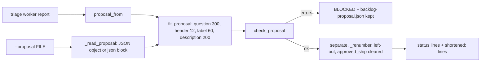
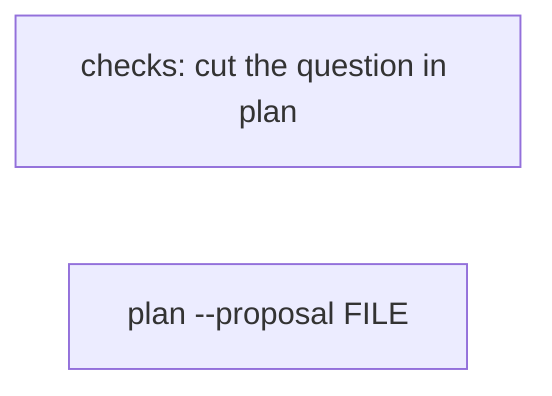

# Superlite: backlog plan applies a proposal file and cuts an over-long question (B35)

**Goal:** fix the rest of #297. Since 1.5.33 (B20) `sl backlog plan` states every limit in the triage brief and cuts an over-long header, option label and option description; still missing: a question over 300 characters rejects the whole proposal, and a kept or repaired proposal (`.superlite/backlog-proposal.json`) cannot be applied without a second triage run. Max's decision: add `backlog plan --proposal <file>` and clip the question.
**Architecture:** `backlog_checks.fit_question` gains `question: bool = False`; `fit_proposal` passes `question=True`, so plan cuts the question text to 300 like the other fields, while a lead's question.json (`backlog wait`, `decide --print --batch`) keeps its text. `backlog.cmd_plan` gains `--proposal FILE`: it reads the proposal from the file instead of spawning the triage worker, then runs the same fit, check, separate, renumber, left-out and ship-approval path.
**Tech stack:** Python 3.10+ stdlib, pytest (through `sl run_tests`).
**Spec:** this file, section Design; the issue body of #297 on GitHub.
**Detail:** tests
**Target-min:** 11
**Wave0:** none

Global constraints:
- Code lines under `skills/subagent-driven-development/scripts/` carry the repo's trailing `# O(...)` complexity comment where the file already uses them; tests do not. Follow each file's existing style.
- Stdlib only. Existing tests stay green. A task changes no existing test file except one its Owns names.
- Run `sl` as an executable (`<abs>/sl ...`). Verify with `<abs>/sl run_tests --fast <test files> --task Tn --background`, then run the printed `wait:` line in the foreground and end the turn only after it reports. Never raw `pytest`, never the e2e or eval layers (coordinator's step).
- No version edits (the ship step bumps the version). Only the files a task owns change.
- Tests build their state under `tmp_path`; they never write the real repo's `.superlite/`.
- Limits stay: 1 to 4 distinct questions, question 1 to 300 characters, header 1 to 12, 2 to 4 options, distinct labels of 1 to 60, descriptions 0 to 200.
- A cut follows today's rule (`backlog_checks._cut`): plain cut to the limit, trailing blanks dropped, a ` (Recommended)` suffix kept whole, never cut to only blanks. Its note reads `"<name>" <field>: N -> M characters`; `<name>` is the original question text with control characters as spaces, whitespace collapsed, at most 60 characters. The question's note reads `"<name>" question: N -> M characters` and comes before that question's header note.

Ruling: detail tests - two small changes in existing modules, causes known; verbatim tests - cost if wrong: none.
Ruling: plan cuts the question text (300) but a lead's question.json still never has its question cut (B29) - main answers a lead by the lead's own question text, so a cut there would break the answer key; plan stores the cut text and `decide --print` asks that stored text - cost if wrong: a lead's question over 300 is still sent back once.
Ruling: `--proposal FILE` reads a JSON object, else the last fenced json block holding `batches` (a triage report .md, via `proposal_from`); an unreadable file is `BLOCKED: proposal F unreadable: <error>`, anything else `BLOCKED: proposal F holds no JSON object`, both exit 2 and before any gh call; the open-batch refusal comes first - cost if wrong: main must pass the bare JSON.
Ruling: `--proposal` still fetches the open issues (trusted set, titles, left-out reasons) and keeps every plan rule (cut, check, separate, renumber, left-out list, ship approval cleared); it writes no triage brief, turns no fleet on and spawns no worker; `--tier` and `--timeout-min` are ignored - cost if wrong: none.
Ruling: a rejected `--proposal` file is kept (cut) at `.superlite/backlog-proposal.json` like the triage path and prints no `triage worker` line (no worker ran) - cost if wrong: main loses the worker summary it already saw.
Ruling: T1 edits one existing test (`tests/scripts/test_backlog_fit.py::test_every_other_error_is_left_for_check_proposal`: its 301-character question becomes an empty question) - the old line pinned the reject Max overruled - cost if wrong: a rebase conflict if another lead edits that line.
Ruling: docs outside B35's files lag (skills/subagent-driven-development/backlog.md step 2, docs/tools.md backlog row, commands/backlog.md, the triage brief in backlog_brief.py still say a question over 300 fails the plan and do not name `--proposal`): follow-ups in notes - cost if wrong: main reads one stale sentence.
Ruling: no probe adapter - script internals over local files; Review Focus cases run as named pytest cases - cost if wrong: no generated probes.
LAYERS: unit



## Design

### 1. Plan cuts an over-long question (#297)
`backlog_checks.fit_question(q, question=False)` cuts as today; with `question=True` it first cuts each question text over 300 to 300 (same `_fit` / `_cut` rule) and notes it as `"<name>" question: N -> M characters`. `fit_proposal` calls `fit_question(d, question=True)` for each decision. Every caller of `fit_question` without the keyword (lead question.json in `backlog_run`, `decide --print --batch`) is unchanged. Two questions equal after the cut still reject as duplicates; a question of only blanks is not cut and still rejects.

### 2. backlog plan --proposal FILE (#297)
`cmd_plan`: after the open-batch refusal, with `--proposal` it reads FILE (`_read_proposal`): a JSON object is the proposal; text that is not JSON gives the last fenced json block holding `batches`; anything else, or an unreadable file, prints one `BLOCKED: proposal F ...` line and exits 2. It then fetches the repo and the open issues as today, skips `_triage`, and runs the same path: `fit_proposal`, `check_proposal` against the trusted numbers, on errors the kept file and exit 3 (without the `triage worker` line), else `separate`, the left-out list, one `bs.update` (shipped batches kept, `approved_ship` cleared, new ids after the kept ones) and the status lines plus `shortened:` lines.

## Coverage

| Category | State | Basis |
|---|---|---|
| Scope and success criteria | settled | #297 Expected lines; item 1 and the label/header/description cut shipped in B20 |
| Interfaces and contracts | settled | one new keyword, one new CLI flag; output lines pinned in tests |
| Error handling and recovery | settled | unreadable or shapeless file exit 2; rejected proposal kept, exit 3 |
| Compatibility | settled | lead question path unchanged; plan without --proposal unchanged except the question cut |
| Security and privacy | settled | the file goes through the same check_proposal as a worker's proposal |
| Testing strategy | settled | one new unit test file per task; unit layer by the coordinator |
| Rollout | ruled | one PR; version bump at ship |
| Domain and data model | settled | backlog.json shape unchanged |
| Persistence and migration | n/a | no new keys |
| UI states | n/a | CLI text |
| Concurrency and state ownership | settled | writes stay inside `bs.update`'s lock; T1, T2 own disjoint files |
| Performance and limits | settled | one pass over at most 20 batches; file read once |
| Observability | settled | `shortened:` lines, BLOCKED lines |
| Research unknowns | n/a | causes named in the issue |

## File structure
- `skills/subagent-driven-development/scripts/backlog_checks.py`, `tests/scripts/test_backlog_question_cut_297.py`, `tests/scripts/test_backlog_fit.py` (T1).
- `skills/subagent-driven-development/scripts/backlog.py`, `tests/scripts/test_backlog_plan_proposal_297.py` (T2).

## Task graph

```mermaid
%% schedule
gantt
  title Predicted schedule (mm:ss)
  dateFormat X
  axisFormat %M:%S
  section lane 1
  T2 backlog plan --proposal FILE :t2, 0, 75s
  section lane 2
  T1 backlog_checks plan cuts an over-long :t1, 0, 69s
```




critical path: T2 (1.2 min) · peak width 2 · predicted build 1.2 min · predicted total ≈ 4.7 min (target ✓)

## Package: superlite backlog scripts (CLI over local state)
**Probe entry:** none (Ruling: no probe adapter).

### T1 backlog_checks: plan cuts an over-long question · Complexity 2 · Est. context 34k
**Owns:** skills/subagent-driven-development/scripts/backlog_checks.py, tests/scripts/test_backlog_question_cut_297.py, tests/scripts/test_backlog_fit.py
**Components:** 1
**LOC owned:** 75
**Tests:** fast
**Model:** sonnet
**Est. time:** 1.6 min (1 component, about 75 LOC, fast tests)
**Covers:** 1
**Consumes:** nothing executed from another task.
**Produces:** backlog_checks.fit_question(q: object, question: bool = False) -> list[str]
e.g. `fit_question({"questions": [{"question": "a" * 298 + "   tail", "header": "H", "options": [two valid]}]}, question=True)` -> `['"' + "a" * 60 + '" question: 305 -> 298 characters']`
e.g. the same call without `question=True` -> `[]`, question unchanged
**Review Focus:** encoding: `test_question_cut_drops_trailing_blanks_and_never_leaves_nothing`; state: `test_two_questions_equal_after_the_cut_still_reject`; protocol: `test_a_lead_question_keeps_its_text_unless_asked`, `test_plan_stores_the_cut_question_and_decide_asks_it`.
**Test code (verbatim):** new file `tests/scripts/test_backlog_question_cut_297.py`:
```python
import copy
import json
import sys

from test_backlog_cli import bk, cli, load, BATCH  # noqa: F401  bk is the CLI fixture
from test_plan_tools import SCRIPTS

sys.path.insert(0, str(SCRIPTS))
import backlog_checks as bc  # noqa: E402

LONG = "Keep the old API " + "x" * 330 + "?"
NOTE = f'"{LONG[:60]}" question: 348 -> 300 characters'


def opts():
    return [{"label": "Keep (Recommended)", "description": "a"}, {"label": "Drop", "description": "b"}]


def prop(*texts):
    return {"batches": [{"id": "B1", "topic": "t", "issues": [1], "files": ["a.py"], "depends": [],
                         "decisions": [{"questions": [{"question": t, "header": "H", "options": opts()} for t in texts]}]}]}


def qs(p):
    return p["batches"][0]["decisions"][0]["questions"]


def test_plan_cuts_a_question_over_300_and_names_the_cut():
    p = prop(LONG)
    assert len(LONG) == 348 and bc.fit_proposal(p) == [NOTE]
    assert qs(p)[0]["question"] == LONG[:300]
    batches, errs = bc.check_proposal(p, {1})
    assert errs == [] and batches[0]["decisions"][0]["questions"][0]["question"] == LONG[:300]


def test_a_question_of_300_is_untouched():
    p = prop("q" * 300)
    assert bc.fit_proposal(p) == [] and qs(p)[0]["question"] == "q" * 300


def test_question_cut_drops_trailing_blanks_and_never_leaves_nothing():
    p = prop("a" * 298 + "   tail", " " * 301)
    assert bc.fit_proposal(p) == ['"' + "a" * 60 + '" question: 305 -> 298 characters']
    assert qs(p)[0]["question"] == "a" * 298 and qs(p)[1]["question"] == " " * 301
    assert "B1 decision 1: q2 question: 1 to 300 characters" in bc.check_proposal(p, {1})[1]


def test_two_questions_equal_after_the_cut_still_reject():
    p = prop("q" * 310, "q" * 320)
    assert len(bc.fit_proposal(p)) == 2
    assert "B1 decision 1: q2 question: duplicate" in bc.check_proposal(p, {1})[1]


def test_the_question_note_comes_before_the_header_note():
    p = prop(LONG)
    qs(p)[0]["header"] = "Dependencies!"
    assert bc.fit_proposal(p) == [NOTE, f'"{LONG[:60]}" header: 13 -> 12 characters']


def test_a_lead_question_keeps_its_text_unless_asked():
    q = {"questions": [{"question": LONG, "header": "H", "options": opts()}]}
    assert bc.fit_question(q) == [] and q["questions"][0]["question"] == LONG
    c = copy.deepcopy(q)
    assert bc.fit_question(c, question=True) == [NOTE] and c["questions"][0]["question"] == LONG[:300]


def test_plan_stores_the_cut_question_and_decide_asks_it(bk, capsys, monkeypatch):
    monkeypatch.delenv("SUPERLITE_FLEET_WORKER", raising=False)
    bk.batches = [{**BATCH, "decisions": [{"questions": [{"question": LONG, "header": "API", "options": opts()}]}]}]
    rc, out = cli(capsys, "plan")
    assert rc == 0 and out.endswith(f"shortened: {NOTE}\n")
    assert load(bk)["batches"][0]["decisions"][0]["questions"][0]["question"] == LONG[:300]
    asked = [q["question"] for q in json.loads(cli(capsys, "decide", "--print")[1])["questions"]]
    assert f"B1: {LONG[:300]}" in asked
```
In `tests/scripts/test_backlog_fit.py` change only, in `test_every_other_error_is_left_for_check_proposal`, `"question": "?" * 301` to `"question": ""` (the expected error set stays as it is).
**Steps:** 1 failing tests, 2 run: FAIL, 3 implement, 4 run: PASS (also `tests/scripts/test_backlog_fit.py`, `test_backlog_question_fit.py`, `test_backlog_fit_cli.py`, `test_backlog_decide_fit.py`, `test_backlog_wait_question.py` stay green).
**Notes:** In `fit_question`, after `name` is computed and before the header `_fit`: `if question: _fit(e, "question", 300, name, "question", notes)`. `fit_proposal` calls `fit_question(d, question=True)`. Update both docstrings (fit_question: the question text is cut only with `question=True`, which plan uses; a lead's question keeps its text because main answers it by that text; fit_proposal: also the question, 300).

### T2 backlog plan --proposal FILE · Complexity 3 · Est. context 40k
**Owns:** skills/subagent-driven-development/scripts/backlog.py, tests/scripts/test_backlog_plan_proposal_297.py
**Components:** 1
**LOC owned:** 120
**Tests:** fast
**Model:** sonnet
**Est. time:** 2.2 min (1 component, about 120 LOC, fast tests)
**Covers:** 2
**Consumes:** nothing executed from another task (uses today's `backlog_checks.proposal_from`, `fit_proposal`, `cut_lines`, `check_proposal`, `separate`).
**Produces:** backlog._read_proposal(f: str) -> tuple[dict | None, str | None]
e.g. `_read_proposal("fixed.json")` holding `{"batches": []}` -> `({"batches": []}, None)`
e.g. `_read_proposal("bad.txt")` holding `[1, 2]` -> `(None, "BLOCKED: proposal bad.txt holds no JSON object")`
**Review Focus:** file: `test_unreadable_or_shapeless_files_are_refused_before_gh` (missing, not UTF-8, a JSON list, plain text, a json block without batches, 100000-deep nesting); protocol: `test_open_batches_refuse_before_the_file_is_read`, `test_a_rejected_file_is_kept_and_names_no_worker`; state: `test_clashing_batches_merge_and_renumber_after_shipped_ones`.
**Test code (verbatim):** new file `tests/scripts/test_backlog_plan_proposal_297.py`:
```python
import json
import sys

from test_backlog_cli import bk, cli, load, BATCH  # noqa: F401  bk is the CLI fixture
from test_plan_tools import SCRIPTS

sys.path.insert(0, str(SCRIPTS))
import backlog_state as bs  # noqa: E402

Q = {"questions": [{"question": "Which store?", "header": "Dependencies!",
                    "options": [{"label": "A (Recommended)", "description": "a"}, {"label": "B", "description": "b"}]}]}
OK = {"by": "AskUserQuestion", "time": "2026-11-08T10:00:00Z"}


def write(bk, obj, name="fixed.json"):
    f = bk.root / name
    f.write_text(obj if isinstance(obj, str) else json.dumps(obj))
    return str(f)


def test_a_proposal_file_is_applied_without_a_worker(bk, capsys):
    bs.update(bs.path(bk.root), lambda d: d.update(approved_ship=OK))
    f = write(bk, {"batches": [BATCH]})
    rc, out = cli(capsys, "plan", "--proposal", f)
    d = load(bk)
    assert rc == 0 and "B1 | #1 #2 | planned" in out
    assert bk.calls == [] and not (bk.sd / "briefs" / "triage.md").exists()
    assert d["repo"] == "o/r" and d["approved_ship"] is None and [b["id"] for b in d["batches"]] == ["B1"]
    assert d["titles"] == {"1": "One", "2": "Two"} and d["outside"] == [{"number": 3, "title": "Three", "author": "eve"}]


def test_a_triage_report_with_a_json_block_is_read(bk, capsys):
    f = write(bk, "Status: DONE\n```json\n" + json.dumps({"status": "DONE", "batches": [BATCH]}) + "\n```\n", "triage.md")
    assert cli(capsys, "plan", "--proposal", f)[0] == 0 and load(bk)["batches"][0]["issues"] == [1, 2]


def test_texts_in_the_file_are_cut_and_named(bk, capsys):
    f = write(bk, {"batches": [{**BATCH, "decisions": [Q]}]})
    rc, out = cli(capsys, "plan", "--proposal", f)
    assert rc == 0 and out.endswith('shortened: "Which store?" header: 13 -> 12 characters\n')
    assert load(bk)["batches"][0]["decisions"][0]["questions"][0]["header"] == "Dependencies"


def test_a_kept_proposal_applies_after_a_repair(bk, capsys):
    bk.batches = [{**BATCH, "issues": [1, 9], "decisions": [Q]}]
    rc, out = cli(capsys, "plan")
    kept = bk.sd / "backlog-proposal.json"
    assert rc == 3 and "B1: unknown issue #9" in out and f"proposal kept: {kept}" in out
    p = json.loads(kept.read_text())
    p["batches"][0]["issues"] = [1]
    kept.write_text(json.dumps(p))
    rc, out = cli(capsys, "plan", "--proposal", str(kept))
    assert rc == 0 and "B1 | #1 | planned" in out and "shortened" not in out


def test_a_rejected_file_is_kept_and_names_no_worker(bk, capsys):
    f = write(bk, {"status": "DONE", "summary": "s", "batches": [{**BATCH, "issues": [9]}]})
    rc, out = cli(capsys, "plan", "--proposal", f)
    kept = bk.sd / "backlog-proposal.json"
    assert (rc, out) == (3, f"BLOCKED: proposal rejected\nB1: unknown issue #9\nproposal kept: {kept}\n")
    assert json.loads(kept.read_text())["batches"][0]["issues"] == [9] and load(bk)["batches"] == []


def test_unreadable_or_shapeless_files_are_refused_before_gh(bk, capsys):
    missing = str(bk.root / "nope.json")
    rc, out = cli(capsys, "plan", "--proposal", missing)
    assert rc == 2 and out.startswith(f"BLOCKED: proposal {missing} unreadable: ") and out.count("\n") == 1
    raw = bk.root / "bin.json"
    raw.write_bytes(b"\xff\xfe\x00")
    rc, out = cli(capsys, "plan", "--proposal", str(raw))
    assert rc == 2 and out.startswith(f"BLOCKED: proposal {raw} unreadable: ")
    for body in ("[1, 2]", "no json here", '```json\n{"x": 1}\n```\n', "[" * 100000 + "]" * 100000):
        f = write(bk, body, "bad.txt")
        assert cli(capsys, "plan", "--proposal", f) == (2, f"BLOCKED: proposal {f} holds no JSON object\n")
    assert bk.gh == [] and bk.calls == []


def test_open_batches_refuse_before_the_file_is_read(bk, capsys):
    f = write(bk, {"batches": [BATCH]})
    assert cli(capsys, "plan", "--proposal", f)[0] == 0
    assert cli(capsys, "plan", "--proposal", str(bk.root / "nope.json")) == (2, "BLOCKED: backlog has open batches (B1 planned)\n")
    assert cli(capsys, "plan", "--reset", "--proposal", f)[0] == 0 and [b["id"] for b in load(bk)["batches"]] == ["B1"]


def test_clashing_batches_merge_and_renumber_after_shipped_ones(bk, capsys):
    assert cli(capsys, "plan")[0] == 0
    bs.update(bs.path(bk.root), lambda d: bs.batch(d, "B1").update({"state": "shipped"}))
    f = write(bk, {"batches": [{**BATCH, "issues": [1]}, {**BATCH, "id": "B2", "topic": "second", "issues": [2]}]})
    assert cli(capsys, "plan", "--proposal", f)[0] == 0
    assert [(b["id"], b["state"], b["issues"]) for b in load(bk)["batches"]] == [("B1", "shipped", [1, 2]), ("B2", "planned", [1, 2])]
```
**Steps:** 1 failing tests, 2 run: FAIL, 3 implement, 4 run: PASS (also `tests/scripts/test_backlog_cli.py`, `test_backlog_fit_cli.py`, `test_backlog_plan_round.py`, `test_backlog_decide_fit.py` stay green).
**Notes:** `pl.add_argument("--proposal", metavar="FILE")`. New `_read_proposal(f)`: `Path(f).read_text(encoding="utf-8")`, `(OSError, ValueError)` -> `(None, f"BLOCKED: proposal {f} unreadable: {e}")`; then `json.loads(text)`, on `(ValueError, RecursionError)` fall back to `backlog_checks.proposal_from(text)`; a result that is not a dict -> `(None, f"BLOCKED: proposal {f} holds no JSON object")`. A dict without `batches` goes on to `check_proposal`, which rejects it. In `cmd_plan`, after the open-batch refusal and before `_gh`: with `a.proposal`, read it, print the error and return 2 on failure. Call `_triage` only without `a.proposal`. On check errors print the same lines; the `triage worker <status>: <summary>` line only without `a.proposal`. Everything after `check_proposal` is shared and unchanged. Update the module docstring (plan --proposal FILE applies a kept or repaired proposal through the same checks, no worker).

## Review Focus
- Package: superlite backlog scripts; app type CLI; categories protocol, encoding, state, file.
- Specific risks: a cut question that collides with another (duplicate still rejects); a lead's question text must never be cut (answers keyed by it); a proposal file that is binary, deeply nested or a markdown report; the file path must never spawn a worker or touch gh before the file is read.

## Self-review
Coverage: Design 1 -> T1, Design 2 -> T2. No placeholders. No edges: T1 and T2 own disjoint files and neither test runs the other's new code (T1's CLI test runs today's plan path; T2's tests cut only a header). Measurable fields filled.
