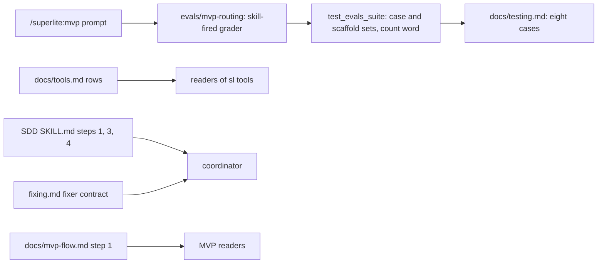
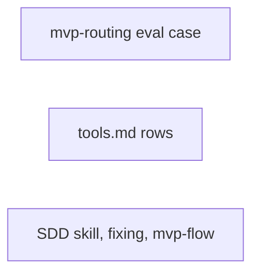

# Superlite: an mvp-routing eval case, docs lag after #274 (B32)

**Goal:** fix #280 (no eval case guards that `/superlite:mvp` loads `superlite:brainstorming` first; `tests/scripts/test_evals_suite.py` pins the case and scaffold sets and `docs/testing.md` says "six cases" while seven exist) and #310 (docs/tools.md rows, docs/mvp-flow.md step 1, SDD SKILL.md steps 3-4 and the fixing.md fixer contract still lag the 1.5.23-1.5.34 changes).
**Architecture:** a new eval case folder `evals/mvp-routing/` in the feature-routing pattern plus the suite test and the testing doc count (T1); exact text replacements in docs/tools.md rows (T2); exact text replacements in SDD SKILL.md steps 1, 3 and 4, the fixing.md fixer contract and docs/mvp-flow.md step 1 (T3). One new test file each for T2 and T3.
**Tech stack:** Markdown, YAML, bash, Python 3.10+ stdlib, pytest (through `sl run_tests`).
**Spec:** this file, section Design; the issue bodies on GitHub are the source for each Expected line.
**Detail:** tests
**Target-min:** 11
**Wave0:** none
**Coverage:** off

Global constraints:
- Each edit is an exact replacement: find the `old` text (it occurs once in its file), put the `new` text in its place. Never reword, move or drop any other sentence (existing docs tests pin many phrases).
- docs/tools.md is a Markdown table: each row stays one line, and no inserted text holds a `|`.
- Existing tests stay green; a task changes no existing test file except the one its Owns names.
- Run `sl` as an executable (`<abs>/sl ...`). Verify with `<abs>/sl run_tests --fast <test files> --task Tn --background`, then run the printed `wait:` line in the foreground and end the turn only after it reports. Never raw `pytest`, never the e2e or eval layers (coordinator's step).
- No version edits (the ship step bumps the version). Only the files a task owns change.

Ruling: the new paths `evals/mvp-routing/*`, `tests/scripts/test_docs_b32_tools.py` and `tests/scripts/test_docs_b32_sdd.py` are outside the brief's file list but new, so no other batch can own them; #280 needs the case folder - cost if wrong: a rename at rebase.
Ruling: the docs/tools.md `backlog` and `backlog_run` rows also name the B21, B27 and B29 changes (wait re-read window, left-out status lines, per-round ship approval, lead question cut and send-back): the same rows are edited for #310's plan shortening, and the B21, B27 and B29 follow-ups name this file - cost if wrong: two longer rows.
Ruling: mvp-routing runs with `max_turns: 6` and `timeout_seconds: 300` (feature-routing: 12 and 600): its only grader needs the first Skill call, while a longer MVP run writes a plan and a prototype each time, and `scripts/evals.sh` caps the suite at $5 - cost if wrong: a run that loads brainstorming after turn 6 fails the case.
Ruling: docs/testing.md keeps "about $2-4" for the eval layer; the evals layer run of this batch shows whether eight cases still fit - cost if wrong: a stale cost estimate.
Ruling: docs/mvp-flow.md's "Status: design only, nothing is built yet." line stays (not in #310): follow-up in notes - cost if wrong: one stale line.
Ruling: all three tasks are mechanical (exact text given, verbatim tests) - cost if wrong: a haiku miss goes to a sonnet fixer.
Ruling: no probe adapter - docs and eval fixtures; checks run as named pytest cases - cost if wrong: no generated probes.
LAYERS: unit, headless, evals



## Design

### 1. mvp-routing eval case (#280)
`evals/mvp-routing/` copies the feature-routing shape: `case.yaml` (sonnet, 2 runs, scaffold), `prompt.md` (a plain `/superlite:mvp` request for a new reading-list CLI), `scaffold.sh` (a bare Python project: `pyproject.toml` and an empty `tests/`, no source yet, since an MVP is something new) and one `tool_used` grader on the Skill call for brainstorming, `arm: with-only`. The suite test adds the case to both pinned sets, checks the new scaffold, checks both routing cases' graders and prompts, and derives the testing doc's count word from the case set, so the next case cannot leave the doc behind. docs/testing.md says "eight cases".

### 2. docs/tools.md rows (#310)
Eleven exact replacements in the `feedback`, `fleet`, `fleet_io`, `next_tasks`, `dispatch`, `commit_task`, `autocommit`, `run_tests`, `testcmd`, `backlog` and `backlog_run` rows, each naming behaviour the code already has (B18, B20, B21, B22, B23, B24, B27, B29 rulings).

### 3. SDD SKILL.md, fixing.md, mvp-flow.md (#310)
SKILL.md step 1 names the `unstable=` stderr line and the fix-task lapse; step 3 runs the `wait:` line in the foreground (#278); step 4 names the three commit_task lines. The fixing.md fixer contract runs the `wait:` line in the foreground. docs/mvp-flow.md step 1 names the brainstorming routing (#261).

## File structure
- `evals/mvp-routing/case.yaml`, `prompt.md`, `scaffold.sh`, `graders/skill-fired.md`, `tests/scripts/test_evals_suite.py`, `docs/testing.md` (T1).
- `docs/tools.md`, `tests/scripts/test_docs_b32_tools.py` (T2).
- `skills/subagent-driven-development/SKILL.md`, `skills/subagent-driven-development/fixing.md`, `docs/mvp-flow.md`, `tests/scripts/test_docs_b32_sdd.py` (T3).

## Task graph

```mermaid
%% schedule
gantt
  title Predicted schedule (mm:ss)
  dateFormat X
  axisFormat %M:%S
  section lane 1
  T1 mvp-routing eval case suite test test :t1, 0, 79s
  section lane 2
  T2 docs/tools.md rows name the 1.5.23-1. :t2, 0, 65s
  section lane 3
  T3 SDD SKILL.md fixing.md mvp-flow.md na :t3, 0, 63s
```




critical path: T1 (1.3 min) · peak width 3 · predicted build 1.3 min · predicted total ≈ 4.8 min (target ✓)

## Package: docs and eval fixtures
**Probe entry:** none (Ruling: no probe adapter).

### T1 mvp-routing eval case, suite test, testing doc count · Complexity 1 · Est. context 30k
**Owns:** evals/mvp-routing/case.yaml, evals/mvp-routing/prompt.md, evals/mvp-routing/scaffold.sh, evals/mvp-routing/graders/skill-fired.md, tests/scripts/test_evals_suite.py, docs/testing.md
**Components:** 2
**LOC owned:** 60
**Tests:** fast
**Kind:** mechanical
**Model:** haiku
**Est. time:** 1.5 min (2 components, about 60 LOC, fast tests)
**Covers:** 1
**Consumes:** nothing executed from another task.
**Produces:** evals/mvp-routing (eval case folder, read by `claude plugin eval`)
**Review Focus:** file: `test_scaffold_scripts_are_executable_bash` (mvp-routing's scaffold is executable, starts `#!/usr/bin/env bash`, writes `pyproject.toml` with `name = "readinglist"` and `tests/`, no `src/`); protocol: `test_routing_cases_grade_the_brainstorming_load` (each routing case has exactly `skill-fired.md`, its pattern matches `"skill": "superlite:brainstorming"` and `"skill":"brainstorming"`, not `"skill": "superlite:writing-plans"`; prompts start `/superlite:feature ` and `/superlite:mvp `); state: `test_testing_doc_counts_cases` (the count word equals `len(CASES)`).
**Files (verbatim).** `evals/mvp-routing/case.yaml`:
```yaml
schema_version: "1.1"
name: mvp-routing
description: A plain /superlite:mvp request loads brainstorming before anything else.
runs: 2
context:
  scaffold_script: scaffold.sh
execution:
  model: sonnet
  max_turns: 6
  timeout_seconds: 300
  allowed_tools: [Read, Glob, Grep, Skill, Edit, Write]
```
`evals/mvp-routing/prompt.md` (one line, then a newline):
```text
/superlite:mvp A small reading-list CLI: add a book, list the books, mark one as read.
```
`evals/mvp-routing/scaffold.sh` (then `chmod +x evals/mvp-routing/scaffold.sh`):
```bash
#!/usr/bin/env bash
set -euo pipefail
mkdir -p tests
cat > pyproject.toml <<'TOML'
[project]
name = "readinglist"
version = "0.1.0"

[tool.pytest.ini_options]
pythonpath = ["src"]
TOML
```
`evals/mvp-routing/graders/skill-fired.md`:
```markdown
---
type: tool_used
tool: Skill
input_match: '"skill":\s*"(superlite:)?brainstorming"'
arm: with-only
---

The MVP command loaded brainstorming. It is the case's only grader, so the runner scores it in both arms.
```
`docs/testing.md`: old `six cases of real agent work` -> new `eight cases of real agent work`.
**Test code (verbatim).** In `tests/scripts/test_evals_suite.py`: (1) `CASES` gains `"mvp-routing"` (second line becomes `         "ai-asks-once", "ai-bounded-quiet", "feature-routing", "mvp-routing"}`); (2) the scaffold set in `test_scaffold_scripts_are_executable_bash` gains `"mvp-routing"` after `"feature-routing"`; (3) after that test's `for name in ("ai-asks-once", ...)` loop, at the same indent, add:
```python
    mvp = tmp_path / "mvp-routing"
    assert 'name = "readinglist"' in (mvp / "pyproject.toml").read_text()
    assert not (mvp / "src").exists()
```
(4) add after `test_ai_prompts_name_the_orchestrator`:
```python
def test_routing_cases_grade_the_brainstorming_load():
    for name, command in (("feature-routing", "/superlite:feature "), ("mvp-routing", "/superlite:mvp ")):
        graders = sorted((EVALS / name / "graders").glob("*.md"))
        assert [g.name for g in graders] == ["skill-fired.md"], name
        fm = frontmatter(graders[0])
        assert fm["type"] == "tool_used" and fm["tool"] == "Skill" and fm["arm"] == "with-only", name
        pattern = re.compile(fm["input_match"])
        assert pattern.search('"skill": "superlite:brainstorming"') and pattern.search('"skill":"brainstorming"'), name
        assert not pattern.search('"skill": "superlite:writing-plans"'), name
        assert (EVALS / name / "prompt.md").read_text().startswith(command), name
```
(5) replace `test_testing_doc_counts_cases` with:
```python
def test_testing_doc_counts_cases():
    row = next(l for l in (ROOT / "docs/testing.md").read_text().splitlines() if l.startswith("| evals"))
    words = {7: "seven", 8: "eight", 9: "nine", 10: "ten", 11: "eleven", 12: "twelve"}
    assert f"{words[len(CASES)]} cases" in row
```
**Steps:** 1 edit the test, 2 run: FAIL, 3 add the case files and the doc word, 4 run: PASS (`tests/scripts/test_evals_suite.py`, also `tests/scripts/test_test_layers.py` stays green).
**Notes:** keep `scaffold.sh` LF and executable (git records the mode).

### T2 docs/tools.md rows name the 1.5.23-1.5.39 changes · Complexity 2 · Est. context 32k
**Owns:** docs/tools.md, tests/scripts/test_docs_b32_tools.py
**Components:** 1
**LOC owned:** 75
**Tests:** fast
**Kind:** mechanical
**Model:** haiku
**Est. time:** 1.6 min (1 component, about 75 LOC, fast tests)
**Covers:** 2
**Consumes:** nothing executed from another task.
**Produces:** docs/tools.md (rows read by agents and users)
**Review Focus:** encoding: no inserted text holds `|`, each row stays one line (`test_backlog_user_docs.py` and `test_backlog_main_docs.py` find rows by `| \`name\` |`); protocol: every test below finds its phrase in its row.
**Edits (old -> new, in docs/tools.md).**
1. `feedback` row: old ``` `mark ID...`; `finish` asks for it ``` -> new ``` `mark ID... [--host H]...` (each argument is split on whitespace; an id found in neither the local inbox nor `feedback-triaged.json` is looked up over ssh in the inbox of each `--host H`, else of each host in `feedback-hosts`; an id found nowhere is refused: exit 2, one `feedback mark: unknown feedback id X` line per id on stderr, nothing written); `finish` asks for it ```
2. `fleet` row: old ``` `spawn --tier T`, `stop [Wn...] [--all]` ``` -> new ``` `spawn --tier T` (a start that fails with `not an available shell` is retried once on the same pane after 3 s, and a BLOCKED reason after that retry ends `; retried once`; `--for-dispatch` adds `; rerun sl fleet spawn --for-dispatch` to its `BLOCKED: Tn not sent (...)` line), `stop [Wn...] [--all]` ```
3. `fleet_io` row: old ``` `send Wn Tn [Tm ...] [--text TEXT]` ``` -> new ``` `send Wn Tn [Tm ...]`, `send Wn --text TEXT` or `send Wn --brief FILE` (two of task ids, `--text` and `--brief` in one call, an empty `--text` included, exit 2 with `error: send takes task ids, --text or --brief, not two of them` on stderr before anything is sent) ```
4. `next_tasks` row: old ``` until T0 is committed (`--committed` or the ledger) | ``` -> new ``` until T0 is committed (`--committed` or the ledger); a stable.json `fix` task whose every reason is `depends on unstable <ids>` becomes ready once all those ids are committed, with no re-lint; stderr names each graph-ready task stable.json still holds back (`unstable=Tn <reason>; rerun sl lint --stable`, the reason `not in stable.json` when it is in neither list) and each held task (`held=Tn <reason>`); `--committed` and `--running` take ids split on commas or whitespace and print `warning: --<flag>: Tn is not a task of the plan` on stderr per unknown id (T0 is always known) | ```
5. `dispatch` row: old ``` prints `held=Tn <reason>` on stderr | ``` -> new ``` prints `held=Tn <reason>` on stderr; a ready task stable.json still holds back prints `unstable=Tn <reason>; rerun sl lint --stable` on stderr, and a `fix` task held only by `depends on unstable <ids>` is offered once those ids are committed; `--committed` and `--running` take ids split on commas or whitespace (`warning: --committed: T7 is not a task of the plan` on stderr per unknown id) | ```
6. `commit_task` row: old ``` none when there is no baseline. | ``` -> new ``` none when there is no baseline. A re-run for a task that already has a checkpoint, whose staged tree equals the chain head's, prints `Tn: no change since its last checkpoint <sha>` (exit 0), writes no commit, ref or entry and starts no probe or seam check; a task's first checkpoint always commits. | ```
7. `autocommit` row: old ``` (older states: `head`, same value) | ``` -> new ``` (older states: `head`, same value); every subcommand takes `--plan P` or `--plan=P` anywhere and works in P's checkout (`state.git_root(P)`, the one whose `.superlite/checkpoints.json` `commit_task` writes; a P outside any checkout keeps the cwd), and `--plan` with no value or a value starting with `--` is a usage error (exit 2) | ```
8. `run_tests` row: old ``` else `npm install`; no incident) | ``` -> new ``` else `npm install`; no incident); with `--task Tn` in an isolated tree, when the run root holds `package.json` and a `node_modules` folder and the spec has no `setup` command, `tree/node_modules` is first linked to the root's (relative, `../../../node_modules`; a real tree folder stays, a wrong or dangling link is replaced), then the same guard checks the tree and refuses with exit 2 naming the tree | ```
9. `testcmd` row: old ``` so a column-0 `}` inside one never ends a type. | ``` -> new ``` so a column-0 `}` inside one never ends a type. `resolve` expands `{names}` and `{only_testing}` only when the command holds them, so only an Xcode template warns `testcmd: <file> declares no test suite`. | ```
10. `backlog` row: old ``` only `start B` starts it); `start`, `wait`, `answer` and `ship` go to ``` -> new ``` only `start B` starts it); `plan` cuts an over-long question header (12), option label (60) and option description (200), a ` (Recommended)` suffix kept, and names each cut in a `shortened: "<question>" <field>: N -> M characters` line (at most 5, then `shortened: K more`), while a question over 300 characters still fails the plan; each successful `plan` clears the ship approval, so `decide --print` asks it again each round; `decide --print --batch B` cuts a lead's question.json the same way, with clean JSON on stdout and the `shortened:` lines on stderr; `status` prints `<reason>: #a #b` lines after the table for issues no batch took (`not planned (cap)`, `not planned (triage)`, `not triaged (200 cap)`); `start`, `wait`, `answer` and `ship` go to ```
11. `backlog_run` row: old ``` with the reason `no status in stop text: <text>` | ``` -> new ``` with the reason `no status in stop text: <text>`; a stop whose transcript lags (blank, or without the status its cut `last` line holds) is re-read for 10 s from the stop, after which a cut `last` line with a status parks the batch with `<cut line> (transcript unread)`; a lead's question.json is cut like `plan`'s, with `B shortened: ...` lines after the `needs_decision` line, and one still invalid after the cut is sent back to the lead once, the next invalid one parking the batch with `invalid question.json: <errors>` | ```
**Test code (verbatim).** New file `tests/scripts/test_docs_b32_tools.py`:
```python
"""docs/tools.md rows name the 1.5.23-1.5.39 changes (#310)."""
from pathlib import Path

TOOLS = (Path(__file__).resolve().parents[2] / "docs" / "tools.md").read_text(encoding="utf-8")


def row(name):
    return next(ln for ln in TOOLS.splitlines() if ln.startswith(f"| `{name}` |"))


def check(name, *parts):
    r = row(name)
    missing = [p for p in parts if p not in r]
    assert not missing, (name, missing)


def test_feedback_mark_splits_checks_and_takes_hosts():
    check("feedback", "`mark ID... [--host H]...`", "split on whitespace", "`feedback-triaged.json`", "`feedback-hosts`",
          "`feedback mark: unknown feedback id X`", "exit 2", "nothing written")


def test_fleet_spawn_retry_and_rerun_hint():
    check("fleet", "`not an available shell`", "retried once on the same pane after 3 s", "`; retried once`",
          "`; rerun sl fleet spawn --for-dispatch`")


def test_fleet_io_send_refuses_two_kinds():
    check("fleet_io", "`send Wn --brief FILE`", "`error: send takes task ids, --text or --brief, not two of them`",
          "an empty `--text` included", "exit 2")


def test_next_tasks_and_dispatch_name_the_lapse_the_stderr_lines_and_id_lists():
    check("next_tasks", "`depends on unstable <ids>`", "`unstable=Tn <reason>; rerun sl lint --stable`",
          "`not in stable.json`", "`held=Tn <reason>`", "split on commas or whitespace",
          "`warning: --<flag>: Tn is not a task of the plan`")
    check("dispatch", "`unstable=Tn <reason>; rerun sl lint --stable`", "`depends on unstable <ids>`",
          "split on commas or whitespace", "`warning: --committed: T7 is not a task of the plan`")


def test_commit_task_no_change_line():
    check("commit_task", "`Tn: no change since its last checkpoint <sha>`", "writes no commit, ref or entry",
          "a task's first checkpoint always commits")


def test_autocommit_takes_plan():
    check("autocommit", "`--plan P` or `--plan=P` anywhere", "`state.git_root(P)`", "usage error (exit 2)")


def test_run_tests_links_node_modules_into_a_task_tree():
    check("run_tests", "`tree/node_modules`", "`../../../node_modules`", "a wrong or dangling link is replaced",
          "refuses with exit 2 naming the tree")


def test_testcmd_placeholder_gate():
    check("testcmd", "`{names}` and `{only_testing}` only when the command holds them",
          "`testcmd: <file> declares no test suite`")


def test_backlog_rows_name_shortening_and_lead_questions():
    check("backlog", '`shortened: "<question>" <field>: N -> M characters`', "`shortened: K more`",
          "over 300 characters still fails", "clears the ship approval", "`decide --print --batch B`",
          "`not planned (cap)`", "`not triaged (200 cap)`")
    check("backlog_run", "re-read for 10 s", "`<cut line> (transcript unread)`", "`B shortened: ...`",
          "sent back to the lead once", "`invalid question.json: <errors>`")


def test_rows_stay_one_table_line():
    rows = [ln for ln in TOOLS.splitlines() if ln.startswith("| `")]
    assert all(ln.endswith(" |") and ln.count(" | ") == 1 for ln in rows if "\\|" not in ln)
```
**Steps:** 1 failing tests, 2 run: FAIL, 3 edit, 4 run: PASS (`tests/scripts/test_docs_b32_tools.py`, also `test_docs_b16.py`, `test_backlog_user_docs.py`, `test_backlog_main_docs.py`, `test_sl_form.py`, `test_tool_notes.py`, `test_hooks_doc.py`, `test_run_isolation_flow.py`, `test_docs_contract.py` stay green).
**Notes:** apply each edit with one exact replacement; if an `old` text is not found once, stop and report NEEDS_CONTEXT naming it.

### T3 SDD SKILL.md, fixing.md, mvp-flow.md name the 1.5.25-1.5.34 changes · Complexity 1 · Est. context 30k
**Owns:** skills/subagent-driven-development/SKILL.md, skills/subagent-driven-development/fixing.md, docs/mvp-flow.md, tests/scripts/test_docs_b32_sdd.py
**Components:** 1
**LOC owned:** 50
**Tests:** fast
**Kind:** mechanical
**Model:** haiku
**Est. time:** 1.5 min (1 component, about 50 LOC, fast tests)
**Covers:** 3
**Consumes:** nothing executed from another task.
**Produces:** skills/subagent-driven-development/SKILL.md (coordinator rules)
**Review Focus:** protocol: each test below finds its sentence in the named step or line; `test_run_tests_wait.py::test_prompts_say_wait_path` (fixing.md never has `--wait` followed by a backtick or a line end) stays green.
**Edits (old -> new).**
1. `skills/subagent-driven-development/SKILL.md`, scheduling loop step 1: old ``` `dispatch` never offers a busy agent, or one past 3 tasks, 80k context, 50 idle minutes. ``` -> new ``` `dispatch` never offers a busy agent, or one past 3 tasks, 80k context, 50 idle minutes. Stderr `unstable=Tn <reason>; rerun sl lint --stable` names a ready task `stable.json` still holds back: patch it and re-lint; a FIX task whose only reason is `depends on unstable <ids>` needs no patch: `dispatch` offers it once those ids are committed. ```
2. SKILL.md step 3: old ``` then the printed `wait:` line) ``` -> new ``` then run the printed `wait:` line in the foreground (never as a background command) and end the turn only after it reports) ```
3. SKILL.md step 4: old ``` prints `Tn <sha>` or `Tn FAILED` (one task: the SHA) ``` -> new ``` prints `Tn <sha>`, `Tn FAILED` or, for a re-run with nothing new, `Tn: no change since its last checkpoint <sha>` (one task: the SHA) ```
4. `skills/subagent-driven-development/fixing.md`, fixer contract: old ``` on the touched files and wait with the printed `run_tests --wait <path>` line; ``` -> new ``` on the touched files, then run the printed `wait:` line (`run_tests --wait <path>`) in the foreground (never as a background command) and end the turn only after it reports; ```
5. `docs/mvp-flow.md`, step order: old ``` 1. **Orchestrator choice.** Human or AI, asked once with the other questions (`sl orchestrator set`). ``` -> new ``` 1. **Brainstorming first, then the orchestrator choice.** `/superlite:mvp` loads `superlite:brainstorming` before it writes the plan or asks anything, as `/superlite:feature` does, for its sizing and question rules: an MVP is never trivial. Its one question batch carries the orchestrator choice, human or AI (`sl orchestrator set`), unless the user already said, plus whatever about the request is still unclear. With AskUserQuestion withheld or in a headless run it asks nothing, rules AI with a `Ruling:` line and goes on to step 2 in the same turn. Steps 2 to 6 replace brainstorming's design and approval steps. ```
**Test code (verbatim).** New file `tests/scripts/test_docs_b32_sdd.py`:
```python
"""SDD SKILL.md steps 1, 3 and 4, the fixer contract and mvp-flow step 1 name the 1.5.25-1.5.34 changes (#310)."""
from pathlib import Path

ROOT = Path(__file__).resolve().parents[2]


def read(rel):
    return (ROOT / rel).read_text(encoding="utf-8")


def step(n):
    return next(ln for ln in read("skills/subagent-driven-development/SKILL.md").splitlines() if ln.startswith(f"{n}. "))


def test_step1_names_the_unstable_line_and_the_fix_task_lapse():
    s = step(1)
    assert "`unstable=Tn <reason>; rerun sl lint --stable`" in s
    assert "`depends on unstable <ids>`" in s and "once those ids are committed" in s


def test_step3_runs_the_wait_line_in_the_foreground():
    s = step(3)
    assert ("then run the printed `wait:` line in the foreground (never as a background command) "
            "and end the turn only after it reports)") in s
    assert "then the printed `wait:` line)" not in s


def test_step4_names_the_three_commit_task_lines():
    assert ("prints `Tn <sha>`, `Tn FAILED` or, for a re-run with nothing new, "
            "`Tn: no change since its last checkpoint <sha>` (one task: the SHA)") in step(4)


def test_fixer_contract_runs_the_wait_line_in_the_foreground():
    text = read("skills/subagent-driven-development/fixing.md")
    line = next(ln for ln in text.splitlines() if ln.startswith("- **Fixer contract:**"))
    assert ("then run the printed `wait:` line (`run_tests --wait <path>`) in the foreground "
            "(never as a background command) and end the turn only after it reports;") in line
    assert "wait with the printed" not in line


def test_mvp_flow_step1_routes_through_brainstorming():
    line = next(ln for ln in read("docs/mvp-flow.md").splitlines() if ln.startswith("1. "))
    for s in ("`superlite:brainstorming`", "`/superlite:feature`", "never trivial", "orchestrator choice",
              "`sl orchestrator set`", "AskUserQuestion withheld", "`Ruling:`",
              "Steps 2 to 6 replace brainstorming's design and approval steps"):
        assert s in line, s
    assert "asked once with the other questions" not in line
```
**Steps:** 1 failing tests, 2 run: FAIL, 3 edit, 4 run: PASS (`tests/scripts/test_docs_b32_sdd.py`, also `test_docs_contract.py`, `test_fleet_hint_wording.py`, `test_isolation_wording.py`, `test_sl_form.py`, `test_agent_mcp_tools.py`, `test_run_tests_wait.py`, `test_fleet_roles_docs.py`, `test_fixer_commit_wording.py`, `test_block_coordinator_edits.py`, `test_mvp_plan_docs_b19.py` stay green).
**Notes:** apply each edit with one exact replacement; if an `old` text is not found once, stop and report NEEDS_CONTEXT naming it.

## Review Focus
- Package docs and eval fixtures: app type file I/O / generator (Markdown and YAML read by agents, tests and `claude plugin eval`); categories encoding (table rows stay one line, no `|` inserted, `--wait` never followed by a backtick), file (scaffold executable, LF), protocol (each new sentence matches the code's output strings).
- Specific risks: an edit rewording a phrase another docs test pins; a doc sentence that misstates a tool line (`unstable=`, `Tn: no change ...`, `shortened:`); the mvp-routing grader matching any Skill call; the count word drifting from the case set.

## Self-review
Coverage: #280 -> T1 (case, both sets, doc count); #310 -> T2 (all tools.md items of its list) and T3 (mvp-flow step 1, SKILL.md steps 3-4 and the lapse, fixing.md). No placeholders; every edit gives exact old and new text. No edges: the three tasks own disjoint files and run no other task's code. Fields filled; all three mechanical.
