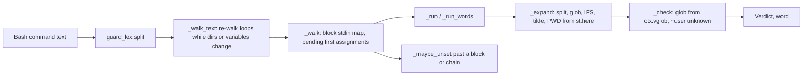
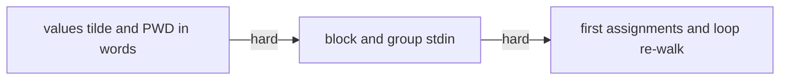

# Superlite: coordinator guard judges glob, whitespace, IFS, tilde, PWD, block-stdin and while-loop values (B34)

**Goal:** fix #312: five holes left in the coordinator guard (`guard_judge.py`) after #289: an assigned value with a glob or whitespace is judged as one path; a heredoc on `done` never reaches `sh` in the loop body; a `while` body that reassigns a variable after using it is judged once; a conditional or subshell assignment to `PWD` or an environment name replaces its value instead of adding a possible value; `~+`/`~-` and `IFS=` outside loops are not handled. Expected: each case is judged against every value it can take, or the target is unknown and blocks with `Unresolved word:`.
**Architecture:** edits to `skills/subagent-driven-development/scripts/guard_judge.py` only, in three tasks run in sequence (one file): T1 word expansion (split, glob, IFS, tilde, PWD), T2 block and group stdin, T3 conditional first assignments and the loop re-walk. One new test file per task.
**Tech stack:** Python 3.10+ stdlib, pytest (through `sl run_tests`).
**Spec:** this file, section Design; issue #312's Expected line and Max's decision.
**Detail:** contracts
**Target-min:** 11
**Wave0:** none
**Max chars:** 32000

Global constraints:
- Only `guard_judge.py` and the task's own new test file change. Every code line in `skills/subagent-driven-development/scripts/` carries the repo's trailing `# O(...)` complexity comment (short notes after `|`); tests do not. Stdlib only.
- Existing tests stay green and no existing test file changes (another lead may own them). If an existing test turns red, report it in DONE_WITH_CONCERNS with the test id and the reason instead of editing it.
- Run `sl` as an executable (`<abs>/sl ...`). Verify with `<abs>/sl run_tests --fast <own test file> tests/scripts/test_guard_for_loop_289.py tests/scripts/test_guard_false_blocks.py tests/scripts/test_guard_judge.py --task Tn --background`, then run the printed `wait:` line in the foreground and end the turn only after it reports. Never raw `pytest`, never the e2e or eval layers (coordinator's step).
- No version edits (the ship step bumps the version).
- The guard fails closed: a case this design leaves open makes the value unknown (`None`) and the write blocks with its word.
- Test fixture in every new file: `P` = resolved `tmp_path / "p"` holding `src/x.py` (any text), `docs/plans/`, `.superlite/linux/`; `{P}` is that path; `run(cmd, P, mode="active", cwd=None)` returns `judge(cmd, cwd or P, P, mode)`; `UNK = Verdict("?", "?", "code")`.

Ruling: three tasks in sequence (T1 -> T2 -> T3) because all of #312 lives in guard_judge.py and two tasks on one file never run at once - cost if wrong: about 4 minutes more wall time than one task.
Ruling: Max's decision (unknown values block as `Unresolved word:`) is the default; a value with glob characters is judged as a glob word, as a literal glob is today, so a protected file reached through `X=.superlite/orch*` still blocks in idle mode - cost if wrong: none beyond today's glob verdicts.
Ruling: the quoting of one expansion is not tracked (the lexer keeps one `quoted` flag per word and none per redirect; guard_lex.py is outside B34's files), so `"$X"` with a whitespace value is unknown and with a glob value is judged as a glob, like `$X` - cost if wrong: `F=".superlite/my notes.md"; echo > "$F"` blocks.
Ruling: the split rule reads only values the command assigned; `$CLAUDE_PROJECT_DIR` and `$PWD` expand whole under the default IFS, so a project path with a space keeps working; a custom IFS (assigned in the command, also conditionally) splits them too - cost if wrong: an unquoted `$PWD` in a project path with a space is judged as one word.
Ruling: siblings of the five holes are fixed with them: `HOME=` before `~`, `~user` (unknown), `$PWD` and `~+` read from the command's own directory (inside a `cd x &&` chain), a `cd` resets an assigned `PWD` and `OLDPWD`, `NAME=v read X`, a `{ ...; }` or `( ... )` heredoc, a loop fed by a pipe, `$(...)` inside a loop body, and a loop header after `then`/`do` - cost if wrong: a few more blocks where bash would only fail.
Ruling: before its first assignment in the command, a name the guard does not read itself (all but PWD, CLAUDE_PROJECT_DIR, HOME, IFS) holds an unknown environment value; a first assignment inside a block or after `&&`/`||` gives that value back past the block or chain, so the name is unknown there - cost if wrong: `if c; then X=a; else X=b; fi; echo > $X` and a loop body's variable used after its `done` block as unknown.
Ruling: a function body or a flattened `{ ...; } &&` group (`force_cond`) does not count as a block for that rule - cost if wrong: `{ false; } && X=a; echo > $X` keeps judging `a` only.
Ruling: a script file the command wrote by heredoc and run by an interpreter inside a block with a heredoc is judged with both its code and the block's docs - cost if wrong: none (stricter).
Ruling: detail contracts - known causes in an existing module; the algorithm is spelled out in Design and the tests are named with exact inputs and outcomes - cost if wrong: one NEEDS_CONTEXT round.
Ruling: no probe adapter - a pure library over a command string; Review Focus cases run as named pytest cases - cost if wrong: no generated probes.
LAYERS: unit

## Design

### 1. Values, tilde and PWD in words (T1)
- `DEFAULT_IFS = " \t\n"`. `_ifs(st) -> str | None`: the characters an unquoted expansion splits on: every character of `st.vars.get("IFS", DEFAULT_IFS)` and of each entry of `st.multi.get("IFS", [])`; None when any of those is None.
- `_expand(text, st, ctx, split=True)`:
  1. Leading tilde, on the text as given: `~+` or `~+/...` becomes `$PWD` + rest; `~-` or `~-/...` becomes `$OLDPWD` + rest; `~` or `~/...` becomes `$HOME` + rest when `"HOME" in st.vars`, else `ctx.home` + rest (today's rule). Any other leading `~` stays.
  2. A variable in `st.vars`: None stays as written. With `split`, a value that would split stays as written (the word is unknown): `_ifs(st)` is None and the value is not empty, or the value holds a character of `_ifs(st)`. Otherwise the value is used, and with `split` a value for which `_is_glob` holds adds the whole result text to `ctx.vglob`.
  3. `CLAUDE_PROJECT_DIR` not in vars gives `ctx.projn`; `PWD` not in vars gives `st.here[0]` when `len(st.here) == 1` and it is not None. With `split` these two stay as written only when `_ifs(st) != DEFAULT_IFS` and (it is None or the value holds one of its characters). Every other name stays as written.
  - `split=False` callers: the `-c` body in `_shell`, the eval words in `_source_or_eval`, the assignment value in `_run`. Every other caller keeps the default.
- `_Ctx.vglob: set[str]`, empty at start. `_flags(seg, ctx)`: the segment's flags plus `"g"` for each text in `ctx.vglob` not flagged already; every caller passes ctx. `_check`: after `_expand`, an empty `flag` becomes `_flag_of(t, {w: "g" for w in ctx.vglob})`. `_run_words`: a command word in `ctx.vglob` is read like a dyn command word (every operand is a target). `_cd`: an operand in `ctx.vglob` gives an unknown directory, as a glob word does.
- `_tilde_user(t) -> bool`: `t` starts with `~` and is none of `~`, `~/...`, `~+`, `~+/...`, `~-`, `~-/...`. `_check` makes such a target unknown (its word is the target), tested on `t` before `_expand`; `_cd` gives such an operand an unknown directory.
- `_State.here`: the directories the current command runs in; `__init__` sets the start dirs, `fork(dirs)` sets `dirs`. `_run` sets `st.here = c.inn` first. `_walk` computes `op` and `inn` (with the chain reset) before `_unroll` and sets `st.here = inn` there (the unroll never changes `segs[i - 1]`).
- `_cd`, on the persisting path once `sure` is known: when `"PWD" in st.vars`, pop it and `st.multi["PWD"]` if `sure`, else set it to None; always pop `"OLDPWD"` from `st.vars` and `st.multi` (bash sets both on a cd).
- `_alternatives`: a name in `st.multi` also counts as used when the joined text holds its tilde form at the start or after whitespace, followed by `/`, whitespace or the end: `~` for HOME, `~+` for PWD, `~-` for OLDPWD.
- `_run`: the CLOBBER and `printf -v` check also runs on the words after the leading `NAME=value` words (`IFS= read -r X` makes X unknown).
- The module docstring names the split, glob, IFS and tilde rules in one sentence.

### 2. Stdin of blocks and groups (T2)
- `_State.stdin: list[str]` (start `[]`) and `_State.pipe: bool` (start False): what every command of this walk reads on stdin (a nested body's or subshell's); `fork` copies both. `_Cmd.stdin` (`[]`) and `_Cmd.pipe` (False) the same for one command.
- `_block_stdin(segs) -> dict[int, tuple[list[str], bool]]`: id(segment) to (docs, piped) it takes from blocks of this list. Openers and closers pair through a stack (`_opens` pushes the index, `_closes` pops). For a pair (o, e): docs are the heredocs of `segs[e]` and its `<<<` targets plus `"\n"`; piped is `o > 0 and segs[o - 1].sep == "|"`; when piped and `segs[o - 1]` is `cat` with only option words, its heredocs and here-strings come first. Every segment of `segs[o:e]` gets them (docs appended, piped ORed). A segment with no words and no subshell (a closing `{ ...; }` group's redirects) gives its heredocs and here-strings to every segment before it.
- `_walk` builds the map once per call. Per command: `c.stdin = st.stdin + map docs`, `c.pipe = st.pipe or map piped`; its docs are its own heredocs and here-strings, a `cat` before it in the pipeline (as today), then `c.stdin`; it is piped when `segs[k - 1].sep == "|"` (as today) or `c.pipe`. The old forward scan over word-less segments goes (the map covers it). The alternatives' `c2` gets the same `stdin` and `pipe`.
- `_run`: each `$(...)`/backtick body walks on a fork with `stdin = list(c.stdin)`, `pipe = c.piped`; the `( ... )` subshell on a fork with `stdin = list(c.docs)`, `pipe = c.piped`.
- `_targets`: the heredoc-script lookup (`_script`) no longer requires `not c.docs`; when it finds a script, its code is judged and the docs too.
- The module docstring says a block's or group's heredoc, here-string or pipe reaches every command inside it.

### 3. Conditional first assignments and the loop re-walk (T3)
- `KNOWN = frozenset({"PWD", "CLAUDE_PROJECT_DIR", "HOME", "IFS"})`: names whose value before the command the guard reads itself.
- `_maybe_unset(st, name)`: past a block or chain that may not have run a name's first assignment. Not in `st.vars`: nothing. Value None: popped unless the name is in KNOWN (that one stays None). Any other value: popped from `st.vars` and appended to `st.multi[name]` unless listed. After it `_expand` derives a KNOWN name again and keeps any other name as written; `_alternatives` still judges the listed values.
- `_walk` keeps `pend: list[tuple[str, int, bool]]` (name, block depth, chained). After a command's `_run` and alternatives gave no verdict, when `c.chained` or `depth_c > 0`, each name in `st.vars` that was not there before that `_run` call is appended as `(name, depth_c, c.chained)`. Settling an entry calls `_maybe_unset` and drops it: right after a `_closes` segment lowers `depth_c` (before `if not inn` and before its `_run`, so `done > $X` sees it) the entries deeper than the new `depth_c`; at a chain end (`sep not in ("&&", "||")`) the chained entries; at the end of `_walk` every entry left. `force_cond` alone registers nothing.
- `_loopy(seg) -> bool`: the word at `_lead(seg)`, past literal `time` words, is a literal unquoted `for`, `while`, `until` or `select`. `_walk_text` counts a loop when FUNC matches or any segment is `_loopy`.
- `_snap(st)`: `(frozenset(st.vars.items()), frozenset((k, frozenset(v)) for k, v in st.multi.items()))`. `_walk_text` re-walks a loop text while the directory union or the snapshot changed since the round before, at most MAX_DIRS times; when the state still changes after the last of them, each name whose vars or multi entry differs between the last two snapshots becomes unknown (`st.vars[name] = None`, `st.multi.pop(name, None)`) and one final walk gives the verdict.
- The module docstring names the re-walk on variable changes and the first-assignment rule.

## Coverage

| Category | State | Basis |
|---|---|---|
| Scope and success criteria | settled | #312 Expected line; Max's decision: unknown values block as `Unresolved word:` |
| Domain and data model | settled | `_State.here`, `stdin`, `pipe`; `_Ctx.vglob`; `_Cmd.stdin`, `pipe` |
| Persistence and migration | n/a | no stored data |
| Interfaces and contracts | settled | `judge` and `main` unchanged |
| UI states | n/a | hook stderr text unchanged |
| Concurrency and state ownership | ruled | three tasks in sequence on one file |
| Error handling and recovery | settled | open cases fail closed (unknown) |
| Security and privacy | settled | protected files still win in every mode; glob values protect in idle mode |
| Performance and limits | settled | re-walk capped at MAX_DIRS; step and time budgets unchanged |
| Observability | settled | blocks name the word (`Unresolved word:`) as since 1.5.35 |
| Testing strategy | settled | one new unit test file per task; unit layer by the coordinator |
| Compatibility | ruled | stricter only; listed false-block costs in the rulings |
| Rollout | ruled | one PR; version bump at ship |
| Research unknowns | n/a | every hole reproduced on 1.5.42 |

## File structure
- `skills/subagent-driven-development/scripts/guard_judge.py` (T1, T2, T3 in turn).
- `tests/scripts/test_guard_values_312.py` (T1), `tests/scripts/test_guard_block_stdin_312.py` (T2), `tests/scripts/test_guard_priors_312.py` (T3).

## Task graph

```mermaid
%% schedule
gantt
  title Predicted schedule (mm:ss)
  dateFormat X
  axisFormat %M:%S
  section lane 1
  T1 guard_judge split glob IFS and tilde :t1, 0, 100s
  T2 guard_judge a block's or group's here :t2, 100, 79s
  T3 guard_judge first assignments in a bl :t3, 179, 96s
```

critical path: T1 → T2 → T3 (4.6 min) · peak width 1 · predicted build 4.6 min · predicted total ≈ 8.1 min (target ✓)

## Package: coordinator guard (library over a command string)
App type: library/evaluator. Categories: state, encoding, deep. Specific risks: false blocks of common coordinator commands, bypass through quoting or a custom IFS, budget blow-up from re-walks.
**Probe entry:** none (Ruling: no probe adapter).

### T1 guard_judge: split, glob, IFS and tilde values; PWD from the command's directory · Complexity 5 · Est. context 50k
**Owns:** skills/subagent-driven-development/scripts/guard_judge.py, tests/scripts/test_guard_values_312.py
**Components:** 2
**LOC owned:** 200
**Tests:** fast
**Model:** sonnet
**Est. time:** 3.0 min (2 components, about 200 LOC, fast tests)
**Covers:** 1
**Consumes:** existing `guard_lex.split(text: str) -> list[Segment]` · existing `guard_types.Segment` (words, dyn, redirects, heredocs, bodies, subshell, sep, quoted, globs)
**Produces:** guard_judge._expand(text: str, st: _State, ctx: _Ctx, split: bool = True) -> str · guard_judge._ifs(st: _State) -> str | None · guard_judge._State.here: tuple
**Review Focus:**
encoding: `test_glob_value_protects_in_every_mode` (`X=.superlite/orch*; echo hi > $X` in mode `idle` and `active` -> kind `protected`; `X=.superlite/orch*; rm "$X"` active -> kind `protected`);
encoding: `test_glob_value_is_a_glob_target` (`X='src/*.py'; echo hi > $X` -> kind `code`; `X='.superlite/*.md'; cat a > $X` -> None);
encoding: `test_whitespace_value_is_unknown` (`X='.superlite/a src/x.py'; rm $X` and `X='.superlite/a src/x.py'; rm ""$X` -> `UNK` with word `$X`);
encoding: `test_command_word_value_is_read` (`C='rm -f'; $C src/x.py` and `X='/bin/r?'; $X src/x.py` -> `rel == "src/x.py"`, kind `code`);
state: `test_command_text_values_still_walked` (`CMD='rm src/x.py'; bash -c "$CMD"` and `CMD='rm src/x.py'; eval "$CMD"` -> `rel == "src/x.py"`);
encoding: `test_custom_ifs_splits_values` (`IFS=x; X=.superlite/xsrc/x.py; rm $X` -> `UNK`; `IFS=/; echo hi > $CLAUDE_PROJECT_DIR/.superlite/a` -> kind `code`; `IFS=; X='.superlite/a b'; echo hi > $X` -> None);
encoding: `test_project_path_with_space_still_passes` (project `tmp_path / "my p"` with `.superlite/`: `echo hi > "$CLAUDE_PROJECT_DIR/.superlite/a"` and `cd "$CLAUDE_PROJECT_DIR/.superlite" && echo hi > "$PWD/a"` -> None);
state: `test_plain_values_still_pass` (`X=.superlite/a; echo hi > $X`, `D=.superlite; cp f $D/x` -> None);
state: `test_tilde_plus_is_pwd` (`echo hi > ~+/src/x.py` -> `rel == "src/x.py"`; `cd {P}/src; echo hi > ~+/x.py` -> `rel == "src/x.py"`);
state: `test_tilde_minus_is_oldpwd` (`cd /tmp; echo hi > ~-/src/x.py` -> kind `code`; `OLDPWD={P}/.superlite; echo hi > ~-/a` -> None);
state: `test_home_assignment_moves_tilde` (`HOME={P}; echo hi > ~/src/x.py` -> `rel == "src/x.py"`; `HOME={P}; [ -e z ] && HOME=/tmp; echo hi > ~/src/x.py` -> `rel == "src/x.py"`);
encoding: `test_tilde_user_is_unknown` (`cd /tmp; echo hi > ~nosuchuser/x` -> `UNK` with word `~nosuchuser/x`);
state: `test_prefixed_read_clobbers` (`X=.superlite/a; IFS= read -r X; echo hi > $X` -> `UNK`);
state: `test_pwd_follows_the_chain` (`cd .superlite && echo hi > $PWD/../src/x.py` -> `rel == "src/x.py"`);
state: `test_cd_resets_assigned_pwd` (`PWD=/tmp; cd {P}; echo hi > $PWD/src/x.py` -> `rel == "src/x.py"`).
**Steps:** 1 failing tests, 2 run: FAIL, 3 implement Design 1, 4 run: PASS (own file plus the verify files of Global constraints).

### T2 guard_judge: a block's or group's heredoc, here-string and pipe reach the commands inside · Complexity 4 · Est. context 45k
**Owns:** skills/subagent-driven-development/scripts/guard_judge.py, tests/scripts/test_guard_block_stdin_312.py
**Components:** 1
**LOC owned:** 150
**Tests:** fast
**Model:** sonnet
**Est. time:** 2.5 min (1 component, about 150 LOC, fast tests)
**Covers:** 2
**Consumes:** existing `guard_judge._opens(seg) -> bool` · existing `guard_judge._closes(seg) -> bool`
**Produces:** guard_judge._block_stdin(segs: list[Segment]) -> dict[int, tuple[list[str], bool]]
**Review Focus:**
state: `test_done_heredoc_reaches_body` (parametrized, each -> `rel == "src/x.py"`: `while true; do sh; done <<EOF\nrm src/x.py\nEOF`, `for v in a; do sh; done <<EOF\nrm src/x.py\nEOF`, `while true; do sh; done <<< 'rm src/x.py'`, `while sh; do :; done <<EOF\nrm src/x.py\nEOF`, `while true; do source /dev/stdin; done <<EOF\nrm src/x.py\nEOF`);
state: `test_fi_and_esac_heredoc_reach_body` (`if true; then sh; fi <<EOF\nrm src/x.py\nEOF`, `case a in a) sh;; esac <<EOF\nrm src/x.py\nEOF` -> `rel == "src/x.py"`);
deep: `test_outer_block_heredoc_reaches_nested_body` (`while true; do for v in a; do sh; done; done <<EOF\nrm src/x.py\nEOF` -> `rel == "src/x.py"`);
state: `test_group_and_subshell_heredoc` (`{ sh; echo; } <<EOF\nrm src/x.py\nEOF` and `( sh ) <<EOF\nrm src/x.py\nEOF` -> `rel == "src/x.py"`);
deep: `test_body_substitution_and_subshell_read_block_stdin` (`while true; do x=$(sh); done <<EOF\nrm src/x.py\nEOF` and `while true; do (sh); done <<EOF\nrm src/x.py\nEOF` -> `rel == "src/x.py"`);
protocol: `test_piped_loop_body` (`printf 'rm src/x.py\n' | while true; do sh; done` -> `UNK` with word `program piped into sh`; `cat <<EOF | while true; do sh; done\nrm src/x.py\nEOF` -> `rel == "src/x.py"`);
state: `test_heredoc_script_and_block_docs_both_judged` (`cat > .superlite/s.py <<'A'\nimport os; os.remove('src/x.py')\nA\nwhile read l; do python3 .superlite/s.py; done <<EOF\ndata\nEOF` -> `rel == "src/x.py"`);
state: `test_block_stdin_benign_passes` (each -> None: `while read l; do echo "$l" >> .superlite/log; done <<EOF\nsrc/x.py\nEOF`, `for f in a b; do cat; done <<EOF\nhi\nEOF`, `while read f; do sh -c 'echo hi'; done <<EOF\nrm src/x.py\nEOF`, `while read l; do sh build.sh; done <<EOF\nrm src/x.py\nEOF`).
**Steps:** 1 failing tests, 2 run: FAIL, 3 implement Design 2, 4 run: PASS (own file plus the verify files of Global constraints).
**Notes:** check `test_heredoc_script_and_block_docs_both_judged` against today's `python3 .superlite/s.py` (no loop) verdict first: that one already blocks through `_script`.

### T3 guard_judge: first assignments in a block or chain, loops re-walked while variables change · Complexity 6 · Est. context 50k
**Owns:** skills/subagent-driven-development/scripts/guard_judge.py, tests/scripts/test_guard_priors_312.py
**Components:** 2
**LOC owned:** 170
**Tests:** fast
**Model:** sonnet
**Est. time:** 3.0 min (2 components, about 170 LOC, fast tests)
**Covers:** 3
**Consumes:** guard_judge._expand(text: str, st: _State, ctx: _Ctx, split: bool = True) -> str (T1) · guard_judge._State.here: tuple (T1)
**Produces:** guard_judge._maybe_unset(st: _State, name: str) -> None · guard_judge._snap(st: _State) -> tuple
**Review Focus:**
state: `test_conditional_pwd_keeps_the_directory` (parametrized, each -> `rel == "src/x.py"`: `false && PWD=/tmp; echo hi > $PWD/src/x.py`, `if false; then PWD=/tmp; fi; echo hi > $PWD/src/x.py`, `for v in a; do PWD=/tmp; done | cat; echo hi > $PWD/src/x.py`, `for v in a; do PWD=/tmp; done > $PWD/src/x.py`, `false && CLAUDE_PROJECT_DIR=/tmp; echo hi > $CLAUDE_PROJECT_DIR/src/x.py`);
state: `test_conditional_env_name_is_unknown` (`false && X=.superlite/a; echo hi > $X` and `if [ -e z ]; then X=.superlite/a; fi; echo hi > $X` -> `UNK` with word `$X`);
state: `test_conditional_home_and_ifs` (`false && HOME={P}; echo hi > ~/src/x.py` -> `rel == "src/x.py"`; `false && IFS=x; X=.superlite/xsrc/x.py; rm $X` -> `UNK`);
state: `test_first_assignment_known_inside_its_block` (each -> None: `for t in a b; do f=.superlite/$t; echo hi > $f; done`, `if true; then X=.superlite/a; echo hi > $X; fi`, `while true; do X=.superlite/a; echo hi >> $X; done`);
state: `test_while_body_reassigns_after_use` (parametrized, each -> `rel == "src/x.py"`: `s=.superlite/a; while true; do echo hi > $s; s=src/x.py; done`, `s=.superlite/a; until false; do echo hi > $s; s=src/x.py; done`, `s=.superlite/a; if true; then while true; do echo hi > $s; s=src/x.py; done; fi`);
numeric: `test_growing_loop_value_is_unknown` (`s=.superlite/a; while true; do echo hi > $s; s=$s/b; done` -> `UNK`);
state: `test_force_cond_registers_nothing` (`f() { :; }; D=.superlite; echo hi > $D/x` -> None).
**Steps:** 1 failing tests, 2 run: FAIL, 3 implement Design 3, 4 run: PASS (own file plus the verify files of Global constraints).

## Self-review
- Every #312 bullet maps to a design section: glob/whitespace (1), done heredoc (2), while reassign (3), conditional PWD/env (3, with 1's `st.here`), `~+`/`~-` and `IFS=` (1, IFS prior in 3).
- T3 consumes T1's `_expand`, `_ifs` and `st.here`; the hard edges keep the three tasks off the shared file at the same time.
- No placeholders; every task has Components, LOC owned, Tests, Model and named Review Focus cases.
