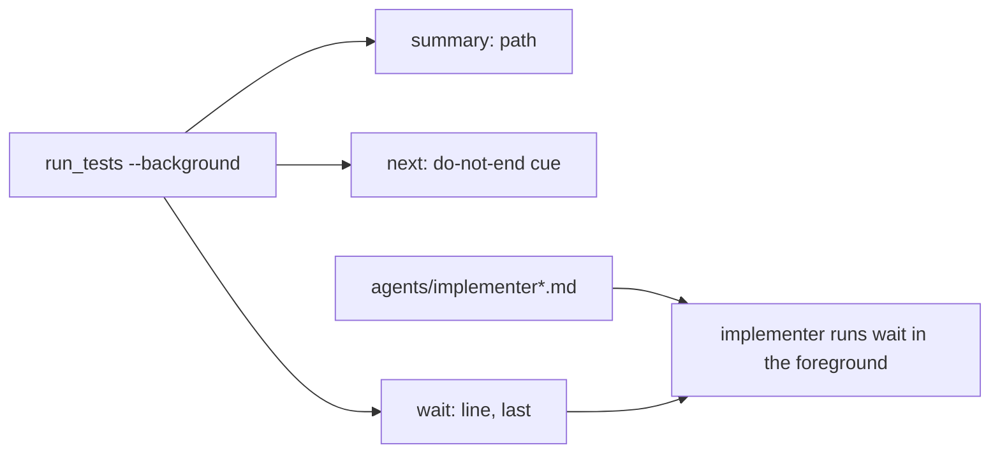
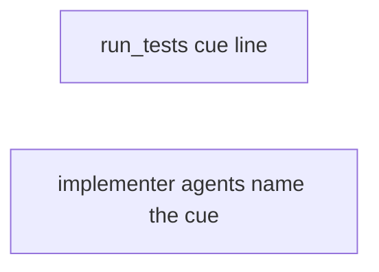

# Superlite: background test run prints the wait last, under a do-not-end cue (B36)

**Goal:** fix #286 (a fleet implementer on 1.5.25 again ended its turn while its `run_tests ... --background` wait was still running, although 1.5.24 told it to run the `wait:` line in the foreground). Max's decision: print the wait last with a do-not-end cue.
**Architecture:** `run_tests.start_background` prints a new `next:` cue line between `summary:` and `wait:`, so the output still ends with the wait line (T1); the implementer agents name that cue and what an early stop costs (T2); one new test file per task.
**Tech stack:** Python 3.10+ stdlib, Markdown, pytest (through `sl run_tests`).
**Spec:** this file, section Design; issue #286 on GitHub is the source of the Expected line.
**Detail:** tests
**Target-min:** 11
**Wave0:** none
**Coverage:** off

Global constraints:
- Code lines under `skills/subagent-driven-development/scripts/` carry the repo's trailing `# O(...)` complexity comment; tests do not.
- `run_tests.wait_line(path)` stays unchanged (several tests pin its exact form); only `start_background` and the module docstring change in run_tests.py.
- Insert text into the agent files; never reword or drop an existing sentence (tests/scripts/test_foreground_verify_rule.py pins the `wait:` rule clause).
- Run `sl` as an executable (`<abs>/sl ...`). Verify with `<abs>/sl run_tests --fast <test files> --task Tn --background`, then run the printed `wait:` line in the foreground. Never raw `pytest`, never the e2e or eval layers (coordinator's step).
- No version edits. Only the files a task owns change.

Ruling: the cue is its own stdout line `next: ...` between `summary:` and `wait:` (not a shell comment appended to the wait line, which would change the line agents copy verbatim and `wait_line`'s pinned form) - cost if wrong: one more output line to read.
Ruling: T1 updates the background-output assertions of tests/scripts/test_run_tests_wait.py, test_run_tests_root.py and test_0_3_1_scripts.py (`lines[1]` becomes `lines[-1]`, `len(lines) == 2` becomes 3), outside the brief's file list, because they pin the old two-line output - cost if wrong: a rebase conflict with another lead editing those tests.
Ruling: the Stop-hook re-prompt alternative of #286 is not built (Max chose the printed cue) - cost if wrong: a model that ignores the cue still ends early; a follow-up issue can add the hook.
Ruling: both tasks are mechanical (exact text given, verbatim tests) - cost if wrong: a haiku miss goes to a sonnet fixer.
Ruling: no probe adapter - one print change and agent text; checks run as named pytest cases - cost if wrong: no generated probes.
LAYERS: unit, headless, evals



## Design

### 1. The background output ends with the wait, under a cue
`run_tests.py` gains `WAIT_CUE = "next: tests still running; run the wait line below now, in the foreground (never as a background command), and do not end your turn until it reports."`. `start_background` prints `summary: <abs path>`, then `WAIT_CUE`, then `wait_line(mine)`, so the wait line stays the last line and the cue sits right above it. The docstring paragraph on `--background` names the cue. Everything else (detached spawn, pointer, `--wait`) is unchanged.

### 2. The implementer agents name the cue
`agents/implementer.md` and `agents/implementer-haiku.md` append, right after `read only its summary.` in their TDD rule line, the sentence `AGENT_CUE` (exact text in T2's test): the run prints a `next:` cue and, as its last line, that `wait:` line; a turn ended before the wait reports reaches the coordinator as the report, with no test result.

## File structure
- `skills/subagent-driven-development/scripts/run_tests.py`, `tests/scripts/test_run_tests_wait_cue.py`, plus the three assertion updates (T1).
- `agents/implementer.md`, `agents/implementer-haiku.md`, `tests/scripts/test_implementer_wait_cue_b36.py` (T2).

## Task graph

```mermaid
%% schedule
gantt
  title Predicted schedule (mm:ss)
  dateFormat X
  axisFormat %M:%S
  section lane 1
  T1 run_tests --background prints the cue :t1, 0, 60s
  section lane 2
  T2 implementer agents name the cue and t :t2, 0, 58s
```




critical path: T1 (1.0 min) · peak width 2 · predicted build 1.0 min · predicted total ≈ 4.5 min (target ✓)

## Package: superlite run_tests and agents (CLI output read by agents)
**Probe entry:** none (Ruling: no probe adapter).
App type: CLI (protocol: the background output lines), plus agent text. Risks: the wait line no longer last; a test still reading `lines[1]` as the wait line; the cue named in the agents but not printed.

### T1 run_tests --background prints the cue, then the wait last · Complexity 1 · Est. context 30k
**Owns:** skills/subagent-driven-development/scripts/run_tests.py, tests/scripts/test_run_tests_wait_cue.py, tests/scripts/test_run_tests_wait.py, tests/scripts/test_run_tests_root.py, tests/scripts/test_0_3_1_scripts.py
**Components:** 1
**LOC owned:** 50
**Tests:** fast
**Kind:** mechanical
**Model:** haiku
**Est. time:** 1.5 min (1 component, about 50 LOC, fast tests)
**Covers:** 1
**Produces:** run_tests.WAIT_CUE (str constant)
**Review Focus:** protocol: `test_background_prints_cue_then_wait_last` (stdout is exactly `summary: P`, `WAIT_CUE`, `wait_line(P)`); protocol: `test_cue_text` (WAIT_CUE equals CUE); protocol: `test_docstring_names_the_cue`.
**Steps:**
1. Write `tests/scripts/test_run_tests_wait_cue.py` verbatim (below); run it: FAIL (no `WAIT_CUE`).
2. In run_tests.py add, right above `def start_background`, `WAIT_CUE = "next: tests still running; run the wait line below now, in the foreground (never as a background command), and do not end your turn until it reports."  # O(1)`. In `start_background`, between `print(f"summary: {mine}")` and `print(wait_line(mine))`, add `print(WAIT_CUE)  # O(1) the cue sits right above the wait line, which stays last (#286)`.
3. In the module docstring replace `--background starts a detached run of the same command, prints \`summary: <path>\` and exits 0` with `--background starts a detached run of the same command, prints \`summary: <path>\`, a \`next:\` line (run the wait line now, in the foreground; do not end your turn until it reports) and, last, the \`wait:\` line, and exits 0` (keep the rest of the paragraph; the line may wrap).
4. Update the old assertions: test_run_tests_wait.py `test_background_prints_wait_line`: `assert len(lines) == 2` becomes `assert len(lines) == 3`, and `lines[1]` becomes `lines[-1]` in its three asserts; test_run_tests_root.py line 60: `lines[1].startswith("wait: ")` becomes `lines[-1].startswith("wait: ")`; test_0_3_1_scripts.py lines 49-52: each `lines[1]` becomes `lines[-1]`. No other change in those files.
5. Run all four test files: PASS.
**Test code (verbatim):**
```python
"""#286: run_tests --background prints a do-not-end cue, then the wait line last."""
from __future__ import annotations

import sys

from test_plan_tools import SCRIPTS
from test_run_tests_wait import RUN_TESTS, run, setup, start

sys.path.insert(0, str(SCRIPTS))

import run_tests  # noqa: E402

CUE = ("next: tests still running; run the wait line below now, in the foreground "
       "(never as a background command), and do not end your turn until it reports.")


def test_cue_text():
    assert run_tests.WAIT_CUE == CUE


def test_background_prints_cue_then_wait_last(tmp_path):
    setup(tmp_path)
    lines, path = start(tmp_path)
    assert lines == [f"summary: {path}", CUE, run_tests.wait_line(path)]
    assert lines[-1].startswith("wait: ") and lines[-1].endswith(f"run_tests --wait {path}")
    done = run(RUN_TESTS, "--wait", path, "--timeout", "60", cwd=tmp_path)
    assert done.returncode == 0, done.both


def test_docstring_names_the_cue():
    doc = " ".join(run_tests.__doc__.split())
    assert "a `next:` line (run the wait line now, in the foreground; do not end your turn until it reports) and, last, the `wait:` line" in doc
```

### T2 implementer agents name the cue and the cost of an early stop · Complexity 1 · Est. context 24k
**Owns:** agents/implementer.md, agents/implementer-haiku.md, tests/scripts/test_implementer_wait_cue_b36.py
**Components:** 1
**LOC owned:** 30
**Tests:** fast
**Kind:** mechanical
**Model:** haiku
**Est. time:** 1.5 min (1 component, about 30 LOC, fast tests)
**Covers:** 2
**Produces:** agent text (AGENT_CUE sentence)
**Review Focus:** protocol: `test_agents_name_the_cue` (each file holds `RULE + " " + AGENT_CUE` on one line); protocol: `test_agent_rule_kept` (each file still holds `RULE` once).
**Steps:**
1. Write `tests/scripts/test_implementer_wait_cue_b36.py` verbatim (below); run it: FAIL.
2. In both agent files, in the `- TDD.` rule line, append one space and `AGENT_CUE` (the test's constant, verbatim) right after `read only its summary.`; the line stays one line.
3. Run the test file and tests/scripts/test_foreground_verify_rule.py: PASS.
**Test code (verbatim):**
```python
"""#286: the implementer agents name the next: cue and the cost of ending the turn before the wait reports."""
from __future__ import annotations

from pathlib import Path

import pytest

AGENTS = Path(__file__).resolve().parents[2] / "agents"
RULE = ("then run the `wait:` line it prints (`<abs sl> run_tests --wait <path>`) in the foreground, "
        "never as a background command, and end your turn only after it reports; read only its summary.")
AGENT_CUE = ("The run prints a `next:` cue and, as its last line, that `wait:` line; a turn ended before "
             "the wait reports reaches the coordinator as your report, with no test result.")


@pytest.mark.parametrize("name", ["implementer.md", "implementer-haiku.md"])
def test_agents_name_the_cue(name):
    lines = (AGENTS / name).read_text(encoding="utf-8").splitlines()
    assert any(RULE + " " + AGENT_CUE in ln and ln.startswith("- TDD.") for ln in lines)


@pytest.mark.parametrize("name", ["implementer.md", "implementer-haiku.md"])
def test_agent_rule_kept(name):
    text = (AGENTS / name).read_text(encoding="utf-8")
    assert text.count(RULE) == 1 and text.count(AGENT_CUE) == 1
```

## Review Focus
Package superlite run_tests and agents (CLI): protocol. Cases are in T1 and T2. The final reviewer also checks that no other producer of a `wait:` line (fleet_io verify text, primes) contradicts the new output.

## Self-review
- Coverage: Design 1 -> T1, Design 2 -> T2.
- No placeholders; both tests verbatim; no edge (T2 names T1's cue in prose only).
- T1 owns the three existing test files it changes (Ruling above); T2's files are disjoint.
