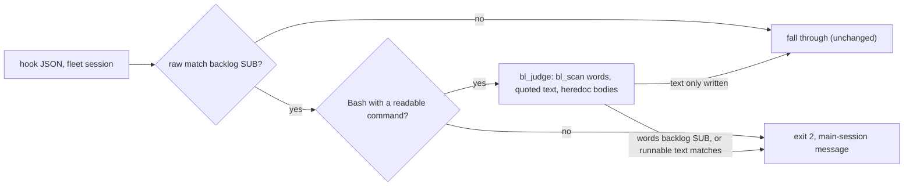
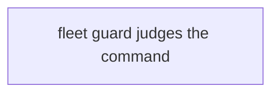

# Superlite: the fleet backlog guard judges the command, not text a heredoc or quote only writes (B33)

**Goal:** fix #276. In a fleet session (lead or worker), `hooks/block-coordinator-edits` blocks any Bash text that names `backlog decide|answer|start|plan`, also a heredoc body or a quoted argument that only writes the words into a doc or test file. Expected: it blocks an actual invocation, not the string inside a heredoc body or a quoted argument. Ships with regression tests.
**Architecture:** the fleet block keeps its raw-text match as a cheap first filter (no match passes at once, unchanged cost). A Bash match is then judged on the decoded `tool_input.command` alone by two new builtin-only functions: `bl_scan` (shell words, quoted text, heredoc bodies) and `bl_judge` (block decision). PowerShell keeps the raw match.
**Tech stack:** bash (3.2 compatible builtins, no spawn), pytest through `sl run_tests`.
**Spec:** this file, section Design; the issue body on GitHub is the source of the Expected line.
**Detail:** full
**Target-min:** 11
**Wave0:** none
**Worktree:** none

Global constraints:
- Only `hooks/block-coordinator-edits` changes, plus the new test file T1 owns. No other existing file changes; no version edits (the ship step bumps).
- bash 3.2 compatible (stock macOS `/bin/bash`): `tests/scripts/test_hooks_bash32.py` stays green; no `${x,,}`, no associative arrays, no mapfile. No process spawn in the fleet block (no `tr`, `sed`, subshell, `$(...)`).
- The block message stays byte-identical: `Blocked: sl backlog <SUB> runs only in the main session (Max's session), never in a fleet worker or lead. Use sl backlog status or wait, and report NEEDS_DECISION instead.`
- Tests never hard-code `/bin/bash` (`test_tests_resolve_bash_instead_of_bin_bash`); they build state under `tmp_path`.
- Verify with `<abs>/sl run_tests --fast <test files> --task T1 --background`, then the printed `wait:` line in the foreground. Never raw `pytest`, never the e2e layers (coordinator's step).

Ruling: detail full - a hand-rolled shell scanner in bash is algorithmic and easy to get subtly wrong; the code below was spiked in the lead's scratchpad and passed 54 cases on bash 5.3 and 3.2 - cost if wrong: one fix round.
Ruling: text in quotes or a heredoc body is judged as code only when it may run in the same command: a word naming a shell, `eval`, `trap`, `xargs`, `ssh`, `su`, `watch`, `script`, `tmux`, `screen`, `herdr`, PowerShell, `cmd`, an interpreter (`python*`, `pypy*`, `node`, `deno`, `bun`, `perl`, `ruby`, `php`, `lua`, `osascript`, `expect`), or `env` with `-S`/`--split-string`; a quoted value assigned to a variable (`x="..."; $x`); an unquoted-delimiter heredoc body holding `$(` or a backtick. `$(...)` and backticks are scanned as commands, also inside double quotes - the scripts' own `SUPERLITE_FLEET_WORKER` refusal stays the backstop; the hook keeps every spelling the old test pins (env -u, bash -c, python3 backlog.py, quoted words, backslashes, tabs, capitals) - cost if wrong: a deliberate obfuscation (a variable built from pieces) passes the hook and only the script refuses.
Ruling: PowerShell keeps the raw-text match - its quoting differs and #276 names Bash heredocs - cost if wrong: PowerShell docs edits stay blocked (follow-up).
Ruling: a Bash call whose `command` cannot be read, or a command with a line over 4096 characters, keeps the raw match (blocked) - bash substring access is O(n), so a 20 KB single line costs 0.5 s; lines of that size are rare - cost if wrong: one false block, use the Write tool.
Ruling: only `tool_input.command` is judged after the raw match - a `description` that names the subcommand no longer blocks - cost if wrong: none (the description never runs).
Ruling: no probe adapter - a hook over stdin JSON; Review Focus cases run as named pytest cases - cost if wrong: no generated probes.
Ruling: docs that describe the guard (docs/*.md) are outside B33's files: follow-up in notes - cost if wrong: docs lag one batch.
LAYERS: unit, headless



## Design

### 1. bl_scan: words, text and runnable text
`bl_scan CMD` scans one line at a time (no step copies the whole command) and fills three arrays: `BLW` the shell words with quotes and backslashes removed, a `$'\001'` between simple commands (`;`, `&`, `|`, newline, `(`, `)`, `$(`, backtick); `BLT` quoted text and heredoc bodies; `BLS` text that may run (a quoted value of a `NAME=` word, an unquoted-delimiter heredoc body holding `$(` or a backtick). Modes: single quote, `$'...'`, double quote (`\` escapes `"\$` and backtick), `$(...)` with paren depth, backticks. `<<`, `<<-` (leading tabs stripped when matching the delimiter), quoted or backslashed delimiters, several heredocs on one line, `<<<`, `#` comments at a word start, `\`-newline continuation. `BLLONG=1` when a line is over 4096 characters (scan stops).

### 2. bl_judge: the decision
Blocks (returns 0, `BLHIT` = the subcommand) when two adjacent words are `*backlog` or `*backlog.py` then exactly `decide|answer|start|plan` (case-insensitive), or when `BLLONG` is set, or when a `BLS` entry matches the old regex, or when a word names a runner (Ruling 2) and a `BLT` entry matches it. Texts are matched with quotes and backslashes removed, like the raw match.

### 3. Wiring in the fleet block
After the raw match: Bash with a `"command"` string in the JSON -> JSON-decode it (`\\` first, then `\"`, `\t`, `\r`, `\n`) -> `bl_judge`; a no clears the block. PowerShell or no command: blocked as today.

## Coverage

| Category | State | Basis |
|---|---|---|
| Scope and success criteria | settled | #276 Expected line; Rulings 2-5 for the edges |
| Domain and data model | n/a | no state |
| Persistence and migration | n/a | no files written |
| Interfaces and contracts | settled | message unchanged; exit 2 or fall through |
| UI states | n/a | hook |
| Concurrency and state ownership | n/a | one process per call |
| Error handling and recovery | settled | unreadable command and long lines keep the raw block (fail closed, as today) |
| Security and privacy | ruled | Ruling 2: runners re-judge text; scripts refuse in fleet sessions |
| Performance and limits | settled | raw filter first; line cap 4096; 50 KB heredoc about 0.15 s |
| Observability | settled | same block message |
| Testing strategy | settled | new test file; old regression file pins old spellings |
| Compatibility | settled | bash 3.2 lint test; old test cases unchanged |
| Rollout | ruled | one PR; version bump at ship |
| Research unknowns | n/a | spike done in the lead's scratchpad |

## File structure
- `hooks/block-coordinator-edits`: fleet block comment and wiring, new `bl_scan`, `bl_judge` (T1).
- `tests/scripts/test_lead_guard_heredoc_276.py`: new regression tests (T1).

## Task graph

```mermaid
%% schedule
gantt
  title Predicted schedule (mm:ss)
  dateFormat X
  axisFormat %M:%S
  section lane 1
  T1 fleet backlog guard judge the command :t1, 0, 105s
```




critical path: T1 (1.7 min) · peak width 1 · predicted build 1.7 min · predicted total ≈ 5.2 min (target ✓)

## Package: superlite hooks (stdin JSON hook)
**Probe entry:** none (Ruling: no probe adapter).

### T1 fleet backlog guard: judge the command, not written text · Complexity 6 · Est. context 46k
**Owns:** hooks/block-coordinator-edits, tests/scripts/test_lead_guard_heredoc_276.py
**Components:** 2
**LOC owned:** 230
**Tests:** fast
**Model:** sonnet
**Est. time:** 3.5 min (2 components, about 230 LOC, fast tests)
**Covers:** 1, 2, 3
**Consumes:** nothing executed from another task.
**Produces:** bl_judge(cmd: str) -> exit status 0 (block, BLHIT set) or 1 (pass)
e.g. `bl_judge "cat > d.md <<'EOF'"$'\n'"sl backlog start"$'\n'"EOF"` -> 1
e.g. `bl_judge "bash -c 'sl backlog start B2'"` -> 0, BLHIT=start
**Review Focus:** encoding: `test_written_text_passes` (every ALLOW command below, roles lead and implementer -> exit 0); protocol: `test_runs_stay_blocked` (every BLOCK command -> exit 2, `main session` in stderr); state: `test_long_line_keeps_the_raw_block` (`'printf %s "' + "x" * 5000 + ' sl backlog start"'` -> 2); numeric: `test_large_heredoc_is_quick` (a 3000-line quoted heredoc naming the start command -> 0 in under 5 s); `test_description_alone_passes` (command `ls`, description `then sl backlog start` -> 0); `test_powershell_keeps_the_raw_match` (PowerShell `Write-Output 'sl backlog start'` -> 2).
**Code (verbatim):** insert `bl_scan` and `bl_judge` from the block below right after `IFS= read -r -d '' input`, and replace the fleet block (its comment and the `if [ -n "${SUPERLITE_FLEET_WORKER:-}" ]` statement) with the wiring at its end.
```bash
# bl_scan CMD: the shell words of the Bash command CMD, quotes and backslashes removed, into BLW (a $'\001'
# between simple commands); the quoted text and heredoc bodies into BLT (text only) or BLS (text that may run:
# an assignment's quoted value, an unquoted-delimiter heredoc body holding $( or a backtick). A $( or backtick
# opens its own words, inside double quotes too. BLLONG=1 when a line is over 4096 characters (the scan stops).
# Bash builtins only; one line at a time, so no step copies the whole command.
bl_scan() {
  local LC_ALL=C
  local rest="$1" ln n i c d w="" wt="" wa=0 stk="" m dl dq ds j seg cmp body k more=1
  local -a dep=() pd=() pq=() pt=()
  BLW=(); BLT=(); BLS=(); BLLONG=0
  bl_emit() {
    if [ "$wa" = 1 ]; then
      BLW[${#BLW[@]}]="$w"
      if [ -n "$wt" ]; then
        if [[ $w =~ ^[A-Za-z_][A-Za-z0-9_]*\+?= ]]; then BLS[${#BLS[@]}]="$wt"; else BLT[${#BLT[@]}]="$wt"; fi
      fi
    fi
    w=""; wt=""; wa=0
  }
  bl_sep() { bl_emit; BLW[${#BLW[@]}]=$'\001'; }
  bl_line() {   # next line of rest into ln; more=0 after the last one
    ln="${rest%%$'\n'*}"
    if [ ${#ln} -gt 4096 ]; then BLLONG=1; more=0; ln=""; rest=""; return; fi
    if [ ${#ln} = ${#rest} ]; then more=0; rest=""; else rest="${rest:${#ln}+1}"; fi
  }
  while [ "$more" = 1 ]; do
    bl_line; n=${#ln}; i=0
    while [ "$i" -lt "$n" ]; do
      c="${ln:i:1}"; m="${stk: -1}"
      case "$m" in
        Q) seg="${ln:i}"; d="${seg%%\'*}"; w+="$d"; wt+="$d"
           if [ ${#d} = ${#seg} ]; then i=$n; else stk="${stk%?}"; i=$((i + ${#d} + 1)); fi
           continue ;;
        A) if [ "$c" = '\' ]; then d="${ln:i+1:1}"; w+="$d"; wt+="$d"; i=$((i + 2))
           elif [ "$c" = "'" ]; then stk="${stk%?}"; i=$((i + 1))
           else w+="$c"; wt+="$c"; i=$((i + 1)); fi
           continue ;;
        D) case "$c" in
             '"') stk="${stk%?}"; i=$((i + 1)) ;;
             '\') d="${ln:i+1:1}"
                  case "$d" in '"'|'\'|'$'|'`') w+="$d"; wt+="$d" ;; '') ;; *) w+="\\$d"; wt+="\\$d" ;; esac
                  i=$((i + 2)) ;;
             '$') if [ "${ln:i+1:1}" = '(' ]; then bl_sep; stk+=S; dep[${#stk}]=0; i=$((i + 2))
                  else w+='$'; wt+='$'; i=$((i + 1)); fi ;;
             '`') bl_sep; stk+=B; i=$((i + 1)) ;;
             *) seg="${ln:i}"; seg="${seg%%[\"\\\$\`]*}"; w+="$seg"; wt+="$seg"; i=$((i + ${#seg})) ;;
           esac
           continue ;;
      esac
      case "$c" in
        ' '|$'\t') bl_emit; i=$((i + 1)) ;;
        '\') if [ $((i + 1)) -lt "$n" ]; then w+="${ln:i+1:1}"; wa=1; fi
             i=$((i + 2)) ;;
        "'") stk+=Q; wa=1; i=$((i + 1)) ;;
        '"') stk+=D; wa=1; i=$((i + 1)) ;;
        '$') case "${ln:i+1:1}" in
               '(') bl_sep; stk+=S; dep[${#stk}]=0; i=$((i + 2)) ;;
               "'") stk+=A; wa=1; i=$((i + 2)) ;;
               '{') seg="${ln:i}"; d="${seg%%\}*}"; w+="$d}"; wa=1; i=$((i + ${#d} + 1)) ;;
               *) w+='$'; wa=1; i=$((i + 1)) ;;
             esac ;;
        '`') bl_sep; if [ "$m" = B ]; then stk="${stk%?}"; else stk+=B; fi; i=$((i + 1)) ;;
        '(') bl_sep; [ "$m" = S ] && dep[${#stk}]=$((dep[${#stk}] + 1)); i=$((i + 1)) ;;
        ')') bl_sep
             if [ "$m" = S ]; then
               if [ "${dep[${#stk}]}" = 0 ]; then stk="${stk%?}"; else dep[${#stk}]=$((dep[${#stk}] - 1)); fi
             fi
             i=$((i + 1)) ;;
        ';'|'&'|'|') bl_sep; i=$((i + 1)) ;;
        '<') if [ "${ln:i:3}" = '<<<' ]; then bl_emit; i=$((i + 3))
             elif [ "${ln:i:2}" = '<<' ]; then
               bl_emit; i=$((i + 2)); ds=0; dq=0; dl=""
               [ "${ln:i:1}" = - ] && { ds=1; i=$((i + 1)); }
               while [[ ${ln:i:1} == [' '$'\t'] ]]; do i=$((i + 1)); done
               while [ "$i" -lt "$n" ]; do
                 d="${ln:i:1}"
                 case "$d" in
                   ' '|$'\t'|';'|'&'|'|'|'<'|'>'|'('|')') break ;;
                   "'"|'"') dq=1; seg="${ln:i+1}"; j="${seg%%"$d"*}"; dl+="$j"; i=$((i + ${#j} + 2)) ;;
                   '\') dq=1; dl+="${ln:i+1:1}"; i=$((i + 2)) ;;
                   *) dl+="$d"; i=$((i + 1)) ;;
                 esac
               done
               pd[${#pd[@]}]="$dl"; pq[${#pq[@]}]="$dq"; pt[${#pt[@]}]="$ds"
             else bl_emit; i=$((i + 1)); fi ;;
        '>') bl_emit; i=$((i + 1)) ;;
        '#') if [ "$wa" = 0 ]; then i=$n; else w+='#'; i=$((i + 1)); fi ;;
        *) seg="${ln:i}"; seg="${seg%%[[:space:]\\\'\"\$\`\(\)\;\&\|\<\>]*}"
           [ -z "$seg" ] && seg="$c"
           w+="$seg"; wa=1; i=$((i + ${#seg})) ;;
      esac
    done
    # end of line: a newline inside quotes is text; after a trailing backslash it joins the lines
    m="${stk: -1}"
    case "$m" in
      Q|A|D) w+=$'\n'; wt+=$'\n'; continue ;;
    esac
    [ "$more" = 1 ] && [[ $ln == *'\' ]] && [ "$i" -gt "$n" ] && continue
    bl_sep
    for ((k = 0; k < ${#pd[@]}; k++)); do
      body=""
      while [ "$more" = 1 ]; do
        bl_line
        cmp="$ln"; [ "${pt[k]}" = 1 ] && { while [[ $cmp == $'\t'* ]]; do cmp="${cmp#?}"; done; }
        [ "$cmp" = "${pd[k]}" ] && break
        body+="$ln"$'\n'
      done
      if [ "${pq[k]}" = 0 ] && [[ $body == *'$('* || $body == *'`'* ]]; then BLS[${#BLS[@]}]="$body"
      else BLT[${#BLT[@]}]="$body"; fi
    done
    pd=(); pq=(); pt=()
  done
  bl_emit
}

# bl_judge CMD: succeeds, the subcommand in BLHIT, when the Bash command CMD runs sl backlog decide|answer|start|plan:
# the two words in a row, or the text of a quote or heredoc that may run (a runner word in the command, an assignment).
# A line over 4096 characters succeeds without a scan, BLHIT unchanged (the caller's raw match stands).
bl_judge() {
  local k nx v b run=0 envw=0 envs=0 t re='backlog(\.py)?[[:space:]]+(decide|answer|start|plan)([^[:alnum:]_-]|$)'
  local -a texts=()
  bl_scan "$1"
  [ "$BLLONG" = 1 ] && return 0
  shopt -s nocasematch
  for ((k = 0; k < ${#BLW[@]}; k++)); do
    v="${BLW[k]}"; nx="${BLW[k+1]}"
    if [[ $v == *backlog || $v == *backlog.py ]] && [[ $nx == decide || $nx == answer || $nx == start || $nx == plan ]]; then
      shopt -u nocasematch; BLHIT="$nx"; return 0
    fi
    b="${v##*/}"; b="${b##*\\}"; b="${b%.exe}"
    case "$b" in
      sh|bash|zsh|dash|ksh|ash|mksh|yash|fish|csh|tcsh|busybox|eval|trap|xargs|ssh|su|watch|script|tmux|screen|herdr|pwsh|powershell|cmd|iex|invoke-expression|python*|pypy*|node|nodejs|deno|bun|perl|ruby|php|lua|osascript|expect) run=1 ;;
      env) envw=1 ;;
      --split-string*|-S*) envs=1 ;;
    esac
  done
  [ "$envw" = 1 ] && [ "$envs" = 1 ] && run=1
  texts=("${BLS[@]}")
  [ "$run" = 1 ] && texts+=("${BLT[@]}")
  for t in "${texts[@]}"; do
    t="${t//\\/}"; t="${t//\"/}"; t="${t//\'/}"
    if [[ $t =~ $re ]]; then BLHIT="${BASH_REMATCH[2]}"; shopt -u nocasematch; return 0; fi
  done
  shopt -u nocasematch
  return 1
}

# Fleet session (any role, a lead too; the env is the session's, so a command's `env -u` cannot change it): `sl backlog
# decide|answer|start|plan` is Max's main session only. A raw match on the hook JSON comes first (quotes and backslashes
# dropped, `backlog[.py]` then the subcommand): no match falls through at once. A Bash match is then judged on its
# command alone by bl_judge (#276): the two words run as a command block in any spelling ($SL, an absolute path,
# env -u ... sl, python3 .../backlog.py, $( ) or backticks, quoted words); text that a heredoc or a quoted argument only
# writes passes, unless the command can run it (a shell, eval, an interpreter, xargs, ssh, env -S, a variable). PowerShell,
# a Bash call without a readable command and a line over 4096 characters keep the raw match. Only a fleet session pays
# for it (builtin string work, no spawn); the idle coordinator path is untouched.
if [ -n "${SUPERLITE_FLEET_WORKER:-}" ]; then
  re_bl_tool='"tool_name"[[:space:]]*:[[:space:]]*"(Bash|PowerShell)"'
  if [[ $input =~ $re_bl_tool ]]; then
    bl_tool="${BASH_REMATCH[1]}"
    bl="${input//\\t/ }"; bl="${bl//\\/}"; bl="${bl//\"/}"; bl="${bl//\'/}"
    re_bl='backlog(\.py)?[[:space:]]+(decide|answer|start|plan)([^[:alnum:]_-]|$)'
    shopt -s nocasematch
    if [[ $bl =~ $re_bl ]]; then
      shopt -u nocasematch
      BLHIT="${BASH_REMATCH[2]}"; bl_block=1
      re_bl_cmd='"command"[[:space:]]*:[[:space:]]*"(([^"\\]|\\.)*)"'
      if [ "$bl_tool" = Bash ] && [[ $input =~ $re_bl_cmd ]]; then
        blc="${BASH_REMATCH[1]}"
        blc="${blc//\\\\/$'\x01'}"   # JSON \\ first, so \\" and \\n keep their shell meaning
        blc="${blc//\\\"/\"}"; blc="${blc//\\t/$'\t'}"; blc="${blc//\\r/}"; blc="${blc//\\n/$'\n'}"
        blc="${blc//$'\x01'/\\}"
        bl_judge "$blc" || bl_block=0
      fi
      if [ "$bl_block" = 1 ]; then
        printf '%s\n' "Blocked: sl backlog ${BLHIT} runs only in the main session (Max's session), never in a fleet worker or lead. Use sl backlog status or wait, and report NEEDS_DECISION instead." >&2
        exit 2
      fi
    fi
    shopt -u nocasematch
  fi
fi
```
**Test code (verbatim):** `tests/scripts/test_lead_guard_heredoc_276.py`
```python
"""#276: in a fleet session (lead or worker) the backlog guard blocks `sl backlog decide|answer|start|plan` run as a
command, not the same words in a heredoc body or a quoted argument that only writes them."""
import json, os, subprocess, time
import pytest
from test_block_coordinator_edits import BASH, HOOK

ALLOW = [
    "cat > docs/x.md <<'EOF'\nRun `sl backlog start B1` from main.\nEOF",
    "cat > t.py <<EOF\nsl backlog decide --file f\nEOF",
    "cat > t.py <<-EOF\n\tsl backlog decide --file f\n\tEOF\nls",
    'git commit -m "docs: sl backlog start runs in main"',
    "git commit -m \"$(cat <<'EOF'\nsl backlog plan --reset\nEOF\n)\"",
    'grep -n "backlog start" commands/backlog.md',
    "printf '%s\\n' 'sl backlog answer B1' > f",
    'sl feedback add --kind bug "the hook blocks sl backlog start in a heredoc"',
    "echo x # sl backlog start",
    "gh issue create --title t --body 'sl backlog decide'",
    "cat <<\\EOF > f\n$(sl backlog start)\nEOF",
    "cat > t.py <<'EOF'\nrun(['sl', 'backlog', 'start'])\nEOF",
]
BLOCK = [
    "bash <<'EOF'\nsl backlog start B1\nEOF",
    "sh -s <<EOF\nenv -u SUPERLITE_FLEET_WORKER sl backlog decide\nEOF",
    "echo 'sl backlog start' | bash", 'eval "sl backlog plan"', 'x="sl backlog start"; $x',
    "cat <<EOF\n$(sl backlog start)\nEOF", 'echo "$(sl backlog decide --print)"', "echo `sl backlog answer B1`",
    "ls; sl backlog start B1", "python3 -c \"import os; os.system('sl backlog start')\"",
    "cat > f.sh <<'EOF'\nsl backlog start\nEOF\nbash f.sh", 'echo "backlog start" | xargs sl',
    "(sl backlog start)", "{ sl backlog start; }", "if true; then sl backlog start; fi",
    "env -S 'sl backlog start'", "ssh host 'sl backlog start'",
    "git commit -m \"$(cat <<'EOF'\nx\nEOF\n)\" && sl backlog start",
    "sl backlog start>out", "/abs/sl backlog plan --reset",
    "cat <<'A' <<'B2'\nsl backlog start\nA\nfoo\nB2\nsl backlog plan", "sl backlog \\\nstart",
]


@pytest.fixture
def sd(tmp_path):
    d = tmp_path / "proj" / ".superlite"; d.mkdir(parents=True); return d


def call(sd, cmd, tool="Bash", role="lead", **extra):
    e = {k: v for k, v in os.environ.items() if not k.startswith("SUPERLITE_")}
    e.update({"CLAUDE_PROJECT_DIR": str(sd.parent), "SUPERLITE_FLEET_WORKER": "W2", "SUPERLITE_FLEET_ROLE": role,
              "SUPERLITE_STATE_DIR": str(sd)})
    raw = json.dumps({"session_id": "s276", "tool_name": tool, "tool_input": {"command": cmd, **extra}, "cwd": str(sd.parent)})
    return subprocess.run([BASH, str(HOOK)], input=raw, capture_output=True, text=True, env=e, cwd=sd.parent)


@pytest.mark.parametrize("cmd", ALLOW)
def test_written_text_passes(sd, cmd):
    for role in ("lead", "implementer"):
        r = call(sd, cmd, role=role)
        assert r.returncode == 0, (role, cmd, r.stderr)


@pytest.mark.parametrize("cmd", BLOCK)
def test_runs_stay_blocked(sd, cmd):
    for role in ("lead", "implementer"):
        r = call(sd, cmd, role=role)
        assert r.returncode == 2 and "runs only in the main session" in r.stderr, (role, cmd, r.stderr)


def test_long_line_keeps_the_raw_block(sd):
    assert call(sd, 'printf %s "' + "x" * 5000 + ' sl backlog start"').returncode == 2


def test_large_heredoc_is_quick(sd):
    cmd = "cat > docs/big.md <<'EOF'\n" + "Run `sl backlog start B1` from the main session.\n" * 3000 + "EOF"
    t = time.monotonic()
    r = call(sd, cmd)
    assert r.returncode == 0 and time.monotonic() - t < 5, r.stderr


def test_description_alone_passes(sd):
    assert call(sd, "ls", description="then sl backlog start").returncode == 0


def test_powershell_keeps_the_raw_match(sd):
    assert call(sd, "Write-Output 'sl backlog start'", tool="PowerShell").returncode == 2
```
**Steps:** 1 write the test file, 2 run: FAIL (ALLOW cases and the description case exit 2), 3 insert the code, 4 run: PASS; also `tests/regression/test_fleet_backlog_guard.py`, `tests/scripts/test_hooks_bash32.py`, `tests/scripts/test_lead_guard_190.py`, `tests/scripts/test_lead_hooks.py`, `tests/scripts/test_block_coordinator_edits.py`, `tests/scripts/test_guard_fleet_agents.py` stay green (`test_hooks_bash32.py` lints the bash 3.2 syntax).
**Notes:** keep the fleet block before the `agent_id` exit, as today (a subagent call in a fleet session is judged too). `bl_emit`, `bl_sep` and `bl_line` read `bl_scan`'s locals by bash's dynamic scope; keep them inside `bl_scan`. Update the hook's header comment only where it names the fleet block.

## Review Focus
- Package superlite hooks: app type hook over stdin JSON (CLI-like); categories protocol (block vs fall through, message unchanged), encoding (JSON escapes, quotes, backslashes, tabs, capitals, multibyte text), state (heredoc and quote modes across lines), numeric (line cap, timing).
- Specific risks: an old spelling no longer blocked (the regression file pins them); a heredoc delimiter never found swallowing the rest of the command; `nocasematch` left on for the rest of the hook; a bash 3.2 construct.

## Self-review
- Coverage: #276 -> T1 (sections 1-3); docs -> follow-up (Ruling).
- Graph: one task, no edges; Owns two files.
- Placeholders: none; code and tests verbatim from the spike.
