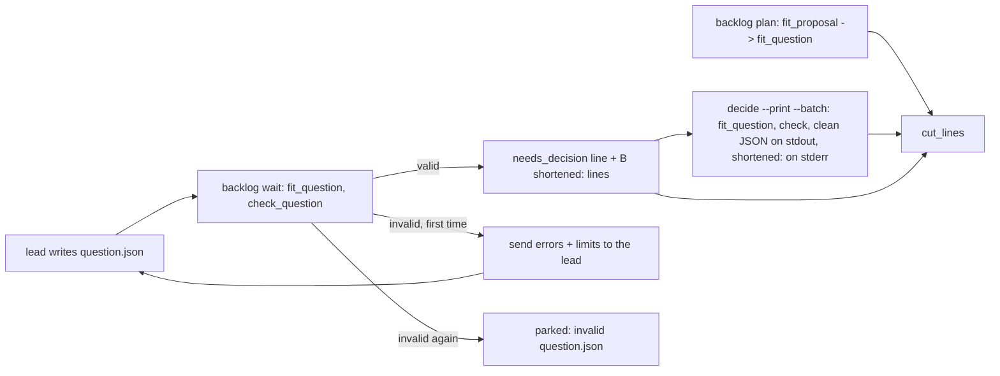
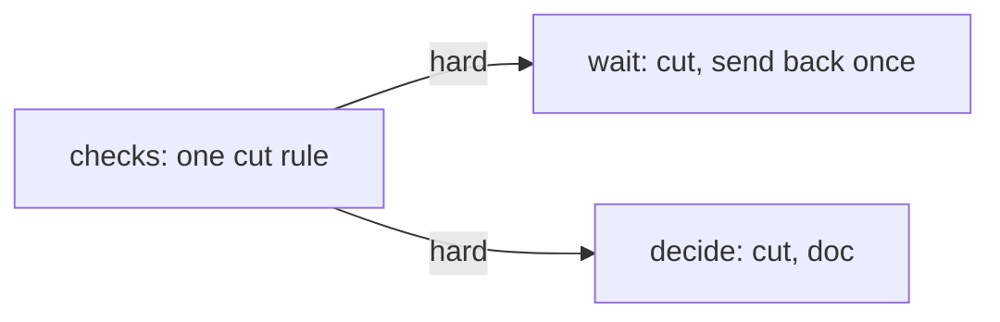

# Superlite: a lead's question.json is cut like the plan's, an invalid one is sent back once (B29)

**Goal:** fix #308 (a lead's `.superlite/question.json` is still refused over a long header or label, while `sl backlog plan` cuts them since 1.5.33) and #301 (an invalid lead question, such as one over 300 characters, parks the batch and loses the lead). Each fix ships with regression tests.
**Architecture:** `backlog_checks.py` gets the one cut rule for a question batch (`fit_question`) and the `shortened:` line format (`cut_lines`); `fit_proposal` uses it. `backlog_run.py` (`backlog wait`) cuts before it checks and sends a still invalid file back to the lead once; `backlog.py` (`decide --print --batch`, `plan`) cuts before it checks; `commands/backlog.md` step 5 tells main.
**Tech stack:** Python 3.10+ stdlib, pytest (through `sl run_tests`).
**Spec:** this file, section Design; the issue bodies on GitHub are the source for each Expected line.
**Detail:** contracts
**Target-min:** 11
**Wave0:** none

Global constraints:
- Code lines under `skills/subagent-driven-development/scripts/` carry the repo's trailing `# O(...)` complexity comment where the file already uses them; tests do not. Follow each file's existing style.
- Stdlib only. Existing tests stay green. A task changes no existing test file except one its Owns names: new tests go in the new file its Owns names.
- Run `sl` as an executable (`<abs>/sl ...`). Verify with `<abs>/sl run_tests --fast <test files> --task Tn --background`, then run the printed `wait:` line in the foreground and end the turn only after it reports. Never raw `pytest`, never the e2e or eval layers (coordinator's step).
- No version edits (the ship step bumps the version). Only the files a task owns change.
- Tests build their state under `tmp_path`; they never write the real repo's `.superlite/`.
- Limits stay as today: 1 to 4 distinct questions, question 1 to 300 characters, header 1 to 12, 2 to 4 options, distinct labels of 1 to 60, descriptions 0 to 200. The question text itself is never cut.
- A cut note reads `"<name>" header: N -> M characters`, `"<name>" option <k> label: N -> M characters` or `"<name>" option <k> description: N -> M characters`; `<name>` is the question text with control characters as spaces, whitespace collapsed, at most 60 characters (`?` when it is not a string). These are today's `fit_proposal` notes.

Ruling: detail contracts - fixes in existing modules with known causes; tests named with exact inputs and outcomes - cost if wrong: one NEEDS_CONTEXT per task.
Ruling: the lead path never cuts the question text; a question over 300 characters (and every other error the cut cannot fix) is sent back to the lead once with the errors and the limits, and the batch stays running - the lead holds the context and writes a better short question than a blind cut, whose tail is usually the question itself; one re-prompt then park matches the status re-prompt (B14) - cost if wrong: one extra lead turn per slip.
Ruling: `backlog wait` never rewrites the lead's question.json; main reads the cut questions from `decide --print --batch B` (the status table already names it), and the wait line is followed by `B shortened:` lines - the lead's own file stays its record - cost if wrong: main reading the raw file sees an uncut header.
Ruling: `decide --print --batch` keeps stdout pure JSON and prints its `shortened:` lines on stderr - callers parse stdout - cost if wrong: main reads two streams.
Ruling: a batch parked after the second invalid file still resumes with `start B` (#301 asked for `answer`): park stops the lead, and only `start` spawns one; the first slip no longer parks - cost if wrong: main restarts a lead on a second slip.
Ruling: T2 sets `question_reprompted=True` in two existing tests of tests/scripts/test_backlog_run.py so they keep asserting the park - the park now needs a second invalid file - cost if wrong: a rebase conflict if another lead edits those lines.
Ruling: the lead brief (backlog_brief.py), skills/subagent-driven-development/backlog.md ## Lead and docs/fleet.md (both say "never cut") are outside B29's files: follow-ups in notes - cost if wrong: lead docs lag one batch.
Ruling: no probe adapter - script internals over local files; Review Focus cases run as named pytest cases - cost if wrong: no generated probes.
Ruling: edges T1 -> T2 and T1 -> T3 are hard - both tasks' tests run the real `fit_question` and `cut_lines` through the modules that import them - cost if wrong: about 2 min of serial time.
LAYERS: unit

## Design

### 1. One cut rule for both paths (#308)
`backlog_checks.fit_question(q)` cuts, in place, each question's over-long header (12), option label (60, a ` (Recommended)` suffix kept whole) and option description (200), trailing blanks dropped, never cut to only blanks, and returns one note per cut. It takes a batch `{"questions": [...]}` or a bare question; any other shape returns `[]` and is left for `check_question`. `fit_proposal` returns the notes of `fit_question` over every decision of every batch, as today. `backlog_checks.cut_lines(notes, prefix="")` formats them: `<prefix>shortened: <note>` for the first 5, then `<prefix>shortened: K more`. `plan` prints `cut_lines(fit_proposal(prop))` (output unchanged).

### 2. backlog wait cuts, then sends an invalid file back once (#301, #308)
For a fresh `question.json`, `_round` loads it, runs `fit_question`, then `check_question` on the cut copy. Valid: `needs_decision` and the line `B needs_decision question=<path>`, then `cut_lines(cuts, "B ")`. The file on disk is not rewritten. Invalid (also not JSON) and the batch has no `question_reprompted`: set `question_reprompted: true` and `since: now`, send `QUESTION_FIX` (the first 5 errors and the limits) with `fleet_io.main(["send", lead, "--text", text, "--plan", sd])`, print no line; a failed send parks at once. Invalid with `question_reprompted` set: park with `invalid question.json: <errors>` as today. `start` and `answer` reset `question_reprompted` to false.

### 3. decide --print --batch cuts too, main is told (#308, #301)
`decide --print --batch B` loads B's question.json, runs `fit_question`, then `check_question`; errors still print `BLOCKED: B question.json invalid: ...` (exit 3); a valid file prints `clean_question` JSON on stdout and `cut_lines(cuts)` on stderr. `commands/backlog.md` step 5 tells main to run it for a `needs_decision` line and names the question re-prompt and its park.

## Coverage

| Category | State | Basis |
|---|---|---|
| Scope and success criteria | settled | two issues in Goal; each issue's Expected line; Rulings for the parts left out |
| Domain and data model | settled | batch key `question_reprompted` (bool, absent = false) |
| Persistence and migration | settled | old backlog.json batches have no key and read as false |
| Interfaces and contracts | settled | two new functions with Produces lines; CLI output lines named in tests |
| UI states | n/a | CLI text |
| Concurrency and state ownership | settled | writes stay inside `bs.update`'s lock; T2, T3 own disjoint files |
| Error handling and recovery | settled | not JSON counts as invalid; failed send parks |
| Security and privacy | settled | error text comes from check_question (labels checked for control characters first) |
| Performance and limits | settled | one pass over at most 4 questions |
| Observability | settled | wait lines, stderr cut lines |
| Testing strategy | settled | new unit test file per task; unit layer by the coordinator |
| Compatibility | settled | plan output unchanged; valid lead files print as today |
| Rollout | ruled | one PR; version bump at ship |
| Research unknowns | n/a | causes named in the issues |

## File structure
- `skills/subagent-driven-development/scripts/backlog_checks.py`, `tests/scripts/test_backlog_question_fit.py` (T1).
- `skills/subagent-driven-development/scripts/backlog_run.py`, `tests/scripts/test_backlog_wait_question.py`, `tests/scripts/test_backlog_run.py` (T2).
- `skills/subagent-driven-development/scripts/backlog.py`, `commands/backlog.md`, `tests/scripts/test_backlog_decide_fit.py` (T3).

## Task graph

```mermaid
%% schedule
gantt
  title Predicted schedule (mm:ss)
  dateFormat X
  axisFormat %M:%S
  section lane 1
  T1 backlog_checks  fit_question and cut_ :t1, 0, 72s
  T2 backlog wait  cut before the check  s :t2, 72, 77s
  section lane 2
  T3 decide --print --batch cuts  plan use :t3, 72, 74s
```

critical path: T1 → T2 (2.5 min) · peak width 2 · predicted build 2.5 min · predicted total ≈ 6.0 min (target ✓)

## Package: superlite backlog scripts (CLI over local state)
**Probe entry:** none (Ruling: no probe adapter).

### T1 backlog_checks: fit_question and cut_lines · Complexity 2 · Est. context 36k
**Owns:** skills/subagent-driven-development/scripts/backlog_checks.py, tests/scripts/test_backlog_question_fit.py
**Components:** 1
**LOC owned:** 80
**Tests:** fast
**Model:** sonnet
**Est. time:** 1.6 min (1 component, about 80 LOC, fast tests)
**Covers:** 1
**Consumes:** nothing executed from another task.
**Produces:** backlog_checks.fit_question(q: object) -> list[str] · backlog_checks.cut_lines(notes: list[str], prefix: str = "") -> list[str]
e.g. `fit_question({"questions": [{"question": "Keep the v1 API?", "header": "Compatibility", "options": [{"label": "Keep (Recommended)", "description": "no break"}, {"label": "Drop", "description": "smaller"}]}]})` -> `['"Keep the v1 API?" header: 13 -> 12 characters']` (header now `Compatibilit`)
e.g. `cut_lines(['"Q?" header: 13 -> 12 characters'], "B1 ")` -> `['B1 shortened: "Q?" header: 13 -> 12 characters']`
e.g. `cut_lines(["n0", "n1", "n2", "n3", "n4", "n5", "n6"])` -> `["shortened: n0", "shortened: n1", "shortened: n2", "shortened: n3", "shortened: n4", "shortened: 2 more"]`
**Review Focus:** encoding: `test_fit_question_cuts_header_label_description` (one question `Keep the v1 API?`, header `Compatibility`, option 1 label `"k" * 70 + " (Recommended)"`, option 2 description `"y" * 250` -> notes `['"Keep the v1 API?" header: 13 -> 12 characters', '"Keep the v1 API?" option 1 label: 84 -> 60 characters', '"Keep the v1 API?" option 2 description: 250 -> 200 characters']`, label now `"k" * 46 + " (Recommended)"`, `check_question` of it `[]`); state: `test_fit_question_cuts_a_bare_question_in_place` (bare `{"question": "Q?", "header": "Dependencies!", "options": [two valid]}` -> `['"Q?" header: 13 -> 12 characters']`, the same dict's header `Dependencies`); protocol: `test_fit_question_never_cuts_the_question` (question `"a" * 301`, valid header and options -> `[]`, question unchanged, `check_question` holds `q1 question: 1 to 300 characters`); deep: `test_fit_question_ignores_other_shapes` (`None`, `[]`, `"x"`, `{"questions": "x"}`, `{"questions": [None, {"header": 5, "options": "x"}]}` -> `[]` each, no exception); protocol: `test_fit_proposal_is_fit_question_per_decision` (proposal with batches B1 and B2, each one decision with header `Compatibility` and questions `One?` and `Two?` -> `fit_proposal` equals `fit_question(d1) + fit_question(d2)` run on deep copies); numeric: `test_cut_lines_prefix_and_cap` (the three e.g. lines; `cut_lines([])` -> `[]`; five notes -> five lines, no `more` line).
**Test code:** new file; `from test_plan_tools import SCRIPTS`, `sys.path.insert(0, str(SCRIPTS))`, `import backlog_checks as bc`; build fresh dicts per test.
**Steps:** 1 failing tests, 2 run: FAIL, 3 implement, 4 run: PASS (also `tests/scripts/test_backlog_fit.py`, `test_backlog_fit_cli.py`, `test_backlog_checks.py` stay green).
**Notes:** Move the per-question loop body of `fit_proposal` into `fit_question` (reuse `_fit` and `_cut`); `fit_question` reads `as_batch(q)` so a bare question is cut in the caller's dict. `fit_proposal` keeps its docstring and adds that it uses `fit_question`. Update the module docstring (one cut rule for plan and lead questions).

### T2 backlog wait: cut before the check, send an invalid file back once · Complexity 4 · Est. context 50k
**Owns:** skills/subagent-driven-development/scripts/backlog_run.py, tests/scripts/test_backlog_wait_question.py, tests/scripts/test_backlog_run.py
**Components:** 1
**LOC owned:** 120
**Tests:** fast
**Model:** sonnet
**Est. time:** 2.2 min (1 component, about 120 LOC, fast tests)
**Covers:** 2
**Consumes:** backlog_checks.fit_question(q: object) -> list[str] (T1) · backlog_checks.cut_lines(notes: list[str], prefix: str = "") -> list[str] (T1)
**Produces:** backlog_run.QUESTION_FIX: str (a format string with one `{errs}` field)
**Review Focus:** protocol: `test_wait_cuts_header_and_label_and_names_each_cut` (`running(bk)`; question.json = fixture `Q` with header `Compatibility` and option 1 label `"k" * 70 + " (Recommended)"`; stop `{"t": 2000, "last": "Status: NEEDS_DECISION"}` -> `(0, f'B1 needs_decision question={q}\nB1 shortened: "Keep the v1 API?" header: 13 -> 12 characters\nB1 shortened: "Keep the v1 API?" option 1 label: 84 -> 60 characters\n')`, state `needs_decision`, the file's JSON unchanged, no `text` or `stop` call); state: `test_wait_sends_an_over_long_question_back_once` (question `"a" * 320` -> `(0, "TIMEOUT\n")`, state `running`, `question_reprompted is True`, `since == 5000`, one `text` call `["send", "W1", "--text", T, "--plan", str(bk.sd)]` with `q1 question: 1 to 300 characters`, `1 to 12` and `Status: NEEDS_DECISION` in T, no `stop` or `release` call; then question.json = `Q`, stop `t` 6000 -> `(0, f"B1 needs_decision question={q}\n")`); state: `test_wait_parks_on_the_second_invalid_file` (first `{"questions": []}` -> TIMEOUT; rewrite `{"questions": []}`, stop `t` 6000 -> `(0, "B1 parked: invalid question.json: questions: 1 to 4 entries\n")`, `("stop", ["W1"])` and `("release", "B1")` in calls, one `text` call in all); protocol: `test_wait_parks_when_the_question_fix_cannot_be_sent` (`sys.modules["fleet_io"].main` returns 1; question `"a" * 320` -> `(0, "B1 parked: invalid question.json: q1 question: 1 to 300 characters\n")`); encoding: `test_wait_not_json_is_sent_back_then_parks` (file `{` -> TIMEOUT and the text holds `not JSON`; still `{` at stop `t` 6000 -> `B1 parked: invalid question.json: not JSON`); state: `test_start_and_answer_reset_the_question_reprompt` (`running(bk, question_reprompted=True)`, state `needs_decision`, question.json `Q`, answers `{"answers": {"Keep the v1 API?": "Drop"}}` -> `answer B1 --file F` rc 0 and `question_reprompted is False`; `put(bk, b("B2", ["b.py"], question_reprompted=True))`, `start B2` rc 0 and `question_reprompted is False`).
**Test code:** new file; `from test_backlog_run import bk, put, get, run, running  # noqa: F401`, `from backlog_fixtures import Q, batch as b`; question files written with `json.dumps`. In `tests/scripts/test_backlog_run.py` change only: in `test_wait_needs_decision_or_invalid_question` the second `running(bk)` becomes `running(bk, question_reprompted=True)`; in `test_wait_parks_on_a_deeply_nested_question_json` `running(bk)` becomes `running(bk, question_reprompted=True)`.
**Steps:** 1 failing tests, 2 run: FAIL, 3 implement, 4 run: PASS (also `tests/scripts/test_backlog_run.py`, `test_backlog_run_lifecycle.py`, `test_backlog_wait_lag.py` stay green).
**Notes:** `QUESTION_FIX = "superlite: your .superlite/question.json is invalid: {errs}. Limits: 1 to 4 distinct questions, each question 1 to 300 characters, a header of 1 to 12, 2 to 4 options with distinct labels of 1 to 60 and descriptions up to 200 (an over-long header, label or description is cut for you). Rewrite the file and end your turn with Status: NEEDS_DECISION."`; `errs` = `"; ".join(errs[:5])`. In `_round`'s fresh branch: `json.loads`, `cuts = bc.fit_question(obj)`, `errs = bc.check_question(obj)` inside the existing try (OSError, ValueError, RecursionError -> `cuts, errs = [], ["not JSON"]`). The re-prompt update is one `bs.update` setting `question_reprompted` and `since = _now_ms()`, then the send; a non-zero send parks with the invalid reason. `cmd_start`'s and `cmd_answer`'s `mark` set `"question_reprompted": False`. Update the module docstring (cut, one send-back, then park).

### T3 decide --print --batch cuts; plan uses cut_lines; main's step 5 · Complexity 3 · Est. context 44k
**Owns:** skills/subagent-driven-development/scripts/backlog.py, commands/backlog.md, tests/scripts/test_backlog_decide_fit.py
**Components:** 1
**LOC owned:** 100
**Tests:** fast
**Model:** sonnet
**Est. time:** 1.9 min (1 component, about 100 LOC, fast tests)
**Covers:** 3, 1
**Consumes:** backlog_checks.fit_question(q: object) -> list[str] (T1) · backlog_checks.cut_lines(notes: list[str], prefix: str = "") -> list[str] (T1)
**Produces:** backlog.cmd_decide(a) -> int (signature unchanged)
**Review Focus:** protocol: `test_decide_batch_cuts_and_names_cuts_on_stderr` (B1 `needs_decision` with a worktree; question.json = fixture `Q` with header `Compatibility`, option 1 label `"k" * 70 + " (Recommended)"`, option 2 description `"y" * 250` -> rc 0, `json.loads(stdout)` = that question with header `Compatibilit`, label `"k" * 46 + " (Recommended)"`, description `"y" * 200`; stderr exactly `'shortened: "Keep the v1 API?" header: 13 -> 12 characters\nshortened: "Keep the v1 API?" option 1 label: 84 -> 60 characters\nshortened: "Keep the v1 API?" option 2 description: 250 -> 200 characters\n'`; the file on disk unchanged); protocol: `test_decide_batch_valid_file_prints_no_cut_lines` (`Q` -> stdout JSON `== Q`, stderr `""`); state: `test_decide_batch_still_refuses_an_over_long_question` (question `"a" * 301` -> rc 3, stdout `BLOCKED: B1 question.json invalid: q1 question: 1 to 300 characters\n`); numeric: `test_decide_batch_caps_cut_lines_at_five` (four questions `Q1?`..`Q4?`, each header `Compatibility` and option 1 label `"k" * 70` -> stderr has 6 lines, the last `shortened: 3 more`); protocol: `test_plan_cut_lines_unchanged` (the plan path prints the same `shortened:` lines: a triage decision with header `Dependencies!` -> stdout holds `shortened: "Which store?" header: 13 -> 12 characters`; reuse the `test_backlog_cli` fixture with `bk.batches = [{**BATCH, "decisions": [<that decision>]}]`); protocol: `test_command_step5_names_decide_batch_and_the_send_back` (`commands/backlog.md` holds `"$SL" backlog decide --print --batch B`, `shortened:`, `invalid question.json`, `rewrite`, and `decide --print --batch B` comes before `"$SL" backlog answer B --file F`).
**Test code:** new file; `from test_backlog_cli import bk, cli, BATCH  # noqa: F401`, `from backlog_fixtures import Q, batch`, `import backlog as bl`, `import backlog_state as bs`; set B1 with `bs.update(bs.path(bk.root), lambda d: d.update({"batches": [batch("B1", ["a.py"], "needs_decision", worktree=str(wt))]}))`; read stderr with `capsys.readouterr().err` after `bl.main([...])`.
**Steps:** 1 failing tests, 2 run: FAIL, 3 implement, 4 run: PASS (also `tests/scripts/test_backlog_cli.py`, `test_backlog_fit_cli.py`, `test_backlog_docs.py`, `test_backlog_main_docs.py`, `test_backlog_user_docs.py` stay green).
**Notes:** In `cmd_decide`'s `--batch` branch: `cuts = bc.fit_question(q)` before `check_question(q)`; after the JSON print, `print(line, file=sys.stderr)` per `bc.cut_lines(cuts)`. In `cmd_plan` replace the inline `cuts` build and its `> 5` trim with `cuts = bc.cut_lines(bc.fit_proposal(prop))`. Module docstring: `decide --print --batch` cuts like plan. `commands/backlog.md` step 5, `needs_decision` clause: ``run `"$SL" backlog decide --print --batch B` (it prints the lead's questions with an over-long header, option label or description cut, each cut named in a `shortened:` line, as the `B shortened:` lines after the wait line do), ask them with AskUserQuestion, write the answers file, run `"$SL" backlog answer B --file F`;`` and after the status re-prompt sentence: ``A lead whose `question.json` is still invalid after the cut (a question over 300 characters, a wrong option count) is sent the errors once to rewrite it, with no wait line; its next invalid file parks the batch with `invalid question.json: <errors>`.`` Keep every other sentence.

## Review Focus
- Package superlite backlog scripts: app type CLI over local state; categories protocol (wait and decide lines, the re-prompt send), state (`question_reprompted`, `since`, park after the second slip), encoding (not JSON, control characters in the cut note name), numeric (cut lengths, five-line cap), deep (odd JSON shapes).
- Specific risks: the plan's `shortened:` output changing; a valid lead file printing extra lines; the re-prompt firing twice or never parking; `since` not moved so the old stop record parks at once; stdout of `decide --print --batch` no longer pure JSON.

## Self-review
- Coverage: #308 -> T1 (rule), T2 (wait), T3 (decide); #301 -> T2 (no park on the first slip), T3 (main's step 5); lead brief and lead docs -> follow-ups (Ruling).
- Types: T2's and T3's Consumes match T1's Produces names and types.
- Graph: two hard edges from T1; T2 and T3 own disjoint files.
