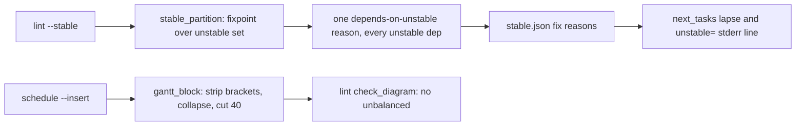
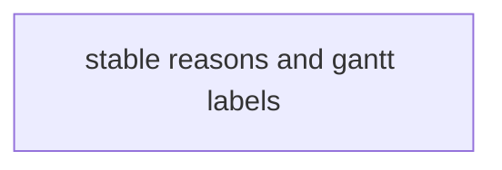

# Superlite: stable reasons name every unstable dep, gantt labels keep lint green (B30)

**Goal:** fix #302 (`plan_tools.stable_partition` names only the first round's unstable deps in a task's `depends on unstable` reason) and #306 (`schedule --insert` cuts a gantt label mid-brace, so `lint` flags the generated block as `unbalanced {}`).
**Architecture:** two local edits in `skills/subagent-driven-development/scripts/plan_tools.py` (`stable_partition`, `gantt_block`); one new test file. `next_tasks.py` is read by the new test, not changed.
**Tech stack:** Python 3.10+ stdlib, pytest (through `sl run_tests`).
**Spec:** this file, section Design; the Expected lines of #302 and #306.
**Detail:** tests
**Target-min:** 11
**Wave0:** none

Global constraints:
- Only `plan_tools.py` and the new test file change; existing tests stay green and no existing test file is edited (another lead may own them).
- The reason text keeps its exact shape `depends on unstable T1, T5` (ids joined by `, `), so `next_tasks._DEPENDS` and the fix-task lapse (B22) still match it.
- Run `sl` as an executable (`<abs>/sl ...`). Verify with `<abs>/sl run_tests --fast <test file> --task T1 --background`, then run the printed `wait:` line in the foreground. Never raw `pytest`, never the e2e or eval layers (coordinator's step).
- No version edits (the ship step bumps the version). Tests build plans under `tmp_path`; they never write the real repo's `.superlite/`.

Ruling: one task for both issues (because both edit plan_tools.py, so two tasks would serialize on the shared file anyway) - cost if wrong: one review covers two small fixes.
Ruling: #302 computes the unstable set to a fixpoint first, then writes one `depends on unstable` reason per task naming every unstable graph dep in graph order (parse_taskgraph sorts deps by id), after the task's own reasons (because the old loop appended once and never revisited) - cost if wrong: none; the lapse reads the same text.
Ruling: #306 strips `[`, `]`, `{`, `}` from gantt titles like `:;#,` (each becomes a space), collapses whitespace runs, cuts to 40 characters, then trims trailing space (because a title unbalanced on its own would still fail a balanced cut; check_diagram counts only []{} in gantt blocks, so no bracket left means no lint flag) - cost if wrong: labels lose bracket characters, which are display only.
Ruling: `()` stay in labels (because check_diagram counts parentheses only in flowchart and graph blocks) - cost if wrong: none.
Ruling: detail tests; Kind design on sonnet (because the fixpoint is small but stateful) - cost if wrong: a slightly slower worker.
Ruling: no probe adapter - plan text in, plan text and stable.json out; Review Focus cases run as named pytest cases - cost if wrong: no generated probes.
LAYERS: unit



## Design

**#302, `stable_partition(plan, issues, warnings)`.** Own reasons (task-scoped issues, flagged CHAIN, MISSED TARGET subjects) are collected as today. Then:

1. `unstable = {t for t in ids if reasons[t]}`; repeat until nothing changes: a task not in `unstable` with any graph dep in `unstable` joins it.
2. For each task in plan order: `bad = [d for d in graph.get(t, []) if d in unstable]`; when `bad` is non-empty append exactly one reason `"depends on unstable " + ", ".join(bad)`.

Result: every task reason lists each unstable dep, whatever round it turned unstable in; a stable dep is never named; own reasons come first; return value and shapes unchanged.

**#306, `gantt_block(plan, rep)`.** Per task: `title = re.sub(r"[:;#,\[\]{}]", " ", task.title if task else "")`, then `label = re.sub(r"\s+", " ", f"{t} {title}").strip()[:40].rstrip()`. The task line format `  {label} :{t.lower()}, {s}, {d}s` stays. No other part of the block changes.

## Coverage

| Category | State | Basis |
|---|---|---|
| Scope and success criteria | settled | #302 and #306 Expected lines |
| Domain and data model | settled | stable.json shape unchanged; reason text shape unchanged |
| Persistence and migration | n/a | stable.json rewritten by every lint --stable |
| Interfaces and contracts | settled | stable_partition and gantt_block signatures unchanged |
| UI states | n/a | CLI text |
| Concurrency and state ownership | n/a | one task |
| Error handling and recovery | settled | taskgraph parse error still gives an empty graph |
| Security and privacy | n/a | local plan files |
| Performance and limits | settled | fixpoint O(n) rounds as before |
| Observability | settled | the `unstable=` stderr line now names every dep |
| Testing strategy | settled | new unit test file; unit layer by the coordinator |
| Compatibility | settled | lapse regex matches the same text |
| Rollout | ruled | one PR; version bump at ship |
| Research unknowns | n/a | both causes read from the code |

## File structure
- `skills/subagent-driven-development/scripts/plan_tools.py`, `tests/scripts/test_stable_reason_gantt_label.py` (T1).

## Task graph

```mermaid
%% schedule
gantt
  title Predicted schedule (mm:ss)
  dateFormat X
  axisFormat %M:%S
  section lane 1
  T1 stable reasons name every unstable de :t1, 0, 91s
```




critical path: T1 (1.5 min) · peak width 1 · predicted build 1.5 min · predicted total ≈ 5.0 min (target ✓)

## Package: plan_tools (plan text in, plan text and stable.json out)
**Probe entry:** none (Ruling: no probe adapter).

### T1 stable reasons name every unstable dep; gantt labels hold no brackets · Complexity 3 · Est. context 34k
**Owns:** skills/subagent-driven-development/scripts/plan_tools.py, tests/scripts/test_stable_reason_gantt_label.py
**Components:** 2
**LOC owned:** 110
**Tests:** fast
**Model:** sonnet
**Est. time:** 2.5 min (2 components, about 110 LOC, fast tests)
**Covers:** Design
**Consumes:** existing `next_tasks.lapsed_fix(fix: list, committed) -> set[str]`
**Produces:** `stable_partition(plan: Plan, issues: list, warnings: list[str]) -> tuple[list[str], list[dict], list[str]]` and `gantt_block(plan: Plan, rep: dict) -> list[str]`, behaviour per the Design section (signatures unchanged)
**Review Focus:** state: `test_reason_names_dep_that_turns_unstable_in_a_later_round` (T3 deps T1, T5; T5 turns unstable through T4 after T3 was visited -> `depends on unstable T1, T5`); state: `test_own_reasons_first_then_one_depends_line`; state: `test_lapse_waits_for_every_named_dep` (committed T1 -> held, T1+T5 -> lapsed); encoding: `test_gantt_label_cut_inside_braces_stays_balanced` (cut at 40 inside `{...}` -> no brace, lint has no `unbalanced`); encoding: `test_gantt_label_strips_lone_brackets_and_collapses_spaces`.
**Test code (verbatim):**
```python
"""#302: stable_partition names every unstable dep; #306: gantt labels hold no brackets and pass lint."""
from __future__ import annotations

import json
import re

from test_plan_tools import make_plan, pt  # puts the scripts folder on sys.path

import next_tasks  # noqa: E402
import plan_tools  # noqa: E402

IDS = ("T1", "T2", "T3", "T4", "T5")
LATER_ROUND = [("T1", "T3"), ("T5", "T3"), ("T4", "T5")]  # T3 is visited before T5 turns unstable


def _plan(tmp_path, edges):
    return plan_tools.Plan.load(str(make_plan(tmp_path, [{"id": i, "time": 2} for i in IDS], edges)))


def _issue(tid):
    return plan_tools.Issue(f"LINT: {tid} is broken", tasks=(tid,))


def _reasons(fix):
    return {f["task"]: f["reasons"] for f in fix}


def test_reason_names_dep_that_turns_unstable_in_a_later_round(tmp_path):
    stable, fix, _ = plan_tools.stable_partition(_plan(tmp_path, LATER_ROUND), [_issue("T1"), _issue("T4")], [])
    reasons = _reasons(fix)
    assert reasons["T3"] == ["depends on unstable T1, T5"]
    assert reasons["T5"] == ["depends on unstable T4"]
    assert stable == ["T2"]


def test_own_reasons_first_then_one_depends_line(tmp_path):
    issues = [_issue("T1"), _issue("T3"), _issue("T4")]
    _, fix, _ = plan_tools.stable_partition(_plan(tmp_path, LATER_ROUND), issues, [])
    reasons = _reasons(fix)
    assert reasons["T3"] == ["LINT: T3 is broken", "depends on unstable T1, T5"]
    assert sum(r.startswith("depends on unstable") for rs in reasons.values() for r in rs) == 2


def test_stable_deps_are_not_named(tmp_path):
    stable, fix, _ = plan_tools.stable_partition(_plan(tmp_path, [("T1", "T3"), ("T2", "T3")]), [_issue("T1")], [])
    assert _reasons(fix)["T3"] == ["depends on unstable T1"]
    assert stable == ["T2", "T4", "T5"]


def test_lapse_waits_for_every_named_dep(tmp_path):
    _, fix, _ = plan_tools.stable_partition(_plan(tmp_path, LATER_ROUND), [_issue("T1"), _issue("T4")], [])
    assert "T3" not in next_tasks.lapsed_fix(fix, ["T1"])
    assert "T3" in next_tasks.lapsed_fix(fix, ["T1", "T5"])


def test_lint_stable_json_names_later_round_dep(tmp_path):
    ghost = "ghost(x: int) -> int"
    tasks = [{"id": "T1", "time": 5, "consumes": ghost}, {"id": "T2", "time": 2}, {"id": "T3", "time": 2},
             {"id": "T4", "time": 2, "consumes": ghost}, {"id": "T5", "time": 2}]
    cp = pt("lint", "--stable", "--plan", make_plan(tmp_path, tasks, LATER_ROUND))
    data = json.loads((tmp_path / ".superlite" / "stable.json").read_text(encoding="utf-8"))
    reasons = _reasons(data["fix"])
    assert "depends on unstable T1, T5" in reasons["T3"], cp.both
    assert "depends on unstable T4" in reasons["T5"], cp.both


def _gantt_lines(text):
    return [ln for ln in text.splitlines() if re.search(r" :t\d+, \d+, \d+s$", ln)]


def _schedule(tmp_path, title):
    p = make_plan(tmp_path, [{"id": "T1", "time": 2, "title": title}])
    cp = pt("schedule", "--plan", p, "--insert")
    assert cp.returncode == 0, cp.both
    lines = _gantt_lines(p.read_text(encoding="utf-8"))
    assert len(lines) == 1, lines
    return p, lines[0]


def test_gantt_label_cut_inside_braces_stays_balanced(tmp_path):
    p, line = _schedule(tmp_path, "Fix the stable reason list {name every dep}")
    assert line.startswith("  T1 Fix the stable reason list name every :t1, 0, "), line
    assert "unbalanced" not in pt("lint", "--plan", p).both


def test_gantt_label_strips_lone_brackets_and_collapses_spaces(tmp_path):
    p, line = _schedule(tmp_path, "Add [x] flag: {y} mode; #3, done ] {")
    assert line.startswith("  T1 Add x flag y mode 3 done :t1, 0, "), line
    assert "unbalanced" not in pt("lint", "--plan", p).both


def test_gantt_label_never_ends_in_a_space(tmp_path):
    _, line = _schedule(tmp_path, "a" * 36 + " tail")
    assert line.startswith("  T1 " + "a" * 36 + " :t1, 0, "), line


def test_gantt_label_keeps_parentheses(tmp_path):
    p, line = _schedule(tmp_path, "Parse (a) values")
    assert line.startswith("  T1 Parse (a) values :t1, 0, "), line
    assert "unbalanced" not in pt("lint", "--plan", p).both
```
**Steps:** 1 write the test file, 2 run: FAIL (later-round reason, brace cut, stripping, trailing space), 3 implement the Design section in plan_tools.py, 4 run: PASS.
**Notes:** keep the `# O(...)` comment on every changed or added line of plan_tools.py (the file's convention). The fixpoint keeps the old worst case of O(n) rounds.

## Review Focus
- plan_tools (library over plan text): state (fixpoint over the unstable set, reasons per round), encoding (gantt labels: brackets, separators, cut, trailing space). Specific risks: a dep named twice, a stable dep named, the lapse text shape, a cut landing inside a bracket pair.

## Self-review
Coverage: both Expected lines map to T1 tests. No placeholders. Consumes names an existing function. One task, no edges, no shared file. Fields filled. Schedule and lint run next.
