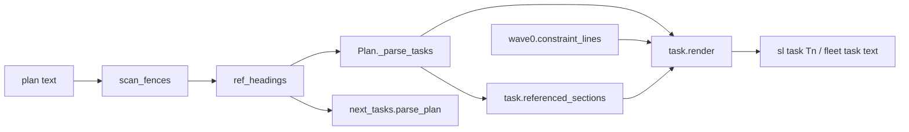
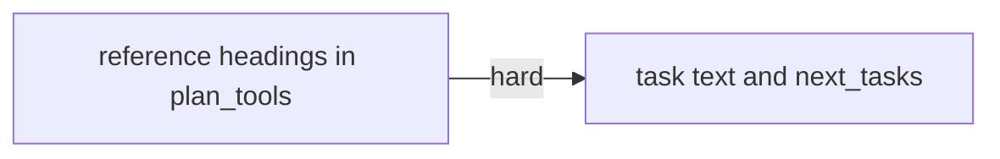

# Superlite: `sl task` appends the plan's Global constraints; a section reference line no longer ends a task (B37)

**Goal:** fix #285: `sl task Tn` (and the fleet task text, both `task.render`) never shows the plan header's Global constraints although writing-plans tells authors that task briefs point there; and a line that is exactly `## X` inside a task block ends the task in both plan parsers, so every field after it is lost. Expected: `sl task` includes the Global constraints block, a `## X` reference line keeps the task going, and the writing-plans text matches what an implementer receives.
**Architecture:** T1 adds the reference rule to `plan_tools.py` (`heading_phrase`, `ref_headings`, `Plan.refs`, `_parse_tasks`); T2 makes `task.render` append the constraint lines `wave0.constraint_lines` already gives the slim prime, makes `next_tasks.parse_plan` and `task.referenced_sections` honour the same reference set, and updates the writing-plans and docs/tools.md text.
**Tech stack:** Python 3.10+ stdlib, pytest (through `sl run_tests`).
**Spec:** this file, section Design; issue #285's Expected line and Max's decision.
**Detail:** contracts
**Target-min:** 11
**Wave0:** none
**Max chars:** 24000

Global constraints:
- Every code line in `skills/subagent-driven-development/scripts/` carries the repo's trailing `# O(...)` complexity comment (short notes after `|`); tests do not. Stdlib only.
- Existing tests stay green and no existing test file changes (another lead may own them). If an existing test turns red, report it in DONE_WITH_CONCERNS with the test id and the reason instead of editing it.
- Run `sl` as an executable (`<abs>/sl ...`). Verify with `<abs>/sl run_tests --fast <own test file> tests/scripts/test_task_sections.py tests/scripts/test_parse_plan_fences.py tests/scripts/test_plan_tools.py tests/scripts/test_slim_prime.py --task Tn --background`, then run the printed `wait:` line in the foreground and end the turn only after it reports. Never raw `pytest`, never the e2e or eval layers (coordinator's step).
- No version edits (the ship step bumps the version).
- Plans without a reference line parse exactly as before (same tasks, fields and text).

Ruling: Max's decision: `sl task` always appends the Global constraints block, whether or not the task names it - cost if wrong: about 5-15 lines more per task text.
Ruling: the block reuses `wave0.constraint_lines` (Global constraints lines with their bullets, a `## Global constraints` section, Tech stack and Architecture lines), the source the slim prime and the wave0 brief already use, instead of a second extractor - cost if wrong: Tech stack and Architecture lines ride along in every task text.
Ruling: B37 also edits task.py, next_tasks.py, skills/writing-plans/SKILL.md and docs/tools.md (outside its file list): the render lives in task.py, the second plan parser in next_tasks.py, and no running or planned batch (B36, B38, B39) owns them - cost if wrong: a rebase conflict at ship.
Ruling: a reference line is a `##`/`###` non-task heading whose phrase repeats another such heading and that a task field line follows before the next non-reference heading; both conditions, so a component section that repeats a design heading still ends the task above it and a malformed `### Task 5` heading never merges its Owns into the task above - cost if wrong: a trailing reference with no field after it still ends its task (it loses only itself).
Ruling: `# X` and `#### X` lines keep today's behaviour in both parsers - cost if wrong: none beyond today's.
Ruling: the Global constraints block comes last in the task text, after `## Plan sections this task names`; a plan section whose phrase is `global constraints` is never listed under Plan sections (the block already carries it); no block when the plan states none - cost if wrong: none.
Ruling: detail contracts - known causes in existing modules; tests named with exact inputs and outcomes - cost if wrong: one NEEDS_CONTEXT round.
Ruling: no probe adapter - plan parsing over text; Review Focus cases run as named pytest cases - cost if wrong: no generated probes.
Ruling: already in the lead worktree on branch superlite/b37-sl-task-global-constraints, so no `sl worktree ensure` - cost if wrong: none.
LAYERS: unit, headless, evals

## Design

### 1. Reference headings (T1)
- `heading_phrase(title: str) -> str`: today's `task._phrase`, moved: drop backticks and asterisks, strip, drop a leading `N.` / `N.N` number and its blanks, drop a trailing colon, collapse whitespace, lower case.
- `TASK_FIELDS`: frozenset of the task template's field names, lower case: owns, components, loc owned, tests, kind, model, est. time, est. context, consumes, produces, covers, review focus, test code, steps, notes, status.
- `ref_headings(lines, fenced) -> set[int]`, the line indexes of reference headings:
  1. A candidate is an unfenced line matching `^#{2,3}\s+(.+?)\s*#*\s*$` that `HEADING_RE` does not match and whose `heading_phrase` of group 1 is not empty.
  2. A candidate is repeated when another candidate (another index) has the same phrase.
  3. A repeated candidate `i` is a reference when, scanning lines `i+1` onward: fenced and blank lines are skipped; another repeated candidate is skipped; any other unfenced line matching `ANY_HEADING_RE` stops the scan (not a reference); an unfenced line whose stripped text matches `FIELD_RE` with `group(1).strip().lower()` in `TASK_FIELDS` makes `i` a reference; every other line is skipped. The end of the text: not a reference.
- `Plan.__init__` sets `self.refs = ref_headings(self.lines, self.fenced)` before parsing tasks. `_parse_tasks` treats an unfenced line whose index is in `self.refs` as an ordinary body line: it never closes the task, and it resets `cur_field` like any other non-field line.
- The module docstring names the reference rule in one sentence.

### 2. Task text and the second parser (T2)
- `task.py`: `_phrase` goes; `referenced_sections` uses `pt.heading_phrase`, skips every heading whose line lies inside a task block (`t.line` up to `t.line + len(t.text.split("\n")) - 1` for each task) and every section whose phrase is `global constraints`.
- `task.render`: after the Plan sections part, when `wave0.constraint_lines(plan)` is not empty, append `""`, `"## Global constraints"`, `""` and those lines joined by `"\n"`. The module docstring names the block.
- `next_tasks.parse_plan`: an unfenced heading whose index is in `plan_tools.ref_headings(lines, fenced)` never ends a task (it goes to the body like any line).
- `skills/writing-plans/SKILL.md`, Plan shape item 1: the sentence "Task briefs point here, so do not repeat constraints per task." becomes "`sl task` appends them, with the Tech stack and Architecture lines, to every task's text, so do not repeat constraints per task." Plan size paragraph: "(implementers read their task with `sl task Tn`)" becomes "(implementers read their task with `sl task Tn`: the block, the Produces lines it consumes, the plan sections it names and the Global constraints)".
- `docs/tools.md`, `task` row: "prints one task's block from the current plan (no rebuild), the Produces lines of the tasks it consumes, the plan sections it names (a one-word heading as `X section`, `section X`, `§ X` or a `## X` line) and the plan's Global constraints; an unknown id exits 2 and lists the tasks".

## Coverage

| Category | State | Basis |
|---|---|---|
| Scope and success criteria | settled | #285 Expected line; Max's decision: always append |
| Domain and data model | settled | `Plan.refs`; task text gains one block |
| Persistence and migration | n/a | no stored data |
| Interfaces and contracts | settled | `sl task` output grows; parser results change only with a reference line |
| UI states | n/a | CLI text only |
| Concurrency and state ownership | ruled | two tasks in sequence |
| Error handling and recovery | settled | no new error paths |
| Security and privacy | n/a | plan text only |
| Performance and limits | settled | one more O(L) scan per parse |
| Observability | n/a | no logs |
| Testing strategy | settled | one new unit test file per task; layers by the coordinator |
| Compatibility | ruled | plans without reference lines unchanged |
| Rollout | ruled | one PR; version bump at ship |
| Research unknowns | n/a | both bugs reproduced from the code |

## File structure
- `skills/subagent-driven-development/scripts/plan_tools.py`, `tests/scripts/test_plan_heading_refs_285.py` (T1).
- `skills/subagent-driven-development/scripts/task.py`, `skills/subagent-driven-development/scripts/next_tasks.py`, `skills/writing-plans/SKILL.md`, `docs/tools.md`, `tests/scripts/test_task_constraints_285.py` (T2).

## Task graph

```mermaid
%% schedule
gantt
  title Predicted schedule (mm:ss)
  dateFormat X
  axisFormat %M:%S
  section lane 1
  T1 plan_tools a repeated heading followe :t1, 0, 75s
  T2 task text Global constraints block ne :t2, 75, 90s
```

critical path: T1 → T2 (2.7 min) · peak width 1 · predicted build 2.7 min · predicted total ≈ 6.2 min (target ✓)

## Package: plan parsing and task text (library over plan text)
App type: library/parser. Categories: deep, state, encoding. Specific risks: a real section heading swallowed into the task above, a malformed task heading merging its fields, the two parsers disagreeing on a task's Owns.
**Probe entry:** none (Ruling: no probe adapter).

### T1 plan_tools: a repeated heading followed by task fields stays in its task · Complexity 4 · Est. context 40k
**Owns:** skills/subagent-driven-development/scripts/plan_tools.py, tests/scripts/test_plan_heading_refs_285.py
**Components:** 1
**LOC owned:** 140
**Tests:** fast
**Model:** sonnet
**Est. time:** 2.0 min (1 component, about 140 LOC, fast tests)
**Covers:** 1
**Consumes:** existing `plan_tools.scan_fences(lines: list[str])` · existing `plan_tools.Plan(text: str)`
**Produces:** plan_tools.heading_phrase(title: str) -> str · plan_tools.ref_headings(lines: list[str], fenced: list[bool]) -> set[int] · plan_tools.Plan.refs: set[int] · plan_tools.TASK_FIELDS: frozenset
e.g. heading_phrase("2. The `fmt_row` Helper:") -> "the fmt_row helper"
e.g. heading_phrase("**Design**") -> "design"
e.g. ref_headings(["## Design", "x", "### T1 A", "**Owns:** a.py", "## Design", "**Steps:** s"], [False] * 6) -> {4}
**Review Focus:**
Test fixture: `PLAN = "# Plan\n\n## Design\nUse X = 1.\n\n## Package\n\n### T1 First\n**Owns:** a.py\nFollow\n## Design\n**Steps:** do it\n**Produces:** a.f() -> int\n\n### T2 Second\n**Owns:** b.py\n"` (the reference `## Design` is line 10).
state: `test_ref_line_keeps_task_fields` (`Plan(PLAN)`: `refs == {10}`, T1 `owns == ["a.py"]`, `produces == ["a.f() -> int"]`, T1 text holds `## Design` and `**Steps:** do it`; T2 `owns == ["b.py"]`);
state: `test_ref_to_later_section` (T1 holds `## Wire format` then `**Steps:** s`, the real `## Wire format\nbytes` section follows T2 -> T1 text holds `**Steps:** s`; the real heading's index is not in `refs`);
encoding: `test_heading_phrase_normalizes` (the two `e.g.` cases, `heading_phrase("1.2 Wire  format") == "wire format"`; a `### 3. Design:` section above the tasks and a `## design` line in T1 followed by `**Steps:** s` -> that line is in `refs`);
state: `test_unrepeated_heading_ends_task` (T1 then `### Task 5: c` and `**Owns:** c.py` -> `refs == set()`, T1 `owns == ["a.py"]`);
state: `test_repeat_without_task_field_ends_task` (`## Parser` above the tasks; after T1 a section `## Parser\nParser package.\n**Probe entry:** call=x.parse\n\n### T2 Second\n**Owns:** b.py` -> its index not in `refs`, T1 text lacks `Parser package.`, `"probe entry" not in T1.fields`);
deep: `test_fenced_lines_ignored` (a `## Design` line in T1 followed only by a fenced block holding `**Steps:** s` and then `### T2` -> not in `refs`; the same followed by the fence and then an unfenced `**Steps:** s` -> in `refs`; a `## Design` line inside a fence is never a candidate);
deep: `test_consecutive_refs` (T1 holds `## Design`, `## Wire format`, `**Steps:** s`, both headings repeated elsewhere -> both indexes in `refs`, T1 text holds `**Steps:** s`);
state: `test_level_one_and_four_unchanged` (`# Design` and `#### Design` lines in T1 followed by `**Steps:** s`, with `# Design` / `#### Design` repeated above -> `refs == set()`, T1 text lacks `**Steps:** s`);
state: `test_plain_plan_unchanged` (`Plan(PLAN.replace("Follow\n## Design\n", ""))`: `refs == set()`, task ids, `owns`, `produces` and texts equal those parsed before the change, asserted as literals).
**Steps:** 1 failing tests, 2 run: FAIL, 3 implement Design 1, 4 run: PASS (own file plus the verify files of Global constraints).

### T2 task text: Global constraints block; next_tasks and referenced_sections honour reference lines · Complexity 4 · Est. context 45k
**Owns:** skills/subagent-driven-development/scripts/task.py, skills/subagent-driven-development/scripts/next_tasks.py, skills/writing-plans/SKILL.md, docs/tools.md, tests/scripts/test_task_constraints_285.py
**Components:** 2
**LOC owned:** 130
**Tests:** fast
**Model:** sonnet
**Est. time:** 2.5 min (2 components, about 130 LOC, fast tests)
**Covers:** 2
**Consumes:** plan_tools.heading_phrase(title: str) -> str (T1) · plan_tools.ref_headings(lines: list[str], fenced: list[bool]) -> set[int] (T1) · existing `wave0.constraint_lines(plan) -> list[str]`
**Produces:** task.render(plan, tid) -> str (adds the `## Global constraints` block) · task.referenced_sections(plan, task) -> list
**Review Focus:**
Test fixture: `HEAD = "# Plan\n**Tech stack:** Python\n\nGlobal constraints:\n- stdlib only.\n- No version edits.\n\n## Design\nbody\n\n## Package\n\n"`, tasks `### T1 First\n**Owns:** a.py\n**Produces:** a.f() -> int\n\n### T2 Second\n**Owns:** b.py\n**Consumes:** a.f() -> int (T1)\nsee the Design section\n`.
state: `test_constraints_appended_always` (`render(plan, "T1")` ends with `"## Global constraints\n\n**Tech stack:** Python\nGlobal constraints:\n- stdlib only.\n- No version edits.\n"`, though T1 names nothing);
state: `test_order_of_parts` (`render(plan, "T2")`: index of `## Consumed interfaces` < `## Plan sections this task names` < `## Global constraints`);
state: `test_constraints_section_form` (a plan whose header holds `## Global constraints\n- Numbers are float64.` and a task saying `obey the global constraints` -> render holds `"## Global constraints\n\n- Numbers are float64.\n"` once and `referenced_sections` is `[]`);
state: `test_no_constraints_no_block` (a plan with no constraint, Tech stack or Architecture line -> `"## Global constraints" not in render(plan, "T1")`);
deep: `test_ref_line_names_section_once` (T2 holds `## Design` then `**Steps:** x` -> render holds `**Steps:** x` and `referenced_sections(plan, T2) == ["## Design\nbody"]`);
state: `test_next_tasks_keeps_fields_after_ref` (plan file in `tmp_path`; T2 is `### T2 Second\n**Kind:** design\n## Design\n**Owns:** b.py\n` -> `next_tasks.parse_plan(path)["T2"]["owns"] == ["b.py"]` and `Plan.load(path).by_id["T2"].owns == ["b.py"]`);
state: `test_next_tasks_plain_plan_unchanged` (the fixture plan without a reference line -> `parse_plan` ids `["T1", "T2"]`, owns `["a.py"]` and `["b.py"]`);
encoding: `test_docs_name_the_block` (`skills/writing-plans/SKILL.md` holds "`sl task` appends them" and no longer "Task briefs point here"; the `docs/tools.md` `task` row names "Global constraints").
**Steps:** 1 failing tests, 2 run: FAIL, 3 implement Design 2 (read the Design section), 4 run: PASS (own file plus the verify files of Global constraints).

## Self-review
- #285 bullet 1 (constraints never reach `sl task` or the fleet text): Design 2, `task.render`, which fleet_io also calls. Bullet 2 (`## X` ends a task): Design 1 in `plan_tools`, Design 2 in `next_tasks` and `referenced_sections`. Expected's writing-plans clause: Design 2 text edits.
