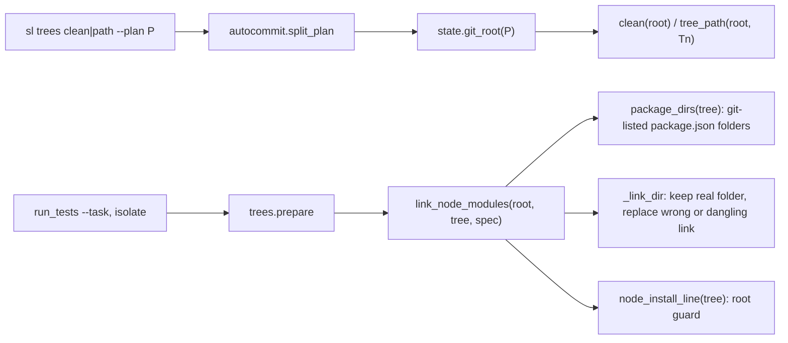
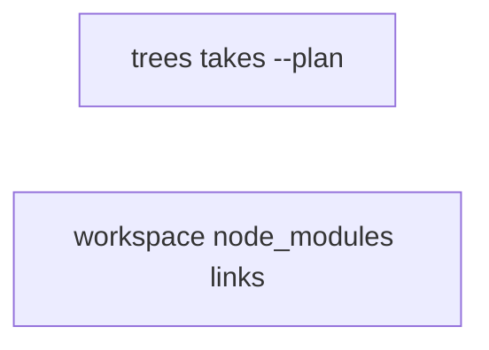

# Superlite: trees takes --plan, task trees link workspace node_modules (B31)

**Goal:** fix #303 (`sl trees clean --plan P` and `trees path Tn --plan P` fail with `usage: trees.py clean | path Tn`) and #305 (an isolated Node task tree links only the root `node_modules`; a workspace package's own `packages/x/node_modules` is missing).
**Architecture:** two local edits: `trees.main` parses `--plan` with the existing `autocommit.split_plan` and works in `state.git_root(P)`; `run_tests.link_node_modules` links the root's and every package folder's `node_modules` through one helper. Two new test files. `autocommit.py` and `state.py` are read, not changed.
**Tech stack:** Python 3.10+ stdlib, pytest (through `sl run_tests`).
**Spec:** this file, section Design; the Expected lines of #303 and #305.
**Detail:** tests
**Target-min:** 11
**Wave0:** none

Global constraints:
- Only `trees.py`, `run_tests.py` and the two new test files change; existing tests stay green and no existing test file is edited (another lead may own them).
- Run `sl` as an executable (`<abs>/sl ...`). Verify with `<abs>/sl run_tests --fast <test file> --task Tn --background`, then run the printed `wait:` line in the foreground. Never raw `pytest`, never the e2e or eval layers (coordinator's step).
- No version edits (the ship step bumps the version). Tests build repos under `tmp_path`; they never write the real repo's `.superlite/`.
- Keep the `# O(...)` comment on every changed or added code line of `trees.py` and `run_tests.py` (the files' convention).

Ruling: two tasks, one per issue (because they touch different files and share no code) - cost if wrong: none.
Ruling: trees reuses `autocommit.split_plan` (lazy import in `main`) instead of a copy (because #303 asks for exactly #290's behaviour and duplicate logic is a defect) - cost if wrong: trees' CLI loads one more stdlib-only module.
Ruling: `--plan` with no value, an empty `--plan=` or a value starting with `--` is a usage error (exit 2), as in autocommit; a P outside any checkout keeps the cwd - cost if wrong: none, same contract as 1.5.31.
Ruling: a workspace package is any folder below the tree root holding a `package.json` that `git ls-files -co --exclude-standard` lists in the tree (tracked at base, or overlaid as a new owned file), with no `node_modules` part in its path; no parsing of `workspaces` or `pnpm-workspace.yaml` (because the folder test covers npm, yarn and pnpm alike, stdlib only) - cost if wrong: a nested non-workspace project with its own install is linked too, which only helps it resolve.
Ruling: a package is linked only when its run-root counterpart holds a `node_modules` folder; no new guard for a package whose link fails (OSError only), the root guard stays (because #305 offers linking or a guard, and a failed package link is rare) - cost if wrong: such a run fails at module resolution instead of a usage error.
Ruling: detail tests; Kind design on sonnet for both (CLI args and file links are protocol and file risks) - cost if wrong: slightly slower workers.
Ruling: no probe adapter - CLI args in, folder state out; Review Focus cases run as named pytest cases - cost if wrong: no generated probes.
LAYERS: unit



## Design

**#303, `trees.main(argv)`.** `rest, plan = autocommit.split_plan(argv)` (lazy import). `plan == ""`: usage, exit 2. `root = state.git_root(plan) or "."` when `plan`, else `"."`. Then `rest == ["clean"]` prints `removed N` from `clean(root)`; `rest == ["path", Tn]` prints `tree_path(root, Tn).resolve()`; anything else prints `usage: trees.py clean | path Tn [--plan P]` on stderr and exits 2. The module docstring names `--plan P` (as autocommit's line 4 does).

**#305, `run_tests.link_node_modules(root, tree, spec) -> bool`.** Same gates as today: a setup command, or no `root/package.json`, returns False. Then for `d` in `["", *package_dirs(tree)]`: when `root/d/node_modules` is a folder and `tree/d` is a folder, `_link_dir(root/d/node_modules, tree/d/node_modules)`. Returns True when any link changed.
- `_link_dir(src, dst) -> bool`: the old body: a symlink resolving to `src` stays (False); a dangling, looping or wrong symlink is removed and relinked; a real folder or file stays (False); the new link is `os.path.relpath(src, dst.parent.resolve())`; an OSError returns False.
- `package_dirs(tree) -> list[str]`: `trees.git(tree, "ls-files", "-co", "--exclude-standard", "-z")`, split with `trees.split_z`; each path whose last part is `package.json`, with at least one folder part and no `node_modules` part, gives its folder (posix, sorted, unique). A git error gives `[]`.
- The root link text stays `../../../node_modules`; `packages/x` gets `../../../../../packages/x/node_modules`. `node_install_line(tree)` is unchanged. The docstring line 15 names the package links.

## Coverage

| Category | State | Basis |
|---|---|---|
| Scope and success criteria | settled | #303 and #305 Expected lines |
| Domain and data model | n/a | no data model |
| Persistence and migration | n/a | trees are throwaway |
| Interfaces and contracts | settled | trees CLI gains `--plan`; link_node_modules signature unchanged |
| UI states | n/a | CLI text |
| Concurrency and state ownership | settled | prepare holds the tree lock; links are made after it, per task tree |
| Error handling and recovery | ruled | usage error on a valueless --plan; failed package link not guarded |
| Security and privacy | n/a | local folders |
| Performance and limits | settled | one `ls-files` per isolated task run |
| Observability | settled | usage line names `--plan P` |
| Testing strategy | settled | two new unit test files; unit layer by the coordinator |
| Compatibility | settled | without --plan the CLI is unchanged; root link text unchanged |
| Rollout | ruled | one PR; version bump at ship |
| Research unknowns | n/a | both causes read from the code |

## File structure
- `skills/subagent-driven-development/scripts/trees.py`, `tests/scripts/test_trees_plan.py` (T1).
- `skills/subagent-driven-development/scripts/run_tests.py`, `tests/scripts/test_run_tests_workspace_node_modules.py` (T2).

## Task graph



critical path: T2 (1.6 min) · peak width 2 · predicted build 1.6 min · predicted total ≈ 5.1 min (target ✓)

## Package: trees (CLI over task trees)
**Probe entry:** none (Ruling: no probe adapter).

### T1 trees clean and path take --plan P anywhere · Complexity 2 · Est. context 35k
**Owns:** skills/subagent-driven-development/scripts/trees.py, tests/scripts/test_trees_plan.py
**Components:** 1
**LOC owned:** 120
**Tests:** fast
**Model:** sonnet
**Est. time:** 2.5 min (1 component, about 120 LOC, fast tests)
**Covers:** Design
**Consumes:** existing `autocommit.split_plan(argv: list[str]) -> tuple[list[str], str | None]` · existing `state.git_root(path) -> Path | None`
**Produces:** `trees.main(argv: list[str] | None = None) -> int`, behaviour per the Design section (#303)
**Review Focus:** protocol: `test_clean_with_plan_works_in_plan_checkout` (4 argument orders); protocol: `test_plan_without_value_is_usage_error`; file: `test_plan_outside_any_checkout_keeps_cwd`; protocol: `test_sl_trees_clean_with_plan` (through the launcher).
**Test code (verbatim):**
```python
"""#303: trees.py clean and path take --plan P / --plan=P anywhere and work in P's checkout."""
from __future__ import annotations

import os
import subprocess
import sys

import pytest

from test_plan_tools import SCRIPTS

sys.path.insert(0, str(SCRIPTS))
import state  # noqa: E402
import trees  # noqa: E402

SL = SCRIPTS / "sl"
USAGE = "usage: trees.py clean | path Tn [--plan P]"


def git(root, *args):
    return subprocess.run(["git", "-C", str(root), *args], check=True, capture_output=True, text=True).stdout


def make_repo(path):
    path.mkdir(parents=True)
    git(path, "init", "-q")
    git(path, "config", "user.email", "t@t")
    git(path, "config", "user.name", "t")
    (path / ".git" / "info").mkdir(exist_ok=True)
    (path / ".git" / "info" / "exclude").write_text(".superlite/\n")
    (path / "src").mkdir()
    (path / "src" / "a.py").write_text("A = 1\n")
    git(path, "add", ".")
    git(path, "commit", "-qm", "base")
    (path / ".superlite").mkdir()
    return path


@pytest.fixture
def two(tmp_path, monkeypatch):
    run = make_repo(tmp_path / "run")
    other = make_repo(tmp_path / "other")
    monkeypatch.chdir(other)
    return run, other


def trees_of(repo):
    base = repo / ".superlite" / "trees"
    return sorted(p.name for p in base.iterdir() if p.is_dir()) if base.is_dir() else []


@pytest.mark.parametrize("argv", [
    ["clean", "--plan", "{run}/.superlite"],
    ["--plan", "{run}/.superlite", "clean"],
    ["clean", "--plan={run}/docs/plans/p.md"],
    ["--plan={run}", "clean"],
])
def test_clean_with_plan_works_in_plan_checkout(two, capsys, argv):
    run, other = two
    trees.prepare(run, "T1", ["src/a.py"])
    trees.prepare(other, "T1", ["src/a.py"])
    assert trees.main([a.format(run=run) for a in argv]) == 0
    assert capsys.readouterr().out.strip() == "removed 1"
    assert trees_of(run) == []
    assert trees_of(other) == ["T1"]


def test_path_with_plan_prints_plan_checkout_tree(two, capsys):
    run, _ = two
    assert trees.main(["path", "T3", "--plan", str(run / ".superlite")]) == 0
    assert capsys.readouterr().out.strip() == str((run / ".superlite" / "trees" / "T3").resolve())


def test_path_plan_before_command(two, capsys):
    run, _ = two
    assert trees.main([f"--plan={run / 'docs' / 'plans' / 'p.md'}", "path", "T2"]) == 0
    assert capsys.readouterr().out.strip() == str((run / ".superlite" / "trees" / "T2").resolve())


@pytest.mark.parametrize("argv", [["clean", "--plan"], ["clean", "--plan="], ["clean", "--plan", "--x"],
                                  ["path", "T1", "--plan"]])
def test_plan_without_value_is_usage_error(two, capsys, argv):
    _, other = two
    trees.prepare(other, "T1", ["src/a.py"])
    assert trees.main(argv) == 2
    cap = capsys.readouterr()
    assert USAGE in cap.err
    assert cap.out == ""
    assert trees_of(other) == ["T1"]


def test_plan_outside_any_checkout_keeps_cwd(two, tmp_path, capsys):
    _, other = two
    plan = tmp_path / "loose" / "plan.md"
    if state.git_root(plan):
        pytest.skip("tmp_path lies inside a git checkout")
    trees.prepare(other, "T1", ["src/a.py"])
    assert trees.main(["clean", "--plan", str(plan)]) == 0
    assert capsys.readouterr().out.strip() == "removed 1"
    assert trees_of(other) == []


def test_without_plan_unchanged(two, capsys):
    run, other = two
    trees.prepare(run, "T1", ["src/a.py"])
    trees.prepare(other, "T1", ["src/a.py"])
    assert trees.main(["clean"]) == 0
    assert capsys.readouterr().out.strip() == "removed 1"
    assert trees_of(run) == ["T1"]
    assert trees_of(other) == []
    assert trees.main(["path", "T4"]) == 0
    assert capsys.readouterr().out.strip() == str((other / ".superlite" / "trees" / "T4").resolve())
    assert trees.main(["bogus"]) == 2
    assert USAGE in capsys.readouterr().err


@pytest.mark.skipif(os.name == "nt", reason="bash launcher")
def test_sl_trees_clean_with_plan(two):
    run, _ = two
    trees.prepare(run, "T1", ["src/a.py"])
    r = subprocess.run([str(SL), "trees", "clean", "--plan", ".superlite"], cwd=run, capture_output=True, text=True)
    assert r.returncode == 0, r.stderr
    assert r.stdout.strip() == "removed 1"
    assert trees_of(run) == []
```
**Steps:** 1 write the test file, 2 run: FAIL (--plan rejected), 3 implement the Design section's #303 part in trees.py, 4 run: PASS.
**Notes:** import `autocommit` and `state` inside `main` (run_tests imports trees; keep its import cheap). Update the module docstring and the usage line together.

## Package: run_tests (task-tree node_modules links)
**Probe entry:** none (Ruling: no probe adapter).

### T2 isolated task tree links every workspace package's node_modules · Complexity 3 · Est. context 42k
**Owns:** skills/subagent-driven-development/scripts/run_tests.py, tests/scripts/test_run_tests_workspace_node_modules.py
**Components:** 2
**LOC owned:** 170
**Tests:** fast
**Model:** sonnet
**Est. time:** 3 min (2 components, about 170 LOC, fast tests)
**Covers:** Design
**Consumes:** existing `trees.git(root, *args) -> str` · existing `trees.split_z(text: str) -> list[str]` · existing `trees.prepare(root, task: str, owns: list[str]) -> Path`
**Produces:** `run_tests.link_node_modules(root, tree, spec: dict) -> bool` and `run_tests.package_dirs(tree) -> list[str]`, behaviour per the Design section (#305)
**Review Focus:** file: `test_wrong_and_dangling_package_links_replaced`; file: `test_real_package_folder_in_tree_kept`; file: `test_nested_package_link_depth`; state: `test_new_owned_package_in_overlay_is_linked`; file: `test_package_json_under_node_modules_is_no_package`.
**Test code (verbatim):**
```python
"""#305: an isolated Node task tree links each workspace package's node_modules, not only the root's."""
from __future__ import annotations

import json
import os
import subprocess
import sys

import pytest

from test_plan_tools import SCRIPTS

sys.path.insert(0, str(SCRIPTS))
import run_tests  # noqa: E402
import testcmd  # noqa: E402
import trees  # noqa: E402

pytestmark = pytest.mark.skipif(os.name == "nt", reason="posix symlinks")

PLAN = """# P

## Section A

### T1 first
**Owns:** packages/x/src/a.test.ts
**Produces:** x
"""
CMD = ("python3 -c \"open('seen.txt','w').write(open('packages/x/node_modules/marker.txt').read() + "
       "open('node_modules/marker.txt').read()); print('Tests  1 passed (1)')\"")
ARGS = ["--fast", "packages/x/src/a.test.ts", "--task", "T1", "--plan", "plan.md", "--summary",
        ".superlite/test-summary.json", "--log", ".superlite/incidents.jsonl", "--ledger", ".superlite/progress.md"]
NO_SETUP = {"setup": ""}


def git(root, *args):
    return subprocess.run(["git", "-C", str(root), *args], check=True, capture_output=True, text=True).stdout


def spec():
    return {"language": "typescript", "python": False, "isolate": True, "junit": "", "env": {},
            "setup": "", "source": "test", "command": CMD}


def pkg(root, rel, marker=None):
    d = root / rel
    d.mkdir(parents=True, exist_ok=True)
    (d / "package.json").write_text(json.dumps({"name": rel.rsplit("/", 1)[-1], "devDependencies": {"vitest": "1"}}))
    if marker is not None:
        (d / "node_modules").mkdir()
        (d / "node_modules" / "marker.txt").write_text(marker)


@pytest.fixture
def repo(tmp_path, monkeypatch):
    for k in ("SUPERLITE_FLEET_ROLE", "SUPERLITE_FLEET_PARENT_DIR", "SUPERLITE_STATE_DIR"):
        monkeypatch.delenv(k, raising=False)
    git(tmp_path, "init", "-q")
    git(tmp_path, "config", "user.email", "t@t")
    git(tmp_path, "config", "user.name", "t")
    (tmp_path / ".git" / "info").mkdir(exist_ok=True)
    (tmp_path / ".git" / "info" / "exclude").write_text(".superlite/\n")
    (tmp_path / "package.json").write_text(json.dumps({"workspaces": ["packages/*"], "devDependencies": {"vitest": "1"}}))
    (tmp_path / ".gitignore").write_text("node_modules/\n")
    (tmp_path / "plan.md").write_text(PLAN)
    (tmp_path / "node_modules").mkdir()
    (tmp_path / "node_modules" / "marker.txt").write_text("root")
    pkg(tmp_path, "packages/x", "pkg-x")
    (tmp_path / "packages" / "x" / "src").mkdir()
    (tmp_path / "packages" / "x" / "src" / "a.test.ts").write_text("// t\n")
    pkg(tmp_path, "packages/y")
    pkg(tmp_path, "packages/deep/z", "pkg-z")
    git(tmp_path, "add", ".")
    git(tmp_path, "commit", "-qm", "base")
    (tmp_path / ".superlite").mkdir(exist_ok=True)
    monkeypatch.chdir(tmp_path)
    monkeypatch.setattr(testcmd, "resolve", lambda root=".", paths=(): spec())
    return tmp_path


def tree_of(repo):
    return repo / ".superlite" / "trees" / "T1"


def test_task_run_links_workspace_package_node_modules(repo):
    assert run_tests.main(ARGS) == 0
    tree = tree_of(repo)
    link = tree / "packages" / "x" / "node_modules"
    assert link.is_symlink()
    assert os.readlink(link) == "../../../../../packages/x/node_modules"
    assert os.readlink(tree / "node_modules") == "../../../node_modules"
    assert (tree / "seen.txt").read_text() == "pkg-xroot"


def test_nested_package_link_depth(repo):
    assert run_tests.main(ARGS) == 0
    link = tree_of(repo) / "packages" / "deep" / "z" / "node_modules"
    assert os.readlink(link) == "../../../../../../packages/deep/z/node_modules"
    assert (link / "marker.txt").read_text() == "pkg-z"


def test_package_without_root_node_modules_gets_no_link(repo):
    assert run_tests.main(ARGS) == 0
    dst = tree_of(repo) / "packages" / "y" / "node_modules"
    assert not dst.exists() and not dst.is_symlink()


def test_package_dirs_lists_package_folders(repo):
    tree = trees.prepare(repo, "T1", [])
    assert run_tests.package_dirs(tree) == ["packages/deep/z", "packages/x", "packages/y"]


def test_package_dirs_outside_git_is_empty(tmp_path):
    loose = tmp_path / "loose"
    loose.mkdir()
    (loose / "package.json").write_text("{}")
    if subprocess.run(["git", "-C", str(loose), "rev-parse"], capture_output=True).returncode == 0:
        pytest.skip("tmp_path lies inside a git checkout")
    assert run_tests.package_dirs(loose) == []


def test_direct_link_true_then_false(repo):
    tree = trees.prepare(repo, "T1", [])
    assert run_tests.link_node_modules(repo, tree, NO_SETUP) is True
    assert run_tests.link_node_modules(repo, tree, NO_SETUP) is False
    assert (tree / "packages" / "x" / "node_modules" / "marker.txt").read_text() == "pkg-x"


def test_only_package_link_missing_returns_true(repo):
    tree = trees.prepare(repo, "T1", [])
    assert run_tests.link_node_modules(repo, tree, NO_SETUP) is True
    (tree / "packages" / "x" / "node_modules").unlink()
    assert run_tests.link_node_modules(repo, tree, NO_SETUP) is True
    assert os.readlink(tree / "packages" / "x" / "node_modules") == "../../../../../packages/x/node_modules"


def test_wrong_and_dangling_package_links_replaced(repo):
    tree = trees.prepare(repo, "T1", [])
    x = tree / "packages" / "x" / "node_modules"
    z = tree / "packages" / "deep" / "z" / "node_modules"
    os.symlink(str(repo / "node_modules"), x)
    os.symlink(str(repo / "gone"), z)
    assert run_tests.link_node_modules(repo, tree, NO_SETUP) is True
    assert (x / "marker.txt").read_text() == "pkg-x"
    assert (z / "marker.txt").read_text() == "pkg-z"
    assert (repo / "node_modules" / "marker.txt").read_text() == "root"


def test_real_package_folder_in_tree_kept(repo):
    tree = trees.prepare(repo, "T1", [])
    real = tree / "packages" / "x" / "node_modules"
    real.mkdir()
    (real / "marker.txt").write_text("tree")
    run_tests.link_node_modules(repo, tree, NO_SETUP)
    assert real.is_dir() and not real.is_symlink()
    assert (real / "marker.txt").read_text() == "tree"


def test_setup_command_links_no_package(repo):
    tree = trees.prepare(repo, "T1", [])
    assert run_tests.link_node_modules(repo, tree, {"setup": "pnpm install"}) is False
    assert not (tree / "packages" / "x" / "node_modules").is_symlink()
    assert not (tree / "node_modules").is_symlink()


def test_no_root_package_json_links_no_package(repo):
    tree = trees.prepare(repo, "T1", [])
    (repo / "package.json").unlink()
    assert run_tests.link_node_modules(repo, tree, NO_SETUP) is False
    assert not (tree / "packages" / "x" / "node_modules").is_symlink()


def test_new_owned_package_in_overlay_is_linked(repo):
    pkg(repo, "packages/new", "pkg-new")
    tree = trees.prepare(repo, "T1", ["packages/new/"])
    assert (tree / "packages" / "new" / "package.json").is_file()
    run_tests.link_node_modules(repo, tree, NO_SETUP)
    assert (tree / "packages" / "new" / "node_modules" / "marker.txt").read_text() == "pkg-new"


def test_package_json_under_node_modules_is_no_package(repo):
    vend = repo / "vendor" / "node_modules" / "lib"
    vend.mkdir(parents=True)
    (vend / "package.json").write_text("{}")
    git(repo, "add", "-f", "vendor/node_modules/lib/package.json")
    git(repo, "commit", "-qm", "vendor")
    (vend / "node_modules").mkdir()
    tree = trees.prepare(repo, "T1", [])
    assert "vendor/node_modules/lib" not in run_tests.package_dirs(tree)
    run_tests.link_node_modules(repo, tree, NO_SETUP)
    assert not (tree / "vendor" / "node_modules" / "lib" / "node_modules").is_symlink()
```
**Steps:** 1 write the test file, 2 run: FAIL (no package links, no package_dirs), 3 implement the Design section's #305 part in run_tests.py (factor the old link body into `_link_dir`), 4 run: PASS; also run `tests/scripts/test_run_tests_tree_node_modules.py` (must stay green unchanged).
**Notes:** `package_dirs` returns posix strings relative to the tree, sorted. The root entry `""` is handled by `link_node_modules`, never returned by `package_dirs`.

## Review Focus
- trees (CLI): protocol (`--plan` anywhere, `--plan=`, valueless), file (which checkout's trees are removed). Specific risks: cleaning the cwd's trees when P names another checkout; a valueless `--plan` swallowing the subcommand.
- run_tests (file links): file (link text depth, wrong, dangling, looping links, a real folder kept), state (an overlaid new package). Specific risks: a link into the root's own folder replacing it, a package under node_modules, the root link text changing.

## Self-review
Coverage: both Expected lines map to T1 and T2 tests. No placeholders. Consumes name existing functions. Two tasks, no edges, no shared file. Fields filled. Schedule and lint run next.
