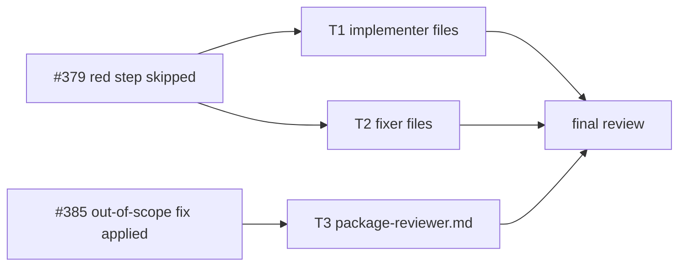
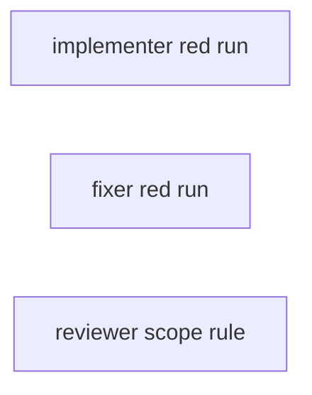

# Superlite: implementers and fixers run each new test red and report it; the package reviewer reports an out-of-scope fix instead of applying it (B59)

**Goal:** fix #379 (implementer and fixer reports say "I wrote the tests together with the code, so there was no failing run") and #385 (a package reviewer added a dependency to six targets and widened a layering test's allowlist, both outside its scope, and listed it as fixed).
**Architecture:** text only, in the agent prompts. T1 adds a red-run rule and a `Red run:` report line to both implementer files; T2 adds a red-run rule and a `- red:` suffix on `FIXED` report lines to the three fixer files; T3 gives the package reviewer a red-run clause, an out-of-scope rule (no file outside scope, no new dependency, no wider allowlist: report it open) and the matching report wording. Each task pins its text with one new test file.
**Tech stack:** Markdown, pytest (through `sl run_tests`).
**Spec:** this file, section Design; issues #379 and #385 (Expected lines).
**Detail:** tests
**Target-min:** 11
**Wave0:** none
**Coverage:** off

Global constraints:
- Insert or replace text exactly as the task's `Text (verbatim)` block gives it: same backticks, quotes, dashes and punctuation, one line per bullet, no line wrapping. Change no other line of the file.
- Existing tests stay green. An existing test file never changes. If another existing test turns red, report it in DONE_WITH_CONCERNS with the test id and the reason instead of editing it.
- Run `sl` as an executable (`<abs>/sl ...`). Verify with `<abs>/sl run_tests --fast <own test file> --task Tn --background`, then run the printed `wait:` line in the foreground and end the turn only after it reports.
- No version edits (the ship step bumps the version). Never run `scripts/test_layers.py run`, `scripts/evals.sh` or `claude plugin eval` (the coordinator runs the layers).

Ruling: #379 gets prompt wording only, no red-then-green tooling in `run_tests` (because this batch may touch only the six agent files, and #73 ruled wording first; cost if wrong: a skipped red step stays visible only as a missing report line).
Ruling: the red run's evidence is the `run_tests --wait` summary line (`tests (fast): 0 passed, 1 failed`, `run_tests.summary_line`), copied into the report; T1's test pins the example against `summary_line` so the prompt cannot drift from the tool.
Ruling: a test written together with its code, or one that passes at once, gets its red run by breaking the code on purpose (implementers) or taking the fix out by hand (fixers), the TDD skill's regression-guard rule, since workers may not use `git stash` or `checkout`.
Ruling: fixers keep their run command without `--task`; their red runs' test-failure incidents are closed by the coordinator's green `--full` run (#380) - cost if wrong: an open incident line in a packet built before that run.
Ruling: the package reviewer counts as a fixer for #379 (it is a reviewer-fixer); its fix rule also names the doc-only exemption (B43 follow-up), so the new red clause does not force a vacuous test.
Ruling: #385 changes agents/package-reviewer.md only; the fixers already say "Touch no file outside the findings" and implementers "Edit only the files you own".
Ruling: each task adds one new test file under tests/scripts/ (a new file no other lead owns); the plan file is the batch's other new file.
Ruling: detail tests; no Wave 0 (the project builds); no probe adapter (text only, no runnable entry); already in the lead worktree, so no `sl worktree ensure`.
LAYERS: unit, headless, evals

## Design

Issue #379, expected: the implementer and fixer agent prompts require the red run's summary line in the report (or `run_tests` records a red-then-green pair; not built, see Ruling).
Issue #385, expected: the agent definition says that a fix which needs a file outside the scope, a new dependency or a wider allowlist is reported as a finding and not applied.



## File structure

- agents/implementer.md, agents/implementer-haiku.md: red-run rule after the TDD rule, `Red run:` report line (T1).
- tests/scripts/test_implementer_red_run_b59.py: pins T1's text (T1).
- agents/fixer-sonnet.md, agents/fixer-sonnet-high.md, agents/fixer-opus.md: red-run rule after the `- For each finding:` rule, `- red:` suffix in the report line (T2).
- tests/scripts/test_fixer_red_run_b59.py: pins T2's text (T2).
- agents/package-reviewer.md: fix rule with red clause, out-of-scope rule, report wording (T3).
- tests/scripts/test_reviewer_scope_b59.py: pins T3's text (T3).

## Task graph

```mermaid
%% schedule
gantt
  title Predicted schedule (mm:ss)
  dateFormat X
  axisFormat %M:%S
  section lane 1
  T1 implementer red run :t1, 0, 76s
  section lane 2
  T2 fixer red run :t2, 0, 76s
  section lane 3
  T3 reviewer scope rule :t3, 0, 59s
```





critical path: T1 (1.3 min) · peak width 3 · predicted build 1.3 min · predicted total ≈ 4.8 min (target ✓)

## Predicted schedule

## Agent prompts

App type: docs (prompt text). Categories: none apply (no code path); the risks are wording drift between sibling agent files and a broken pin of an earlier batch's test, which the tasks' tests and the existing tests cover.

### T1 implementer red run · Complexity 2 (O-1) · Est. context 30k
**Owns:** agents/implementer.md, agents/implementer-haiku.md, tests/scripts/test_implementer_red_run_b59.py
**Components:** 2
**LOC owned:** 45
**Tests:** fast
**Kind:** mechanical
**Model:** haiku
**Est. time:** 2 min (2 components, about 45 LOC, fast tests)
**Consumes:** none
**Produces:** none
**Covers:** Design
**Review Focus:** `test_red_rule_follows_the_tdd_rule`: the red line is byte-identical in both files and sits right after the `- TDD.` line.
**Text (verbatim):** in agents/implementer.md and agents/implementer-haiku.md, insert this line right after the line that starts `- TDD.`:
````text
- Red run first: run the new tests through that fast check before you write the code they test, and see them fail for the right reason (the behavior is missing, not a typo or an import error). A test written together with its code, or one that passes at once (a regression guard for behavior that already works), has no red run yet: break the code on purpose, run the test red, then restore the code. Your report's `Red run:` line copies that run's summary line.
````
In the same two files, insert this line right after the line `- Test command and its result line`:
````text
- Red run: the summary line of the run that saw your new tests fail (for example `tests (fast): 0 passed, 1 failed`), or `none - no test` for a task that adds no test
````
**Test code (verbatim):** tests/scripts/test_implementer_red_run_b59.py
```python
"""Implementers run each new test red before its code and report that run's summary line (#379)."""
from __future__ import annotations

import sys
from pathlib import Path

ROOT = Path(__file__).resolve().parents[2]
IMPLEMENTERS = ["agents/implementer.md", "agents/implementer-haiku.md"]
RED = ("- Red run first: run the new tests through that fast check before you write the code they test, and see them "
       "fail for the right reason (the behavior is missing, not a typo or an import error). A test written together "
       "with its code, or one that passes at once (a regression guard for behavior that already works), has no red "
       "run yet: break the code on purpose, run the test red, then restore the code. Your report's `Red run:` line "
       "copies that run's summary line.")
REPORT = ("- Red run: the summary line of the run that saw your new tests fail (for example "
          "`tests (fast): 0 passed, 1 failed`), or `none - no test` for a task that adds no test")


def lines(rel):
    return (ROOT / rel).read_text(encoding="utf-8").splitlines()


def test_red_rule_follows_the_tdd_rule():
    for rel in IMPLEMENTERS:
        ls = lines(rel)
        assert ls.count(RED) == 1, rel
        assert ls[ls.index(RED) - 1].startswith("- TDD."), rel


def test_report_names_the_red_run():
    for rel in IMPLEMENTERS:
        ls = lines(rel)
        assert ls.count(REPORT) == 1, rel
        i = ls.index(REPORT)
        assert ls[i - 1] == "- Test command and its result line", rel
        assert ls[i + 1] == "- Concerns or open questions", rel


def test_example_is_the_wait_summary_line():
    sys.path.insert(0, str(ROOT / "skills" / "subagent-driven-development" / "scripts"))
    import run_tests
    data = {"passed": 0, "failed": 1, "skipped": 0, "mode": "fast"}
    assert run_tests.summary_line(data) == "tests (fast): 0 passed, 1 failed"
```
**Steps:** 1 write the test file, 2 run: FAIL, 3 insert the text, 4 run: PASS (also run tests/scripts/test_implementer_wait_cue_b36.py, tests/scripts/test_implementer_seam_rule.py, tests/scripts/test_foreground_verify_rule.py and tests/scripts/test_docs_contract.py: still green)

**Probe entry:** none (text only)

### T2 fixer red run · Complexity 2 (O-1) · Est. context 30k
**Owns:** agents/fixer-sonnet.md, agents/fixer-sonnet-high.md, agents/fixer-opus.md, tests/scripts/test_fixer_red_run_b59.py
**Components:** 2
**LOC owned:** 45
**Tests:** fast
**Kind:** mechanical
**Model:** haiku
**Est. time:** 2 min (2 components, about 45 LOC, fast tests)
**Consumes:** none
**Produces:** none
**Covers:** Design
**Review Focus:** `test_red_rule_sits_between_the_fix_and_run_rules`: the red line is byte-identical in all three fixer files, right after `- For each finding:` and right before `- Run only the touched test files`.
**Text (verbatim):** in each of the three fixer files, insert this line right after the line that starts `- For each finding:`:
````text
- Red run first: run each regression test through the commands of the next rule before you make its fix, and see it fail for the right reason. A test written after its fix, or together with it, has no red run yet: take the fix out by hand, run the test red, then put the fix back. Its `FIXED` line ends `- red: <that run's summary line>` (for example `- red: tests (fast): 0 passed, 1 failed`).
````
In the same three files, in the line that starts `Report,`, replace `` `NOT_FIXED - <finding> - <reason>`. Then the test summary line `` with:
````text
`NOT_FIXED - <finding> - <reason>`; a `FIXED` line with a regression test ends `- red: <its red run's summary line>`. Then the test summary line
````
**Test code (verbatim):** tests/scripts/test_fixer_red_run_b59.py
```python
"""Fixers run each regression test red before its fix and name that run in the FIXED line (#379)."""
from __future__ import annotations

from pathlib import Path

ROOT = Path(__file__).resolve().parents[2]
FIXERS = ["agents/fixer-sonnet.md", "agents/fixer-sonnet-high.md", "agents/fixer-opus.md"]
RED = ("- Red run first: run each regression test through the commands of the next rule before you make its fix, "
       "and see it fail for the right reason. A test written after its fix, or together with it, has no red run yet: "
       "take the fix out by hand, run the test red, then put the fix back. Its `FIXED` line ends "
       "`- red: <that run's summary line>` (for example `- red: tests (fast): 0 passed, 1 failed`).")
REPORT = ("`NOT_FIXED - <finding> - <reason>`; a `FIXED` line with a regression test ends "
          "`- red: <its red run's summary line>`. Then the test summary line")


def lines(rel):
    return (ROOT / rel).read_text(encoding="utf-8").splitlines()


def test_red_rule_sits_between_the_fix_and_run_rules():
    for rel in FIXERS:
        ls = lines(rel)
        assert ls.count(RED) == 1, rel
        i = ls.index(RED)
        assert ls[i - 1].startswith("- For each finding:"), rel
        assert ls[i + 1].startswith("- Run only the touched test files"), rel


def test_report_line_names_the_red_suffix():
    for rel in FIXERS:
        report = [ln for ln in lines(rel) if ln.startswith("Report,")]
        assert len(report) == 1 and REPORT in report[0], rel
```
**Steps:** 1 write the test file, 2 run: FAIL, 3 insert and replace the text, 4 run: PASS (also run tests/scripts/test_fixer_doc_only_b43.py, tests/scripts/test_fixer_foreground_b26.py, tests/scripts/test_fixer_commit_wording.py and tests/scripts/test_foreground_verify_rule.py: still green)

**Probe entry:** none (text only)

### T3 reviewer scope rule · Complexity 2 (O-1) · Est. context 28k
**Owns:** agents/package-reviewer.md, tests/scripts/test_reviewer_scope_b59.py
**Components:** 1
**LOC owned:** 40
**Tests:** fast
**Kind:** mechanical
**Model:** haiku
**Est. time:** 1.5 min (1 component, about 40 LOC, fast tests)
**Consumes:** none
**Produces:** none
**Covers:** Design
**Review Focus:** `test_scope_rule_follows_the_fix_rule`: the out-of-scope line comes right after the new fix rule, and the old fix rule is gone.
**Text (verbatim):** in agents/package-reviewer.md, replace the line
````text
- Fix every finding you report, including findings the coordinator sends you later, and add a regression test per fix. Log each with `resolution`. No finding stays open unless you cannot verify it.
````
with these two lines
````text
- Fix every finding you report, including findings the coordinator sends you later, and add a regression test per fix that fails before the fix (a red run; a test written together with its fix has none), except for a doc- or comment-only fix, which needs no test. Log each with `resolution`. No finding stays open unless you cannot verify it or its fix is out of scope.
- Out of scope: change only the files in scope and their regression tests (in `tests/regression/` or an in-scope test file). A fix that needs another file, a new dependency (a package manifest, lockfile or build target entry) or a wider allowlist, exemption or threshold in a test, lint or config file is never applied: leave the code as it is, list the finding under open with `out of scope: <what the fix needs>`, and log it `--resolution open`.
````
and replace the line that starts `Report in at most 300 words:` with
````text
Report in at most 300 words: findings fixed or open (`file:line — problem — fix`; an out-of-scope fix is open, never fixed), tests added (each with its red run's summary line), probes run, and a final `Status: DONE | DONE_WITH_CONCERNS | BLOCKED`. No file contents or logs.
````
**Test code (verbatim):** tests/scripts/test_reviewer_scope_b59.py
```python
"""The package reviewer reports an out-of-scope fix as an open finding instead of applying it (#385)."""
from __future__ import annotations

from pathlib import Path

REVIEWER = Path(__file__).resolve().parents[2] / "agents" / "package-reviewer.md"
FIX = ("- Fix every finding you report, including findings the coordinator sends you later, and add a regression test "
       "per fix that fails before the fix (a red run; a test written together with its fix has none), except for a "
       "doc- or comment-only fix, which needs no test. Log each with `resolution`. No finding stays open unless you "
       "cannot verify it or its fix is out of scope.")
SCOPE = ("- Out of scope: change only the files in scope and their regression tests (in `tests/regression/` or an "
         "in-scope test file). A fix that needs another file, a new dependency (a package manifest, lockfile or build "
         "target entry) or a wider allowlist, exemption or threshold in a test, lint or config file is never applied: "
         "leave the code as it is, list the finding under open with `out of scope: <what the fix needs>`, and log it "
         "`--resolution open`.")
REPORT = ("Report in at most 300 words: findings fixed or open (`file:line — problem — fix`; an out-of-scope fix is "
          "open, never fixed), tests added (each with its red run's summary line), probes run, and a final "
          "`Status: DONE | DONE_WITH_CONCERNS | BLOCKED`. No file contents or logs.")


def lines():
    return REVIEWER.read_text(encoding="utf-8").splitlines()


def test_scope_rule_follows_the_fix_rule():
    ls = lines()
    assert ls.count(FIX) == 1 and ls.count(SCOPE) == 1
    assert ls.index(SCOPE) == ls.index(FIX) + 1
    assert not any(ln.startswith("- Fix every finding") and "add a regression test per fix. Log" in ln for ln in ls)


def test_report_keeps_out_of_scope_fixes_open():
    ls = lines()
    assert ls.count(REPORT) == 1
    assert sum(ln.startswith("Report in at most 300 words:") for ln in ls) == 1
```
**Steps:** 1 write the test file, 2 run: FAIL, 3 replace the text, 4 run: PASS (also run tests/scripts/test_fixer_foreground_b26.py and tests/scripts/test_incident_resolve.py: still green)

**Probe entry:** none (text only)

## Review Focus
- docs: sibling agent files carry byte-identical new lines (T1: 2 files, T2: 3 files).
- docs: earlier batches' pinned lines (B26 run line, B36 wait cue, B43 doc-only rule and report substring, seam rule, commit wording, incident kinds) stay intact.

## Self-review
Coverage: #379 -> T1, T2 (and the T3 red clause); #385 -> T3. No placeholders. No Consumes or Produces (text only). Graph: no edges, no shared files. Sizes inside the band or a NOTE.
