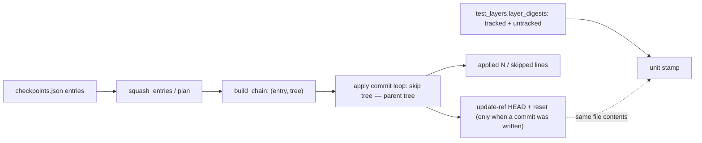
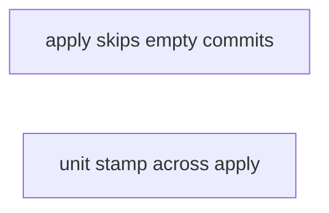

# Superlite: autocommit apply skips restored tasks, unit stamp pinned across apply (B63)

**Goal:** fix #403 (`sl autocommit apply` writes an empty commit for a task whose every change was restored) and settle #396 (the unit layer stamp read stale after `autocommit apply` committed a batch's untracked test files). Max's decision for #396: hash untracked files into the stamp.
**Architecture:** `autocommit.apply` tracks the tree each chain commit would sit on and writes no commit whose tree equals it; a skipped task prints one line, the `applied N commit(s)` count names real commits only, and with no commit HEAD and the index stay untouched. `scripts/test_layers.py` already hashes untracked files (`repo_files` lists `git ls-files --others --exclude-standard` since 1.4.0); a regression test pins that and the green stamp across `autocommit apply`.
**Tech stack:** Python 3.10+ stdlib, pytest (through `sl run_tests`).
**Spec:** this file, section Design; issues #403 and #396 (Expected lines) and Max's decision.
**Detail:** tests
**Target-min:** 11
**Wave0:** none
**Coverage:** off
**Max chars:** 20000

Global constraints:
- New or changed code lines in `skills/subagent-driven-development/scripts/` carry the repo's trailing `# O(...)` complexity comment; tests do not. Stdlib only.
- Existing tests stay green and no existing test file changes (another lead may own them). If an existing test turns red, report it in DONE_WITH_CONCERNS with the test id and the reason instead of editing it.
- Run `sl` as an executable (`<abs>/sl ...`). Verify with the task's own `sl run_tests --fast ... --task Tn --background` line, then run the printed `wait:` line in the foreground and end the turn only after it reports. Never raw `pytest`, never the e2e or eval layers (coordinator's step).
- No version edits (the ship step bumps the version). Touch only the files in Owns.

Ruling: #403: apply never writes a commit whose tree equals its parent commit's tree, in squash and `--no-squash` mode alike; a revert checkpoint that differs from the previous one still commits - cost if wrong: a deliberate empty commit is lost (none is ever wanted).
Ruling: #403 output: one `apply: skipped <title> (no change left)` line per skipped entry, `applied N commit(s) on <branch>:` counts and lists committed entries only; N = 0 keeps HEAD and the index, still removes the checkpoints, exit 0 - cost if wrong: one wording change.
Ruling: #396: Max's choice (hash untracked files) is already in place; a scratch repro showed the stamp stays green across `autocommit apply`, so the fix is a regression test and `scripts/test_layers.py` is unchanged; the stale stamp the lead saw most likely came from `backlog ship lock`'s rebase onto a moved main, and `check` names files against the last manifest of any worktree (shared store), which can list the batch's own new test files - both are follow-ups outside B63's files - cost if wrong: #396 reopens with a new repro.
Ruling: detail tests; no probe adapter (git-plumbing CLI; Review Focus cases run as named pytest cases); new tests in new files - cost if wrong: no generated probes.
Ruling: already in the lead worktree on branch superlite/b63-autocommit-empty-and-layer-stamp - cost if wrong: none.
LAYERS: unit



## Design

1. `autocommit.apply(squash=True)`: before the commit loop, `ptree` = the tree of `start` (`EMPTY_TREE` when `start` is empty). Per `(entry, tree)` of the chain: `tree == ptree` appends the entry to a skipped list and writes nothing; otherwise `commit-tree` on the current parent as today, then `ptree = tree` and the entry joins the committed list.
2. After the loop: only when at least one commit was written, `update-ref HEAD` and the `git reset -q -- <files>` run as today. With none, HEAD, the branch and the index are untouched (an unborn HEAD stays unborn).
3. Output: the `squash skipped:` note as today; `applied N commit(s) on <branch>:` with N = committed entries and one `- <title>` line each; then one `apply: skipped <title> (no change left)` line per skipped entry; the `left uncommitted` line as today; `clean()` runs in every case.
4. Unchanged: every refusal (branch changed, moved overlap, edited files), the squash and interleave logic, `record`.

## File structure

- `skills/subagent-driven-development/scripts/autocommit.py`: apply's commit loop (T1).
- `tests/scripts/test_autocommit_empty_403.py`: #403 cases (T1).
- `tests/scripts/test_layer_stamp_untracked_396.py`: #396 regression (T2).

## Task graph

```mermaid
%% schedule
gantt
  title Predicted schedule (mm:ss)
  dateFormat X
  axisFormat %M:%S
  section lane 1
  T1 autocommit apply writes no empty comm :t1, 0, 69s
  section lane 2
  T2 unit stamp stays green across autocom :t2, 0, 62s
```





critical path: T1 (1.1 min) · peak width 2 · predicted build 1.1 min · predicted total ≈ 4.6 min (target ✓)

## Package: autocommit

App type: CLI over git plumbing. Categories: state (HEAD, index, refs), file. Specific risks: an entry whose net change is nil in squash mode, an unchanged first checkpoint in `--no-squash` mode, an all-skipped run that must not move HEAD.

### T1 autocommit apply writes no empty commit · Complexity 3 (O-1) · Est. context 30k
**Owns:** skills/subagent-driven-development/scripts/autocommit.py, tests/scripts/test_autocommit_empty_403.py
**Components:** 1
**LOC owned:** 90
**Tests:** fast
**Kind:** design
**Model:** sonnet
**Est. time:** 2 min (1 component, about 90 LOC, fast tests)
**Covers:** Design
**Consumes:** none
**Produces:** autocommit.apply(squash: bool = True) -> int
**Review Focus:** `test_every_task_restored_leaves_head`: README.md v1 then back to `base\n` in T1, apply -> HEAD unchanged, `applied 0 commit(s) on ` printed, status clean (state); `test_no_squash_skips_an_unchanged_checkpoint`: T1 checkpoint with no change then T2 b.py, apply --no-squash -> only `T2: t2 work` (state).
**Test code (verbatim):**
```python
"""#403: autocommit apply writes no commit whose tree equals its parent's."""
import sys
from pathlib import Path

sys.path.insert(0, str(Path(__file__).resolve().parent))
from test_autocommit import SCRIPTS, make_repo, write, git, run  # noqa: E402

sys.path.insert(0, str(SCRIPTS))
import autocommit  # noqa: E402


def cp(repo, monkeypatch, tid, contents, files=None):
    monkeypatch.chdir(repo)
    for rel, text in contents.items():
        write(repo, rel, text)
    return autocommit.checkpoint(tid, f"{tid.lower()} work", files or list(contents), "plan.md")


def subjects(repo, base):
    return git(repo, "log", "--format=%s", f"{base}..HEAD").splitlines()


def test_restored_task_gets_no_commit(tmp_path, monkeypatch):
    repo = make_repo(tmp_path)
    base = git(repo, "rev-parse", "HEAD")
    cp(repo, monkeypatch, "T1", {"README.md": "v1\n"})
    cp(repo, monkeypatch, "T1", {"README.md": "base\n"})
    cp(repo, monkeypatch, "T2", {"b.py": "b\n"})
    r = run("autocommit", "apply", cwd=repo)
    assert r.returncode == 0, r.stdout + r.stderr
    assert subjects(repo, base) == ["T2: t2 work"]
    assert "apply: skipped T1: t1 work (no change left)" in r.stdout
    assert "applied 1 commit(s) on " in r.stdout
    assert "- T1: t1 work" not in r.stdout
    assert git(repo, "status", "--porcelain") == ""
    assert git(repo, "for-each-ref", "refs/superlite") == ""


def test_every_task_restored_leaves_head(tmp_path, monkeypatch):
    repo = make_repo(tmp_path)
    base = git(repo, "rev-parse", "HEAD")
    cp(repo, monkeypatch, "T1", {"README.md": "v1\n"})
    cp(repo, monkeypatch, "T1", {"README.md": "base\n"})
    r = run("autocommit", "apply", cwd=repo)
    assert r.returncode == 0, r.stdout + r.stderr
    assert git(repo, "rev-parse", "HEAD") == base
    assert "applied 0 commit(s) on " in r.stdout
    assert "apply: skipped T1: t1 work (no change left)" in r.stdout
    assert git(repo, "status", "--porcelain") == ""
    assert git(repo, "for-each-ref", "refs/superlite") == ""
    assert not (repo / ".superlite" / "checkpoints.json").exists()


def test_new_file_deleted_again_gets_no_commit(tmp_path, monkeypatch):
    repo = make_repo(tmp_path)
    base = git(repo, "rev-parse", "HEAD")
    cp(repo, monkeypatch, "T1", {"n.py": "n\n"})
    (repo / "n.py").unlink()
    cp(repo, monkeypatch, "T1", {}, files=["n.py"])
    r = run("autocommit", "apply", cwd=repo)
    assert r.returncode == 0, r.stdout + r.stderr
    assert git(repo, "rev-parse", "HEAD") == base
    assert "apply: skipped T1: t1 work (no change left)" in r.stdout


def test_no_squash_skips_an_unchanged_checkpoint(tmp_path, monkeypatch):
    repo = make_repo(tmp_path)
    base = git(repo, "rev-parse", "HEAD")
    cp(repo, monkeypatch, "T1", {"README.md": "base\n"})
    cp(repo, monkeypatch, "T2", {"b.py": "b\n"})
    r = run("autocommit", "apply", "--no-squash", cwd=repo)
    assert r.returncode == 0, r.stdout + r.stderr
    assert subjects(repo, base) == ["T2: t2 work"]
    assert "apply: skipped T1: t1 work (no change left)" in r.stdout


def test_revert_checkpoint_kept_without_squash(tmp_path, monkeypatch):
    repo = make_repo(tmp_path)
    base = git(repo, "rev-parse", "HEAD")
    cp(repo, monkeypatch, "T1", {"README.md": "v1\n"})
    cp(repo, monkeypatch, "T1", {"README.md": "base\n"})
    r = run("autocommit", "apply", "--no-squash", cwd=repo)
    assert r.returncode == 0, r.stdout + r.stderr
    assert subjects(repo, base) == ["T1: t1 work", "T1: t1 work"]
    assert "skipped" not in r.stdout
```
**Verify:** `sl run_tests --fast tests/scripts/test_autocommit_empty_403.py tests/scripts/test_autocommit.py tests/scripts/test_autocommit_squash.py tests/scripts/test_autocommit_base.py tests/scripts/test_autocommit_record.py tests/scripts/test_autocommit_unrelated.py tests/scripts/test_autocommit_plan.py --task T1 --background`
**Steps:** 1 write the test file, 2 run: FAIL, 3 implement Design 1-3 in `apply`, 4 run: PASS
**Notes:** the chain's trees come from `build_chain` (replayed or checkpoint trees); compare each against the previous written tree, not the previous chain tree, so an entry after a skipped one is judged against what HEAD will hold. `start` empty (unborn HEAD) with every entry skipped calls no `update-ref`.

## Package: test layers

App type: library (hashing). Categories: file. Specific risk: an untracked file left out of the unit digest.

### T2 unit stamp stays green across autocommit apply · Complexity 1 (O-1) · Est. context 24k
**Owns:** tests/scripts/test_layer_stamp_untracked_396.py
**Components:** 1
**LOC owned:** 55
**Tests:** fast
**Kind:** mechanical
**Model:** haiku
**Est. time:** 1.5 min (1 component, about 55 LOC, fast tests)
**Covers:** Design
**Consumes:** none
**Produces:** none
**Review Focus:** `test_untracked_test_file_is_in_the_unit_stamp`: editing an untracked tests/scripts file after a unit stamp -> `check` exit 2 naming it (file).
**Test code (verbatim):**
```python
"""#396: the unit stamp hashes untracked files, so committing them (autocommit apply) keeps it green."""
import shutil
import subprocess
import sys
from pathlib import Path

sys.path.insert(0, str(Path(__file__).resolve().parent))
from test_autocommit import SCRIPTS, ENV, make_repo, write, git, run  # noqa: E402

sys.path.insert(0, str(SCRIPTS))
import autocommit  # noqa: E402

TOP = Path(__file__).resolve().parents[2]


def layers(repo, *args, state):
    env = {**ENV, "PYTHONDONTWRITEBYTECODE": "1"}
    return subprocess.run([sys.executable, str(repo / "scripts" / "test_layers.py"), *args, "--state", str(state)],
                          cwd=repo, capture_output=True, text=True, env=env, encoding="utf-8")


def layer_repo(tmp_path):
    repo = make_repo(tmp_path)
    (repo / "scripts").mkdir()
    for name in ("test_layers.py", "layer_store.py"):
        shutil.copy(TOP / "scripts" / name, repo / "scripts" / name)
    write(repo, ".gitignore", "__pycache__/\n*.pyc\n")
    write(repo, "skills/x/scripts/a.py", "a = 1\n")
    git(repo, "add", "-A")
    git(repo, "commit", "-q", "-m", "layers")
    return repo


def batch(repo, monkeypatch):
    write(repo, "skills/x/scripts/a.py", "a = 2\n")
    write(repo, "tests/scripts/test_new.py", "def test_new():\n    assert True\n")
    monkeypatch.chdir(repo)
    autocommit.checkpoint("T1", "new test", ["skills/x/scripts/a.py", "tests/scripts/test_new.py"], "plan.md")


def test_untracked_test_file_is_in_the_unit_stamp(tmp_path, monkeypatch):
    repo = layer_repo(tmp_path)
    state = tmp_path / "layers.json"
    batch(repo, monkeypatch)
    assert "tests/scripts/test_new.py" in git(repo, "ls-files", "--others", "--exclude-standard").splitlines()
    assert layers(repo, "stamp", "unit", "--ruling", "r", state=state).returncode == 0
    write(repo, "tests/scripts/test_new.py", "def test_new():\n    assert 1\n")
    r = layers(repo, "check", state=state)
    assert r.returncode == 2
    assert "unit stale: tests/scripts/test_new.py" in r.stdout


def test_unit_stamp_stays_green_across_autocommit_apply(tmp_path, monkeypatch):
    repo = layer_repo(tmp_path)
    state = tmp_path / "layers.json"
    batch(repo, monkeypatch)
    assert layers(repo, "stamp", "unit", "--ruling", "r", state=state).returncode == 0
    before = layers(repo, "status", state=state).stdout
    assert before.startswith("unit green ")
    r = run("autocommit", "apply", cwd=repo)
    assert r.returncode == 0, r.stdout + r.stderr
    assert "tests/scripts/test_new.py" in git(repo, "ls-files").splitlines()
    assert layers(repo, "status", state=state).stdout == before
    assert layers(repo, "check", state=state).returncode == 0
```
**Verify:** `sl run_tests --fast tests/scripts/test_layer_stamp_untracked_396.py tests/scripts/test_test_layers.py --task T2 --background`
**Steps:** 1 write the test file verbatim, 2 run: PASS (the behaviour exists; a red run is reported as DONE_WITH_CONCERNS with the failing assert, never fixed in scripts/)
**Notes:** test-only task: `scripts/test_layers.py` and `autocommit.py` stay untouched by T2.

## Review Focus

- autocommit (CLI over git plumbing): state, file. Cases in T1.
- test layers (library): file. Case in T2.

## Self-review

Coverage: Design 1-3 in T1, the #396 decision in T2. No placeholders. No Consumes. No edges: T2 runs apply's unchanged non-empty path. Owns disjoint.
