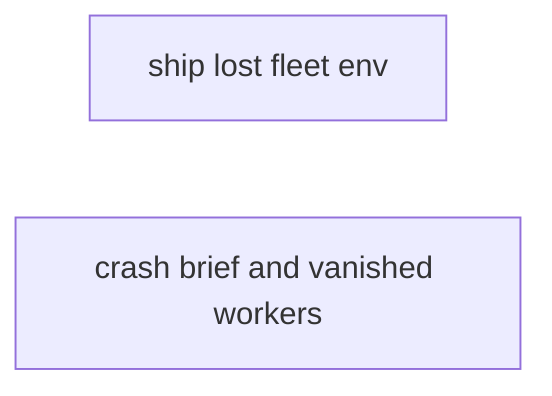

# Superlite: backlog crash recovery (B49)

**Goal:** #354: `sl backlog ship` in a lead resumed after a crash (fleet environment lost) refuses, names the lost environment and the fix `sl backlog start B`. #356: `backlog start` on a resumed batch briefs the new lead with the worktree state and the answers already given; `backlog wait` flags a live lead whose fleet workers' panes vanished and tells that lead.
**Architecture:** backlog_ship.main gains a lost-environment branch before its lead check (T1). backlog_run gains `_resume_state` (appended to the resumed lead's brief in cmd_start) and `_gone` (called by `_round` for a running batch whose lead lives and has no new stop record), plus two batch keys `gone_seen` and `gone_workers` that start resets (T2).
**Tech stack:** Python 3 stdlib, git, pytest (through `sl run_tests`).
**Spec:** this file, section Design; issues #354 and #356 (Expected lines) and Max's decision for #354 (refuse, name the lost env and `sl backlog start` as the fix).
**Detail:** tests
**Target-min:** 11
**Wave0:** none
**Coverage:** off

Global constraints:
- Keep the repo's `# O(...)` comment on every new code line (see any function in the file you edit). Change no line outside what the task needs.
- Existing tests stay green and unchanged; new tests are appended at the end of the test file. The one allowed edit of an existing line is named in the task. Another existing test turning red: report it in DONE_WITH_CONCERNS with the test id and the reason instead of editing it.
- Run `sl` as an executable (`<abs>/sl ...`). Verify with `<abs>/sl run_tests --fast <own test file> --task Tn --background`, then run the printed `wait:` line in the foreground and end the turn only after it reports.
- No version edits (the ship step bumps the version). Never run `scripts/test_layers.py run`, `scripts/evals.sh` or `claude plugin eval` (the coordinator runs the layers).

## Design

#354, observed: a lead that main re-prompted after a crash runs without `SUPERLITE_FLEET_ROLE=lead` and `SUPERLITE_FLEET_WORKER=W21`, so `sl backlog ship B43 lock` refuses with `runs only in its lead W21`. Max's decision: refuse, name the lost environment and the fix `sl backlog start B43`. Such a session also writes no stop record (hooks/capture-worker-stop needs SUPERLITE_FLEET_WORKER), so `backlog wait` would never see it end, and `start` refuses a running batch. The refusal therefore parks the batch itself, as `release --park` does: the next `backlog wait` round sees a parked batch whose lead still lives, stops that lead and prints `B43 parked: lead W21 lost its fleet env (resumed after a crash)`, and `sl backlog start B43` then resumes a fresh lead with its full environment.

#356, observed: `backlog start B40` on a `lead pane gone` park spawned a lead that was not told about the dead lead's uncommitted work nor the answer already given; a surviving lead whose worker panes died got no signal. Expected: start briefs the new lead with the worktree state and the recorded answers; wait flags surviving leads whose workers' panes vanished.

Ruling: the lost-environment branch needs both SUPERLITE_FLEET_ROLE and SUPERLITE_FLEET_WORKER unset, the cwd inside the batch's worktree (both resolved) and the batch running; any other mismatch keeps today's refusal - main (no env, main checkout) and other workers keep their message, and a plain session inside a lead worktree is the only thing that looks like a resumed lead - cost if wrong: a hand-run ship command inside a lead worktree parks the batch (start resumes it).
Ruling: the lost-environment refusal releases the ship lock only when this batch holds it (ship_lock.release by batch id) and exits 2 like every refusal.
Ruling: the worktree-state section goes into every resumed lead's brief (a parked batch with a worktree), not only `lead pane gone`: every resumed lead is fresh, and the new `lost its fleet env` park needs it too - cost if wrong: a few extra brief lines after a red-check park.
Ruling: the section is appended by backlog_run.cmd_start after backlog_brief.lead_brief (backlog_brief.py is outside B49's files); answers given mid-run already appear under "Max's decisions" (batch `answers`); the section names the answer files and says not to ask again.
Ruling: a worker counts as vanished when its record in the lead's `<worktree>/.superlite/fleet.json` is not `stopped` or `starting`, its role is not `layer` (a shell pane has no Herdr agent), and its Herdr agent name is missing from `agent_states()`; it is flagged once it stayed missing for GONE_MS = 30000 ms (batch key `gone_seen` {wid: first ms}) - fleet.stop exits the agent before it writes `stopped`, so a single poll would flag workers that just finished - cost if wrong: a crash is flagged 30 s later.
Ruling: a flagged worker goes into batch key `gone_workers` and is never flagged again for that lead; `start` resets both keys. The wait line is `B worker panes gone: W2 W7; lead W1 told` (or `not told (send failed)`), and like every wait line it ends that wait call.
Ruling: the lead is told through `fleet_io send --text` (the path REPROMPT uses), naming `fleet stop <ids> --plan .superlite` and redispatching the unfinished tasks; a busy lead reads it after its current tool call.

## File structure

- skills/subagent-driven-development/scripts/backlog_ship.py: lost-environment branch in main (T1).
- tests/scripts/test_backlog_ship.py: its tests (T1).
- skills/subagent-driven-development/scripts/backlog_run.py: `_resume_state`, `_gone`, GONE_MS, GONE, start resets (T2).
- tests/scripts/test_backlog_run.py: its tests, fixture fake fleet_state gains `load` and `name_of` (T2).

## Task graph

```mermaid
%% schedule
gantt
  title Predicted schedule (mm:ss)
  dateFormat X
  axisFormat %M:%S
  section lane 1
  T2 crash brief and vanished worker panes :t2, 0, 89s
  section lane 2
  T1 ship refuses and parks a lead without :t1, 0, 64s
```





critical path: T2 (1.5 min) · peak width 2 · predicted build 1.5 min · predicted total ≈ 5.0 min (target ✓)

## Predicted schedule

## backlog ship

App type: CLI. Categories: protocol (refusal text, exit code), state (batch parked, lock), file (cwd inside the worktree).
**Probe entry:** none (main needs a backlog state and a fleet env; covered by in-process tests)

### T1 ship refuses and parks a lead without fleet env · Complexity 3 (O-1) · Est. context 36k
**Owns:** skills/subagent-driven-development/scripts/backlog_ship.py, tests/scripts/test_backlog_ship.py
**Components:** 1
**LOC owned:** 70
**Tests:** fast
**Model:** sonnet
**Est. time:** 2 min
**Produces:** backlog_ship._env_lost(b: dict) -> bool
**Review Focus:** `test_lost_env_parks_only_a_running_batch_from_inside_its_worktree` (main's checkout, another worker, a needs_decision batch keep the plain refusal); `test_lost_env_with_a_held_lock_of_another_batch_keeps_that_lock`
**Test code (verbatim):** append to tests/scripts/test_backlog_ship.py

```python
LOST = ("refused: this session has no fleet environment (SUPERLITE_FLEET_ROLE and SUPERLITE_FLEET_WORKER unset), as a lead "
        "resumed after a crash has none, so it cannot ship as lead W1; B1 is parked: end your turn with Status: BLOCKED "
        "fleet env lost, then main runs sl backlog start B1\n")
PLAIN = "refused: sl backlog ship B1 runs only in its lead W1\n"

def lose_env(monkeypatch):
    monkeypatch.delenv("SUPERLITE_FLEET_ROLE"); monkeypatch.delenv("SUPERLITE_FLEET_WORKER")

def test_a_lead_resumed_without_its_fleet_env_parks_its_batch_and_names_start(sh, capsys, monkeypatch):
    locked(sh, capsys); lose_env(monkeypatch); monkeypatch.chdir(sh.wt / "scripts")
    assert ship(capsys, "B1", "bump") == (2, LOST) and sh.calls == []
    x = b1(sh)
    assert (x["state"], x["reason"], x["parked_at"]) == ("parked", "lead W1 lost its fleet env (resumed after a crash)", 10_000)
    assert not ship_lock.holder(sh.lock)

def test_lost_env_parks_only_a_running_batch_from_inside_its_worktree(sh, capsys, monkeypatch):
    lose_env(monkeypatch); monkeypatch.chdir(sh.root)
    assert ship(capsys, "B1", "lock") == (2, PLAIN) and b1(sh)["state"] == "running"
    monkeypatch.chdir(sh.wt); monkeypatch.setenv("SUPERLITE_FLEET_WORKER", "W2")
    assert ship(capsys, "B1", "lock") == (2, PLAIN) and b1(sh)["state"] == "running"
    monkeypatch.delenv("SUPERLITE_FLEET_WORKER")
    bs.update(bs.path(sh.root), lambda d: bs.batch(d, "B1").update({"state": "needs_decision"}))
    assert ship(capsys, "B1", "lock") == (2, PLAIN) and b1(sh)["state"] == "needs_decision"

def test_lost_env_with_a_held_lock_of_another_batch_keeps_that_lock(sh, capsys, monkeypatch):
    ship_lock.acquire(sh.lock, B2, None, 9_000); lose_env(monkeypatch); monkeypatch.chdir(sh.wt)
    assert ship(capsys, "B1", "release") == (2, LOST)
    assert ship_lock.holder(sh.lock)["batch"] == "B2" and b1(sh)["state"] == "parked"

def test_env_lost_needs_both_vars_unset_and_the_worktree_cwd(sh, monkeypatch):
    b = b1(sh); monkeypatch.chdir(sh.wt)
    assert not bsh._env_lost(b)
    lose_env(monkeypatch)
    assert bsh._env_lost(b) and not bsh._env_lost({**b, "worktree": None}) and not bsh._env_lost({**b, "state": "parked"})
    monkeypatch.chdir(sh.root)
    assert not bsh._env_lost(b)
```

**Steps:** 1 append the tests, 2 run: FAIL, 3 implement, 4 run: PASS
**Notes:** `_env_lost(b)`: True when `os.environ.get` of both SUPERLITE_FLEET_ROLE and SUPERLITE_FLEET_WORKER is empty, `b["state"] == "running"`, `b.get("worktree")` is set and `Path.cwd().resolve()` equals `Path(b["worktree"]).resolve()` or lies below it. In main, inside the existing `if ROLE != "lead" or WORKER != lead:` branch, before its plain refusal: when `_env_lost(b)`, release the ship lock by batch id (`ship_lock.release(ship_lock.lock_path(data["repo"]), bid)` when `data.get("repo")`, catching OSError and ValueError), `_set(root, bid, state="parked", reason=f"lead {lead} lost its fleet env (resumed after a crash)", parked_at=_now_ms())`, then `_out(2, ...)` with the LOST text (batch id and lead filled in). No git call. The module docstring gains one line naming this refusal.

## backlog start and wait

App type: CLI. Categories: protocol (brief lines, wait line, lead message), state (gone_seen, gone_workers, reset on start), encoding (git output with control characters in the brief).
**Probe entry:** none (start and wait need Herdr; covered by in-process tests with fakes)

### T2 crash brief and vanished worker panes · Complexity 5 (O-1) · Est. context 48k
**Owns:** skills/subagent-driven-development/scripts/backlog_run.py, tests/scripts/test_backlog_run.py
**Components:** 2
**LOC owned:** 150
**Tests:** fast
**Model:** sonnet
**Est. time:** 4 min
**Produces:** backlog_run._resume_state(batch: dict, wt: Path, branch: str) -> list[str] · backlog_run._gone(p: Path, sd: Path, b: dict, states: dict) -> list[str]
**Review Focus:** `test_start_after_a_crash_strips_control_characters` (encoding); `test_wait_forgets_a_worker_pane_that_comes_back_and_skips_herdr_outages` (state); `test_wait_flags_vanished_worker_panes_of_a_live_lead_once` (stopped, starting and layer workers never count)
**Test code (verbatim):** the one allowed edit of an existing line: in the `bk` fixture, `ns` gains `fleets={}` and the fake `"fleet_state"` becomes `types.SimpleNamespace(is_on=lambda sd: False, load=lambda sd: ns.fleets.get(str(sd), {"workers": {}}), name_of=lambda sd, wid, w: w.get("name") or wid)`. Append:

```python
def git(replies):
    return lambda cmd, cwd: next((r for p, r in replies.items() if " ".join(cmd).startswith(p)), (0, ""))

GIT = {"git symbolic-ref": (0, "origin/main"), "git log": (0, "abc1234 T1 ship guard\ndef5678 T0 stubs"), "git status": (0, "M skills/x.py\n?? tests/y.py")}

def parked(bk, **kw):
    wt = bk.root / "wts" / "superlite-b1-t"; (wt / ".superlite").mkdir(parents=True, exist_ok=True)
    put(bk, b("B1", ["a.py"], "parked", reason="lead pane gone", lead="W7", agent="sl-m-W7", worktree=str(wt), **kw))
    return wt

def brief_of(wt):
    return (wt / ".superlite" / "briefs" / "lead.md").read_text()

def test_start_after_a_crash_briefs_the_worktree_state_and_the_answers(bk, capsys, monkeypatch):
    wt = parked(bk, questions=1, answers={"Keep the v1 API?": "Drop"}); (wt / ".superlite" / "answer-1.json").write_text("{}")
    calls = []
    monkeypatch.setattr(br, "_run", lambda cmd, cwd: calls.append((cmd[0], Path(cwd))) or git(GIT)(cmd, cwd))
    assert run(capsys, "start", "B1")[0] == 0
    text = brief_of(wt)
    assert ("Previous lead W7: parked (lead pane gone); its work stays in this worktree. Read it before you plan; "
            "keep, finish or drop each part on purpose:\n") in text
    assert "- Commits on superlite/b1-t not on origin/main: 2: abc1234 T1 ship guard; def5678 T0 stubs\n" in text
    assert "- Uncommitted files: 2: M skills/x.py, ?? tests/y.py\n" in text
    assert "- Answers Max gave mid-run: answer-1.json in .superlite/ (also under Max's decisions above; never ask them again)\n" in text
    assert calls and all(cwd == wt for c, cwd in calls if c == "git")

def test_start_after_a_crash_caps_the_lists_and_names_git_failures(bk, capsys, monkeypatch):
    wt = parked(bk)
    log = "\n".join(f"c{i:06d} subject {i}" for i in range(7)); st = "\n".join(f"?? f{i}.py" for i in range(12))
    monkeypatch.setattr(br, "_run", git({"git symbolic-ref": (128, "fatal: no ref"), "git log": (0, log), "git status": (0, st)}))
    assert run(capsys, "start", "B1")[0] == 0
    text = brief_of(wt)
    assert ("- Commits on superlite/b1-t not on origin/main: 7: c000000 subject 0; c000001 subject 1; c000002 subject 2; "
            "c000003 subject 3; c000004 subject 4 (+2 more)\n") in text
    assert "- Uncommitted files: 12: " + ", ".join(f"?? f{i}.py" for i in range(10)) + " (+2 more)\n" in text
    assert "Answers Max gave" not in text
    parked(bk); monkeypatch.setattr(br, "_run", git({"git log": (128, "fatal: bad revision"), "git status": (0, "")}))
    assert run(capsys, "start", "B1")[0] == 0
    text = brief_of(wt)
    assert "- Commits on superlite/b1-t not on origin/main: unknown (git log failed)\n" in text and "- Uncommitted files: 0\n" in text

def test_start_after_a_crash_strips_control_characters(bk, capsys, monkeypatch):
    wt = parked(bk)
    monkeypatch.setattr(br, "_run", git({"git log": (0, "abc1234 evil\x1b[2J subject"), "git status": (0, "?? a\x07.py")}))
    assert run(capsys, "start", "B1")[0] == 0
    text = brief_of(wt)
    assert "\x1b" not in text and "\x07" not in text and "abc1234 evil?[2J subject" in text and "?? a?.py" in text

def test_a_fresh_start_gets_no_worktree_state(bk, capsys, monkeypatch):
    put(bk, b("B1", ["a.py"])); monkeypatch.setattr(br, "_run", git(GIT))
    assert run(capsys, "start", "B1")[0] == 0
    assert "Previous lead" not in brief_of(bk.root / "wts" / "superlite-b1-t")

def fleet_of(bk, wt, **workers):
    bk.fleets[str(wt / ".superlite")] = {"workers": workers}

def test_wait_flags_vanished_worker_panes_of_a_live_lead_once(bk, capsys, monkeypatch):
    wt = running(bk); bk.states.update({"sl-m-W1": "working", "sl-l-w3": "working"})
    fleet_of(bk, wt, W2={"name": "sl-l-w2", "state": "busy"}, W3={"name": "sl-l-w3", "state": "busy"},
             W4={"name": "sl-l-w4", "state": "stopped"}, W5={"name": "sl-l-w5", "state": "busy", "role": "layer"},
             W6={"name": "sl-l-w6", "state": "starting"}, W7={"name": "sl-l-w7", "state": "ready"})
    assert run(capsys, "wait", "--timeout", "0") == (0, "TIMEOUT\n")
    assert get(bk, "B1")["gone_seen"] == {"W2": 5000, "W7": 5000} and not any(c[0] == "text" for c in bk.calls)
    monkeypatch.setattr(br, "_now_ms", lambda: 5000 + br.GONE_MS)
    assert run(capsys, "wait", "--timeout", "0") == (0, "B1 worker panes gone: W2 W7; lead W1 told\n")
    text = next(c[1] for c in bk.calls if c[0] == "text")
    assert text[:3] == ["send", "W1", "--text"] and "fleet stop W2 W7 --plan .superlite" in text[3] and text[4:] == ["--plan", str(bk.sd)]
    x = get(bk, "B1")
    assert (x["gone_workers"], x["gone_seen"], x["state"]) == (["W2", "W7"], {}, "running")
    bk.calls.clear()
    assert run(capsys, "wait", "--timeout", "0") == (0, "TIMEOUT\n") and not any(c[0] == "text" for c in bk.calls)

def test_wait_forgets_a_worker_pane_that_comes_back_and_skips_herdr_outages(bk, capsys, monkeypatch):
    wt = running(bk); bk.states["sl-m-W1"] = "working"
    fleet_of(bk, wt, W2={"name": "sl-l-w2", "state": "busy"})
    assert run(capsys, "wait", "--timeout", "0") == (0, "TIMEOUT\n") and get(bk, "B1")["gone_seen"] == {"W2": 5000}
    bk.states["sl-l-w2"] = "working"; monkeypatch.setattr(br, "_now_ms", lambda: 5000 + br.GONE_MS)
    assert run(capsys, "wait", "--timeout", "0") == (0, "TIMEOUT\n") and get(bk, "B1")["gone_seen"] == {}
    del bk.states["sl-l-w2"]; bk.down = True
    assert run(capsys, "wait", "--timeout", "0") == (0, "TIMEOUT\n") and get(bk, "B1")["gone_seen"] == {}

def test_wait_names_a_lead_it_could_not_tell(bk, capsys, monkeypatch):
    wt = running(bk, gone_seen={"W2": 0}); bk.states["sl-m-W1"] = "working"
    fleet_of(bk, wt, W2={"name": "sl-l-w2", "state": "busy"})
    monkeypatch.setattr(br, "_now_ms", lambda: br.GONE_MS); monkeypatch.setattr(sys.modules["fleet_io"], "main", lambda argv: 1)
    assert run(capsys, "wait", "--timeout", "0") == (0, "B1 worker panes gone: W2; lead W1 not told (send failed)\n")
    assert get(bk, "B1")["gone_workers"] == ["W2"]

def test_start_clears_the_gone_worker_marks(bk, capsys):
    parked(bk, gone_seen={"W2": 1}, gone_workers=["W3"])
    assert run(capsys, "start", "B1")[0] == 0
    x = get(bk, "B1"); assert (x["gone_seen"], x["gone_workers"]) == ({}, [])
```

**Steps:** 1 the fixture edit and the appended tests, 2 run: FAIL, 3 implement, 4 run: PASS
**Notes:**
- `_resume_state(batch, wt, branch)`: git through `_run(cmd, wt)`. Default branch: `git symbolic-ref --short refs/remotes/origin/HEAD`, the part after the first `/`, else `main` (as backlog_ship._lock). Commits: `git log --format=%h %s origin/<default>..HEAD` (as one argv list), newest first, show 5 joined by `; `, then ` (+K more)`; rc != 0 gives `unknown (git log failed)`; zero commits gives `...: 0`. Uncommitted: `git status --short`, each line stripped, show 10 joined by `, `, then ` (+K more)`; rc != 0 gives `unknown (git status failed)`; none gives `- Uncommitted files: 0`. Answer files: `sorted((wt/".superlite").glob("answer-*.json"))` names joined by `, `; the line only when there is one. Every git-derived item: control characters (as `_ctrl`) replaced by `?`, cut to 120 characters. Header line: `Previous lead {batch['lead']}: parked ({batch['reason']}); its work stays in this worktree. Read it before you plan; keep, finish or drop each part on purpose:`.
- cmd_start: when `ctx["resume"]`, the brief text becomes `lead_brief(...).rstrip("\n") + "\n" + "\n".join(_resume_state(batch, wt, branch)) + "\n"`; `mark()` also sets `"gone_seen": {}, "gone_workers": []`.
- `_round`, running batch with `rec is None`: after the existing lead-gone check, when `states["v"]` is a dict and `b.get("agent") in states["v"]` and `b.get("worktree")`, `out.extend(_gone(p, sd, b, states["v"]))`.
- `_gone`: workers from `fleet_state.load(Path(b["worktree"]) / ".superlite")["workers"]` (imported in the function, like the other fleet modules), in file order; vanished = state not in (`stopped`, `starting`), role != `layer`, `fleet_state.name_of(lsd, wid, w)` not in states, wid not in `b.get("gone_workers")`. `seen` = {wid: old `gone_seen` time or `_now_ms()`} for vanished ones only; due = those with `now - t >= GONE_MS`. Write `gone_seen` (seen minus due) and `gone_workers` (old + due) with `bs.update` only when they change. For due: `fleet_io.main(["send", b["lead"], "--text", GONE.format(ids=" ".join(due), sl=HERE / "sl"), "--plan", str(sd)])`; return `[f"{bid} worker panes gone: {ids}; lead {lead} told"]`, or `... not told (send failed)` when it returned non-zero; else `[]`.
- `GONE_MS = 30000`; `GONE = "superlite: the Herdr panes of your fleet workers {ids} are gone (a crash?), so their tasks will never report. Run `{sl} fleet stop {ids} --plan .superlite`, then dispatch their unfinished tasks again."` The module docstring gains one line for each of the two behaviours.

## Review Focus

backlog ship (CLI): protocol and state cases in T1. backlog start and wait (CLI): encoding, state and protocol cases in T2.

## Self-review

Coverage: #354 (refuse, name the env and the start fix, and make that fix work) is T1; #356 part 1 (brief with worktree state and answers) and part 2 (wait flags vanished worker panes) are T2. No placeholders. T1 and T2 share no file and no code; no edge. `_env_lost`, `_resume_state` and `_gone` are consumed only by their own tests.
