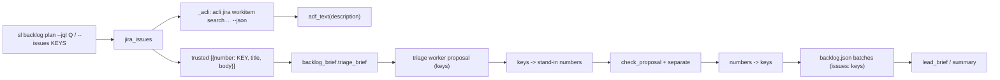
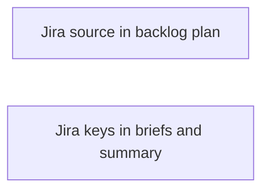

# Superlite: `backlog plan` reads a Jira backlog through acli (B38)

**Goal:** fix #208: `sl backlog plan` collects issues from GitHub only, so a Jira-tracked repo (piX, pix-app, PixKit) gets an empty triage. Expected: main points plan at a Jira source (`--jql "<query>"` or `--issues PIX-1272,PIX-725`), the triage brief quotes the Jira bodies, batches carry Jira keys, the lead brief says how to read a body and to use the key in the PR title and commit subjects, and the shipped summary names the keys.
**Architecture:** T1 adds the acli reader to `backlog.py` (`_acli`, `adf_text`, `jira_keys`, `jira_issues`), the `--jql`/`--issues` flags, a key-to-number mapping around `backlog_checks.check_proposal` (which accepts numbers only) and `skip <KEY>`. T2 makes `backlog_brief.py` render a Jira key wherever it renders `#N` (triage brief, lead brief, summary) and gives the Jira lead and triage brief their reading and naming rules.
**Tech stack:** Python 3.10+ stdlib, pytest (through `sl run_tests`), acli 1.3.40 (`/opt/homebrew/bin/acli`, authenticated).
**Spec:** this file, section Design; issue #208's Expected line and Max's two decisions.
**Detail:** contracts
**Target-min:** 11
**Wave0:** none
**Max chars:** 22000

Global constraints:
- Every code line in `skills/subagent-driven-development/scripts/` carries the repo's trailing `# O(...)` complexity comment (short notes after `|`); tests do not. Stdlib only.
- Existing tests stay green and no existing test file changes (another lead may own them). If an existing test turns red, report it in DONE_WITH_CONCERNS with the test id and the reason instead of editing it.
- The GitHub path is unchanged: with no `--jql`/`--issues`, plan, the briefs and the summary print exactly what they print today.
- Tests never run the real acli or gh: they monkeypatch `backlog._acli` / `subprocess.run`. Never run `sl backlog plan` yourself (main only; a hook blocks it).
- Run `sl` as an executable (`<abs>/sl ...`). Verify with `<abs>/sl run_tests --fast <own test file> <the verify files of the task> --task Tn --background`, then run the printed `wait:` line in the foreground and end the turn only after it reports. Never raw `pytest`, never the e2e or evals layers.
- No version edits (the ship step bumps the version).

Ruling: Max's decision: plan takes `--jql Q` as well as `--issues KEYS`; the two are one mutually exclusive argparse group (argparse usage error, exit 2, when both are given) - cost if wrong: a later flag to union them.
Ruling: Max's decision: the Jira reader is acli: `acli jira workitem search --jql Q --fields key,summary,description --paginate --json` (checked live, read-only: a JSON list of `{"key", "fields": {"summary", "description": <ADF dict or null>}}`, `[]` when empty; a bad JQL or a missing key exits 1 with `✗ Error: ...` on stderr); `--issues` runs the same search with `key in (K1, K2)` - cost if wrong: another reader later.
Ruling: plan stores Jira keys as strings in each batch's `issues`, `titles`, `skipped` and `outside`; `check_proposal` and `separate` run on stand-in numbers that plan maps back, because B38 may touch only backlog.py and backlog_brief.py. Ship's added `Closes #PIX-1272` line links nothing on GitHub (GitHub links only `#<digits>`), and merge then prints `OPEN #PIX-1272` after one failed `gh issue view`, which the lead brief names as expected - cost if wrong: a 10 s retry per merge and `#PIX-1272` in status lines until backlog_state/backlog_ship learn keys (follow-up).
Ruling: every Jira issue the source returns is trusted (no admit question): Jira has no GitHub author association and Max chose the query - cost if wrong: an outside reporter's ticket reaches triage, still under the data rule.
Ruling: the Jira path reuses the 200-issue cap and `not triaged (200 cap)` entries of the GitHub path - cost if wrong: none.
Ruling: detail contracts; no probe adapter (CLI over mocked subprocesses; Review Focus cases run as named pytest cases) - cost if wrong: one NEEDS_CONTEXT round.
Ruling: already in the lead worktree on branch superlite/b38-backlog-jira-source, so no `sl worktree ensure` - cost if wrong: none.
LAYERS: unit

## Design

### 1. Jira source in plan (T1, backlog.py)
- `KEY_RE = re.compile(r"^[A-Z][A-Z0-9_]*-[1-9][0-9]*$")`; `ACLI_TIMEOUT = 300`.
- `_acli(args: list) -> object`: `subprocess.run(["acli", *args], capture_output=True, text=True, timeout=ACLI_TIMEOUT)`. `FileNotFoundError` -> `RuntimeError("acli not found: install the Atlassian CLI and run `acli jira auth login`")`; another `OSError` or `TimeoutExpired` -> `RuntimeError(f"acli {' '.join(args[:3])} failed: {e}")`; a nonzero exit -> `RuntimeError(f"acli {' '.join(args[:3])} failed: {msg}")` where `msg` is stderr (else stdout) stripped, a leading `✗` and blanks dropped, collapsed to one line, cut to 200 characters; stdout not JSON -> `RuntimeError(f"acli {' '.join(args[:3])} gave no JSON")`. `main` already turns a RuntimeError into `BLOCKED: <msg>` with exit 3.
- `adf_text(node) -> str`: plain text of an Atlassian Document Format value. `None` -> `""`; a `str` -> itself; a dict of `type` `text` -> its `text`; `hardBreak` -> `"\n"`; `mention` -> `attrs.text`; `emoji` -> `attrs.text` else `attrs.shortName`; `inlineCard`/`blockCard` -> `attrs.url`; any other dict -> its `content` children's text joined with `""`; the block types `paragraph`, `heading`, `codeBlock`, `blockquote`, `listItem`, `tableRow`, `panel`, `rule` end their text with `"\n"`, and `listItem` starts with `"- "`. The result has runs of 3+ newlines collapsed to 2 and is stripped. Iterative or depth-capped: a node nested deeper than 100 levels is dropped, never a RecursionError. Non-dict, non-str values are `""`.
- `jira_keys(text: str) -> list[str]`: split on commas and whitespace, drop empties, upper-case, keep first occurrence order, each must match `KEY_RE`, else `ValueError(f"not a Jira key: {item}")` naming the item as given.
- `jira_issues(jql: str | None, keys: list[str] | None) -> list[dict]`: with keys, `jql = "key in (" + ", ".join(keys) + ")"`. Calls `_acli(["jira", "workitem", "search", "--jql", jql, "--fields", "key,summary,description", "--paginate", "--json"])`. Not a list -> `RuntimeError("acli search gave no issue list")`. Each dict item with a `key` matching `KEY_RE` becomes `{"number": key, "title": fields.summary or "", "body": _body(adf_text(fields.description))}`; other items are skipped. With keys, the result follows the keys' order and a key acli did not return -> `RuntimeError(f"Jira issue {key} not found")`.
- `plan` flags: one mutually exclusive group, `--jql Q` and `--issues KEYS`. `cmd_plan`: after the open-batch check and the proposal read, a bad `--issues` value prints `BLOCKED: --issues: not a Jira key: <item>` and returns 2 before any gh or acli call; an empty `--jql` (blank) prints `BLOCKED: --jql is empty` and returns 2. `info` still comes from `gh repo view` (repo name for briefs and ship). With a Jira source, `jira_issues` replaces the GitHub fetch: issues past `ISSUE_LIMIT` become `not triaged (200 cap)` entries, skipped keys are left out, every other issue is trusted (`outside` gets no admit entries).
- Mapping (Jira source only): after `fit_proposal`, a deep copy of the proposal whose batch `issues` lists hold stand-in numbers: the i-th trusted key (1-based, upper-cased match) -> i; any other item (unknown key, number, bool, other) -> the next number above the trusted count, remembered with `repr`-free text (`str(item)`). `check_proposal(copy, set(range(1, len(trusted) + 1)))`; every error line has each `#<n>` replaced by its key (or the remembered text), and `list of numbers` by `list of Jira keys`. After `separate`, each batch's `issues` maps back to keys in trusted order. The rejected proposal kept on disk is the original (keys), so `plan --proposal FILE --jql Q` re-applies it.
- `skip` takes `<n>` or a Jira key: an all-digit argument is an int, a `KEY_RE` match (after upper-casing) is the key, anything else is an argparse error (exit 2).
- The module docstring names `--jql`/`--issues` (acli) in one clause.

### 2. Jira keys in the briefs (T2, backlog_brief.py)
- `ref(n) -> str`: a `str` issue is a Jira key, shown as `clean(n)`; any other value as `f"#{n}"`. A batch or issue list is Jira when any of its issue values is a `str`.
- `triage_brief`: a Jira issue heading is `## <KEY> <title>`; with Jira issues the intro says `open Jira issues`, adds the line `Issues are Jira keys: list them as strings, e.g. "issues": ["PIX-1272"].`, and the closing JSON example shows `"issues": ["<KEY>"]` instead of `"issues": [<n>]`.
- `lead_brief`: with Jira issues, the issues line reads `Issues (Jira keys; you have a shell: read each body yourself with `acli jira workitem view <KEY> --fields summary,description --json`, or the Atlassian MCP getJiraIssue; never comments):` and each item is `- <KEY> <title>`. One more line follows the files line: `Jira: set **Ticket:** <first key> in your plan header (commit subjects then start with it), pass merge --title "<keys>: 
", and write no Jira change yourself (main moves the issues).` In the approved ship text the `Closes #N` clause becomes `.superlite/pr-body.md naming each Jira key; merge adds a `Closes #<KEY>` line, which closes nothing on GitHub, and prints `OPEN #<KEY>` for each key, which is expected (main moves the Jira issues to Done).`
- `summary`: the first line names each issue with `ref`, e.g. `B38 shipped: PIX-1272 PIX-725`.

## Coverage

| Category | State | Basis |
|---|---|---|
| Scope and success criteria | settled | #208 Expected; Max: `--jql` as well, acli |
| Domain and data model | ruled | keys as strings in backlog.json |
| Persistence and migration | ruled | old GitHub state unchanged; Jira state is new |
| Interfaces and contracts | settled | two plan flags, `skip <KEY>`, brief lines |
| UI states | n/a | CLI text only |
| Concurrency and state ownership | settled | existing bs.update path |
| Error handling and recovery | settled | acli missing, failing, non-JSON, missing key: BLOCKED lines |
| Security and privacy | ruled | keys validated before JQL; argv, no shell; bodies under the data rule |
| Performance and limits | ruled | 200 cap, 300 s acli timeout |
| Observability | n/a | stdout lines only |
| Testing strategy | settled | one new unit test file per task; mocked acli; one live read by the lead |
| Compatibility | settled | GitHub path byte-identical |
| Rollout | ruled | one PR; version bump at ship |
| Research unknowns | settled | acli JSON shape checked live |

## File structure
- `skills/subagent-driven-development/scripts/backlog.py`, `tests/scripts/test_backlog_jira_208.py` (T1).
- `skills/subagent-driven-development/scripts/backlog_brief.py`, `tests/scripts/test_backlog_brief_jira_208.py` (T2).

## Task graph

```mermaid
%% schedule
gantt
  title Predicted schedule (mm:ss)
  dateFormat X
  axisFormat %M:%S
  section lane 1
  T1 backlog plan --jql/--issues read Jira :t1, 0, 95s
  section lane 2
  T2 backlog_brief Jira keys in the triage :t2, 0, 69s
```

critical path: T1 (1.6 min) · peak width 2 · predicted build 1.6 min · predicted total ≈ 5.1 min (target ✓)

## Package: backlog Jira source (CLI over mocked subprocesses)
App type: CLI. Categories: protocol, encoding, state, deep. Specific risks: a Jira key mapped to the wrong batch, JQL built from unvalidated input, the GitHub path changing, a deep ADF tree crashing plan.
**Probe entry:** none (Ruling: no probe adapter).

### T1 backlog plan: --jql/--issues read Jira through acli; keys map around the checks · Complexity 5 · Est. context 50k
**Owns:** skills/subagent-driven-development/scripts/backlog.py, tests/scripts/test_backlog_jira_208.py
**Components:** 2
**LOC owned:** 210
**Tests:** fast
**Model:** sonnet
**Est. time:** 3.0 min (2 components, about 210 LOC, fast tests)
**Covers:** 1
**Consumes:** existing `backlog_checks.check_proposal(obj, known)` · existing `backlog_checks.separate(batches)` · existing `backlog_brief.triage_brief(issues, ctx)` (T2 makes it render a `str` number as a key)
**Produces:** backlog.adf_text(node) -> str · backlog.jira_keys(text: str) -> list[str] · backlog.jira_issues(jql: str | None, keys: list[str] | None) -> list[dict]
e.g. adf_text({"type": "doc", "content": [{"type": "paragraph", "content": [{"type": "text", "text": "Hi"}, {"type": "hardBreak"}, {"type": "text", "text": "there"}]}, {"type": "bulletList", "content": [{"type": "listItem", "content": [{"type": "paragraph", "content": [{"type": "text", "text": "a"}]}]}]}]}) -> "Hi\nthere\n- a"
e.g. jira_keys("pix-1272, PIX-725 pix-1272") -> ["PIX-1272", "PIX-725"]
e.g. jira_issues(None, ["PIX-2", "PIX-1"]) with acli returning [{"key": "PIX-1", "fields": {"summary": "One", "description": None}}, {"key": "PIX-2", "fields": {"summary": "Two", "description": "body"}}] -> [{"number": "PIX-2", "title": "Two", "body": "body"}, {"number": "PIX-1", "title": "One", "body": ""}]
**Review Focus:**
Fixture: reuse `bk`, `cli`, `load` from `test_backlog_cli` (as test_backlog_plan_proposal_297.py does) and monkeypatch `backlog._acli` with a fake that records its args and returns `ACLI = [{"key": "PIX-1", "fields": {"summary": "One", "description": {"type": "doc", "version": 1, "content": [{"type": "paragraph", "content": [{"type": "text", "text": "body one"}]}]}}}, {"key": "PIX-2", "fields": {"summary": "Two", "description": None}}]`; `bk.batches = [{"id": "B1", "topic": "first", "issues": ["PIX-1", "PIX-2"], "files": ["a.py"], "depends": [], "decisions": []}]`.
protocol: `test_jql_plans_batches_with_keys` (`plan --jql "project = PIX"`: rc 0, `B1 | #PIX-1 #PIX-2 | planned` in out, batch issues `["PIX-1", "PIX-2"]`, titles `{"PIX-1": "One", "PIX-2": "Two"}`, outside `[]`, the acli args are exactly `["jira", "workitem", "search", "--jql", "project = PIX", "--fields", "key,summary,description", "--paginate", "--json"]`, the brief issues are `[{"number": "PIX-1", "title": "One", "body": "body one"}, {"number": "PIX-2", "title": "Two", "body": ""}]`, and no gh `api` call ran);
protocol: `test_issues_flag_builds_key_jql` (`plan --issues "pix-2,PIX-1"`: acli `--jql` value `key in (PIX-2, PIX-1)`; a fake missing PIX-2 -> rc 3, out `BLOCKED: Jira issue PIX-2 not found\n`);
protocol: `test_bad_flags_refused_before_any_call` (`--issues "PIX-1,12"` -> rc 2, out `BLOCKED: --issues: not a Jira key: 12\n`; `--jql "  "` -> rc 2, `BLOCKED: --jql is empty\n`; `--jql a --issues PIX-1` -> SystemExit 2; in all three no acli and no gh call);
state: `test_unknown_key_rejected_and_named` (proposal issues `["PIX-1", "PIX-9"]` -> rc 3, `B1: unknown issue PIX-9` in out, `#` not before `PIX-9`, the kept file holds `["PIX-1", "PIX-9"]`; issues `[1]` -> `B1: unknown issue 1`; `"issues": "PIX-1"` -> `list of Jira keys` in out);
state: `test_key_in_two_batches_named` (B1 `["PIX-1"]`, B2 `["PIX-1"]` -> `PIX-1 is in B1 and B2` in out);
state: `test_lowercase_key_in_proposal_matches` (`["pix-2"]` -> batch issues `["PIX-2"]`, PIX-1 in outside with reason `not planned (triage)`);
state: `test_proposal_file_with_jql` (`plan --proposal F --jql x`, F holds the keyed batch -> rc 0, `bk.calls == []`, issues keys);
state: `test_skip_takes_a_key` (after a Jira plan, `skip pix-2` -> rc 0, out `skipped #PIX-2 (B1 keeps #PIX-1)\n`, `"PIX-2" in skipped`; a later `plan --reset --jql x` keeps PIX-2 out of the brief; `skip PIX` -> SystemExit 2; `skip 3` still stores the int 3);
encoding: `test_adf_text_shapes` (the `e.g.` case; `None` -> `""`; `"plain"` -> `"plain"`; mention `{"type": "mention", "attrs": {"text": "@max"}}` -> `"@max"`; inlineCard url; a heading then three empty paragraphs then a paragraph -> one blank line between; `{"type": "text"}` -> `""`; `[1, 2]` -> `""`);
deep: `test_adf_text_deep_tree` (a 5000-level nested `{"type": "blockquote", "content": [...]}` ending in a text node -> returns a str without raising);
protocol: `test_acli_errors_become_blocked` (monkeypatch `backlog.subprocess.run`: raising FileNotFoundError -> `plan --jql x` rc 3, out starts `BLOCKED: acli not found: install the Atlassian CLI`; returncode 1 with stderr `"✗ Error: failed to parse JQL query: the value 'nope' does not exist for the field 'project'.\n"` -> out `BLOCKED: acli jira workitem search failed: Error: failed to parse JQL query: the value 'nope' does not exist for the field 'project'.\n`; stdout `"not json"` rc 0 -> `BLOCKED: acli jira workitem search gave no JSON\n`; stdout `{}` -> `BLOCKED: acli search gave no issue list\n`);
state: `test_cap_lists_rest_as_not_triaged` (monkeypatch `backlog.ISSUE_LIMIT` to 1, two acli issues -> outside holds `{"number": "PIX-2", "title": "Two", "reason": "not triaged (1 cap)"}`);
state: `test_github_path_unchanged` (`plan` with no Jira flag: no acli call, `B1 | #1 #2 | planned` with the stock `BATCH`, outside as today).
**Steps:** 1 failing tests, 2 run: FAIL, 3 implement Design 1, 4 run: PASS (verify files: tests/scripts/test_backlog_jira_208.py tests/scripts/test_backlog_cli.py tests/scripts/test_backlog_plan_proposal_297.py tests/scripts/test_backlog_plan_round.py tests/scripts/test_backlog_fit_cli.py).

### T2 backlog_brief: Jira keys in the triage brief, lead brief and summary · Complexity 3 · Est. context 35k
**Owns:** skills/subagent-driven-development/scripts/backlog_brief.py, tests/scripts/test_backlog_brief_jira_208.py
**Components:** 1
**LOC owned:** 110
**Tests:** fast
**Model:** sonnet
**Est. time:** 2.0 min (1 component, about 110 LOC, fast tests)
**Covers:** 2
**Notes:** issue values come from backlog.json: `int` for GitHub, `str` Jira key for Jira; nothing is consumed from T1.
**Produces:** backlog_brief.ref(n) -> str · backlog_brief.triage_brief(issues, ctx) -> str (renders a str number as a key) · backlog_brief.lead_brief(batch, ctx) -> str (Jira lines) · backlog_brief.summary(batch, notes) -> str (keys)
e.g. ref("PIX-1272") -> "PIX-1272"
e.g. ref(208) -> "#208"
e.g. summary({"id": "B38", "issues": ["PIX-1272", "PIX-725"], "pr": 9, "version": "1.5.47"}, "") -> "B38 shipped: PIX-1272 PIX-725\nPR: #9\nVersion: 1.5.47\n"
**Review Focus:**
Fixture: `CTX = {"sl": "/x/sl", "repo": "o/r", "backlog_md": "/x/backlog.md", "titles": {"PIX-1272": "Fix login", "PIX-725": "Cache"}, "summaries": [], "approved": {"by": "AskUserQuestion", "time": "t"}}`, `JB = {"id": "B2", "topic": "jira-fix", "issues": ["PIX-1272", "PIX-725"], "files": ["a.py"], "answers": {}}`.
protocol: `test_lead_brief_lists_keys_and_acli` (`lead_brief(JB, CTX)` holds `- PIX-1272 Fix login`, `- PIX-725 Cache`, `acli jira workitem view <KEY> --fields summary,description --json`, `getJiraIssue`, `**Ticket:** PIX-1272`, `merge --title`, `naming each Jira key`, `OPEN #<KEY>`; holds neither `#PIX` nor `gh issue view` nor "one `Closes #N` line per issue");
state: `test_lead_brief_jira_not_approved` (`approved` None -> the NOT approved line unchanged, the Jira line about `**Ticket:**` still present);
protocol: `test_github_lead_brief_unchanged` (an int batch `{"id": "B1", "topic": "t", "issues": [7], "files": ["a.py"]}` with titles `{"7": "Seven"}` -> equals the text the current code prints for it, asserted as a literal built before the change: holds `- #7 Seven`, `gh issue view <n>`, "one `Closes #N` line per issue", no `Jira`);
encoding: `test_triage_brief_jira_headings` (issues `[{"number": "PIX-1272", "title": "Fix\x07 login", "body": "line\n\x1bnext"}]` -> `## PIX-1272 Fix login`, `    line`, `    next`, `open Jira issues`, `"issues": ["PIX-1272"]`, `"issues": ["<KEY>"]`; no `#PIX`);
protocol: `test_triage_brief_github_unchanged` (issues `[{"number": 3, "title": "T", "body": "b"}]` -> holds `## #3 T`, `"issues": [<n>]`, no `Jira`);
encoding: `test_ref_and_summary` (the three `e.g.` cases; `summary({"id": "B1", "issues": [1, 2]}, "")` first line `B1 shipped: #1 #2`; `ref("PIX-1\x07")` -> `"PIX-1"`).
**Steps:** 1 failing tests, 2 run: FAIL, 3 implement Design 2, 4 run: PASS (verify files: tests/scripts/test_backlog_brief_jira_208.py tests/scripts/test_backlog_brief.py tests/scripts/test_backlog_brief_limits.py tests/scripts/test_backlog_docs.py).

## Self-review
- #208 Expected: Jira source (`--jql`, `--issues`): Design 1. Briefs say how to read a body: Design 2 (lead) and Design 1+2 (triage quotes bodies, the worker has no shell). Batches carry keys: Design 1 mapping. PR title and commit subjects use the key: Design 2 lead line. Summary names the key: Design 2 `summary`.
- Outside B38's files (follow-up): backlog_state status lines and backlog_ship `Closes`/`OPEN` lines print `#<KEY>`; docs/tools.md, commands/backlog.md and backlog.md do not name `--jql`/`--issues`.
