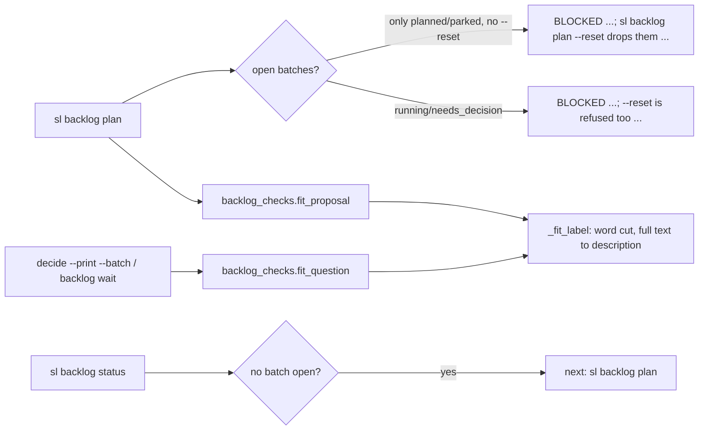
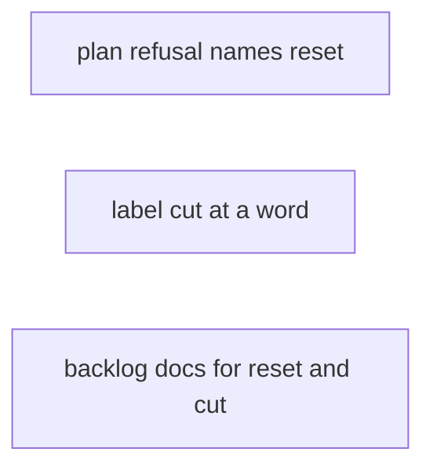

# Superlite: backlog plan names --reset, status names the next plan, labels cut at a word (B55)

**Goal:** fix #369 and #370. `sl backlog plan` refused by planned or parked batches names `sl backlog plan --reset` and what it drops; `--reset` is described in `--help`, `commands/backlog.md`, `skills/subagent-driven-development/backlog.md` and `docs/tools.md`; `sl backlog status` with no batch open ends with `next: sl backlog plan`. An over-long option label is cut at its last whole word and its full text moves to the front of its description; the triage brief says the label limit includes the ` (Recommended)` suffix.
**Architecture:** #369 lives in `backlog.py` (`cmd_plan` refusal line through a new `open_refusal` helper, `--reset` help text, `cmd_status` next line). #370 lives in the one cut rule of `backlog_checks.py` (`_word`, `_cut(word=True)`, `_fit_label`), so plan, `decide --print --batch` and `backlog wait` all get it; `backlog_brief.py` states it to the triage worker. Docs are additive sentences.
**Tech stack:** Python 3 stdlib, pytest (through `sl run_tests`).
**Spec:** this file, section Design; issues #369 and #370 Expected lines; Max's decision for #370: cut at a word, full text to the description.
**Detail:** tests
**Target-min:** 11
**Wave0:** none
**Coverage:** off

Global constraints:
- Replace code exactly as the task's `Code (verbatim)` block gives it; keep the file's `# O(...)` comment on every new line, as the block shows. Change no other line of the file.
- Existing tests stay green, except the existing assertions a task names, which it changes exactly as given. If another existing test turns red, report it in DONE_WITH_CONCERNS with the test id and the reason instead of editing it.
- Run `sl` as an executable (`<abs>/sl ...`). Verify with `<abs>/sl run_tests --fast <test files> --task Tn --background`, then run the printed `wait:` line in the foreground and end the turn only after it reports.
- No version edits (the ship step bumps the version). Never run `scripts/test_layers.py run`, `scripts/evals.sh` or `claude plugin eval` (the coordinator runs the layers).
- A hook blocks any Bash text that names the backlog start or decide subcommands; write files with Write or Edit, never with a heredoc.

## Design

#369 as seen: a second `sl backlog plan` exited 2 with `BLOCKED: backlog has open batches (B49 planned, B50 planned)` and named no way on; `--reset` (drops planned and parked batches, plans every open issue again, shipped history stays; running and needs_decision batches still block) was undocumented; `status` with every batch shipped printed no next step.
#370 as seen: `decide --print` showed labels cut mid-word at 60 characters (`Try the project-package prefix first, then the (Recommended)` was one of the better ones); main rewrote them by hand.

New refusal lines (stdout, exit 2, unchanged exit code):
- only planned or parked batches open, no `--reset`: `BLOCKED: backlog has open batches (B1 planned, B2 parked); sl backlog plan --reset drops them and plans every open issue again (shipped batches stay)`
- a running or needs_decision batch open, with or without `--reset`: `BLOCKED: backlog has open batches (B1 running, B2 planned); --reset is refused too while a batch is running or needs_decision`

`status`: when no batch is open (none yet, or every batch shipped) the last line is `next: sl backlog plan`.

Label cut: a label over 60 characters is cut to at most 60 at its last blank, trailing blanks and `,;:-` dropped; a ` (Recommended)` suffix stays whole (the base is cut to 46). A first word longer than the limit falls back to the plain cut. The full label text (without the suffix, stripped) goes in front of the description: `<full>. <old description>` (no added period when the full text ends in `.!?:`; just `<full>` when the description is absent or blank); a non-string description is left for `check_question` to refuse. The description is cut to 200 after that, as before. The `shortened:` note format is unchanged.

Ruling: #370's fix goes into backlog_checks.py and backlog_brief.py, and #369's docs into skills/subagent-driven-development/backlog.md, although the brief lists only commands/backlog.md, docs/tools.md and backlog.py (because the cut rule and the triage brief live only there, a copy in backlog.py would be duplicate logic, the issues name those texts, and no open batch B54, B56-B60 lists any of the three files while `plan` refuses new batches until B55 ships) - cost if wrong: a merge conflict with a later batch, resolved at its rebase.
Ruling: the refusal names `--reset` only when it would succeed; with a running or needs_decision batch it says --reset is refused too (because a user who already passed --reset gets the same refusal and otherwise learns nothing).
Ruling: `next: sl backlog plan` is appended by `cmd_status`, not by `status_lines` (because `plan` prints `status_lines` after every successful plan, where a planned batch always exists) - cost if wrong: none.
Ruling: every cut label, also the plain-cut fallback for one long word, moves its full text into the description; headers, descriptions and plan question texts keep the plain cut (Max's decision covers labels).
Ruling: the `shortened:` note keeps `N -> M characters` without a suffix (because docs and tests pin that format; the docs say where the full text goes).
Ruling: one plan of three parallel tasks in the lead worktree (no `sl worktree ensure`), detail tests, no Wave 0, no probe adapter (no new runnable entry).
LAYERS: unit, headless, evals



## File structure

- skills/subagent-driven-development/scripts/backlog.py: refusal helper, `--reset` help, status next line, docstring (T1).
- tests/scripts/test_backlog_plan_reset_369.py: new tests for T1.
- tests/scripts/test_backlog_cli.py, tests/scripts/test_backlog_plan_proposal_297.py: three existing assertions move to the new lines (T1).
- skills/subagent-driven-development/scripts/backlog_checks.py: `_word`, `_cut(word=)`, `_fit_label`, docstrings (T2).
- skills/subagent-driven-development/scripts/backlog_brief.py: the triage brief's label limit and cut sentence (T2).
- tests/scripts/test_backlog_label_cut_370.py: new tests for T2; tests/scripts/test_backlog_decide_fit.py: one expected description (T2).
- commands/backlog.md, skills/subagent-driven-development/backlog.md, docs/tools.md, tests/scripts/test_backlog_docs_369_370.py: doc sentences and their pins (T3).

## Task graph

```mermaid
%% schedule
gantt
  title Predicted schedule (mm:ss)
  dateFormat X
  axisFormat %M:%S
  section lane 1
  T2 label cut at a word :t2, 0, 86s
  section lane 2
  T1 plan refusal names reset :t1, 0, 64s
  section lane 3
  T3 backlog docs for reset and cut :t3, 0, 60s
```





critical path: T2 (1.4 min) · peak width 3 · predicted build 1.4 min · predicted total ≈ 4.9 min (target ✓)

## Predicted schedule

## backlog

App type: CLI. Categories: protocol (refusal lines, exit codes, help text, status line), encoding (label cut at blanks and punctuation, suffix kept, description join).

### T1 plan refusal names reset · Complexity 2 (O-1) · Est. context 34k
**Owns:** skills/subagent-driven-development/scripts/backlog.py, tests/scripts/test_backlog_plan_reset_369.py, tests/scripts/test_backlog_cli.py, tests/scripts/test_backlog_plan_proposal_297.py
**Components:** 1
**LOC owned:** 70
**Tests:** fast
**Kind:** design
**Model:** sonnet
**Est. time:** 2.5 min (1 component, about 70 LOC, fast tests)
**Consumes:** none
**Produces:** backlog.open_refusal(open_: list, busy: list) -> str
**Covers:** Design
**Review Focus:** `test_plan_names_reset_while_only_planned_or_parked_batches_are_open`: B1 planned, B2 parked: exit 2, the RESET line, then `plan --reset` exits 0; `test_plan_refusal_says_reset_is_refused_with_a_live_batch[running|needs_decision]`: plain and `--reset` give the BUSY line, states unchanged; `test_plan_help_describes_reset`; `test_status_names_plan_when_nothing_is_open`.
**Code (verbatim):** in skills/subagent-driven-development/scripts/backlog.py:
1. In the module docstring replace `park <batch> --reason R; start|wait|answer and ship are routed.` with `park <batch> --reason R; a plan refused by planned or parked batches names --reset, and status with no batch open ends with next: sl backlog plan (#369); start|wait|answer and ship are routed.`
2. Directly above `def cmd_plan(a) -> int:` insert (two blank lines after it):
````python
RESET_HINT = "; sl backlog plan --reset drops them and plans every open issue again (shipped batches stay)"  # O(1) #369
BUSY_HINT = "; --reset is refused too while a batch is running or needs_decision"  # O(1) #369


def open_refusal(open_: list, busy: list) -> str:
    """The plan refusal while batches are open; it names --reset only when only planned or parked batches block (#369)."""
    head = "BLOCKED: backlog has open batches (" + ", ".join(f"{b['id']} {b['state']}" for b in open_) + ")"  # O(b)
    return head + (BUSY_HINT if busy else RESET_HINT)  # O(1)
````
3. In `cmd_plan` replace the three lines
````python
    if open_ and (not a.reset or any(b["state"] in ("running", "needs_decision") for b in open_)):
        print("BLOCKED: backlog has open batches (" + ", ".join(f"{b['id']} {b['state']}" for b in open_) + ")")
        return 2
````
with
````python
    busy = [b for b in open_ if b["state"] in ("running", "needs_decision")]  # O(b) --reset never drops these
    if open_ and (not a.reset or busy):  # O(1)
        print(open_refusal(open_, busy))  # O(b)
        return 2
````
4. Replace the body of `cmd_status` (the two lines after its import) with
````python
    d = bs.load(bs.path(_root()))  # O(size)
    lines = bs.status_lines(d)  # O(b)
    if all(b["state"] == "shipped" for b in d["batches"]):  # O(b) no batch yet, or every batch shipped (#369)
        lines.append("next: sl backlog plan")  # O(1)
    print("\n".join(lines))  # O(lines)
    return 0  # O(1)
````
5. Replace `    pl.add_argument("--reset", action="store_true")` with
````python
    pl.add_argument("--reset", action="store_true", help="drop the planned and parked batches and plan every open issue again; "
                    "shipped batches stay; refused while a batch is running or needs_decision")  # O(1) #369
````
**Existing assertions (change exactly these):**
- tests/scripts/test_backlog_cli.py `test_plan_refuses_while_batches_are_open`: the expected `"BLOCKED: backlog has open batches (B1 planned)\n"` becomes `"BLOCKED: backlog has open batches (B1 planned); sl backlog plan --reset drops them and plans every open issue again (shipped batches stay)\n"`.
- tests/scripts/test_backlog_cli.py `test_status_and_router`: the expected status output becomes `"backlog: 0 batches, 0 running, 0 shipped, ship not approved\nnext: sl backlog plan\n"`.
- tests/scripts/test_backlog_plan_proposal_297.py line 81: the expected refusal gets the same `; sl backlog plan --reset drops them ...` tail as the first item.
**Test code (verbatim):** new file tests/scripts/test_backlog_plan_reset_369.py:
```python
import pytest
from test_backlog_cli import bk, cli, load, BATCH  # noqa: F401  bk is the CLI fixture
import backlog as bl
import backlog_state as bs

RESET = "; sl backlog plan --reset drops them and plans every open issue again (shipped batches stay)"
BUSY = "; --reset is refused too while a batch is running or needs_decision"
TWO = [{**BATCH, "issues": [1]}, {**BATCH, "id": "B2", "topic": "second", "issues": [2], "files": ["b.py"]}]


def _state(bk, bid, state):
    bs.update(bs.path(bk.root), lambda d: bs.batch(d, bid).update({"state": state}))


def test_plan_names_reset_while_only_planned_or_parked_batches_are_open(bk, capsys):
    bk.batches = TWO
    assert cli(capsys, "plan")[0] == 0
    _state(bk, "B2", "parked")
    assert cli(capsys, "plan") == (2, "BLOCKED: backlog has open batches (B1 planned, B2 parked)" + RESET + "\n")
    assert cli(capsys, "plan", "--reset")[0] == 0
    assert [(b["id"], b["state"]) for b in load(bk)["batches"]] == [("B1", "planned"), ("B2", "planned")]


@pytest.mark.parametrize("state", ["running", "needs_decision"])
def test_plan_refusal_says_reset_is_refused_with_a_live_batch(bk, capsys, state):
    bk.batches = TWO
    cli(capsys, "plan")
    _state(bk, "B1", state)
    want = (2, f"BLOCKED: backlog has open batches (B1 {state}, B2 planned)" + BUSY + "\n")
    assert cli(capsys, "plan") == want
    assert cli(capsys, "plan", "--reset") == want
    assert [b["state"] for b in load(bk)["batches"]] == [state, "planned"]


def test_open_refusal_lists_every_open_batch():
    open_ = [{"id": "B4", "state": "planned"}, {"id": "B5", "state": "needs_decision"}]
    assert bl.open_refusal(open_, open_[1:]) == "BLOCKED: backlog has open batches (B4 planned, B5 needs_decision)" + BUSY
    assert bl.open_refusal(open_[:1], []) == "BLOCKED: backlog has open batches (B4 planned)" + RESET


def test_plan_help_describes_reset(capsys):
    with pytest.raises(SystemExit):
        bl.main(["plan", "--help"])
    out = " ".join(capsys.readouterr().out.split())
    assert ("drop the planned and parked batches and plan every open issue again; shipped batches stay; "
            "refused while a batch is running or needs_decision") in out


def test_status_names_plan_when_nothing_is_open(bk, capsys):
    assert cli(capsys, "status") == (0, "backlog: 0 batches, 0 running, 0 shipped, ship not approved\nnext: sl backlog plan\n")
    cli(capsys, "plan")
    assert "next: sl backlog plan" not in cli(capsys, "status")[1]
    _state(bk, "B1", "shipped")
    assert cli(capsys, "status")[1].splitlines()[-1] == "next: sl backlog plan"
    _state(bk, "B1", "parked")
    assert "next: sl backlog plan" not in cli(capsys, "status")[1]
```
**Steps:** 1 write the test file and change the three assertions, 2 run: FAIL, 3 make the five edits, 4 run: PASS with tests/scripts/test_backlog_plan_reset_369.py tests/scripts/test_backlog_cli.py tests/scripts/test_backlog_plan_proposal_297.py tests/scripts/test_backlog_plan_round.py tests/scripts/test_backlog_jira_208.py
**Notes:** the `bk` fixture's issue #3 has an outside author, so batches use #1 and #2 only. A successful plan prints status lines but never the next line.

### T2 label cut at a word · Complexity 3 (O-1) · Est. context 36k
**Owns:** skills/subagent-driven-development/scripts/backlog_checks.py, skills/subagent-driven-development/scripts/backlog_brief.py, tests/scripts/test_backlog_label_cut_370.py, tests/scripts/test_backlog_decide_fit.py
**Components:** 2
**LOC owned:** 110
**Tests:** fast
**Kind:** design
**Model:** sonnet
**Est. time:** 3 min (2 components, about 110 LOC, fast tests)
**Consumes:** none
**Produces:** backlog_checks.fit_question(q: object, question: bool = False) -> list[str]
**Covers:** Design
**Review Focus:** encoding: `test_trailing_punctuation_is_dropped_and_a_cut_on_a_blank_keeps_the_last_word` (`"x"*50 + " abcdef; ghijkl"` -> `"x"*50 + " abcdef"`, 65 -> 57); `test_one_long_word_is_cut_inside_it_and_still_moved` (`"k"*70 + REC` -> `"k"*46 + REC`); `test_a_label_at_the_limit_and_a_non_string_description_stay`.
**Code (verbatim):** in skills/subagent-driven-development/scripts/backlog_checks.py:
1. Replace the whole `_cut` function (its 4 lines) with
````python
def _word(v: str, hi: int) -> str:
    """v cut to at most hi characters at its last blank, trailing blanks and ,;:- dropped (#370).

    A first word longer than hi, or a cut that would leave only those characters, falls back to the plain cut."""
    head = v[:hi]  # O(hi)
    if len(v) > hi and not v[hi].isspace():  # O(1) the cut falls inside a word
        m = re.search(r"\s\S*\Z", head)  # O(hi) the last blank
        if m and head[:m.start()].strip():  # O(hi)
            head = head[:m.start()]  # O(hi)
    return head.rstrip(" \t\n,;:-") or v[:hi].rstrip()  # O(hi)


def _cut(v: str, hi: int, word: bool = False) -> str:
    cut = _word if word else (lambda s, n: s[:n].rstrip())  # O(1)
    if v.endswith(REC) and hi > len(REC):  # O(len)
        return cut(v[:len(v) - len(REC)], hi - len(REC)) + REC  # O(hi)
    return cut(v, hi)  # O(hi)
````
2. Directly below the `_fit` function insert (two blank lines before and after):
````python
def _fit_label(o: dict, name: str, what: str, notes: list) -> None:
    """Cut an over-long option label (60) at its last whole word; its full text, without the ` (Recommended)` suffix, goes in front of the description (#370)."""
    v = o.get("label")
    if not isinstance(v, str) or len(v) <= 60:  # O(1)
        return
    c = _cut(v, 60, word=True)  # O(len)
    if not c.strip():  # O(len)
        return
    o["label"] = c
    full = (v[:len(v) - len(REC)] if v.endswith(REC) else v).strip()  # O(len)
    d = o.get("description")
    if full and (d is None or isinstance(d, str)):  # O(1) a non-string description stays for check_question to refuse
        rest = (d or "").lstrip()  # O(len)
        o["description"] = full + (("" if full[-1] in ".!?:" else ".") + " " + rest if rest.strip() else "")  # O(len)
    notes.append(f'"{name}" {what}: {len(v)} -> {len(c)} characters')
````
3. In `fit_question` replace `                _fit(o, "label", 60, name, f"option {n} label", notes)` with `                _fit_label(o, name, f"option {n} label", notes)`.
4. In the docstrings of `fit_question` and `fit_proposal` replace the sentence `A label ending in " (Recommended)" keeps that suffix.` with `An over-long label is cut at its last whole word (a " (Recommended)" suffix kept) and its full text goes in front of its description, which is then cut to 200.`
In skills/subagent-driven-development/scripts/backlog_brief.py replace the two lines
````python
               "header at most 12 characters, 2 to 4 options with distinct labels, option label at most 60 characters, "
               "description at most 200 characters; an over-long header, label or description is cut to its limit, "
````
with
````python
               "header at most 12 characters, 2 to 4 options with distinct labels, option label at most 60 characters "
               "including a ` (Recommended)` suffix, description at most 200 characters; an over-long header, label or "
               "description is cut to its limit (a label at its last whole word, its full text moved to the front of its "
               "description), "
````
**Existing assertions (change exactly these):** tests/scripts/test_backlog_decide_fit.py `test_decide_batch_cuts_and_names_cuts_on_stderr`: below `want["questions"][0]["options"][0]["label"] = "k" * 46 + REC` add `want["questions"][0]["options"][0]["description"] = "k" * 70 + ". no break"`.
**Test code (verbatim):** new file tests/scripts/test_backlog_label_cut_370.py:
```python
import sys

from test_plan_tools import SCRIPTS

sys.path.insert(0, str(SCRIPTS))
import backlog_brief as bb  # noqa: E402
import backlog_checks as bc  # noqa: E402

REC = " (Recommended)"
FULL = "Refuse, name the lost env and the resume command first"


def one(label, desc="trade-off"):
    o = {"label": label} if desc is None else {"label": label, "description": desc}
    return {"questions": [{"question": "Q?", "header": "H", "options": [o, {"label": "Drop", "description": "b"}]}]}


def opt(q):
    return q["questions"][0]["options"][0]


def test_a_suffixed_label_is_cut_at_a_word_and_its_full_text_leads_the_description():
    q = one(FULL + REC)
    assert bc.fit_question(q) == ['"Q?" option 1 label: 68 -> 54 characters']
    assert opt(q) == {"label": "Refuse, name the lost env and the resume" + REC, "description": FULL + ". trade-off"}
    assert bc.check_question(q) == []


def test_the_issue_labels_end_at_a_whole_word():
    for full, cut in (("Allow writes under .superlite/ and plans; name the guard file", "Allow writes under .superlite/ and plans; name"),
                      ("Try the project-package prefix first, then the plain module name", "Try the project-package prefix first, then the")):
        q = one(full + REC)
        bc.fit_question(q)
        assert opt(q) == {"label": cut + REC, "description": full + ". trade-off"}


def test_trailing_punctuation_is_dropped_and_a_cut_on_a_blank_keeps_the_last_word():
    q = one("x" * 50 + " abcdef; ghijkl")
    assert bc.fit_question(q) == ['"Q?" option 1 label: 65 -> 57 characters'] and opt(q)["label"] == "x" * 50 + " abcdef"
    q = one("w" * 30 + " " + "x" * 29 + " tail")
    assert bc.fit_question(q) == ['"Q?" option 1 label: 65 -> 60 characters'] and opt(q)["label"] == "w" * 30 + " " + "x" * 29


def test_one_long_word_is_cut_inside_it_and_still_moved():
    q = one("k" * 70 + REC)
    assert bc.fit_question(q) == ['"Q?" option 1 label: 84 -> 60 characters']
    assert opt(q) == {"label": "k" * 46 + REC, "description": "k" * 70 + ". trade-off"}


def test_description_absent_blank_or_after_a_sentence():
    full = "Keep the old v1 flag for one more minor release, then remove it in 1.6"
    cut = "Keep the old v1 flag for one more minor release, then remove"
    q = one(full, desc=None)
    assert bc.fit_question(q) == ['"Q?" option 1 label: 70 -> 60 characters'] and opt(q) == {"label": cut, "description": full}
    q = one(full, desc="  ")
    bc.fit_question(q)
    assert opt(q)["description"] == full
    q = one(full + ".", desc="  no break")
    bc.fit_question(q)
    assert opt(q) == {"label": cut, "description": full + ". no break"}


def test_a_moved_label_that_overflows_the_description_is_cut_to_200_and_named():
    q = one("k" * 70 + REC, desc="d" * 190)
    assert bc.fit_question(q) == ['"Q?" option 1 label: 84 -> 60 characters', '"Q?" option 1 description: 262 -> 200 characters']
    assert opt(q)["description"] == ("k" * 70 + ". " + "d" * 190)[:200]


def test_a_label_at_the_limit_and_a_non_string_description_stay():
    q = one("y" * 60)
    assert bc.fit_question(q) == [] and opt(q) == {"label": "y" * 60, "description": "trade-off"}
    q = one("k" * 70, desc=5)
    assert bc.fit_question(q) == ['"Q?" option 1 label: 70 -> 60 characters'] and opt(q) == {"label": "k" * 60, "description": 5}
    assert bc.check_question(q) == ["q1 options description: description 0 to 200 characters"]


def test_plan_proposals_get_the_same_word_cut():
    p = {"batches": [{"decisions": [one(FULL + REC)]}]}
    assert bc.fit_proposal(p) == ['"Q?" option 1 label: 68 -> 54 characters']
    assert opt(p["batches"][0]["decisions"][0])["description"] == FULL + ". trade-off"


def test_triage_brief_names_the_suffix_and_the_word_cut():
    t = bb.triage_brief([{"number": 1, "title": "t"}], {"repo": "r", "max_batches": 2})
    assert "option label at most 60 characters including a ` (Recommended)` suffix" in t
    assert "(a label at its last whole word, its full text moved to the front of its description)" in t
```
**Steps:** 1 write the test file and the one assertion, 2 run: FAIL, 3 make the edits, 4 run: PASS with tests/scripts/test_backlog_label_cut_370.py tests/scripts/test_backlog_decide_fit.py tests/scripts/test_backlog_fit.py tests/scripts/test_backlog_fit_cli.py tests/scripts/test_backlog_question_fit.py tests/scripts/test_backlog_question_cut_297.py tests/scripts/test_backlog_wait_question.py tests/scripts/test_backlog_brief_limits.py tests/scripts/test_backlog_brief.py
**Notes:** the expected numbers were computed from the verbatim code. `backlog wait` keeps the lead's file unchanged; only the cut copy main prints changes.

### T3 backlog docs for reset and cut · Complexity 1 (O-1) · Est. context 28k
**Owns:** commands/backlog.md, skills/subagent-driven-development/backlog.md, docs/tools.md, tests/scripts/test_backlog_docs_369_370.py
**Components:** 1
**LOC owned:** 40
**Tests:** fast
**Kind:** mechanical
**Model:** haiku
**Est. time:** 2 min (1 component, about 40 LOC, fast tests)
**Consumes:** none
**Produces:** none
**Covers:** Design
**Review Focus:** `test_backlog_docs_369_370`: each new sentence is in its file; existing doc pins (tests/scripts/test_docs_b26.py, test_docs_b32_tools.py) stay green.
**Code (verbatim):** insert only, on the same line as the anchor (no new line); delete no existing text. Each insert is the fenced text after its anchor, starting with its leading blank.
1. commands/backlog.md step 1, after the anchor `tells you the next step.` insert
````text
 With no batch open (none yet, or every batch shipped) its last line is `next: sl backlog plan`.
````
2. commands/backlog.md step 2, after the anchor `you are notified when it ends.` insert
````text
 Issues filed while batches are still only planned: `"$SL" backlog plan --reset` drops the planned and parked batches and plans every open issue again; shipped batches stay, and a running or needs_decision batch still refuses it (a plain `plan` names `--reset` in its `BLOCKED:` line).
````
3. commands/backlog.md step 3, after the anchor `It prints the open questions.` insert
````text
 A label the plan cut ends at a whole word; its full text leads the option's description.
````
4. skills/subagent-driven-development/backlog.md `## Main` step 1, after the anchor `topic, issues, PR.` insert
````text
 With no batch open its last line is `next: sl backlog plan`.
````
5. skills/subagent-driven-development/backlog.md `## Main` step 2, after the anchor `a question over 300 characters still fails the plan.` insert
````text
 An option label is cut at its last whole word, its full text moved to the front of its description. `--reset` drops the planned and parked batches and plans every open issue again (shipped batches stay); a running or needs_decision batch refuses it, and a plain `plan` refused by planned or parked batches names `--reset` in its `BLOCKED:` line.
````
6. docs/tools.md, the row that starts with `` | `backlog` | ``, three inserts; the row stays one line. After the anchor `[--timeout-min 60] [--reset]` followed by its closing backtick, insert
````text
 (`--reset` drops the planned and parked batches and plans every open issue again; shipped batches stay; refused while a batch is running or needs_decision; a plain `plan` refused by planned or parked batches names it)
````
After the anchor `suffix kept,` insert
````text
 a label cut at its last whole word with its full text moved to the front of its description,
````
After the anchor `not triaged (200 cap)` followed by its closing backtick and `)`, insert
````text
 and `next: sl backlog plan` when no batch is open
````
**Test code (verbatim):** new file tests/scripts/test_backlog_docs_369_370.py:
```python
from pathlib import Path

ROOT = Path(__file__).resolve().parents[2]
CMD = (ROOT / "commands" / "backlog.md").read_text()
SKILL = (ROOT / "skills" / "subagent-driven-development" / "backlog.md").read_text()
TOOLS = (ROOT / "docs" / "tools.md").read_text()
ROW = next(ln for ln in TOOLS.splitlines() if ln.startswith("| `backlog` |"))


def test_command_names_next_reset_and_word_cut():
    for s in ("its last line is `next: sl backlog plan`.",
              '`"$SL" backlog plan --reset` drops the planned and parked batches and plans every open issue again; shipped batches stay',
              "a plain `plan` names `--reset` in its `BLOCKED:` line",
              "A label the plan cut ends at a whole word; its full text leads the option's description."):
        assert s in CMD, s


def test_skill_main_section_names_next_reset_and_word_cut():
    main = SKILL[SKILL.index("## Main"):SKILL.index("## Lead")]
    for s in ("With no batch open its last line is `next: sl backlog plan`.",
              "An option label is cut at its last whole word, its full text moved to the front of its description.",
              "`--reset` drops the planned and parked batches and plans every open issue again (shipped batches stay)"):
        assert s in main, s


def test_tools_row_names_reset_word_cut_and_next():
    for s in ("`--reset` drops the planned and parked batches and plans every open issue again; shipped batches stay; refused while a batch is running or needs_decision",
              "a label cut at its last whole word with its full text moved to the front of its description,",
              "and `next: sl backlog plan` when no batch is open"):
        assert s in ROW, s
    assert ROW.endswith(" |")
```
**Steps:** 1 write the test file, 2 run: FAIL, 3 make the six inserts, 4 run: PASS with tests/scripts/test_backlog_docs_369_370.py tests/scripts/test_docs_b26.py tests/scripts/test_docs_b32_tools.py tests/scripts/test_backlog_docs.py tests/scripts/test_backlog_main_docs.py tests/scripts/test_backlog_user_docs.py tests/scripts/test_docs_b16.py tests/scripts/test_run_state_docs_b19.py
**Notes:** each anchor occurs once in its file (in tools.md, once in the `backlog` row). The fenced text is literal: its backticks are the doc's code spans.

**Probe entry:** none (no new runnable entry; the CLI paths are covered by in-process tests)

## Review Focus

backlog (CLI): protocol cases in T1, encoding cases in T2, doc pins in T3.

## Self-review

Coverage: #369 refusal, help and status are T1; its docs are T3; #370 cut and brief are T2, its docs T3. No placeholders. Three tasks, no edges, disjoint Owns. Expected numbers in T2 were computed from the verbatim code.
