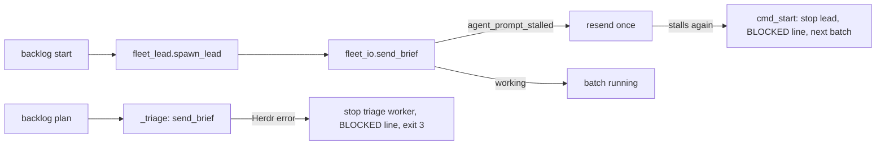
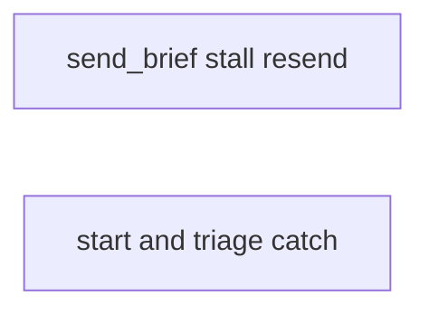

# Superlite: a stalled brief no longer crashes backlog start or leaves an idle lead (B41)

**Goal:** fix #338: `sl backlog start` crashed with an uncaught `HerdrError: agent_prompt_stalled` in `fleet_io.send_brief`, left the lead pane `ready` with no task and the batch `planned`.
**Architecture:** T1 makes `fleet_io.send_brief` resend the brief once when Herdr reports `agent_prompt_stalled` (as `fleet.spawn` already resends a prime); T2 makes `backlog_run.cmd_start` catch a Herdr error from `send_brief`, stop that lead, print one `BLOCKED:` line for the batch and start the others, and makes `backlog._triage` do the same for the triage worker.
**Tech stack:** Python 3.10+ stdlib, pytest (through `sl run_tests`).
**Spec:** this file, section Design; issue #338 Expected line.
**Detail:** contracts
**Target-min:** 11
**Wave0:** none

Global constraints:
- Every code line in `skills/subagent-driven-development/scripts/*.py` carries the repo's trailing `# O(...)` complexity comment where the surrounding function's lines do; tests do not. Stdlib only.
- Existing tests stay green. An existing test file changes only when the task Owns it. If another existing test turns red, report it in DONE_WITH_CONCERNS with the test id and the reason instead of editing it.
- Run `sl` as an executable (`<abs>/sl ...`). Verify with `<abs>/sl run_tests --fast <own test files> --task Tn --background`, then run the printed `wait:` line in the foreground and end the turn only after it reports.
- No version edits (the ship step bumps the version). Never run `scripts/evals.sh`, `claude plugin eval` or `scripts/test_layers.py run`.

Ruling: the resend lives in `send_brief` itself (the issue's Expected line), so `fleet send --brief`, the Wave 0 send in `fleet spawn --for-dispatch` and the triage send get it too; only the code `agent_prompt_stalled` is resent, at once and with the same message, as `fleet.spawn`'s prime resend - cost if wrong: a stall that a resend cannot fix costs one more 15 s prompt.
Ruling: B41 also edits `skills/subagent-driven-development/scripts/backlog_run.py` (outside its list): `cmd_start`, the crash site, lives there, not in backlog.py; no open batch owns it (B40 owns feedback.py and run_tests.py, B42-B46 other files) - cost if wrong: a rebase conflict at ship.
Ruling: a batch whose lead got no brief keeps its state (planned, or parked with its reason) and records no lead; its worktree stays for the next `start`; the exit is 2, as for a refused batch, so main reads the BLOCKED line and the other batches still start - cost if wrong: main reruns `start B` by hand.
Ruling: `backlog._triage` gets the same catch (backlog.py is in B41's list and its triage send crashes the same way): the triage worker is stopped and `plan` prints one BLOCKED line, exit 3 like the other triage failures - cost if wrong: none.
Ruling: detail contracts; no probe adapter (CLI paths over faked Herdr; Review Focus cases are named pytest cases); already in the lead worktree, so no `sl worktree ensure`; layers: unit only (scripts/** is outside headless, tui and evals) - cost if wrong: one NEEDS_CONTEXT round.
LAYERS: unit

## Design

### 1. `fleet_io.send_brief` resends once on a stall (T1)
- New constant `STALLED = "agent_prompt_stalled"`.
- In `send_brief`, the `hc.prompt(name, msg, ["working"], 15000)` call becomes: try it; on `hc.HerdrError` whose `code` attribute (read with `getattr(e, "code", None)`) is `STALLED`, call `hc.prompt` again once with the same arguments; any other code, or an error from the second call, propagates unchanged. Nothing is marked busy, relabelled or printed before a prompt succeeds.
- `send`, `send_text` and `wait` are unchanged. The module docstring names the resend in one line: `send --brief` resends the brief once when Herdr reports agent_prompt_stalled; a second stall is the error.
- The CLI path is unchanged: a second stall reaches `main`'s `except hc.HerdrError` and prints `error: agent_prompt_stalled: <message>` on stderr, exit 1.

### 2. `backlog start` and `backlog plan` survive a failed brief (T2)
- `backlog_run.cmd_start`: the `fleet_io.send_brief(sd, rec["id"], str(brief), bid)` call is wrapped in `try/except fleet.hc.HerdrError as e`. On the error: `_stop(sd, rec["id"])`, print `BLOCKED: <bid> lead <Wn> got no brief (<e>); lead stopped, rerun sl backlog start <bid>`, set `code = 2`, and `continue` with the next batch. The batch is not marked (no `mark`, no running line), so it keeps its state, reason and fields.
- `backlog_run` module docstring: one more sentence: a lead whose brief Herdr refuses (after send_brief's one resend on a stall) is stopped and its batch keeps its state (BLOCKED line, exit 2).
- `backlog._triage`: `import herdr_client as hc` inside the function; the `fleet_io.send_brief(sd, wid, str(brief), "triage")` call is wrapped in `try/except hc.HerdrError as e`: `fleet.stop(sd, [wid])` inside `try/except (Exception, SystemExit): pass`, then `return None, [f"BLOCKED: triage worker {wid} got no brief ({e}); worker stopped"]`. `cmd_plan` already prints the lines and returns 3.

## Coverage

| Category | State | Basis |
|---|---|---|
| Scope and success criteria | settled | #338 Expected line |
| Domain and data model | settled | batch fields unchanged; a failed brief writes nothing |
| Persistence and migration | n/a | no new stored data |
| Interfaces and contracts | settled | `send_brief` signature unchanged; one new stdout line shape in start and plan |
| UI states | n/a | CLI text only |
| Concurrency and state ownership | ruled | the stopped lead's worker record turns `stopped`; the batch never turns running |
| Error handling and recovery | ruled | one resend on a stall; then BLOCKED line, worker stopped, rerun `start B` |
| Security and privacy | n/a | no new input |
| Performance and limits | ruled | at most one extra 15 s prompt per send |
| Observability | settled | BLOCKED line names batch, worker and Herdr error |
| Testing strategy | settled | unit tests over the existing fake Herdr and backlog fixtures |
| Compatibility | settled | Herdr error code `agent_prompt_stalled` (docs/plans/2026-11-05-herdr-fleet.md) |
| Rollout | ruled | one PR; version bump at ship |
| Research unknowns | n/a | none |

## File structure
- `skills/subagent-driven-development/scripts/fleet_io.py`, `tests/scripts/test_fleet_io_brief_stall.py` (T1).
- `skills/subagent-driven-development/scripts/backlog_run.py`, `skills/subagent-driven-development/scripts/backlog.py`, `tests/scripts/test_backlog_start_stall.py`, `tests/scripts/test_backlog_plan_stall.py` (T2).

## Task graph

```mermaid
%% schedule
gantt
  title Predicted schedule (mm:ss)
  dateFormat X
  axisFormat %M:%S
  section lane 1
  T2 backlog start and triage stop a worke :t2, 0, 83s
  section lane 2
  T1 fleet_io send_brief resends once on a :t1, 0, 65s
```

critical path: T2 (1.4 min) · peak width 2 · predicted build 1.4 min · predicted total ≈ 4.9 min (target ✓)

## Package: fleet I/O (library)
App type: library over a CLI. Categories: protocol (Herdr error codes), state (worker busy only after a sent prompt). Specific risks: a resend after a non-stall error; the worker marked busy before the second stall.
**Probe entry:** none (Ruling: no probe adapter).

### T1 fleet_io: send_brief resends once on agent_prompt_stalled · Complexity 3 · Est. context 30k
**Owns:** skills/subagent-driven-development/scripts/fleet_io.py, tests/scripts/test_fleet_io_brief_stall.py
**Components:** 1
**LOC owned:** 70
**Tests:** fast
**Model:** sonnet
**Est. time:** 2.0 min (1 component, about 70 LOC, fast tests)
**Covers:** 1
**Consumes:** none
**Produces:** fleet_io.send_brief(sd, wid: str, brief: str, label: str = "") -> str (unchanged signature; resends once on a stall)
**Review Focus:**
Test fixture: `from test_fleet_io import io, world` (world is a fixture: `world.fh` is a FakeHerdr set as `io.hc`, workers W1 and W2 `ready`); a brief file `world.sd / "briefs" / "b.md"`; a `Stall(world.fh.HerdrError)` class with `__init__(self, code, message="")` that calls `super().__init__(f"{code}: {message}")` and sets `self.code`, `self.message`; a fake prompt set as `world.fh.prompt` that records `(name, text, until, timeout_ms)` and raises from a list of outcomes.
protocol: `test_send_brief_resends_once_on_a_stall` (outcomes: `Stall("agent_prompt_stalled", "no working state")`, then `"working"` -> `io.send_brief(world.sd, "W2", str(b))` returns `"b"`; two prompt records, equal to each other, until `["working"]`, timeout `15000`; W2 in fleet.json `state == "busy"`, `task == "b"`; stdout holds `W2 b sent`).
state: `test_send_brief_second_stall_raises_and_leaves_the_worker_ready` (two stalls -> raises an error with `code == "agent_prompt_stalled"`; exactly two prompt records; W2 `state == "ready"`, `task is None`; stdout lacks `sent`).
protocol: `test_send_brief_does_not_resend_other_errors` (outcome `Stall("timeout", "15000 ms")` -> raises with `code == "timeout"`; exactly one prompt record; W2 `state == "ready"`).
protocol: `test_send_brief_cli_second_stall_exits_1` (two stalls -> `io.main(["send", "W1", "--brief", str(b)]) == 1`; stderr holds `error: agent_prompt_stalled: no working state`; W1 `state == "ready"`).
**Steps:** 1 failing tests, 2 run: FAIL, 3 implement Design 1, 4 run: PASS (own file plus `tests/scripts/test_fleet_io.py tests/scripts/test_fleet_io_roles.py`).

## Package: backlog start and plan (CLI)
App type: CLI. Categories: protocol (stdout lines, exit codes), state (batch state after a failed brief). Specific risks: a batch marked running for a stopped lead; one failed batch ending the loop for the others.
**Probe entry:** none.

### T2 backlog: start and triage stop a worker whose brief failed · Complexity 3 · Est. context 35k
**Owns:** skills/subagent-driven-development/scripts/backlog_run.py, skills/subagent-driven-development/scripts/backlog.py, tests/scripts/test_backlog_start_stall.py, tests/scripts/test_backlog_plan_stall.py
**Components:** 2
**LOC owned:** 90
**Tests:** fast
**Model:** sonnet
**Est. time:** 2.5 min (2 components, about 90 LOC, fast tests)
**Covers:** 2
**Consumes:** nothing executed from another task.
**Notes:** the tests fake the existing send_brief of fleet_io (signature unchanged by T1): the fake raises the Herdr error class the module catches.
**Produces:** backlog_run.cmd_start(a) -> int · backlog._triage(sd, root, trusted, repo, tier, timeout_min) -> tuple
**Review Focus:**
Test fixture: for start, `from test_backlog_run import bk, put, get, run, Herdr` and `from backlog_fixtures import batch as b` (bk fakes fleet with `hc.HerdrError = Herdr` and `stop` logging `("stop", ids)`, spawn_lead W1, W2 ...); replace `sys.modules["fleet_io"].send_brief` with `monkeypatch.setattr(..., raising=False)` by a fake that raises `Herdr("agent_prompt_stalled: no working state")` for the failing wid and else logs `("send", wid, Path(brief).name, label)` and returns label. For plan, a second file (two `bk` fixtures cannot share one module): `from test_backlog_cli import bk, cli, load`; set `stop` on `sys.modules["fleet"]` (logging `("stop", ids)`) and `send_brief` on `sys.modules["fleet_io"]` (raising `herdr_client.HerdrError("agent_prompt_stalled", "no working state")`), both with `monkeypatch.setattr(..., raising=False)`.
protocol: `test_start_stops_a_lead_whose_brief_stalls_and_starts_the_rest` (batches B1 `["a.py"]`, B3 `["c.py"]`, W1 fails -> `run(capsys, "start") == (2, f"BLOCKED: B1 lead W1 got no brief (agent_prompt_stalled: no working state); lead stopped, rerun sl backlog start B1\nB3 running lead=W2 worktree={w3}\n")` with `w3 = bk.root / "wts" / "superlite-b3-t"`; `("stop", ["W1"])` in calls; B1 `state == "planned"` and no `lead` or `agent` key set to W1; B3 `state == "running"`, `lead == "W2"`).
state: `test_start_keeps_a_parked_batch_parked_when_its_brief_fails` (B1 parked, `reason="tui red"`, worktree set; W1 fails -> `run(capsys, "start", "B1")[0] == 2`; B1 `state == "parked"`, `reason == "tui red"`; `("stop", ["W1"])` in calls).
protocol: `test_plan_stops_a_triage_worker_whose_brief_stalls` (in test_backlog_plan_stall.py: `cli(capsys, "plan") == (3, "BLOCKED: triage worker W1 got no brief (agent_prompt_stalled: no working state); worker stopped\n")`; `("stop", ["W1"])` in calls; backlog.json `batches == []`).
**Steps:** 1 failing tests, 2 run: FAIL, 3 implement Design 2, 4 run: PASS (own files plus `tests/scripts/test_backlog_run.py tests/scripts/test_backlog_cli.py`).

## Review Focus
- fleet I/O (library): protocol, state; cases in T1.
- backlog start and plan (CLI): protocol, state; cases in T2.

## Self-review
- Coverage: #338 resend -> T1; BLOCKED line, stopped lead, other batches start -> T2. No placeholders. T2 fakes `send_brief`, so the taskgraph has no edges; owned files are disjoint.
