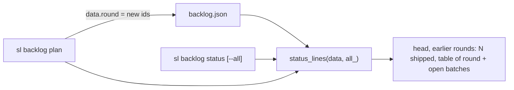
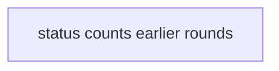

# Superlite: backlog status counts shipped batches of earlier rounds (B61)

**Goal:** #406: `sl backlog status` and the status block at the end of `sl backlog plan` print the shipped batches of earlier plan rounds as one count line; `sl backlog status --all` lists every batch; batches of the current round stay listed.
**Architecture:** backlog.py's `plan` records the ids of the batches it adds as `data["round"]` in backlog.json; backlog_state.status_lines lists a batch when it is not shipped or belongs to that round, and collapses the rest into one `earlier rounds: N shipped (sl backlog status --all lists them)` line; `status --all` passes `all_=True`.
**Tech stack:** Python 3 stdlib, pytest (through `sl run_tests`).
**Spec:** this file, section Design; issue #406 Expected line and Max's decision (one count line, --all lists them).
**Detail:** tests
**Target-min:** 11
**Wave0:** none
**Coverage:** off

Global constraints:
- Keep the repo's `# O(...)` comment on every new code line (see any function in the file you edit). Change no line outside what the task needs.
- Existing tests stay green. An existing test file never changes. If another existing test turns red, report it in DONE_WITH_CONCERNS with the test id and the reason instead of editing it.
- Run `sl` as an executable (`<abs>/sl ...`). Verify with `<abs>/sl run_tests --fast <own test file> --task Tn --background`, then run the printed `wait:` line in the foreground and end the turn only after it reports.
- No version edits (the ship step bumps the version). Never run `scripts/test_layers.py run`, `scripts/evals.sh` or `claude plugin eval` (the coordinator runs the layers).

## Design

Issue #406, expected: "shipped batches of finished rounds as one count line by default (`53 shipped`), the full list behind a flag such as `--all`. Batches of the current round stay listed." Max's decision: one count line, `--all` lists them.

Today backlog.json holds every batch of every round (64 on the live file) and `status_lines` prints one table row per batch. A round has no record: `plan` keeps the shipped batches and renumbers the new ones after them.

- `backlog.py cmd_plan` (apply): after `_renumber`, `data["round"] = [ids of the batches this plan added]`. Every successful plan, with or without `--reset`, starts a new round (as the ship approval, B27).
- `backlog_state.in_round(data, b) -> bool`: True when `b` is not shipped; else, when `data["round"]` is a list, True when `b["id"]` is in it; else (a backlog.json written before 1.5.70) True when `data["titles"]` is empty or names one of `b["issues"]` (`str(i)` keys, so Jira keys work).
- `backlog_state.status_lines(data, all_=False)`: the head line is unchanged. Without `all_`, rows are the batches `in_round` keeps; the count of the others (all shipped) gives `earlier rounds: N shipped (sl backlog status --all lists them)` right after the head; the table header prints only when a row follows. Left-out and `questions:` lines follow as today. `all_=True` lists every batch and prints no count line (today's output).
- `backlog.py status --all` passes `all_=True`; `plan` prints the default view.

Example (live file after this round's plan): `backlog maxboettinger/superlite: 67 batches, 2 running, 60 shipped, ship approved (...)`, `earlier rounds: 60 shipped (sl backlog status --all lists them)`, the table with B61-B67.

Ruling: a round is the set of batch ids one successful `plan` added, stored as `data["round"]` (a list on the backlog, not a field per batch) - one key, no batch-shape change, and `default()` stays as tests pin it - cost if wrong: a later per-batch round number is a small migration.
Ruling: a backlog.json without `round` falls back to `titles` (the issues the latest plan triaged), and to listing every batch when `titles` is empty - on the live file this keeps exactly B61-B67, so main's lean status starts this round, and the existing status tests (no titles) keep today's output - cost if wrong: an older round's batch whose issue stayed open shows as current until the next plan.
Ruling: only shipped batches collapse; a batch in any other state is always listed, and an earlier round's `OPEN #N` shipped row collapses too (the next plan triages that open issue again).
Ruling: `--all` is a `status` flag only; `plan`'s printed status uses the default view, whose count line names `sl backlog status --all` - plan is a heavy command, a second flag there adds nothing.
Ruling: the count line reads `earlier rounds: N shipped (sl backlog status --all lists them)` and sits right after the head line, before the table.
Ruling: one task (two files, one chain); detail tests; no Wave 0 (the project builds); no probe adapter (covered by unit and CLI tests); already in the lead worktree.
Ruling: skills/subagent-driven-development/backlog.md (## Main step 1), commands/backlog.md and docs/tools.md do not name the count line or `status --all` (outside B61's files): a follow-up note.
LAYERS: unit



## File structure

- skills/subagent-driven-development/scripts/backlog_state.py: `in_round`, `status_lines(data, all_=False)`, module docstring (T1).
- skills/subagent-driven-development/scripts/backlog.py: `plan` writes `data["round"]`, `status --all`, module docstring (T1).
- tests/scripts/test_backlog_status_rounds_406.py: unit and CLI tests (T1).

## Task graph

```mermaid
%% schedule
gantt
  title Predicted schedule (mm:ss)
  dateFormat X
  axisFormat %M:%S
  section lane 1
  T1 status counts shipped batches of earl :t1, 0, 90s
```





critical path: T1 (1.5 min) · peak width 1 · predicted build 1.5 min · predicted total ≈ 5.0 min (target ✓)

## Predicted schedule

## backlog status

App type: CLI. Categories: protocol (flag, output lines), state (round record across plan, reset and legacy files).

### T1 status counts shipped batches of earlier rounds · Complexity 3 (O-1) · Est. context 36k
**Owns:** skills/subagent-driven-development/scripts/backlog_state.py, skills/subagent-driven-development/scripts/backlog.py, tests/scripts/test_backlog_status_rounds_406.py
**Components:** 2
**LOC owned:** 160
**Tests:** fast
**Model:** sonnet
**Est. time:** 3 min (2 components, about 160 LOC, fast tests)
**Consumes:** none
**Produces:** backlog_state.in_round(data: dict, b: dict) -> bool · backlog_state.status_lines(data: dict, all_: bool = False) -> list
**Covers:** Design
**Review Focus:** `test_without_a_round_record_or_titles_every_batch_is_listed`: legacy data with empty titles prints today's table; `test_a_finished_round_stays_listed_until_the_next_plan`: every batch shipped, round record present, rows stay and `next: sl backlog plan` ends the output.
**Test code (verbatim):** tests/scripts/test_backlog_status_rounds_406.py
````python
"""backlog status: shipped batches of earlier plan rounds collapse to one count line; --all lists them (#406)."""
import sys

import pytest
from backlog_fixtures import APPROVED, batch as b
from test_backlog_cli import bk, cli, load, BATCH  # noqa: F401  bk is the CLI fixture
from test_plan_tools import SCRIPTS

sys.path.insert(0, str(SCRIPTS))
import backlog as bl  # noqa: E402
import backlog_state as bs  # noqa: E402

COUNT = "earlier rounds: {} shipped (sl backlog status --all lists them)"
HEADER = "batch | issues | state | lead | PR | next"
HEAD = "backlog o/r: {} batches, {} running, {} shipped, ship approved (AskUserQuestion 2026-11-05T10:00:00Z)"


def data(*batches, **kw):
    return {**bs.default(), "repo": "o/r", "batches": list(batches), "approved_ship": APPROVED, **kw}


def shipped(bid, **kw):
    n = bid[1:]
    return b(bid, [f"{bid}.py"], "shipped", pr=100 + int(n), version=f"1.5.{n}", lead=f"W{n}", **kw)


def test_round_record_keeps_its_batches_and_counts_the_rest():
    d = data(shipped("B1"), shipped("B2"), shipped("B3"), b("B4", ["d.py"], "running", lead="W9"), b("B5", ["e.py"]),
             round=["B3", "B4", "B5"])
    assert bs.status_lines(d) == [HEAD.format(5, 1, 3), COUNT.format(2), HEADER,
                                  "B3 | #3 | shipped | W3 | #103 | 1.5.3",
                                  "B4 | #4 | running | W9 | - | sl backlog wait",
                                  "B5 | #5 | planned | - | - | start"]


def test_all_lists_every_batch_without_the_count_line():
    d = data(shipped("B1"), shipped("B2"), b("B3", ["c.py"]), round=["B3"])
    assert bs.status_lines(d, all_=True) == [HEAD.format(3, 0, 2), HEADER, "B1 | #1 | shipped | W1 | #101 | 1.5.1",
                                             "B2 | #2 | shipped | W2 | #102 | 1.5.2", "B3 | #3 | planned | - | - | start"]
    assert bs.status_lines(d)[1:] == [COUNT.format(2), HEADER, "B3 | #3 | planned | - | - | start"]


def test_a_batch_not_shipped_is_listed_outside_the_round():
    d = data(shipped("B1"), b("B2", ["b.py"], "parked", reason="hold"), round=[])
    assert bs.status_lines(d)[1:] == [COUNT.format(1), HEADER, "B2 | #2 | parked | - | - | hold"]


def test_no_row_left_prints_no_table_and_keeps_left_out_lines():
    d = data(shipped("B1"), shipped("B2"), round=["B9"], outside=[{"number": 7, "title": "x", "reason": "not planned (cap)"}])
    assert bs.status_lines(d) == [HEAD.format(2, 0, 2), COUNT.format(2), "not planned (cap): #7"]


def test_without_a_round_record_titles_pick_the_current_round():
    d = data(shipped("B1"), shipped("B2"), shipped("B3"), b("B4", ["d.py"], "running", lead="W9"),
             titles={"3": "Three", "4": "Four", "8": "Eight"})
    assert bs.status_lines(d)[1:] == [COUNT.format(2), HEADER, "B3 | #3 | shipped | W3 | #103 | 1.5.3",
                                      "B4 | #4 | running | W9 | - | sl backlog wait"]


def test_without_a_round_record_or_titles_every_batch_is_listed():
    d = data(shipped("B1"), b("B2", ["b.py"]))
    assert bs.status_lines(d)[1:] == [HEADER, "B1 | #1 | shipped | W1 | #101 | 1.5.1", "B2 | #2 | planned | - | - | start"]


def test_in_round_reads_jira_keys_and_round_ids():
    d = data(titles={"PIX-1": "x"})
    assert bs.in_round(d, shipped("B1", issues=["PIX-1"])) and not bs.in_round(d, shipped("B2", issues=["PIX-2"]))
    r = {**d, "round": ["B2"]}
    assert bs.in_round(r, shipped("B2", issues=["PIX-2"])) and not bs.in_round(r, shipped("B1", issues=["PIX-1"]))
    assert bs.in_round(d, b("B3", ["c.py"], "needs_decision"))


def ship_b1(bk):
    bs.update(bs.path(bk.root), lambda d: bs.batch(d, "B1").update({"state": "shipped", "pr": 201, "version": "1.5.8"}))


def test_plan_records_its_round_and_counts_earlier_shipped(bk, capsys):
    assert cli(capsys, "plan")[0] == 0 and load(bk)["round"] == ["B1"]
    ship_b1(bk)
    rc, out = cli(capsys, "plan")
    assert rc == 0 and load(bk)["round"] == ["B2"]
    assert out.splitlines()[1:4] == [COUNT.format(1), HEADER, "B2 | #1 #2 | planned | - | - | start"]
    assert cli(capsys, "status")[1].splitlines()[1:4] == [COUNT.format(1), HEADER, "B2 | #1 #2 | planned | - | - | start"]
    rc, out = cli(capsys, "status", "--all")
    assert rc == 0 and "earlier rounds" not in out
    assert out.splitlines()[1:4] == [HEADER, "B1 | #1 #2 | shipped | - | #201 | 1.5.8", "B2 | #1 #2 | planned | - | - | start"]


def test_reset_starts_a_new_round(bk, capsys):
    assert cli(capsys, "plan")[0] == 0
    ship_b1(bk)
    assert cli(capsys, "plan")[0] == 0
    rc, out = cli(capsys, "plan", "--reset")
    assert rc == 0 and load(bk)["round"] == ["B2"] and [x["id"] for x in load(bk)["batches"]] == ["B1", "B2"]
    assert out.splitlines()[1] == COUNT.format(1)


def test_a_finished_round_stays_listed_until_the_next_plan(bk, capsys):
    assert cli(capsys, "plan")[0] == 0
    ship_b1(bk)
    rc, out = cli(capsys, "status")
    assert rc == 0 and "earlier rounds" not in out and out.endswith("next: sl backlog plan\n")
    assert out.splitlines()[1:3] == [HEADER, "B1 | #1 #2 | shipped | - | #201 | 1.5.8"]


def test_status_help_names_all(capsys):
    with pytest.raises(SystemExit):
        bl.main(["status", "--help"])
    out = " ".join(capsys.readouterr().out.split())
    assert "--all" in out and "earlier plan rounds" in out
````
**Steps:** 1 write the test file, 2 run: FAIL, 3 implement, 4 run: PASS (also run tests/scripts/test_backlog_state.py, tests/scripts/test_backlog_state_left_out.py, tests/scripts/test_backlog_cli.py, tests/scripts/test_backlog_plan_round.py, tests/scripts/test_backlog_plan_reset_369.py, tests/scripts/test_backlog_plan_proposal_297.py, tests/regression/test_backlog_status_join.py: still green)
**Notes:** backlog_state.status_lines: keep `active` (clash check) computed from every batch; the head line and the `if not bs` early return stay as they are. backlog.py cmd_plan apply: `new = _renumber(copy.deepcopy(batches), data["batches"])`, `data["batches"] += new`, `data["round"] = [x["id"] for x in new]`. The status subparser gets `--all` (`action="store_true"`) with help text `list every batch, also the shipped batches of earlier plan rounds (#406)`; cmd_status passes `all_=getattr(a, "all", False)` (tests build bare namespaces). Add one sentence each to both module docstrings naming the count line and `status --all` (#406). Do not add `round` to `default()` (test_backlog_state pins it).

**Probe entry:** none (CLI output, covered by its tests)

## Review Focus

backlog status (CLI): protocol (`--all`, line order, the count line text) and state (round record after plan and `--reset`, legacy file without `round`) are in T1's tests and Review Focus line.

## Self-review

Coverage: #406's count line, `--all` and "current round stays listed" are T1 (Design bullets 1-4). No placeholders. One task, no edges. Produces lines match the Notes; no consumer.
