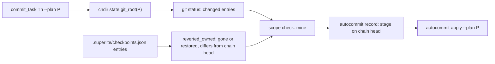

# Superlite: commit_task checkpoints a restored file and runs git in the plan's checkout (B58)

**Goal:** fix #363 (a file a checkpoint holds, restored to its HEAD content afterwards, is never checkpointed again: `no change since its last checkpoint`, then `autocommit apply` refuses forever) and #365 (`commit_task --plan <absolute path>` run from another checkout runs git in the caller's directory and prints `nothing to commit`). Max's decision for #363: commit_task compares with the newest checkpoint.
**Architecture:** #363: `commit_task.deleted_owned` becomes `reverted_owned`: every owned file this plan's checkpoints hold that `git status` no longer lists (a new file deleted, or a file back to its HEAD content) joins the task's files when its working-tree state differs from the newest checkpoint; `autocommit.record` then stages it on top of the chain head. #365: `commit_task.main` with `--plan P` changes into `state.git_root(P)` before any git call, as `autocommit --plan` and `trees --plan` do, so checkpoints, probes and the checkpoint state land in the checkout `autocommit apply --plan P` reads.
**Tech stack:** Python 3.10+ stdlib, pytest (through `sl run_tests`).
**Spec:** this file, section Design; issues #363 and #365 (Expected lines) and Max's decision.
**Detail:** tests
**Target-min:** 11
**Wave0:** none
**Max chars:** 20000

Global constraints:
- Every code line in `skills/subagent-driven-development/scripts/` carries the repo's trailing `# O(...)` complexity comment (short notes after `|`); tests do not. Stdlib only.
- Existing tests stay green and no existing test file changes (another lead may own them). If an existing test turns red, report it in DONE_WITH_CONCERNS with the test id and the reason instead of editing it.
- Tests reuse the helpers of `tests/scripts/test_autocommit.py` (`from test_autocommit import ENV, git, make_repo, run, write`): `ENV` sets `SUPERLITE_AUTOCOMMIT=0` (checkpoint mode) and runs commit_task as a subprocess.
- Run `sl` as an executable (`<abs>/sl ...`). Verify with the task's verify line (`<abs>/sl run_tests --fast <files> --task Tn --background`), then run the printed `wait:` line in the foreground and end the turn only after it reports. Never raw `pytest`, never the e2e or eval layers (coordinator's step).
- No version edits (the ship step bumps the version). Touch only the files in Owns.

Ruling: Max's decision: commit_task compares an owned checkpointed file with the newest checkpoint; `autocommit apply` is unchanged - cost if wrong: none.
Ruling: a restored file prints `restored F (back to its HEAD content)` on stderr, once per file; stdout keeps the bare SHA - cost if wrong: one stderr line.
Ruling: with `--plan P`, commit_task works in `state.git_root(P)` (the B23 rule of `autocommit --plan`); a P outside any checkout keeps the cwd; without `--plan` nothing changes - cost if wrong: a plan kept in a different repository than the code it builds now commits in the plan's repository (no such setup is documented).
Ruling: before that change of directory, `--plan`, `--ledger`, `--log`, `--pool` and the run-folder defaults become absolute against the caller's cwd (a path keeps the meaning it had where it was typed); `--also`/`--claim` paths stay repo-relative, an absolute one is made relative to the plan's checkout - cost if wrong: none.
Ruling: T1 and T2 both change `commit_task.py`, so T2 follows T1 (sequential: one file, not an execution dependency) - cost if wrong: about two minutes.
Ruling: detail tests; no probe adapter (git CLI over temporary repositories; Review Focus cases run as named pytest cases) - cost if wrong: no generated probes.
Ruling: the lead worktree on branch superlite/b58-commit-task-checkpoint-root is the run root - cost if wrong: none.
LAYERS: unit

## Design

1. `commit_task.reverted_owned(owns, live, plan) -> list[str]` replaces `deleted_owned` (same arguments, same caller, `mine += reverted_owned(owns, live, a.plan)`): checkpoint mode only (`autocommit.is_on()` -> `[]`), same-plan state only (`plan_key`), files of every entry that this task owns (`nt.owns_match`) and that are not in `live` (git status no longer lists them), passed through `changed_vs_parent` (differs from the newest checkpoint, `entries[-1]["sha"]`). The `not os.path.lexists(f)` filter goes: a file still on disk but equal to HEAD now counts too. Sorted, as today.
2. In `commit_one`, each returned file that exists on disk prints `restored F (back to its HEAD content)` on stderr before the commit step; a deleted one prints nothing (as today). The restored file then runs through the syntax and import check and `autocommit.record` stages its HEAD content on top of the chain head, so the new checkpoint holds it and `autocommit apply` finds no `files edited after their checkpoint`.
3. Unchanged: a re-run with nothing new still prints `Tn: no change since its last checkpoint <sha>` (a restored file already checkpointed as restored equals the chain head); another task's file is never taken; autocommit-on mode is untouched.
4. `commit_task.main`, right after `sd` is computed and before the `--also`/`--claim` task-id scan: when `--plan` was given and `root = state.git_root(a.plan)` is not None and differs from the cwd (compare `Path(root).resolve()` with `Path.cwd().resolve()`), set `a.plan`, `a.ledger`, `a.log`, `a.pool` to `os.path.abspath` of their current values (the defaults derive from `sd`, which may be the relative `.superlite`), then `os.chdir(root)` and `os.environ["PWD"] = str(root)`. Everything after (status, plan folder, own files, checkpoint state, probes, seam checks, dispatch) runs in the plan's checkout.
5. Module docstring: the restored-file rule joins the scope rules; "Run it from the repository root" becomes "Without --plan, run it from the repository root; with --plan P it works in the checkout holding P (state.git_root), a P outside any checkout keeps the cwd".

## Coverage

| Category | State | Basis |
|---|---|---|
| Scope and success criteria | settled | #363 and #365 Expected lines; Max's decision |
| Domain and data model | settled | checkpoint entries and git status, unchanged formats |
| Persistence and migration | n/a | no new stored data |
| Interfaces and contracts | settled | CLI flags unchanged; one stderr line added |
| UI states | n/a | CLI text only |
| Concurrency and state ownership | settled | one commit_task process; state file location now follows --plan |
| Error handling and recovery | settled | no new error paths |
| Security and privacy | n/a | local git only |
| Performance and limits | settled | one more hash-object over owned checkpointed files |
| Observability | settled | `restored F` stderr line |
| Testing strategy | settled | two new unit test files; unit layer by the coordinator |
| Compatibility | ruled | without --plan, and from the plan's checkout root, behaviour is unchanged |
| Rollout | ruled | one PR; version bump at ship |
| Research unknowns | n/a | reproduced from the code |

## File structure
- `skills/subagent-driven-development/scripts/commit_task.py`: `reverted_owned` and the `restored` line (T1); the change of directory in `main` and the docstring (T2).
- `tests/scripts/test_commit_restored_363.py`: restored-file cases (T1).
- `tests/scripts/test_commit_plan_root_365.py`: plan-checkout cases (T2).

## Task graph

```mermaid
%% schedule
gantt
  title Predicted schedule (mm:ss)
  dateFormat X
  axisFormat %M:%S
  section lane 1
  T1 Restored file checkpointed again :t1, 0, 68s
  T2 Git runs in the plan's checkout :t2, 68, 70s
```

critical path: T1 → T2 (2.3 min) · peak width 1 · predicted build 2.3 min · predicted total ≈ 5.8 min (target ✓)

## Package: commit_task (CLI over git)
App type: CLI. Categories: protocol, state, file. Specific risks: a restored file of another task taken, the no-change line lost, a relative path resolved against the wrong directory after the change of directory, the checkpoint state written in the caller's checkout.
**Probe entry:** none (Ruling: no probe adapter).

### T1 Restored file checkpointed again · Complexity 3 · Est. context 42k
**Owns:** skills/subagent-driven-development/scripts/commit_task.py, tests/scripts/test_commit_restored_363.py
**Components:** 1
**LOC owned:** 110
**Tests:** fast
**Model:** sonnet
**Est. time:** 2.5 min (1 component, about 110 LOC, fast tests)
**Covers:** 1, 2, 3
**Consumes:** existing `autocommit.record(tid, title, files, plan) -> (str, bool)` · existing `commit_task.changed_vs_parent(files) -> list`
**Produces:** commit_task.reverted_owned(owns: list, live: set, plan: str) -> list
**Review Focus:**
Fixture: `base(tmp_path)`: `make_repo`, write `src/a.py` = `"A = 0\n"`, `src/b.py` = `"B = 0\n"`, `tests/test_a.py` = `"def test_a():\n    assert 1\n"`, `git add -A`, `git commit -q -m base2`; `ck(repo, *tids)` = `run("commit_task", *tids, "--plan", "plan.md", cwd=repo)`.
state: `test_restored_file_is_checkpointed` (write `src/a.py` = `"A = 1\n"` and `tests/test_a.py` = `"def test_a():\n    assert 2\n"`, `s1 = ck(repo, "T1")`; `git checkout HEAD -- src/a.py`; `r = ck(repo, "T1")` -> exit 0, `r.stdout.strip()` is a 40-hex sha `s2 != s1`, `"restored src/a.py (back to its HEAD content)" in r.stderr`, `git show s2:src/a.py == "A = 0"`, `git show s2:tests/test_a.py` holds `assert 2`, `git rev-parse s2^ == s1`);
state: `test_only_restored_file` (only `src/a.py` = `"A = 1\n"` changed, `ck T1`, restore it, `ck T1` -> exit 0, not `nothing to commit`, `git show s2:src/a.py == "A = 0"`);
file: `test_apply_after_restore` (the first case, then `run("autocommit", "apply", cwd=repo)` -> exit 0, `git show HEAD:src/a.py == "A = 0"`, `git show HEAD:tests/test_a.py` holds `assert 2`, `git status --porcelain` empty);
protocol: `test_rerun_after_restore_says_no_change` (the first case, then `ck T1` again -> stdout `f"T1: no change since its last checkpoint {s2}\n"`, no `restored` on stderr);
state: `test_other_tasks_restored_file_untouched` (`src/a.py` = `"A = 1\n"`, `ck T1`; `src/b.py` = `"B = 1\n"`, `ck T2`; `git checkout HEAD -- src/b.py`; `src/a.py` = `"A = 2\n"`, `s3 = ck(repo, "T1")` -> `git show s3:src/b.py == "B = 1"`, `"restored src/b.py" not in stderr`);
state: `test_reverted_owned_in_process` (`src/a.py` = `"A = 1\n"`, `ck T1`, `git checkout HEAD -- src/a.py`; in-process with `sys.path` holding the scripts folder, `monkeypatch.chdir(repo)`: `monkeypatch.setenv("SUPERLITE_AUTOCOMMIT", "0")` -> `commit_task.reverted_owned(["src/a.py"], set(), "plan.md") == ["src/a.py"]`; with `{"src/a.py"}` as `live` -> `[]`; with owns `["src/b.py"]` -> `[]`; `monkeypatch.setenv("SUPERLITE_AUTOCOMMIT", "1")` -> `[]`).
**Verify:** `run_tests --fast tests/scripts/test_commit_restored_363.py tests/scripts/test_checkpoint_chain.py tests/scripts/test_commit_recheckpoint.py tests/scripts/test_autocommit.py tests/scripts/test_commit_scope_batch.py --task T1 --background`
**Steps:** 1 failing tests, 2 run: FAIL, 3 implement Design 1 to 3 (read the Design section), 4 run: PASS (the Verify line).

### T2 Git runs in the plan's checkout · Complexity 3 · Est. context 42k
**Owns:** skills/subagent-driven-development/scripts/commit_task.py, tests/scripts/test_commit_plan_root_365.py
**Components:** 1
**LOC owned:** 130
**Tests:** fast
**Model:** sonnet
**Est. time:** 2.5 min (1 component, about 130 LOC, fast tests)
**Covers:** 4, 5
**Consumes:** existing `state.git_root(path) -> Path | None`
**Produces:** commit_task.main(argv: list | None = None) -> int
**Review Focus:**
Fixture: `pair(tmp_path)`: `repo = make_repo(tmp_path)`; `git(repo, "worktree", "add", "-q", str(tmp_path / "wt"), "-b", "feat")`; `wt = tmp_path / "wt"`; `(wt / ".superlite").mkdir()`; write `wt/.superlite/stable.json` = `"{}"` (a started run); write `wt/src/a.py` = `"A = 1\n"` and `wt/tests/test_a.py` = `"def test_a():\n    assert 1\n"`; `plan = str(wt / "plan.md")`.
protocol: `test_absolute_plan_from_main_checkout` (`r = run("commit_task", "T1", "--plan", plan, cwd=repo)` -> exit 0, stdout a 40-hex sha; `git(wt, "show", sha + ":src/a.py") == "A = 1"`; `wt/.superlite/checkpoints.json` has one entry for T1; `repo/.superlite/checkpoints.json` does not exist; `wt/.superlite/progress.md` holds a line starting `- commit T1 `; `git(repo, "status", "--porcelain")` empty);
state: `test_apply_from_main_checkout` (the first case, then `run("autocommit", "apply", "--plan", plan, cwd=repo)` -> exit 0; `git(wt, "show", "feat:src/a.py") == "A = 1"`; `git(repo, "rev-parse", "HEAD")` unchanged);
file: `test_plan_from_a_subdirectory` (`run("commit_task", "T1", "--plan", "../plan.md", cwd=wt / "src")` -> exit 0, a 40-hex sha holding `src/a.py`; no `wt/src/.superlite` folder);
file: `test_relative_ledger_keeps_callers_cwd` (`run("commit_task", "T1", "--plan", plan, "--ledger", "notes/ledger.md", cwd=repo)` -> exit 0, `repo/notes/ledger.md` holds `- commit T1 `, `wt/notes` does not exist);
file: `test_absolute_also_into_plan_checkout` (also write `wt/src/c.py` = `"C = 1\n"`; `run("commit_task", "T1", "--plan", plan, "--also", str(wt / "src/c.py"), "--ruling", "test", cwd=repo)` -> exit 0, `src/c.py` in `git(wt, "ls-tree", "-r", "--name-only", sha)`);
state: `test_plan_outside_any_checkout_keeps_cwd` (copy `repo/plan.md` to `tmp_path / "outside" / "plan.md"`; write `repo/src/a.py` = `"A = 1\n"`; `run("commit_task", "T1", "--plan", str(tmp_path / "outside" / "plan.md"), cwd=repo)` -> exit 0, `git(repo, "show", sha + ":src/a.py") == "A = 1"`).
**Verify:** `run_tests --fast tests/scripts/test_commit_plan_root_365.py tests/scripts/test_commit_restored_363.py tests/scripts/test_autocommit_plan.py tests/scripts/test_commit_task_batch.py tests/scripts/test_commit_plan_folder.py tests/scripts/test_commit_baseline.py tests/scripts/test_checkpoint_chain.py --task T2 --background`
**Steps:** 1 failing tests, 2 run: FAIL, 3 implement Design 4 and 5 (read the Design section), 4 run: PASS (the Verify line).

## Review Focus
Package commit_task: protocol (stdout stays the bare SHA or the no-change line), state (only the task's own checkpointed files, newest checkpoint as the reference, checkpoint state in the plan's checkout), file (relative paths keep the caller's meaning, subdirectory and outside-checkout plans). All cases sit in T1 and T2.

## Self-review
- #363 (restored file reads as no change; apply refuses): Design 1 and 2; `test_restored_file_is_checkpointed`, `test_only_restored_file`, `test_apply_after_restore`. Max's decision (commit_task, not apply): autocommit.py unchanged.
- #365 (absolute plan from another checkout): Design 4; `test_absolute_plan_from_main_checkout`, `test_apply_from_main_checkout`.
- No placeholders; one shared file, ordered by the T1 -> T2 edge; every task has Components, LOC owned, Tests, Model.
