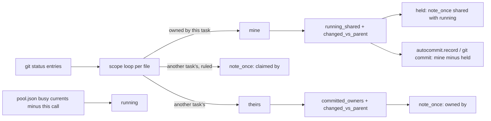
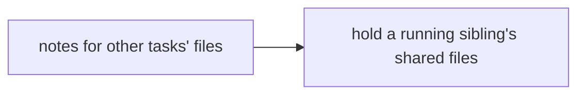

# Superlite: commit_task notes other tasks' files and keeps a running sibling's edits out (B62)

**Goal:** fix #397 (a reviewer's edit to a file another, already committed task owns stays uncommitted without a word), #399 (a fixer's `commit_task T1` checkpoint captured T2's running edits in files both tasks own) and #400 (`commit_task A B C` repeats `left uncommitted (claimed by Hn)` once per task). Max's decision for #399: warn and leave shared files unstaged.
**Architecture:** all in `commit_task.commit_one`. A call-wide `note_once` prints each stderr note once per call (#400). A file another task owns that changed after the newest checkpoint, whose owner is committed and not running, gets a `left uncommitted (owned by ...)` note (#397). A file this task owns that a running sibling (busy in pool.json, not in this call) also owns and that differs from the newest checkpoint is held out of the checkpoint with one note per task (#399).
**Tech stack:** Python 3.10+ stdlib, pytest (through `sl run_tests`).
**Spec:** this file, section Design; issues #397, #399, #400 (Expected lines) and Max's decision.
**Detail:** tests
**Target-min:** 11
**Wave0:** none
**Max chars:** 22000

Global constraints:
- Every code line in `skills/subagent-driven-development/scripts/` carries the repo's trailing `# O(...)` complexity comment (short notes after `|`); tests do not. Stdlib only.
- Existing tests stay green and no existing test file changes (another lead may own them). If an existing test turns red, report it in DONE_WITH_CONCERNS with the test id and the reason instead of editing it.
- Tests reuse the helpers of `tests/scripts/test_autocommit.py` (`from test_autocommit import ENV, SCRIPTS, git, make_repo, run, write`): `ENV` sets `SUPERLITE_AUTOCOMMIT=0` (checkpoint mode) and runs commit_task as a subprocess; `git(...)` returns stripped stdout.
- New code reads call-wide attributes with `getattr(a, name, default)`: tests call `commit_task.main` in-process.
- Run `sl` as an executable (`<abs>/sl ...`). Verify with the task's verify line, then run the printed `wait:` line in the foreground and end the turn only after it reports. Never raw `pytest`, never the e2e or eval layers (coordinator's step).
- No version edits (the ship step bumps the version). Touch only the files in Owns.

Ruling: Max's decision (#399): a file this task owns that a running sibling also owns and that differs from the newest checkpoint is left unstaged with one note per task; no refusal - cost if wrong: a fixer's own change in a shared file waits for a second `commit_task` after the sibling.
Ruling: "running sibling" = a task id that a busy pool agent's `current` names (`others_running`), excluding every task of this call; ids not in the plan are ignored; fixers are not in the pool (B-ruling of #127), so a fixer never holds a sibling's file - cost if wrong: a stale busy flag holds a file until `dispatch` syncs the pool.
Ruling: `--also` files are never held (an explicit ruling to commit them with this task) - cost if wrong: none.
Ruling: every task held out entirely gives `Tn FAILED: nothing to commit; held for running T2: F` (exit 1), as `nothing to commit` does today; a partial hold still checkpoints the rest (exit 0) - cost if wrong: one more commit_task call.
Ruling: #397's note goes only to a file whose owners are all outside this call and not running, with at least one owner committed (ledger commit line), and that differs from the newest checkpoint (HEAD with autocommit on); an owner still building or never started stays silent, as today - cost if wrong: a reviewer edit to a not yet started task's file stays silent.
Ruling: #400: each stderr note (`claimed by`, `owned by`, `another task is running`, `shared with running`) prints once per call, also when the claimer is in the call; incidents and the `outside every Owns` set are unchanged - cost if wrong: none.
Ruling: no new incidents for the notes or held files; `autocommit apply` already refuses a file edited after its checkpoint - cost if wrong: the build report does not list held files.
Ruling: T1 and T2 both change `commit_task.py`, so T2 follows T1 (sequential: one file, not an execution dependency) - cost if wrong: about two minutes.
Ruling: detail tests; no probe adapter (git CLI over temporary repositories; Review Focus cases run as named pytest cases) - cost if wrong: no generated probes.
Ruling: docs/tools.md is outside this batch's files; its commit_task row gets the new lines in a follow-up - cost if wrong: docs lag one release.
LAYERS: unit



## Design

1. `commit_task.note_once(a, line) -> bool`: prints `line` on stderr unless this call printed it already (a set kept on `a` as `a.noted`, created on first use); True when printed. The `claimed by` line and the `another task is running` line go through it (#400).
2. `commit_task.committed_owners(path, info, call, done, running) -> list`: the plan tasks not in `call` whose Owns match `path` (`nt.owns_match`), in plan order; `[]` when any of them is in `running`; otherwise those that are in `done`.
3. In `commit_one`, a file in the `nt.owns_match(f, other)` branch without a ruling or claim joins a `theirs` list. After the loop, with `running = others_running(pool, call)` (`call` = `getattr(a, "task", [tid])`, pool as the existing stray check reads it), the files with a non-empty `committed_owners` go through one `changed_vs_parent` call; each changed one prints `left uncommitted (owned by T2, changed after its checkpoint; run commit_task T2): F` via `note_once` (owners joined by `, `, the command names the first). Nothing changes in `mine`, the exit code or stdout (#397).
4. `commit_task.running_shared(files, info, running) -> dict`: `{file: [ids]}` for each file that a task in `running` (ids in `info` only) owns, ids in plan order; files nobody running owns are absent.
5. In `commit_one`, after `mine` is complete (owned, stubs, docs.md, restored, shared tests) and before the `nothing to commit` check: the files of `mine` that are not `--also` entries go through `running_shared` with the same `running`; those whose working tree differs from the newest checkpoint (`changed_vs_parent`) are held: removed from `mine`, and one `note_once` line per task `left uncommitted (shared with running T2; commit_task T1 again once it is done): F1, F2` (ids of the holding siblings joined by `, `, files sorted, joined by `, `). When `mine` is then empty: print `nothing to commit for T1` (stderr, as today) and fail with `nothing to commit; held for running T2: F1, F2` (#399). When `mine` keeps only files equal to the chain head and the task has a checkpoint, the existing reuse path prints `Tn: no change since its last checkpoint <sha>` (exit 0) after the hold note. Checkpoint and autocommit modes alike.
6. Module docstring: "files another task owns are left uncommitted, silently" becomes the rules of 3 and 5, and one sentence says notes print once per call.

## Coverage

| Category | State | Basis |
|---|---|---|
| Scope and success criteria | settled | #397, #399, #400 Expected lines; Max's decision |
| Domain and data model | settled | plan Owns, ledger commit lines, pool busy currents, checkpoint chain head |
| Persistence and migration | n/a | no new stored data |
| Interfaces and contracts | settled | CLI unchanged; stderr notes and one FAILED reason added |
| UI states | n/a | CLI text only |
| Concurrency and state ownership | ruled | running = busy pool agents minus this call (Ruling) |
| Error handling and recovery | settled | all-held task fails like `nothing to commit` |
| Security and privacy | n/a | local git only |
| Performance and limits | settled | at most two more `changed_vs_parent` calls per task, only when candidates exist |
| Observability | settled | stderr notes |
| Testing strategy | settled | two new unit test files; unit layer by the coordinator |
| Compatibility | ruled | without a busy sibling or an edited committed file, output is unchanged except deduplicated notes |
| Rollout | ruled | one PR; version bump at ship |
| Research unknowns | n/a | reproduced from the code |

## File structure
- `skills/subagent-driven-development/scripts/commit_task.py`: `note_once`, `committed_owners`, the owned-by note (T1); `running_shared`, the hold and the docstring (T2).
- `tests/scripts/test_commit_notes_397_400.py`: note cases (T1).
- `tests/scripts/test_commit_shared_hold_399.py`: hold cases (T2).

## Task graph

```mermaid
%% schedule
gantt
  title Predicted schedule (mm:ss)
  dateFormat X
  axisFormat %M:%S
  section lane 1
  T1 Notes for other tasks' files :t1, 0, 70s
  T2 Hold a running sibling's shared files :t2, 70, 71s
```




critical path: T1 → T2 (2.3 min) · peak width 1 · predicted build 2.3 min · predicted total ≈ 5.8 min (target ✓)

## Package: commit_task (CLI over git)
App type: CLI. Categories: protocol, state, file. Specific risks: a note that repeats per task, a note while the owner still builds, a held file whose sibling is in the same call, an `--also` file held, stdout no longer the bare SHA, a fully held task reported as checkpointed.
**Probe entry:** none (Ruling: no probe adapter).

Shared test fixture (both test files define it, no import between them): `PLAN` =

```text
# Plan
**Goal:** x.

` ``mermaid
%% taskgraph
flowchart LR
  T1
  T2
  T3
  T4
` ``

### T1 core · Complexity 2 · Est. context 20k
**Owns:** src/a.py, src/shared.py

### T2 extension · Complexity 2 · Est. context 20k
**Owns:** src/b.py, src/shared.py, tests/test_b.py

### T3 consumer · Complexity 2 · Est. context 20k
**Owns:** src/c.py

### T4 notes · Complexity 2 · Est. context 20k
**Owns:** src/d.py
```

(write the fence as three backticks without the space). `setup(tmp_path)`: `make_repo`, write `plan.md` = `PLAN`, `src/shared.py` = `"S = 0\n"`, `tests/test_b.py` = `"def test_b():\n    assert 1\n"`, `git add -A`, `git commit -q -m plan`. `ck(repo, *args, env=ENV)` = `run("commit_task", *args, "--plan", "plan.md", cwd=repo, env=env)`. `pool(repo, agents)` writes `repo/.superlite/pool.json` = `json.dumps({"agents": agents})`. `entries(repo)` = the `entries` list of `repo/.superlite/checkpoints.json`, `[]` when the file is missing. `info` for in-process cases = `{"T1": {"owns": ["src/a.py", "src/shared.py"]}, "T2": {"owns": ["src/b.py", "src/shared.py", "tests/test_b.py"]}, "T3": {"owns": ["src/c.py"]}}`.

### T1 Notes for other tasks' files · Complexity 3 · Est. context 44k
**Owns:** skills/subagent-driven-development/scripts/commit_task.py, tests/scripts/test_commit_notes_397_400.py
**Components:** 1
**LOC owned:** 130
**Tests:** fast
**Model:** sonnet
**Est. time:** 2.5 min (1 component, about 130 LOC, fast tests)
**Covers:** 1, 2, 3
**Consumes:** existing `commit_task.changed_vs_parent(files) -> list` · existing `commit_task.others_running(pool_path, tids) -> list`
**Produces:** commit_task.note_once(a, line: str) -> bool · commit_task.committed_owners(path: str, info: dict, call: list, done: set, running: list) -> list
e.g. committed_owners("src/b.py", info, ["T3"], {"T2"}, []) -> ["T2"]
e.g. committed_owners("src/shared.py", info, ["T3"], {"T1", "T2"}, ["T2"]) -> []
e.g. committed_owners("src/shared.py", info, ["T3"], {"T1", "T2"}, []) -> ["T1", "T2"]
**Review Focus:**
state: `test_reviewer_edit_to_committed_task_file_noted` (`setup`; `src/b.py` = `"B = 1\n"`, `ck T2` exit 0; write `tests/test_b.py` = `"def test_b():\n    assert 2\n"` and `src/c.py` = `"C = 1\n"`; `r = ck(repo, "T3")` -> exit 0, `r.stdout.strip()` a 40-hex sha, `"left uncommitted (owned by T2, changed after its checkpoint; run commit_task T2): tests/test_b.py" in r.stderr`, `git show sha:tests/test_b.py` holds `assert 1`; then `ck(repo, "T2")` -> exit 0 and its sha's `tests/test_b.py` holds `assert 2`);
state: `test_running_owner_silent` (`src/b.py` = `"B = 1\n"`, `ck T2`; `pool(repo, [{"busy": True, "current": "T2"}])`; `src/b.py` = `"B = 2\n"`, `src/c.py` = `"C = 1\n"`; `ck T3` -> exit 0, `"owned by" not in stderr`);
state: `test_uncommitted_owner_silent` (no pool, T2 never committed; `src/b.py` = `"B = 1\n"`, `src/c.py` = `"C = 1\n"`; `ck T3` -> exit 0, `"owned by" not in stderr`);
state: `test_unchanged_since_checkpoint_silent` (`src/b.py` = `"B = 1\n"`, `ck T2`; `src/c.py` = `"C = 1\n"`; `ck T3` -> exit 0, `"owned by" not in stderr`);
state: `test_owner_in_same_call_silent` (`src/b.py` = `"B = 1\n"`, `ck T2`; `src/b.py` = `"B = 2\n"`, `src/c.py` = `"C = 1\n"`; `r = ck(repo, "T3", "T2")` -> exit 0, `"owned by" not in r.stderr`, stdout lines start `T3 ` and `T2 `, T2's sha `src/b.py` == `"B = 2"`);
protocol: `test_owned_note_once_per_call` (`src/b.py` = `"B = 1\n"`, `ck T2`; `src/b.py` = `"B = 2\n"`, `src/c.py` = `"C = 1\n"`, `src/d.py` = `"D = 1\n"`; `r = ck(repo, "T3", "T4")` -> exit 0, `r.stderr.count("left uncommitted (owned by T2, changed after its checkpoint; run commit_task T2): src/b.py") == 1`);
protocol: `test_claimed_line_once_per_call` (`ck(repo, "T4", "--claim", "notes/x.md", "--ruling", "needed")` exit 0; write `notes/x.md` = `"x\n"`, `src/a.py` = `"A = 1\n"`, `src/b.py` = `"B = 1\n"`, `src/c.py` = `"C = 1\n"`; `r = ck(repo, "T1", "T2", "T3")` -> exit 0, `r.stderr.count("left uncommitted (claimed by T4): notes/x.md") == 1`);
protocol: `test_note_once_in_process` (`ns = types.SimpleNamespace()`; `commit_task.note_once(ns, "x") is True`, capsys err `"x\n"`; again -> `False`, err `""`);
state: `test_committed_owners_examples` (the three `e.g.` lines above, plus `committed_owners("src/b.py", info, ["T3", "T2"], {"T2"}, []) == []` and `committed_owners("src/b.py", info, ["T3"], set(), []) == []`).
**Verify:** `run_tests --fast tests/scripts/test_commit_notes_397_400.py tests/scripts/test_commit_scope_batch.py tests/scripts/test_commit_shared_test.py tests/scripts/test_commit_running_scope.py tests/scripts/test_commit_never_silent.py tests/scripts/test_commit_recheckpoint.py --task T1 --background`
**Steps:** 1 failing tests, 2 run: FAIL, 3 implement Design 1 to 3 (read the Design section), 4 run: PASS (the Verify line).

### T2 Hold a running sibling's shared files · Complexity 3 · Est. context 46k
**Owns:** skills/subagent-driven-development/scripts/commit_task.py, tests/scripts/test_commit_shared_hold_399.py
**Components:** 1
**LOC owned:** 140
**Tests:** fast
**Model:** sonnet
**Est. time:** 2.5 min (1 component, about 140 LOC, fast tests)
**Covers:** 4, 5, 6
**Consumes:** commit_task.note_once(a, line: str) -> bool (T1) · existing `commit_task.changed_vs_parent(files) -> list`
**Produces:** commit_task.running_shared(files: list, info: dict, running: list) -> dict
e.g. running_shared(["src/a.py", "src/shared.py"], info, ["T2"]) -> {"src/shared.py": ["T2"]}
e.g. running_shared(["src/shared.py"], info, ["T9", "review P1"]) -> {}
e.g. running_shared(["src/a.py"], info, []) -> {}
**Review Focus:**
Hold line for T1 held by T2: `HOLD = "left uncommitted (shared with running T2; commit_task T1 again once it is done): src/shared.py"`.
state: `test_fixer_checkpoint_leaves_running_siblings_shared_file` (`setup`; `src/a.py` = `"A = 1\n"`, `src/shared.py` = `"S = 1\n"`, `s1 = ck(repo, "T1").stdout.strip()`; `pool(repo, [{"busy": True, "current": "T2"}])`; `src/shared.py` = `"S = 1\nT2 = 1\n"`, `src/b.py` = `"B = 1\n"`, `src/a.py` = `"A = 2\n"`; `r = ck(repo, "T1")` -> exit 0, `s2 = r.stdout.strip()` a 40-hex sha `!= s1`, `HOLD in r.stderr`, `git show s2:src/shared.py == "S = 1"`, `git show s2:src/a.py == "A = 2"`, `"src/b.py" not in git ls-tree -r --name-only s2`);
state: `test_all_held_fails_with_reason` (`setup`; pool T2 busy; only `src/shared.py` = `"S = 2\n"`; `r = ck(repo, "T1")` -> exit 1, `"T1 FAILED: nothing to commit; held for running T2: src/shared.py" in r.stdout`, `HOLD in r.stderr`, `entries(repo) == []`);
protocol: `test_held_after_own_checkpoint_says_no_change` (`src/a.py` = `"A = 1\n"`, `s1 = ck(repo, "T1").stdout.strip()`; pool T2 busy; `src/shared.py` = `"S = 2\n"`; `r = ck(repo, "T1")` -> exit 0, `r.stdout == f"T1: no change since its last checkpoint {s1}\n"`, `HOLD in r.stderr`);
state: `test_unchanged_shared_file_not_held` (`src/a.py` = `"A = 1\n"`, `src/shared.py` = `"S = 1\n"`, `ck T1`; pool T2 busy; `src/a.py` = `"A = 2\n"`; `ck T1` -> exit 0, `"shared with running" not in stderr`);
state: `test_no_running_sibling_commits_shared` (no pool; `src/a.py` = `"A = 1\n"`, `src/shared.py` = `"S = 1\n"`; `ck T1` -> exit 0, sha's `src/shared.py == "S = 1"`, no `shared with running`);
state: `test_sibling_in_same_call_not_held` (`pool(repo, [{"busy": True, "current": "T1,T2"}])`; `src/a.py` = `"A = 1\n"`, `src/shared.py` = `"S = 1\n"`, `src/b.py` = `"B = 1\n"`; `r = ck(repo, "T1", "T2")` -> exit 0, no `shared with running`, T1's sha `src/shared.py == "S = 1"`);
state: `test_also_file_never_held` (pool T2 busy; `src/a.py` = `"A = 1\n"`, `src/shared.py` = `"S = 1\n"`; `ck(repo, "T1", "--also", "src/shared.py", "--ruling", "fixer owns the fix")` -> exit 0, sha's `src/shared.py == "S = 1"`, no `shared with running`);
state: `test_sibling_commit_takes_held_file` (the first case, then `pool(repo, [{"busy": False}])`; `r = ck(repo, "T2")` -> exit 0, its sha's `src/shared.py == "S = 1\nT2 = 1"`, `"src/shared.py" in entries(repo)[-1]["files"]`);
file: `test_hold_with_autocommit_on` (`env = {**ENV, "SUPERLITE_AUTOCOMMIT": "1"}`; pool T2 busy; `src/a.py` = `"A = 1\n"`, `src/shared.py` = `"S = 1\n"`; `ck(repo, "T1", env=env)` -> exit 0, `HOLD in stderr`, `git show --name-only --format= HEAD == "src/a.py"`, `src/shared.py` still in `git status --porcelain`);
protocol: `test_running_shared_examples` (the three `e.g.` lines above, in-process).
**Verify:** `run_tests --fast tests/scripts/test_commit_shared_hold_399.py tests/scripts/test_commit_notes_397_400.py tests/scripts/test_commit_scope_batch.py tests/scripts/test_commit_also_owned.py tests/scripts/test_commit_also.py tests/scripts/test_commit_running_scope.py tests/scripts/test_commit_restored_363.py tests/scripts/test_checkpoint_chain.py tests/scripts/test_commit_t0_stubs.py --task T2 --background`
**Steps:** 1 failing tests, 2 run: FAIL, 3 implement Design 4 to 6 (read the Design section), 4 run: PASS (the Verify line).
**Notes:** T1 widened the stray-file check's `others_running` to the whole call; split it again: the `another task is running` check uses `others_running(pool, [tid])` as before T1 (a batch agent's in-call sibling still counts there), while the owned-by note and the hold use the call-wide list (`getattr(a, "task", [tid])`). Add `test_stray_file_with_batch_mate_running` (`setup`; `pool(repo, [{"busy": True, "current": "T1,T2"}])`; `src/a.py` = `"A = 1\n"`, `src/b.py` = `"B = 1\n"`, `stray/new.txt` = `"x\n"`; `r = ck(repo, "T1", "T2")` -> exit 0, `"left uncommitted (another task is running: T2): stray/new.txt" in r.stderr`, no `out-of-scope` in stdout).

## Review Focus
Package commit_task: protocol (stdout stays the bare SHA, `Tn <sha>` or the no-change line; each note once per call), state (owners in the call, running or uncommitted stay silent; only changed files are noted or held; `--also` never held; a fully held task fails), file (both checkpoint and autocommit modes). All cases sit in T1 and T2.

## Self-review
- #397 (reviewer edit to another task's file, silent): Design 2 and 3; `test_reviewer_edit_to_committed_task_file_noted`.
- #399 (fixer checkpoint took a running sibling's edits): Design 4 and 5, Max's decision; `test_fixer_checkpoint_leaves_running_siblings_shared_file`, `test_all_held_fails_with_reason`.
- #400 (claimed-by line once per task): Design 1; `test_claimed_line_once_per_call`.
- No placeholders; one shared file, ordered by the T1 -> T2 edge; every task has Components, LOC owned, Tests, Model.
