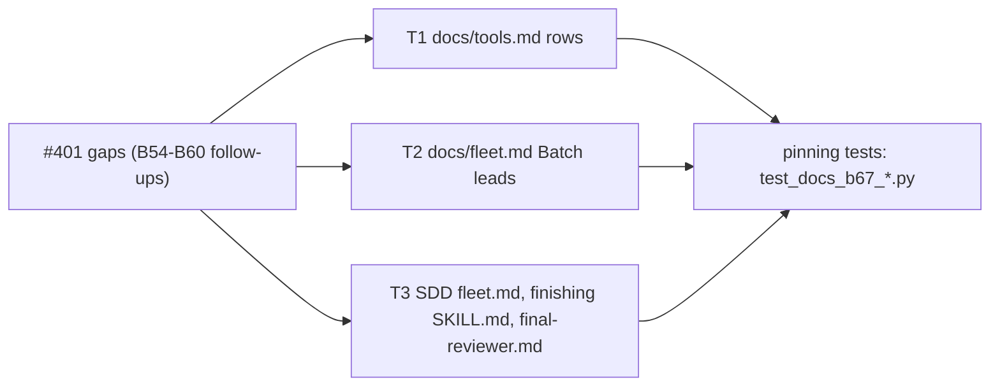
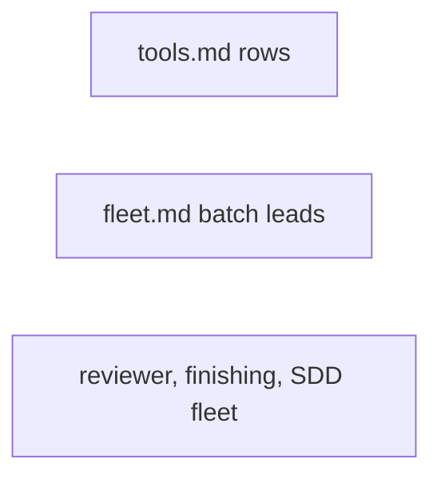

# Superlite: docs catch up with 1.5.63 to 1.5.69 (B67)

**Goal:** fix #401: the docs name what shipped in 1.5.63 to 1.5.69 (B54 to B60): run_tests wait line, rerun hint, DEFAULT_WAIT, `{only_testing}` gate and #380 closing rules; commit_task `restored F` and `--plan` checkout; `fleet report`, the fleet `--plan` refusal, `sl accounts`; the packet's tests shard and OUTDATED lines and lint's IMPORT warning; backlog plan label cut, `--reset` hint, `next: sl backlog plan`; `orchestrator takeover`.
**Architecture:** text inserts into five owned files, each pinned by a new test file whose constants hold the exact inserted text: T1 docs/tools.md, T2 docs/fleet.md `## Batch leads`, T3 skills/subagent-driven-development/fleet.md, skills/finishing-a-development-branch/SKILL.md and agents/final-reviewer.md.
**Tech stack:** Markdown docs; Python 3.10+ stdlib, pytest (through `sl run_tests`).
**Spec:** this file, section Design; issue #401's list and Expected line.
**Detail:** tests
**Target-min:** 11
**Wave0:** none
**Coverage:** off
**Max chars:** 22000

Global constraints:
- Touch only the files in Owns. Existing tests stay green and no existing test file changes (another lead may own them). If an existing test turns red, report it in DONE_WITH_CONCERNS with the test id and the reason instead of editing it.
- Each inserted text is the matching constant of the task's test file, byte for byte (copy it from the test file, not retyped). Existing sentences stay byte-identical (tests/scripts/test_docs_b26.py pins two docs/fleet.md sentences).
- Run `sl` as an executable (`<abs>/sl ...`). Verify with the task's `run_tests --fast ... --task Tn --background` line, then run the printed `wait:` line in the foreground and end the turn only after it reports. Never raw `pytest`, never the e2e or eval layers (coordinator's step).
- No version edits (the ship step bumps the version).

Ruling: scope is 1.5.63 to 1.5.69 as #401 states; the 1.5.45 to 1.5.62 and 1.5.70 to 1.5.74 docs gaps in these files (run_tests `next:` cue and Swift `--fast` mapping, commit_task hold notes, autocommit skip line, contract default rule, backlog `status --all`) go to notes as a follow-up - cost if wrong: one more docs batch.
Ruling: SDD SKILL.md stays out (Max: B5 owns it) - cost if wrong: none.
Ruling: docs/fleet.md's stale "A lead's `question.json` is checked strictly, never cut" (B29) stays: test_docs_b26.py pins it verbatim and is outside B67's files; follow-up - cost if wrong: one wrong sentence stays a while.
Ruling: the packet carries no lint lines, so agents/final-reviewer.md names lint's `WARNING: IMPORT:` as a cross-target use to spot in an excerpt (tier 2) - cost if wrong: a reviewer misses a Swift import gap the lint already warned about.
Ruling: all three tasks are `Kind: mechanical` (docs from existing code, exact text given in the test constants) - cost if wrong: a haiku miss goes to a sonnet fixer.
Ruling: coverage off: bounded docs change, no decision categories open - cost if wrong: none.
Ruling: already in the lead worktree on branch superlite/b67-docs-catch-up-1-5-63-to-69 - cost if wrong: none.
LAYERS: unit, headless, evals



## Design

Each gap of #401 becomes one inserted text; a new test file per task holds each text as a constant and asserts it at its place, plus that the strings it quotes still exist in the code (`run_tests.py`, `commit_task.py`, `pt_review.py`, `plan_tools.py`, `backlog.py`, `orchestrator.py`). docs/tools.md rows stay one table row each (one ` | ` separator, ending ` |`). No code changes.

## File structure

- docs/tools.md: rows `run_tests`, `commit_task`, `fleet`, `accounts`, `pt_review`, `plan_tools` (T1); tests/scripts/test_docs_b67_tools.py (T1).
- docs/fleet.md: two new paragraphs in `## Batch leads (backlog mode)` (T2); tests/scripts/test_docs_b67_fleet.py (T2).
- skills/subagent-driven-development/fleet.md (UNKNOWN bullet), skills/finishing-a-development-branch/SKILL.md (step 6), agents/final-reviewer.md (three bullets) (T3); tests/scripts/test_docs_b67_review_finish.py (T3).

## Task graph

```mermaid
%% schedule
gantt
  title Predicted schedule (mm:ss)
  dateFormat X
  axisFormat %M:%S
  section lane 1
  T1 tools.md rows for 1.5.63 to 1.5.69 :t1, 0, 79s
  section lane 2
  T3 final reviewer finishing and SDD flee :t3, 0, 78s
  section lane 3
  T2 fleet.md batch leads plan details and :t2, 0, 77s
```





critical path: T1 (1.3 min) · peak width 3 · predicted build 1.3 min · predicted total ≈ 4.8 min (target ✓)

## Predicted schedule

## Docs

### T1 tools.md rows for 1.5.63 to 1.5.69 · Complexity 2 (O-1) · Est. context 34k
**Owns:** docs/tools.md, tests/scripts/test_docs_b67_tools.py
**Components:** 2
**LOC owned:** 70
**Tests:** fast
**Kind:** mechanical
**Model:** haiku
**Est. time:** 2 min (2 components, about 70 LOC, fast tests)
**Consumes:** none
**Produces:** none
**Review Focus:** `test_rows_keep_table_shape`: each edited row still has exactly one ` | ` and ends ` |`.
**Test code (verbatim):** tests/scripts/test_docs_b67_tools.py
```python
"""B67 (#401): docs/tools.md names what shipped in 1.5.63 to 1.5.69."""
from pathlib import Path

ROOT = Path(__file__).resolve().parents[2]
TOOLS = (ROOT / "docs" / "tools.md").read_text(encoding="utf-8")
SCRIPTS = ROOT / "skills" / "subagent-driven-development" / "scripts"

RT = "; `--wait` keeps stdout one JSON document and ends with a stderr summary line `tests (<mode>): P passed, F failed[, S skipped][; error: E]` (the summary `error` is cut at 400 characters); its limit defaults to 540 s (`DEFAULT_WAIT`, under a 600 s Bash cap), and a timeout prints `tests: no result yet after T s [(pid N still running)]; run again: <cmd>`; runner output goes to temp files, so a leftover child holding stdout no longer blocks the summary; a test-cmd.json `{only_testing}` placeholder is refused before the run when git lists no `*.swift`, `*.xcodeproj/*` or `*.xcworkspace/*` file (exit 2, `test-cmd.json uses {only_testing}, the Xcode (Swift) placeholder, ...` naming the detected language's `{files}` form; no incident; `--background` refuses in the parent); incident closing (#380): no rule closes an entry logged at or after the run's start, a green `--task Tn` run closes Tn's `-` entries and re-logs other tasks' open entries there (a stretch holding a no-result stays open), a green `--full` run without `--task` closes every `run_tests` test-failure location, and a `--fast` run without `--task` closes nothing"
CT = "An owned file that a checkpoint of this plan holds and git status no longer lists (a new file deleted, or a file back to its HEAD content) is staged again when it differs from the newest checkpoint; a restored one prints `restored F (back to its HEAD content)` on stderr. `--plan P` changes into P's checkout (`state.git_root(P)`, as `autocommit` and `trees` do) when it differs from the cwd, after making `--plan`, `--ledger`, `--log`, `--pool` and the run-folder defaults absolute against the caller's cwd; `--also` and `--claim` stay repo-relative (an absolute one is made relative to P's checkout), and a P outside any checkout keeps the cwd."
FLEET = "; `report Wn [Wm ...]` prints the reports `fleet wait` saved, read-only (a report label such as `T3` or `FR1` works too; several ids print a `== <id> <path>` line before each; a busy, blocked or unknown id, or one with no collected report, prints an `error:` line on stderr and exits 1 while the others still print); every `fleet` subcommand refuses an explicit `--plan` that is no plan file or folder, or whose state folder cannot be created (exit 2, `error: --plan P: ...`, before anything runs)"
ACCOUNTS = "| `accounts` | Account choice for fleet workers from `claude-profile usage --json` and `list --json`; `sl accounts [--tier MODEL]` prints one headroom line per account, `claude1 ok 5h=12% weekly=40%` or `claude2 skip 5-hour 95%` (the reason spawn skips it; `--tier` adds that model's scoped weekly cap), and exits 3 without usage data |"
PT = "; a `run_tests` test failure is outdated when its test file, a `conftest.py` above it, or a changed-since-base `.py` module it imports changed (mtime) after the run: it leaves section 1 and the open count (the packet can still take the fast path) and shows in section 4 as `- OUTDATED: <test> (<file> changed after this run; the full suite decides)` or `- OUTDATED incident: <file>:<line> <context> (<file> changed after it)` (at most 30 lines; agent-logged failures are never outdated); when a changed test file would be cut from section 8, every changed test file goes in full to the tests shard `<packet stem>-tests.md` (cap `AUTO_MAX_TOKENS`, or `--max-tokens`), named in the packet head by a `Tests shard: K changed test file(s) are not in section 8 (truncated: test diffs over the size limit; read <abs> in full)` line and on stdout by a second `wrote` line, and a packet without a shard deletes an old one; the contract check searches a task's source files, then its owned test files"
PLAN_TOOLS = "Lint warns `WARNING: IMPORT: Tn consumes <item> from Tm, but <Type> is declared in <targets>, which target <tg> may not import (<Package.swift>) dependencies: <deps>` (a warning, never an issue; SwiftPM only) when a seam's Produces type is declared only in SwiftPM targets that the consumer's target does not list in its `Package.swift` dependencies."


def row(name):
    rows = [ln for ln in TOOLS.splitlines() if ln.startswith(f"| `{name}` |")]
    assert len(rows) == 1, name
    return rows[0]


def test_rows_keep_table_shape():
    for name in ("run_tests", "commit_task", "fleet", "accounts", "pt_review", "plan_tools"):
        r = row(name)
        assert r.count(" | ") == 1 and r.endswith(" |"), name


def test_run_tests_row():
    assert row("run_tests").endswith("naming the tree" + RT + " |")


def test_commit_task_row():
    assert row("commit_task").endswith("always commits. " + CT + " |")


def test_fleet_row():
    assert row("fleet").endswith("(see `docs/fleet.md`)" + FLEET + " |")


def test_accounts_row():
    assert row("accounts") == ACCOUNTS


def test_pt_review_row():
    assert row("pt_review").endswith("the cap grows by these sections" + PT + " |")


def test_plan_tools_row():
    assert row("plan_tools").endswith("(`<stem>.build-report.md`/`.json`). " + PLAN_TOOLS + " |")


def test_quoted_strings_exist_in_code():
    rt = (SCRIPTS / "run_tests.py").read_text(encoding="utf-8")
    assert "DEFAULT_WAIT = 540.0" in rt and "no result yet after" in rt and "test-cmd.json uses {only_testing}, the Xcode (Swift) placeholder" in rt
    assert "back to its HEAD content)" in (SCRIPTS / "commit_task.py").read_text(encoding="utf-8")
    pt = (SCRIPTS / "pt_review.py").read_text(encoding="utf-8")
    assert "Tests shard: " in pt and "- OUTDATED: " in pt and "- OUTDATED incident: " in pt
    assert "WARNING: IMPORT: " in (SCRIPTS / "plan_tools.py").read_text(encoding="utf-8")
    assert "skip %s" in (SCRIPTS / "accounts.py").read_text(encoding="utf-8")
```
**Steps:** 1 write the test file, 2 run: FAIL, 3 insert each constant into its row (RT and FLEET and PT right before the row's closing ` |`; CT and PLAN_TOOLS after one space, right before the closing ` |`; ACCOUNTS replaces the whole `accounts` row), 4 run: PASS. Verify: `<abs sl> run_tests --fast tests/scripts/test_docs_b67_tools.py tests/scripts/test_docs_b32_tools.py tests/scripts/test_docs_b16.py tests/scripts/test_docs_b10.py tests/scripts/test_sl_form.py tests/scripts/test_tool_notes.py tests/scripts/test_hooks_doc.py tests/scripts/test_backlog_docs_369_370.py tests/scripts/test_orchestrator_takeover.py tests/scripts/test_docs_contract.py --task T1 --background`.
**Probe entry:** none (text only)

### T2 fleet.md batch leads: plan details and takeover · Complexity 2 (O-1) · Est. context 30k
**Owns:** docs/fleet.md, tests/scripts/test_docs_b67_fleet.py
**Components:** 2
**LOC owned:** 40
**Tests:** fast
**Kind:** mechanical
**Model:** haiku
**Est. time:** 1.5 min (2 components, about 40 LOC, fast tests)
**Consumes:** none
**Produces:** none
**Review Focus:** `test_hints_match_the_code`: the two quoted hints equal `backlog.RESET_HINT` and `backlog.BUSY_HINT`.
**Test code (verbatim):** tests/scripts/test_docs_b67_fleet.py
```python
"""B67 (#401): docs/fleet.md ## Batch leads names the 1.5.64 plan details and the 1.5.69 orchestrator takeover."""
from pathlib import Path

ROOT = Path(__file__).resolve().parents[2]
FLEET = (ROOT / "docs" / "fleet.md").read_text(encoding="utf-8")
LEADS = FLEET.split("## Batch leads (backlog mode)", 1)[1].split("\n## ", 1)[0]
SCRIPTS = ROOT / "skills" / "subagent-driven-development" / "scripts"

PLAN = "An option label over 60 characters is cut at its last whole word, and its full text (without ` (Recommended)`) leads its description, which is then cut to 200. A `plan` refused by planned or parked batches ends `; sl backlog plan --reset drops them and plans every open issue again (shipped batches stay)`; with a running or needs_decision batch it ends `; --reset is refused too while a batch is running or needs_decision` instead (exit 2). `sl backlog status` with no batch open ends with the line `next: sl backlog plan`."
TAKEOVER = "Taking a run over: a session that continues another session's run (a resumed lead, or a coordinator whose session ran out of usage) runs `sl orchestrator takeover --plan .superlite` first (a plan path works too). `sl orchestrator end`, `set`, `approve` and `bind` refuse a run folder another live session owns and name that command, and `sl finish` prints it as a hint; `takeover` binds the run to this session and prints `orchestrator: run <dir> taken over from session <id>; this session owns it now`."


def paragraphs():
    return [p for p in LEADS.strip().split("\n\n")]


def test_plan_paragraph_follows_the_main_paragraph():
    ps = paragraphs()
    i = next(k for k, p in enumerate(ps) if p.startswith("`/superlite:backlog` works"))
    assert ps[i + 1] == PLAN


def test_takeover_paragraph_follows_the_lead_paragraph():
    ps = paragraphs()
    i = next(k for k, p in enumerate(ps) if p.startswith("A lead is a fleet worker"))
    assert ps[i + 1] == TAKEOVER


def test_hints_match_the_code():
    src = (SCRIPTS / "backlog.py").read_text(encoding="utf-8")
    for hint in ("; sl backlog plan --reset drops them and plans every open issue again (shipped batches stay)",
                 "; --reset is refused too while a batch is running or needs_decision", "next: sl backlog plan"):
        assert f'"{hint}"' in src and f"`{hint}`" in PLAN


def test_takeover_text_matches_the_code():
    src = (SCRIPTS / "orchestrator.py").read_text(encoding="utf-8")
    assert "taken over from session {old}; this session owns it now" in src
    assert "sl orchestrator takeover --plan" in (SCRIPTS / "finish.py").read_text(encoding="utf-8")
```
**Steps:** 1 write the test file, 2 run: FAIL, 3 insert PLAN as a new paragraph right after the paragraph starting "`/superlite:backlog` works" and TAKEOVER as a new paragraph right after the one starting "A lead is a fleet worker" (blank line before and after each), 4 run: PASS. Verify: `<abs sl> run_tests --fast tests/scripts/test_docs_b67_fleet.py tests/scripts/test_docs_b26.py tests/scripts/test_backlog_main_docs.py tests/scripts/test_backlog_user_docs.py tests/scripts/test_backlog_docs.py tests/scripts/test_fleet_docs_b54.py tests/scripts/test_fleet_b1_docs.py tests/scripts/test_fleet_roles_docs.py tests/scripts/test_fleet_research_docs_b43.py tests/scripts/test_fleet_capacity.py tests/scripts/test_docs_contract.py --task T2 --background`.
**Probe entry:** none (text only)

### T3 final reviewer, finishing and SDD fleet docs · Complexity 2 (O-1) · Est. context 32k
**Owns:** skills/subagent-driven-development/fleet.md, skills/finishing-a-development-branch/SKILL.md, agents/final-reviewer.md, tests/scripts/test_docs_b67_review_finish.py
**Components:** 2
**LOC owned:** 50
**Tests:** fast
**Kind:** mechanical
**Model:** haiku
**Est. time:** 2 min (2 components, about 50 LOC, fast tests)
**Consumes:** none
**Produces:** none
**Review Focus:** `test_final_reviewer_bullets_follow_the_failing_test_rule`: the three bullets sit right after the `- A failing or skipped test` line, in order.
**Test code (verbatim):** tests/scripts/test_docs_b67_review_finish.py
```python
"""B67 (#401): SDD fleet.md names fleet report, finishing names orchestrator takeover, final-reviewer names the tests shard, OUTDATED lines and the IMPORT warning."""
from pathlib import Path

ROOT = Path(__file__).resolve().parents[2]
SDD_FLEET = (ROOT / "skills" / "subagent-driven-development" / "fleet.md").read_text(encoding="utf-8")
FINISH = (ROOT / "skills" / "finishing-a-development-branch" / "SKILL.md").read_text(encoding="utf-8")
REVIEWER = (ROOT / "agents" / "final-reviewer.md").read_text(encoding="utf-8")

UNKNOWN = '  - `UNKNOWN` (no parsable report): `"$SL" fleet report Wn --plan $PLAN` prints the saved `.superlite/fleet/reports/<id>.md` (read-only; a busy worker or one with no collected report exits 1); read it once, then decide.'
FINISH_TAKEOVER = "When `end` refuses because another session owns the run (this session took over a run whose first session ran out of usage or crashed; `finish` names it too), run `<skill-dir>/../subagent-driven-development/scripts/sl orchestrator takeover --plan <absolute plan path>` first, then `end` again."
R_OUTDATED = "- `OUTDATED:` and `OUTDATED incident:` lines in section 4 are failures whose code changed after that run; the full suite decides, so they are not open and not a finding on their own."
R_SHARD = "- A `Tests shard:` line in the packet head names `<packet stem>-tests.md`, every changed test file in full; it carries the truncated marker, so you may read it in full like any truncated file."
R_IMPORT = "- Plan lint's `WARNING: IMPORT:` (a Swift consumer target uses a type declared in a SwiftPM target its `Package.swift` does not list) is not in the packet: an excerpt that shows such a cross-target use is a finding, tier 2."


def test_sdd_fleet_unknown_uses_fleet_report():
    lines = SDD_FLEET.splitlines()
    assert UNKNOWN in lines
    assert sum("`UNKNOWN`" in ln for ln in lines) == 1


def test_finishing_names_takeover_in_cleanup():
    sec = FINISH.split("## 6. Worktree cleanup", 1)[1].split("\n## ", 1)[0]
    assert "the coordinator guard stops). " + FINISH_TAKEOVER in sec


def test_final_reviewer_bullets_follow_the_failing_test_rule():
    lines = REVIEWER.splitlines()
    i = next(k for k, ln in enumerate(lines) if ln.startswith("- A failing or skipped test"))
    assert lines[i + 1:i + 4] == [R_OUTDATED, R_SHARD, R_IMPORT]


def test_final_reviewer_keeps_its_contract():
    assert "read <path> in full" in REVIEWER and "may read" in REVIEWER and "nothing else" in REVIEWER
    assert "tools: Read, Grep, Glob" in REVIEWER and "$SL" not in REVIEWER
```
**Steps:** 1 write the test file, 2 run: FAIL, 3 replace the SDD fleet.md line starting "  - `UNKNOWN` (no parsable report):" with UNKNOWN; append " " + FINISH_TAKEOVER to the step 6 sentence ending "the coordinator guard stops)." (same line); insert R_OUTDATED, R_SHARD, R_IMPORT as three lines right after the final-reviewer line starting "- A failing or skipped test", 4 run: PASS. Verify: `<abs sl> run_tests --fast tests/scripts/test_docs_b67_review_finish.py tests/scripts/test_adapter_and_packet.py tests/scripts/test_packet_inline.py tests/scripts/test_docs_contract.py tests/scripts/test_fleet_hint_wording.py tests/scripts/test_run_state_docs_b19.py tests/scripts/test_backlog_docs.py tests/scripts/test_fleet_b1_docs.py tests/scripts/test_fleet_capacity.py --task T3 --background`.
**Probe entry:** none (text only)

## Review Focus

Package docs (app type: generator of text; categories: encoding). Risks: a table row split by a stray ` | ` (T1 `test_rows_keep_table_shape`); a quoted message that no longer matches the code (each test's code-string check); a pinned sentence changed (existing tests in each verify line).

## Self-review

1. Coverage: every #401 bullet maps to a constant (tools.md: RT, CT, FLEET, ACCOUNTS, PT, PLAN_TOOLS; fleet.md: PLAN, TAKEOVER; SDD fleet.md: UNKNOWN; finishing: FINISH_TAKEOVER; final-reviewer: R_OUTDATED, R_SHARD, R_IMPORT); SDD SKILL.md is B5's.
2. Placeholders: none. 3. Types: no Produces. 4. Graph: no edges, disjoint Owns. 5. Fields filled. 6. Review Focus per task. 7. Schedule and lint below.
