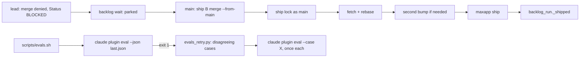
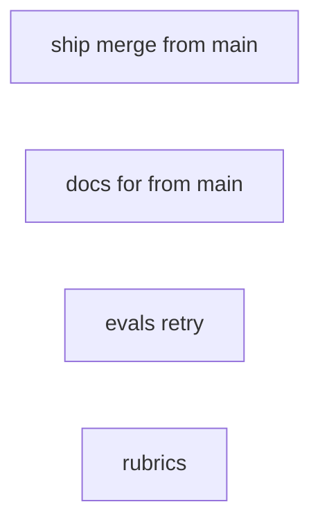

# Superlite: main ships a denied lead merge with one command; the evals gate retries a disagreeing case once (B39)

**Goal:** fix #275 (a lead's `sl backlog ship B merge` is denied by the auto-mode classifier, so main ships by hand with `maxapp ship -C` plus `done`) and #281 (judge-graded eval cases fail 1 of 2 runs on untouched paths, so leads stamp evals by ruling).
**Architecture:** T1 adds `merge --from-main` to `backlog_ship.py` (lock as main, rebase, second bump when needed, `maxapp ship`, then `done`'s bookkeeping through `backlog_run._shipped`); T2 documents it; T3 adds `scripts/evals_retry.py` and a retry loop in `scripts/evals.sh`; T4 tightens the two grader rubrics.
**Tech stack:** Python 3.10+ stdlib, bash, pytest (through `sl run_tests`).
**Spec:** this file, section Design; issue #275 and #281 Expected lines and Max's decisions.
**Detail:** contracts
**Target-min:** 11
**Wave0:** none
**Max chars:** 31000

Global constraints:
- Every code line in `skills/subagent-driven-development/scripts/*.py` and `scripts/*.py` carries the repo's trailing `# O(...)` complexity comment; tests and shell scripts do not. Stdlib only.
- Existing tests stay green. An existing test file changes only when the task Owns it. If another existing test turns red, report it in DONE_WITH_CONCERNS with the test id and the reason instead of editing it.
- Run `sl` as an executable (`<abs>/sl ...`). Verify with `<abs>/sl run_tests --fast <own test files> --task Tn --background`, then run the printed `wait:` line in the foreground and end the turn only after it reports.
- No version edits (the ship step bumps the version). Never run `scripts/evals.sh`, `claude plugin eval` or `scripts/test_layers.py run` (they spend quota; the coordinator runs the layers).

Ruling: #275 per Max's decision: `sl backlog ship B merge --from-main` (main only) ships a parked batch whose lead's merge was denied in one command: ship lock as `main` (agent none, so the stopped lead never makes it look stale), fetch and rebase onto the default branch (a conflict aborts the rebase), a second bump when the default branch already holds the batch's version, `maxapp ship`, then `done`'s bookkeeping (`backlog_run._shipped`) - cost if wrong: main falls back to `maxapp ship -C` plus `done`, which stay.
Ruling: `--from-main` takes only a parked batch that recorded a version (when the worktree has `scripts/bump-version.sh`): a denied merge ends the lead BLOCKED and `wait` parks it; a running batch may still be building - cost if wrong: main waits for the park line.
Ruling: on CONFLICT (5), RED (6) or BLOCKED (3) `--from-main` releases the lock and keeps the batch parked with the reason, since main does not fix code (`start B` resumes the lead); WAIT and RERUN (4) keep the state, RERUN keeps the lock - cost if wrong: one more `start`.
Ruling: a lead does not retry a denied merge: it ends `Status: BLOCKED merge denied: main runs sl backlog ship B merge --from-main` (backlog.md ## Lead) - cost if wrong: none.
Ruling: #281 per Max's decision: the retry lives in `scripts/evals.sh` plus new `scripts/evals_retry.py`, because `claude plugin eval` graders are a strict schema with no retry or vote field (read from CLI 2.1.319). After a red run (exit 1, not partial) every failing case whose with-plugin runs disagree reruns once with `--case`; the suite is green when every rerun is green; a case that failed every run stays red with no retry - cost if wrong: about $0.4-0.8 per retried case.
Ruling: reads-coverage is a with-only grader in a case with scored graders, so `claude plugin eval` reports it `[with-only, not scored]` and it never failed the gate; B19's red brainstorm-coverage came from a scored judge (raises-limits, B26 ruling). Its match tightens to the skill's own `brainstorming/coverage.md` and its text says it is an unscored indicator; raises-limits is left to the retry - cost if wrong: a follow-up rubric fix.
Ruling: one-batch passes on zero to four decision questions (raises-decisions grades that decisions are raised) and never counts a request to enable Bash or another tool - cost if wrong: the judge still miscounts, and the retry absorbs a single miss.
Ruling: B39 also edits scripts/evals.sh, scripts/evals_retry.py (new), docs/testing.md, skills/subagent-driven-development/backlog.md, commands/backlog.md, docs/fleet.md, docs/tools.md, tests/scripts/test_evals_suite.py, tests/scripts/test_backlog_main_docs.py and two new test files (outside its file list); the only other running batch, B38, owns backlog.py and backlog_brief.py - cost if wrong: a rebase conflict at ship.
Ruling: detail contracts; no probe adapter (CLI and shell over mocked subprocesses; Review Focus cases are named pytest cases); already in the lead worktree, so no `sl worktree ensure` - cost if wrong: one NEEDS_CONTEXT round.
LAYERS: unit, headless, evals



## Design

### 1. `sl backlog ship B merge --from-main` (T1)
`main()` gains `--from-main` (store_true). After the unknown-batch check: `--from-main` with any action but `merge` -> exit 2 `refused: --from-main goes only with merge`; `merge --from-main` goes to the new path before the lead gate. Refusals, exit 2, in this order:
1. `SUPERLITE_FLEET_WORKER` set: `refused: sl backlog ship B merge --from-main runs only in the main session`.
2. no `approved_ship`: `refused: no ship approval recorded (sl backlog decide)`.
3. state not `parked`: `refused: B is <state>, not parked (main ships a parked batch only)`.
4. no repo or worktree recorded: `refused: B has no repo or worktree recorded`; worktree folder missing: `refused: worktree <path> is gone`.
5. the worktree has `scripts/bump-version.sh` and the batch has no `version`: `refused: B has no version yet (its lead never ran bump)`.
6. `git status --porcelain` not empty: `refused: uncommitted changes in the worktree`.

Then:
- **Lock:** `ship_lock.acquire` with owner `{"batch": B, "lead": "main", "agent": None, "repo": repo}`, the same 15 s wait loop and `--wait` as `lock`; not acquired -> exit 4 `WAIT: ship lock held by <B2> (<lead>); run sl backlog ship B merge --from-main again`; a stale lock taken over prints the same `took over ...` line and incident as `lock`. Re-entry (this batch already holds it) is fine.
- **Sync:** `git fetch origin` (failure: give up, exit 3, `BLOCKED: git fetch origin failed: <tail>`), the default branch as in `lock`, `git rebase origin/<default>`; a conflict runs `git rebase --abort` and gives up, exit 5, `CONFLICT: <files>; rebase aborted`. No layer check (CI checks gate the PR).
- **Second bump**, only when the worktree has `scripts/bump-version.sh`: `base` = the version in `git show origin/<default>:<path>` for the first `.json` entry of `.version-bump.json` (same field rule as `_current_version`); unreadable -> give up, exit 3, `BLOCKED: cannot read the version on origin/<default>`. When the worktree version is unreadable or not above `base` (compared as integer tuples, so 1.5.10 > 1.5.9): `v` = base with patch + 1, run `bash scripts/bump-version.sh v` and `git commit -am "Bump version to v"` (failure: give up, exit 3, `BLOCKED: <first two words> failed: <tail>`), record `version=v`, print `B version v (origin/<default> is at base)`.
- **Merge:** the lead `merge` code path (title, body composition with `Closes`, notes read before the run, `maxapp ship -C <wt> --timeout 8 ...` run in the worktree). Outcomes: merged `#n` -> summary file, open issues, `pr`, `merged`, `open_issues` set, lock released, then `backlog_run._shipped(bs.path(root), root / ".superlite", root, {**batch, "pr": n, "version": v, "open_issues": left}, wt)` and its lines printed, exit 0 (the batch's current version, after a second bump the new one); exit 0 without a number -> give up 3 `BLOCKED: maxapp ship gave no merged PR number (<tail>)`; exit 3 -> give up 6 `RED: <tail>`; exit 4 -> `RERUN: sl backlog ship B merge --from-main (run k of 5)` with the lock kept, and at the 5th the lead path's park, release and `BLOCKED: maxapp ship timed out 5 times; lock released`; any other -> give up 3 `BLOCKED: maxapp ship failed (<tail>)`.
- **Give up:** release the lock, keep the batch parked with `reason=<text>` and `parked_at`, print `<text>; lock released, B parked: sl backlog start B resumes its lead to fix it` for exit 5 and 6, else `<text>; lock released, B parked: run sl backlog ship B merge --from-main again`. Lines printed before (took over, version) come first.
- The module docstring names `merge --from-main`. The lead `lock`, `bump`, `merge`, `release` and `done` paths keep their output.

### 2. Docs (T2)
Exact text in the T2 block. Main uses `--from-main` for a denied merge; `maxapp ship -C <worktree>` plus `done` stays the hand-ship record.

### 3. Evals retry (T3)
`scripts/evals_retry.py RESULT.json`: stdout one case name per line, the failing cases to rerun; exit 0 when there is at least one; exit 1 (reason on stderr) when the run is partial, no case scored below the threshold, a failing case failed every with-plugin run, or a failing case name is not `[A-Za-z0-9._-]+`; exit 2 when the file is missing or not JSON. `retry_cases(result: dict) -> tuple[list[str], str]`: threshold `suite.threshold` (default 1.0); a case fails when `aggregates.score` is below it (a missing score fails every run); its runs disagree when `arms.with` holds a run with `passed` true and one with `passed` false.
`scripts/evals.sh`: one `run()` function with the current fixed flags; `rm -f evals/results/last.json`; first run `run --json evals/results/last.json "$@"`; exit codes other than 1 pass through; on 1, `cases=$(python3 scripts/evals_retry.py evals/results/last.json) || exit 1`; per case print `evals: retry once: <case> (its runs disagreed)` to stderr and `run "$@" --case "<case>" --json "evals/results/retry-<case>.json" || exit 1`; after all print `evals: green after one retry of: <cases>` to stderr, exit 0.
`docs/testing.md`, Rules of thumb, new last bullet: "- A red evals run reruns, once, each failing case whose with-plugin runs disagree (one passed, one failed): `scripts/evals_retry.py` picks them from `evals/results/last.json`, and the suite is green when every rerun is green. A case that failed every run stays red."

### 4. Rubrics (T4)
Exact text in the T4 block.

## Coverage

| Category | State | Basis |
|---|---|---|
| Scope and success criteria | settled | #275 and #281 Expected lines; Max's two decisions |
| Domain and data model | settled | batch fields `version`, `reason`, `pr`, `merged`, `open_issues` reused; lock owner lead `main` |
| Persistence and migration | n/a | no new stored data |
| Interfaces and contracts | settled | new flag only; lead ship output and `done` unchanged; `evals.sh` keeps its flags |
| UI states | n/a | CLI text only |
| Concurrency and state ownership | ruled | ship lock as main with agent none; another batch's live lock -> WAIT |
| Error handling and recovery | ruled | give up releases the lock and keeps the batch parked with the reason |
| Security and privacy | ruled | case names from the result file pass a `[A-Za-z0-9._-]+` check before the shell uses them |
| Performance and limits | ruled | one rerun per disagreeing case, each under the $5 cap |
| Observability | settled | stderr retry lines; park reason and incident on takeover |
| Testing strategy | settled | unit tests with mocked `_run`, a fake `claude` on PATH for `evals.sh`; layers by the coordinator |
| Compatibility | settled | `claude plugin eval` exit 1 below threshold, 2 on the cost cap (CLI 2.1.319 help) |
| Rollout | ruled | one PR; version bump at ship |
| Research unknowns | n/a | grader schema and with-only scoring read from the CLI |

## File structure
- `skills/subagent-driven-development/scripts/backlog_ship.py`, `tests/scripts/test_backlog_ship_from_main.py` (T1).
- `skills/subagent-driven-development/backlog.md`, `commands/backlog.md`, `docs/fleet.md`, `docs/tools.md`, `tests/scripts/test_backlog_main_docs.py` (T2).
- `scripts/evals_retry.py`, `scripts/evals.sh`, `docs/testing.md`, `tests/scripts/test_evals_retry.py` (T3).
- `evals/ai-asks-once/graders/one-batch.md`, `evals/brainstorm-coverage/graders/reads-coverage.md`, `tests/scripts/test_evals_suite.py` (T4).

## Task graph

```mermaid
%% schedule
gantt
  title Predicted schedule (mm:ss)
  dateFormat X
  axisFormat %M:%S
  section lane 1
  T3 evals retry a disagreeing case once :t3, 0, 93s
  section lane 2
  T1 backlog_ship merge --from-main for a :t1, 0, 80s
  section lane 3
  T2 docs main ships a denied merge with m :t2, 0, 60s
  section lane 4
  T4 graders one-batch counts only decisio :t4, 0, 60s
```




critical path: T3 (1.5 min) · peak width 4 · predicted build 1.5 min · predicted total ≈ 5.0 min (target ✓)

## Package: backlog ship (CLI)
App type: CLI. Categories: protocol, state, file. Specific risks: shipping a batch whose lead is still building, a lock left held after a failed main-side ship, a version compared as text, a stopped lead making main's lock stale.
**Probe entry:** none (Ruling: no probe adapter).

### T1 backlog_ship: merge --from-main for a parked batch · Complexity 5 · Est. context 45k
**Owns:** skills/subagent-driven-development/scripts/backlog_ship.py, tests/scripts/test_backlog_ship_from_main.py
**Components:** 1
**LOC owned:** 190
**Tests:** fast
**Model:** sonnet
**Est. time:** 3.0 min (1 component, about 190 LOC, fast tests)
**Covers:** 1
**Consumes:** existing `ship_lock.acquire(p, owner, live, now_ms)`, `ship_lock.release(p, batch)`, `backlog_run._shipped(p, sd, root, b, wt) -> list`
**Produces:** backlog_ship.main(argv: list[str]) -> int (new `merge --from-main` path)
**Review Focus:**
Test fixture: reuse `sh`, `ship`, `b1`, `AG`, `B2` from `test_backlog_ship` and `APPROVED` from `backlog_fixtures`; a `fm` fixture on top: delenv `SUPERLITE_FLEET_ROLE` and `SUPERLITE_FLEET_WORKER`, `sys.modules["fleet"]` stub recording stops, `backlog_run._run` recording calls and returning `(0, "")` (as `test_backlog_ship_done.dn`), batch B1 `state="parked"`, `reason="merge denied"`, `version="1.5.8"`, worktree files `scripts/bump-version.sh` (empty), `package.json` `{"version": "1.5.8"}`, `.version-bump.json` naming `package.json` field `version`, replies `git symbolic-ref` -> `(0, "origin/main\n")`, `git show origin/main:package.json` -> `(0, '{"version": "1.5.7"}\n')`, `maxapp ship -C` -> `(0, "pr https://github.com/o/r/pull/301\nmerged #301 as abc\n")`.
protocol: `test_from_main_ships_a_parked_batch` (`merge --from-main` -> `(0, f"B1 shipped PR #301 1.5.8 summary={sd}/backlog/B1.md\n")`; B1 `state, pr, merged, version, open_issues == ("shipped", 301, True, "1.5.8", [])`; lock free; `("stop", ["W1"])` recorded; calls hold `git fetch origin`, `git rebase origin/main`, `["maxapp", "ship", "-C", wt, "--timeout", "8", "--title", "B1: #5", "--body-file", sd/backlog/B1.pr-body.md]` and no `bash scripts/bump-version.sh`; pr-body file reads `Closes #5\n`; summary file exists);
numeric: `test_from_main_bumps_again_when_main_has_the_version` (origin `1.5.8` -> first line `B1 version 1.5.9 (origin/main is at 1.5.8)`, calls hold `["bash", "scripts/bump-version.sh", "1.5.9"]` and `["git", "commit", "-am", "Bump version to 1.5.9"]`, B1 version `1.5.9`, line `B1 shipped PR #301 1.5.9 summary=...`; origin `1.5.10` -> `B1 version 1.5.11 (origin/main is at 1.5.10)`; origin reply `(1, "fatal")` -> `(3, "BLOCKED: cannot read the version on origin/main; lock released, B1 parked: run sl backlog ship B1 merge --from-main again\n")`);
state: `test_from_main_refusals` (`lock --from-main` -> `(2, "refused: --from-main goes only with merge\n")`; `SUPERLITE_FLEET_WORKER=W1` -> `(2, "refused: sl backlog ship B1 merge --from-main runs only in the main session\n")`; `approved_ship` None -> `(2, "refused: no ship approval recorded (sl backlog decide)\n")`; state `running` -> `(2, "refused: B1 is running, not parked (main ships a parked batch only)\n")`; version None -> `(2, "refused: B1 has no version yet (its lead never ran bump)\n")`; `git status --porcelain` -> `(0, " M a.py\n")` -> `(2, "refused: uncommitted changes in the worktree\n")`; worktree `<wt>/gone` -> `(2, "refused: worktree <wt>/gone is gone\n")`; after all: no stop, lock file absent, B1 still parked, no `maxapp ship` call);
state: `test_from_main_waits_for_another_batch` (`B2` holds the lock, live `{"sl-x-w5"}`, `--wait 0` -> `(4, "WAIT: ship lock held by B2 (W5); run sl backlog ship B1 merge --from-main again\n")`, holder still B2, no `git fetch`);
state: `test_from_main_rerun_keeps_the_lock_as_main` (`maxapp ship -C` -> `(4, "running")` -> `(4, "RERUN: sl backlog ship B1 merge --from-main (run 1 of 5)\n")`; holder `{"batch": "B1", "lead": "main", "agent": None, "repo": "o/r", "time": 10000}`; B1 parked, no stop; a second call -> `run 2 of 5`);
state: `test_from_main_conflict_aborts_and_releases` (`git rebase origin` -> `(1, "CONFLICT")`, `git diff --name-only --diff-filter=U` -> `(0, "a.py\nb.py\n")` -> `(5, "CONFLICT: a.py b.py; rebase aborted; lock released, B1 parked: sl backlog start B1 resumes its lead to fix it\n")`; calls hold `git rebase --abort`; lock free; reason starts `CONFLICT: a.py b.py`; no `maxapp ship`);
state: `test_from_main_red_and_failure_release_and_park` (`maxapp ship -C` `(3, "check unit failed")` -> `(6, "RED: check unit failed; lock released, B1 parked: sl backlog start B1 resumes its lead to fix it\n")`, reason `RED: check unit failed`, not merged; `(1, "gh failed")` -> `(3, "BLOCKED: maxapp ship failed (gh failed); lock released, B1 parked: run sl backlog ship B1 merge --from-main again\n")`; lock free after each);
protocol: `test_from_main_names_open_issues` (`gh issue view` -> `(0, "OPEN\n")` -> out lines hold `B1 OPEN #5`, B1 `open_issues == [5]`).
**Steps:** 1 failing tests, 2 run: FAIL, 3 implement Design 1, 4 run: PASS (own file plus `tests/scripts/test_backlog_ship.py tests/scripts/test_backlog_ship_done.py`).

## Package: docs (text)
App type: docs. Categories: protocol (named commands). Specific risks: a pinned phrase dropped from a doc test.
**Probe entry:** none.

### T2 docs: main ships a denied merge with merge --from-main · Complexity 2 · Est. context 30k
**Owns:** skills/subagent-driven-development/backlog.md, commands/backlog.md, docs/fleet.md, docs/tools.md, tests/scripts/test_backlog_main_docs.py
**Components:** 1
**LOC owned:** 30
**Tests:** fast
**Model:** sonnet
**Est. time:** 1.5 min (1 component, about 30 LOC, fast tests)
**Covers:** 2
**Consumes:** none
**Produces:** none
**Review Focus:** protocol: `test_docs_name_the_main_side_merge` (new, in test_backlog_main_docs.py: `'"$SL" backlog ship B merge --from-main'` in CMD and in REF = skills/subagent-driven-development/backlog.md; `"merge denied: main runs sl backlog ship B merge --from-main"` in REF; `"ship B merge --from-main"` in docs/fleet.md; `row("backlog_ship")` holds `` `merge --from-main` `` and `"rebase aborted"`; and in CMD `index("merge --from-main") < index("backlog ship B done")`); the existing tests in test_backlog_main_docs.py and test_backlog_docs.py stay green.
**Steps:** replace each line below whole with the fenced text (one line each; keep the file's other lines byte-identical).
1. `skills/subagent-driven-development/backlog.md`, the line starting `6. A batch whose lead could not merge` (## Main step 6):
```text
6. A batch whose lead could not merge (its merge step was denied, so the lead ended BLOCKED and `wait` parked it) is main's to ship with one command: `"$SL" backlog ship B merge --from-main` (main only, refused in any fleet worker; it needs the ship approval, a parked batch and its bumped version). It takes the ship lock as main, rebases the worktree onto the default branch, bumps the version again when the default branch already has it, runs `maxapp ship`, then marks the batch shipped, records its PR and version, writes its summary, releases the ship lock and stops its lead. exit 4 is WAIT or RERUN: run it again. A CONFLICT (5), RED (6) or BLOCKED (3) releases the lock and keeps the batch parked with the reason; `"$SL" backlog start B` resumes its lead to fix a conflict or a red check. A batch main shipped by hand (`maxapp ship -C <worktree>`) is recorded with `"$SL" backlog ship B done --pr N [--version X]` (main only; `gh pr view N` must read MERGED).
```
2. Same file, the line starting `  3. ` followed by `` `merge [--title T] `` (## Lead ship step 3):
```text
  3. `merge [--title T] [--body-file F]`: run `maxapp ship`; give the Bash call a timeout of 600000 ms. exit 6 is RED: fix the checks, rerun. A denied merge (the permission check or the auto-mode classifier refuses the Bash call, no exit code) is not retried: run no `release` and end with `Status: BLOCKED merge denied: main runs sl backlog ship B merge --from-main`.
```
3. `commands/backlog.md`, the line starting `6. A batch whose lead could not merge`:
```text
6. A batch whose lead could not merge (its merge step was denied) is yours to ship with one command: `"$SL" backlog ship B merge --from-main`. It takes the ship lock, rebases, bumps the version again when needed, runs `maxapp ship`, then marks the batch shipped, records its PR and version, writes its summary, releases the ship lock and stops its lead, so batches that depend on it can start. Exit 4: run it again. A CONFLICT or RED keeps the batch parked: `"$SL" backlog start B` resumes its lead to fix it. If you ever ship a batch by hand with `maxapp ship -C <worktree>`, record it with `"$SL" backlog ship B done --pr N`.
```
4. `docs/fleet.md`, in the line starting `` `/superlite:backlog` works a whole issue backlog ``, replace only its last sentence (from `A batch whose lead's merge was denied is shipped by main:` to the line end) with:
```text
A batch whose lead's merge was denied is shipped by main with `sl backlog ship B merge --from-main` (main only): it takes the ship lock, rebases (a conflict aborts the rebase), bumps the version again when the default branch already has it, runs `maxapp ship`, marks the batch shipped, writes its summary, releases the ship lock and stops its lead; a batch main shipped by hand (`maxapp ship -C <worktree>`) is recorded with `sl backlog ship B done --pr N [--version X]`.
```
   and the line starting `| Main ships a denied merge |` with:
```text
| Main ships a denied merge | The lead's `merge` was denied and `wait` parked the batch; main runs `ship B merge --from-main` | `status` shows the batch shipped with its PR; the ship lock is free |
```
5. `docs/tools.md`, the line starting `` | `backlog_ship` | ``:
```text
| `backlog_ship` | `backlog ship B lock [--wait 500] \| bump [--version X] \| merge [--title T] [--body-file F] \| release [--park R]` under the machine-wide ship lock; `done --pr N [--version X]` (main only) records a batch main shipped by hand: it checks that PR N is merged, marks the batch shipped with its PR and version, writes its summary, releases the ship lock, stops its lead and cleans up its worktree; `merge --from-main` (main only) ships a parked batch whose lead's merge was denied: it takes the ship lock as main, rebases onto the default branch (a conflict: rebase aborted), bumps again when the default branch already has the version, runs `maxapp ship` and then does what `done` does; CONFLICT, RED and BLOCKED release the lock and keep the batch parked with the reason |
```
6. Add the Review Focus test; run the verify command on `tests/scripts/test_backlog_main_docs.py tests/scripts/test_backlog_docs.py tests/scripts/test_backlog_user_docs.py`.

## Package: evals gate (script + shell)
App type: CLI over a result file. Categories: protocol, encoding, file. Specific risks: a stale last.json read after a failed run, a case name with shell characters, a retry on a case that failed every run, exit 2 (cost cap) retried.
**Probe entry:** none.

### T3 evals: retry a disagreeing case once · Complexity 4 · Est. context 40k
**Owns:** scripts/evals_retry.py, scripts/evals.sh, docs/testing.md, tests/scripts/test_evals_retry.py
**Components:** 2
**LOC owned:** 170
**Tests:** fast
**Model:** sonnet
**Est. time:** 3.0 min (2 components, about 170 LOC, fast tests)
**Covers:** 3
**Consumes:** none
**Produces:** evals_retry.retry_cases(result: dict) -> tuple[list[str], str] · evals_retry.main(argv: list[str]) -> int
e.g. retry_cases({"partial": False, "suite": {"threshold": 1.0}, "cases": [{"name": "ai-asks-once", "aggregates": {"score": 0.75}, "arms": {"with": [{"passed": True}, {"passed": False}]}}]}) -> (["ai-asks-once"], "")
e.g. the same with both runs `{"passed": False}` -> ([], "ai-asks-once failed every run")
e.g. the same with `"partial": True` -> ([], "partial run")
**Review Focus:**
protocol: `test_disagreeing_cases_are_retried` (two failing cases that disagree plus one passing case (score 1.0) -> both failing names in result order, reason "");
state: `test_no_retry_reasons` (a failing case with every run failed among disagreeing ones -> `([], "<name> failed every run")`; no case below the threshold -> `([], "no failing case")`; threshold 0.5 with score 0.6 -> no failing case; missing `aggregates.score` -> failed every run; `partial` true -> `([], "partial run")`);
encoding: `test_unsafe_case_name_is_not_retried` (a disagreeing case named `x; rm -rf /` -> `([], "unsafe case name: x; rm -rf /")`);
file: `test_cli_exit_codes` (`main([path])` prints names one per line and returns 0; returns 1 with the reason on stderr and nothing on stdout; missing file and `not json` file return 2);
protocol: `test_evals_sh_retries_once_and_turns_green` (copy `scripts/evals.sh` and `scripts/evals_retry.py` into `tmp/scripts/`; a fake `claude` first on PATH logs its argv as one line, writes the JSON named after `--json` from a queue file and exits the queued code; queue: exit 1 with one disagreeing case `ai-asks-once`, then exit 0 -> `bash tmp/scripts/evals.sh --runs 1` exits 0; two calls; the second argv holds `--runs 1 --case ai-asks-once --json evals/results/retry-ai-asks-once.json` after the fixed flags; stderr holds `evals: retry once: ai-asks-once (its runs disagreed)`);
protocol: `test_evals_sh_no_retry_paths` (queue exit 1 with every run failed -> exit 1 after one call; exit 2 -> exit 2 after one call; exit 1 with a disagreeing case, then exit 1 -> exit 1 after two calls; a stale `evals/results/last.json` from before and a fake that writes no JSON and exits 1 -> exit 1 after one call);
`test_runner_flags` in test_evals_suite.py stays green (the fixed flags and `--json evals/results/last.json` stay in the script text).
**Steps:** 1 failing tests, 2 run: FAIL, 3 implement Design 3, 4 run: PASS (own file plus `tests/scripts/test_evals_suite.py`).

## Package: graders (text)
App type: docs. Categories: protocol (grader schema). Specific risks: a `: ` or ` #` inside a YAML plain scalar breaking the case, the pinned phrase dropped.
**Probe entry:** none.

### T4 graders: one-batch counts only decisions; reads-coverage names the skill file · Complexity 2 · Est. context 25k
**Owns:** evals/ai-asks-once/graders/one-batch.md, evals/brainstorm-coverage/graders/reads-coverage.md, tests/scripts/test_evals_suite.py
**Components:** 1
**LOC owned:** 30
**Tests:** fast
**Kind:** mechanical
**Model:** haiku
**Est. time:** 1.5 min (1 component, about 30 LOC, fast tests)
**Covers:** 4
**Consumes:** none
**Produces:** none
**Review Focus:** protocol: `test_ai_cases_grade_outcomes` keeps its assertions; new `test_one_batch_counts_only_decisions` (`frontmatter(one-batch.md)["criteria"]` holds `zero included`, `Bash` and `requests to enable a denied tool or permission are not counted`, and holds neither `": "` nor `" #"`); new `test_reads_coverage_matches_the_skill_file` (reads-coverage frontmatter: `type == "tool_used"`, `tool == "Read"`, `arm == "with-only"`; `re.compile(input_match)` matches `'"file_path": "/p/skills/brainstorming/coverage.md"'` and not `'"file_path": "/x/docs/coverage.md"'`).
**Steps:**
1. `evals/ai-asks-once/graders/one-batch.md` becomes exactly (criteria is one line):
```text
---
type: llm
criteria: Count the questions in the final message that ask the user to decide a design, scope or trade-off item. A numbered or top-level item counts once, together with its options, sub-questions and default. Never count Ruling lines, stated assumptions, an offer to continue, or a request to enable or allow a tool, command, Bash or permission (requests to enable a denied tool or permission are not counted). Pass when the count is four or fewer, zero included, since whether decisions are raised is graded elsewhere; fail only when it is five or more.
---

One batch of at most four decisions, as the AI orchestrator asks while planning. A request to enable Bash or another denied tool is never a decision.
```
2. `evals/brainstorm-coverage/graders/reads-coverage.md` becomes exactly:
```text
---
type: tool_used
tool: Read
input_match: 'brainstorming[/\\]coverage\.md'
arm: with-only
---

The brainstorming skill's own coverage.md was read. Indicator only: in this case claude plugin eval reports it as with-only, not scored, so a miss here never fails the case.
```
3. Add the two tests to `tests/scripts/test_evals_suite.py`; run the verify command on it.

## Review Focus
- backlog ship (CLI): protocol, state, file; cases in T1.
- docs and graders (text): pinned phrases and YAML-safe criteria; cases in T2 and T4.
- evals gate: protocol, encoding, file; cases in T3.

## Self-review
- Coverage: #275 -> T1, T2; #281 -> T3, T4. No placeholders. No task consumes another task's new code, so the taskgraph has no edges; owned files are disjoint.
- The four tasks' Owns do not overlap; T2 and T4 are mechanical with exact text; T1 and T3 name every test with inputs and outputs.
