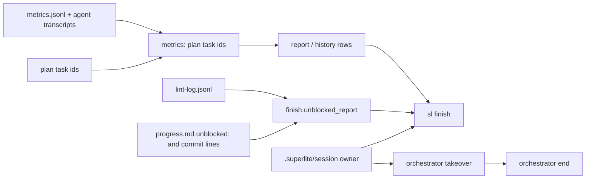
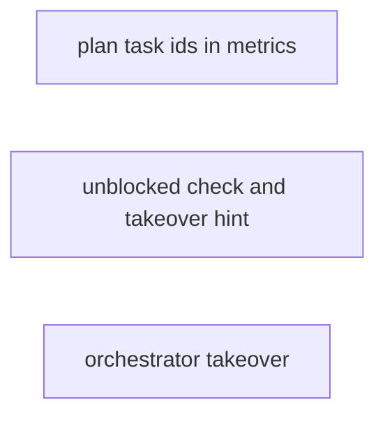

# Superlite: build report counts every plan task id, unblocked check names its evidence, orchestrator takeover (B60)

**Goal:** fix #375 (fleet and resumed builds report `agent cost USD 0.00 (-100%)`, `wall-clock n/a`, `history: 0 rows appended`, and an `unblocked: NO` line with a lag no task had) and #367 (`orchestrator end` refuses after a new session takes a run over). Max's decision for #367: a new `orchestrator takeover` command.
**Architecture:** `metrics` recognises the plan's own task ids (D1, P2, UI3a), not only `T<n>`, when it maps agents and handovers to tasks; `finish.unblocked_report` measures each task from the lint that offered it to the `unblocked:` line that names it and prints the lint and ledger times behind a NO; `orchestrator takeover` binds this session to a run folder another session owns.
**Tech stack:** Python 3.10+ stdlib, pytest (through `sl run_tests`).
**Spec:** this file, section Design; issues #367 and #375 and Max's decision.
**Detail:** tests
**Target-min:** 11
**Wave0:** none
**Max chars:** 22000

Global constraints:
- Every code line in `skills/subagent-driven-development/scripts/` carries the repo's trailing `# O(...)` complexity comment (short notes after `|`); tests do not. Stdlib only.
- Existing tests stay green and no existing test file changes (another lead may own them). If an existing test turns red, report it in DONE_WITH_CONCERNS with the test id and the reason instead of editing it.
- Run `sl` as an executable (`<abs>/sl ...`). Verify with `<abs>/sl run_tests --fast <your test file> <the existing files your Steps name> --task Tn --background`, then run the printed `wait:` line in the foreground and end the turn only after it reports.
- No version edits (the ship step bumps the version). Touch only the files in Owns.

Ruling: B60 also edits metrics.py and docs/tools.md (the brief lists finish.py and orchestrator.py): both empty reports come from `metrics.TID` matching only `T<n>` (the runs used D0, D1, F1, P1 ids; with plan ids the preview-fixtures run reads $7.72 and 35.2 min instead of $0.00 and n/a); no open batch owns either file (B59 owns agents/*.md) - cost if wrong: a rebase at ship.
Ruling: the unblocked rule stays: a task one lint offered (`pending`) that the next lint still lists, with no `unblocked:` line naming it by then, was held. The issue's D1 F1 run was offered at the 14:04:18 lint and its first implementer started 14:26:39, so that NO was right; the false parts were the lag (counted from first stable, so I1's wait on its dependencies read 3273 s) and committed tasks with no `unblocked:` line counted as never dispatched. The NO line now names the lint times and the `unblocked:` time - cost if wrong: Max wanted any logged task to pass; one rule in finish.
Ruling: "a resumed run keeps the first lead's rows": the build-300 report counted all 28 agents, so the rows were in metrics.jsonl; they mapped to no task for the same id reason (D0, P1). No run-merge code - cost if wrong: a resumed run that lost its metrics.jsonl stays empty.
Ruling: Max's decision for #367: `sl orchestrator takeover [--plan P]` binds this session to the run folder by force; `end` and the ownership refusals name it; `bind --force` stays as it is - cost if wrong: none.
Ruling: detail tests; no probe adapter (scripts with unit tests; Review Focus cases run as named pytest cases) - cost if wrong: no generated probes.
Ruling: already in the lead worktree on branch superlite/b60-finish-report-and-handoff - cost if wrong: none.
LAYERS: unit

## Design

1. **metrics: plan task ids.** `metrics.T_ID = r"T\d+[a-z]?"`. `metrics.id_re(known=None)` compiles `\b(<T_ID>|<each id in known that T_ID does not already match, re.escape'd, longest first>)\b`; group 1 is the whole id. `metrics.TID = id_re()` (group 1 is now `T3`, not `3`). `handover(text, tid=TID)` uses `tid` and returns whole ids (no `"T" +`). `transcript_segments(path, tasks_hint, tid=TID)` passes `tid` to `handover`. `agent_records(sl_dir, known=None)` builds `tid = id_re(known)` and uses it for the launch-description hint. `task_records` loads the plan before `agent_records` and passes `{t.id for t in plan.tasks}`; without a plan nothing changes. Ids outside the plan (`W3`, `UTF8`) are never task ids, `T<n>` ids always are (T0 is no plan task). The module docstring names plan ids.
2. **finish: unblocked check.** `unblocked_report(ledger, lint_log)` keeps its signature and its first line for a missing or empty lint log.
   - Lints: the lint-log entries in file order, each `(time, pending)`.
   - Sent: every `unblocked: dispatched <ids> at HH:MM:SS` ledger line (the `UNBLOCKED` regex) in ledger order; its clock is read forward from the first lint's time: `at = datetime.combine(prev.date(), clock)`, plus one day when `at < prev - 12 h`; then `prev = max(prev, at)`. `sent_at[t]` is the first such time naming `t`. Committed: tasks with a ledger `- commit Tn <sha>` line (`COMMIT`).
   - Offered: `offered[t]` is the time of the first lint whose `pending` holds `t`.
   - Held: for each consecutive lint pair `(a, b)` and each `t` in both `pending` lists, in `a`'s order, unless `sent_at[t] <= b.time + 1 s`; a task is recorded once, at its first such pair, as `(offered[t], b.time, sent_at.get(t))`.
   - Lag: for each `t` in both `sent_at` and `offered`, `max(0, sent_at[t] - offered[t])` seconds; `worst` = `max lag Ns`, else `max lag n/a (no \`unblocked:\` lines)` when the ledger has none, else `max lag n/a (no logged task was offered by a lint)`.
   - Never dispatched: tasks in the last lint's `pending` with no `sent_at` and no commit.
   - Output, one line: held tasks grouped by equal `(offered, next lint, sent)` in first-seen order, at most 3 groups then `, +N more`: `unblocked: NO - D1 F1 still waiting at the next lint (offered 14:04:18, next lint 14:10:02, sent 14:26:29), H3 (offered ..., next lint ..., no unblocked: line names it); max lag 1331s` (the phrase `still waiting at the next lint` after the first group only). Else never-dispatched ids: `unblocked: NO - never dispatched: T2 (pending at the last lint 10:00:05; no unblocked: line or commit names them); <worst>`. Else unchanged: `unblocked: yes - every stable task was dispatched before the next patch; <worst>`. Clock texts are `HH:MM:SS`.
3. **finish: takeover hint.** In `summary`, right after the `after finishing: ...` line: when `state.live_owner(<run folder>)` (run folder = the ledger's resolved parent) names another session, add `this run belongs to session <id>: run \`sl orchestrator takeover --plan <run folder>\` before \`sl orchestrator end\``. Any error there adds nothing (finish never fails over it).
4. **orchestrator takeover.** `orchestrator.py takeover [--plan P]`:
   - Without `--plan`: the folder as `end` finds it (`state.resolve(None, strict=False)`), with the same #199 refusal when it lies outside the cwd's worktree, its wording ending `not taken over; pass --plan ...`. With `--plan`: a missing path exits 2 with `orchestrator: plan not found: P`; else `sl_dir(P)`.
   - The folder must exist, else exit 2 `orchestrator: no run folder <sd>; nothing to take over`. No session id: exit 2 with `NO_SESSION`.
   - `old = state.owner(sd)`, then `state.bind(sd, force=True)`; a `None` return exits 2 (`NO_SESSION`). Prints `orchestrator: run <sd> taken over from session <old>; this session owns it now` when `old` was another session, else `orchestrator: session bound to <sd>; no other session owned it`. Exit 0. After it, `end` and `set` in this session act on that folder.
   - `end`'s refusal becomes `orchestrator: <sd> belongs to session <other>; not ended; take the run over first: sl orchestrator takeover --plan <sd>` (exit 2). `set`, `approve` and `bind` print, on `state.Owned`, `orchestrator: <sd> belongs to session <other>; pass --plan with your own worktree's plan, or take the run over: sl orchestrator takeover --plan <sd>` (exit 2), `<other>` from `state.live_owner(sd)` or, if that is None, `state.owner(sd)`.
   - The docstring and the docs/tools.md `orchestrator` row name `takeover`.

## Coverage

| Category | State | Basis |
|---|---|---|
| Scope and success criteria | settled | #375 Expected lines, #367 Expected line, Max's decision |
| Domain and data model | settled | lint-log entries, ledger lines, metrics.jsonl unchanged |
| Persistence and migration | n/a | no stored format changes |
| Interfaces and contracts | ruled | `handover`, `transcript_segments`, `agent_records` gain optional parameters; `TID` group 1 is the whole id |
| UI states | n/a | CLI text only |
| Concurrency and state ownership | ruled | takeover is an explicit force bind; the old session's binding file stays |
| Error handling and recovery | settled | takeover refusals exit 2; finish never fails over the hint |
| Security and privacy | n/a | local files only |
| Performance and limits | settled | one more regex per transcript line; O(L*n) unchanged in finish |
| Observability | settled | NO lines name their evidence |
| Testing strategy | settled | three new unit test files; unit layer by the coordinator |
| Compatibility | ruled | T-id plans map as before; existing unblocked texts keep their prefixes |
| Rollout | ruled | one PR; version bump at ship |
| Research unknowns | n/a | reproduced on the maxOS run backups |

## File structure
- `skills/subagent-driven-development/scripts/metrics.py`: plan task ids (T1).
- `tests/scripts/test_metrics_plan_ids.py`: T1's cases.
- `skills/subagent-driven-development/scripts/finish.py`: unblocked check and takeover hint (T2).
- `tests/scripts/test_finish_unblocked_375.py`: T2's cases.
- `skills/subagent-driven-development/scripts/orchestrator.py`: `takeover` and the refusal texts (T3).
- `docs/tools.md`: the `orchestrator` row (T3).
- `tests/scripts/test_orchestrator_takeover.py`: T3's cases.

## Task graph

```mermaid
%% schedule
gantt
  title Predicted schedule (mm:ss)
  dateFormat X
  axisFormat %M:%S
  section lane 1
  T1 plan task ids in metrics :t1, 0, 72s
  section lane 2
  T2 unblocked check and takeover hint in :t2, 0, 72s
  section lane 3
  T3 orchestrator takeover :t3, 0, 67s
```

critical path: T1 (1.2 min) · peak width 3 · predicted build 1.2 min · predicted total ≈ 4.7 min (target ✓)

## Package: build report (library over run files)
App type: data pipeline. Categories: numeric, encoding, state, deep. Specific risks: a worker id or acronym read as a task id, clock texts across midnight, a task counted held although its `unblocked:` line came first.
**Probe entry:** none (Ruling: no probe adapter).

### T1 plan task ids in metrics · Complexity 4 · Est. context 52k
**Owns:** skills/subagent-driven-development/scripts/metrics.py, tests/scripts/test_metrics_plan_ids.py
**Components:** 1
**LOC owned:** 150
**Tests:** fast
**Model:** sonnet
**Est. time:** 2.5 min (1 component, about 150 LOC, fast tests)
**Covers:** 1
**Consumes:** existing `plan_tools.Plan.load(path)` · existing `history.run_rows(plan_path, sl_dir)`
**Produces:** metrics.id_re(known=None) -> re.Pattern · metrics.handover(text, tid=TID) -> list | None
e.g. handover("\n<pasted_content id=\"fe26\">\n# Task F1\nPLAN=/x/p.md", id_re({"D1", "F1"})) -> ["F1"]
e.g. handover("# Task F1", TID) -> None
e.g. handover("Tasks P1 P2 (after D0)", id_re({"P1", "P2", "D0"})) -> ["P1", "P2"]
**Review Focus:**
Fixture: a plan file with tasks `D0`, `D1`, `F1`, `P1` in the shape of the plans in `tests/scripts/test_metrics_history.py` (copy its helpers, do not import that file); transcripts as JSONL with `type` `user`/`assistant`, `timestamp`, and assistant `message` `{id, model: "claude-sonnet-4-5", usage: {input_tokens, output_tokens, cache_read_input_tokens}, content}`.
encoding: `test_id_re_plan_ids` (`id_re({"D1", "UI3a"}).findall("D1 and UI3a then T4, not W3 or UTF8") == ["D1", "UI3a", "T4"]`; `id_re().findall("D1 T4 T12b") == ["T4", "T12b"]`);
encoding: `test_handover_plan_ids` (the three `e.g.` cases; `handover("W3: next one", id_re({"D1"})) is None`; `handover("Task T2", id_re({"D1"})) == ["T2"]`; `handover("T4's tests then Task T5") == ["T5"]` unchanged);
state: `test_fleet_workers_other_accounts` (metrics.jsonl: `launch` W5 and W6, type `fleet:superlite:implementer`, model `sonnet`, desc `fleet worker claude2 pane wB2:p1`; `stop` records whose `transcript` paths sit in two different account folders, `tmp/acct1/projects/p/w5.jsonl` and `tmp/acct2/projects/p/w6.jsonl`; each transcript: user `Read /x/.superlite/prime.md, then reply READY`, an assistant reply, user `\n<pasted_content id="fe26">\n# Task F1\n...` (W6: `D1`), two assistant messages 60 s apart with usage, the last text `Status: DONE`) -> `task_records(sl, plan)` has rows `D1` and `F1`, each `cost_usd > 0` and `duration_s >= 60`, and no row `W5` or `W6`);
state: `test_resumed_run_keeps_first_lead_rows` (a first lead's in-process agent `a1`, type `superlite:implementer`, desc `D0 Theme tokens`, transcript `tmp/projA/sessA/subagents/agent-a1.jsonl` with no task heading, plus fleet worker W1 handed `# Task P1` in `tmp/acct2/...`) -> rows `D0` and `P1`, both `cost_usd > 0`; `len(history.run_rows(plan, sl)) == 2`;
state: `test_no_plan_keeps_t_ids` (same W5 run without a plan: `task_records(sl)` has no `F1` row; a run whose transcript hands over `Task T2` gives row `T2` with or without the plan).
**Steps:** 1 failing tests, 2 run: FAIL, 3 implement Design 1, 4 run: PASS (own file plus tests/scripts/test_metrics_attribution.py tests/scripts/test_metrics_handback.py tests/scripts/test_metrics_history.py tests/scripts/test_metrics_sidecar.py tests/scripts/test_metrics_fable.py).

### T2 unblocked check and takeover hint in finish · Complexity 4 · Est. context 44k
**Owns:** skills/subagent-driven-development/scripts/finish.py, tests/scripts/test_finish_unblocked_375.py
**Components:** 1
**LOC owned:** 150
**Tests:** fast
**Model:** sonnet
**Est. time:** 2.5 min (1 component, about 150 LOC, fast tests)
**Covers:** 2, 3
**Consumes:** existing `state.live_owner(sd)` · existing `finish.read_ledger(path)`
**Produces:** finish.unblocked_report(ledger, lint_log) -> str
e.g. lints 10:00:05 pending [T4], 10:03:30 pending [T4], empty ledger -> "unblocked: NO - T4 still waiting at the next lint (offered 10:00:05, next lint 10:03:30, no unblocked: line names it); max lag n/a (no `unblocked:` lines)"
**Review Focus:**
Fixture: `entry(when, pending, newly=None)` -> `{"time": when, "stable": 1, "fix": 0, "stable_ids": pending, "newly_stable": newly or pending, "dispatched": [], "pending": pending}`; lint log lines and ledger lines written to tmp files; dates 2026-11-09 unless named.
numeric: `test_lag_from_offering_lint` (lint 10:00:05 pending [T1], newly [T1, T2]; ledger `- unblocked: dispatched T1 at 10:00:12; waiting on fixes: none`, `- commit T1 abc1234 one`, `- unblocked: dispatched T2 at 10:30:09; waiting on fixes: none`; lint 10:30:00 pending [T2], newly [] -> `"unblocked: yes - every stable task was dispatched before the next patch; max lag 9s"`);
state: `test_held_names_evidence` (lints 14:04:18 pending [D1, F1] and 14:10:02 pending [D1, F1, H1]; ledger `- unblocked: dispatched D1 F1 at 14:26:29; waiting on fixes: none`, `- unblocked: dispatched H1 at 14:26:30; waiting on fixes: none` -> `"unblocked: NO - D1 F1 still waiting at the next lint (offered 14:04:18, next lint 14:10:02, sent 14:26:29); max lag 1331s"`);
state: `test_held_never_logged` (the `e.g.` case, exact string);
state: `test_logged_before_next_lint_satisfies` (lints 10:00:05 and 10:05:00 both pending [T1]; ledger `- unblocked: dispatched T1 at 10:00:40` -> `"unblocked: yes - every stable task was dispatched before the next patch; max lag 35s"`);
state: `test_commit_counts_as_dispatched` (lint 10:00:05 pending [T1]; ledger `- commit T1 abcdef1 x` -> `"unblocked: yes - every stable task was dispatched before the next patch; max lag n/a (no `unblocked:` lines)"`);
state: `test_never_dispatched` (lint 10:00:05 pending [T2]; empty ledger -> `"unblocked: NO - never dispatched: T2 (pending at the last lint 10:00:05; no unblocked: line or commit names them); max lag n/a (no `unblocked:` lines)"`);
numeric: `test_clock_forward_over_midnight` (lint 2026-11-08T23:50:00 pending [T1]; ledger `- unblocked: dispatched T1 at 00:05:00` -> ends `max lag 900s`; lint 14:04:18 pending [T1] with ledger `... T1 at 13:59:00` -> ends `max lag 0s`);
state: `test_more_than_three_groups` (lints 10:00:00 [A1], 10:01:00 [A1, B1], 10:02:00 [B1, C1], 10:03:00 [C1, D1], 10:04:00 [D1]; empty ledger -> starts `"unblocked: NO - A1 still waiting at the next lint (offered 10:00:00, next lint 10:01:00, no unblocked: line names it), B1 (offered 10:01:00, next lint 10:02:00, "` and contains `"), +1 more; max lag n/a"`);
state: `test_takeover_hint` (`SUPERLITE_HOME` in tmp, a run folder whose `session` file names session `bbbbbbbb-0000-4000-8000-000000000002` and that session's binding file pointing at the folder, as tests/scripts/test_orchestrator.py sets them; this session `aaaaaaaa-0000-4000-8000-000000000001`) -> `finish.summary(...)` holds `this run belongs to session bbbbbbbb-0000-4000-8000-000000000002: run \`sl orchestrator takeover --plan <folder>\` before \`sl orchestrator end\``; with no `session` file the text has no `belongs to session`).
**Steps:** 1 failing tests, 2 run: FAIL, 3 implement Design 2 and 3, 4 run: PASS (own file plus tests/scripts/test_run_scripts.py tests/scripts/test_lint_dispatch_now.py tests/scripts/test_finish_closeout.py tests/scripts/test_finish_held.py tests/scripts/test_finish_stop_rule.py).

## Package: run ownership (CLI)
App type: CLI. Categories: protocol, state, file. Specific risks: taking over another worktree's run without `--plan`, a takeover of a path that does not exist, the old owner's binding left pointing at the folder.
**Probe entry:** none (Ruling: no probe adapter).

### T3 orchestrator takeover · Complexity 3 · Est. context 37k
**Owns:** skills/subagent-driven-development/scripts/orchestrator.py, docs/tools.md, tests/scripts/test_orchestrator_takeover.py
**Components:** 1
**LOC owned:** 100
**Tests:** fast
**Model:** sonnet
**Est. time:** 2.0 min (1 component, about 100 LOC, fast tests)
**Covers:** 4
**Consumes:** existing `state.bind(sd, sid=None, force=False)` · existing `state.owner(sd)` · existing `state.live_owner(sd)`
**Produces:** CLI `orchestrator.py takeover [--plan P]` -> exit 0 and one stdout line, or exit 2 and one stderr line
**Review Focus:**
Fixture: as tests/scripts/test_orchestrator.py and tests/scripts/test_session_handover.py run the CLI (env `SUPERLITE_HOME` in tmp, `CLAUDE_CODE_SESSION_ID` per session; copy their helpers, do not import them). Session A = `aaaaaaaa-0000-4000-8000-000000000001`, B = `bbbbbbbb-0000-4000-8000-000000000002`.
state: `test_takeover_then_end` (A runs `set ai --plan <repo>/.superlite` and writes `stable.json`; B's `end --plan <sd>` exits 2 with stderr `orchestrator: <sd> belongs to session A; not ended; take the run over first: sl orchestrator takeover --plan <sd>`; B's `takeover --plan <sd>` exits 0, stdout `orchestrator: run <sd> taken over from session A; this session owns it now`, `<sd>/session` reads B; B's `end --plan <sd>` exits 0 and moves `stable.json` into `<sd>/runs/`);
state: `test_takeover_unowned` (an existing folder with no `session` file: exit 0, stdout `orchestrator: session bound to <sd>; no other session owned it`);
protocol: `test_set_refusal_names_takeover` (A owns the folder; B's `set ai --plan <sd>` exits 2 and stderr holds `belongs to session` and `sl orchestrator takeover --plan <sd>`);
file: `test_takeover_missing_plan` (`takeover --plan <tmp>/gone/plan.md`: exit 2, stderr `orchestrator: plan not found: <that path>`);
state: `test_takeover_no_session` (no `CLAUDE_CODE_SESSION_ID` or `SUPERLITE_SESSION_ID`: exit 2, stderr is `NO_SESSION`'s text);
state: `test_takeover_foreign_worktree_without_plan` (cwd in a linked worktree, `SUPERLITE_STATE_DIR` naming the main checkout's `.superlite`; `takeover` without `--plan` exits 2, stderr holds `not taken over; pass --plan`; build the worktree as tests/scripts/test_orchestrator_worktree_guard.py does);
encoding: `test_tools_doc_names_takeover` (`docs/tools.md`'s line starting `| \`orchestrator\`` contains `takeover`).
**Steps:** 1 failing tests, 2 run: FAIL, 3 implement Design 4, 4 run: PASS (own file plus tests/scripts/test_orchestrator.py tests/scripts/test_orchestrator_worktree_guard.py tests/scripts/test_orchestrator_end_summaries.py tests/scripts/test_session_handover.py tests/scripts/test_session_state.py).

## Review Focus
Package build report: numeric (lags, clocks across midnight), encoding (task-id boundaries, worker ids, acronyms), state (held vs sent vs committed), deep (batches and polls in transcripts). Cases sit in T1 and T2.
Package run ownership: protocol (subcommand, refusal texts), state (owner file and bindings), file (missing paths, foreign worktrees). Cases sit in T3.

## Self-review
- #375 cost and wall-clock for fleet workers, other accounts: Design 1; `test_fleet_workers_other_accounts`. Resumed run rows: `test_resumed_run_keeps_first_lead_rows` and the Ruling. Unblocked check: Design 2, `test_held_names_evidence`, `test_lag_from_offering_lint`, `test_commit_counts_as_dispatched`.
- #367 takeover: Design 3 and 4; `test_takeover_then_end`, `test_takeover_hint`.
- No placeholders; three tasks, no shared files, no edges.
