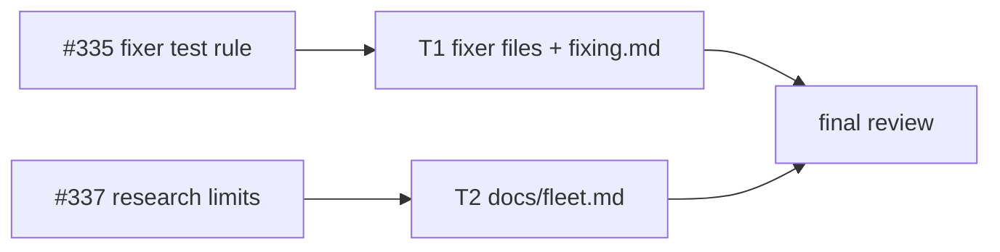
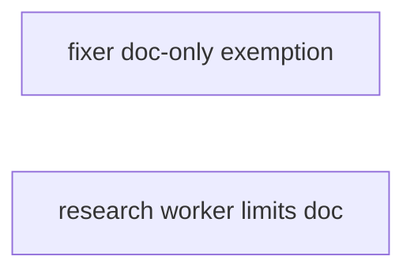

# Superlite: fixers exempt doc-only findings from the regression-test rule; docs/fleet.md states the research worker's limits (B43)

**Goal:** fix #335 (the fixer contract "one regression test per fix" forces a vacuous test for a doc- or comment-only finding) and #337 (the fleet research role has no Write tool and a 300-word reply cap, and docs/fleet.md does not say so).
**Architecture:** text only. T1 edits the three fixer agent files and fixing.md's fixer contract so a doc- or comment-only finding needs no regression test, a check counts only when it fails without the fix, and the report line names the exemption. T2 edits docs/fleet.md: the research row names the missing Write tool and the `--tier` model pin, and a new paragraph names the 300-word cap, where the reply lands, the split rule and the research path.
**Tech stack:** Markdown, pytest (through `sl run_tests`).
**Spec:** this file, section Design; issue #335 and #337 Expected lines and Max's decision (#337: document the cap and the missing Write tool).
**Detail:** tests
**Target-min:** 11
**Wave0:** none
**Coverage:** off

Global constraints:
- Replace text exactly as the task's `Text (verbatim)` block gives it: same backticks, quotes and punctuation, one line per bullet, no line wrapping. Change no other line of the file.
- Existing tests stay green. An existing test file never changes. If another existing test turns red, report it in DONE_WITH_CONCERNS with the test id and the reason instead of editing it.
- Run `sl` as an executable (`<abs>/sl ...`). Verify with `<abs>/sl run_tests --fast <own test file> --task Tn --background`, then run the printed `wait:` line in the foreground and end the turn only after it reports.
- No version edits (the ship step bumps the version). Never run `scripts/test_layers.py run`, `scripts/evals.sh` or `claude plugin eval` (the coordinator runs the layers).

## Design

Issue #335, expected: fixer briefs exempt doc-only and comment-only findings from the regression-test rule, or name what counts as a check. Both: the exemption, and the rule that a check counts only when it fails without the fix.
Issue #337, expected (Max chose the first option): docs/fleet.md states the cap and the missing Write tool.

Ruling: one exemption sentence, identical in all three fixer files, on the existing `- For each finding:` line; the report format gains `FIXED - <finding> - no test: doc-only` - cost if wrong: a fixer may skip a test for prompt wording that a repo pins with doc-text tests (the sentence names that case as a check that does fail).
Ruling: the fixer files say the exemption holds "also when the brief says \"one regression test each\"", because findings.py's fix brief (line 124, outside B43's files) still says that; follow-up issue for findings.py and agents/package-reviewer.md - cost if wrong: one more sentence to drop later.
Ruling: docs/fleet.md also names the research path in detail (brief file, spawn, send, `fleet wait Wn`, report `.md`, PLAN before a plan exists), the B28 follow-up, since it belongs to the same paragraph - cost if wrong: one sentence.
Ruling: agents/researcher.md stays unchanged (outside B43's files, Max chose documentation); the new T2 test reads its `at most 300 words` so the doc and the agent file cannot drift apart unnoticed.
Ruling: each task adds one new test file under tests/scripts/ (a new file no other lead owns); the plan file is the batch's other new file.
Ruling: detail tests; no Wave 0 (the project builds); no probe adapter (text only, no runnable entry); already in the lead worktree, so no `sl worktree ensure`.
LAYERS: unit, headless, evals



## File structure

- agents/fixer-sonnet.md, agents/fixer-sonnet-high.md, agents/fixer-opus.md: fixer prompts; the doc-only exemption and report line (T1).
- skills/subagent-driven-development/fixing.md: fixer contract bullet (T1).
- tests/scripts/test_fixer_doc_only_b43.py: pins T1's text (T1).
- docs/fleet.md: research row and research limits paragraph (T2).
- tests/scripts/test_fleet_research_docs_b43.py: pins T2's text (T2).

## Task graph

```mermaid
%% schedule
gantt
  title Predicted schedule (mm:ss)
  dateFormat X
  axisFormat %M:%S
  section lane 1
  T1 fixer doc-only exemption :t1, 0, 75s
  section lane 2
  T2 research worker limits doc :t2, 0, 59s
```





critical path: T1 (1.3 min) · peak width 2 · predicted build 1.3 min · predicted total ≈ 4.8 min (target ✓)

## Predicted schedule

## Fixer prompts

App type: docs (prompt text). Categories: none apply (no code path); the risk is wording drift between the three fixer files, which T1's test pins.

### T1 fixer doc-only exemption · Complexity 2 (O-1) · Est. context 30k
**Owns:** agents/fixer-sonnet.md, agents/fixer-sonnet-high.md, agents/fixer-opus.md, skills/subagent-driven-development/fixing.md, tests/scripts/test_fixer_doc_only_b43.py
**Components:** 2
**LOC owned:** 45
**Tests:** fast
**Kind:** mechanical
**Model:** haiku
**Est. time:** 2 min (2 components, about 45 LOC, fast tests)
**Consumes:** none
**Produces:** none
**Covers:** Design
**Review Focus:** `test_fixer_rule_lines_match`: the `- For each finding:` line is byte-identical in all three fixer files.
**Text (verbatim):** in each of the three fixer files, replace the line
````text
- For each finding: read the code, make the fix, add one regression test that fails without it.
````
with
````text
- For each finding: read the code, make the fix, add one regression test that fails without it. A doc- or comment-only finding (the fix changes only docs, comments or prompt wording, no code a test runs) is exempt, also when the brief says "one regression test each": add a check only when one fails without the fix (for example a test that reads that file's text, where the repo already has such tests), never a test that passes either way; else its report line ends `- no test: doc-only`.
````
In the same three files, in the `Report,` line, replace `` `FIXED - <finding>` or `NOT_FIXED - <finding> - <reason>` `` with `` `FIXED - <finding>`, `FIXED - <finding> - no test: doc-only` or `NOT_FIXED - <finding> - <reason>` ``.
In skills/subagent-driven-development/fixing.md, in the `- **Fixer contract:**` line, replace `one regression test per fix;` with:
````text
one regression test per fix that fails without it, except a doc- or comment-only fix (docs, comments or prompt wording, no code a test runs): it gets a check only when one fails without the fix, never a test that passes either way, and its report line ends `no test: doc-only`;
````
**Test code (verbatim):** tests/scripts/test_fixer_doc_only_b43.py
```python
"""Fixers exempt doc- and comment-only findings from the regression-test rule (#335)."""
from __future__ import annotations

from pathlib import Path

ROOT = Path(__file__).resolve().parents[2]
FIXERS = ["agents/fixer-sonnet.md", "agents/fixer-sonnet-high.md", "agents/fixer-opus.md"]
EXEMPT = ("A doc- or comment-only finding (the fix changes only docs, comments or prompt wording, no code a test runs) "
          "is exempt, also when the brief says \"one regression test each\": add a check only when one fails without "
          "the fix (for example a test that reads that file's text, where the repo already has such tests), never a "
          "test that passes either way; else its report line ends `- no test: doc-only`.")
RULE = "- For each finding: read the code, make the fix, add one regression test that fails without it. " + EXEMPT
REPORT = "`FIXED - <finding>`, `FIXED - <finding> - no test: doc-only` or `NOT_FIXED - <finding> - <reason>`"


def read(rel):
    return (ROOT / rel).read_text(encoding="utf-8")


def test_fixers_exempt_doc_only_findings():
    for rel in FIXERS:
        lines = read(rel).splitlines()
        assert RULE in lines, rel
        assert sum(REPORT in ln for ln in lines if ln.startswith("Report,")) == 1, rel


def test_fixer_rule_lines_match():
    found = [[ln for ln in read(rel).splitlines() if ln.startswith("- For each finding:")] for rel in FIXERS]
    assert all(len(f) == 1 for f in found)
    assert found[0] == found[1] == found[2]


def test_fixing_contract_names_the_exemption():
    text = read("skills/subagent-driven-development/fixing.md")
    line = next(ln for ln in text.splitlines() if ln.startswith("- **Fixer contract:**"))
    for s in ("one regression test per fix that fails without it", "except a doc- or comment-only fix",
              "never a test that passes either way", "`no test: doc-only`;"):
        assert s in line, s
    assert "one regression test per fix;" not in line
```
**Steps:** 1 write the test file, 2 run: FAIL, 3 replace the text, 4 run: PASS (also run tests/scripts/test_fixer_commit_wording.py, tests/scripts/test_fixer_foreground_b26.py and tests/scripts/test_docs_b32_sdd.py: still green)
**Notes:** the fixer-opus `- For each finding:` line is identical to the other two before the change; keep it so.

**Probe entry:** none (text only)

## Fleet docs

App type: docs. Categories: none apply; the risk is the doc drifting from agents/researcher.md, which T2's test checks.

### T2 research worker limits doc · Complexity 2 (O-1) · Est. context 32k
**Owns:** docs/fleet.md, tests/scripts/test_fleet_research_docs_b43.py
**Components:** 1
**LOC owned:** 35
**Tests:** fast
**Kind:** mechanical
**Model:** haiku
**Est. time:** 1.5 min (1 component, about 35 LOC, fast tests)
**Consumes:** none
**Produces:** none
**Covers:** Design
**Review Focus:** `test_doc_cap_matches_the_agent_file`: the 300-word cap in docs/fleet.md equals the one in agents/researcher.md.
**Text (verbatim):** in docs/fleet.md, replace the research table row with
````text
| `research` | `superlite:researcher` (`agents/researcher.md`) | haiku, low (`--tier sonnet\|opus` pins another model); read-only (Read, Grep, Glob; no Write, Edit or shell) | none; one brief |
````
Then insert one blank line and this paragraph directly after the line that starts `The reviewers take no `--tier``:
````text
Research worker limits: the researcher has only Read, Grep and Glob (spawn also disallows Edit, Write, NotebookEdit and Bash), so it cannot write a report file or run `git`, and it answers in at most 300 words with `file:line` references. `fleet wait` saves that reply as `<sd>/fleet/reports/<label>.md` (the `.json` next to it): that file is the report. A brief that asks for a report file, or for more than 300 words, cannot be fulfilled: split it into one brief per question and one worker each. Research path: write the prompt to `<sd>/briefs/<name>.md`; `sl fleet spawn --role research --plan PLAN` prints `Wn`; `sl fleet send Wn --brief <sd>/briefs/<name>.md --plan PLAN`; `sl fleet wait Wn --plan PLAN` (Bash timeout 600000). PLAN is the plan file, or the state folder `.superlite` before a plan exists (a lead in brainstorming).
````
**Test code (verbatim):** tests/scripts/test_fleet_research_docs_b43.py
```python
"""docs/fleet.md states the research worker's limits: no Write tool, the 300-word cap, the research path (#337)."""
from __future__ import annotations

from pathlib import Path

ROOT = Path(__file__).resolve().parents[2]
FLEET = (ROOT / "docs" / "fleet.md").read_text(encoding="utf-8")


def line_starting(prefix):
    found = [ln for ln in FLEET.splitlines() if ln.startswith(prefix)]
    assert len(found) == 1, prefix
    return found[0]


def test_research_row_names_missing_write_and_model_pin():
    row = line_starting("| `research` |")
    for s in ("read-only (Read, Grep, Glob; no Write, Edit or shell)", "(`--tier sonnet\\|opus` pins another model)"):
        assert s in row, s


def test_research_limits_paragraph():
    para = line_starting("Research worker limits:")
    for s in ("cannot write a report file", "at most 300 words", "`<sd>/fleet/reports/<label>.md`",
              "one brief per question and one worker each", "`<sd>/briefs/<name>.md`",
              "`sl fleet spawn --role research --plan PLAN`", "`sl fleet send Wn --brief", "`sl fleet wait Wn --plan PLAN`",
              "Bash timeout 600000", "before a plan exists"):
        assert s in para, s


def test_doc_cap_matches_the_agent_file():
    agent = (ROOT / "agents" / "researcher.md").read_text(encoding="utf-8")
    assert "at most 300 words" in agent
    assert "at most 300 words" in line_starting("Research worker limits:")
```
**Steps:** 1 write the test file, 2 run: FAIL, 3 replace and insert the text, 4 run: PASS (also run tests/scripts/test_fleet_roles_docs.py, tests/scripts/test_docs_b26.py and tests/scripts/test_backlog_user_docs.py: still green)
**Notes:** the table row keeps `\|` (an escaped pipe inside a table cell).

**Probe entry:** none (text only)

## Review Focus

- Docs (T1, T2): no runnable entry; the named tests above pin the text, the drift between the three fixer files, and the doc cap against agents/researcher.md.

## Self-review

Coverage: #335 -> T1, #337 -> T2. No placeholders. No Consumes or Produces. No edges; the two tasks share no file. Every task has Components, LOC owned, Tests and Model.
