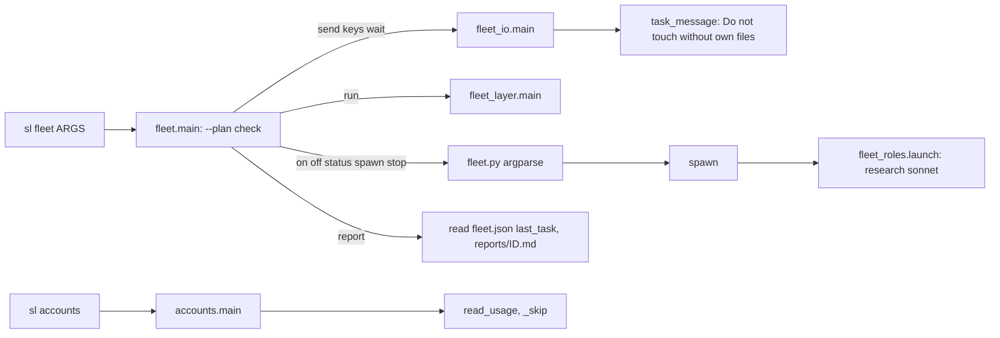
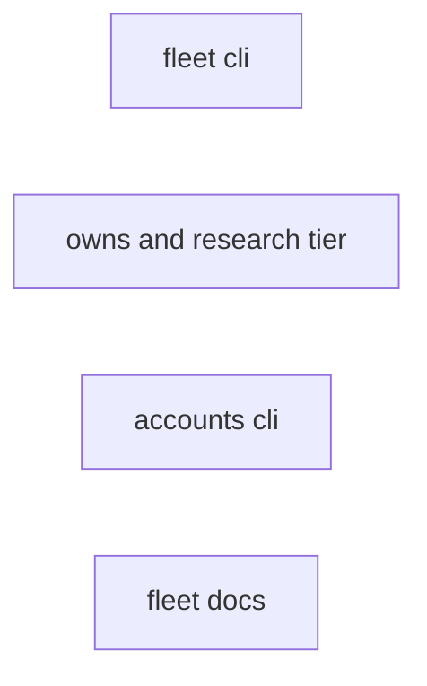

# Superlite: fleet CLI gaps and fleet docs: fleet report, --help, an unusable --plan, sl accounts, sonnet researchers, own files not under Do not touch (B54)

**Goal:** fix #364 (a task's own file listed under "Do not touch"), #372 (`fleet spawn --plan /dev/null` dies with a PermissionError), #374 (research workers default to sonnet; docs say what a researcher cannot reach), #376 (`fleet report Wn` prints a worker's report), #378 (docs: shared run root vs `run_tests --task` trees, the parallel-fixer rule), #387 (`sl fleet --help` lists every subcommand; `sl accounts` prints something).
**Architecture:** four independent tasks. T1 changes fleet.py's CLI (help, `report`, a `--plan` check before any subcommand). T2 changes one line each in fleet_io.task_message and fleet_roles.launch. T3 gives accounts.py a `main`. T4 edits docs/fleet.md with the exact text below.
**Tech stack:** Python 3 stdlib, pytest (through `sl run_tests`).
**Spec:** this file, section Design; the Expected lines of issues #364 #372 #374 #376 #378 #387; Max's decision for #374: default to sonnet.
**Detail:** tests
**Target-min:** 11
**Wave0:** none
**Coverage:** off

Global constraints:
- Python 3 stdlib only. In scripts, every new or changed code line ends with a `# O(...)` complexity comment like its neighbours; comments say why; no new module.
- Change only the files in your Owns line. An existing test changes only where your task says so. If another existing test turns red, report it in DONE_WITH_CONCERNS with the test id and the reason instead of editing it.
- Run `sl` as an executable (`<abs>/sl ...`). Verify with `<abs>/sl run_tests --fast <your test files> --task Tn --background`, then run the printed `wait:` line in the foreground and end the turn only after it reports.
- No version edits. Never run `scripts/test_layers.py run`, `scripts/evals.sh` or `claude plugin eval`.

## Design

Root causes:
- #364: `fleet_io.task_message` builds `others` from every other task's Owns; a file that an earlier task (hard edge) and this task both own lands under "Do not touch". Fix: skip files in this message's own Owns and drop repeats, order kept.
- #372: `--plan /dev/null` maps to the state folder `/dev/.superlite`; the first write raises PermissionError. Fix: fleet.py checks an explicit `--plan` (both `--plan P` and `--plan=P`) before any subcommand, the delegated `send`, `keys`, `wait`, `run` included, and exits 2 with one `error:` line. Without `--plan` nothing changes: the run is the current directory's (state.resolve).
- #374: `fleet_roles.launch` pins no model for research, so the agent file's haiku wins. Fix: `pin = tier or "sonnet"`. agents/researcher.md keeps `model: haiku` (fleet off, in-process).
- #376: `fleet wait W5 W6` already waits for named workers; only reading a report back is missing. `fleet wait` saves `<sd>/fleet/reports/<id>.md` and remembers the label as the worker's `last_task` (kept when the worker is stopped). `fleet report` reads that, nothing else.
- #387: fleet.py delegates `send`, `keys`, `wait`, `run` before argparse, so its parser never names them. Fix: help-only subparsers. accounts.py has no `__main__`, so `sl accounts` runs nothing. Fix: a `main`.
- #378: docs only (T4). The `commit_task` repeat of `left uncommitted (claimed by Hn)` lives in commit_task.py, which batch B58 owns: not in this batch.

Ruling: B54 edits fleet_io.py, fleet_roles.py and accounts.py (outside the brief's two files; no running or planned batch owns them) and their tests - the fixes live there - cost if wrong: a rebase conflict at ship.
Ruling: #378's commit_task half is left to a follow-up issue (commit_task.py belongs to B58) - cost if wrong: the noise stays one more batch.
Ruling: `fleet report` exits 1 when any asked id printed nothing (busy, no report, unknown), 0 otherwise; several ids print `== <id> <path>` before each report, one id prints the bare text - cost if wrong: a caller parsing several reports splits on the header.
Ruling: an explicit `--plan` is refused when its path exists but is neither a file nor a folder, or when its state folder is missing and the nearest existing ancestor is not a writable folder - cost if wrong: a read-only `status` on such a path now exits 2 instead of printing `fleet: off`.
Ruling: parallel-fixer rule in docs: one fixer at a time per run root on a compiled stack (isolated trees); disjoint fixers may run at once on other stacks - cost if wrong: a pytest fix round sees a red test from a sibling's half-edit and reruns it.
Ruling: detail tests; no Wave 0 (the project builds); no probe adapter (named tests cover the Review Focus); already in the lead worktree, so no `sl worktree ensure`.
LAYERS: unit



## File structure

- skills/subagent-driven-development/scripts/fleet.py: help-only subparsers, `report`, `--plan` check (T1).
- tests/scripts/test_fleet_cli_b54.py: T1's tests (new).
- skills/subagent-driven-development/scripts/fleet_io.py, skills/subagent-driven-development/scripts/fleet_roles.py: one fix each (T2).
- tests/scripts/test_fleet_owns_research_b54.py (new), tests/scripts/test_fleet_roles.py (one assertion): T2's tests.
- skills/subagent-driven-development/scripts/accounts.py, tests/scripts/test_accounts_cli_b54.py (new): T3.
- docs/fleet.md, tests/scripts/test_fleet_docs_b54.py (new), tests/scripts/test_fleet_research_docs_b43.py (one assertion): T4.

## Task graph

```mermaid
%% schedule
gantt
  title Predicted schedule (mm:ss)
  dateFormat X
  axisFormat %M:%S
  section lane 1
  T1 fleet cli :t1, 0, 106s
  section lane 2
  T2 owns and research tier :t2, 0, 77s
  section lane 3
  T3 accounts cli :t3, 0, 61s
  section lane 4
  T4 fleet docs :t4, 0, 60s
```





critical path: T1 (1.8 min) · peak width 4 · predicted build 1.8 min · predicted total ≈ 5.3 min (target ✓)

## Predicted schedule

## Fleet CLI

App type: CLI. Categories: protocol (arguments, `--plan=P`), file (state folders that cannot be made), state (report reads only). Specific risk: the `--plan` check refusing a plan path that worked before (a not yet existing plan file in a writable folder).

### T1 fleet cli · Complexity 4 (O-1) · Est. context 44k
**Owns:** skills/subagent-driven-development/scripts/fleet.py, tests/scripts/test_fleet_cli_b54.py
**Components:** 3
**LOC owned:** 140
**Tests:** fast
**Model:** sonnet
**Produces:** fleet.main(argv: list[str] | None = None) -> int
**Review Focus:** `test_plan_that_is_no_file_or_folder_exits_2` (the `--plan=P` form too); `test_plan_whose_state_folder_cannot_be_created_exits_2` writes nothing; `test_report_busy_unknown_and_missing` changes no state.
**Steps:** 1 write the tests, 2 run: FAIL, 3 implement, 4 run: PASS
**Notes:**
- Help: add subparsers `report`, `send`, `keys`, `wait`, `run` next to the existing ones and give every subparser a one-line `help=` (on: turn fleet mode on; off: stop every worker and turn fleet mode off; status: list the workers; spawn: start a worker; stop: close workers; report: print a worker's last report; send: send tasks, a brief or text to a worker; keys: send keys to a worker's pane; wait: wait for busy workers to report; run: run a test layer in a shell pane). `send`, `keys`, `wait`, `run` stay delegated before parsing, so their parsers only feed `--help`. Keep `prog`.
- `--plan` check, first thing in `main`, before the delegation: the value of `--plan P` or `--plan=P` (a `--plan` with no value is left to argparse). Reason, or none: the path exists but is neither a file nor a folder -> `not a plan file or folder`; else `sd = state.plan_dir(P)` resolved; sd is a folder -> none; else the nearest existing ancestor of sd is not a writable folder (`os.access(d, os.W_OK)`) -> `cannot create <sd>`. A reason prints `error: --plan P: <reason>; pass the plan file or the run's .superlite folder, or leave --plan out to use the current directory's run` on stderr and returns 2. Nothing is created.
- `report IDS... [--plan P]`, read-only. Per id: a worker in fleet.json first, else a report label. Worker: state `busy` -> `error: Wn is busy on <task>; run sl fleet wait Wn first`; no `last_task` -> `error: Wn has no collected report; run sl fleet wait Wn first`; else label = `last_task`, id part = label up to the first comma. Label: id part = the argument; no file -> `error: unknown worker or report label X`. File: `<sd>/fleet/reports/<id part>.md`, else `.json`, else (worker) `error: Wn <label>: no report file in <reports dir>`. Errors go to stderr. More than one id asked: print `== <id> <path>` before each printed file. Print the file text, adding a final newline if missing. Return 1 when any id printed nothing, else 0.
- Update the module docstring: `report`, the `--plan` check.
**Test code (verbatim):**
```python
"""fleet.py CLI: --help lists every subcommand (#387), fleet report (#376), an unusable --plan exits 2 (#372)."""
import json, os, sys
import pytest
from test_plan_tools import SCRIPTS
sys.path.insert(0, str(SCRIPTS))
import fleet  # noqa: E402

SUBS = ("on", "off", "status", "spawn", "stop", "report", "send", "keys", "wait", "run")
HINT = "; pass the plan file or the run's .superlite folder, or leave --plan out to use the current directory's run"


def test_help_lists_every_subcommand(capsys):
    with pytest.raises(SystemExit) as e:
        fleet.main(["--help"])
    out = capsys.readouterr().out
    assert e.value.code == 0
    choices = next(x.strip() for x in out.splitlines() if x.strip().startswith("{"))
    assert set(choices.strip("{}").split(",")) == set(SUBS)
    for s in SUBS:
        assert any(x.split()[:1] == [s] and len(x.split()) > 1 for x in out.splitlines()), s


@pytest.fixture
def run(tmp_path):
    sd = (tmp_path / ".superlite").resolve(); (sd / "fleet" / "reports").mkdir(parents=True)
    (sd / "fleet.json").write_text(json.dumps({"on": True, "label": "sl:x", "workspace_id": None, "root_pane": None, "accounts": [], "next": 6,
        "workers": {"W1": {"state": "ready", "task": None, "last_task": "T3,T4"}, "W2": {"state": "busy", "task": "T5", "last_task": "T1"},
                    "W3": {"state": "stopped", "task": None, "last_task": "layer-headless"}, "W4": {"state": "ready", "task": None},
                    "W5": {"state": "stopped", "task": None, "last_task": "T9"}}}))
    (sd / "fleet" / "reports" / "T3.md").write_text("Status: DONE\nchanged src/c.py\n")
    (sd / "fleet" / "reports" / "FR1.md").write_text("Verdict: APPROVED")
    (sd / "fleet" / "reports" / "layer-headless.json").write_text('{"status": "GREEN"}\n')
    return sd


def test_report_prints_the_workers_last_report(run, capsys):
    before = (run / "fleet.json").read_text()
    assert fleet.main(["report", "W1", "--plan", str(run)]) == 0
    assert capsys.readouterr().out == "Status: DONE\nchanged src/c.py\n"
    assert (run / "fleet.json").read_text() == before


def test_report_by_label_and_json_fallback(run, capsys):
    assert fleet.main(["report", "FR1", "W3", "--plan", str(run)]) == 0
    r = run / "fleet" / "reports"
    assert capsys.readouterr().out == f"== FR1 {r / 'FR1.md'}\nVerdict: APPROVED\n== W3 {r / 'layer-headless.json'}\n{{\"status\": \"GREEN\"}}\n"


def test_report_busy_unknown_and_missing(run, capsys):
    assert fleet.main(["report", "W2", "W9", "W4", "W5", "W1", "--plan", str(run)]) == 1
    cap = capsys.readouterr()
    for s in ("error: W2 is busy on T5; run sl fleet wait W2 first", "error: unknown worker or report label W9",
              "error: W4 has no collected report; run sl fleet wait W4 first", f"error: W5 T9: no report file in {run / 'fleet' / 'reports'}"):
        assert s in cap.err, s
    assert cap.out == f"== W1 {run / 'fleet' / 'reports' / 'T3.md'}\nStatus: DONE\nchanged src/c.py\n"


@pytest.mark.parametrize("argv", [["spawn", "--role", "research", "--plan", "/dev/null"], ["on", "--plan", "/dev/null"],
                                  ["wait", "--plan=/dev/null"], ["report", "W1", "--plan", "/dev/null"], ["run", "--layer", "tui", "--plan", "/dev/null"]])
def test_plan_that_is_no_file_or_folder_exits_2(argv, capsys):
    assert fleet.main(argv) == 2
    assert capsys.readouterr().err == "error: --plan /dev/null: not a plan file or folder" + HINT + "\n"


@pytest.mark.skipif(getattr(os, "geteuid", lambda: 1)() == 0, reason="root writes everywhere")
def test_plan_whose_state_folder_cannot_be_created_exits_2(tmp_path, capsys):
    ro = tmp_path / "ro"; ro.mkdir(); ro.chmod(0o555)
    try:
        assert fleet.main(["on", "--plan", str(ro / "plan.md")]) == 2
    finally:
        ro.chmod(0o755)
    assert capsys.readouterr().err == f"error: --plan {ro / 'plan.md'}: cannot create {(ro / '.superlite').resolve()}" + HINT + "\n"
    assert not (ro / ".superlite").exists()


def test_new_plan_file_in_a_writable_folder_passes_the_check(tmp_path, capsys):
    assert fleet.main(["status", "--plan", str(tmp_path / "docs" / "new-plan.md")]) == 0
    assert capsys.readouterr().out == "fleet: off\n"


def test_spawn_without_plan_uses_the_current_directorys_run(tmp_path, monkeypatch, capsys):
    monkeypatch.delenv("SUPERLITE_STATE_DIR", raising=False)
    monkeypatch.setattr(fleet.state, "bound", lambda: None)
    monkeypatch.setattr(fleet.state, "session_id", lambda: "")
    monkeypatch.chdir(tmp_path)
    assert fleet.main(["spawn", "--role", "research"]) == 3
    assert capsys.readouterr().out.startswith(f"BLOCKED: fleet is off in {(tmp_path / '.superlite').resolve()}; run sl fleet on first")
```

## Fleet I/O and roles

App type: library. Categories: state (owned files across tasks). Specific risk: a batch message (`Tn,Tm`) still listing a member's file.

### T2 owns and research tier · Complexity 2 (O-1) · Est. context 30k
**Owns:** skills/subagent-driven-development/scripts/fleet_io.py, skills/subagent-driven-development/scripts/fleet_roles.py, tests/scripts/test_fleet_owns_research_b54.py, tests/scripts/test_fleet_roles.py
**Components:** 2
**LOC owned:** 35
**Tests:** fast
**Kind:** mechanical
**Model:** haiku
**Produces:** fleet_io.task_message(plan, tasks: list[str], sl_path: str, superlite_root: str, tier: str = "sonnet") -> str
**Review Focus:** `test_batch_owns_cover_every_member`: a batch lists no member's file under Do not touch.
**Steps:** 1 write the tests and edit the one assertion, 2 run: FAIL, 3 implement, 4 run: PASS
**Notes:**
- fleet_io.py `task_message`: compute `owns` before `others`; `others` = every other task's Owns that is not in `owns`, repeats dropped, first-seen order kept (`dict.fromkeys`).
- fleet_roles.py `launch`, research branch: `pin = tier or "sonnet"`.
- tests/scripts/test_fleet_roles.py `test_research_runs_the_read_only_researcher`: the first assert becomes `assert r["argv"] == ["--agent", "superlite:researcher", "--model", "sonnet", "--effort", "low"] + TAIL + ["Edit", "Write", "NotebookEdit", "Bash"] and r["model"] == "sonnet" and r["one_turn"]`. Nothing else in that file changes.
**Test code (verbatim):**
```python
"""Fleet task message: own files never under Do not touch (#364); research workers default to sonnet (#374)."""
import sys
from test_plan_tools import SCRIPTS, make_plan
sys.path.insert(0, str(SCRIPTS))
import fleet_io as io  # noqa: E402
import fleet_roles as fr  # noqa: E402
import routing  # noqa: E402


def test_own_files_never_in_do_not_touch(tmp_path):
    plan = make_plan(tmp_path, [{"id": "T1", "owns": "src/guard.py, tests/test_t1.py"}, {"id": "T2", "owns": "src/guard.py, tests/test_t2.py"},
                                {"id": "T3", "owns": "src/c.py, tests/test_t1.py"}], edges=[("T1", "T2")])
    lines = io.task_message(plan, ["T2"], "/sl/sl", "/sl").splitlines()
    assert "Owns: src/guard.py, tests/test_t2.py" in lines
    assert "Do not touch: tests/test_t1.py, src/c.py" in lines


def test_batch_owns_cover_every_member(tmp_path):
    plan = make_plan(tmp_path, [{"id": "T1", "owns": "src/a.py"}, {"id": "T2", "owns": "src/b.py, src/a.py"}, {"id": "T3", "owns": "src/a.py, src/b.py"}])
    assert "Do not touch: (nothing else is owned)" in io.task_message(plan, ["T1", "T2"], "/sl/sl", "/sl").splitlines()


def test_research_defaults_to_sonnet_and_takes_a_haiku_pin():
    r = fr.launch("research", None, routing.load_cfg())
    assert r["model"] == "sonnet" and r["argv"][:4] == ["--agent", "superlite:researcher", "--model", "sonnet"]
    h = fr.launch("research", "haiku", routing.load_cfg())
    assert h["model"] == "haiku" and h["argv"][:4] == ["--agent", "superlite:researcher", "--model", "haiku"]
```

## Accounts

App type: CLI. Categories: protocol (arguments), encoding (percent format). Specific risk: `sl accounts` still printing nothing because the `__main__` hook is missing.

### T3 accounts cli · Complexity 2 (O-1) · Est. context 30k
**Owns:** skills/subagent-driven-development/scripts/accounts.py, tests/scripts/test_accounts_cli_b54.py
**Components:** 1
**LOC owned:** 70
**Tests:** fast
**Kind:** mechanical
**Model:** haiku
**Produces:** accounts.main(argv: list[str] | None = None) -> int
**Review Focus:** `test_sl_accounts_runs_main`: the real `sl accounts` path prints lines.
**Steps:** 1 write the tests, 2 run: FAIL, 3 implement, 4 run: PASS
**Notes:**
- `main(argv=None)`: argparse with `prog="sl accounts"` and one option `--tier MODEL` (default None). `usage = read_usage()`; no `accounts` list in it -> stderr `accounts: no usage data from claude-profile usage --json` and `usage: sl accounts [--tier MODEL]`, return 3. Else one stdout line per account, report order: `_skip(a, tier)` gives a reason -> `<name> skip <reason>`; none -> `<name> ok 5h=<_five(a):g>% weekly=<_pct(a, "weekly_all"):g>%`. Return 0.
- Add `if __name__ == "__main__": sys.exit(main())`; import argparse and sys. Update the module docstring with the CLI line.
**Test code (verbatim):**
```python
"""sl accounts prints each claude-profile account with its headroom, or a usage line (#387)."""
import json, os, subprocess, sys
from test_plan_tools import SCRIPTS
sys.path.insert(0, str(SCRIPTS))
import accounts as ac  # noqa: E402

USAGE = {"accounts": [
    {"name": "claude1", "n": 1, "limits": [{"kind": "session", "percent": 12}, {"kind": "weekly_all", "percent": 40}]},
    {"name": "claude2", "n": 2, "limits": [{"kind": "session", "percent": 95}, {"kind": "weekly_all", "percent": 10}]},
    {"name": "claude3", "n": 3, "error": "token expired"},
    {"name": "claude4", "n": 4, "limits": [{"kind": "session", "percent": 5}, {"kind": "weekly_all", "percent": 20},
                                            {"kind": "weekly_scoped", "label": "Opus", "percent": 100}]}]}


def test_lines_per_account(monkeypatch, capsys):
    monkeypatch.setattr(ac, "read_usage", lambda env=None: USAGE)
    assert ac.main([]) == 0
    assert capsys.readouterr().out.splitlines() == ["claude1 ok 5h=12% weekly=40%", "claude2 skip 5-hour 95%",
                                                    "claude3 skip error token expired", "claude4 ok 5h=5% weekly=20%"]


def test_tier_adds_the_scoped_cap(monkeypatch, capsys):
    monkeypatch.setattr(ac, "read_usage", lambda env=None: USAGE)
    assert ac.main(["--tier", "opus"]) == 0
    assert capsys.readouterr().out.splitlines()[3] == "claude4 skip weekly_scoped Opus 100%"


def test_no_usage_data_prints_usage_and_exits_3(monkeypatch, capsys):
    monkeypatch.setattr(ac, "read_usage", lambda env=None: {})
    assert ac.main([]) == 3
    cap = capsys.readouterr()
    assert cap.out == ""
    assert "accounts: no usage data from claude-profile usage --json" in cap.err and "usage: sl accounts [--tier MODEL]" in cap.err


def test_sl_accounts_runs_main(tmp_path):
    fake = tmp_path / "claude-profile"
    fake.write_text("#!/bin/sh\nif [ \"$1\" = usage ]; then echo '" + json.dumps(USAGE) + "'; exit 0; fi\nexit 1\n")
    fake.chmod(0o755)
    r = subprocess.run([str(SCRIPTS / "sl"), "accounts"], capture_output=True, text=True, timeout=60,
                       env={**os.environ, "SUPERLITE_CLAUDE_PROFILE_BIN": str(fake)})
    assert r.returncode == 0 and r.stdout.splitlines()[0] == "claude1 ok 5h=12% weekly=40%"
```

## Fleet docs

App type: docs. Categories: none beyond text that matches T1-T3's lines (given verbatim here).

### T4 fleet docs · Complexity 2 (O-1) · Est. context 34k
**Owns:** docs/fleet.md, tests/scripts/test_fleet_docs_b54.py, tests/scripts/test_fleet_research_docs_b43.py
**Components:** 1
**LOC owned:** 50
**Tests:** fast
**Kind:** mechanical
**Model:** haiku
**Review Focus:** `test_research_row_defaults_to_sonnet`: the B43 row test still passes with its one changed string.
**Steps:** 1 write the test and edit the B43 string, 2 run: FAIL, 3 edit docs/fleet.md, 4 run: PASS
**Notes:** Edit docs/fleet.md exactly as the block below says (each OLD text occurs once; NEW replaces it; ADD inserts new lines); keep every other line. The block is raw text: no character in it is an escape.
```text
1) Roles table, `research` row
OLD: haiku, low (`--tier sonnet\|opus` pins another model);
NEW: sonnet, low (`--tier haiku\|opus` pins another model; with fleet off the in-process researcher keeps the agent file's haiku);

2) The line starting "Research worker limits:", its last sentence
OLD: PLAN is the plan file, or the state folder `.superlite` before a plan exists (a lead in brainstorming).
NEW: PLAN is the plan file, or the state folder `.superlite` before a plan exists (a lead in brainstorming); without `--plan` the run is the current directory's (`SUPERLITE_STATE_DIR` in a lead pane, else the worktree's or the current folder's `.superlite`). `sl fleet report Wn` prints the saved report again. The researcher cannot reach documentation tools (context7, Xcode DocumentationSearch or any other MCP server) or the web (WebFetch, WebSearch): an API or library lookup stays with the coordinator, which does it itself and puts the answer into the brief.

3) Capacity: ADD as the section's new last bullet
- `sl accounts [--tier MODEL]` shows the headroom spawn sees: one line per account of `claude-profile usage --json`, `claude1 ok 5h=12% weekly=40%` or `claude2 skip 5-hour 95%` (the reason spawn skips it; `--tier` adds that model's scoped weekly cap). Without usage data it prints `accounts: no usage data from claude-profile usage --json` and `usage: sl accounts [--tier MODEL]` on stderr and exits 3.

4) Commands, first line
OLD: Run as `"$SL" fleet ...`. All take `--plan PLAN` to find the run.
NEW: Run as `"$SL" fleet ...`; `fleet --help` lists every subcommand (on, off, status, spawn, stop, report, send, keys, wait, run). All take `--plan PLAN` to find the run; without it the run is the current directory's. A `--plan` that names no usable run exits 2 before anything runs: `error: --plan P: not a plan file or folder; pass the plan file or the run's .superlite folder, or leave --plan out to use the current directory's run` (`/dev/null`), or `error: --plan P: cannot create <dir>; ...` when its state folder cannot be created.

5) Commands: ADD right after the bullet that starts "- `fleet wait --any`"
- `fleet report Wn [Wm ...]` prints the report `fleet wait` saved for each worker's last collected label (`<sd>/fleet/reports/<id>.md`, a layer's `.json`); a report label (`T3`, `FR1`) works too. Several ids print a `== <id> <path>` line before each report. A busy worker (`error: Wn is busy on T3; run sl fleet wait Wn first`), a worker with no collected report or an unknown id prints an `error:` line on stderr and exits 1; the others still print. It only reads.

6) ADD right before the line "## Limits" (a section, then a blank line)
## Run root and task trees

- Every worker edits the shared run root: the checkout the run lives in (a lead's batch worktree), not a copy. `commit_task` commits from there.
- On a compiled stack (Swift, Go, Rust, C#, or `"isolate": true` in `.superlite/test-cmd.json`) `run_tests --task Tn` builds and tests in its own tree, `.superlite/trees/Tn`: the base commit plus the working-tree changes minus the files of unfinished sibling tasks (`--fast`), or plus Tn's own files only (`--full`). A task's test run there does not see another running task's files, and a file the task does not own is missing from its `--full` tree. Other stacks (pytest) test in the run root.
- Fixers run `run_tests --fast` without `--task`, in the run root. On a compiled stack two fixers at once break each other's builds with their half-edits: send one fixer at a time per run root, the next after the previous fixer's `commit_task`. On other stacks fixers with disjoint files may run at once; a test that turns red in another fixer's file is rerun after that fixer's commit.

7) tests/scripts/test_fleet_research_docs_b43.py, test_research_row_names_missing_write_and_model_pin (Python source text)
OLD: "(`--tier sonnet\\|opus` pins another model)"
NEW: "(`--tier haiku\\|opus` pins another model"
Nothing else in that file changes.
```
**Test code (verbatim):**
```python
"""docs/fleet.md names fleet report, --help, the --plan check, sl accounts, the sonnet researcher and its reach, the run root and task trees (#372 #374 #376 #378 #387)."""
from pathlib import Path

FLEET = (Path(__file__).resolve().parents[2] / "docs" / "fleet.md").read_text(encoding="utf-8")


def line_starting(prefix):
    found = [x for x in FLEET.splitlines() if x.startswith(prefix)]
    assert len(found) == 1, prefix
    return found[0]


def test_research_row_defaults_to_sonnet():
    assert "| sonnet, low (`--tier haiku\\|opus` pins another model; with fleet off the in-process researcher keeps the agent file's haiku);" in line_starting("| `research` |")


def test_researcher_reach_and_plan():
    para = line_starting("Research worker limits:")
    for s in ("context7", "Xcode DocumentationSearch", "WebFetch", "stays with the coordinator", "without `--plan` the run is the current directory's", "`sl fleet report Wn`"):
        assert s in para, s


def test_commands_name_report_help_plan_and_accounts():
    for s in ("`fleet report Wn [Wm ...]`", "`== <id> <path>`", "`fleet --help` lists every subcommand (on, off, status, spawn, stop, report, send, keys, wait, run)",
              "`error: --plan P: not a plan file or folder; pass the plan file", "`sl accounts [--tier MODEL]`", "`claude1 ok 5h=12% weekly=40%`", "`claude2 skip 5-hour 95%`"):
        assert s in FLEET, s


def test_run_root_and_task_trees():
    sec = FLEET.split("## Run root and task trees", 1)[1].split("\n## ", 1)[0]
    for s in ("shared run root", "`.superlite/trees/Tn`", "`\"isolate\": true`", "one fixer at a time per run root", "disjoint files may run at once"):
        assert s in sec, s
    assert FLEET.index("## Run root and task trees") < FLEET.index("## Limits")
```

## Review Focus

- fleet.py (CLI): protocol: `--plan=P` and `--plan P` both checked, a valueless `--plan` left to argparse; file: no folder created on a refused `--plan`; state: `report` writes nothing.
- fleet_io.py (library): state: own files of every batch member are excluded.
- accounts.py (CLI): protocol: `--tier` passes to `_skip`; encoding: `%g` percent, no `.0`.
- docs/fleet.md: every quoted line matches T1-T3's output strings.

## Self-review

- Coverage: #364 T2; #372 T1 (+T4 docs); #374 T2 (+T4 docs); #376 T1 (+T4); #378 T4 (commit_task half: Ruling, follow-up); #387 T1, T3 (+T4).
- No placeholders; no edges (T4's strings are given here verbatim, so it needs no other task's code); no two tasks share a file.
