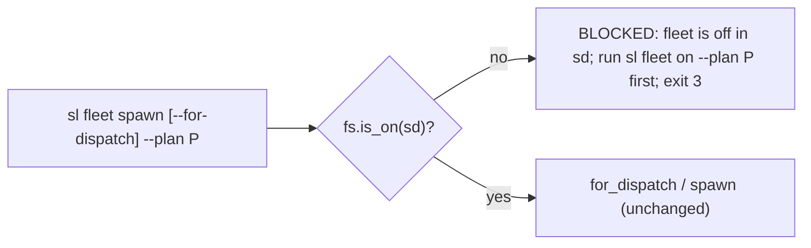
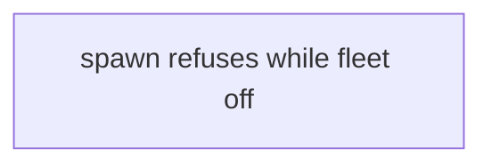

# Superlite: fleet spawn refuses while the run's fleet is off (B50)

**Goal:** fix #355: `sl fleet spawn` (plain and `--for-dispatch`) never starts a worker while the run's own `.superlite/fleet.json` says off; it refuses with exit 3 and a hint to run `sl fleet on` there.
**Architecture:** one guard at the top of the `spawn` branch of `fleet.main`: `if not fs.is_on(sd)` it prints one `BLOCKED:` line on stdout naming the state dir and the `sl fleet on [--plan P]` command, and returns 3, before `for_dispatch` runs dispatch or `spawn` picks an account. The `spawn` and `for_dispatch` functions stay unchanged.
**Tech stack:** Python 3 stdlib, pytest (through `sl run_tests`).
**Spec:** this file, section Design; issue #355 Expected line and Max's decision (spawn refuses with a hint to run 'sl fleet on').
**Detail:** tests
**Target-min:** 11
**Wave0:** none
**Coverage:** off

Global constraints:
- Replace code exactly as the task's `Code (verbatim)` block gives it; keep the file's `# O(...)` comment on every new line, as the block shows. Change no other line of the file.
- Existing tests stay green. Append the new tests to the end of tests/scripts/test_fleet_for_dispatch.py and change none of its existing lines. If another existing test turns red, report it in DONE_WITH_CONCERNS with the test id and the reason instead of editing it.
- Run `sl` as an executable (`<abs>/sl ...`). Verify with `<abs>/sl run_tests --fast <own test file> --task Tn --background`, then run the printed `wait:` line in the foreground and end the turn only after it reports.
- No version edits (the ship step bumps the version). Never run `scripts/test_layers.py run`, `scripts/evals.sh` or `claude plugin eval` (the coordinator runs the layers).

## Design

Issue #355: `sl fleet on` ran in the main checkout before `sl worktree ensure`; in the worktree `.superlite/fleet.json` said `on=false`, yet `sl fleet spawn --for-dispatch` spawned W1 to W3 and `sl fleet status` printed `fleet: off` while they were busy. Cause: the `spawn` branch of `fleet.main` never reads the `on` flag. Max's decision: spawn refuses with a hint to run `sl fleet on`.

Refusal line (stdout, exit 3): `BLOCKED: fleet is off in <resolved state dir>; run sl fleet on --plan <P> first (a worktree run keeps its own fleet.json)`; without `--plan` the command reads `sl fleet on`.

Ruling: plain `fleet spawn` (any role) refuses too, not only `--for-dispatch` (because a worker spawned while off is the same mismatch: `fleet status` prints `fleet: off` over it; every in-repo caller of the CLI turns the fleet on first) - cost if wrong: a script that spawned research workers without `fleet on` now gets exit 3.
Ruling: the guard sits in the CLI branch, not in the `spawn` / `for_dispatch` functions (because backlog triage and the tests call `fleet.spawn` directly after their own `fleet on`) - cost if wrong: none for the CLI path.
Ruling: the guard runs before dispatch, so a refused `--for-dispatch` marks no task dispatched, opens no pane and uses no worker id.
Ruling: worktree.py stays unchanged (Max chose the refusal over carrying the main checkout's fleet setting into a new worktree).
Ruling: the hint names the state dir and the `--plan` value as typed, so the printed command turns on the same run's fleet (both resolve through `_sd`).
Ruling: one task, already in the lead worktree (no `sl worktree ensure`), detail tests, no Wave 0 (the project builds), no probe adapter (no new runnable entry).
LAYERS: unit



## File structure

- skills/subagent-driven-development/scripts/fleet.py: the guard in `main`'s spawn branch and one docstring sentence (T1).
- tests/scripts/test_fleet_for_dispatch.py: two appended tests pin the refusal for both spawn forms, the hint, and the round going out after `fleet on` (T1).

## Task graph

```mermaid
%% schedule
gantt
  title Predicted schedule (mm:ss)
  dateFormat X
  axisFormat %M:%S
  section lane 1
  T1 spawn refuses while fleet off :t1, 0, 59s
```





critical path: T1 (1.0 min) · peak width 1 · predicted build 1.0 min · predicted total ≈ 4.5 min (target ✓)

## Predicted schedule

## fleet

App type: CLI. Categories: protocol (which command refuses, the exact BLOCKED line and exit code), state (no dispatch, pane or worker record on a refusal).

### T1 spawn refuses while fleet off · Complexity 2 (O-1) · Est. context 30k
**Owns:** skills/subagent-driven-development/scripts/fleet.py, tests/scripts/test_fleet_for_dispatch.py
**Components:** 1
**LOC owned:** 50
**Tests:** fast
**Kind:** mechanical
**Model:** haiku
**Est. time:** 2 min (1 component, about 50 LOC, fast tests)
**Consumes:** none
**Produces:** fleet.main(argv: list[str] | None = None) -> int
**Covers:** Design
**Review Focus:** `test_for_dispatch_refuses_while_fleet_is_off`: no fleet.json, `spawn --for-dispatch --plan P` gives exit 3, the one BLOCKED line naming `sl fleet on --plan P`, no dispatch call, no herdr call, no worker; `test_fleet_json_on_false_refuses_until_fleet_on`: fleet.json `on=false`, both spawn forms give exit 3 (plain spawn without --plan names `sl fleet on`), after `fleet on` the same round prints `W1 T2 sent`.
**Code (verbatim):** in skills/subagent-driven-development/scripts/fleet.py:
1. In `main`, replace the two lines
````python
    elif a.cmd == "spawn":  # O(1)
        if a.for_dispatch:  # O(1)
````
with
````python
    elif a.cmd == "spawn":  # O(1)
        if not fs.is_on(sd):  # a worktree run keeps its own fleet.json: the main checkout's `fleet on` does not reach it (#355) | O(w)
            hint = "sl fleet on" + (f" --plan {a.plan}" if a.plan else "")  # O(1) the same --plan resolves the same state dir
            print(f"BLOCKED: fleet is off in {sd}; run {hint} first (a worktree run keeps its own fleet.json)")  # O(1)
            return 3  # O(1) before dispatch: no task marked, no pane, no worker id
        if a.for_dispatch:  # O(1)
````
2. In the module docstring, directly below the line `A start that fails with `not an available shell` (a freed pane) is retried once after SHELL_PAUSE_S.`, insert the line
````text
While the run's fleet.json says off, `spawn` (both forms) starts nothing: `BLOCKED: fleet is off in <state dir>; run sl fleet on [--plan P] first ...`, exit 3 (#355).
````
**Test code (verbatim):** append to the end of tests/scripts/test_fleet_for_dispatch.py (one blank line pair before it):
```python
def test_for_dispatch_refuses_while_fleet_is_off(world, monkeypatch, capsys):
    """#355: no `fleet on` in this run: no dispatch round, no worker, one BLOCKED line with the hint, exit 3. Runs in both modes."""
    calls = []
    monkeypatch.setattr(dispatch, "run", lambda *a, **k: calls.append(a) or ([], {}))
    sd = world.sd.resolve()
    assert fleet.main(["spawn", "--for-dispatch", "--plan", str(world.plan)]) == 3
    assert capsys.readouterr().out.splitlines() == [f"BLOCKED: fleet is off in {sd}; run sl fleet on --plan {world.plan} first (a worktree run keeps its own fleet.json)"]
    assert calls == [] and world.fh.calls == []
    assert fleet.fs.load(sd)["workers"] == {}


@pytest.mark.skipif(REAL, reason="scripted dispatch lines need the in-process fake")
def test_fleet_json_on_false_refuses_until_fleet_on(dwld, capsys):
    """#355 as seen: the worktree's fleet.json says on=false: both spawn forms refuse; after `fleet on` the same round goes out."""
    sd = dwld.sd.resolve()
    (sd / "fleet.json").write_text(json.dumps({"on": False, "workers": {}, "next": 1}) + "\n")
    dwld.lines = [("T2", FRESH)]
    assert _go(dwld) == 3
    assert fleet.main(["spawn", "--tier", "sonnet"]) == 3
    assert capsys.readouterr().out.splitlines() == [
        f"BLOCKED: fleet is off in {sd}; run sl fleet on --plan {dwld.tasks_plan} first (a worktree run keeps its own fleet.json)",
        f"BLOCKED: fleet is off in {sd}; run sl fleet on first (a worktree run keeps its own fleet.json)"]
    assert dwld.fh.calls == [] and fleet.fs.load(sd)["workers"] == {}
    fleet.main(["on"])
    assert _go(dwld) == 0
    assert capsys.readouterr().out.splitlines() == ["W1 T2 sent"]
```
**Steps:** 1 append the tests, 2 run: FAIL (both new tests fail: spawn starts workers while off), 3 make the two edits, 4 run: PASS (also run tests/scripts/test_fleet.py, tests/scripts/test_fleet_roles_spawn.py and tests/scripts/test_backlog_cli.py: still green)
**Notes:** `fleet on` prints on stderr, so the captured stdout holds only the spawn lines. `world.plan` and `dwld.tasks_plan` print as the path given to `--plan`; `sd` is the resolved state dir `_sd` returns.

**Probe entry:** none (no new runnable entry; the CLI branch is covered by its in-process tests)

## Review Focus

fleet (CLI): protocol and state cases are in T1's Review Focus line.

## Self-review

Coverage: #355 is T1 (Max's refusal option; the carry-over option is not built). No placeholders. One task, no edges, no shared files. T1 is mechanical: about 50 LOC, one component, fast tests, verbatim code and tests.
