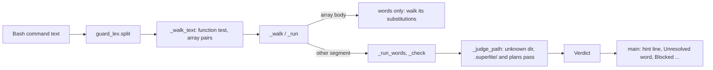
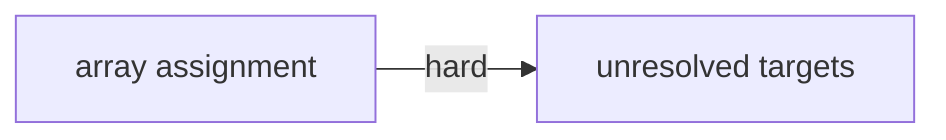

# Superlite: the coordinator guard passes .superlite/ and plan writes from an unknown directory, ignores prose "function", reads array assignments as words (B51)

**Goal:** fix #351 (the coordinator guard blocks a `.superlite/last-wait.txt` write, a python3 plan edit, a findings report and a `for B in $(...)` brief loop) and #352 (`files=(tests/scripts/test_guard*.py ...)` is blocked as a write to `tests/scripts/?`).
**Architecture:** two tasks in guard_judge.py, in sequence. T1 reads `NAME=(words)` (also `+=`, after `local`/`declare`/`export`, after `then`/`do`) as an array assignment: its words run no command, its `$(...)` and backtick bodies and its redirects are judged as today, and NAME's value is unknown. T2 lets a relative `.superlite/` or plans-folder path pass when the shell's directory is unknown, detects a function definition from the segments (`function` keyword) or from `NAME() {` outside heredoc bodies, and adds one hint line to an unresolved-target block naming the supported way.
**Tech stack:** Python 3 stdlib, pytest (through `sl run_tests`).
**Spec:** this file, section Design; issue #351 and #352 Expected lines and Max's decision (#351: allow writes under .superlite/ and plans; name the supported way).
**Detail:** tests
**Target-min:** 11
**Wave0:** none
**Coverage:** off

Global constraints:
- Python 3 stdlib only. Follow guard_judge.py's style: every new or changed code line ends with a `# O(...)` complexity comment like its neighbours, comments say why, no new module.
- Change only the files in your Owns line. An existing test changes only where your task says so. If another existing test turns red, report it in DONE_WITH_CONCERNS with the test id and the reason instead of editing it.
- Run `sl` as an executable (`<abs>/sl ...`). Verify with `<abs>/sl run_tests --fast tests/scripts/test_guard_vars_329.py tests/scripts/test_guard_for_loop_289.py tests/scripts/test_guard_judge.py tests/scripts/test_guard_priors_312.py --task Tn --background`, then run the printed `wait:` line in the foreground and end the turn only after it reports.
- No version edits, no docs edits. Never run `scripts/test_layers.py run`, `scripts/evals.sh` or `claude plugin eval`.

## Design

#351 expected: the guard resolves these targets, or allows writes that stay under `.superlite/` and the plan directory; where the block is intended, its message names the supported way. #352 expected: `NAME=(words)` is an assignment and writes nothing. Max chose: allow writes under .superlite/ and plans; name the supported way (strict on unknown targets).

Root causes (reproduced on 1.5.58 from the logged commands):
- `.superlite/last-wait.txt`: a `while` loop makes `_walk_text` walk the command again, starting from every directory the first walk ended in; the trailing `eval "$W"` left the directory unknown, so the second walk judges the write from an unknown directory, where `_judge_path` passes a relative path only when `x/<path>` is allowed too. `.superlite/*` and the plans patterns are anchored at the root, so the write blocks.
- python3 plan edit (`cd WT && P=docs/.../plans/x.md && python3 - $P <<'EOF'`): the heredoc's prose holds "function in", which `FUNC` reads as `function NAME`; the walk then loops, the second walk sees P's not-run value (empty), `sys.argv[1]` becomes `''` and `open(p,'w')` gives the target `?`.
- `for B in $(awk ...)` and a python3 report whose path guard_tools cannot compose: the target is unknown; it stays blocked (Max: strict on unknown targets) and the block now names the supported way.
- #352: guard_lex ends the segment at `(`, so `files=` is one segment and `(tests/scripts/test_guard*.py tests/scripts/test_x.py)` a subshell walked as a command: a glob command word makes every operand a write target. guard_lex gives `x=(a)` and `x=; (a)` the same segments; only the text tells them apart.

Ruling: an array assignment is recognised when the head segment ends in a literal `NAME=`/`NAME+=` with sep `;`, the next segment is a bare subshell, the text holds `NAME=(` or `NAME+=(` glued at a word start, and the text holds no `NAME=` or `NAME+=` followed by blanks and `;` (a real `x=; (cmd)`) - cost if wrong: none found: `x= (cmd)` is a bash and zsh syntax error, and a text with `x=;` anywhere keeps the old subshell walk.
Ruling: an array body that lexes into anything but words and substitutions (a redirect, a heredoc, a nested `(...)` such as a zsh glob qualifier, a `;`, `&`, `|` separator) keeps the old subshell walk; bash and zsh reject those inside an array except the qualifier - cost if wrong: `files=(src/*.py(N) x)` still judged as commands, as today.
Ruling: the unknown-directory exception covers `.superlite/*`, `docs/plans/*` and `docs/*/plans/*` (each also allowed by the mode's policy, so human mode passes only `.superlite/*` and `*.review.md` plans); `docs/*.md`, `SPEC*.md` and the rest stay strict; T2 changes the one assertion in tests/scripts/test_guard_judge.py (outside the brief's files; no running batch owns it) that pinned `cd $X; printf x > docs/plans/a.md` as blocked - cost if wrong: a plan-pattern file below some other folder of the project passes from an unknown directory.
Ruling: the function test reads the `function` keyword structurally (a literal, unquoted word at `_lead(seg)`) and `NAME() {` from the text without heredoc bodies; a quoted or heredoc "function" no longer loops the walk; a heredoc's own text is still walked with its own function test when it runs as shell - cost if wrong: none found; a body not found verbatim keeps the old, stricter reading.
Ruling: the hint line prints before `Unresolved word:`, so the last two lines stay `Unresolved word:` and `Blocked command:`/`Blocked target:` as before; the incident line is unchanged - cost if wrong: none.
Ruling: no sl tool writes a findings report, a plan edit or a wait file; the Write and Edit tools are the supported way and the hint names them - cost if wrong: a later sl tool is not named.
Ruling: three tasks would add a third sequential step on one file; two tasks in sequence (T1 -> T2) because both live in guard_judge.py and two tasks on one file never run at once - cost if wrong: about 2 minutes more wall time than one task.
Ruling: detail tests; no Wave 0 (the project builds); no probe adapter (library code inside scripts/, named tests cover the Review Focus); already in the lead worktree, so no `sl worktree ensure`.
LAYERS: unit



## File structure

- skills/subagent-driven-development/scripts/guard_judge.py: array pairs, unknown-dir exception, function test, hint line.
- tests/scripts/test_guard_vars_329.py: T1's tests (appended).
- tests/scripts/test_guard_for_loop_289.py: T2's tests (appended).
- tests/scripts/test_guard_judge.py: one assertion (T2).

## Task graph




critical path: T1 → T2 (2.3 min) · peak width 1 · predicted build 2.3 min · predicted total ≈ 5.8 min (target ✓)

## Predicted schedule

## Guard

App type: library (a policy over parsed shell text). Categories: protocol (bash and zsh parsing), state (variable values across walks), file (paths from unknown directories). Specific risk: a relaxation that lets a real write into project code pass (a real subshell read as an array, a code path read as a plan path).

### T1 array assignment · Complexity 4 (O-1) · Est. context 40k
**Owns:** skills/subagent-driven-development/scripts/guard_judge.py, tests/scripts/test_guard_vars_329.py
**Components:** 1
**LOC owned:** 110
**Tests:** fast
**Model:** sonnet
**Est. time:** 2.5 min (1 component, about 110 LOC, fast tests)
**Consumes:** none
**Produces:** none
**Covers:** Design
**Review Focus:** protocol: `test_subshell_after_empty_assignment_still_judged` (`x=; (rm src/x.py)` and four more still block src/x.py); `test_array_substitution_and_redirect_still_judged`; state: `test_array_value_is_unknown` (`x=(src/x.py); rm $x` is unknown `$x`, today it passes).
**Contract:**
1. New `_arrays(text, segs) -> dict`: for each pair head = segs[e], body = segs[e + 1] that is an array assignment, `{id(head): ("head", NAME, head), id(body): ("body", NAME, body)}`. A pair is one when: `head.sep == ";"`; head's last word is literal (`_lit`) and fully matches `[A-Za-z_][A-Za-z0-9_]*\+?=`; the words between `_lead(head)` and the last word are all ASSIGN words, or the first of them is in DECLARE and the others are `-` options or ASSIGN words; body has no words and `body.subshell is not None`; `re.search(r"(^|[\s;&|(){}!])" + NAME + r"\+?=\(", text)` matches and `re.search(r"(^|[\s;&|(){}!])" + NAME + r"\+?=[ \t]*;", text)` does not.
2. `_Ctx.__init__` sets `self.arrays = {}`; `_walk_text` adds `_arrays(text, segs)` to it right after `guard_lex.split` (the stored segment keeps its id from being reused).
3. `_run`, head segment: NAME's new value is None (unknown) instead of the empty text, in the assignment loop and in the DECLARE path; the other assignments of the segment are unchanged.
4. `_run`, body segment: instead of walking `seg.subshell` as a command line, lex it with `guard_lex.split`; when every part has no redirects, no heredocs, `subshell is None` and a sep of `"\n"` or `""`, walk each part's `bodies` like `seg.bodies` (a fork of the state with `stdin`/`pipe` from c) and nothing else; otherwise walk `seg.subshell` exactly as today. The body segment's own redirects are judged as today.
5. Module docstring: one sentence: `NAME=(words)` is an array assignment: its words run nothing, its substitutions and redirects are judged, NAME is unknown.
**Test code (verbatim):** append to tests/scripts/test_guard_vars_329.py
```python
# --- #352: an array assignment NAME=(words) assigns, it runs no command


@pytest.mark.parametrize("cmd", [
    "files=(tests/scripts/test_guard*.py tests/scripts/test_x.py)\nsl run_tests --fast $files",
    "SL=/x/sl; files=(tests/scripts/test_guard*.py tests/scripts/test_x.py); $SL run_tests --fast $files",
    "files=(rm src/x.py)",
    "a=1 files+=(rm src/x.py)",
    "local -a files=(src/*.py src/x.py)",
    "declare -a files=(tee src/x.py)",
    "export A=(rm src/x.py)",
    "files=(\n  rm src/x.py\n)",
    "if true; then files=(src/*.py src/x.py); fi",
    "for f in a b; do files=(src/*.py src/$f.py); done",
])
@pytest.mark.parametrize("mode", ["active", "human"])
def test_array_assignment_runs_no_command(P, cmd, mode):
    assert run(cmd, P, mode) is None


@pytest.mark.parametrize("cmd", ["x=(a $(rm src/x.py) b)", "x=(a `touch src/x.py`)", "x=(a)>src/x.py"])
def test_array_substitution_and_redirect_still_judged(P, cmd):
    v = run(cmd, P)
    assert v is not None and v.rel == "src/x.py" and v.kind == "code"


@pytest.mark.parametrize("cmd", [
    "x=; (rm src/x.py)",
    "x= ;(rm src/x.py)",
    "x=\n(rm src/x.py)",
    "x=(a); x=; (rm src/x.py)",
    "x=(a; rm src/x.py)",
])
def test_subshell_after_empty_assignment_still_judged(P, cmd):
    v = run(cmd, P)
    assert v is not None and v.rel == "src/x.py" and v.kind == "code"


@pytest.mark.parametrize("cmd", ["x=(src/x.py); rm $x", "x=(.superlite/a); x+=(b); echo hi > $x"])
def test_array_value_is_unknown(P, cmd):
    v = run(cmd, P)
    assert v == UNK and v.word == "$x"
```
**Steps:** 1 append the tests, 2 run: the array cases FAIL, 3 implement, 4 run the four guard test files: PASS.

### T2 unresolved targets · Complexity 4 (O-1) · Est. context 42k
**Owns:** skills/subagent-driven-development/scripts/guard_judge.py, tests/scripts/test_guard_for_loop_289.py, tests/scripts/test_guard_judge.py
**Components:** 1
**LOC owned:** 120
**Tests:** fast
**Model:** sonnet
**Est. time:** 2.5 min (1 component, about 120 LOC, fast tests)
**Consumes:** none
**Produces:** none
**Covers:** Design
**Review Focus:** file: `test_unknown_dir_other_writes_still_block` (src/x.py, docs/a.md, `.superlite/../src/x.py`, `x/.superlite/a` stay code, `.superlite/orchestrator.json` protected); state: `test_real_function_body_still_runs_later` (a real `f() {`/`function f` still blocks `docs/.superlite/a`); `test_unresolvable_loop_targets_stay_blocked`.
**Contract:**
1. New `STAYS = (".superlite/*", "docs/plans/*", "docs/*/plans/*")`. In `_judge_path`'s unknown-directory branch (`base is None and not p.startswith("/")`) a path passes when it has no `..` part, `_allowed(p, ctx.mode)` holds and either `_allowed("x/" + p, ctx.mode)` or a STAYS pattern matches p (`fnmatchcase`); protected names and everything else stay as today.
2. New `FUNC_DEF = re.compile(r"(^|[;&|{}\s])[A-Za-z_][\w.:-]*\s*\(\s*\)\s*\{")` and `_defines_function(text, segs) -> bool`: True when some segment's word at `_lead(seg)` is a literal (`_lit`) `function`, or FUNC_DEF matches the text with each segment's heredoc bodies cut out (`text.replace(doc, "", 1)` per body; a body not found verbatim stays). `_walk_text` uses it for `func`, and its `\}\s*(&&|\|\|)` group check reads the same heredoc-free text. Remove `FUNC` (no other user).
3. New `UNRESOLVED_HINT` (one line, it must contain `Write or Edit tool` and `.superlite/`): "The guard cannot resolve this target: name the path literally in the command, or write the file (a findings report, a plan edit, a fixer brief, a wait file under .superlite/ or a plans folder) with the Write or Edit tool." `main()` prints it on stderr, when `v.word` is set and the kind is not protected, right before the `Unresolved word:` line.
4. Module docstring: one sentence each for the unknown-directory exception and the function test.
5. tests/scripts/test_guard_judge.py: replace only the line `assert blocked("cd $X; printf x > docs/plans/a.md", P).rel == "docs/plans/a.md"` with `passes("cd $X; printf x > docs/plans/a.md", P)` and `assert blocked("cd $X; printf x > docs/a.md", P).rel == "docs/a.md"`.
**Test code (verbatim):** append to tests/scripts/test_guard_for_loop_289.py
```python
# --- #351: unresolved targets: .superlite/ and plan writes from an unknown directory, prose "function", the hint


@pytest.mark.parametrize("tgt", [".superlite/last-wait.txt", ".superlite/fixes/a.md", "docs/plans/x.md", "docs/sub/plans/x.md"])
def test_unknown_dir_state_and_plan_writes_pass(P, tgt):
    assert run(f"cd $X; echo hi > {tgt}", P) is None


@pytest.mark.parametrize("tgt,kind", [
    ("src/x.py", "code"), ("docs/a.md", "code"), (".superlite/../src/x.py", "code"), ("x/.superlite/a", "code"),
    (".superlite/orchestrator.json", "protected"),
])
def test_unknown_dir_other_writes_still_block(P, tgt, kind):
    v = run(f"cd $X; echo hi > {tgt}", P)
    assert v is not None and v.rel == tgt and v.kind == kind


def test_unknown_dir_human_mode(P):
    assert run("cd $X; echo hi > .superlite/a", P, "human") is None
    assert run("cd $X; echo hi > docs/plans/x.review.md", P, "human") is None
    v = run("cd $X; echo hi > docs/plans/x.md", P, "human")
    assert v is not None and v.kind == "human"


def test_wait_file_after_unknown_dir_passes(P, tmp_path):
    out = tmp_path / "out"
    out.mkdir()
    cmd = (f"cd {out} && SL=/x/sl && $SL fleet stop W17 2>&1 | tail -1; ( git diff main --name-only -- '*.swift' ) "
           "| sort -u | while read f; do [ -f \"$f\" ] && echo \"$f\"; done | xargs -n 20 swift format lint 2>&1 "
           "| grep -c warning; W=$($SL run_tests --full --background 2>&1 | grep '^wait:'); "
           "echo \"$W\" > .superlite/last-wait.txt; eval \"$W\" >/dev/null 2>&1")
    assert run(cmd, P) is None


def test_prose_function_word_is_no_function(P, tmp_path):
    out = tmp_path / "out"
    (out / "docs" / "plans").mkdir(parents=True)
    cmd = (f"cd {out} && P=docs/plans/x.md && python3 - $P <<'EOF'\nimport sys\np=sys.argv[1]\n"
           "open(p,'w').write('a #if DEBUG public function in Dashboard')\nEOF")
    assert run(cmd, P) is None
    assert run("cat <<'EOF' > .superlite/n.md\nf() { x; }\nEOF\necho hi > .superlite/a; cd docs", P) is None


@pytest.mark.parametrize("cmd", [
    "f() { echo hi > .superlite/a; }; cd docs; f",
    "function f { echo hi > .superlite/a; }; cd docs; f",
    "if true; then function f { echo hi > .superlite/a; }; fi; cd docs; f",
    "cat <<'EOF' > .superlite/n.md\nnotes\nEOF\nf() { echo hi > .superlite/a; }; cd docs; f",
])
def test_real_function_body_still_runs_later(P, cmd):
    v = run(cmd, P)
    assert v is not None and v.rel == "docs/.superlite/a"


@pytest.mark.parametrize("cmd,word", [
    ("for B in $(awk '{print $2}' .superlite/route.txt); do echo x >> $B; done", "$B"),
    ("for B in $(cat .superlite/r.txt); do echo x > .superlite/fixes/$B.md; done", ".superlite/fixes/$B.md"),
])
def test_unresolvable_loop_targets_stay_blocked(P, cmd, word):
    v = run(cmd, P)
    assert v == UNK and v.word == word


def test_unresolved_block_names_the_supported_way(P, tmp_path, monkeypatch, capsys):
    cmd = "for B in $(awk '{print $2}' .superlite/route.txt); do echo x >> $B; done"
    code, err, rows = _main(P, tmp_path, monkeypatch, capsys, cmd)
    lines = err.splitlines()
    assert code == 2 and lines[-2:] == ["Unresolved word: $B", "Blocked command: " + cmd]
    assert lines[-3] == guard_judge.UNRESOLVED_HINT
    assert "Write or Edit tool" in guard_judge.UNRESOLVED_HINT and ".superlite/" in guard_judge.UNRESOLVED_HINT
    code, err, rows = _main(P, tmp_path, monkeypatch, capsys, "rm src/a")
    assert code == 2 and guard_judge.UNRESOLVED_HINT not in err
```
**Steps:** 1 append the tests, 2 run: the new cases FAIL (AttributeError for UNRESOLVED_HINT included), 3 implement, 4 run the four guard test files: PASS.
**Notes:** `test_unresolvable_loop_targets_stay_blocked` passes before and after (it pins the strict part of Max's decision).

## Review Focus

Guard package (library): protocol (bash and zsh array and function syntax, `x=; (cmd)` against `x=(words)`), state (an array name's value, the second walk of a loop or function), file (relative paths from an unknown directory). Every case is a named test in T1 or T2.

## Self-review

Coverage: #352 -> T1; #351 wait file and plan edit -> T2 items 1-2; #351 unknown targets -> T2 item 3. No placeholders. No Consumes or Produces (one module). T1 -> T2 is a hard edge: both edit guard_judge.py. Fields filled.
