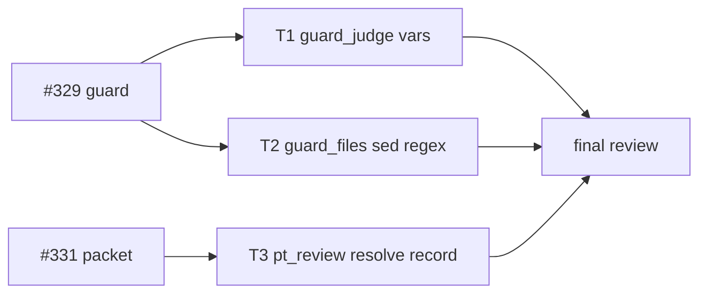
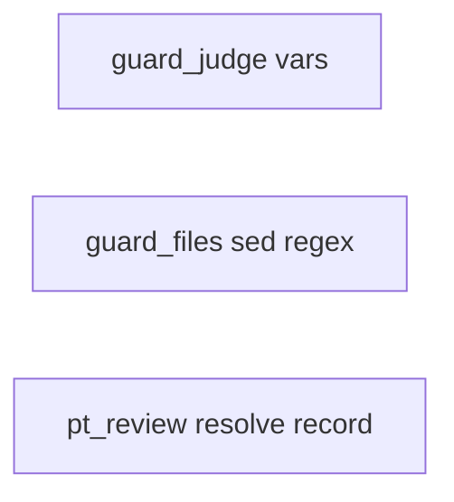

# Superlite: the coordinator guard resolves chain-assigned literals, $TMPDIR and $HOME, reads sed scripts per command; `sl incident resolve` closes its location in the review packet (B46)

**Goal:** fix #329 (the coordinator guard blocks `X && P=lit; sed -i '' ... $P`, `"$TMPDIR/x"`, a two-command `sed -i` plan edit, and a write after `mkdir -p D; cd D`) and #331 (`plan_tools packet` lists an incident as open after `sl incident resolve` closed it).
**Architecture:** three independent fixes. T1 changes guard_judge.py: a name first assigned after `&&`/`||` or in a block keeps its literal as one value and, as the other value, its value before the command (unset, so empty, unless the hook's environment holds the name); `$TMPDIR` and `$HOME` read the hook's environment; `mkdir -p D` before `;` or a newline makes D sure like before `&&`. T2 changes two sed regexes in guard_files.py so an `s` command's pattern and replacement never hold its unescaped delimiter (the `/Spe` of a second `s` command is no `e` flag). T3 changes pt_review.incident_items: a location whose newest entry is an `sl incident resolve` record is closed, also when it has repeated entries.
**Tech stack:** Python 3 stdlib, pytest (through `sl run_tests`).
**Spec:** this file, section Design; issue #329 and #331 Expected lines and Max's decision (#329: resolve vars and exempt scratchpad/plan).
**Detail:** tests
**Target-min:** 11
**Wave0:** none
**Coverage:** off

Global constraints:
- Python 3 stdlib only. Follow the touched file's style: every new or changed code line ends with a `# O(...)` complexity comment like its neighbours, comments say why, no new module.
- Change only the files in your Owns line. An existing test file changes only where your task says so. If another existing test turns red, report it in DONE_WITH_CONCERNS with the test id and the reason instead of editing it.
- Run `sl` as an executable (`<abs>/sl ...`). Verify with `<abs>/sl run_tests --fast <own test files> --task Tn --background`, then run the printed `wait:` line in the foreground and end the turn only after it reports.
- No version edits (the ship step bumps the version), no docs edits. Never run `scripts/test_layers.py run`, `scripts/evals.sh` or `claude plugin eval` (the coordinator runs the layers).

## Design

#329 expected: a literal assignment earlier in the command and `$TMPDIR` resolve; a `.superlite/` plan file and the session scratchpad are never code; a relative target after `cd <scratchpad>` resolves against the scratchpad. Max chose: resolve vars and exempt scratchpad/plan.
#331 expected: an incident with a later resolution record for its file:line drops out of Open items in the review packet.

Root causes (reproduced on 1.5.53):
- `cd D && P=lit; sed ... $P`: `_maybe_unset` drops P from the known variables when the chain ends (the assignment may not have run), so the current value of `$P` is unknown and blocks. Bash gives P its value before the command there: unset in a fresh Bash tool shell.
- `$TMPDIR` is never read; `$HOME` is read only as `~`.
- `sed -i '' 's/^Spec: a\.$/b./; s/^Spec: c\.$/d./' .superlite/plan.md`: guard_files `_SED_E` lets an `s` pattern or replacement run past its delimiter, so `/Spe` of the second command reads as the `e` flag (a shell command: target `?`).
- `cd <scratchpad>; cat > png.py` already resolves against the scratchpad when the folder exists; `mkdir -p D; cd D; ...` does not, because `_mkdir` trusts only `&&`. A cd into a missing folder still leaves the shell in the project (a real failed cd), so that stays judged there.
- #331: `incident_items` flags a location `repeated` when it has 2+ distinct entries; the resolve record is the second entry, so the closed incident stays listed as repeated.

Ruling: the value before the command of a non-KNOWN name the hook's environment does not hold is empty (unset); a name in the hook's environment stays unknown as today (existing test `test_conditional_env_name_is_unknown` now sets X in the environment to keep testing that) - cost if wrong: a variable a shell profile sets without exporting it is judged as empty in the not-run branch.
Ruling: TMPDIR joins KNOWN and is read from the hook's environment only when absolute; its path is then judged by the normal policy (a TMPDIR inside the project is still code) - cost if wrong: a sandboxed shell with another TMPDIR is judged with the hook's, both outside the project.
Ruling (after T1, PR1): `$HOME` stays unresolved, so T1 contract item 3 keeps only the TMPDIR read and `test_home_resolves` became `test_home_stays_unresolved` - the parity suite (test_guard_parity, test_guard_targets, test_guard_judge) pins `rm "$HOME/x y"` as blocked and counts a failure there against the judge; #329 names only `$TMPDIR` - cost if wrong: a `$HOME/x` write outside the project still blocks.
Ruling: "exempt scratchpad/plan" needs no new path rule: `.superlite/*` is already allowed in active and human mode and the scratchpad lies outside the project; the blocks came from the three causes above, and T1's tests pin the scratchpad cases in both modes - cost if wrong: a scratchpad inside a project would still be judged as project code.
Ruling: T2 edits guard_files.py, outside the brief's file list; no running batch owns it (B43 owns only docs and agents) - cost if wrong: a rebase conflict on one regex line.
Ruling: a resolve record is an entry whose resolution is in RESOLVED and whose context starts with `<resolution>: ` (what `incident resolve` writes); two agent `fixed` entries without that prefix stay a repeated hotspot (test_packet_repeated_location_ranks_first) - cost if wrong: an agent entry whose context starts with `fixed: ` also closes its location.
Ruling: detail tests; no Wave 0 (the project builds); no probe adapter (library code inside scripts/, the named tests cover the Review Focus cases); already in the lead worktree, so no `sl worktree ensure`.
LAYERS: unit



## File structure

- skills/subagent-driven-development/scripts/guard_judge.py: variable values before the command, mkdir sureness (T1).
- tests/scripts/test_guard_vars_329.py: T1's tests (T1).
- tests/scripts/test_guard_priors_312.py: one test sets X in the environment (T1).
- skills/subagent-driven-development/scripts/guard_files.py: sed `s` command regexes (T2).
- tests/scripts/test_guard_sed_329.py: T2's tests (T2).
- skills/subagent-driven-development/scripts/pt_review.py: `is_ruling`, `incident_items` (T3).
- tests/scripts/test_packet_resolve_331.py: T3's tests (T3).

## Task graph

```mermaid
%% schedule
gantt
  title Predicted schedule (mm:ss)
  dateFormat X
  axisFormat %M:%S
  section lane 1
  T1 guard_judge vars :t1, 0, 73s
  section lane 2
  T3 pt_review resolve record :t3, 0, 64s
  section lane 3
  T2 guard_files sed regex :t2, 0, 61s
```





critical path: T1 (1.2 min) · peak width 3 · predicted build 1.2 min · predicted total ≈ 4.7 min (target ✓)

## Predicted schedule

## Guard

App type: library (a policy over parsed shell text). Categories: state (variable values across chains and blocks), protocol (bash expansion semantics), file (paths inside and outside the project). Specific risk: a relaxation that lets a real write into project code pass.

### T1 guard_judge vars · Complexity 5 (O-1) · Est. context 42k
**Owns:** skills/subagent-driven-development/scripts/guard_judge.py, tests/scripts/test_guard_vars_329.py, tests/scripts/test_guard_priors_312.py
**Components:** 1
**LOC owned:** 140
**Tests:** fast
**Model:** sonnet
**Est. time:** 3 min (1 component, about 140 LOC, fast tests)
**Consumes:** none
**Produces:** none
**Covers:** Design
**Review Focus:** `test_chain_literal_still_judged`: `false && X=src/x.py; echo hi > $X` blocks src/x.py; `test_env_name_stays_unknown`: with X in the environment the not-run value stays unknown; `test_tmpdir_inside_project_is_code`: TMPDIR=<project>/src blocks `$TMPDIR/y.py`; `test_mkdir_mode_or_background_not_sure`.
**Contract:**
1. `_Ctx.__init__` sets `self.tmpdir`: `os.environ.get("TMPDIR")` through `_winpath` when the result starts with `/` and holds no NUL, else None.
2. `KNOWN` gains `"TMPDIR"`.
3. `_expand`, for a name not in `st.vars`: `HOME` -> `ctx.home`, `TMPDIR` -> `ctx.tmpdir` (None: stays as written), beside the existing CLAUDE_PROJECT_DIR and PWD reads; the existing IFS split check applies to them too.
4. `_maybe_unset(st, name)`: an unknown value (None) and a KNOWN name behave as today. A known value of any other name: when `name in os.environ`, as today (deleted: unknown); otherwise `st.vars[name] = ""` and the old value joins `st.multi[name]` (both values are judged through `_alternatives`).
5. `_mkdir` also makes its folders sure when the segment's separator is `;` or a newline (`seg.sep in ("&&", ";", "\n")`); `-m`, a background `&`, `||` and a pipeline stay as today.
6. Update the module docstring sentence on first assignments: the other possible value is the value before the command (unset unless the environment holds the name); `$TMPDIR` and `$HOME` read the environment.
7. In tests/scripts/test_guard_priors_312.py change only `test_conditional_env_name_is_unknown`: signature `(P, cmd, monkeypatch)`, first line `monkeypatch.setenv("X", "/elsewhere")`.
**Test code (verbatim):** tests/scripts/test_guard_vars_329.py
```python
"""#329: chain-assigned literals, $TMPDIR and $HOME resolve; `mkdir -p D;` makes D sure; scratchpad writes pass."""
import sys
from pathlib import Path

import pytest

sys.path.insert(0, str(Path(__file__).resolve().parents[2] / "skills" / "subagent-driven-development" / "scripts"))

from guard_judge import Verdict, judge  # noqa: E402

UNK = Verdict("?", "?", "code")


@pytest.fixture
def P(tmp_path, monkeypatch):
    p = (tmp_path / "p").resolve()
    for d in ("src", "docs/plans", ".superlite"):
        (p / d).mkdir(parents=True)
    (p / "src" / "x.py").write_text("x = 1\n")
    (p / "docs" / "plans" / "x.md").write_text("a\n")
    for name in ("P", "S", "X"):
        monkeypatch.delenv(name, raising=False)
    return str(p)


@pytest.fixture
def SP(tmp_path):
    s = (tmp_path / "scratchpad").resolve()
    s.mkdir()
    return str(s)


def run(cmd, P, mode="active"):
    return judge(cmd, P, P, mode)


def test_chain_literal_resolves(P, SP):
    assert run(f"cd {SP} && P=docs/plans/x.md; sed -i '' 's/a/b/' $P && grep -c b $P", P) is None
    assert run("true && P=docs/plans/x.md; sed -i '' 's/a/b/' $P", P) is None
    assert run(f"git status && S={SP}; cat > $S/probe.py <<'EOF'\nx\nEOF", P) is None
    assert run("if [ -e z ]; then P=.superlite/a; fi; echo hi > $P", P) is None
    assert run('true && P=.superlite/a; echo hi > "$P"', P) is None


def test_chain_literal_still_judged(P):
    v = run("false && X=src/x.py; echo hi > $X", P)
    assert v is not None and v.rel == "src/x.py" and v.kind == "code"
    v = run("true && X=docs/plans/x.md; echo hi > $X", P, "human")
    assert v is not None and v.rel == "docs/plans/x.md" and v.kind == "human"


def test_env_name_stays_unknown(P, monkeypatch):
    monkeypatch.setenv("X", "/elsewhere")
    v = run("false && X=.superlite/a; echo hi > $X", P)
    assert v == UNK and v.word == "$X"


def test_tmpdir_resolves(P, tmp_path, monkeypatch):
    t = tmp_path / "T"
    t.mkdir()
    monkeypatch.setenv("TMPDIR", str(t.resolve()) + "/")
    assert run('git diff --name-only HEAD origin/main | sort > "$TMPDIR/upstream.txt"', P) is None
    assert run("echo a > ${TMPDIR}x.txt", P) is None
    assert run('cd "$TMPDIR"; cat > png.py', P) is None


def test_tmpdir_inside_project_is_code(P, monkeypatch):
    monkeypatch.setenv("TMPDIR", P + "/src")
    v = run("echo a > $TMPDIR/y.py", P)
    assert v is not None and v.rel == "src/y.py"


@pytest.mark.parametrize("value", [None, "rel/tmp"])
def test_tmpdir_unset_or_relative_stays_unknown(P, monkeypatch, value):
    if value is None:
        monkeypatch.delenv("TMPDIR", raising=False)
    else:
        monkeypatch.setenv("TMPDIR", value)
    v = run("echo a > $TMPDIR/y.py", P)
    assert v is not None and v.word == "$TMPDIR/y.py"


def test_home_resolves(P, tmp_path, monkeypatch):
    h = tmp_path / "home"
    h.mkdir()
    monkeypatch.setenv("HOME", str(h.resolve()))
    assert run("echo hi > $HOME/x.txt", P) is None
    monkeypatch.setenv("HOME", P)
    v = run("echo hi > $HOME/src/y.py", P)
    assert v is not None and v.rel == "src/y.py"


@pytest.mark.parametrize("sep", ["; ", "\n"])
def test_mkdir_before_semicolon_is_sure(P, SP, sep):
    assert run(f"mkdir -p {SP}/n{sep}cd {SP}/n{sep}cat > png.py <<'EOF'\nx\nEOF", P) is None


@pytest.mark.parametrize("cmd", ["mkdir -p -m 700 {SP}/n; cd {SP}/n; cat > png.py",
                                 "mkdir -p {SP}/n & cd {SP}/n; cat > png.py"])
def test_mkdir_mode_or_background_not_sure(P, SP, cmd):
    v = run(cmd.format(SP=SP), P)
    assert v is not None and v.rel == "png.py"


@pytest.mark.parametrize("mode", ["active", "human"])
def test_scratchpad_writes_pass(P, SP, mode):
    assert run(f"cd {SP}; cat > png.py <<'EOF'\nx\nEOF", P, mode) is None
    assert run(f"S={SP}; cat > $S/probe.py <<'EOF'\nx\nEOF", P, mode) is None
    assert run(f"cd {SP} && python3 - <<'PY'\nopen('png.py','w').write('x')\nPY", P, mode) is None
    v = run(f"cd {SP}/missing; cat > png.py", P, mode)
    assert v is not None and v.rel == "png.py"
```
**Steps:** 1 write the test file, 2 run: FAIL, 3 implement the contract, 4 run the new file and tests/scripts/test_guard_priors_312.py tests/scripts/test_guard_values_312.py tests/scripts/test_guard_judge.py: PASS
**Notes:** `_alternatives` already judges every value in `st.multi`; the change only gives the current value a definite empty string instead of dropping it. An empty value expands to an empty target, which `_judge_path` passes.

### T2 guard_files sed regex · Complexity 2 (O-1) · Est. context 28k
**Owns:** skills/subagent-driven-development/scripts/guard_files.py, tests/scripts/test_guard_sed_329.py
**Components:** 1
**LOC owned:** 45
**Tests:** fast
**Model:** sonnet
**Est. time:** 2 min (1 component, about 45 LOC, fast tests)
**Consumes:** none
**Produces:** none
**Covers:** Design
**Review Focus:** `test_real_flags_still_found`: `s/a/b/e` still gives `?`, `s/a/b/w out.txt` and `s/a/b/gw out.txt` still write out.txt, an escaped delimiter `s/a\/b/c/e` still gives `?`.
**Contract:** in `_SED_SW` and `_SED_E` replace each of the two `(?:[^\\\n]|\\.)*?\1` with `(?:(?!\1)[^\\\n]|\\.)*\1` (a pattern or replacement holds an escaped delimiter, never a bare one). Nothing else changes.
**Test code (verbatim):** tests/scripts/test_guard_sed_329.py
```python
"""#329: a sed `s` command's pattern and replacement end at their own delimiter; `/Spe` of a later command is no flag."""
import sys
from pathlib import Path

import pytest

sys.path.insert(0, str(Path(__file__).resolve().parents[2] / "skills" / "subagent-driven-development" / "scripts"))

import guard_files  # noqa: E402
from guard_judge import judge  # noqa: E402

PLAN_EDIT = ("s/^Spec: sections 1 and 3\\.$/Spec: section 1, section 3./; "
             "s/^Spec: sections 2 and 3\\.$/Spec: section 2, section 3./")


@pytest.mark.parametrize("words, want", [
    (["sed", "-i", "", PLAN_EDIT, ".superlite/plan.md"], [".superlite/plan.md"]),
    (["sed", "-i", "", "s/a/b/;s/c/Spe/", "a.md"], ["a.md"]),
    (["sed", "-n", "s/a/b/; s/c/w/p", "in.txt"], []),
])
def test_later_command_is_no_flag(words, want):
    assert guard_files.targets(words) == want


@pytest.mark.parametrize("words, want", [
    (["sed", "-i", "s/a/b/e", "f.txt"], ["?", "f.txt"]),
    (["sed", "s/a/b/w out.txt", "in.txt"], ["out.txt"]),
    (["sed", "s/a/b/gw out.txt", "in"], ["out.txt"]),
    (["sed", "s|a/b|c|w f.txt", "in"], ["f.txt"]),
    (["sed", "-i", "", "s/a\\/b/c/e", "a.md"], ["?", "a.md"]),
])
def test_real_flags_still_found(words, want):
    assert guard_files.targets(words) == want


def test_plan_edit_passes_the_judge(tmp_path):
    p = tmp_path / "p"
    (p / ".superlite").mkdir(parents=True)
    (p / ".superlite" / "plan.md").write_text("Spec: sections 1 and 3.\n")
    cmd = f"sed -i '' '{PLAN_EDIT}' .superlite/plan.md && grep -n \"^Spec:\" .superlite/plan.md"
    assert judge(cmd, str(p), str(p), "active") is None
```
**Steps:** 1 write the test file, 2 run: FAIL, 3 change the two regexes, 4 run the new file and tests/scripts/test_guard_files.py: PASS

## Packet

App type: CLI (review packet). Categories: state (the newest entry per location decides), file (the JSONL log).

### T3 pt_review resolve record · Complexity 3 (O-1) · Est. context 32k
**Owns:** skills/subagent-driven-development/scripts/pt_review.py, tests/scripts/test_packet_resolve_331.py
**Components:** 1
**LOC owned:** 70
**Tests:** fast
**Model:** sonnet
**Est. time:** 2 min (1 component, about 70 LOC, fast tests)
**Consumes:** none
**Produces:** pt_review.is_ruling(entry: dict) -> bool
e.g. is_ruling({"resolution": "resolved", "context": "resolved: fixed by T3"}) -> True
e.g. is_ruling({"resolution": "fixed", "context": "off-by-one"}) -> False
e.g. is_ruling({"resolution": "open", "context": "open: x"}) -> False
**Covers:** Design
**Review Focus:** `test_entry_after_the_resolve_reopens`: open, resolve, open again lists the location as unresolved; `test_fixed_findings_without_a_ruling_stay_repeated`.
**Contract:** `is_ruling(entry)`: `str(entry.get("resolution", "")).lower()` is in RESOLVED and `str(entry.get("context", "")).lower()` starts with that resolution plus `": "` (the record `incident resolve` writes). In `incident_items`, take each group's newest entry before the dedupe; when the location is in `superseded(entries)` and that newest entry `is_ruling`, skip the location (closed, also when repeated or low confidence). The commit_task rule and everything else stay.
**Test code (verbatim):** tests/scripts/test_packet_resolve_331.py
```python
"""#331: an `sl incident resolve` record closes its location in the review packet, also after repeated entries."""
import json
import sys
from pathlib import Path

sys.path.insert(0, str(Path(__file__).resolve().parents[2] / "skills" / "subagent-driven-development" / "scripts"))

import incident  # noqa: E402
import pt_review  # noqa: E402


def add(log, **e):
    with open(log, "a", encoding="utf-8") as fh:
        fh.write(json.dumps(e) + "\n")


def items(log):
    return pt_review.incident_items(pt_review.read_incidents(log))


def resolve(log, file, line, *extra):
    assert incident.main(["resolve", "--file", file, "--line", str(line), "--ruling", "fixed by T3",
                          "--log", str(log), *extra]) == 0


def test_is_ruling():
    assert pt_review.is_ruling({"resolution": "resolved", "context": "resolved: fixed by T3"})
    assert pt_review.is_ruling({"resolution": "Accepted", "context": "Accepted: known gap"})
    assert not pt_review.is_ruling({"resolution": "fixed", "context": "off-by-one"})
    assert not pt_review.is_ruling({"resolution": "open", "context": "open: x"})
    assert not pt_review.is_ruling({"context": "resolved: x"})


def test_resolve_record_closes_its_location(tmp_path):
    log = tmp_path / "incidents.jsonl"
    add(log, file="skills/x/backlog_ship.py", line=249, context="AssertionError boom", kind="test-failure",
        resolution="open", agent="run_tests", epoch=1.0)
    assert len(items(log)) == 1
    resolve(log, "skills/x/backlog_ship.py", 249)
    assert items(log) == []


def test_resolve_closes_a_repeated_location(tmp_path):
    log = tmp_path / "incidents.jsonl"
    for ctx in ("first boom", "second boom"):
        add(log, file="a.py", line=3, context=ctx, kind="exception", resolution="open", agent="T1")
    resolve(log, "a.py", 3, "--resolution", "accepted")
    assert items(log) == []


def test_entry_after_the_resolve_reopens(tmp_path):
    log = tmp_path / "incidents.jsonl"
    add(log, file="a.py", line=3, context="first boom", kind="exception", resolution="open", agent="T1")
    resolve(log, "a.py", 3)
    add(log, file="a.py", line=3, context="third boom", kind="exception", resolution="open", agent="T2")
    it = items(log)
    assert len(it) == 1 and "unresolved" in it[0].title


def test_fixed_findings_without_a_ruling_stay_repeated():
    es = [{"file": "a.py", "line": 3, "context": "first", "kind": "exception", "resolution": "fixed"},
          {"file": "a.py", "line": 3, "context": "second", "kind": "exception", "resolution": "fixed"}]
    it = pt_review.incident_items(es)
    assert len(it) == 1 and "repeated" in it[0].title
```
**Steps:** 1 write the test file, 2 run: FAIL, 3 implement, 4 run the new file and tests/scripts/test_pt_review.py tests/scripts/test_pt_review_noise_batch.py tests/scripts/test_finish_open_incidents.py: PASS

## Review Focus

- Guard (T1, T2): state, protocol, file; each task carries its named cases. No probe entry (see Ruling).
- Packet (T3): state, file; named cases in T3.

## Self-review

Coverage: #329's four blocked forms map to T1 (chain literal, TMPDIR, scratchpad, mkdir) and T2 (sed plan edit); #331 maps to T3. No placeholders. No Consumes. No edges; no shared files. Every task has Components, LOC owned, Tests, Model.
