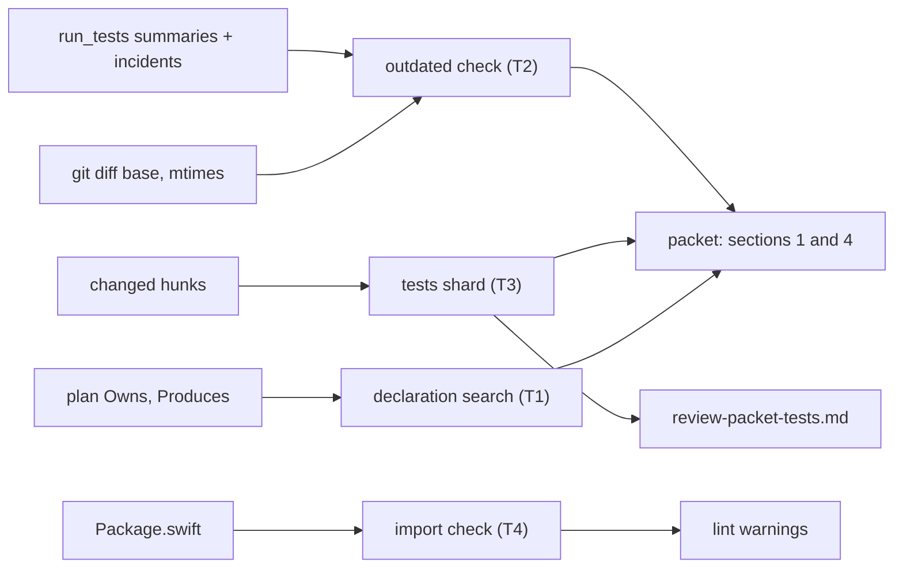
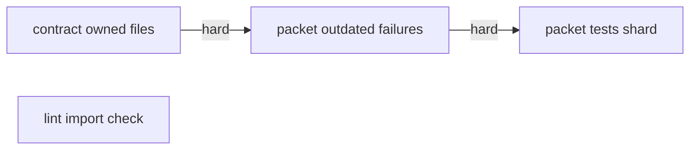

# Superlite: packet and contract fixes (B56)

**Goal:** #366 a reviewer's red-step run never becomes the packet's test summary or its open incidents; #381 test files that do not fit the final-review packet go to a second shard in full; #383 the contract check looks for a Produces name in every file the task owns; #388 plan lint warns when a seam's Produces type lives in a module a consumer's Swift target may not import.
**Architecture:** pt_review.py (packet and contract check) gets an outdated-failure check, a tests shard and an owned-file declaration search, in three chained tasks (one file); plan_tools.py (lint) gets a SwiftPM import check, in parallel.
**Tech stack:** Python 3 stdlib, git, pytest (through `sl run_tests`).
**Spec:** this file, section Design; issue Expected lines; Max's decision on #381: a second shard for tests.
**Detail:** contracts
**Target-min:** 11
**Wave0:** none
**Coverage:** off

Global constraints:
- Keep the repo's `# O(...)` comment on every new code line (see any function in the file you edit). Change no line outside what the task needs.
- Existing tests stay green. An existing test file never changes. If another existing test turns red, report it in DONE_WITH_CONCERNS with the test id and the reason instead of editing it.
- Run `sl` as an executable (`<abs>/sl ...`). Verify with `<abs>/sl run_tests --fast <own test file> tests/scripts/test_packet_*.py tests/scripts/test_pt_review*.py --task Tn --background` (T4: `<own test file> tests/scripts/test_plan_tools*.py`), then run the printed `wait:` line in the foreground and end the turn only after it reports.
- No version edits. Never run `scripts/test_layers.py run`, `scripts/evals.sh` or `claude plugin eval`.
- Test fixtures: `tests/scripts/test_packet_stale.py` (packet subprocess, summaries, incident logs) and `tests/scripts/test_pt_review_declarations.py` (Swift fixture, check_interfaces) show the patterns.

## Design

#366 (B50): the package reviewer swapped in the start SHA's fleet.py, ran `run_tests --fast` (2 failing, 2 incidents per run), restored the file and logged `verified`, without a new run. The packet took that run as the newest fast run and its incidents as open. A run whose code changed afterwards no longer says anything about the tree, so its failures are **outdated**: listed in section 4, never open, the full suite (started with the packet) decides.

Ruling: a run_tests test-failure is outdated when its test file, a `conftest.py` above it, or a changed-since-base `.py` file whose module the test file imports (ast, any depth, matched by dotted name or file stem) has an mtime later than the run (incident `epoch`; summary `started`) - mtimes are the only trace a restore leaves; a red-step and a fix-without-rerun look the same, and both are unconfirmed - cost if wrong: a real failure from an older run waits for the full suite instead of the packet.
Ruling: only `agent: run_tests` incidents can be outdated; agent-logged ones stay as they are; outdated items never count as open, so the packet can take the fast path.
Ruling: #381 (Max: second shard): when any changed test file would be truncated or left out of section 8, every changed test file moves to `<packet stem>-tests.md` with its full diff (no per-file cap; size cap AUTO_MAX_TOKENS, or `--max-tokens`); the packet head names it with the marker the final reviewer may already follow (`(truncated: ...; read <abs path> in full)`), so agents/final-reviewer.md stays unchanged; a packet without a shard deletes an old shard file.
Ruling: #383: declarations are searched in the task's source files first, then its owned test-path files; the mismatch names every file searched; Python `locate` tries owned test `.py` files before its first-file fallback.
Ruling: #388 checks SwiftPM only (`Package.swift` target `dependencies`, direct deps plus the target itself) - the observed case (maxOS) - as a `WARNING: IMPORT:` lint line, never an issue, so a parser miss never blocks a task - cost if wrong: Python (import-linter) and TS projects get no check yet (follow-up).
Ruling: detail contracts (named tests with exact inputs and outputs); T1 -> T2 -> T3 are ordered only because they share pt_review.py; no Wave 0, no probe adapter (subprocess and unit tests cover the CLI).
LAYERS: unit



## File structure

- skills/subagent-driven-development/scripts/pt_review.py: owned declaration search (T1), outdated failures (T2), tests shard (T3).
- skills/subagent-driven-development/scripts/plan_tools.py: SwiftPM import check in lint (T4).
- tests/scripts/test_pt_review_owned_decl_383.py (T1), test_packet_outdated_366.py (T2), test_packet_tests_shard_381.py (T3), test_plan_lint_imports_388.py (T4).

## Task graph

```mermaid
%% schedule
gantt
  title Predicted schedule (mm:ss)
  dateFormat X
  axisFormat %M:%S
  section lane 1
  T4 lint warns on a seam type a consumer :t4, 0, 100s
  T3 packet tests shard :t3, 171, 77s
  section lane 2
  T1 contract check searches every owned f :t1, 0, 72s
  T2 packet marks outdated test failures :t2, 72, 100s
```





critical path: T1 → T2 → T3 (4.1 min) · peak width 2 · predicted build 4.1 min · predicted total ≈ 7.6 min (target ✓)

## Predicted schedule

## pt_review

App type: CLI and report generator. Categories: file (mtimes, shard file, missing files), state (incident log, summaries), encoding (ast of test files, diff text).

### T1 contract check searches every owned file · Complexity 3 (O-1) · Est. context 40k
**Owns:** skills/subagent-driven-development/scripts/pt_review.py, tests/scripts/test_pt_review_owned_decl_383.py
**Components:** 1
**LOC owned:** 150
**Tests:** fast
**Model:** sonnet
**Est. time:** 3 min (1 component, about 150 LOC, fast tests)
**Consumes:** none
**Produces:** pt_review.find_declaration(root: Path, files: list[str], name: str, *, tests: bool = False) -> tuple[str, int] | None · pt_review.test_owns(plan: Plan, tid: str) -> list[str]
**Covers:** Design
**Review Focus:** `test_swift_name_missing_everywhere_names_every_owned_file`: the message lists sources first, then test files; `test_python_source_still_wins`: a name in both a source and a test helper locates the source.
**Test code:** tests/scripts/test_pt_review_owned_decl_383.py, named tests:
- `test_find_declaration_tests_flag`: `Tests/T.swift` holds `struct Foo {}`; `find_declaration(root, ["Tests/T.swift"], "Foo")` is None; with `tests=True` it is `("Tests/T.swift", 1)`.
- `test_test_owns_lists_owned_test_code`: task owns `Sources/Kit/A.swift, Tests/KitTests/Support/FakeA.swift, docs/a.md`; `test_owns(plan, "T1") == ["Tests/KitTests/Support/FakeA.swift"]`.
- `test_swift_name_in_owned_test_helper_is_declared`: `Sources/Kit/A.swift` holds `public struct A {}`, `Tests/KitTests/Support/FakeA.swift` holds `final class FakeA {}`; T1 owns both, `**Produces:** A · FakeA`; `check_interfaces(plan, root, None) == ([], 2)`.
- `test_swift_name_missing_everywhere_names_every_owned_file`: same files, `**Produces:** Missing`; one Mismatch, `file == "Sources/Kit/A.swift"`, msg ends with "`Missing` not declared in Sources/Kit/A.swift, Tests/KitTests/Support/FakeA.swift".
- `test_python_name_in_owned_test_helper_located`: T1 owns `src/pkg/core.py` (`def run(x): return x`) and `tests/helpers.py` (`def make_fake(n: int) -> list: return [0] * n`), `**Produces:** pkg.core.run(x) · make_fake(n: int) -> list`; `locate` for `make_fake` returns the file `tests/helpers.py`, and `check_interfaces` reports no mismatch for `make_fake`.
- `test_python_source_still_wins`: both files define `run`; `locate` for `run` returns `src/pkg/core.py`.
**Steps:** 1 failing tests, 2 run: FAIL, 3 implement, 4 run: PASS
**Notes:** `test_owns`: owned files that are test paths (`is_test_path`) with a `DECL_PATTERNS` suffix or `.py`, in Owns order. `check_declarations` searches `code_owns` (tests=False) first, then `test_owns` (tests=True); the Mismatch keeps `files[0]` as its file. In `locate`, owned test `.py` files come after the source files in the module-name match and the `_top_level_names` scan; the final fallback stays the first existing source file, else the first existing owned test file.

### T2 packet marks outdated test failures · Complexity 5 (O-1) · Est. context 50k
**Owns:** skills/subagent-driven-development/scripts/pt_review.py, tests/scripts/test_packet_outdated_366.py
**Components:** 2
**LOC owned:** 260
**Tests:** fast
**Model:** sonnet
**Est. time:** 5 min (2 components, about 260 LOC, fast tests)
**Consumes:** none
**Produces:** pt_review.test_inputs(root: Path, test_file: str, changed: set[str] | None) -> list[str] · pt_review.changed_after(root: Path, files: list[str], when: float) -> str | None · pt_review.outdated_failure(root: Path, test_file: str, when: float, changed: set[str] | None) -> str | None · pt_review.read_test_summary(path: Path, root: Path | None = None, changed: set[str] | None = None) -> tuple[str, int]
e.g. test_inputs(root, "tests/test_mod.py", {"src/mod.py", "src/other.py", "tests/conftest.py"}) -> ["tests/test_mod.py", "src/mod.py", "tests/conftest.py"]
e.g. changed_after(root, ["tests/test_mod.py", "src/mod.py"], 1000.0) -> "src/mod.py"
**Covers:** Design
**Review Focus:** `test_redstep_incident_is_outdated`: the B50 shape leaves section 1 and the open count; `test_unrelated_change_keeps_failure_open`: a changed file the test does not import never makes it outdated; `test_agent_logged_failure_never_outdated`.
**Test code:** tests/scripts/test_packet_outdated_366.py. Fixture: a git repo with a base commit; `src/mod.py` changed since base; `tests/test_mod.py` holds `import mod`; `.superlite/incidents.jsonl` holds `{"file": "tests/test_mod.py", "line": 3, "context": "test_x: AssertionError", "agent": "run_tests", "kind": "test-failure", "resolution": "open", "epoch": NOW-100}`; `.superlite/test-summary.json` a fast summary with `started` NOW-110, `failed` 1, `failures` `["tests/test_mod.py::test_x: AssertionError"]`, `files` `{"tests/test_mod.py": [0, 1]}`; mtimes set with `os.utime`; packet run with `--base <base sha>`. Named tests:
- `test_redstep_incident_is_outdated`: `src/mod.py` mtime NOW-50; section 1 shows `- none` and `moved 1 outdated test-failure incident(s) to section 4`; the head says `FAST PATH`; section 4 holds `- passed 0 · failed 1 (1 outdated) · skipped 0`, `- OUTDATED: tests/test_mod.py::test_x: AssertionError (src/mod.py changed after this run; the full suite decides)` and `- OUTDATED incident: tests/test_mod.py:3 test_x: AssertionError (src/mod.py changed after it)`.
- `test_failure_after_last_change_stays_open`: `src/mod.py` and the test file mtime NOW-200; the incident is in section 1 and the head counts `failing tests 1`.
- `test_unrelated_change_keeps_failure_open`: `src/mod.py` NOW-200, a changed `src/other.py` NOW-50; the incident stays open.
- `test_edited_test_file_makes_failure_outdated`: only `tests/test_mod.py` mtime NOW-50; outdated, reason names `tests/test_mod.py`.
- `test_agent_logged_failure_never_outdated`: same as the first test with `"agent": "T1"`; the incident stays open.
- `test_no_base_checks_only_test_file`: no `--base`, `src/mod.py` NOW-50; the incident stays open.
- `test_test_inputs_values` and `test_changed_after_values`: the two `e.g.` lines (all files exist, mtimes 900 except `src/mod.py` 1100); a missing file counts as changed.
**Steps:** 1 failing tests, 2 run: FAIL, 3 implement, 4 run: PASS
**Notes:** `test_inputs`: the test file, then changed `.py` files whose `module_name(root, f)` or stem is an imported name or one of its dotted prefixes (`import a.b` -> a, a.b; `from a.b import c` -> a, a.b, a.b.c), sorted, then changed `conftest.py` files in the test file's folder or above, sorted; a non-`.py`, missing or unparsable test file, or `changed` None: just the test file. `changed_after`: the first file in order whose `st_mtime > when`, or that is missing. In `cmd_packet`, resolve the base and `changed_since` before the incident filter; after the stale filter, move run_tests test-failure entries with a numeric `epoch` and an `outdated_failure` reason out of `entries`. Section 4 lists the summary's outdated failures, then one `OUTDATED incident` line per distinct file:line (context cut at 120), at most 30 lines in all; `nfail` counts only current failures. A summary without `started` is never outdated.

### T3 packet tests shard · Complexity 4 (O-1) · Est. context 50k
**Owns:** skills/subagent-driven-development/scripts/pt_review.py, tests/scripts/test_packet_tests_shard_381.py
**Components:** 1
**LOC owned:** 200
**Tests:** fast
**Model:** sonnet
**Est. time:** 4 min (1 component, about 200 LOC, fast tests)
**Consumes:** none
**Produces:** pt_review.cut_files(text: str) -> set[str] · pt_review.shard_path(out: Path) -> Path
e.g. cut_files("Left out: a.py, tests/b.py\n### x\n(truncated: 5 of 9 diff lines shown, size cap; read tests/c.py in full)") -> {"a.py", "tests/b.py", "tests/c.py"}
e.g. shard_path(Path("/r/.superlite/review-packet.md")) -> Path("/r/.superlite/review-packet-tests.md")
**Covers:** Design
**Review Focus:** `test_small_change_has_no_shard_and_removes_old_one`: a shard from an earlier round never survives; `test_shard_respects_max_tokens`: the shard stays within its cap.
**Test code:** tests/scripts/test_packet_tests_shard_381.py. Fixture: a git repo, base commit with `src/a.py`; then `src/a.py` gains 10 lines and `tests/test_a.py` is added; packet with `--base <base sha> --out <root>/packet.md`. Named tests:
- `test_cut_files_values` and `test_shard_path_values`: the two `e.g.` lines; `cut_files("### x\n```diff\n+a\n```")` is an empty set.
- `test_long_test_file_goes_to_shard`: `tests/test_a.py` with 300 lines `x_<n> = <n>`; `packet-tests.md` exists, holds `+x_0 = 0` and `+x_299 = 299` and no `(truncated:`; `packet.md` has no `### tests/test_a.py`, keeps `### src/a.py`, and its head has a line starting `Tests shard: 1 changed test file(s)` that ends `read <abs path of packet-tests.md> in full)`; stdout has a second line starting `wrote <abs path of packet-tests.md>`.
- `test_small_change_has_no_shard_and_removes_old_one`: `tests/test_a.py` with 20 lines and an old `packet-tests.md` present before the run; afterwards no `packet-tests.md`, no `Tests shard:` line, and `### tests/test_a.py` is in section 8.
- `test_shard_respects_max_tokens`: 300-line test file, `--max-tokens 2000`; `len(shard text) <= int(2000 * 1.9)` and it holds `(truncated:` for `tests/test_a.py`.
- `test_inline_packet_shards_too`: `--inline --spec spec.md` (spec with a Review Focus section) and the 300-line untracked test file; the shard exists and holds `+x_299 = 299`.
**Steps:** 1 failing tests, 2 run: FAIL, 3 implement, 4 run: PASS
**Notes:** In `cmd_packet`, render section 8 as today; when `cut_files(raw_ex)` holds a test path (`is_test_path`), split the diffs: render section 8 again from the non-test files only (recompute the auto budget from their `excerpt_need`), and render the shard with `render_excerpts(test_files, test_diffs, per_file=10**9, budget=<shard cap>, hot=test_files)`. Shard cap: `--max-tokens` chars when given, else `AUTO_MAX_TOKENS * CHARS_PER_TOKEN`, header included (`cap_text` at the end). Shard text: `# Review packet shard: test files`, `packet: <abs out>`, one line saying it is part of the packet, then `## 9. Test files (full diffs)` and the excerpts. The head line goes right after the `Open items`/`Nothing is open` line: `Tests shard: K changed test file(s) are not in section 8 (truncated: test diffs over the size limit; read <abs shard> in full)`. No shard: `shard_path(out).unlink(missing_ok=True)`. The `wrote` line for the packet stays first and unchanged.

**Probe entry:** none (packet and contract are covered by their subprocess and unit tests)

## plan_tools lint

App type: library (plan parser and lint). Categories: deep (nested parentheses in Package.swift), encoding (string literals, comments), file (manifests under the root).

### T4 lint warns on a seam type a consumer target may not import · Complexity 4 (O-1) · Est. context 45k
**Owns:** skills/subagent-driven-development/scripts/plan_tools.py, tests/scripts/test_plan_lint_imports_388.py
**Components:** 2
**LOC owned:** 260
**Tests:** fast
**Model:** sonnet
**Est. time:** 5 min (2 components, about 260 LOC, fast tests)
**Consumes:** none
**Produces:** plan_tools.swift_targets(root: Path) -> dict[str, dict] · plan_tools.signature_types(sig: dict) -> list[str] · plan_tools.import_issues(plan: Plan, root: Path) -> list[str]
e.g. signature_types(parse_signature("FailedCardPreview(_ error: LakeError, at: [Period]) -> Card?")) -> ["LakeError", "Period", "Card"]
e.g. swift_targets(root)["AreaHealth"] -> {"dir": root / "Packages/Kit/Sources/AreaHealth", "deps": {"Core", "Metrics", "Dashboard", "Charts"}, "manifest": "Packages/Kit/Package.swift"}
**Covers:** Design
**Review Focus:** `test_manifest_with_nested_calls`: `.product(name:, package:)`, `swiftSettings: [...]` and a `path:` argument parse right; `test_typealias_in_allowed_module_is_silent`; `test_warning_is_not_an_issue`.
**Test code:** tests/scripts/test_plan_lint_imports_388.py. Fixture (git repo): `Packages/Kit/Package.swift` with targets `Core`; `Lake` (deps Core); `Metrics` (Core, Lake); `Dashboard` (Core, Lake, Metrics); `AreaHealth` (Core, Metrics, Dashboard, `.product(name: "Charts", package: "swift-charts")`, plus `swiftSettings: [.define("X")]`); `.testTarget(name: "AreaHealthTests", dependencies: ["AreaHealth"])`; `.target(name: "Custom", path: "Custom/X")`. `Sources/Lake/LakeError.swift`: `public enum LakeError: Error { case down }`; `Sources/Core/Period.swift`: `public struct Period {}`. Plan: T1 owns `Packages/Kit/Sources/Dashboard/FailedCardPreview.swift`, `**Produces:** FailedCardPreview(_ error: LakeError)`; T2 owns `Packages/Kit/Sources/AreaHealth/HealthCard.swift`, `**Consumes:** FailedCardPreview(_ error: LakeError) (T1)`. Named tests:
- `test_signature_types_values`: the first `e.g.` line; a signature without capitalised types gives `[]`.
- `test_manifest_with_nested_calls`: the second `e.g.` line; `AreaHealthTests` dir `.../Tests/AreaHealthTests`; `Custom` dir `root / "Packages/Kit/Custom/X"`.
- `test_consumer_target_without_dependency_warns`: lint warnings hold one line starting `WARNING: IMPORT: T2 consumes FailedCardPreview(_ error: LakeError) from T1, but LakeError is declared in Lake, which target AreaHealth may not import (Packages/Kit/Package.swift)`.
- `test_allowed_dependency_is_silent`: T2 owns `Packages/Kit/Sources/Dashboard/Other.swift`; no `IMPORT:` warning.
- `test_typealias_in_allowed_module_is_silent`: add `Sources/Metrics/Aliases.swift` with `public typealias LakeError = Lake.LakeError`; no `IMPORT:` warning.
- `test_type_produced_by_plan_task`: T3 owns `Packages/Kit/Sources/Lake/HealthScore.swift` (not on disk), `**Produces:** HealthScore`; T1 produces `card(score: HealthScore) -> Int`, T2 consumes it; one `IMPORT:` warning naming `HealthScore is declared in Lake`.
- `test_no_package_swift_no_warning`: the same plan without `Package.swift`; no `IMPORT:` warning.
- `test_warning_is_not_an_issue`: `lint_plan` issues hold no `IMPORT`; `lint --stable` lists T2 as stable.
**Steps:** 1 failing tests, 2 run: FAIL, 3 implement, 4 run: PASS
**Notes:** `swift_targets`: every `Package.swift` at the root and up to 3 folder levels down (skip `.build`, `.git`, `.superlite`, `node_modules`); each `.target(`, `.executableTarget(`, `.testTarget(`, `.macro(` call is cut at its balanced `)` (strings and `//` comments skipped); its first `name: "X"` is the target, `path: "P"` the folder (else `Sources/X`, `Tests/X` for a test target), and `dependencies: [...]` (balanced) gives every string literal except `package:` values. A type's modules: targets whose `.swift` files declare it (`struct|class|enum|actor|protocol|typealias` + name, comment lines skipped), plus the targets of the non-test `.swift` Owns of a task whose Produces item is that type (bare name, or the parsed `cls`). `import_issues`: for each Consumes item resolved to a Produces line (as lint's Consumes check does), each type in the producer's signature with known modules, each non-test `.swift` file the consumer owns inside a target: warn once per (consumer, target, type) when no module is the target or one of its deps; add the deps after the manifest path: `dependencies: Core, Metrics, Dashboard, Charts`. Lint calls it with `stable_root(plan.path)` after the Consumes check, inside `try/except (OSError, ValueError)`; no `Package.swift`: no work.

**Probe entry:** none (lint is covered by its unit and subprocess tests)

## Review Focus

pt_review (CLI, report generator): file, state and encoding cases are in T1-T3's Review Focus lines. plan_tools lint (library): T4.

## Self-review

Coverage: #383 T1, #366 T2, #381 T3, #388 T4. No placeholders. Produces names are new and consumed by no other task. T1, T2, T3 share pt_review.py, so they chain; T4 runs alongside. All tasks fast, sonnet, inside the band.
