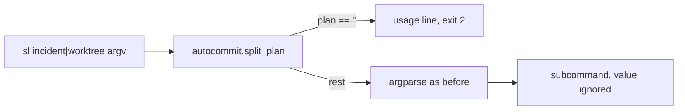
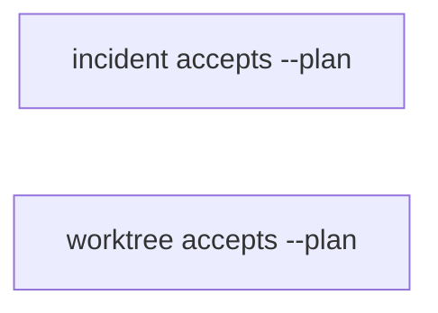

# Superlite: sl worktree and sl incident accept and ignore --plan (B42)

**Goal:** fix #336: `sl worktree ensure` and `sl incident hotspots` exit 2 with `unrecognized arguments: --plan`, although every lead brief says to pass `--plan .superlite` to every sl call.
**Architecture:** each tool's `main` removes every `--plan P` / `--plan=P` from argv with `autocommit.split_plan` (as `trees.main` does since B31) before argparse runs; the value is ignored (Max's decision: accept and ignore). T1 is incident.py, T2 is worktree.py.
**Tech stack:** Python 3.10+ stdlib, pytest (through `sl run_tests`).
**Spec:** this file, section Design; issue #336 Expected line.
**Detail:** contracts
**Target-min:** 11
**Wave0:** none

Global constraints:
- Every code line in `skills/subagent-driven-development/scripts/*.py` carries the repo's trailing `# O(...)` complexity comment where the surrounding function's lines do; tests do not. Stdlib only.
- Existing tests stay green. An existing test file changes only when the task Owns it. If another existing test turns red, report it in DONE_WITH_CONCERNS with the test id and the reason instead of editing it.
- Reuse `autocommit.split_plan(argv) -> (rest, plan)` unchanged (imported inside `main`, as `trees.main` does): `plan` is None when absent, `""` when `--plan` has no value or is followed by an item starting with `--`, else the last value.
- Run `sl` as an executable (`<abs>/sl ...`). Verify with `<abs>/sl run_tests --fast <own test files> --task Tn --background`, then run the printed `wait:` line in the foreground and end the turn only after it reports.
- Tests clear SUPERLITE_FLEET_ROLE, SUPERLITE_FLEET_PARENT_DIR and SUPERLITE_STATE_DIR with `monkeypatch.delenv(..., raising=False)` (and drop them from a subprocess env).
- No version edits (the ship step bumps the version). Never run `scripts/evals.sh`, `claude plugin eval` or `scripts/test_layers.py run`.

Ruling: `--plan` is accepted anywhere on every subcommand of both tools (incident add, resolve, hotspots, summary; worktree ensure, inplace), not only on hotspots and ensure, because lead briefs pass it to every sl call - cost if wrong: none, the value is ignored.
Ruling: the value is ignored (Max's decision): the incident log stays `--log` or `state.incident_log()`, the worktree repo stays `--repo` or the cwd, inplace's state folder stays `state.resolve()` - cost if wrong: a later issue makes the value pick the checkout, as autocommit and trees do.
Ruling: a valueless `--plan` is a usage error (exit 2, one stderr usage line naming `[--plan P]`), as for `trees` and `autocommit` - cost if wrong: none.
Ruling: detail contracts; no probe adapter (CLI argv handling; Review Focus cases are named pytest cases); already in the lead worktree, so no `sl worktree ensure`; layers: unit only (scripts/** is outside headless, tui and evals) - cost if wrong: one NEEDS_CONTEXT round.
LAYERS: unit

## Design

### 1. incident.py takes --plan anywhere (T1)
- `main(argv=None)`: `argv = list(sys.argv[1:] if argv is None else argv)`, then `argv, plan = autocommit.split_plan(argv)` (import autocommit after the existing `sys.path.insert`). When `plan == ""`: print `usage: incident.py add|resolve|hotspots|summary ... [--plan P]` on stderr and return 2. Otherwise parse `argv` as today; the plan value is not used.
- The ArgumentParser gets `epilog="--plan P (anywhere): accepted and ignored; lead briefs pass it to every sl call (#336)"`, so `incident.py --help` names it.
- Module docstring: one more line naming `--plan P` (accepted anywhere, ignored).

### 2. worktree.py takes --plan anywhere (T2)
- `main(argv=None)`: `import autocommit` inside main; `argv = list(sys.argv[1:] if argv is None else argv)`; `argv, plan = autocommit.split_plan(argv)`. When `plan == ""`: print `usage: worktree ensure TOPIC [--repo DIR] | inplace --reason TEXT [--plan P]` on stderr and return 2, before any git call (no worktree is created). Otherwise parse `argv` as today; the plan value is not used.
- The ArgumentParser gets `epilog="--plan P (anywhere): accepted and ignored; lead briefs pass it to every sl call (#336)"`.
- Module docstring usage lines end with `[--plan P]` and one sentence says the value is ignored.

## Coverage

| Category | State | Basis |
|---|---|---|
| Scope and success criteria | settled | #336 Expected line; Max: accept and ignore |
| Domain and data model | n/a | no data change |
| Persistence and migration | n/a | nothing stored |
| Interfaces and contracts | ruled | one optional flag on two CLIs; valueless is exit 2 |
| UI states | n/a | CLI text only |
| Concurrency and state ownership | n/a | no new state |
| Error handling and recovery | ruled | valueless `--plan` exits 2 with a usage line |
| Security and privacy | n/a | the value is never read |
| Performance and limits | n/a | one argv pass |
| Observability | settled | `--help` epilog names the flag |
| Testing strategy | settled | main(argv) cases plus one `sl` subprocess case per tool |
| Compatibility | settled | calls without `--plan` behave as before |
| Rollout | ruled | one PR; version bump at ship |
| Research unknowns | n/a | none |

## File structure
- `skills/subagent-driven-development/scripts/incident.py`, `tests/scripts/test_incident_plan.py` (T1).
- `skills/subagent-driven-development/scripts/worktree.py`, `tests/scripts/test_worktree_plan.py` (T2).

## Task graph

```mermaid
%% schedule
gantt
  title Predicted schedule (mm:ss)
  dateFormat X
  axisFormat %M:%S
  section lane 1
  T2 worktree accept and ignore --plan any :t2, 0, 66s
  section lane 2
  T1 incident accept and ignore --plan any :t1, 0, 65s
```

critical path: T2 (1.1 min) · peak width 2 · predicted build 1.1 min · predicted total ≈ 4.6 min (target ✓)

## Package: incident CLI
App type: CLI. Categories: protocol (argv), file (which log is written). Specific risks: the `--plan` value read as a log path; a `--plan` before the subcommand still rejected.
**Probe entry:** none (Ruling: no probe adapter).

### T1 incident: accept and ignore --plan anywhere · Complexity 2 · Est. context 25k
**Owns:** skills/subagent-driven-development/scripts/incident.py, tests/scripts/test_incident_plan.py
**Components:** 1
**LOC owned:** 70
**Tests:** fast
**Model:** sonnet
**Est. time:** 1.8 min (1 component, about 70 LOC, fast tests)
**Covers:** 1
**Consumes:** none
**Produces:** incident.main(argv: list[str] | None = None) -> int (accepts `--plan P` / `--plan=P` anywhere)
**Review Focus:**
Test fixture: `sys.path.insert(0, SCRIPTS)`, `import incident`; a log `L = tmp_path / "i.jsonl"` holding two entries written by `incident.main(["add", "--file", "a.py", "--line", "3", "--context", "c", "--log", str(L)])` and the same for `b.py` line 5; `other = tmp_path / "other" / ".superlite"` (not created).
protocol: `test_hotspots_accepts_plan_anywhere` (parametrized argv: `["hotspots", "--log", L, "--plan", other]`, `["--plan", other, "hotspots", "--log", L]`, `["hotspots", "--plan=" + other, "--log", L]`, `["hotspots", "--log", L, "--plan", "x", "--plan=y"]` -> `main` returns 0 and stdout equals the stdout of `main(["hotspots", "--log", L])`, two JSON lines).
file: `test_add_with_plan_writes_only_the_log` (`main(["add", "--file", "c.py", "--line", "1", "--context", "x", "--log", L, "--plan", other]) == 0` -> L has 3 lines; `other` does not exist).
protocol: `test_resolve_and_summary_accept_plan` (`main(["resolve", "--file", "a.py", "--line", "3", "--ruling", "r", "--log", L, "--plan", other]) == 0`; `main(["summary", "--log", L, "--plan=" + other]) == 0` and stdout starts with `total: 3`).
protocol: `test_valueless_plan_is_usage_error` (parametrized: `["hotspots", "--log", L, "--plan"]`, `["hotspots", "--plan", "--log", L]` -> returns 2; stderr is exactly `usage: incident.py add|resolve|hotspots|summary ... [--plan P]\n`; stdout empty).
protocol: `test_help_names_plan` (`main(["--help"])` raises SystemExit with code 0; stdout contains `--plan P (anywhere): accepted and ignored`).
protocol: `test_sl_incident_hotspots_with_plan` (subprocess `[SL, "incident", "hotspots", "--files", "a.py", "--log", L, "--plan", ".superlite"]` with cwd tmp_path -> returncode 0, stderr has no `unrecognized arguments`, stdout one JSON line with `"file": "a.py"`).
**Steps:** 1 failing tests, 2 run: FAIL, 3 implement Design 1, 4 run: PASS (own file plus `tests/scripts/test_incident.py tests/scripts/test_incident_resolve.py`).

## Package: worktree CLI
App type: CLI. Categories: protocol (argv), state (no worktree created on a usage error). Specific risks: `--plan .superlite` taken as the topic; a valueless `--plan` still creating a worktree.
**Probe entry:** none.

### T2 worktree: accept and ignore --plan anywhere · Complexity 2 · Est. context 27k
**Owns:** skills/subagent-driven-development/scripts/worktree.py, tests/scripts/test_worktree_plan.py
**Components:** 1
**LOC owned:** 80
**Tests:** fast
**Model:** sonnet
**Est. time:** 2.0 min (1 component, about 80 LOC, fast tests)
**Covers:** 2
**Consumes:** none
**Produces:** worktree.main(argv: list[str] | None = None) -> int (accepts `--plan P` / `--plan=P` anywhere)
**Review Focus:**
Test fixture: copy `git` and `init` from `tests/scripts/test_worktree.py` (do not import them: that module's fixtures stay its own); `repo = init(tmp_path.resolve() / "repo")`; `wt = repo / ".claude" / "worktrees" / "superlite-topic"`; `sys.path.insert(0, SCRIPTS)`, `import worktree`.
protocol: `test_ensure_accepts_plan_anywhere` (parametrized argv: `["ensure", "topic", "--repo", repo, "--plan", ".superlite"]`, `["--plan", ".superlite", "ensure", "topic", "--repo", repo]`, `["ensure", "--plan=/elsewhere/.superlite", "topic", "--repo", repo]` -> `main` returns 0, stdout last line is `wt.as_posix()`, branch of wt is `superlite/topic`; no worktree named after `.superlite`).
protocol: `test_ensure_with_plan_inside_linked_worktree` (after one ensure, `main(["ensure", "other", "--repo", wt, "--plan", ".superlite"]) == 0` and stdout is `wt.as_posix() + "\n"`).
state: `test_valueless_plan_is_usage_error_and_creates_nothing` (parametrized: `["ensure", "topic", "--repo", repo, "--plan"]`, `["ensure", "topic", "--plan", "--repo", repo]` -> returns 2; stderr is exactly `usage: worktree ensure TOPIC [--repo DIR] | inplace --reason TEXT [--plan P]\n`; `wt` does not exist; `git worktree list --porcelain` of repo has one `worktree ` line).
protocol: `test_inplace_accepts_plan` (cwd tmp_path via monkeypatch.chdir, no marker -> `main(["inplace", "--reason", "r", "--plan", ".superlite"]) == 0`; stderr holds `no inline flow is marked here`).
protocol: `test_help_names_plan` (`main(["--help"])` raises SystemExit with code 0; stdout contains `--plan P (anywhere): accepted and ignored`).
protocol: `test_sl_worktree_ensure_with_plan` (subprocess `["bash", SL, "worktree", "ensure", "topic", "--plan", ".superlite"]` with cwd repo -> returncode 0, stderr has no `unrecognized arguments`, stdout last line is `wt.as_posix()`).
**Steps:** 1 failing tests, 2 run: FAIL, 3 implement Design 2, 4 run: PASS (own file plus `tests/scripts/test_worktree.py tests/scripts/test_worktree_bootstrap.py`).

## Review Focus
- incident CLI: protocol, file; cases in T1.
- worktree CLI: protocol, state; cases in T2.

## Self-review
- Coverage: #336 incident hotspots -> T1; worktree ensure -> T2. No placeholders. No edges: both tasks only call the unchanged `autocommit.split_plan`; owned files are disjoint.
