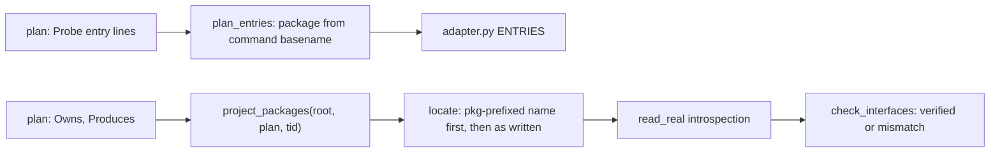
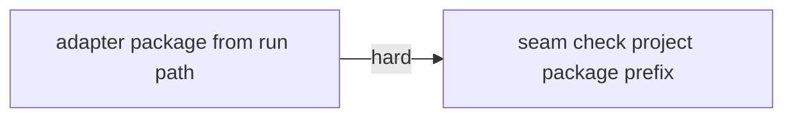

# Superlite: probe adapter on dotted run paths, seam check on package-relative names (B53)

**Goal:** #347: `sl plan_tools adapter` builds the adapter for a plan whose `run=` entry starts with a path such as `.venv/bin/dashmax` instead of crashing with IndexError. #348: the seam check resolves a Produces name written relative to the project package (`core.sunsama_api.client` in package `dashmax`) and logs `verified`, not a false AttributeError incident.
**Architecture:** both fixes sit in pt_review.py. `plan_entries` names an entry's package from the basename of its command; a new `project_packages` helper names the project's top packages from the plan's owned files, and `locate` tries `<package>.<name>` before the name as written.
**Tech stack:** Python 3 stdlib, pytest (through `sl run_tests`).
**Spec:** this file, section Design; issues #347 and #348 (Expected lines) and Max's decisions.
**Detail:** tests
**Target-min:** 11
**Wave0:** none
**Coverage:** off

Global constraints:
- Keep the repo's `# O(...)` comment on every new code line (see any function in pt_review.py). Change no line outside what the task needs.
- Add the task's tests to tests/scripts/test_pt_review.py, appended at the end of the file; never change an existing test. If an existing test turns red, report it in DONE_WITH_CONCERNS with the test id and the reason instead of editing it.
- Run `sl` as an executable (`<abs>/sl ...`). Verify with `<abs>/sl run_tests --fast tests/scripts/test_pt_review.py --task Tn --background`, then run the printed `wait:` line in the foreground and end the turn only after it reports.
- No version edits (the ship step bumps the version). Never run `scripts/test_layers.py run`, `scripts/evals.sh` or `claude plugin eval` (the coordinator runs the layers).

## Design

#347, reproduced: a plan with `**Probe entry:** run=.venv/bin/dashmax registry sunsama-sync` crashes in `plan_entries` (`first.split(".")[0]` is empty, `.split()[0]` raises). A package without a Probe entry contributes no entry line and never crashed; the same plan without the `run=.venv/...` line builds its adapter. Max's decision: skip the package without a probe entry (adapter for the others, no hard error). That already holds; the fix makes the dotted-path entry build too.

New package naming in `plan_entries`: strip a leading `[<path>/]python[3]|py -m ` from the first target, take its first whitespace word, cut everything up to the last `/` or `\`, keep the part before the first `.`; an empty result falls back to `p<n>` as today. Examples: `run=.venv/bin/dashmax registry sunsama-sync` -> `dashmax`, `run=./tool --verbose` -> `tool`, `run=.build/debug/MyExec` -> `MyExec`, `run=.venv/bin/python -m dashmax sync` -> `dashmax`, `call=minisheet.Workbook.set` -> `minisheet` (unchanged), `run=./` -> `p0`.

#348, reproduced: `core.sunsama_api.client(token: str) -> object` owned by T1 at `src/dashmax/core/sunsama_api.py` gives `AttributeError: core not found in dashmax.core.sunsama_api`; `locate` finds no module for `core.sunsama_api` and falls back to the first owned file with the whole name as attribute chain. Max's decision: try the project-package prefix first, then the name as written (keeps absolute names working).

New helper `project_packages(root, plan, tid)`: the first dotted part of `module_name(root, root / f)` for every owned non-test `.py` file whose module name has a dot, the task's own files first, then the other tasks' files in plan order, without duplicates. `locate` first tries, for each such package `pkg` with `parts[0] != pkg`, the names `pkg.parts[:k]` with k from len(parts)-1 down to 1 through `find_module_file` (the module always holds `pkg` plus at least one part of the name, so `pkg/__init__.py` alone never matches); on a hit it returns that module, the rest of the name as chain and the file. Otherwise the existing lookup runs unchanged.

Ruling: a `run=` entry whose first word is a path now gets the basename as package (`bin/tool` -> `tool`, was `bin/tool`) - one naming rule for every path - cost if wrong: probe_run's stale check regenerates such adapters once.
Ruling: the prefix applies to the seam/contract check's `locate` only; the probe adapter's `call=` resolution stays as written (outside #348).
Ruling: T1 --> T2 is sequential because both tasks own pt_review.py and test_pt_review.py (the batch's only two files).
Ruling: detail tests; no Wave 0 (the project builds); no Probe entry (pt_review is covered by in-process tests); already in the lead worktree, so no `sl worktree ensure`.
LAYERS: unit



## File structure

- skills/subagent-driven-development/scripts/pt_review.py: `plan_entries` package naming (T1); `project_packages` and `locate` prefix lookup (T2).
- tests/scripts/test_pt_review.py: #347 tests (T1), #348 tests (T2), appended.

## Task graph

```mermaid
%% schedule
gantt
  title Predicted schedule (mm:ss)
  dateFormat X
  axisFormat %M:%S
  section lane 1
  T1 adapter package from run path :t1, 0, 62s
  T2 seam check project package prefix :t2, 62, 67s
```





critical path: T1 → T2 (2.1 min) · peak width 1 · predicted build 2.1 min · predicted total ≈ 5.6 min (target ✓)

## Predicted schedule

## pt_review

App type: CLI and library. Categories: protocol (Probe entry forms, Produces name forms), file (module lookup on disk).

### T1 adapter package from run path · Complexity 2 (O-1) · Est. context 38k
**Owns:** skills/subagent-driven-development/scripts/pt_review.py, tests/scripts/test_pt_review.py
**Components:** 1
**LOC owned:** 50
**Tests:** fast
**Model:** sonnet
**Est. time:** 1.5 min (1 component, about 50 LOC, fast tests)
**Consumes:** none
**Produces:** none
**Covers:** Design
**Review Focus:** `test_plan_entries_package_from_command_347`: the nine entry forms map to the packages listed; `test_adapter_skips_package_without_probe_entry_347`: a three-package plan (call, run with `.venv/bin` path, no entry) writes an adapter with two entries and its `run` executes the relative path.
**Test code (verbatim):** append to tests/scripts/test_pt_review.py
````python
# ----------------------------------------------------------------------------- adapter: run= paths (#347)


@pytest.mark.parametrize("entry, package", [
    ("run=.venv/bin/dashmax registry sunsama-sync", "dashmax"),
    ("run=./tool --verbose", "tool"),
    ("run=.build/debug/MyExec", "MyExec"),
    ("run=bin/tool", "tool"),
    ("run=.venv/bin/python -m dashmax sync", "dashmax"),
    ("run=python -m minisheet", "minisheet"),
    ("call=minisheet.Workbook.set", "minisheet"),
    ("serve=minisheet.server.create_server(Workbook())", "minisheet"),
    ("run=./", "p0"),
])
def test_plan_entries_package_from_command_347(tmp_path: Path, entry: str, package: str):
    plan = tmp_path / "plan.md"
    plan.write_text(f"**Probe entry:** {entry}\n", encoding="utf-8")
    assert pt_review.plan_entries(pt_review.parse_plan(plan))[0]["package"] == package


@pytest.mark.skipif(sys.platform == "win32", reason="runs a POSIX shell script")
def test_adapter_skips_package_without_probe_entry_347(tmp_path: Path):
    tool = tmp_path / ".venv" / "bin" / "pkgtool"
    tool.parent.mkdir(parents=True)
    tool.write_text('#!/bin/sh\necho synced "$@"\n', encoding="utf-8")
    tool.chmod(0o755)
    plan = tmp_path / "plan.md"
    plan.write_text("# Plan\n\n## Package lib\n**Probe entry:** call=pkg.mod.fn\n\n"
                    "## Package cli\n**Probe entry:** run=.venv/bin/pkgtool sync\n\n"
                    "## Package http\nNetwork-only client, no runnable entry.\n", encoding="utf-8")
    out = tmp_path / ".superlite" / "probes" / "adapter.py"
    assert run("adapter", "--plan", str(plan), "--root", str(tmp_path), "--out", str(out)) == 0
    assert pt_review.plan_entries(pt_review.parse_plan(plan)) == [
        {"package": "pkg", "call": "pkg.mod.fn"}, {"package": "pkgtool", "run": ".venv/bin/pkgtool sync"}]
    spec = importlib.util.spec_from_file_location("probe_adapter_347", out)
    adapter = importlib.util.module_from_spec(spec)
    try:
        spec.loader.exec_module(adapter)
        rc, so, _err = adapter.run(["now"], package="pkgtool")
        assert rc == 0 and so.strip() == "synced sync now"
    finally:
        sys.path[:] = [p for p in sys.path if not p.startswith(str(tmp_path))]
````
**Steps:** 1 append the tests, 2 run: FAIL (IndexError), 3 change the package expression in `plan_entries` per Design, 4 run: PASS
**Notes:** keep the `p<n>` fallback; the `python -m` strip gains an optional path before `python`.

### T2 seam check project package prefix · Complexity 3 (O-1) · Est. context 44k
**Owns:** skills/subagent-driven-development/scripts/pt_review.py, tests/scripts/test_pt_review.py
**Components:** 1
**LOC owned:** 95
**Tests:** fast
**Model:** sonnet
**Est. time:** 2 min (1 component, about 95 LOC, fast tests)
**Consumes:** none
**Produces:** pt_review.project_packages(root: Path, plan: Plan, tid: str) -> list[str]
**Covers:** Design
**Review Focus:** `test_locate_tries_project_package_prefix_first_348`: with both `src/core/sunsama_api.py` and `src/dashmax/core/sunsama_api.py` present, `core.sunsama_api.client` resolves to `dashmax.core.sunsama_api`; `test_contract_relative_name_missing_attribute_still_reported_348`: a missing attribute under a relative name still fails.
**Test code (verbatim):** append to tests/scripts/test_pt_review.py
````python
# ----------------------------------------------------------------------------- contract: package-relative Produces names (#348)

RELATIVE_348 = "core.sunsama_api.client(token: str) -> object · registry.settings.ToolTokens(a: str)"


def dashmax(root: Path, produces: str = RELATIVE_348) -> Path:
    pkg = root / "src" / "dashmax"
    for d in (pkg / "core", pkg / "registry"):
        d.mkdir(parents=True)
        (d / "__init__.py").write_text("", encoding="utf-8")
    (pkg / "__init__.py").write_text("", encoding="utf-8")
    (pkg / "use.py").write_text("", encoding="utf-8")
    (pkg / "core" / "sunsama_api.py").write_text(
        "def client(token: str) -> object:\n    return token\n", encoding="utf-8")
    (pkg / "registry" / "settings.py").write_text(
        "class ToolTokens:\n    def __init__(self, a: str):\n        self.a = a\n", encoding="utf-8")
    plan = root / "plan.md"
    plan.write_text("\n".join([
        "# dashmax plan", "", "```mermaid", "flowchart LR", "%% taskgraph", "T1 --> T2", "```", "",
        "### T1 api",
        "**Owns:** src/dashmax/core/sunsama_api.py, src/dashmax/registry/settings.py",
        f"**Produces:** {produces}", "",
        "### T2 use",
        "**Owns:** src/dashmax/use.py",
        "**Consumes:** core.sunsama_api.client (T1)", ""]), encoding="utf-8")
    return plan


def seam_348(plan: Path, root: Path, log: Path) -> int:
    return run("contract", "--plan", str(plan), "--root", str(root), "--seam", "T1,T2", "--log", str(log))


def test_contract_relative_produces_names_verified_348(tmp_path: Path, capsys):
    log = tmp_path / "incidents.jsonl"
    assert seam_348(dashmax(tmp_path), tmp_path, log) == 0
    out = capsys.readouterr().out
    assert "PASS: verified: seam T1↔T2" in out and "AttributeError" not in out
    assert [json.loads(ln)["kind"] for ln in log.read_text(encoding="utf-8").splitlines()] == ["verified"]


def test_contract_absolute_produces_names_still_verified_348(tmp_path: Path, capsys):
    plan = dashmax(tmp_path, "dashmax.core.sunsama_api.client(token: str) -> object · "
                             "dashmax.registry.settings.ToolTokens(a: str)")
    assert seam_348(plan, tmp_path, tmp_path / "incidents.jsonl") == 0
    assert "PASS: verified: seam T1↔T2" in capsys.readouterr().out


def test_contract_relative_name_missing_attribute_still_reported_348(tmp_path: Path, capsys):
    plan = dashmax(tmp_path, "core.sunsama_api.missing(token: str) -> object")
    assert seam_348(plan, tmp_path, tmp_path / "incidents.jsonl") == 1
    assert "AttributeError: missing not found in dashmax.core.sunsama_api" in capsys.readouterr().out


def test_locate_tries_project_package_prefix_first_348(tmp_path: Path):
    plan_path = dashmax(tmp_path)
    top = tmp_path / "src" / "core"
    top.mkdir()
    (top / "__init__.py").write_text("", encoding="utf-8")
    (top / "sunsama_api.py").write_text("def client(other: int) -> int:\n    return other\n", encoding="utf-8")
    plan = pt_review.parse_plan(plan_path)
    items = {p.qual: p for p in pt_review.planned_items(plan, ["T1"])}
    mod, chain, f = pt_review.locate(tmp_path, plan, items["core.sunsama_api.client"])
    assert (mod, chain) == ("dashmax.core.sunsama_api", ["client"])
    assert f.resolve() == (tmp_path / "src" / "dashmax" / "core" / "sunsama_api.py").resolve()
    mod, chain, _f = pt_review.locate(tmp_path, plan, items["registry.settings.ToolTokens"])
    assert (mod, chain) == ("dashmax.registry.settings", ["ToolTokens"])


def test_project_packages_from_owned_files_348(tmp_path: Path):
    plan = pt_review.parse_plan(dashmax(tmp_path))
    assert pt_review.project_packages(tmp_path, plan, "T1") == ["dashmax"]
    assert pt_review.project_packages(tmp_path, plan, "T2") == ["dashmax"]
````
**Steps:** 1 append the tests, 2 run: FAIL, 3 add `project_packages` above `locate` and the prefix loop at the top of `locate` per Design, 4 run: PASS (the existing contract tests stay green: short names such as `Workbook.set` never match `pkg/__init__.py`)
**Notes:** `project_packages` skips test paths (`TEST_PATH_RE`) like `locate`'s owned list does.

## Review Focus

- pt_review (CLI and library): protocol, file. Probe entry: none (in-process tests cover both commands).

## Self-review

Coverage: #347 -> T1, #348 -> T2. No placeholders. T1 and T2 share both files, so the hard edge keeps them sequential. Every task has Components, LOC owned, Tests, Model.
