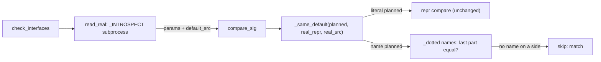
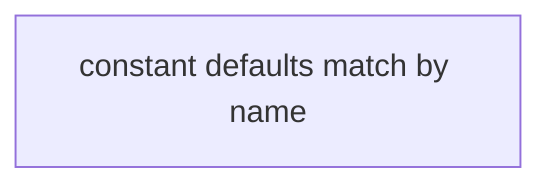

# Superlite: `pt_review contract` matches a default that names a module constant by name (B66)

**Goal:** fix #402: a Produces default that names a module constant built by a call (`tid=TID`, with `TID = id_re()` at module level) was reported as a contract mismatch, because the check compared the planned text `TID` with the real value's repr (`re.compile('...')`). Max's decision: match by name, skip when not a literal.
**Architecture:** the introspection subprocess (`pt_review._INTROSPECT`) also reports each default's source expression (`default_src`, read from the function's own AST). `pt_review._same_default` keeps the literal comparison for a literal planned default; a non-literal planned default matches by name against that source, and is skipped otherwise. `compare_sig` shows the source name in the mismatch line.
**Tech stack:** Python 3.10+ stdlib, pytest (through `sl run_tests`).
**Spec:** this file, section Design; issue #402's Expected line and Max's decision.
**Detail:** tests
**Target-min:** 11
**Wave0:** none
**Max chars:** 16000

Global constraints:
- Every code line in `skills/subagent-driven-development/scripts/` outside string literals carries the repo's trailing `# O(...)` complexity comment (short notes after `|`); tests do not. Stdlib only.
- Existing tests stay green and no existing test file changes (another lead may own them). If an existing test turns red, report it in DONE_WITH_CONCERNS with the test id and the reason instead of editing it.
- Run `sl` as an executable (`<abs>/sl ...`). Verify with `<abs>/sl run_tests --fast tests/scripts/test_pt_review_constant_default_402.py tests/scripts/test_pt_review.py tests/scripts/test_pt_review_owned_decl_383.py tests/scripts/test_pt_review_declarations.py tests/scripts/test_pt_review_pix_v2.py --task T1 --background`, then run the printed `wait:` line in the foreground and end the turn only after it reports. Never raw `pytest`, never the e2e or eval layers (coordinator's step).
- No version edits (the ship step bumps the version). Touch only the files in Owns.

Ruling: Max's decision: a planned default that is not a literal matches by name (last dotted component of the plan's default equals the last dotted component of the code's default expression); when either side is not a plain name or attribute chain, or the code's default source cannot be read, the default is skipped - cost if wrong: a planned name whose code default is a literal (`tid=TID` vs `tid=None`) is not reported.
Ruling: a literal planned default (`ast.literal_eval` succeeds) keeps today's repr comparison unchanged - cost if wrong: none.
Ruling: the default's source comes from the function's own AST in the introspection subprocess (`inspect.unwrap`, `inspect.getsource`, `textwrap.dedent`, first def or lambda found by `ast.walk`); a class uses its `__init__`; any failure gives no source - cost if wrong: a class whose signature comes from `__new__` or a metaclass gets no source and is skipped.
Ruling: no identity lookup in module globals (`module.TID is default`): with the skip rule it can only turn a skip into a match - cost if wrong: none.
Ruling: the new tests live in a new file `tests/scripts/test_pt_review_constant_default_402.py`; docs/tools.md (outside B66's files) gets no row change - cost if wrong: none, the contract row names no default rule.
Ruling: detail tests; no probe adapter (library inside a CLI; Review Focus cases run as named pytest cases) - cost if wrong: no generated probes.
Ruling: already in the lead worktree on branch superlite/b66-pt-review-constant-defaults - cost if wrong: none.
LAYERS: unit



## Design

1. `_INTROSPECT` gains a helper `default_srcs(obj) -> dict` (imports `ast`, `textwrap`): `fn = obj.__init__ if inspect.isclass(obj) else obj`, `fn = inspect.unwrap(fn)`, `tree = ast.parse(textwrap.dedent(inspect.getsource(fn)))`, the first `FunctionDef`, `AsyncFunctionDef` or `Lambda` from `ast.walk(tree)`; it maps each positional parameter with a default (the last `len(defaults)` of `posonlyargs + args`) and each keyword-only parameter with a non-None `kw_defaults` entry to `ast.unparse(default)`. Any exception returns `{}`. Each param dict gains `"default_src": srcs.get(p.name)` when the parameter has a default, else `None`. Nothing else in the subprocess output changes.
2. `_dotted(expr: str | None) -> list[str] | None`: `None` for an empty value or a `SyntaxError`; parses `expr.strip()` with `mode="eval"`; an `ast.Attribute` chain ending in an `ast.Name` gives its parts in source order (`metrics.TID` -> `["metrics", "TID"]`, `TID` -> `["TID"]`); anything else (a call, a constant such as `None`, a subscript) gives `None`.
3. `_same_default(planned: str, real_repr: str | None, real_src: str | None = None) -> bool`: when `ast.literal_eval(planned)` succeeds, return `repr(value) == real_repr` (today's rule). Otherwise `pn, rn = _dotted(planned), _dotted(real_src)`; return `pn[-1] == rn[-1]` when both are lists, else `True` (skipped). The old text fallback (`planned.strip() == real_repr.strip()`) goes.
4. `compare_sig` calls `_same_default(w["default"], h["default"], h.get("default_src"))`; on a mismatch the shown real default is `h.get("default_src") or h["default"]` when `_dotted(w["default"])` is a list, else `h["default"]` (literal case keeps `default is 8080, planned 0`).
5. The module docstring's Produces line gains: a default that names a constant (`tid=TID`) matches the code's default by name; any other non-literal default is not compared.

## Coverage

| Category | State | Basis |
|---|---|---|
| Scope and success criteria | settled | #402 Expected line; Max's decision |
| Domain and data model | settled | param dicts gain `default_src` |
| Persistence and migration | n/a | no stored data |
| Interfaces and contracts | ruled | `_same_default` gains an optional third argument |
| UI states | n/a | CLI text only |
| Concurrency and state ownership | n/a | one subprocess, unchanged |
| Error handling and recovery | ruled | unreadable source -> no `default_src` -> skip |
| Security and privacy | n/a | reads the project's own source |
| Performance and limits | settled | one `getsource` and parse per checked item |
| Observability | settled | mismatch line names the code's default name |
| Testing strategy | settled | one new test file; real introspection on a tmp project |
| Compatibility | ruled | literal defaults unchanged; Python < 3.9 project interpreters get no source (`ast.unparse`), so skip |
| Rollout | ruled | one PR; version bump at ship |
| Research unknowns | n/a | reproduced from the code |

## File structure
- `skills/subagent-driven-development/scripts/pt_review.py`: `_INTROSPECT` `default_srcs`, `_dotted`, `_same_default`, `compare_sig`, docstring line (T1).
- `tests/scripts/test_pt_review_constant_default_402.py`: the Review Focus cases (T1).

## Task graph

```mermaid
%% schedule
gantt
  title Predicted schedule (mm:ss)
  dateFormat X
  axisFormat %M:%S
  section lane 1
  T1 constant defaults match by name :t1, 0, 90s
```




critical path: T1 (1.5 min) · peak width 1 · predicted build 1.5 min · predicted total ≈ 5.0 min (target ✓)

## Package: pt_review contract defaults (library inside a CLI)
App type: library. Categories: deep (attribute chains, decorated and nested defs), encoding (source text normalised by `ast.unparse`), state (literal path unchanged).
**Probe entry:** none (Ruling: no probe adapter).

### T1 constant defaults match by name · Complexity 3 · Est. context 40k
**Owns:** skills/subagent-driven-development/scripts/pt_review.py, tests/scripts/test_pt_review_constant_default_402.py
**Components:** 2
**LOC owned:** 120
**Tests:** fast
**Model:** sonnet
**Est. time:** 2.5 min (2 components, about 120 LOC, fast tests)
**Covers:** 1, 2, 3, 4, 5
**Consumes:** existing `pt_review.check_interfaces(plan, root, task_ids)` · existing `pt_review.read_real(root, located)` · existing `pt_review.parse_plan(path)`
**Produces:** pt_review._dotted(expr: str | None) -> list[str] | None · pt_review._same_default(planned: str, real_repr: str | None, real_src: str | None = None) -> bool
**Review Focus:** deep: `test_keyword_only_method_and_wrapped_defaults_match`, `test_dotted_planned_name_matches_last_component`; state: `test_literal_default_still_compared`; encoding: `test_read_real_reports_default_source`.
**Test code (verbatim):**
```python
"""#402: a Produces default that names a module constant matches by name, else is skipped when not a literal."""
from __future__ import annotations

import importlib.util
import sys
from pathlib import Path

import pytest

HERE = Path(__file__).resolve().parent
SCRIPT = HERE.parent.parent / "skills" / "subagent-driven-development" / "scripts" / "pt_review.py"

_spec = importlib.util.spec_from_file_location("pt_review", SCRIPT)
pt_review = importlib.util.module_from_spec(_spec)
sys.modules["pt_review"] = pt_review
_spec.loader.exec_module(pt_review)

CORE = '''\
import functools
import re


def id_re():
    return re.compile(r"T\\d+")


TID = id_re()
OTHER = re.compile("x")
PORT = 8080


def handover(text: str, tid=TID) -> list:
    return []


def kw(text: str, *, tid=TID) -> list:
    return []


def serve(port: int = 8080) -> None:
    return None


def wrap(fn):
    @functools.wraps(fn)
    def inner(*a, **k):
        return fn(*a, **k)
    return inner


@wrap
def wrapped(text: str, tid=TID) -> list:
    return []


class Box:
    def put(self, x: int, tid=TID) -> None:
        return None
'''


def project(root: Path) -> Path:
    (root / "src" / "pkg").mkdir(parents=True)
    (root / "src" / "pkg" / "__init__.py").write_text("", encoding="utf-8")
    (root / "src" / "pkg" / "core.py").write_text(CORE, encoding="utf-8")
    return root


def check(root: Path, produces: str) -> tuple[list[str], int]:
    project(root)
    (root / "plan.md").write_text(
        "# p\n\n```mermaid\nflowchart LR\n%% taskgraph\nT1\n```\n\n"
        f"### T1 core · Complexity 3\n**Owns:** src/pkg/core.py\n**Produces:** {produces}\n\n"
        "## Review Focus\n- core: state\n", encoding="utf-8")
    out, n = pt_review.check_interfaces(pt_review.parse_plan(root / "plan.md"), root, None)
    return [m.msg for m in out], n


@pytest.mark.parametrize("planned, real_repr, real_src, same", [
    ("TID", "re.compile('T\\\\d+')", "TID", True),
    ("metrics.TID", "re.compile('x')", "TID", True),
    ("TID", "re.compile('x')", "metrics.TID", True),
    ("TID", "re.compile('x')", None, True),
    ("TID", "re.compile('x')", "id_re()", True),
    ("TID", "None", "None", True),
    ("TID", "re.compile('x')", "OTHER", False),
    ("Path('.')", "PosixPath('.')", "Path('.')", True),
    ("0", "8080", "8080", False),
    ("0", "0", "ZERO", True),
    ("None", "re.compile('x')", "TID", False),
])
def test_same_default(planned, real_repr, real_src, same):
    assert pt_review._same_default(planned, real_repr, real_src) is same


def test_same_default_two_arguments_unchanged():
    assert pt_review._same_default("0", "0") is True
    assert pt_review._same_default("0", "8080") is False


@pytest.mark.parametrize("expr, parts", [
    ("TID", ["TID"]),
    ("metrics.TID", ["metrics", "TID"]),
    ("a.b.C", ["a", "b", "C"]),
    ("id_re()", None),
    ("None", None),
    ("x[0]", None),
    ("", None),
    (None, None),
    ("(", None),
])
def test_dotted(expr, parts):
    assert pt_review._dotted(expr) == parts


def test_constant_built_by_call_matches_by_name(tmp_path):
    assert check(tmp_path, "pkg.core.handover(text: str, tid=TID) -> list") == ([], 1)


def test_dotted_planned_name_matches_last_component(tmp_path):
    assert check(tmp_path, "pkg.core.handover(text: str, tid=core.TID) -> list") == ([], 1)


def test_keyword_only_method_and_wrapped_defaults_match(tmp_path):
    produces = ("pkg.core.kw(text: str, *, tid=TID) -> list · pkg.core.Box.put(x: int, tid=TID) -> None"
                " · pkg.core.wrapped(text: str, tid=TID) -> list")
    assert check(tmp_path, produces) == ([], 3)


def test_other_constant_name_is_a_mismatch(tmp_path):
    msgs, _n = check(tmp_path, "pkg.core.handover(text: str, tid=OTHER) -> list")
    assert len(msgs) == 1
    assert msgs[0].endswith("parameter 'tid' default is TID, planned OTHER")


def test_literal_default_still_compared(tmp_path):
    msgs, _n = check(tmp_path, "pkg.core.serve(port: int = 0) -> None")
    assert len(msgs) == 1
    assert msgs[0].endswith("parameter 'port' default is 8080, planned 0")


def test_planned_name_for_literal_source_is_skipped(tmp_path):
    assert check(tmp_path, "pkg.core.serve(port: int = PORT) -> None") == ([], 1)


def test_read_real_reports_default_source(tmp_path):
    project(tmp_path)
    got = pt_review.read_real(tmp_path, [("pkg.core", ["handover"]), ("pkg.core", ["Box", "put"]),
                                         ("pkg.core", ["serve"]), ("pkg.core", ["wrapped"])])
    assert [p["default_src"] for p in got[0]["params"]] == [None, "TID"]
    assert [p["default_src"] for p in got[1]["params"]] == [None, "TID"]
    assert got[2]["params"][0]["default_src"] == "8080"
    assert [p["default_src"] for p in got[3]["params"]] == [None, "TID"]
```
**Steps:** 1 failing tests, 2 run: FAIL, 3 implement Design 1 to 5 (read the Design section), 4 run: PASS (own file plus the verify files of Global constraints).
**Notes:** `default_srcs` lives inside the `_INTROSPECT` string (it runs in the project's interpreter), so its lines carry no `# O(...)` comments; keep it free of f-strings and of Python 3.10+ syntax beyond what the string already uses.

## Review Focus
Package pt_review contract defaults: deep (attribute chains, keyword-only, methods, `functools.wraps` wrappers), encoding (`ast.unparse` text of the default), state (literal defaults keep their repr comparison). All cases sit in T1.

## Self-review
- #402 (`tid=TID`, `TID = id_re()` reported): Design 1 to 3; `test_constant_built_by_call_matches_by_name`.
- Max's decision (match by name, skip when not a literal): Design 3; `test_same_default`, `test_planned_name_for_literal_source_is_skipped`.
- One task, one file plus its new test file; no edge, no stub.
