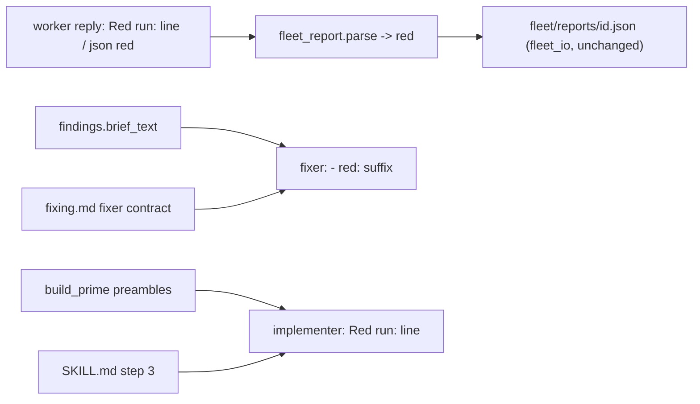
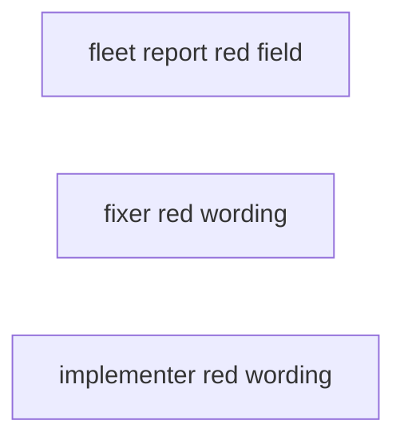

# Superlite: the fix brief, the fixer contract, the prime and the task-message report list name the red-run evidence; fleet reports carry a `red` field (B65)

**Goal:** fix #405: the red-run evidence (the implementer's `Red run:` report line, the fixer's `- red:` suffix, B59/#379) is named in the fix brief `findings.py` writes, the fixer contract in `fixing.md`, the TDD lines of every `build_prime` preamble and the task-message report list of the SDD `SKILL.md`; `fleet_report.parse` carries it as a `red` field in each worker's report JSON.
**Architecture:** T1 adds `red` to `fleet_report` (the WORK contract asks for it, `parse` returns it from the json block or the reply's last `Red run:` line; `fleet_io` already writes `{**rep, ...}` to `<sd>/fleet/reports/<id>.json`, so the field lands there unchanged). T2 changes the fixer side (fix brief, fixer contract). T3 changes the implementer side (three prime preambles, SKILL.md step 3, with a trim so SKILL.md stays under its 11700-char cap).
**Tech stack:** Python 3 stdlib, Markdown, pytest (through `sl run_tests`).
**Spec:** this file, section Design; issue #405 (Expected line).
**Detail:** tests
**Target-min:** 11
**Wave0:** none
**Coverage:** off

Global constraints:
- Insert or replace text exactly as the task's `Text (verbatim)` block gives it: same backticks, quotes, dashes and punctuation, no line wrapping inside a Markdown line. Change no other line of the file.
- Existing tests stay green. An existing test file never changes, except where a task's text says so. If another existing test turns red, report it in DONE_WITH_CONCERNS with the test id and the reason instead of editing it.
- Run `sl` as an executable (`<abs>/sl ...`). Verify with `<abs>/sl run_tests --fast <the task's test files> --task Tn --background`, then run the printed `wait:` line in the foreground and end the turn only after it reports.
- No version edits (the ship step bumps the version). Never run `scripts/test_layers.py run`, `scripts/evals.sh` or `claude plugin eval` (the coordinator runs the layers).

Ruling: Max chose a per-task `red` field in the report JSON; it is one string per worker report (a task, or a batch label, whose worker joins its lines), the json `red` when it is a non-empty string, else the reply's last `Red run:` line, else "" (because implementers already write a `Red run:` line by agents/implementer.md, so a reply whose json lacks the field still carries it; cost if wrong: a batch worker's per-task lines share one string).
Ruling: a json `red` that is not a string breaks the block like a non-string `tests` (consistent validation); the key is always present in `parse`'s result, so tests/scripts/test_fleet_report.py (the owned module's test file) gains `"red": ""` in its exact-dict expectations, nothing else.
Ruling: the fix brief also names the doc-only exemption (B43 follow-up for the same sentence), since a red run cannot exist for a doc-only fix.
Ruling: SKILL.md step 3 names "`Red run:` line" only (the cap leaves 14 chars); " (Fixing)" after `fixing.md` in the bold rule and the colon in "Keep `.superlite/pool.json`:" go to make room (both unpinned, the section name repeats the file name).
Ruling: each task adds one new test file under tests/scripts/ (new files no other lead owns); the plan file is the batch's other new file. Detail tests; no Wave 0 (the project builds); no probe adapter (no runnable entry); already in the lead worktree, so no `sl worktree ensure`.
LAYERS: unit, headless, evals

## Design

Issue #405, expected: the fix brief, the fixer contract, the prime's TDD lines and the SKILL.md task-message report list each name the red-run evidence, and the fleet report carries it as a field.



## File structure

- skills/subagent-driven-development/scripts/fleet_report.py: WORK asks for `red`; `parse` returns `red` (T1).
- tests/scripts/test_fleet_report.py: `"red": ""` added to exact-dict expectations (T1).
- tests/scripts/test_fleet_report_red_b65.py: pins T1's behaviour (T1).
- skills/subagent-driven-development/scripts/findings.py: fix brief sentence (T2).
- skills/subagent-driven-development/fixing.md: fixer contract clause (T2).
- tests/scripts/test_fixer_red_brief_b65.py: pins T2's text (T2).
- skills/subagent-driven-development/scripts/build_prime.py: red-run line in PREAMBLE, PREAMBLE_SLIM, PREAMBLE_MINI (T3).
- skills/subagent-driven-development/SKILL.md: step 3 report list, two trims (T3).
- tests/scripts/test_implementer_red_prime_b65.py: pins T3's text (T3).

## Task graph

```mermaid
%% schedule
gantt
  title Predicted schedule (mm:ss)
  dateFormat X
  axisFormat %M:%S
  section lane 1
  T2 fixer red wording :t2, 0, 78s
  section lane 2
  T3 implementer red wording :t3, 0, 78s
  section lane 3
  T1 fleet report red field :t1, 0, 69s
```





critical path: T2 (1.3 min) · peak width 3 · predicted build 1.3 min · predicted total ≈ 4.8 min (target ✓)

## Predicted schedule

## Fleet report

App type: library / parser. Categories: encoding (Markdown bold and bullet forms of the line), state (json field vs. line precedence). Probe entry: none (no runnable entry; unit tests cover it).

### T1 fleet report red field · Complexity 3 (O-1) · Est. context 36k
**Owns:** skills/subagent-driven-development/scripts/fleet_report.py, tests/scripts/test_fleet_report.py, tests/scripts/test_fleet_report_red_b65.py
**Components:** 1
**LOC owned:** 90
**Tests:** fast
**Model:** sonnet
**Est. time:** 2.5 min (1 component, about 90 LOC, fast tests)
**Consumes:** none
**Produces:** fleet_report.parse(text: str, label: str = "", allow_json: bool = True) -> dict
**Covers:** Design
**Review Focus:** `test_bold_bullet_line_without_json`: `- **Red run:** none - no test` gives `none - no test`; `test_non_string_red_breaks_the_block`: a list `red` makes `valid` False.
**Text (verbatim):** in `WORK`, insert `"red": "<the summary line of the run that saw your new tests fail, or none - no test>", ` right after `"tests": "<test command and result line>", ` (inside the same single-quoted string piece). Add `RED_LINE = re.compile(r"^[ \t]*(?:[-*][ \t]+)?\**Red run:\**[ \t]*(\S.*?)[ \t]*$", re.M)` with an `# O(1)` comment like its neighbours. `_red_line(text) -> str`: the last RED_LINE match's group 1, else "". In `_from_json`: `red = obj.get("red", "")`; a non-str `red` returns None (add it to the existing validity check); the returned dict gets `"red": red or _red_line(text)` after `"tests"`. In `parse`: `base` gets `"red": _red_line(text)` after `"tests"`. Docstring: the parse line lists `"red"` after `"tests"`, plus one sentence: "`red` is the json block's non-empty `red` string, else the reply's last `Red run:` line, else \"\"; a non-string `red` breaks the block." `REVIEW` stays unchanged. In tests/scripts/test_fleet_report.py add `"red": ""` to `GOOD`, `EMPTY` and the two explicit expected dicts (the `CHANGES_REQUESTED` ones), nothing else.
**Test code (verbatim):** tests/scripts/test_fleet_report_red_b65.py
```python
"""Worker reports carry the red-run evidence as a `red` field (#405)."""
from __future__ import annotations

import json
import sys
from pathlib import Path

ROOT = Path(__file__).resolve().parents[2]
sys.path.insert(0, str(ROOT / "skills" / "subagent-driven-development" / "scripts"))
import fleet_report as fr  # noqa: E402

RED = "tests (fast): 0 passed, 1 failed"
GOOD = {"status": "DONE", "files": ["src/a.py"], "tests": "3 passed", "findings": [], "summary": "ok"}


def block(obj):
    return "```json\n" + json.dumps(obj) + "\n```\n"


def test_json_red_field_is_carried():
    assert fr.parse("Status: DONE\n" + block({**GOOD, "red": RED})) == {**GOOD, "red": RED, "valid": True}


def test_json_without_red_takes_the_red_run_line():
    r = fr.parse("Red run: tests (fast): 0 passed, 2 failed\nStatus: DONE\n" + block(GOOD))
    assert r["valid"] and r["red"] == "tests (fast): 0 passed, 2 failed"


def test_empty_json_red_takes_the_red_run_line():
    r = fr.parse("- Red run: none - no test\nStatus: DONE\n" + block({**GOOD, "red": ""}))
    assert r["valid"] and r["red"] == "none - no test"


def test_bold_bullet_line_without_json():
    assert fr.parse("Status: DONE\n- **Red run:** none - no test\n") == {
        "status": "DONE", "files": [], "tests": "", "red": "none - no test", "findings": [], "summary": "",
        "valid": False}


def test_last_red_run_line_counts():
    text = "Red run: tests (fast): 0 passed, 1 failed\nRed run: tests (fast): 1 passed, 2 failed\nStatus: DONE"
    assert fr.parse(text)["red"] == "tests (fast): 1 passed, 2 failed"


def test_blank_red_run_line_is_empty():
    assert fr.parse("Red run:   \nStatus: DONE")["red"] == ""


def test_non_string_red_breaks_the_block():
    r = fr.parse("Status: DONE\n" + block({**GOOD, "red": ["T1: " + RED]}))
    assert r["status"] == "DONE" and not r["valid"] and r["red"] == ""


def test_no_red_anywhere_is_empty():
    for text in ("Status: DONE", "", "Verdict: APPROVED"):
        assert fr.parse(text)["red"] == "", text


def test_screen_text_still_reads_the_line():
    r = fr.parse("Status: DONE\nRed run: " + RED + "\n" + block({**GOOD, "red": "x"}), allow_json=False)
    assert r["red"] == RED and not r["valid"]


def test_work_contract_asks_for_red_between_tests_and_findings():
    field = '"red": "<the summary line of the run that saw your new tests fail, or none - no test>"'
    assert fr.WORK.count(field) == 1
    assert fr.WORK.index('"tests"') < fr.WORK.index(field) < fr.WORK.index('"findings"')
    assert '"red"' not in fr.REVIEW
```
**Steps:** 1 write the test file, 2 run: FAIL, 3 implement and add the keys to test_fleet_report.py, 4 run both files: PASS
**Notes:** Verify with `--fast tests/scripts/test_fleet_report_red_b65.py tests/scripts/test_fleet_report.py tests/scripts/test_fleet_io.py tests/regression/test_fleet_roles_review_b.py`.

## Agent wording

App type: docs (prompt text) plus two string constants. Categories: none apply (no code path); the risks are wording drift from agents/fixer-*.md and agents/implementer*.md (B59) and a broken pin of an earlier batch's test, which the tasks' tests and the existing tests cover.

### T2 fixer red wording · Complexity 2 (O-1) · Est. context 28k
**Owns:** skills/subagent-driven-development/scripts/findings.py, skills/subagent-driven-development/fixing.md, tests/scripts/test_fixer_red_brief_b65.py
**Components:** 2
**LOC owned:** 45
**Tests:** fast
**Kind:** mechanical
**Model:** haiku
**Est. time:** 2 min (2 components, about 45 LOC, fast tests)
**Consumes:** none
**Produces:** none
**Covers:** Design
**Review Focus:** `test_fix_brief_names_red_run_and_doc_only`: the brief holds the sentence once and no longer ends the old sentence at "each.".
**Text (verbatim):** in skills/subagent-driven-development/scripts/findings.py, replace the one source line
````text
              "Fix only these findings, one regression test each.",  # O(1)
````
with these four lines:
````text
              "Fix only these findings, one regression test each, except a doc- or comment-only fix (no code a test runs): "  # O(1)
              "its `FIXED` line ends `- no test: doc-only`. Red run first: run each regression test red before its fix "  # O(1)
              "(a fix already in place: take it out by hand for that run, then put it back); its `FIXED` line ends "  # O(1)
              "`- red: <that run's summary line>`, for example `- red: tests (fast): 0 passed, 1 failed`.",  # O(1)
````
In skills/subagent-driven-development/fixing.md, on the line that starts `- **Fixer contract:**`, replace
````text
and its report line ends `no test: doc-only`; run `"$SL" run_tests
````
with
````text
and its report line ends `no test: doc-only`; run each regression test red before its fix (a fix already in place is taken out by hand for that run) and end its `FIXED` line `- red: <that run's summary line>`; run `"$SL" run_tests
````
**Test code (verbatim):** tests/scripts/test_fixer_red_brief_b65.py
```python
"""The fix brief and the fixer contract name the red-run evidence (#405)."""
from __future__ import annotations

import sys
from pathlib import Path
from types import SimpleNamespace

ROOT = Path(__file__).resolve().parents[2]
sys.path.insert(0, str(ROOT / "skills" / "subagent-driven-development" / "scripts"))
import findings  # noqa: E402
import run_tests  # noqa: E402

BRIEF = ("Fix only these findings, one regression test each, except a doc- or comment-only fix (no code a test runs): "
         "its `FIXED` line ends `- no test: doc-only`. Red run first: run each regression test red before its fix "
         "(a fix already in place: take it out by hand for that run, then put it back); its `FIXED` line ends "
         "`- red: <that run's summary line>`, for example `- red: tests (fast): 0 passed, 1 failed`.")
CONTRACT = ("and its report line ends `no test: doc-only`; run each regression test red before its fix (a fix already "
            "in place is taken out by hand for that run) and end its `FIXED` line `- red: <that run's summary line>`; "
            "run `\"$SL\" run_tests --fast PATHS --background`")


def test_fix_brief_names_red_run_and_doc_only():
    task = SimpleNamespace(id="T2", owns=["src/a.py"])
    item = {"id": "F-T2-1", "file": "src/a.py", "line": 3, "problem": "p", "fix": "f", "tier": 1, "label": "FR1"}
    text = findings.brief_text("/abs/sl", Path("/abs/plan.md"), task, [item], 1)
    assert text.count(BRIEF) == 1
    assert "one regression test each.\n" not in text


def test_brief_example_matches_run_tests_summary_line():
    assert run_tests.summary_line({"mode": "fast", "passed": 0, "failed": 1}) == "tests (fast): 0 passed, 1 failed"


def test_fixer_contract_names_red_run():
    text = (ROOT / "skills" / "subagent-driven-development" / "fixing.md").read_text(encoding="utf-8")
    line = next(ln for ln in text.splitlines() if ln.startswith("- **Fixer contract:**"))
    assert line.count(CONTRACT) == 1
```
**Steps:** 1 write the test file, 2 run: FAIL, 3 apply the two replacements, 4 run: PASS
**Notes:** Verify with `--fast tests/scripts/test_fixer_red_brief_b65.py tests/scripts/test_findings_route.py tests/scripts/test_fixer_doc_only_b43.py tests/scripts/test_docs_b32_sdd.py`.

### T3 implementer red wording · Complexity 2 (O-1) · Est. context 30k
**Owns:** skills/subagent-driven-development/scripts/build_prime.py, skills/subagent-driven-development/SKILL.md, tests/scripts/test_implementer_red_prime_b65.py
**Components:** 2
**LOC owned:** 45
**Tests:** fast
**Kind:** mechanical
**Model:** haiku
**Est. time:** 2 min (2 components, about 45 LOC, fast tests)
**Consumes:** none
**Produces:** none
**Covers:** Design
**Review Focus:** `test_each_prime_names_the_red_run_after_its_tdd_line`: the red line sits right after the TDD line in all three preambles; `test_task_message_report_list_names_the_red_run_line`: SKILL.md stays at or under 11700 chars.
**Text (verbatim):** in skills/subagent-driven-development/scripts/build_prime.py, insert this line right after the line `- Test first: write the failing test, run it, implement, run it again.` in PREAMBLE and in PREAMBLE_SLIM, and right after the line `- Test first, run only the fast focused tests, code to the interfaces below. Never change a signature.` in PREAMBLE_MINI (one line each, no wrapping):
````text
- Red run first: run your new tests through the verify command before you write the code they test, and see them fail for the right reason. A test written together with its code, or one that passes at once, has no red run yet: break the code on purpose, run it red, then restore the code. Your report's `Red run:` line copies that run's summary line (for example `tests (fast): 0 passed, 1 failed`), or says `none - no test`.
````
In skills/subagent-driven-development/SKILL.md make three replacements. In step 3 replace `files, test result, open questions"` with `files, test result, `Red run:` line, open questions"` (that is, insert the 17 characters `` `Red run:` line, `` before `open questions`). On the bold line that starts `**You never edit code`, replace `` `fixing.md` (Fixing). `` with `` `fixing.md`. ``. Replace `` Keep `.superlite/pool.json`: (agents: `` with `` Keep `.superlite/pool.json` (agents: ``.
**Test code (verbatim):** tests/scripts/test_implementer_red_prime_b65.py
```python
"""The prime's TDD lines and the SDD task-message report list name the red-run evidence (#405)."""
from __future__ import annotations

import sys
from pathlib import Path

ROOT = Path(__file__).resolve().parents[2]
sys.path.insert(0, str(ROOT / "skills" / "subagent-driven-development" / "scripts"))
import build_prime  # noqa: E402

RED = ("- Red run first: run your new tests through the verify command before you write the code they test, and see "
       "them fail for the right reason. A test written together with its code, or one that passes at once, has no red "
       "run yet: break the code on purpose, run it red, then restore the code. Your report's `Red run:` line copies "
       "that run's summary line (for example `tests (fast): 0 passed, 1 failed`), or says `none - no test`.")
TDD = {"PREAMBLE": "- Test first: write the failing test, run it, implement, run it again.",
       "PREAMBLE_SLIM": "- Test first: write the failing test, run it, implement, run it again.",
       "PREAMBLE_MINI": "- Test first, run only the fast focused tests, code to the interfaces below. Never change a signature."}
SKILL = ROOT / "skills" / "subagent-driven-development" / "SKILL.md"


def test_each_prime_names_the_red_run_after_its_tdd_line():
    for name, tdd in TDD.items():
        lines = getattr(build_prime, name).splitlines()
        assert lines.count(RED) == 1, name
        assert lines[lines.index(RED) - 1] == tdd, name


def test_task_message_report_list_names_the_red_run_line():
    text = SKILL.read_text(encoding="utf-8")
    step3 = next(ln for ln in text.splitlines() if ln.startswith("3. "))
    assert ("status DONE / DONE_WITH_CONCERNS / NEEDS_CONTEXT / BLOCKED, files, test result, "
            "`Red run:` line, open questions\"") in step3
    assert len(text) <= 11700
```
**Steps:** 1 write the test file, 2 run: FAIL, 3 apply the insertions and replacements, 4 run: PASS
**Notes:** Verify with `--fast tests/scripts/test_implementer_red_prime_b65.py tests/scripts/test_slim_prime.py tests/scripts/test_build_prime_mini.py tests/scripts/test_prime_root.py tests/scripts/test_foreground_verify_rule.py tests/scripts/test_docs_b32_sdd.py tests/scripts/test_orchestrator.py`.

## Review Focus

- Fleet report (library / parser): encoding (bold, bullet, blank forms of the `Red run:` line), state (json `red` vs. line precedence, non-string `red`); named in T1.
- Agent wording (docs): wording matches B59's agent files (`Red run:` line, `- red: <summary line>`, the `tests (fast): 0 passed, 1 failed` example pinned against `run_tests.summary_line`); SKILL.md cap; named in T2 and T3.

## Self-review

Coverage: the five places #405 names map to T1 (fleet_report), T2 (findings.py, fixing.md), T3 (build_prime, SKILL.md). No placeholders. No Consumes. No edges: the three tasks share no file. Measurable fields filled. Limits: schedule and lint run next.
