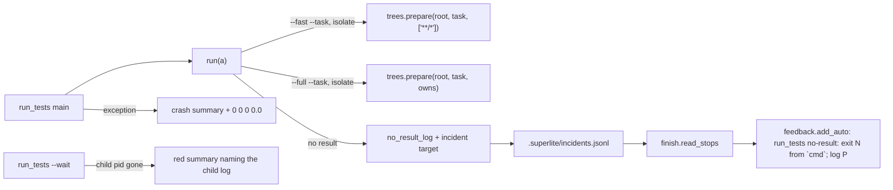

# Superlite: run_tests --fast tests the current working tree in an isolated tree; every run_tests end names its result (B40)

**Goal:** fix #339 (an isolated `run_tests --fast --task Tn` overlays only the task's own changed files, so a reviewer's change to any other file is a false green) and #330 (a `run_tests no-result` auto feedback entry carries no command, exit code or log path, and some run_tests paths end with no summary at all).
**Architecture:** all changes in `skills/subagent-driven-development/scripts/run_tests.py`: T1 overlays every working-tree change into the tree of a `--fast` task run and names the overlay; T2 gives each no-result stop its own kept log and an incident `target` (command, exit code, log) that `finish` already forwards to `feedback.add_auto`; T3 gives every remaining exit path a summary and a named error (unknown task, pytest missing, tree not prepared, crash, a background run that died).
**Tech stack:** Python 3.10+ stdlib, pytest (through `sl run_tests`).
**Spec:** this file, section Design; issue #339 and #330 Expected lines and Max's decision.
**Detail:** contracts
**Target-min:** 11
**Wave0:** none
**Max chars:** 26000

Global constraints:
- Every code line in `skills/subagent-driven-development/scripts/*.py` carries the repo's trailing `# O(...)` complexity comment; tests do not. Stdlib only.
- Existing tests stay green. An existing test file changes only when the task Owns it. If another existing test turns red, report it in DONE_WITH_CONCERNS with the test id and the reason instead of editing it.
- The run_tests.py module docstring describes the new behaviour of your task in one or two sentences; keep its existing sentences (tests pin some of them, e.g. the `next:` cue sentence).
- Run `sl` as an executable (`<abs>/sl ...`). Verify with `<abs>/sl run_tests --fast <own test files> --task Tn --background`, then run the printed `wait:` line in the foreground and end the turn only after it reports.
- No version edits (the ship step bumps the version). Never run `scripts/test_layers.py run`, `scripts/evals.sh` or `claude plugin eval` (the coordinator runs the layers).
- New tests reuse the helpers of `tests/scripts/test_run_tests_plan_fallback.py` (`setup`, `git`, `summary`, `OUT`) and `tests/scripts/test_plan_tools.py` (`run`, `SCRIPTS`) where they fit.

Ruling: #339 per Max's decision (copy the current working tree): an isolated `--fast` task run (`--task Tn`, test-cmd.json `isolate: true`) overlays every working-tree change (modified, new, deleted; `.superlite/` excluded, as `trees.own_changes` does) onto the base, through the existing `trees.prepare(root, task, ["**/*"])`; a `--full --task` run keeps the task's own files, since that whole-suite check is what the isolation protects from a sibling's half-edit - cost if wrong: one more change to the owns choice.
Ruling: every isolated task run prints one stderr line naming the tree and how many files it overlaid, so a reviewer sees what was tested (the decision's rejected option, kept as a cheap extra) - cost if wrong: one stderr line.
Ruling: #330 inventory of run_tests ends without a result: (1) `unknown task` exits through `nt.die` with no summary; (2) pytest not installed prints `0 0 0 0.0` but leaves an older summary in place; (3) a failing `trees.prepare` (git error, busy tree lock) crashes; (4) any other exception in the foreground leaves a traceback and no summary, and a background child writes one only when no summary file exists yet; (5) a background child that dies (SIGKILL, OOM) leaves `--wait` blocking for its full timeout; (6) both no-result stops name the reason but their incident has no command, exit code or log. T2 fixes (6), T3 fixes (1) to (5).
Ruling: the auto entry gets the command, exit code and log through the no-result incident's `target` field, which `finish.read_stops` already passes as the target to `feedback.add_auto` (plus ` (cwd C)` from the incident's `cwd`, set for a tree run only); feedback.py and finish.py stay unchanged - cost if wrong: a follow-up adds structured fields to `add_auto`.
Ruling: each no-result stop keeps its own log `
/no-result-<stamp>.log` (command, cwd, exit, the last 40 output lines), the newest 20 kept, because `test-output.log` is overwritten by the next run and the cause must be traceable afterwards - cost if wrong: up to 20 small files in `.superlite/`.
Ruling: a background run whose child died without a summary gets a red summary written by `--wait` (error names the pid and the child log), which then prints it and exits 1 like any red run; liveness is checked on POSIX only (Windows keeps the timeout) - cost if wrong: a dead child on Windows still waits for the timeout.
Ruling: sequential - all three tasks own run_tests.py, the only code file this batch may touch; T1 -> T2 -> T3 - cost if wrong: about 5 min of lost parallelism.
Ruling: per Max's answer (answer-1, "All but unfinished siblings' files"), T4 narrows T1's `--fast` overlay: every working-tree change except files owned (plan Owns plus `also commits` claims) by another plan task with no `commit` line in the ledger; a file the run's own task owns is always overlaid; so a reviewer's or fixer's edit is tested and a sibling still building stays at base (test_trees' isolation) - cost if wrong: a reviewer edit to a still-building task's file is not tested.
Ruling: detail contracts; no probe adapter (CLI, Review Focus cases are named pytest cases); already in the lead worktree, so no `sl worktree ensure` - cost if wrong: one NEEDS_CONTEXT round.
LAYERS: unit

## Design

### 1. `--fast` task tree overlays the working tree (T1, #339)
In `run()`'s isolate block: `owns = ["**/*"] if paths else info[a.task]["owns"]`, then `tree = trees.prepare(".", a.task, owns)`. After it, read the overlay list (`trees.overlay_file(<root>, a.task)`, a JSON list of copied plus deleted paths) and print to stderr, with the tree path relative to the run root in posix form:
- `--fast`: `run_tests: tree .superlite/trees/T1 = base + all working-tree changes (--fast): 2 files`
- `--full`: `run_tests: tree .superlite/trees/T1 = base + T1's own changes: 1 file`
(`file` when the count is 1, else `files`; an unreadable overlay counts 0.)

### 2. No-result stops name command, exit code and log (T2, #330)
- `add_incidents(log, items, task=None, extra=None)`: `extra` (a dict) is merged into every entry after `kind` and `task`.
- `no_result_log(summary, command, cwd, rc, lines) -> str` writes `<dir of summary>/no-result-<YYYYmmddTHHMMSS>-<9-digit ns fraction>.log` (atomic): `command: <command>`, `cwd: <cwd>`, `exit: <rc>`, an empty line, then the last 40 of `lines`; keeps the newest 20 `no-result-*.log` there (name order), deletes older ones; returns the absolute path, `""` on OSError.
- `no_result_target(command, rc, log) -> str`: `` f"exit {rc} from `{command[:200]}`; log {log or 'not written'}" ``.
- Pytest no-result path: reason `pytest produced no results (exit N): <last 5 lines joined by ' | '>`, `no output` when there are none; command `shlex.join(cmd)`; lines = stdout + stderr lines.
- Zero-count path in `run_other`: command = the command as run (after `.superlite/` and `{junit}` substitution); lines = the lines written to `test-output.log`.
- Both: after the reason line print `run_tests: no-result log <path>` to stderr; the incident gets `extra={"target": target, "command": command[:300], "exit": rc, "log": path}` plus `"cwd": str(tree)` when the run ran in a task tree.

### 3. Every exit path gives a result (T3, #330)
- Unknown task: `usage_error(a, label, f"unknown task {a.task} in {plan}")`.
- `pyrun.PytestUnavailable`: `usage_error(a, label, str(e))` (the summary is now written).
- `trees.prepare` raising `RuntimeError` or `OSError`: `usage_error(a, label, f"isolated tree for {a.task} not prepared: {err}")`.
- `main()` wraps `run(a)` for foreground and background runs alike in `except BaseException as e`: a `SystemExit` with code 0 or None re-raises untouched. Otherwise, unless this process already wrote `a.summary` (`write_summary` records each resolved path it wrote in a module set, cleared at the start of `main`), it writes a zero summary with error `f"run_tests crashed: {e!r}"` (cut to 200), publishes it and prints `0 0 0 0.0`. An `Exception` then prints its traceback and `run_tests: crashed: {e!r}` to stderr and returns 2; any other `BaseException` re-raises.
- `start_background` writes the child's pid to `<run summary>.pid` (`mine.with_suffix(".pid")`).
- `wait_background`: while the summary is missing, a child whose pid is gone (POSIX `os.kill(pid, 0)` raises `ProcessLookupError`; no pid file, bad content, any other error or `os.name == "nt"`: alive) gets one more summary check; still missing: write a zero summary at that path with error `background run ended without a summary (pid N); log <mine.log>`, print `run_tests: background run ended without a summary (pid N); log <log>` to stderr, then the normal print and exit (1, red).
- Timeout line: `run_tests: timed out waiting for <mine>; log <mine with suffix .log>`.

## Coverage

| Category | State | Basis |
|---|---|---|
| Scope and success criteria | settled | #339 and #330 Expected lines; Max's decision |
| Domain and data model | ruled | incident fields `target`, `command`, `exit`, `log`, `cwd`; summary `error` |
| Persistence and migration | ruled | no-result logs, newest 20; `.pid` sidecar per background run |
| Interfaces and contracts | settled | run_tests exit codes and summary line unchanged; finish.py and feedback.py unchanged |
| UI states | n/a | CLI text only |
| Concurrency and state ownership | ruled | tree prepare keeps its per-task lock; the `--fast` overlay may carry a sibling's half-edit (Max's trade-off) |
| Error handling and recovery | settled | each path in the #330 inventory ruling gets a summary and a named error |
| Security and privacy | settled | feedback scrubbing unchanged (home paths, e-mail, tokens) |
| Performance and limits | ruled | larger overlay for `--fast` task runs; one `os.kill` probe per wait poll |
| Observability | settled | tree overlay line, no-result log line, crash line |
| Testing strategy | settled | pytest unit tests driving run_tests in subprocesses or in process with monkeypatch |
| Compatibility | ruled | POSIX liveness only; Windows keeps the timeout |
| Rollout | ruled | one PR; version bump at ship |
| Research unknowns | n/a | none |

## File structure
- `skills/subagent-driven-development/scripts/run_tests.py`: T1 (isolate block), T2 (no-result helpers and both stops), T3 (exit paths, crash wrap, background pid and wait).
- `tests/scripts/test_run_tests_fast_tree.py` (T1), `tests/scripts/test_run_tests_no_result_trace.py` (T2), `tests/scripts/test_run_tests_exit_paths.py` (T3).

## Task graph

```mermaid
%% schedule
gantt
  title Predicted schedule (mm:ss)
  dateFormat X
  axisFormat %M:%S
  section lane 1
  T1 run_tests --fast task tree overlays e :t1, 0, 66s
  T2 run_tests no-result stops name comman :t2, 66, 74s
  T3 run_tests every exit path writes a su :t3, 140, 94s
  T4 run_tests a --fast task tree keeps un :t4, 234, 71s
```

critical path: T1 → T2 → T3 → T4 (5.1 min) · peak width 1 · predicted build 5.1 min · predicted total ≈ 8.6 min (target ✓)

## Package: run_tests (CLI)
App type: CLI. Categories: protocol, state, file. Specific risks: a stale tree file surviving a reverted change, a deleted working-tree file left in the tree, an older summary read as this run's result, a crash after the result overwriting it, a pid reused or unreadable, a log folder growing without bound.
**Probe entry:** none (Ruling: no probe adapter).

### T1 run_tests: --fast task tree overlays every working-tree change · Complexity 3 · Est. context 38k
**Owns:** skills/subagent-driven-development/scripts/run_tests.py, tests/scripts/test_run_tests_fast_tree.py
**Components:** 1
**LOC owned:** 80
**Tests:** fast
**Model:** sonnet
**Est. time:** 2.0 min (1 component, about 80 LOC, fast tests)
**Covers:** 1
**Consumes:** existing `trees.prepare(root, task, owns) -> Path`, `trees.overlay_file(root, task) -> Path`
**Produces:** run_tests.run(a) -> int (isolate block: `--fast` overlays `["**/*"]`, stderr tree line)
**Review Focus:**
Fixture: `setup(tmp_path)` from test_run_tests_plan_fallback (plan owns `src/a.txt`, swift spec); commit `src/b.txt` = `ok` and `src/d.txt` = `d`; `.superlite/check.sh` prints `error: BROKEN` and exits 1 when `src/b.txt` contains `BROKEN`, exits 1 when `CHECK_NEW` is set and (`src/c.txt` is missing or `src/d.txt` exists), else prints `OUT`; test-cmd.json `{"language": "swift", "test": "bash .superlite/check.sh", "test_file": "bash .superlite/check.sh", "isolate": true}`.
state: `test_fast_tree_carries_an_unowned_change` (`src/b.txt` = `BROKEN`, uncommitted; `--fast src/a.txt --task T1 --plan P` -> exit 1, summary `failed >= 1`; stderr holds `run_tests: tree .superlite/trees/T1 = base + all working-tree changes (--fast): 1 file`);
file: `test_fast_tree_carries_new_and_deleted_files` (untracked `src/c.txt`, `src/d.txt` deleted, env `CHECK_NEW=1` in the spec's `env` -> exit 0, summary `passed == 2`; stderr ends that tree line with `: 2 files`);
state: `test_fast_tree_drops_a_reverted_change` (first run with `BROKEN` -> exit 1; restore `src/b.txt` to `ok`; second run -> exit 0, `: 0 files`);
state: `test_full_task_tree_keeps_own_files_only` (`src/b.txt` = `BROKEN`; `--full --task T1 --plan P` -> exit 0; stderr holds `run_tests: tree .superlite/trees/T1 = base + T1's own changes: 0 files`);
protocol: `test_untask_fast_run_prints_no_tree_line` (`--fast src/a.txt` without `--task` -> no `run_tests: tree ` line in stderr).
**Steps:** 1 failing tests, 2 run: FAIL, 3 implement Design 1, 4 run: PASS (own file plus `tests/scripts/test_run_tests_tree_paths.py tests/scripts/test_run_tests_plan_fallback.py tests/scripts/test_run_tests_tree_node_modules.py`).

### T2 run_tests: no-result stops name command, exit code and log · Complexity 4 · Est. context 45k
**Owns:** skills/subagent-driven-development/scripts/run_tests.py, tests/scripts/test_run_tests_no_result_trace.py
**Components:** 1
**LOC owned:** 150
**Tests:** fast
**Model:** sonnet
**Est. time:** 2.5 min (1 component, about 150 LOC, fast tests)
**Covers:** 2
**Consumes:** existing `finish.read_stops(path) -> list[tuple[str, str, str]]`, `finish.log_auto(stops, run="") -> int`, `feedback.add_auto(tool, reason, target, version) -> bool`
**Produces:** run_tests.no_result_log(summary: str, command: str, cwd: str, rc: int, lines: list[str]) -> str · run_tests.no_result_target(command: str, rc: int, log: str) -> str · run_tests.add_incidents(log, items, task=None, extra=None) -> None
e.g. no_result_target("swift test", 0, "/r/.superlite/no-result-20261109T101500-000000042.log") -> "exit 0 from `swift test`; log /r/.superlite/no-result-20261109T101500-000000042.log"
e.g. no_result_target("x", 3, "") -> "exit 3 from `x`; log not written"
**Review Focus:**
protocol: `test_zero_count_stop_names_command_exit_and_log` (swift spec, command `<python> -c "print('nothing here')"`, `--full` -> exit 1; the one `no-result` incident has `exit == 0`, `command` == that command, `log` an existing file under `.superlite/` whose text holds `command: `, `exit: 0` and `nothing here`, `target == f"exit 0 from `{command}`; log {log}"`; stderr holds `run_tests: no-result log {log}`);
protocol: `test_pytest_no_result_names_the_exit` (pytest project, `tests/test_x.py` with `def test_a(): import os; os._exit(3)` -> exit 2; incident `exit == 3`, `"pytest" in command`; summary `error` starts `pytest produced no results (exit 3): `; log text holds `exit: 3`);
state: `test_auto_entry_carries_the_target` (after the zero-count run, `SUPERLITE_HOME=tmp/home`: `finish.log_auto(finish.read_stops(<incident log>))` -> 1; the feedback entry has `tool == "run_tests"`, `reason == "no-result"`, its `text` holds "exit 0 from `" and "; log ");
file: `test_tree_stop_names_the_tree` (isolate spec from test_run_tests_plan_fallback `setup` with a zero-count command, `--fast src/a.txt --task T1 --plan P` -> incident `cwd` ends `.superlite/trees/T1`; `finish.read_stops` target ends with `(cwd <that path>)`);
file: `test_no_result_logs_keep_the_newest_20` (22 calls of `no_result_log(str(tmp/"s.json"), "c", "/r", 1, ["x"])` -> 20 `no-result-*.log` files remain; the first two returned paths are gone, the last one exists);
file: `test_unwritable_log_returns_empty` (summary inside a regular file `tmp/f/s.json` with `tmp/f` a file -> `""`, no exception).
**Steps:** 1 failing tests, 2 run: FAIL, 3 implement Design 2, 4 run: PASS (own file plus `tests/scripts/test_run_tests_collection.py tests/scripts/test_run_tests_paths_claims.py tests/scripts/test_finish_closeout.py tests/scripts/test_feedback_auto.py`).

### T3 run_tests: every exit path writes a summary and names its error · Complexity 5 · Est. context 48k
**Owns:** skills/subagent-driven-development/scripts/run_tests.py, tests/scripts/test_run_tests_exit_paths.py
**Components:** 2
**LOC owned:** 190
**Tests:** fast
**Model:** sonnet
**Est. time:** 3.0 min (2 components, about 190 LOC, fast tests)
**Covers:** 3
**Consumes:** existing `run_tests.usage_error(a, label, reason) -> int`, `pyrun.PytestUnavailable`, `trees.prepare(root, task, owns) -> Path`
**Produces:** run_tests.main(argv=None) -> int (crash wrap) · run_tests.wait_background(a) -> int (dead child, timeout line) · run_tests.start_background(a, argv) -> int (pid sidecar)
**Review Focus:**
protocol: `test_unknown_task_writes_a_summary` (`setup`; `--fast src/a.txt --task T9 --plan P` -> exit 2, stdout last line `0 0 0 0.0`, summary `error == f"unknown task T9 in {P}"`, stderr `run_tests: unknown task T9 in {P}`);
state: `test_pytest_unavailable_replaces_an_old_summary` (in process, monkeypatch `run_tests.pyrun.pytest_cmd` to raise `PytestUnavailable("pytest is not installed")`, an older summary `{"passed": 5, ...}` present -> `main(["--full"])` returns 2, summary `failed == 1`, `"pytest is not installed" in error`);
state: `test_tree_prepare_failure_is_named` (in process, monkeypatch `run_tests.trees.prepare` to raise `RuntimeError("git worktree add failed: boom")` -> 2, summary `error == "isolated tree for T1 not prepared: git worktree add failed: boom"`);
state: `test_crash_writes_a_summary_and_the_line` (in process, monkeypatch `run_tests.testcmd.resolve` to raise `ValueError("bad test-cmd.json")`, an older green summary present -> `main(["--full"])` returns 2; summary `error == "run_tests crashed: ValueError('bad test-cmd.json')"`; stdout ends `0 0 0 0.0`; stderr holds `Traceback` and `run_tests: crashed: ValueError('bad test-cmd.json')`);
state: `test_crash_after_the_result_keeps_it` (pytest project with one passing test, monkeypatch `run_tests.ct.append_ledger` to raise `OSError("disk full")` -> 2; summary `passed == 1` and no `error` key);
state: `test_keyboard_interrupt_still_writes_a_summary` (monkeypatch `run_tests.run` to raise `KeyboardInterrupt` -> `pytest.raises(KeyboardInterrupt)`; summary `error` starts `run_tests crashed: KeyboardInterrupt`);
protocol: `test_background_records_the_child_pid` (pytest project, `--background` -> the `summary:` path's `.pid` sibling holds a positive int; the `wait:` line then exits 0);
state: `test_wait_names_a_dead_background_run` (skip on `os.name == "nt"`; summary path `tmp/.superlite/test-summary-x.json` absent, `.pid` = pid of a finished `python -c pass`, `.log` = `boom`; `--wait <path> --timeout 30` -> exit 1 in under 10 s; stderr holds `run_tests: background run ended without a summary (pid N); log <path .log>`; the summary file now exists with `failed == 1` and that error);
protocol: `test_wait_timeout_names_the_log` (`.pid` = `os.getpid()` (alive), `--wait <path> --timeout 0.5` -> exit 2, stderr `run_tests: timed out waiting for <path>; log <path .log>`).
**Steps:** 1 failing tests, 2 run: FAIL, 3 implement Design 3, 4 run: PASS (own file plus `tests/scripts/test_run_tests_wait.py tests/scripts/test_run_tests_wait_cue.py tests/scripts/test_run_tests_node_modules.py tests/scripts/test_run_scripts.py tests/scripts/test_run_tests_plan_fallback.py`).

### T4 run_tests: a --fast task tree keeps unfinished siblings' files at base · Complexity 4 · Est. context 40k
**Owns:** skills/subagent-driven-development/scripts/run_tests.py, tests/scripts/test_run_tests_fast_tree_siblings.py
**Components:** 1
**LOC owned:** 120
**Tests:** fast
**Model:** sonnet
**Est. time:** 2.0 min (1 component, about 120 LOC, fast tests)
**Covers:** 1
**Consumes:** existing `trees.own_changes(root, base, owns) -> tuple[list[str], list[str]]`, `trees.base_commit(root) -> str`, `ct.committed_tasks(ledger) -> set[str]`, `nt.owns_match(path, owns) -> bool`
**Produces:** run_tests.fast_overlay(root, task: str, info: dict, ledger: str) -> tuple[list[str], list[str]]
e.g. changed `src/a.py` (T1 owns, no commit line), `src/b.py` (T2 owns), untracked `README.md` (no owner); `fast_overlay(".", "T2", info, ledger)` -> (["README.md", "src/b.py"], ["src/a.py"])
e.g. the same with `- commit T1 5e9dd8b464 x` in the ledger -> (["README.md", "src/a.py", "src/b.py"], [])
**Review Focus:**
Contract: `fast_overlay` lists the changed paths (`trees.own_changes(root, trees.base_commit(root), ["**/*"])`, copy plus delete) and splits them: held = paths owned (`nt.owns_match` against `info[t]["owns"]`) by a plan task `t != task` that is not in `ct.committed_tasks(ledger)` and not owned by `task` itself; overlay = the rest; both sorted. `run()` calls it after `ct.add_also_owns(info, a.ledger)` and passes the overlay list as the owns of `trees.prepare` for a `--fast` run (`--full` unchanged). `announce_tree` keeps its line and, when held is not empty, appends `; kept at base: N file(s) of unfinished <sorted task ids, space-separated>` (`1 file`, else `files`).
state: `test_fast_overlay_holds_unfinished_sibling_files` (the first e.g., in a git repo from `make_plan` with T1 owning `src/a.py` and T2 owning `src/b.py`);
state: `test_committed_sibling_files_are_overlaid` (the second e.g.);
state: `test_own_file_shared_with_a_sibling_is_overlaid` (T1 and T2 both own `src/s.py`, T1 uncommitted, `src/s.py` changed -> in T2's overlay, not held);
protocol: `test_fast_run_names_the_held_files` (swift isolate spec, `src/a.py` changed, `--fast src/b.py --task T2 --plan P` -> stderr holds `; kept at base: 1 file of unfinished T1`; the tree's `src/a.py` equals the committed text);
state: `test_claimed_file_of_unfinished_sibling_is_held` (ledger line `- Ruling: T1 also commits src/c.py - why`, `src/c.py` changed, the same run -> tree `src/c.py` equals its committed text);
state: the existing `tests/scripts/test_trees.py::test_task_runs_in_tree_and_summary_in_main` passes unchanged.
**Steps:** 1 failing tests, 2 run: FAIL, 3 implement, 4 run: PASS (own file plus `tests/scripts/test_trees.py tests/scripts/test_run_tests_fast_tree.py tests/scripts/test_run_tests_paths_claims.py tests/scripts/test_run_tests_plan_fallback.py`).

## Review Focus
Package run_tests: CLI; protocol (exit codes 0/1/2, the `P F S secs` line, stderr names), state (tree overlay across runs, summary freshness, crash after the result), file (deleted and untracked overlay files, log retention, pid sidecar). Each case is a named test in its task.

## Self-review
Coverage: Design 1 to 3 map to T1 to T3. No placeholders. Consumes are existing functions. Edges are hard and sequential (one shared file). Each task has Components, LOC owned, Tests, Model.
