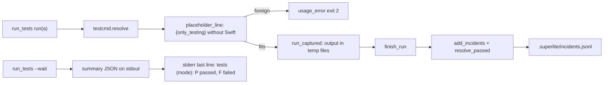

# Superlite: run_tests refuses a foreign placeholder, closes stale test-failure incidents, and ends a wait with one summary line (B57)

**Goal:** fix #373 (a Swift-form `test-cmd.json` placeholder reaches pytest in a Python project), #380 (test-failure incidents from red runs, `-:0` above all, never close) and #382 (`run_tests --wait` prints only raw JSON and can time out after the run has finished).
**Architecture:** all code in `skills/subagent-driven-development/scripts/run_tests.py`: T1 adds a placeholder gate before the run (usage error, exit 2); T2 gives `--wait` a last summary line, a last look at the deadline and a rerun hint, and captures runner output in temp files so a leftover child cannot hold the run; T3 extends `resolve_passed` so a green task run closes its `-` failures and a green full suite closes every run_tests failure.
**Tech stack:** Python 3.10+ stdlib, pytest (through `sl run_tests`).
**Spec:** this file, section Design; issues #373, #380, #382 (Expected lines).
**Detail:** contracts
**Target-min:** 11
**Wave0:** none
**Max chars:** 24000

Global constraints:
- Every code line in `skills/subagent-driven-development/scripts/*.py` carries the repo's trailing `# O(...)` complexity comment; tests do not. Stdlib only.
- Existing tests stay green. Never edit an existing test file. If another existing test turns red, report it in DONE_WITH_CONCERNS with the test id and the reason instead of editing it.
- The run_tests.py module docstring describes the new behaviour of your task in one or two sentences; keep its existing sentences (tests pin some of them).
- Run `sl` as an executable (`<abs>/sl ...`). Verify with `<abs>/sl run_tests --fast <own test file> <listed suites> --task Tn --background`, then run the printed `wait:` line in the foreground and end the turn only after it reports.
- No version edits (the ship step bumps the version). Never run `scripts/test_layers.py run`, `scripts/evals.sh` or `claude plugin eval` (the coordinator runs the layers).
- New tests drive run_tests in subprocesses (`[sys.executable, str(RUN_TESTS), ...]`, cwd a tmp project) or in process (`sys.path.insert(0, str(SCRIPTS)); import run_tests`, `monkeypatch.chdir`); helpers as in `tests/scripts/test_run_tests_resolve.py` (`rt`, `write`, `log`, `newest`).

Ruling: #373 gate covers `{only_testing}` only: it is the one placeholder bound to a language (it scans Swift suites for `xcodebuild -only-testing`); `{files}`, `{names}`, `{junit}` fit any runner - cost if wrong: another foreign placeholder still reaches its runner.
Ruling: #373 "fits the language" is decided by project evidence, not the config's `language` field: refuse only when git lists no Swift file (`*.swift`, `*.xcodeproj/*`, `*.xcworkspace/*`), so a mixed iOS + Python-tooling repo keeps its Xcode command; a git error refuses nothing - cost if wrong: a non-git project with a foreign placeholder still fails at its runner.
Ruling: #382 the last line goes to stderr after a stdout flush; stdout stays the summary JSON (`json.loads(stdout)` callers and `test_run_tests_wait.py` keep working, max-core CLI contract: results on stdout) - cost if wrong: a script reading only stdout does not see the line.
Ruling: #382 root causes handled: (a) the summary written between the last poll and the deadline (one last look before timing out); (b) a runner that leaves a child holding its stdout pipe (reproduced: `sh -c "(sleep 8 &); echo 1 passed"` took 8.0 s), so output goes to temp files and run_tests waits for the runner's exit only; (c) a run longer than the wait: the default wait drops from 600 to 540 s so run_tests reports and names the rerun before a 600 s Bash cap kills it - cost if wrong: a 9-10 min suite needs a second wait call.
Ruling: #380 keeps the location model (a location's newest non-verified entry decides, as the packet, `finish` and `incident resolve` count) and the #180 scope (a run without `--task` closes nothing per test, `test_other_task_not_resolved` pins it); a green `--task Tn` run also closes a `-` location whose newest entry is Tn's open run_tests test-failure, and a green `--full` run without `--task` closes every location whose newest entry is an open run_tests test-failure - cost if wrong: a sibling's still-red `-` failure logged before Tn's is hidden until its next red run (the test summary still shows it).
Ruling: #380 no closing rule touches an entry logged at or after this run's start (`epoch >= started`), so a parallel run's fresh failure stays open; an entry without `epoch` counts as earlier - cost if wrong: none known.
Ruling: sequential - all three tasks own run_tests.py, the only code file this batch may touch; T1 -> T2 -> T3 - cost if wrong: about 5 min of lost parallelism.
Ruling: detail contracts; no probe adapter (CLI, Review Focus cases are named pytest cases); already in the lead worktree, so no `sl worktree ensure` - cost if wrong: one NEEDS_CONTEXT round.
LAYERS: unit

## Design

### 1. Placeholder gate (T1, #373)
`placeholder_line(root, spec) -> str | None`: None unless `spec` is a non-Python spec with `source == "test-cmd.json"` whose raw config (`testcmd.read_config(root) or testcmd.main_checkout_config(root)`) has `{only_testing}` in its `test` or `test_file` string, and `has_swift(root)` is False. `has_swift(root) -> bool | None`: `git -C root -c core.quotepath=off ls-files -co --exclude-standard -- '*.swift' '*.xcodeproj/*' '*.xcworkspace/*'` (timeout 30): True when it lists a path, False when it lists none, None on a git error or timeout. The text, with `CFG` = `.superlite/test-cmd.json` when `root/.superlite/test-cmd.json` is a file, else `the main checkout's .superlite/test-cmd.json`, and `L`, `X` from `testcmd.detect(root)` (language and `test_file`):
- python: `test-cmd.json uses {only_testing}, the Xcode (Swift) placeholder, but this python project has no Swift files: in CFG write the python form {files} (e.g. "test_file": "python -m pytest {files}"), or delete that file so run_tests runs pytest itself`
- another detected language: `... but this L project has no Swift files: in CFG write the L form {files} (e.g. "test_file": "X")`
- nothing detected: `... but this project has no Swift files: in CFG use {files}`
`run()` calls it right after the `spec is None` branch: a text returns `usage_error(a, label, text)` (exit 2, summary error, no incident). The `--background` parent refuses too, for `--full` and `--fast`: stderr `run_tests: <text>`, exit 2, no `summary:` line, nothing spawned.

### 2. Wait summary line and a wait that returns (T2, #382)
- `summary_line(data) -> str`: `tests (<mode>): P passed, F failed`, then `, S skipped` when S > 0, then `; error: <error cut to 150>` when the summary has `error`; no `mode` key: `tests: ...`.
- `wait_background`: each poll reads the summary (missing or half-written: not yet), then checks the pid (dead child path unchanged), then at the deadline reads the summary once more before it times out. On a result: the JSON on stdout as today, `sys.stdout.flush()`, then `summary_line(data)` as the last stderr line. On timeout: the existing `run_tests: timed out waiting for <mine>; log <log>`, then the last stderr line `tests: no result yet after <T:g> s (pid <pid> still running); run again: <cmd>` (without the pid part when no live pid is recorded), `<cmd>` = `wait_line(mine)` minus its `wait: ` prefix; exit 2.
- `DEFAULT_WAIT = 540.0`.
- `run_captured(cmd, **kw) -> subprocess.CompletedProcess`: runs `pyrun.run_tree(cmd, stdout=<TemporaryFile>, stderr=<TemporaryFile>, **kw)` (no pipes, no `capture_output`), then returns the code and both outputs decoded utf-8 with `errors="replace"`. The pytest run and `run_other`'s setup and command use it instead of `capture_output=True`.

### 3. Closing stale test-failure incidents (T3, #380)
`resolve_passed(log, task, failures, files, green=False, full=False, started=None)`; `finish_run` passes `green` (not red), `full` (`label == "full"`) and `a.started`. For each location, its newest non-verified entry `e` must be an open `test-failure` (resolution not in `pt_review.RESOLVED`) logged before the run (`started is None`, or `e` has no numeric `epoch`, or `epoch < started`). Then it closes (one appended entry per location: the run's file and line, kind `test-failure`, resolution `fixed`, agent `run_tests`, the run's `task`) when:
- R1 (unchanged, #180/#196): `task` set, `e["task"] == task`, the file had a passing test in this run and its test is not in this run's failures; context `fixed: passed on a later run`.
- R2: `task` set, `green`, `e["task"] == task`, `e["file"] == "-"`; context `fixed: a green <task> run`.
- R3: no `task`, `green`, `full`, `e["agent"] == "run_tests"`; context `fixed: the full suite passed`.
R1 wins when several match. One append for all closings.

## Coverage

| Category | State | Basis |
|---|---|---|
| Scope and success criteria | settled | Expected lines of #373, #380, #382 |
| Domain and data model | settled | incident entries unchanged; closing entries as `sl incident resolve` writes them |
| Persistence and migration | n/a | no new files besides tests |
| Interfaces and contracts | ruled | stdout JSON kept; new stderr last line; exit codes unchanged; DEFAULT_WAIT 540 |
| UI states | n/a | CLI text only |
| Concurrency and state ownership | ruled | entries logged after the run's start are never closed |
| Error handling and recovery | ruled | placeholder gate is a usage error (exit 2, no incident); git error refuses nothing |
| Security and privacy | n/a | no new input surface |
| Performance and limits | ruled | one `git ls-files` per run with a test-cmd.json `{only_testing}`; temp files instead of pipes |
| Observability | settled | summary line, rerun hint, gate text names `{files}` |
| Testing strategy | settled | pytest unit tests in subprocesses or in process with monkeypatch |
| Compatibility | ruled | POSIX for the leftover-child test; Windows keeps behaviour |
| Rollout | ruled | one PR; version bump at ship |
| Research unknowns | n/a | none |

## File structure
- `skills/subagent-driven-development/scripts/run_tests.py`: T1 (gate), T2 (wait, capture), T3 (resolve_passed, finish_run).
- `tests/scripts/test_run_tests_placeholder_gate.py` (T1), `tests/scripts/test_run_tests_wait_line.py` (T2), `tests/scripts/test_run_tests_close_incidents.py` (T3).

## Task graph

```mermaid
%% schedule
gantt
  title Predicted schedule (mm:ss)
  dateFormat X
  axisFormat %M:%S
  section lane 1
  T1 run_tests refuse a test-cmd.json plac :t1, 0, 71s
  T2 run_tests --wait ends with a summary :t2, 71, 90s
  T3 run_tests green runs close stale test :t3, 162, 74s
```

critical path: T1 → T2 → T3 (3.9 min) · peak width 1 · predicted build 3.9 min · predicted total ≈ 7.4 min (target ✓)

## Package: run_tests (CLI)
App type: CLI. Categories: protocol, state, file. Specific risks: a mixed Swift + Python repo refused, a parallel run's fresh failure closed, a sibling task's failure closed by another task's run, a summary written in the last poll window missed, a leftover child holding the run, stdout no longer valid JSON.
**Probe entry:** none (Ruling: no probe adapter).

### T1 run_tests: refuse a test-cmd.json placeholder of another language · Complexity 3 · Est. context 38k
**Owns:** skills/subagent-driven-development/scripts/run_tests.py, tests/scripts/test_run_tests_placeholder_gate.py
**Components:** 1
**LOC owned:** 140
**Tests:** fast
**Model:** sonnet
**Est. time:** 2.0 min (1 component, about 140 LOC, fast tests)
**Covers:** 1
**Consumes:** existing `testcmd.read_config(root) -> dict | None`, `testcmd.main_checkout_config(root) -> dict | None`, `testcmd.detect(root) -> dict | None`, `run_tests.usage_error(a, label, reason) -> int`
**Produces:** run_tests.placeholder_line(root: Path, spec: dict | None) -> str | None · run_tests.has_swift(root: Path) -> bool | None
e.g. git repo with `pyproject.toml`, `tests/test_a.py` and test-cmd.json `{"language": "swift", "test": "xcodebuild test -scheme X", "test_file": "xcodebuild test -scheme X {only_testing}"}`: placeholder_line(root, testcmd.resolve(str(root))) -> "test-cmd.json uses {only_testing}, the Xcode (Swift) placeholder, but this python project has no Swift files: in .superlite/test-cmd.json write the python form {files} (e.g. \"test_file\": \"python -m pytest {files}\"), or delete that file so run_tests runs pytest itself"
e.g. the same repo plus an untracked `App/App.xcodeproj/project.pbxproj`: placeholder_line(...) -> None; has_swift(root) -> True
**Review Focus:**
Fixture `py_repo(tmp_path)`: `git init`, `pyproject.toml` (`[project]\nname = "x"\n`), `tests/test_a.py` (`def test_a():\n    pass\n`), `.superlite/test-cmd.json` as in the first e.g.
protocol: `test_python_project_refuses_only_testing_fast` (`--fast tests/test_a.py` -> exit 2; stderr holds `run_tests: test-cmd.json uses {only_testing}` and `python form {files}`; summary `error` equals the first e.g. text; `.superlite/incidents.jsonl` holds no entry);
protocol: `test_python_project_refuses_only_testing_full` (`--full` -> exit 2, same summary error);
protocol: `test_background_parent_refuses` (`--full --background` -> exit 2, stdout has no `summary:` line, no `test-summary-*.json` written; same for `--fast tests/test_a.py --background`);
state: `test_mixed_repo_keeps_xcode_command` (the second e.g.; also `Sources/A/a.swift` alone -> None);
protocol: `test_go_project_names_go_form` (`go.mod` instead of `pyproject.toml`, no `.py` files -> text holds `this go project has no Swift files` and `"test_file": "go test {files}"`);
state: `test_markers_spec_untouched` (no test-cmd.json -> placeholder_line(root, testcmd.resolve(str(root))) is None; a config without `{only_testing}` -> None);
file: `test_not_a_git_repo_refuses_nothing` (same files, no `git init` -> has_swift is None, placeholder_line None).
**Steps:** 1 failing tests, 2 run: FAIL, 3 implement Design 1, 4 run: PASS (own file plus `tests/scripts/test_testcmd.py tests/scripts/test_run_tests_node_modules.py tests/scripts/test_run_tests_exit_paths.py`).

### T2 run_tests: --wait ends with a summary line and returns when the run is done · Complexity 4 · Est. context 42k
**Owns:** skills/subagent-driven-development/scripts/run_tests.py, tests/scripts/test_run_tests_wait_line.py
**Components:** 2
**LOC owned:** 160
**Tests:** fast
**Model:** sonnet
**Est. time:** 2.5 min (2 components, about 160 LOC, fast tests)
**Covers:** 2
**Consumes:** existing `pyrun.run_tree(cmd, timeout=None, **kw) -> subprocess.CompletedProcess`, `run_tests.wait_line(path) -> str`, `run_tests.pid_gone(mine) -> int | None`
**Produces:** run_tests.summary_line(data: dict) -> str · run_tests.run_captured(cmd, **kw) -> subprocess.CompletedProcess · run_tests.wait_background(a) -> int (last line, last look, rerun hint) · run_tests.DEFAULT_WAIT = 540.0
e.g. summary_line({"passed": 5022, "failed": 0, "skipped": 0, "mode": "full"}) -> "tests (full): 5022 passed, 0 failed"
e.g. summary_line({"passed": 3, "failed": 1, "skipped": 2, "mode": "fast"}) -> "tests (fast): 3 passed, 1 failed, 2 skipped"
e.g. summary_line({"passed": 0, "failed": 1, "skipped": 0, "mode": "full", "error": "run_tests crashed: X"}) -> "tests (full): 0 passed, 1 failed; error: run_tests crashed: X"
**Review Focus:**
protocol: `test_summary_line_examples` (the three e.g. lines; `{"passed": 1, "failed": 0, "skipped": 0}` -> "tests: 1 passed, 0 failed");
protocol: `test_wait_prints_the_line_last` (summary file `{"passed": 5022, "failed": 0, "skipped": 0, "mode": "full"}`; `--wait 
 --timeout 5` -> exit 0; `json.loads(stdout)["passed"] == 5022`; the last non-empty stderr line is `tests (full): 5022 passed, 0 failed`; a red summary -> exit 1 and its line);
state: `test_wait_last_look_at_the_deadline` (in process: monkeypatch `run_tests.pid_gone` to write `{"passed": 1, "failed": 0, "skipped": 0, "mode": "fast"}` to the summary path and return None; `run_tests.main(["--wait", str(p), "--timeout", "0"])` -> 0);
protocol: `test_timeout_names_the_rerun` (`.pid` = `os.getpid()`; `--wait 
 --timeout 0.5` -> exit 2; stderr holds `run_tests: timed out waiting for 
; log 
`; last stderr line starts `tests: no result yet after 0.5 s (pid <getpid> still running); run again: ` and ends ` run_tests --wait 
`; no `.pid` file -> the line has no `(pid` part);
state: `test_leftover_child_does_not_hold_the_run` (skip on `os.name == "nt"`; git repo, test-cmd.json `{"language": "other", "test": "sh -c '(sleep 20 &) ; echo 1 passed'"}`; `--full` -> exit 0 in under 10 s; summary `passed == 1`);
protocol: `test_run_captured_returns_code_and_output` (`run_captured([sys.executable, "-c", "import sys; print('out'); print('err', file=sys.stderr); sys.exit(3)"])` -> returncode 3, stdout `out\n`, stderr `err\n`);
protocol: `test_default_wait_is_540` (`run_tests.DEFAULT_WAIT == 540.0`).
**Steps:** 1 failing tests, 2 run: FAIL, 3 implement Design 2, 4 run: PASS (own file plus `tests/scripts/test_run_tests_wait.py tests/scripts/test_run_tests_wait_cue.py tests/scripts/test_run_tests_exit_paths.py tests/scripts/test_0_3_1_scripts.py tests/scripts/test_run_tests_no_result_trace.py tests/scripts/test_run_tests_collection.py`).

### T3 run_tests: green runs close stale test-failure incidents · Complexity 5 · Est. context 45k
**Owns:** skills/subagent-driven-development/scripts/run_tests.py, tests/scripts/test_run_tests_close_incidents.py
**Components:** 1
**LOC owned:** 170
**Tests:** fast
**Model:** sonnet
**Est. time:** 2.5 min (1 component, about 170 LOC, fast tests)
**Covers:** 3
**Consumes:** existing `run_tests.add_incidents(log, items, task=None, extra=None) -> None`, `pt_review.RESOLVED`
**Produces:** run_tests.resolve_passed(log, task, failures, files, green=False, full=False, started=None) -> None
e.g. log holds `{"file": "-", "line": 0, "kind": "test-failure", "agent": "run_tests", "task": "T3", "resolution": "open", "context": "testFoo: failed", "epoch": 100.0}`; resolve_passed(log, "T3", [], {}, green=True, full=False, started=200.0) appends one entry `-`:0, kind test-failure, resolution fixed, context `fixed: a green T3 run`, task T3
e.g. the same entry and resolve_passed(log, None, [], {"tests/test_a.py": [2, 0]}, green=True, full=True, started=200.0) appends `-`:0 fixed, context `fixed: the full suite passed`, no task
e.g. the same entry with `"epoch": 300.0` and either call appends nothing
**Review Focus:**
Fixture `dash_repo(tmp_path)`: `check.sh` prints `FAIL testFoo` and exits 1 when a file `red` exists, else prints `1 passed`; test-cmd.json `{"language": "other", "test": "sh check.sh", "test_file": "sh check.sh {files}"}`.
state: `test_green_task_run_closes_its_dash_failures` (`red` present: `--full --task T3` -> exit 1, newest at `("-", 0)` open with task T3; remove `red`: `--full --task T3` -> exit 0, newest at `("-", 0)` resolution `fixed`, context `fixed: a green T3 run`);
state: `test_green_run_of_another_task_keeps_it_open` (red T3, then green `--full --task T4` -> newest at `("-", 0)` still open; then green `--full` without task -> fixed, `fixed: the full suite passed`);
state: `test_red_runs_close_no_dash_failure` (red T3 twice -> newest open; red `--full` without task -> open);
state: `test_green_full_suite_closes_run_tests_failures_only` (pytest project from `test_run_tests_resolve.py` RED/GREEN, red `--fast tests/test_a.py --task T3`; append a reviewer entry `{"file": "tests/test_a.py", "line": 99, "kind": "test-failure", "agent": "package-reviewer", "resolution": "open", "context": "test_z: missing"}`; GREEN, `--full` -> exit 0; T3's two locations newest `fixed` with `fixed: the full suite passed`; `tests/test_a.py:99` still open);
state: `test_green_fast_without_task_closes_nothing` (red T3 pytest, GREEN, `--fast tests/test_a.py` -> no new non-verified entry);
state: `test_entry_logged_after_start_stays_open` (the third e.g., in process, `log` a tmp `incidents.jsonl`);
state: `test_newest_no_result_keeps_the_location` (`-`:0 open test-failure of T3 then a newer `-`:0 open `no-result` entry, both epoch 100; `resolve_passed(log, "T3", [], {}, green=True, started=200.0)` appends nothing).
**Steps:** 1 failing tests, 2 run: FAIL, 3 implement Design 3, 4 run: PASS (own file plus `tests/scripts/test_run_tests_resolve.py tests/scripts/test_run_tests_collection.py tests/scripts/test_run_scripts.py tests/scripts/test_run_tests_no_result_trace.py tests/scripts/test_finish_closeout.py`).

## Review Focus
- protocol: stdout of `--wait` stays one JSON document; the summary line is the last stderr line.
- state: closings never touch an entry logged at or after the run's start, nor another task's location from a `--task` run.
- file: the placeholder gate refuses nothing in a repo where git lists any Swift file, and nothing on a git error.

## Self-review
Coverage: #373 -> T1, #380 -> T3, #382 -> T2. No placeholders. Consumes name existing functions or earlier Produces. Graph: hard edges only for the shared file. Sizes inside the band.
