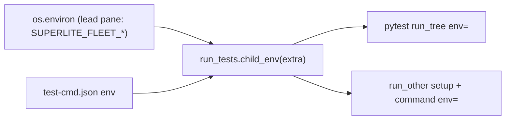
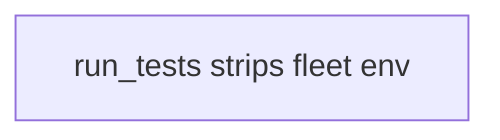

# Superlite: run_tests drops every SUPERLITE_FLEET_* variable from the test subprocess environment (B47)

**Goal:** fix the run_tests half of #219: a test subprocess started by `sl run_tests` (pytest, a test-cmd.json runner command and its setup) never inherits the `SUPERLITE_FLEET_*` variables a batch lead or worker pane exports.
**Architecture:** one helper `run_tests.child_env(extra)` builds the test subprocess environment: `os.environ` without every key starting `SUPERLITE_FLEET_`, then `extra` on top. The pytest `run_tree` call passes `env=child_env()`; `run_other` builds its env with `child_env(<spec env>)` for both the setup and the command. The run_tests process keeps its own environment.
**Tech stack:** Python 3 stdlib, pytest (through `sl run_tests`).
**Spec:** this file, section Design; issue #219 Expected line and Max's decision (drop SUPERLITE_FLEET_* in run_tests).
**Detail:** tests
**Target-min:** 11
**Wave0:** none
**Coverage:** off

Global constraints:
- Replace code exactly as the task's `Code (verbatim)` block gives it; keep the file's `# O(...)` comment on every new line, as the block shows. Change no other line of the file.
- Existing tests stay green. An existing test file never changes. If another existing test turns red, report it in DONE_WITH_CONCERNS with the test id and the reason instead of editing it.
- Run `sl` as an executable (`<abs>/sl ...`). Verify with `<abs>/sl run_tests --fast <own test file> --task Tn --background`, then run the printed `wait:` line in the foreground and end the turn only after it reports.
- No version edits (the ship step bumps the version). Never run `scripts/test_layers.py run`, `scripts/evals.sh` or `claude plugin eval` (the coordinator runs the layers).

## Design

Issue #219, expected: `sl run_tests --full` is green inside a lead pane without unsetting anything by hand. The HOST_VARS half is already on main (tests/scripts/_fixtures.py lists SUPERLITE_FLEET_ROLE and SUPERLITE_FLEET_PARENT_DIR). Max's decision: run_tests also drops every SUPERLITE_FLEET_* variable from the test subprocess environment.

Ruling: the strip is by prefix (`SUPERLITE_FLEET_`), so WORKER, AGENT, ROLE, PARENT_DIR and ACCOUNTS all go, and any later fleet variable too - cost if wrong: a project whose own tests read a SUPERLITE_FLEET_* variable from the shell must set it in test-cmd.json `env`.
Ruling: a test-cmd.json `env` entry is applied after the strip, so an explicit `SUPERLITE_FLEET_*` there still reaches the runner - cost if wrong: none; explicit config wins as everywhere else in testcmd.
Ruling: SUPERLITE_STATE_DIR and SUPERLITE_SESSION_ID stay in the test environment (Max's decision names SUPERLITE_FLEET_* only; superlite's own suite clears them through HOST_VARS) - cost if wrong: another project's tests in a lead pane still see the lead's state dir.
Ruling: the strip covers the pytest run and the runner command and setup; the detached `--background` child is run_tests itself and strips before its own test run; the `pytest --version` probe in `_pyrun.pytest_cmd` runs no test code and keeps the environment.
Ruling: one task with a new test file tests/scripts/test_run_tests_fleet_env.py (a new file no other lead owns) beside run_tests.py, the batch's only listed file; detail tests; no Wave 0 (the project builds); no probe adapter (no new runnable entry); already in the lead worktree, so no `sl worktree ensure`.
LAYERS: unit



## File structure

- skills/subagent-driven-development/scripts/run_tests.py: `FLEET_PREFIX`, `child_env`, the two call sites, one docstring sentence (T1).
- tests/scripts/test_run_tests_fleet_env.py: pins the strip for pytest, runner command and setup, and the helper (T1).

## Task graph

```mermaid
%% schedule
gantt
  title Predicted schedule (mm:ss)
  dateFormat X
  axisFormat %M:%S
  section lane 1
  T1 run_tests strips fleet env :t1, 0, 61s
```





critical path: T1 (1.0 min) · peak width 1 · predicted build 1.0 min · predicted total ≈ 4.5 min (target ✓)

## Predicted schedule

## run_tests

App type: CLI. Categories: protocol (which subprocess gets which environment), state (the run_tests process's own environment must stay unchanged).

### T1 run_tests strips fleet env · Complexity 2 (O-1) · Est. context 32k
**Owns:** skills/subagent-driven-development/scripts/run_tests.py, tests/scripts/test_run_tests_fleet_env.py
**Components:** 1
**LOC owned:** 80
**Tests:** fast
**Kind:** mechanical
**Model:** haiku
**Est. time:** 2 min (1 component, about 80 LOC, fast tests)
**Consumes:** none
**Produces:** run_tests.child_env(extra: dict | None = None) -> dict
**Covers:** Design
**Review Focus:** `test_child_env_strips_only_the_fleet_prefix`: `XSUPERLITE_FLEET_Y` and `SUPERLITE_STATE_DIR` stay, the caller's `os.environ` keeps `SUPERLITE_FLEET_ROLE`; `test_runner_command_and_setup_drop_fleet_env`: the setup sees no SUPERLITE_FLEET_* variable and the command sees only the spec's `SUPERLITE_FLEET_CONFIG`.
**Code (verbatim):** in skills/subagent-driven-development/scripts/run_tests.py:
1. Directly above the line `def root_superlite(s, root, raw=False):` insert these lines, followed by two blank lines (the two blank lines after `record_run` stay):
````python
FLEET_PREFIX = "SUPERLITE_FLEET_"  # O(1) a fleet pane (lead, worker) exports these; no test subprocess inherits them (#219)


def child_env(extra=None):  # O(env) the test subprocess environment: os.environ without SUPERLITE_FLEET_*, then extra on top (test-cmd.json env wins)
    env = {k: v for k, v in os.environ.items() if not k.startswith(FLEET_PREFIX)}  # O(env)
    env.update(extra or {})  # O(e)
    return env  # O(1)
````
2. In `run_other`, replace the line
````python
        env = {**os.environ, **{k: subenv(str(v)) for k, v in (spec.get("env") or {}).items()}}  # O(env)
````
with
````python
        env = child_env({k: subenv(str(v)) for k, v in (spec.get("env") or {}).items()})  # setup and command, no SUPERLITE_FLEET_* (#219) | O(env)
````
3. In the pytest branch of `run`, replace the line
````python
                           errors="replace")  # O(1)
````
(the continuation of `r = pyrun.run_tree(cmd, capture_output=True, text=True, encoding="utf-8",`) with
````python
                           errors="replace", env=child_env())  # no SUPERLITE_FLEET_* in the pytest run (#219) | O(env)
````
4. In the module docstring, directly above the line `Stdlib only.`, insert the line
````text
Every test subprocess (pytest, a test-cmd.json command and its setup) gets the environment without `SUPERLITE_FLEET_*` variables (a fleet pane's worker, role and parent dir); a test-cmd.json `env` entry still applies on top.
````
**Test code (verbatim):** tests/scripts/test_run_tests_fleet_env.py
```python
"""run_tests drops every SUPERLITE_FLEET_* variable from the test subprocess environment (#219)."""
from __future__ import annotations

import json
import os
import shlex
import subprocess
import sys
from pathlib import Path

SCRIPTS = Path(__file__).resolve().parents[2] / "skills" / "subagent-driven-development" / "scripts"
RUN_TESTS = SCRIPTS / "run_tests.py"
sys.path.insert(0, str(SCRIPTS))
import run_tests  # noqa: E402

FLEET = {"SUPERLITE_FLEET_ROLE": "lead", "SUPERLITE_FLEET_PARENT_DIR": "/nowhere/.superlite",
         "SUPERLITE_FLEET_WORKER": "W9", "SUPERLITE_FLEET_AGENT": "lead", "SUPERLITE_FLEET_ACCOUNTS": "claude1"}
PYTEST_BODY = '''import os


def test_no_fleet_env():
    assert sorted(k for k in os.environ if k.startswith("SUPERLITE_FLEET_")) == []
    assert os.environ.get("KEEP_ME") == "1"
'''
CHECK = '''import json, os, sys
fleet = sorted(k for k in os.environ if k.startswith("SUPERLITE_FLEET_"))
if len(sys.argv) > 1:
    with open(sys.argv[1], "w", encoding="utf-8") as fh:
        fh.write(json.dumps(fleet))
    sys.exit(0)
ok = fleet == ["SUPERLITE_FLEET_CONFIG"] and os.environ.get("SUPERLITE_FLEET_CONFIG") == "kept" and os.environ.get("KEEP_ME") == "1"
print("fleet:", fleet)
print("1 passed" if ok else "1 failed")
sys.exit(0 if ok else 1)
'''


def rt(cwd, *args):
    env = {**os.environ, **FLEET, "KEEP_ME": "1", "PYTHONIOENCODING": "utf-8"}
    return subprocess.run([sys.executable, str(RUN_TESTS), *args], cwd=cwd, env=env,
                          capture_output=True, text=True, timeout=120)


def counts(cp):
    return cp.stdout.strip().splitlines()[-1].split()[:2]


def test_pytest_run_drops_fleet_env(tmp_path):
    (tmp_path / "tests").mkdir()
    (tmp_path / "tests" / "test_env.py").write_text(PYTEST_BODY, encoding="utf-8")
    cp = rt(tmp_path, "--fast", "tests/test_env.py")
    assert cp.returncode == 0, cp.stdout + cp.stderr
    assert counts(cp) == ["1", "0"], cp.stdout


def test_runner_command_and_setup_drop_fleet_env(tmp_path):
    (tmp_path / "check.py").write_text(CHECK, encoding="utf-8")
    run = f"{shlex.quote(sys.executable)} {shlex.quote(str(tmp_path / 'check.py'))}"
    out = tmp_path / "setup-env.json"
    spec = {"language": "go", "test": run, "setup": f"{run} {shlex.quote(str(out))}",
            "env": {"SUPERLITE_FLEET_CONFIG": "kept"}}
    (tmp_path / ".superlite").mkdir()
    (tmp_path / ".superlite" / "test-cmd.json").write_text(json.dumps(spec), encoding="utf-8")
    cp = rt(tmp_path, "--full")
    assert cp.returncode == 0, cp.stdout + cp.stderr
    assert counts(cp) == ["1", "0"], cp.stdout
    assert json.loads(out.read_text(encoding="utf-8")) == ["SUPERLITE_FLEET_CONFIG"]


def test_child_env_strips_only_the_fleet_prefix(monkeypatch):
    monkeypatch.setenv("SUPERLITE_FLEET_ROLE", "lead")
    monkeypatch.setenv("SUPERLITE_STATE_DIR", "/x/.superlite")
    monkeypatch.setenv("XSUPERLITE_FLEET_Y", "1")
    env = run_tests.child_env({"SUPERLITE_FLEET_CONFIG": "kept"})
    assert "SUPERLITE_FLEET_ROLE" not in env
    assert env["SUPERLITE_STATE_DIR"] == "/x/.superlite" and env["XSUPERLITE_FLEET_Y"] == "1"
    assert env["SUPERLITE_FLEET_CONFIG"] == "kept"
    assert run_tests.child_env() == {k: v for k, v in os.environ.items() if not k.startswith("SUPERLITE_FLEET_")}
    assert os.environ["SUPERLITE_FLEET_ROLE"] == "lead"
```
**Steps:** 1 write the test file, 2 run: FAIL (the first two tests and the helper test fail), 3 make the four edits, 4 run: PASS (also run tests/scripts/test_run_tests_resolve.py, tests/scripts/test_run_tests_no_result_trace.py and tests/scripts/test_rewrite_isolate.py: still green)
**Notes:** the setup writes its env list to the path given as its one argument; the command runs without one and prints `1 passed` only when it sees exactly `SUPERLITE_FLEET_CONFIG`. In the test, the setup line is `<python> check.py <out>` and the command `<python> check.py`.

**Probe entry:** none (no new runnable entry; run_tests is covered by its subprocess tests)

## Review Focus

run_tests (CLI): protocol and state cases are in T1's Review Focus line.

## Self-review

Coverage: #219's run_tests half is T1; the HOST_VARS half is already on main. No placeholders. One task, no edges, no shared files. T1 is mechanical: about 80 LOC, one component, fast tests, verbatim code and tests.
