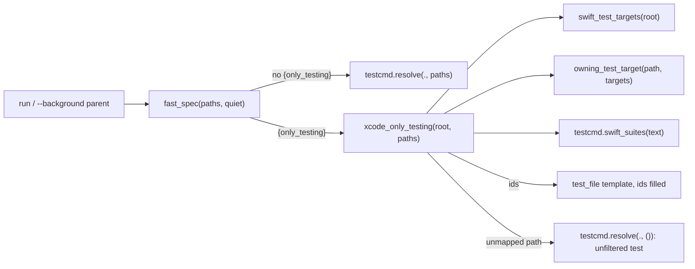
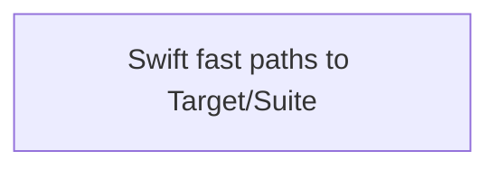

# Superlite: `run_tests --fast` maps Swift paths to `-only-testing:<Target>/<Suite>` or runs unfiltered (B64)

**Goal:** fix #398: with a test-cmd.json template that uses `{only_testing}`, `run_tests --fast <paths>` turned each path into `-only-testing:<FileName>` (no test target), for a test file and a view file alike, so xcodebuild exited 70. Max's decision: map test files to `<Target>/<Suite>`, run unfiltered otherwise.
**Architecture:** `run_tests.fast_spec` replaces the two `testcmd.resolve(".", paths)` calls in `run_tests.py`. For an `{only_testing}` template it reads the test target names (`swift_test_targets`), finds each path's owning test target (`owning_test_target`) and builds shell-quoted ids (`xcode_only_testing`); one path outside every test target makes the run use the unfiltered `test` command, with one stderr line. Every other template still goes through `testcmd.resolve` unchanged.
**Tech stack:** Python 3.10+ stdlib, pytest (through `sl run_tests`).
**Spec:** this file, section Design; issue #398's Expected line and Max's decision.
**Detail:** tests
**Target-min:** 11
**Wave0:** none
**Max chars:** 22000

Global constraints:
- Every code line in `skills/subagent-driven-development/scripts/` carries the repo's trailing `# O(...)` complexity comment (short notes after `|`); tests do not. Stdlib only.
- Existing tests stay green and no existing test file changes (another lead may own them). If an existing test turns red, report it in DONE_WITH_CONCERNS with the test id and the reason instead of editing it.
- Run `sl` as an executable (`<abs>/sl ...`). Verify with `<abs>/sl run_tests --fast tests/scripts/test_run_tests_swift_only_testing.py tests/scripts/test_run_tests_placeholder_gate.py tests/scripts/test_session_cost_testcmd.py tests/scripts/test_run_tests_resolve.py tests/scripts/test_run_tests_exit_paths.py tests/scripts/test_testcmd_xcode.py --task T1 --background`, then run the printed `wait:` line in the foreground and end the turn only after it reports. Never raw `pytest`, never the e2e or eval layers (coordinator's step).
- No version edits (the ship step bumps the version). Touch only the files in Owns; `testcmd.py` stays unchanged (another lead may own it).

Ruling: Max's decision: a test file maps to `-only-testing:<Target>/<Suite>`, any other path runs the unfiltered `test` command - cost if wrong: a source-only `--fast` run takes the full suite's time.
Ruling: the fix lives in `run_tests.py` only (the brief's one file); `testcmd.only_testing` keeps its old mapping for `testcmd.resolve` callers outside run_tests, a follow-up - cost if wrong: `testcmd.py --fast` style callers still get target-less ids.
Ruling: test target names come from `PBXNativeTarget` blocks with product type `bundle.unit-test` or `bundle.ui-testing` in `*.xcodeproj/project.pbxproj` and from `.testTarget(name: "...")` in `Package.swift`, both at the root and one folder below; with none found, the folder conventions (`Tests/<Target>/`, else the nearest folder ending in `Tests`) - cost if wrong: a generated project (XcodeGen, Tuist) not in git relies on folder names.
Ruling: when names were found, a path must sit under a folder of that exact name; no convention fallback - cost if wrong: a test target whose folder name differs from the target runs unfiltered (slow, never exit 70).
Ruling: a file in a test target that declares no suite (a helper), or a non-Swift file there, maps to `-only-testing:<Target>` - cost if wrong: that target's whole suite runs.
Ruling: each id is shell-quoted (`shlex.quote`): a Swift Testing free function id `Target/adds()` and a target name with a space would otherwise break `sh` - cost if wrong: none.
Ruling: an unfiltered fallback keeps the summary mode `fast` (no verified incidents, no full-run closing) - cost if wrong: none.
Ruling: a test-cmd.json without a `test` string keeps today's `testcmd.resolve` path - cost if wrong: such a config still gets the old ids.
Ruling: the new tests live in a new file `tests/scripts/test_run_tests_swift_only_testing.py`; docs/tools.md's run_tests row (outside B64's files) is a follow-up - cost if wrong: one stale doc row.
Ruling: detail tests; no probe adapter (library inside a CLI; Review Focus cases run as named pytest cases) - cost if wrong: no generated probes.
Ruling: already in the lead worktree on branch superlite/b64-run-tests-swift-only-testing - cost if wrong: none.
LAYERS: unit



## Design

1. `swift_test_targets(root) -> set[str]`: for each `*.xcodeproj/project.pbxproj` and `*/*.xcodeproj/project.pbxproj` under root, every `isa = PBXNativeTarget;` block (up to its first `};`) whose `productType` is `"com.apple.product-type.bundle.unit-test"` or `"...bundle.ui-testing"` adds its `name` value (a line `name = X;` or `name = "X Y";`, quotes dropped; never `productName`). For `Package.swift` and `*/Package.swift`, every `.testTarget(name: "X"` adds `X`. Whitespace in the regexes is `\s*` (real files use tabs). Unreadable files are skipped. Nothing found: `set()`.
2. `owning_test_target(path, targets) -> str | None`: `dirs` = the path's folder parts (backslashes as `/`). With `targets`: the nearest folder (deepest first) whose name is in `targets`, else None. Without: the folder right after the first `Tests` folder when one follows it (SwiftPM `Tests/<Target>/`), else the nearest folder whose name ends in `Tests` and is not `Tests`, else None.
3. `xcode_only_testing(root, paths) -> tuple[str | None, str | None]`: one `swift_test_targets` call; per path (an absolute path under root made relative first): no owning target -> `(None, that relative path)` at once. Else the suites from `testcmd.swift_suites` of the file text for a `.swift` file that reads (none for an unreadable or non-Swift file); each suite gives `shlex.quote(f"-only-testing:{tgt}/{suite}")`, no suite gives `shlex.quote(f"-only-testing:{tgt}")`; duplicates dropped, order kept; result `(" ".join(ids), None)`. It prints nothing.
4. `fast_spec(paths, quiet=False) -> dict | None`: `cfg = testcmd.read_config(Path(".")) or testcmd.main_checkout_config(Path("."))`; template = `cfg.get("test_file") or cfg.get("test")` when cfg is a dict. When `paths` is empty, the template is not a string or lacks `{only_testing}`, or `cfg.get("test")` is not a string: `return testcmd.resolve(".", paths)` (today's behaviour). Else `spec = testcmd.resolve(".", ())` (the unfiltered `test` command); a None or python spec is returned as is. Then `ids, miss = xcode_only_testing(Path("."), paths)`. `miss` set: unless `quiet`, print `run_tests: <miss> is not in a test target; running the unfiltered test command` to stderr; return spec. Else `spec["command"]` = the template with `{only_testing}` -> ids, `{files}` -> the paths joined as `testcmd.resolve` joins them (a path with a space in double quotes), `{names}` -> `testcmd.names_filter(paths)`; return spec.
5. `run()` calls `fast_spec(paths)` where it called `testcmd.resolve(".", paths)`; the `--background` parent calls `fast_spec(fast, quiet=True)` where it called `testcmd.resolve(".", fast)`. No other call changes. The module docstring gains one line for the mapping and the fallback note.

## Coverage

| Category | State | Basis |
|---|---|---|
| Scope and success criteria | settled | #398 Expected line; Max's decision |
| Domain and data model | settled | target names from project files, suites from testcmd.swift_suites |
| Persistence and migration | n/a | no stored data |
| Interfaces and contracts | ruled | new run_tests helpers; testcmd untouched |
| UI states | n/a | CLI text only |
| Concurrency and state ownership | n/a | one process |
| Error handling and recovery | ruled | unreadable files skipped; unmapped path -> unfiltered with a note |
| Security and privacy | ruled | ids shell-quoted before `shell=True` |
| Performance and limits | settled | two shallow globs and one read per path |
| Observability | settled | one stderr line on the fallback |
| Testing strategy | settled | one new test file; fake test command records its args |
| Compatibility | ruled | non-`{only_testing}` templates unchanged |
| Rollout | ruled | one PR; version bump at ship |
| Research unknowns | n/a | reproduced from the code |

## File structure
- `skills/subagent-driven-development/scripts/run_tests.py`: `swift_test_targets`, `owning_test_target`, `xcode_only_testing`, `fast_spec`, two call sites, docstring line (T1).
- `tests/scripts/test_run_tests_swift_only_testing.py`: the Review Focus cases (T1).

## Task graph

```mermaid
%% schedule
gantt
  title Predicted schedule (mm:ss)
  dateFormat X
  axisFormat %M:%S
  section lane 1
  T1 Swift fast paths to Target/Suite else :t1, 0, 98s
```




critical path: T1 (1.6 min) · peak width 1 · predicted build 1.6 min · predicted total ≈ 5.1 min (target ✓)

## Package: run_tests Swift fast mapping (CLI + library)
App type: CLI. Categories: protocol (xcodebuild args), encoding (shell quoting, spaces), file (project files, absolute paths), state (fallback mode).
**Probe entry:** none (Ruling: no probe adapter).

### T1 Swift fast paths to Target/Suite, else unfiltered · Complexity 4 · Est. context 42k
**Owns:** skills/subagent-driven-development/scripts/run_tests.py, tests/scripts/test_run_tests_swift_only_testing.py
**Components:** 2
**LOC owned:** 190
**Tests:** fast
**Model:** sonnet
**Est. time:** 3.0 min (2 components, about 190 LOC, fast tests)
**Covers:** 1, 2, 3, 4, 5
**Consumes:** existing `testcmd.swift_suites(text: str) -> list[str]` · existing `testcmd.resolve(root, paths)` · existing `testcmd.read_config(root)` · existing `testcmd.main_checkout_config(root)` · existing `testcmd.names_filter(paths) -> str`
**Produces:** run_tests.swift_test_targets(root: Path) -> set[str] · run_tests.owning_test_target(path: str, targets: set[str]) -> str | None · run_tests.xcode_only_testing(root: Path, paths: list[str]) -> tuple[str | None, str | None] · run_tests.fast_spec(paths: list[str], quiet: bool = False) -> dict | None
e.g. owning_test_target("AppTests/FooTests.swift", {"AppTests"}) -> "AppTests"
e.g. owning_test_target("Tests/CoreTests/BarTests.swift", set()) -> "CoreTests"
e.g. xcode_only_testing(root, ["AppTests/FreeTests.swift"]) -> ("'-only-testing:AppTests/adds()'", None)
**Review Focus:** protocol: `test_fast_test_file_runs_target_suite`, `test_fast_source_file_runs_unfiltered`, `test_fast_mixed_paths_run_unfiltered`; encoding: `test_fast_free_function_survives_the_shell`, `test_xcode_only_testing_target_with_space`; file: `test_targets_nested_project`, `test_xcode_only_testing_absolute_path`; state: `test_background_parent_is_quiet`.
**Test code (verbatim):**
```python
"""run_tests --fast maps Swift test files to -only-testing:<Target>/<Suite> and runs other paths unfiltered (#398)."""
import json
import subprocess
import sys
from pathlib import Path

import pytest

SCRIPTS = Path(__file__).resolve().parents[2] / "skills" / "subagent-driven-development" / "scripts"
RUN_TESTS = SCRIPTS / "run_tests.py"
sys.path.insert(0, str(SCRIPTS))
import run_tests  # noqa: E402

PBXPROJ = (
    "// !$*UTF8*$!\n{\n\tobjects = {\n\n/* Begin PBXNativeTarget section */\n"
    "\t\tA1 /* App */ = {\n\t\t\tisa = PBXNativeTarget;\n\t\t\tbuildPhases = (\n\t\t\t\tB1 /* Sources */,\n\t\t\t);\n"
    "\t\t\tname = App;\n\t\t\tproductName = App;\n\t\t\tproductType = \"com.apple.product-type.application\";\n\t\t};\n"
    "\t\tA2 /* AppTests */ = {\n\t\t\tisa = PBXNativeTarget;\n\t\t\tbuildPhases = (\n\t\t\t\tB2 /* Sources */,\n\t\t\t);\n"
    "\t\t\tname = AppTests;\n\t\t\tproductName = AppTests;\n\t\t\tproductType = \"com.apple.product-type.bundle.unit-test\";\n\t\t};\n"
    "\t\tA3 /* App UITests */ = {\n\t\t\tisa = PBXNativeTarget;\n\t\t\tname = \"App UITests\";\n"
    "\t\t\tproductName = \"App UITests\";\n\t\t\tproductType = \"com.apple.product-type.bundle.ui-testing\";\n\t\t};\n"
    "/* End PBXNativeTarget section */\n\t};\n}\n")
FILES = {
    "App/Views/ContentView.swift": "import SwiftUI\nstruct ContentView: View {\n    var body: some View { Text(\"hi\") }\n}\n",
    "AppTests/FooTests.swift": "import XCTest\n@testable import App\nfinal class FooTests: XCTestCase {\n    func testA() {}\n}\n",
    "AppTests/FreeTests.swift": "import Testing\n@Test func adds() {}\n",
    "AppTests/Support/Helpers.swift": "import Foundation\nfunc makeFoo() -> Int { 1 }\n",
    "App UITests/LaunchTests.swift": "import XCTest\nfinal class LaunchTests: XCTestCase {\n    func testLaunch() {}\n}\n",
}
OK = "echo 'Executed 1 test, with 0 failures (0 unexpected) in 0.1 (0.1) seconds'"
CFG = {"language": "swift", "test": f"echo FULL > .superlite/got.txt; {OK}",
       "test_file": f"printf '%s\\n' {{only_testing}} > .superlite/got.txt; {OK}"}


def xcode_repo(tmp_path, cfg=CFG):
    subprocess.run(["git", "init", "-q"], cwd=tmp_path, check=True)
    (tmp_path / "App.xcodeproj").mkdir()
    (tmp_path / "App.xcodeproj" / "project.pbxproj").write_text(PBXPROJ, encoding="utf-8")
    for rel, text in FILES.items():
        (tmp_path / rel).parent.mkdir(parents=True, exist_ok=True)
        (tmp_path / rel).write_text(text, encoding="utf-8")
    (tmp_path / ".superlite").mkdir()
    if cfg is not None:
        (tmp_path / ".superlite" / "test-cmd.json").write_text(json.dumps(cfg), encoding="utf-8")
    return tmp_path


def rt(cwd, *args):
    return subprocess.run([sys.executable, str(RUN_TESTS), *args], cwd=cwd, capture_output=True, text=True, timeout=120)


def got(root):
    return (root / ".superlite" / "got.txt").read_text(encoding="utf-8").splitlines()


def test_targets_from_pbxproj(tmp_path):
    assert run_tests.swift_test_targets(xcode_repo(tmp_path)) == {"AppTests", "App UITests"}


def test_targets_from_package_swift(tmp_path):
    (tmp_path / "Package.swift").write_text(
        'let package = Package(name: "Core", targets: [\n    .target(name: "Core"),\n'
        '    .testTarget(\n        name: "CoreTests", dependencies: ["Core"]),\n])\n', encoding="utf-8")
    assert run_tests.swift_test_targets(tmp_path) == {"CoreTests"}


def test_targets_nested_project(tmp_path):
    (tmp_path / "ios" / "App.xcodeproj").mkdir(parents=True)
    (tmp_path / "ios" / "App.xcodeproj" / "project.pbxproj").write_text(PBXPROJ, encoding="utf-8")
    assert run_tests.swift_test_targets(tmp_path) == {"AppTests", "App UITests"}


def test_targets_none(tmp_path):
    assert run_tests.swift_test_targets(tmp_path) == set()


@pytest.mark.parametrize("path,targets,want", [
    ("AppTests/FooTests.swift", {"AppTests"}, "AppTests"),
    ("AppTests/Support/Helpers.swift", {"AppTests"}, "AppTests"),
    ("App/Views/ContentView.swift", {"AppTests"}, None),
    ("Tests/CoreTests/BarTests.swift", {"AppTests"}, None),
    ("Tests/CoreTests/BarTests.swift", set(), "CoreTests"),
    ("AppTests/FooTests.swift", set(), "AppTests"),
    ("Sources/Core/Bar.swift", set(), None),
    ("Tests/BarTests.swift", set(), None),
    ("FooTests.swift", set(), None),
])
def test_owning_test_target(path, targets, want):
    assert run_tests.owning_test_target(path, targets) == want


def test_xcode_only_testing_suites(tmp_path):
    root = xcode_repo(tmp_path)
    assert run_tests.xcode_only_testing(root, ["AppTests/FooTests.swift"]) == ("-only-testing:AppTests/FooTests", None)


def test_xcode_only_testing_free_function_is_quoted(tmp_path):
    root = xcode_repo(tmp_path)
    assert run_tests.xcode_only_testing(root, ["AppTests/FreeTests.swift"]) == ("'-only-testing:AppTests/adds()'", None)


def test_xcode_only_testing_helper_runs_its_target(tmp_path):
    root = xcode_repo(tmp_path)
    assert run_tests.xcode_only_testing(root, ["AppTests/Support/Helpers.swift"]) == ("-only-testing:AppTests", None)


def test_xcode_only_testing_target_with_space(tmp_path):
    root = xcode_repo(tmp_path)
    assert run_tests.xcode_only_testing(root, ["App UITests/LaunchTests.swift"]) == (
        "'-only-testing:App UITests/LaunchTests'", None)


def test_xcode_only_testing_source_path_unmapped(tmp_path):
    root = xcode_repo(tmp_path)
    assert run_tests.xcode_only_testing(root, ["AppTests/FooTests.swift", "App/Views/ContentView.swift"]) == (
        None, "App/Views/ContentView.swift")


def test_xcode_only_testing_dedupes(tmp_path):
    root = xcode_repo(tmp_path)
    assert run_tests.xcode_only_testing(root, ["AppTests/FooTests.swift", "AppTests/FooTests.swift"]) == (
        "-only-testing:AppTests/FooTests", None)


def test_xcode_only_testing_absolute_path(tmp_path):
    root = xcode_repo(tmp_path)
    assert run_tests.xcode_only_testing(root, [str(root / "AppTests" / "FooTests.swift")]) == (
        "-only-testing:AppTests/FooTests", None)


def test_fast_spec_other_template_unchanged(tmp_path, monkeypatch):
    root = xcode_repo(tmp_path, cfg={"language": "swift", "test": "swift test", "test_file": "swift test --filter {names}"})
    monkeypatch.chdir(root)
    assert run_tests.fast_spec(["AppTests/FooTests.swift"])["command"] == "swift test --filter FooTests"


def test_fast_test_file_runs_target_suite(tmp_path):
    root = xcode_repo(tmp_path)
    r = rt(root, "--fast", "AppTests/FooTests.swift")
    assert r.returncode == 0, r.stderr
    assert got(root) == ["-only-testing:AppTests/FooTests"]
    assert "declares no test suite" not in r.stderr and "not in a test target" not in r.stderr


def test_fast_free_function_survives_the_shell(tmp_path):
    root = xcode_repo(tmp_path)
    r = rt(root, "--fast", "AppTests/FreeTests.swift", "App UITests/LaunchTests.swift")
    assert r.returncode == 0, r.stderr
    assert got(root) == ["-only-testing:AppTests/adds()", "-only-testing:App UITests/LaunchTests"]


def test_fast_source_file_runs_unfiltered(tmp_path):
    root = xcode_repo(tmp_path)
    r = rt(root, "--fast", "App/Views/ContentView.swift")
    assert r.returncode == 0, r.stderr
    assert got(root) == ["FULL"]
    assert ("run_tests: App/Views/ContentView.swift is not in a test target; running the unfiltered test command"
            in r.stderr)
    assert "declares no test suite" not in r.stderr
    summary = json.loads((root / ".superlite" / "test-summary.json").read_text(encoding="utf-8"))
    assert summary["mode"] == "fast" and summary["passed"] == 1


def test_fast_mixed_paths_run_unfiltered(tmp_path):
    root = xcode_repo(tmp_path)
    r = rt(root, "--fast", "AppTests/FooTests.swift", "App/Views/ContentView.swift")
    assert r.returncode == 0, r.stderr
    assert got(root) == ["FULL"]


def test_background_parent_is_quiet(tmp_path):
    root = xcode_repo(tmp_path)
    r = rt(root, "--fast", "App/Views/ContentView.swift", "--background")
    assert r.returncode == 0, r.stderr
    assert "not in a test target" not in r.stderr and "declares no test suite" not in r.stderr
    w = rt(root, "--timeout", "60", "--wait")
    assert w.returncode == 0, w.stdout + w.stderr
    assert got(root) == ["FULL"]
```
**Steps:** 1 failing tests, 2 run: FAIL, 3 implement Design 1 to 5 (read the Design section), 4 run: PASS (own file plus the verify files of Global constraints).
**Notes:** `fast_spec` mirrors `testcmd.resolve`'s `{files}` join and keeps `{names}`; it never calls `testcmd.only_testing`, so testcmd's `declares no test suite` warning no longer prints for a `--fast` run.

## Review Focus
Package run_tests Swift fast mapping: protocol (ids xcodebuild accepts, fallback command), encoding (quoting of `()` and spaces), file (project files at root and one folder down, absolute paths), state (the `--background` parent prints no note). All cases sit in T1.

## Self-review
- #398 (test file -> `-only-testing:<FileName>`): Design 2 and 3; `test_fast_test_file_runs_target_suite`. View file -> unfiltered: Design 4; `test_fast_source_file_runs_unfiltered`, `test_fast_mixed_paths_run_unfiltered`.
- Max's decision (map test files, run unfiltered otherwise): Design 3 and 4.
- One task, one file plus its new test file; no edge, no stub.
