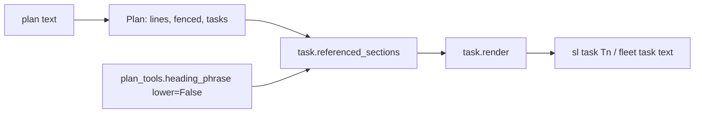
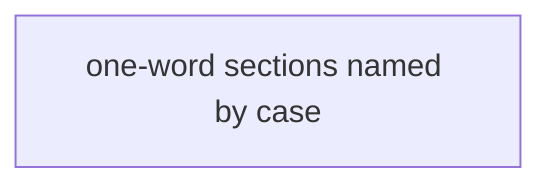

# Superlite: `sl task` appends a one-word plan section the task text names by its capitalised word (B44)

**Goal:** fix #333: `sl task T1` left out the plan's `## Design` section although T1's Notes and Steps said "implement per Design", because a one-word heading counts only as `Design section`, `section Design`, `§ Design` or `## Design`. Max's decision: `sl task` appends the named section (no lint warning).
**Architecture:** `task.referenced_sections` gains a second, case-kept view of the task text; a one-word heading holding an uppercase letter is named by that word in the same case anywhere in it (field labels and inline code left out). `plan_tools.heading_phrase` gets a `lower` keyword so both views share one normaliser. The explicit forms also take the plural `sections`.
**Tech stack:** Python 3.10+ stdlib, pytest (through `sl run_tests`).
**Spec:** this file, section Design; issue #333's Expected line and Max's decision.
**Detail:** tests
**Target-min:** 11
**Wave0:** none
**Max chars:** 20000

Global constraints:
- Every code line in `skills/subagent-driven-development/scripts/` carries the repo's trailing `# O(...)` complexity comment (short notes after `|`); tests do not. Stdlib only.
- Existing tests stay green and no existing test file changes (another lead may own them). If an existing test turns red, report it in DONE_WITH_CONCERNS with the test id and the reason instead of editing it.
- Run `sl` as an executable (`<abs>/sl ...`). Verify with `<abs>/sl run_tests --fast tests/scripts/test_task_sections_333.py tests/scripts/test_task_sections.py tests/scripts/test_task_constraints_285.py tests/scripts/test_plan_heading_refs_285.py tests/scripts/test_plan_tools.py tests/scripts/test_slim_prime.py --task T1 --background`, then run the printed `wait:` line in the foreground and end the turn only after it reports. Never raw `pytest`, never the e2e or eval layers (coordinator's step).
- No version edits (the ship step bumps the version). Touch only the files in Owns.

Ruling: Max's decision: `sl task` appends a section the task names; no `plan_tools lint` warning - cost if wrong: none.
Ruling: a one-word heading whose word holds an uppercase letter (`## Design`, `## API`) is named by that word in the heading's case, plural `s` on either side, anywhere in the task's unfenced text outside bold field labels and inline code, so `per Design`, `**Covers:** Design 1`, `under Design` and `see Design 2)` count; lowercase prose (`**Kind:** design`), a `**Notes:**` label and an identifier in backticks do not - cost if wrong: a capitalised sentence-start word that equals a one-word heading ("Design the parser") adds that section to the task text (tokens only).
Ruling: a lowercase one-word heading (`## design`) keeps the explicit forms only - cost if wrong: none beyond today's.
Ruling: the explicit forms accept `sections` (`design sections 1 to 7`, `sections design`) - cost if wrong: none.
Ruling: the new tests live in a new file `tests/scripts/test_task_sections_333.py`; docs/tools.md's `task` row (outside B44's files) still names only the explicit forms, a follow-up - cost if wrong: one stale doc row.
Ruling: detail tests; no probe adapter (plan text library; Review Focus cases run as named pytest cases) - cost if wrong: no generated probes.
Ruling: already in the lead worktree on branch superlite/b44-sl-task-named-sections - cost if wrong: none.
LAYERS: unit



## Design

1. `plan_tools.heading_phrase(title: str, *, lower: bool = True) -> str`: today's normalisation (drop backticks and asterisks, strip, drop a leading `N.` / `N.N` number, drop a trailing colon, collapse whitespace); lower-cases only when `lower` is true. Every existing caller keeps the default.
2. `task.referenced_sections(plan, task)` builds two views of the task block's unfenced lines:
   - `text` (today's): backticks and asterisks dropped, lower case, whitespace collapsed.
   - `cased` (new): per unfenced line, stripped; a line matching `pt.FIELD_RE` keeps only its value (`group(2)`); inline code spans (`` `...` ``) become a space; asterisks drop; the lines join with spaces, whitespace collapsed, case kept.
3. `task._names(phrase, text, word="", cased="") -> bool` (`word` = `pt.heading_phrase(title, lower=False)`):
   - two or more words: today's rule on `text` (unchanged).
   - one word: the explicit forms on `text` with `sections?` (`w\s+sections?`, `sections?\s+w`, `§\s*w`, `##\s*w`), or, when `word` holds an uppercase character, `(?<![\w-])BASEs?(?![\w-])` searched case-sensitively in `cased`, where BASE is `word` without one trailing `s`.
4. Unchanged: which headings are sections (`##`/`###`, outside task blocks, non-empty body), SKELETON and `global constraints` never listed, a subsection printed once with its parent, render order.

## Coverage

| Category | State | Basis |
|---|---|---|
| Scope and success criteria | settled | #333 Expected line; Max's decision: append |
| Domain and data model | settled | one more text view in referenced_sections |
| Persistence and migration | n/a | no stored data |
| Interfaces and contracts | settled | `heading_phrase` gains a keyword with the old default |
| UI states | n/a | CLI text only |
| Concurrency and state ownership | n/a | one task |
| Error handling and recovery | settled | no new error paths |
| Security and privacy | n/a | plan text only |
| Performance and limits | settled | one more O(block) pass, one regex per section |
| Observability | n/a | no logs |
| Testing strategy | settled | one new unit test file; unit layer by the coordinator |
| Compatibility | ruled | multi-word and explicit forms unchanged; capitalised one-word mentions now add sections |
| Rollout | ruled | one PR; version bump at ship |
| Research unknowns | n/a | reproduced from the code |

## File structure
- `skills/subagent-driven-development/scripts/plan_tools.py`: `heading_phrase` `lower` keyword (T1).
- `skills/subagent-driven-development/scripts/task.py`: cased view, `_names` one-word case rule, plural `sections`, docstring (T1).
- `tests/scripts/test_task_sections_333.py`: the Review Focus cases (T1).

## Task graph

```mermaid
%% schedule
gantt
  title Predicted schedule (mm:ss)
  dateFormat X
  axisFormat %M:%S
  section lane 1
  T1 sl task names a one-word section by i :t1, 0, 70s
```




critical path: T1 (1.2 min) · peak width 1 · predicted build 1.2 min · predicted total ≈ 4.7 min (target ✓)

## Package: task text (library over plan text)
App type: library/parser. Categories: encoding, deep, state. Specific risks: a field label or code identifier pulling in an unrelated section, a lowercase prose word matching, the plural rule over-matching.
**Probe entry:** none (Ruling: no probe adapter).

### T1 sl task names a one-word section by its capitalised word · Complexity 3 · Est. context 36k
**Owns:** skills/subagent-driven-development/scripts/task.py, skills/subagent-driven-development/scripts/plan_tools.py, tests/scripts/test_task_sections_333.py
**Components:** 1
**LOC owned:** 120
**Tests:** fast
**Model:** sonnet
**Est. time:** 2.0 min (1 component, about 120 LOC, fast tests)
**Covers:** 1, 2, 3
**Consumes:** existing `plan_tools.Plan(text: str)` · existing `plan_tools.FIELD_RE`
**Produces:** plan_tools.heading_phrase(title: str, *, lower: bool = True) -> str · task.referenced_sections(plan, task) -> list
e.g. heading_phrase("2. The `Design`:", lower=False) -> "The Design"
e.g. heading_phrase("2. The `Design`:") -> "the design"
**Review Focus:**
Test fixture (copy `mk` and `secs` from `tests/scripts/test_task_sections.py` into the new file, do not import that file): `SEC = "## Design\nbody"`.
state: `test_issue_333_per_design` (`mk(SEC, "**Notes:** implement per Design.\n**Steps:** 1 test, 2 implement per Design")` -> `secs == [SEC]`; `task.render(plan, "T2")` holds `"## Plan sections this task names\n\n## Design\nbody"`);
encoding: `test_capitalised_mentions` (each body alone -> `[SEC]`: `"**Covers:** Design 1"`, `"sections 1 to 6 under Design."`, `"see Design 2)"`, `"the Design's rule"`, `"both Designs"`, `"(Design)"`);
encoding: `test_not_a_mention` (each body alone -> `[]`, also via `extra=`: `"**Kind:** design"`, `"design the parser"`, `"a redesign"`, `"the Designer"`, `"Design-time check"`, `"call `Design.render()` here"`, `"```\nper Design\n```"`);
state: `test_field_label_not_a_mention` (`mk("## Notes\nshared notes", "**Notes:** do x")` -> `[]`; with body `"**Notes:** see Notes above"` -> `["## Notes\nshared notes"]`);
state: `test_lowercase_heading_explicit_only` (`mk("## design\nbody", "per Design")` -> `[]`; `"per design"` -> `[]`; `"design section"` -> `["## design\nbody"]`);
encoding: `test_explicit_plural_sections` (`mk("## design\nbody", "design sections 1 to 7")` and `"sections design"` -> `["## design\nbody"]`);
encoding: `test_acronym_heading` (`mk("## API\nGET /x", "call the API")` -> `["## API\nGET /x"]`; `"call the api"` -> `[]`; `"the APIs"` -> `["## API\nGET /x"]`);
state: `test_skeleton_and_constraints_never` (`mk("## Coverage\ncov\n\n## Self-review\nsr", "per Coverage and Self-review")` -> `[]`);
state: `test_multiword_unchanged` (`mk("## Shared helper\nx", "Use the shared helper.")` -> `["## Shared helper\nx"]`; `mk("## Shared helper\nx", "Shared")` -> `[]`);
encoding: `test_heading_phrase_lower_keyword` (the two `e.g.` cases; `heading_phrase("**Design**") == "design"`; `heading_phrase("1.2 Wire  Format", lower=False) == "Wire Format"`).
**Steps:** 1 failing tests, 2 run: FAIL, 3 implement Design 1 to 3 (read the Design section), 4 run: PASS (own file plus the verify files of Global constraints).

## Review Focus
Package task text: encoding (field labels, inline code, fences, hyphen and plural boundaries), deep (one-word vs multi-word rules), state (sections listed once, unchanged order). All cases sit in T1.

## Self-review
- #333 ("implement per Design" left out `## Design`): Design 3, case rule; `test_issue_333_per_design`. Max's decision (append, no lint): no plan_tools lint change.
- Real plan forms (`**Covers:** Design 1`, `sections 1 to 6 under Design`, `Design sections 1 to 7`): `test_capitalised_mentions`, `test_explicit_plural_sections`.
