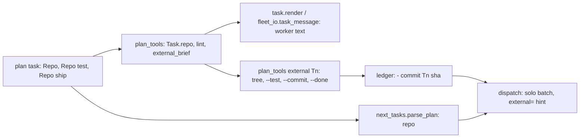
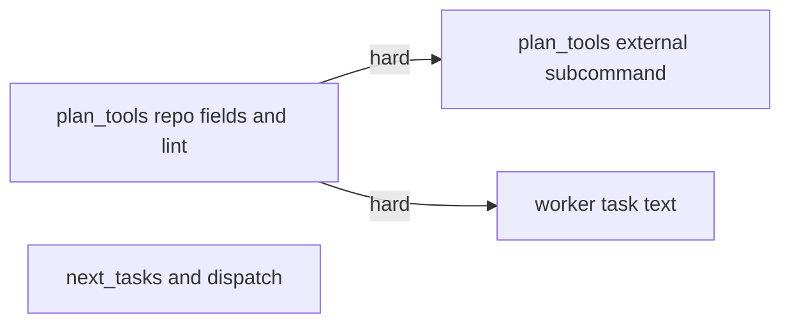
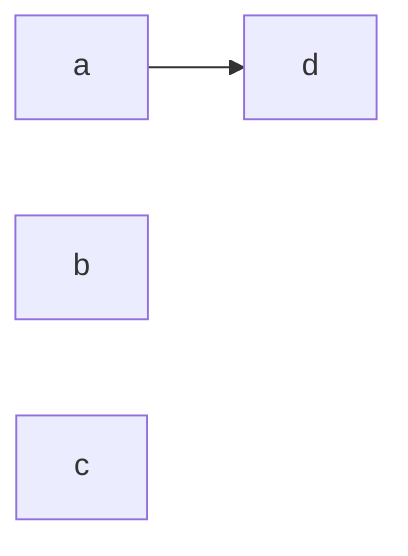

# Superlite: a taskgraph task can change another repository (B48)

**Goal:** #332: a plan task can be a prerequisite change in another repository, declared by per-task fields with its own root, test command and ship step, ordered before its dependents by the existing taskgraph edges.
**Architecture:** plan_tools reads three new task fields (`**Repo:**`, `**Repo test:**`, `**Repo ship:**`), gives such a task an empty local Owns view, lints the fields and owns a new `plan_tools external Tn` subcommand (tree, `--test`, `--commit`, `--done`). next_tasks puts `repo` into its task info; dispatch never batches an external task and names its steps on stderr. task.render and fleet_io.task_message tell the worker to work in the task's tree.
**Tech stack:** Python 3 stdlib, git, pytest (through `sl run_tests`).
**Spec:** this file, section Design; issue #332 Expected line and Max's decision (per-task repo field with root, test command, ship step).
**Detail:** tests
**Target-min:** 11
**Wave0:** none
**Coverage:** off

Global constraints:
- Keep the repo's `# O(...)` comment on every new code line (see any function in the file you edit). Change no line outside what the task needs.
- Existing tests stay green. An existing test file never changes. If another existing test turns red, report it in DONE_WITH_CONCERNS with the test id and the reason instead of editing it.
- Run `sl` as an executable (`<abs>/sl ...`). Verify with `<abs>/sl run_tests --fast <own test file> --task Tn --background`, then run the printed `wait:` line in the foreground and end the turn only after it reports.
- No version edits (the ship step bumps the version). Never run `scripts/test_layers.py run`, `scripts/evals.sh` or `claude plugin eval` (the coordinator runs the layers).

## Design

Issue #332, expected: "a plan field for an external-repository task with its own root, test command and commit/ship step, ordered before the tasks that depend on it." Max's decision: a per-task repo field with root, test command and ship step, ordered by the existing taskgraph edges. Today a lead runs such a change by hand as a fixer in a nested worktree under `.superlite/` and ships it with `maxapp ship -C` (1.5.46); this makes that the plan's own flow.

Plan format (task block):

````text
### T1 shared helper · Est. time 2 min
**Owns:** src/helper.py, tests/test_helper.py      (relative to the other repository)
**Repo:** ~/github/shared-pkg                     (absolute, ~, or relative to the plan's git toplevel)
**Repo test:** `pytest -q`                         (runs in the task's tree)
**Repo ship:** `maxapp ship -C {tree}`             ({tree} and {root} expand)
````

Flow: dispatch sends T1 like any task (never batched, stderr `external=T1 ...`). The worker runs `sl plan_tools external T1 --plan P` (a git worktree of the root at `<plan .superlite>/repos/T1`, branch `superlite/<plan stem without date>-t1`), edits there, verifies with `--test`, reports DONE. The coordinator runs `--commit` (stages the tree, commits only Owns files), runs the printed `ship:` line, then `--done`, which appends `- commit T1 <sha> <title> (repo <root>)` to the ledger and frees the pool agent. Dependents (`T1 --> T2`) become ready from that ledger line, as from a commit_task line.

Ruling: three fields (`**Repo:**`, `**Repo test:**`, `**Repo ship:**`) instead of one packed line - each is a plain plan field, parsed by the existing field reader - cost if wrong: a later merge into one field is a parser change.
Ruling: an external task's `Task.owns` (plan_tools) and `owns` (next_tasks info) are empty; its Owns list stays in `Task.written_owns` - every local reader (Wave 0 stubs, commit_task scope, run_tests trees, fleet "Do not touch", guards) then treats it as owning nothing here - cost if wrong: a local reader that needs the external list must read written_owns.
Ruling: the coordinator, not the worker, commits and ships (fleet workers' permission dialogs are denied; a lead's allow rule matches `maxapp ship *`); lint requires `{tree}` or `{root}` in **Repo ship:** so the step never runs in the coordinator's checkout.
Ruling: the tree forks from the root's checked-out HEAD; `--test` strips SUPERLITE_FLEET_* (as run_tests, B47), runs in the tree with a 600 s default timeout and prints the last 40 output lines plus `external Tn test: PASS|FAIL (...)`.
Ruling: `--done` trusts the coordinator that the ship step ran (no generic "is it merged" check exists); it refuses an unknown sha and records once.
Ruling: B48 also edits task.py and fleet_io.py (T4): the task text and fleet message are the only channels to a worker; backlog.json lists no other unshipped batch.
Ruling: docs/tools.md, skills/writing-plans/SKILL.md and the SDD SKILL.md stay follow-ups (outside B48's files; a SKILL.md edit needs the evals layer, SDD SKILL.md is at its cap); commit_task's `Tn FAILED: no Owns line` for an external task is a follow-up too.
Ruling: detail tests; no Wave 0 (the project builds); no probe adapter (CLI covered by subprocess tests); already in the lead worktree, so no `sl worktree ensure`.
LAYERS: unit



## File structure

- skills/subagent-driven-development/scripts/plan_tools.py: Repo fields, local Owns view, `repo_root`, `repo_issues`, `external_brief`, lint and startable hooks (T1); `external` subcommand (T2).
- skills/subagent-driven-development/scripts/next_tasks.py: `repo` in parse_plan info (T3).
- skills/subagent-driven-development/scripts/dispatch.py: solo batch, `external_hints` on stderr (T3).
- skills/subagent-driven-development/scripts/task.py, fleet_io.py: worker text (T4).
- tests/scripts/test_external_repo_plan.py (T1), test_external_repo_cmd.py (T2), test_external_repo_dispatch.py (T3), test_external_repo_brief.py (T4).

## Task graph

```mermaid
%% schedule
gantt
  title Predicted schedule (mm:ss)
  dateFormat X
  axisFormat %M:%S
  section lane 1
  T1 plan_tools repo fields and lint :t1, 0, 99s
  T2 plan_tools external subcommand :t2, 99, 110s
  section lane 2
  T3 next_tasks and dispatch know external :t3, 0, 71s
  T4 worker task text for external tasks :t4, 99, 68s
```





critical path: T1 → T2 (3.5 min) · peak width 2 · predicted build 3.5 min · predicted total ≈ 7.0 min (target ✓)

## Predicted schedule

## plan_tools

App type: CLI and library. Categories: protocol (fields, subcommand modes, exit codes), state (record file, ledger written once), file (tree path, git worktree).

### T1 plan_tools repo fields and lint · Complexity 4 (O-1) · Est. context 46k
**Owns:** skills/subagent-driven-development/scripts/plan_tools.py, tests/scripts/test_external_repo_plan.py
**Components:** 2
**LOC owned:** 230
**Tests:** fast
**Model:** sonnet
**Est. time:** 4 min (2 components, about 230 LOC, fast tests)
**Consumes:** none
**Produces:** plan_tools.Task.repo -> dict | None · plan_tools.Task.written_owns -> list[str] · plan_tools.repo_root(plan_path: str, written: str) -> Path · plan_tools.repo_issues(plan: Plan) -> list · plan_tools.external_brief(plan_path: str | None, task: Task, sl: str = "sl") -> list[str]
e.g. Task.repo -> {"root": "/abs/shared", "test": "pytest -q", "ship": "maxapp ship -C {tree}"}
e.g. repo_root("/p/proj/plan.md", "../shared") -> Path("/p/shared")
e.g. external_brief("/p/proj/plan.md", local_task) -> []
**Covers:** Design
**Review Focus:** `test_repo_fields_and_local_owns`: an external task's owns and owned_sources are empty, written_owns keeps the list; `test_external_and_local_same_path_not_a_conflict`: no "both own" for a local and an external task owning the same relative path; `test_startable_waits_for_external_producer`: a Wave 0 stub never covers an external producer.
**Test code (verbatim):** tests/scripts/test_external_repo_plan.py
````python
"""External repository tasks (#332): the **Repo:** fields, the local Owns view and their lint checks."""
from __future__ import annotations

import subprocess
import sys

from test_plan_tools import SCRIPTS, pt

sys.path.insert(0, str(SCRIPTS))
import plan_tools  # noqa: E402

EDGE = "  T1 --> T2\n"
LOCAL = ("### T2 local user · Est. time 2 min\n**Owns:** src/helper.py, src/app.py\n"
         "**Components:** 1\n**LOC owned:** 20\n**Tests:** fast\n\n")


def head(edges=EDGE, wave0=True):
    return ("# Plan\n**Goal:** test.\n" + ("**Wave0:** none\n" if wave0 else "") + "\n```mermaid\nflowchart LR\n"
            "  T1[a]\n  T2[b]\n  %% taskgraph\n" + edges + "```\n\n")


def shared_repo(tmp_path):
    root = tmp_path / "shared"
    root.mkdir(exist_ok=True)
    subprocess.run(["git", "init", "-q", str(root)], check=True)
    return root


def ext_block(root, test="pytest -q", ship="maxapp ship -C {tree}", owns="src/helper.py, tests/test_helper.py", extra=""):
    lines = ["### T1 shared helper · Est. time 2 min", f"**Owns:** {owns}", f"**Repo:** {root}"]
    if test is not None:
        lines.append(f"**Repo test:** `{test}`")
    if ship is not None:
        lines.append(f"**Repo ship:** `{ship}`")
    return "\n".join(lines) + "\n" + extra + "**Components:** 1\n**LOC owned:** 20\n**Tests:** fast\n\n"


def write(tmp_path, text, name="plan.md", **kw):
    proj = tmp_path / "proj"
    proj.mkdir(exist_ok=True)
    p = proj / name
    p.write_text(head(**kw) + text, encoding="utf-8")
    return p


def lint(p):
    return pt("lint", "--plan", p, cwd=p.parent)


def test_repo_fields_and_local_owns(tmp_path):
    root = shared_repo(tmp_path)
    plan = plan_tools.Plan.load(str(write(tmp_path, ext_block(root) + LOCAL)))
    t1, t2 = plan.by_id["T1"], plan.by_id["T2"]
    assert t1.repo == {"root": str(root), "test": "pytest -q", "ship": "maxapp ship -C {tree}"}
    assert t1.owns == [] and t1.owned_sources == []
    assert t1.written_owns == ["src/helper.py", "tests/test_helper.py"]
    assert t2.repo is None
    assert t2.owns == t2.written_owns == ["src/helper.py", "src/app.py"]


def test_repo_root_resolution(tmp_path, monkeypatch):
    p = write(tmp_path, LOCAL)
    monkeypatch.setenv("HOME", str(tmp_path))
    want = (tmp_path / "shared").resolve()
    assert plan_tools.repo_root(str(p), "../shared") == want
    assert plan_tools.repo_root(str(p), "~/shared") == want
    assert plan_tools.repo_root(str(p), str(tmp_path / "x" / ".." / "shared")) == want


def test_complete_external_task_lints_clean(tmp_path):
    root = shared_repo(tmp_path)
    cp = lint(write(tmp_path, ext_block(root) + LOCAL))
    assert "ISSUE: T1" not in cp.out and "ISSUE: T2" not in cp.out, cp.out


def test_missing_test_and_ship_flagged(tmp_path):
    root = shared_repo(tmp_path)
    cp = lint(write(tmp_path, ext_block(root, test=None, ship=None) + LOCAL))
    assert "ISSUE: T1: external repo task has no **Repo test:** line (the test command run in its tree)" in cp.out
    assert ("ISSUE: T1: external repo task has no **Repo ship:** line (the commit/ship step, "
            "e.g. maxapp ship -C {tree})") in cp.out


def test_ship_without_tree_or_root_flagged(tmp_path):
    root = shared_repo(tmp_path)
    cp = lint(write(tmp_path, ext_block(root, ship="maxapp ship") + LOCAL))
    assert ("ISSUE: T1: **Repo ship:** names neither {tree} nor {root}; it would run in the coordinator's "
            "checkout") in cp.out
    assert "names neither" not in lint(write(tmp_path, ext_block(root, ship="maxapp ship -C {root}") + LOCAL)).out


def test_root_missing_or_not_git_flagged(tmp_path):
    cp = lint(write(tmp_path, ext_block(tmp_path / "nope") + LOCAL))
    assert f"ISSUE: T1: **Repo:** {tmp_path / 'nope'} is not a folder" in cp.out
    plain = tmp_path / "plain"
    plain.mkdir()
    cp = lint(write(tmp_path, ext_block(plain) + LOCAL))
    assert f"ISSUE: T1: **Repo:** {plain} is not a git checkout" in cp.out


def test_root_is_this_repository_flagged(tmp_path):
    p = write(tmp_path, LOCAL)
    subprocess.run(["git", "init", "-q", str(p.parent)], check=True)
    p.write_text(head() + ext_block(p.parent) + LOCAL, encoding="utf-8")
    assert f"ISSUE: T1: **Repo:** {p.parent} is this repository; drop the Repo lines" in lint(p).out


def test_repo_lines_without_repo_flagged(tmp_path):
    text = ("### T1 x · Est. time 2 min\n**Owns:** src/a.py\n**Repo test:** `pytest`\n"
            "**Components:** 1\n**LOC owned:** 20\n**Tests:** fast\n\n" + LOCAL)
    assert ("ISSUE: T1: **Repo test:** or **Repo ship:** without a **Repo:** line (the other repository's "
            "root)") in lint(write(tmp_path, text)).out


def test_external_and_local_same_path_not_a_conflict(tmp_path):
    root = shared_repo(tmp_path)
    cp = lint(write(tmp_path, ext_block(root, owns="src/helper.py") + LOCAL, edges=""))
    assert "both own" not in cp.out


def test_two_external_tasks_same_root_conflict(tmp_path):
    root = shared_repo(tmp_path)
    second = ext_block(root, owns="src/helper.py").replace("### T1 shared helper", "### T2 shared other")
    cp = lint(write(tmp_path, ext_block(root, owns="src/helper.py") + second, edges=""))
    assert "ISSUE: T1 and T2 can run in parallel but both own src/helper.py" in cp.out


def test_bare_name_checked_against_repo_root(tmp_path):
    root = shared_repo(tmp_path)
    (root / "setup.py").write_text("", encoding="utf-8")
    assert "has no folder" not in lint(write(tmp_path, ext_block(root, owns="src/a.py, setup.py") + LOCAL)).out
    cp = lint(write(tmp_path, ext_block(root, owns="src/a.py, other.py") + LOCAL))
    assert "T1: Owns entry `other.py` has no folder" in cp.out


def test_no_owns_line_still_flagged(tmp_path):
    root = shared_repo(tmp_path)
    text = ext_block(root).replace("**Owns:** src/helper.py, tests/test_helper.py\n", "")
    assert "ISSUE: T1: no **Owns:** line" in lint(write(tmp_path, text + LOCAL)).out


def test_incomplete_external_task_is_a_fix_task(tmp_path):
    root = shared_repo(tmp_path)
    p = write(tmp_path, ext_block(root, test=None) + LOCAL)
    fix = pt("lint", "--stable", "--plan", p, cwd=p.parent).out.split("FIX:")[1]
    assert "T1:" in fix and "**Repo test:**" in fix


def test_startable_waits_for_external_producer(tmp_path):
    root = shared_repo(tmp_path)
    prod = "**Produces:** helper.make(x: int) -> int\n"
    cons = LOCAL.replace("**Components:** 1", "**Consumes:** helper.make(x: int) -> int (T1)\n**Components:** 1", 1)
    sd = tmp_path / "proj" / ".superlite"
    ctrl = write(tmp_path, ext_block(root, extra=prod).replace(f"**Repo:** {root}\n", "") + cons, name="ctrl.md", wave0=False)
    sd.mkdir(exist_ok=True)
    assert plan_tools.startable(plan_tools.Plan.load(str(ctrl)), sd) == {"T1", "T2"}
    plan = plan_tools.Plan.load(str(write(tmp_path, ext_block(root, extra=prod) + cons, wave0=False)))
    assert plan_tools.startable(plan, sd) == {"T1"}
    (sd / "progress.md").write_text("- commit T1 abcdef1234 shared helper\n", encoding="utf-8")
    assert plan_tools.startable(plan, sd) == {"T1", "T2"}


def test_external_brief_lines(tmp_path):
    root = shared_repo(tmp_path)
    p = write(tmp_path, ext_block(root) + LOCAL)
    plan = plan_tools.Plan.load(str(p))
    lines = plan_tools.external_brief(str(p), plan.by_id["T1"], "/x/sl")
    assert lines == [
        "## External repository",
        f"This task changes another repository: {root.resolve()} (**Repo:** {root}). Owns paths are relative to its tree.",
        f"1. Tree: `/x/sl plan_tools external T1 --plan {p}` makes or reuses the task's worktree of that repository "
        "and prints `tree: <path>`; edit only there.",
        f"2. Verify: `/x/sl plan_tools external T1 --plan {p} --test` runs `pytest -q` in the tree; not run_tests.",
        "3. Do not commit or ship: the coordinator runs `--commit`, the **Repo ship:** step and `--done`.",
    ]
    assert plan_tools.external_brief(None, plan.by_id["T1"])[1].startswith(f"This task changes another repository: {root} ")
    assert "`sl plan_tools external T1 --plan $PLAN --test`" in plan_tools.external_brief(None, plan.by_id["T1"])[3]
    assert plan_tools.external_brief(str(p), plan.by_id["T2"]) == []
````
**Steps:** 1 write the test file, 2 run: FAIL, 3 implement, 4 run: PASS (also run tests/scripts/test_plan_tools.py, tests/scripts/test_lint_owns_bare.py, tests/scripts/test_stable_split.py: still green)
**Notes:** `Task.repo`: None without a `**Repo:**` field; else `{"root", "test", "ship"}` from fields `repo`, `repo test`, `repo ship` through `strip_ticks(field_text(...))` ("" when absent). `Task.written_owns` is today's `owns` body; `owns` returns `[]` when `repo` is set, else `written_owns`. `repo_root`: `os.path.expanduser`, a relative path joins `stable_root(plan_path)`, then `.resolve()` (add `import os`). `repo_issues(plan)` returns `Issue(msg, [t.id])` items, messages exactly as the tests assert (the folder checks only when `plan.path` is set; `{written}` is the root as written; "is not a folder", else "is not a git checkout" when `<root>/.git` is missing, else "is this repository" when it equals `stable_root(plan).resolve()`); lint_plan extends issues with it. In lint_plan: the no-Owns check reads `written_owns`; the bare-name exists check joins `repo_root(...)` for an external task, else stable_root; the build-report check skips external tasks; the parallel-share check compares `{(t.repo["root"] if t.repo else "", o) for o in t.written_owns}` sets and prints the paths. `startable.covered` is False when producer `d` has `repo`. `external_brief`: `[]` without repo; the five lines above; `plan_path` None shows the root as written and `$PLAN`. Message suffix after `is not a folder` / `is not a git checkout`: ` ({resolved root})`.

### T2 plan_tools external subcommand · Complexity 5 (O-1) · Est. context 52k
**Owns:** skills/subagent-driven-development/scripts/plan_tools.py, tests/scripts/test_external_repo_cmd.py
**Components:** 2
**LOC owned:** 330
**Tests:** fast
**Model:** sonnet
**Est. time:** 5 min (2 components, about 330 LOC, fast tests)
**Consumes:** plan_tools.repo_root(plan_path: str, written: str) -> Path (T1) · plan_tools.Task.written_owns -> list[str] (T1)
**Produces:** plan_tools.cmd_external(args) -> int · plan_tools.ensure_tree(plan_path: str, task: Task) -> dict
**Covers:** Design
**Review Focus:** `test_commit_owned_files_only`: notes.txt outside Owns stays untracked and is named on stderr; `test_done_records_once_and_releases_pool`: a second `--done` writes no second ledger line; `test_test_pass_and_fleet_env_stripped`: the test command sees no SUPERLITE_FLEET_* and runs in the tree; `test_stale_folder_refused`: a non-worktree folder at the tree path is never reused.
**Test code (verbatim):** tests/scripts/test_external_repo_cmd.py
````python
"""plan_tools external (#332): the tree, test, commit and done steps of an external repository task."""
from __future__ import annotations

import json
import os
import shlex
import subprocess
import sys
from pathlib import Path

from test_plan_tools import PLAN_TOOLS, run
from test_stable_split import DISPATCH

CHECK = '''import os, sys
fleet = sorted(k for k in os.environ if k.startswith("SUPERLITE_FLEET_"))
print("fleet:", fleet)
print("cwd:", os.getcwd())
sys.exit(int(os.environ.get("CHECK_EXIT", "0")) or (3 if fleet else 0))
'''
PY = shlex.quote(sys.executable)


def git(cwd, *args):
    return subprocess.run(["git", "-C", str(cwd), *map(str, args)], capture_output=True, text=True,
                          check=True).stdout.strip()


def shared_repo(tmp_path):
    root = tmp_path / "shared"
    root.mkdir()
    git(root, "init", "-q")
    git(root, "config", "user.email", "t@example.com")
    git(root, "config", "user.name", "T")
    (root / "src").mkdir()
    (root / "src" / "helper.py").write_text("X = 1\n", encoding="utf-8")
    (root / "check.py").write_text(CHECK, encoding="utf-8")
    git(root, "add", "-A")
    git(root, "commit", "-q", "-m", "init")
    return root


def plan_file(tmp_path, root, test=f"{PY} check.py", ship="maxapp ship -C {tree}"):
    plans = tmp_path / "proj" / "docs" / "plans"
    plans.mkdir(parents=True, exist_ok=True)
    p = plans / "2026-11-09-shared-fix.md"
    p.write_text(
        "# Plan\n**Goal:** test.\n**Wave0:** none\n\n```mermaid\nflowchart LR\n  T1[a]\n  T2[b]\n  %% taskgraph\n"
        "  T1 --> T2\n```\n\n"
        f"### T1 shared helper · Est. time 2 min\n**Owns:** src/helper.py, tests/test_helper.py\n**Repo:** {root}\n"
        f"**Repo test:** `{test}`\n**Repo ship:** `{ship}`\n\n"
        "### T2 local · Est. time 2 min\n**Owns:** src/app.py\n\n", encoding="utf-8")
    return p


def ext(p, tid, *args, **env):
    e = {**os.environ, "PYTHONIOENCODING": "utf-8", **env}
    return subprocess.run([sys.executable, str(PLAN_TOOLS), "external", tid, "--plan", str(p), *map(str, args)],
                          capture_output=True, text=True, env=e, timeout=120)


def tree_of(cp):
    return Path(cp.stdout.splitlines()[1][len("tree: "):])


def test_prepare_makes_tree_and_prints_lines(tmp_path):
    root = shared_repo(tmp_path)
    p = plan_file(tmp_path, root)
    cp = ext(p, "T1")
    assert cp.returncode == 0, cp.stderr
    lines = cp.stdout.splitlines()
    tree = tree_of(cp)
    assert lines[0] == f"root: {root.resolve()}"
    assert tree.resolve() == (tmp_path / "proj" / ".superlite" / "repos" / "T1").resolve()
    assert lines[2] == "branch: superlite/shared-fix-t1"
    assert lines[3] == f"test: {PY} check.py"
    assert lines[4] == f"ship: maxapp ship -C {tree}"
    assert git(tree, "rev-parse", "--abbrev-ref", "HEAD") == "superlite/shared-fix-t1"
    assert (tree / "src" / "helper.py").read_text(encoding="utf-8") == "X = 1\n"
    rec = json.loads((tree.parent / "T1.json").read_text(encoding="utf-8"))
    assert rec["base"] == git(root, "rev-parse", "HEAD") and rec["branch"] == "superlite/shared-fix-t1"
    again = ext(p, "T1")
    assert again.returncode == 0 and again.stdout == cp.stdout


def test_test_pass_and_fleet_env_stripped(tmp_path):
    p = plan_file(tmp_path, shared_repo(tmp_path))
    cp = ext(p, "T1", "--test", SUPERLITE_FLEET_ROLE="lead", SUPERLITE_FLEET_WORKER="W3")
    assert cp.returncode == 0, cp.stdout + cp.stderr
    out = cp.stdout.splitlines()
    assert out[-1] == "external T1 test: PASS"
    assert "fleet: []" in out
    assert any(ln.startswith("cwd: ") and ln.endswith(os.path.join(".superlite", "repos", "T1")) for ln in out)


def test_test_fail_exit_code(tmp_path):
    p = plan_file(tmp_path, shared_repo(tmp_path))
    cp = ext(p, "T1", "--test", CHECK_EXIT="5")
    assert cp.returncode == 1
    assert cp.stdout.splitlines()[-1] == "external T1 test: FAIL (exit 5)"


def test_test_timeout(tmp_path):
    p = plan_file(tmp_path, shared_repo(tmp_path), test=f"{PY} -c 'import time; time.sleep(3)'")
    cp = ext(p, "T1", "--test", "--timeout", "0.5")
    assert cp.returncode == 1
    assert cp.stdout.splitlines()[-1] == "external T1 test: FAIL (timeout after 0.5s)"


def test_commit_owned_files_only(tmp_path):
    root = shared_repo(tmp_path)
    p = plan_file(tmp_path, root)
    tree = tree_of(ext(p, "T1"))
    (tree / "src" / "helper.py").write_text("X = 2\n", encoding="utf-8")
    (tree / "tests").mkdir()
    (tree / "tests" / "test_helper.py").write_text("def test_x():\n    pass\n", encoding="utf-8")
    (tree / "notes.txt").write_text("scratch\n", encoding="utf-8")
    cp = ext(p, "T1", "--commit")
    assert cp.returncode == 0, cp.stdout + cp.stderr
    sha = git(tree, "rev-parse", "HEAD")
    out = cp.stdout.splitlines()
    assert out[0] == f"T1 {sha[:10]}"
    assert out[1] == f"ship: maxapp ship -C {tree}"
    assert out[2] == f"then: plan_tools external T1 --plan {p} --done"
    assert "left uncommitted (outside Owns): notes.txt" in cp.stderr
    assert git(tree, "show", "--name-only", "--format=%s", "HEAD").splitlines() == [
        "shared helper (T1)", "", "src/helper.py", "tests/test_helper.py"]
    assert git(tree, "status", "--porcelain") == "?? notes.txt"
    assert json.loads((tree.parent / "T1.json").read_text(encoding="utf-8"))["sha"] == sha


def test_commit_nothing_and_no_tree(tmp_path):
    p = plan_file(tmp_path, shared_repo(tmp_path))
    cp = ext(p, "T1", "--commit")
    assert cp.returncode == 2 and "T1: no tree at" in cp.stderr and "run plan_tools external T1 --plan" in cp.stderr
    assert ext(p, "T1").returncode == 0
    cp = ext(p, "T1", "--commit")
    assert cp.returncode == 1 and "nothing to commit for T1" in cp.stderr


def test_done_records_once_and_releases_pool(tmp_path):
    root = shared_repo(tmp_path)
    p = plan_file(tmp_path, root)
    tree = tree_of(ext(p, "T1"))
    (tree / "src" / "helper.py").write_text("X = 2\n", encoding="utf-8")
    assert ext(p, "T1", "--commit").returncode == 0
    sha = git(tree, "rev-parse", "HEAD")
    led, pool = tmp_path / "progress.md", tmp_path / "pool.json"
    pool.write_text(json.dumps({"agents": [{"id": "W1", "busy": True, "current": "T1", "tasks": []}]}), encoding="utf-8")
    cp = ext(p, "T1", "--done", "--ledger", led, "--pool", pool)
    assert cp.returncode == 0, cp.stderr
    assert cp.stdout.splitlines()[0] == f"T1 {sha[:10]} recorded"
    assert led.read_text(encoding="utf-8").splitlines()[-1] == f"- commit T1 {sha[:10]} shared helper (repo {root.resolve()})"
    ag = json.loads(pool.read_text(encoding="utf-8"))["agents"][0]
    assert ag["busy"] is False and "current" not in ag and ag["tasks"] == ["T1"]
    again = ext(p, "T1", "--done", "--ledger", led, "--pool", pool)
    assert again.returncode == 0 and again.stdout.strip() == "T1: already recorded"
    assert led.read_text(encoding="utf-8").count("- commit T1 ") == 1
    d = run(DISPATCH, "--plan", p, "--pool", tmp_path / "pool2.json", "--ledger", led, cwd=p.parent)
    assert "T2" in {t for ln in d.out.splitlines() if ln.strip() for t in ln.split()[0].split(",")}, d.out + d.err


def test_done_needs_a_commit_and_a_known_sha(tmp_path):
    root = shared_repo(tmp_path)
    p = plan_file(tmp_path, root)
    led, pool = tmp_path / "progress.md", tmp_path / "pool.json"
    cp = ext(p, "T1", "--done", "--ledger", led, "--pool", pool)
    assert cp.returncode == 2 and "T1: no commit recorded; run --commit first or pass --sha" in cp.stderr
    cp = ext(p, "T1", "--done", "--sha", "deadbeef", "--ledger", led, "--pool", pool)
    assert cp.returncode == 2 and "T1: commit deadbeef not found in" in cp.stderr
    head = git(root, "rev-parse", "HEAD")
    cp = ext(p, "T1", "--done", "--sha", head, "--ledger", led, "--pool", pool)
    assert cp.returncode == 0 and f"- commit T1 {head[:10]} " in led.read_text(encoding="utf-8")


def test_local_and_unknown_task_refused(tmp_path):
    p = plan_file(tmp_path, shared_repo(tmp_path))
    cp = ext(p, "T2")
    assert cp.returncode == 2 and "T2 is not an external repo task (no **Repo:** line); use commit_task" in cp.stderr
    cp = ext(p, "T9")
    assert cp.returncode == 2 and "unknown task T9" in cp.stderr


def test_reuses_branch_after_tree_removed(tmp_path):
    root = shared_repo(tmp_path)
    p = plan_file(tmp_path, root)
    tree = tree_of(ext(p, "T1"))
    (tree / "src" / "helper.py").write_text("X = 3\n", encoding="utf-8")
    assert ext(p, "T1", "--commit").returncode == 0
    sha = git(tree, "rev-parse", "HEAD")
    git(root, "worktree", "remove", "--force", tree)
    cp = ext(p, "T1")
    assert cp.returncode == 0, cp.stderr
    assert git(tree, "rev-parse", "HEAD") == sha


def test_stale_folder_refused(tmp_path):
    p = plan_file(tmp_path, shared_repo(tmp_path))
    tree = tmp_path / "proj" / ".superlite" / "repos" / "T1"
    tree.mkdir(parents=True)
    (tree / "x").write_text("", encoding="utf-8")
    cp = ext(p, "T1")
    assert cp.returncode == 2 and "exists but is no worktree; remove it" in cp.stderr
````
**Steps:** 1 write the test file, 2 run: FAIL, 3 implement, 4 run: PASS (also run tests/scripts/test_external_repo_plan.py and tests/scripts/test_plan_tools.py: still green)
**Notes:** Subparser `external`: positional `task`, `--plan` (required), a mutually exclusive `--test` / `--commit` / `--done`, `--sha`, `--timeout` (float, default 600), `--ledger`, `--pool`; `set_defaults(func=cmd_external)`; errors raise `PlanError(msg, 2)` (main prints `error: <msg>`). Unknown id: `unknown task Tn`; local task: `Tn is not an external repo task (no **Repo:** line); use commit_task`. Tree: `state.plan_dir(plan) / "repos" / Tn`, record `<repos>/Tn.json` (`root`, `tree`, `branch`, `base`, later `sha`); branch `superlite/<plan stem minus a leading YYYY-MM-DD->-<tn lowercased>`. `ensure_tree`: root needs `.git` (else the T1 "is not a git checkout" message); a tree with `.git` is reused; an existing non-empty folder without `.git` raises `Tn: <tree> exists but is no worktree; remove it`; else mkdir the parent and `git -C root worktree add <tree> <branch>` when `refs/heads/<branch>` exists, else `git -C root worktree add -b <branch> <tree> <root HEAD>`; `base` = root HEAD at creation (kept on reuse); a git failure raises `Tn: git worktree add failed: <first stderr line>`. `{tree}` and `{root}` expand in test and ship. Default mode prints `root:`, `tree:`, `branch:`, `test:`, `ship:` lines. `--test`: shell command in the tree, env without `SUPERLITE_FLEET_*`, `--timeout` seconds; print the last 40 output lines (stdout then stderr), then `external Tn test: PASS`, `FAIL (exit N)` or `FAIL (timeout after {timeout:g}s)`; exit 0 or 1. `--commit`: no tree raises `Tn: no tree at <tree>; run plan_tools external Tn --plan <plan> first`; `git add -A`, unstage (`git reset -q -- F`) every staged file outside `written_owns` (`next_tasks.owns_match`), stderr `left uncommitted (outside Owns): a, b`; commit `<title> (Tn)` when something stays staged; nothing staged and HEAD == base: stderr `nothing to commit for Tn`, exit 1; save `sha`; print `Tn <sha10>`, `ship: <expanded>`, `then: plan_tools external Tn --plan <plan as given> --done`. `--done`: sha = `--sha` or the record's; none raises `Tn: no commit recorded; run --commit first or pass --sha`; `git -C root rev-parse --verify --quiet <sha>^{commit}` fails: `Tn: commit <sha> not found in <root>`; ledger and pool default to `state.for_plan(plan)/progress.md`, `pool.json`; already in `commit_task.committed_tasks(ledger)`: print `Tn: already recorded`, exit 0; else `commit_task.append_ledger(ledger, "- commit Tn <sha10> <title> (repo <root>)")`, `commit_task.release_agents(pool, [Tn])`, print `Tn <sha10> recorded` (lazy imports; add `import subprocess`).

**Probe entry:** none (no new runnable entry beyond `plan_tools external`, covered by its subprocess tests)

## next_tasks and dispatch

App type: CLI. Categories: protocol (dispatch lines and stderr hints), state (ready set from the ledger).

### T3 next_tasks and dispatch know external tasks · Complexity 3 (O-1) · Est. context 38k
**Owns:** skills/subagent-driven-development/scripts/next_tasks.py, skills/subagent-driven-development/scripts/dispatch.py, tests/scripts/test_external_repo_dispatch.py
**Components:** 1
**LOC owned:** 140
**Tests:** fast
**Model:** sonnet
**Est. time:** 3 min (1 component, about 140 LOC, fast tests)
**Consumes:** none
**Produces:** dispatch.external_hints(lines: list, info: dict) -> list[str]
**Covers:** Design
**Review Focus:** `test_external_task_never_batched`: the control packs T1 with another task, the external T1 stays alone; `test_dependent_waits_for_ledger_line`: T4 is offered only after the `- commit T1` ledger line.
**Test code (verbatim):** tests/scripts/test_external_repo_dispatch.py
````python
"""next_tasks and dispatch know external repository tasks (#332)."""
from __future__ import annotations

import sys

from test_plan_tools import SCRIPTS, run
from test_stable_split import DISPATCH

sys.path.insert(0, str(SCRIPTS))
import dispatch  # noqa: E402
import next_tasks  # noqa: E402

PLAN = """# Plan
**Goal:** test.
**Wave0:** none



### T1 shared helper · Est. time 2 min
**Owns:** src/helper.py, tests/test_helper.py
**Repo:** /abs/shared
**Repo test:** `pytest -q`
**Repo ship:** `maxapp ship -C {tree}`

### T2 local a · Est. time 2 min
**Owns:** src/a.py

### T3 local b · Est. time 2 min
**Owns:** src/b.py

### T4 user · Est. time 2 min
**Owns:** src/helper.py
"""
HINT = ("external=T1 root=/abs/shared: the worker edits its tree (plan_tools external T1); after DONE run "
        "plan_tools external T1 --commit, the printed ship: line, then --done, not commit_task")


def write(tmp_path):
    (tmp_path / ".superlite").mkdir(exist_ok=True)
    p = tmp_path / "plan.md"
    p.write_text(PLAN, encoding="utf-8")
    return p


def offered(cp):
    return {t for ln in cp.out.splitlines() if ln.strip() for t in ln.split()[0].split(",")}


def disp(tmp_path, p):
    return run(DISPATCH, "--plan", p, "--pool", tmp_path / "pool.json", "--ledger",
               tmp_path / ".superlite" / "progress.md", cwd=tmp_path)


def test_parse_plan_repo_info(tmp_path):
    info = next_tasks.parse_plan(write(tmp_path))
    assert info["T1"]["repo"] == {"root": "/abs/shared", "test": "pytest -q", "ship": "maxapp ship -C {tree}"}
    assert info["T1"]["owns"] == []
    assert info["T4"]["repo"] is None and info["T4"]["owns"] == ["src/helper.py"]


def test_external_task_never_batched():
    times = {"T1": 2.0, "T2": 2.0, "T3": 2.0}
    local = {t: {"repo": None} for t in times}
    ctrl = dispatch.make_batches(["T1", "T2", "T3"], lambda t: "sonnet", local, times, lambda tr: 200.0)
    assert any(len(g) > 1 and "T1" in g for g in ctrl)
    info = {**local, "T1": {"repo": {"root": "/r", "test": "t", "ship": "s"}}}
    got = dispatch.make_batches(["T1", "T2", "T3"], lambda t: "sonnet", info, times, lambda tr: 200.0)
    assert ["T1"] in got
    assert all(g == ["T1"] or "T1" not in g for g in got)
    assert sorted(t for g in got for t in g) == ["T1", "T2", "T3"]


def test_external_hints_unit():
    info = {"T1": {"repo": {"root": "/abs/shared"}}, "T2": {"repo": None}}
    assert dispatch.external_hints([("T1", "fresh tier=sonnet"), ("T2", "agent=W1 tier=sonnet")], info) == [HINT]
    assert dispatch.external_hints([("T2,T3", "fresh tier=sonnet")], {**info, "T3": {"repo": None}}) == []


def test_dispatch_prints_external_hint(tmp_path):
    p = write(tmp_path)
    cp = disp(tmp_path, p)
    assert cp.returncode == 0, cp.err
    assert any(ln.split()[0] == "T1" for ln in cp.out.splitlines() if ln.strip())
    assert "T4" not in offered(cp)
    assert HINT in cp.err
    assert "external=T2" not in cp.err


def test_dependent_waits_for_ledger_line(tmp_path):
    p = write(tmp_path)
    (tmp_path / ".superlite" / "progress.md").write_text(
        "- commit T1 abcdef1234 shared helper (repo /abs/shared)\n", encoding="utf-8")
    cp = disp(tmp_path, p)
    assert "T4" in offered(cp) and "T1" not in offered(cp)
    assert "external=T1" not in cp.err
````
**Steps:** 1 write the test file, 2 run: FAIL, 3 implement, 4 run: PASS (also run tests/scripts/test_dispatch_unstable.py, tests/scripts/test_stable_split.py, tests/scripts/test_dispatch_skip.py: still green)
**Notes:** next_tasks.parse_plan: `root = _field(body, "Repo")` with outer whitespace and backticks stripped; `repo` = `{"root", "test", "ship"}` (`_field(body, "Repo test")`, `_field(body, "Repo ship")`, same stripping) or None; `owns` is `[]` when `repo` is set; name `repo` in the docstring. dispatch.make_batches: tasks whose `info[t]["repo"]` is set skip `split.choose` and get `[t]` batches; the rest pack as before; the longest-first sort covers all batches. `external_hints(lines, info)`: one HINT-shaped line per external task in each line's comma-separated tasks, root as written. `run()` prints them on stderr (after the `held=` lines) from `nt.parse_plan(plan)` over the lines it returns.

**Probe entry:** none (dispatch is covered by its subprocess tests)

## Worker text

App type: CLI. Categories: protocol (what the worker is told to run).

### T4 worker task text for external tasks · Complexity 2 (O-1) · Est. context 34k
**Owns:** skills/subagent-driven-development/scripts/task.py, skills/subagent-driven-development/scripts/fleet_io.py, tests/scripts/test_external_repo_brief.py
**Components:** 1
**LOC owned:** 110
**Tests:** fast
**Model:** sonnet
**Est. time:** 2.5 min (1 component, about 110 LOC, fast tests)
**Consumes:** plan_tools.external_brief(plan_path: str | None, task: Task, sl: str = "sl") -> list[str] (T1) · plan_tools.Task.repo -> dict | None (T1) · plan_tools.Task.written_owns -> list[str] (T1)
**Produces:** none
**Covers:** Design
**Review Focus:** `test_fleet_message_external_verify`: the external task's message never names `run_tests --fast`; the local task's message is unchanged.
**Test code (verbatim):** tests/scripts/test_external_repo_brief.py
````python
"""The worker's task text and fleet message for an external repository task (#332)."""
from __future__ import annotations

import subprocess
import sys

from test_plan_tools import SCRIPTS

sys.path.insert(0, str(SCRIPTS))
import fleet_io  # noqa: E402
import plan_tools  # noqa: E402
import task  # noqa: E402


def setup(tmp_path):
    root = tmp_path / "shared"
    root.mkdir()
    subprocess.run(["git", "init", "-q", str(root)], check=True)
    p = tmp_path / "plan.md"
    p.write_text("\n".join([
        "# Plan", "**Goal:** test.", "**Wave0:** none", "", "Global constraints:", "- keep it small", "",
        "```mermaid", "flowchart LR", "  T1[a]", "  T2[b]", "  %% taskgraph", "  T1 --> T2", "```", "",
        "### T1 shared helper · Est. time 2 min", "**Owns:** src/helper.py, tests/test_helper.py",
        f"**Repo:** {root}", "**Repo test:** `pytest -q`", "**Repo ship:** `maxapp ship -C {tree}`", "",
        "### T2 local · Est. time 2 min", "**Owns:** src/app.py, tests/test_app.py", ""]), encoding="utf-8")
    return p, root


def test_task_text_has_external_section(tmp_path):
    p, root = setup(tmp_path)
    plan = plan_tools.Plan.load(str(p))
    text = task.render(plan, "T1")
    assert "\n## External repository\n" in text
    assert f"`sl plan_tools external T1 --plan {p} --test` runs `pytest -q` in the tree" in text
    assert text.index("## External repository") < text.index("## Global constraints")
    assert "## External repository" not in task.render(plan, "T2")


def test_fleet_message_external_verify(tmp_path):
    p, root = setup(tmp_path)
    msg = fleet_io.task_message(p, ["T1"], "/x/sl", "/x")
    plan = p.resolve()
    assert (f"Verify: `/x/sl plan_tools external T1 --plan {plan} --test` (its **Repo test:** command in the "
            "task's tree), not run_tests.") in msg
    assert f"Owns (relative to the task's tree of {root}): src/helper.py, tests/test_helper.py" in msg
    assert "run_tests --fast" not in msg
    local = fleet_io.task_message(p, ["T2"], "/x/sl", "/x")
    assert "run_tests --fast tests/test_app.py --task T2" in local and "plan_tools external" not in local
    assert "Owns: src/app.py, tests/test_app.py" in local


def test_haiku_message_carries_section(tmp_path):
    p, root = setup(tmp_path)
    assert "## External repository" in fleet_io.task_message(p, ["T1"], "/x/sl", "/x", tier="haiku")
````
**Steps:** 1 write the test file, 2 run: FAIL, 3 implement, 4 run: PASS (also run tests/scripts/test_fleet_io.py, tests/scripts/test_task_sections.py, tests/scripts/test_task_constraints_285.py: still green)
**Notes:** task.render: right after the task block (before `## Consumed interfaces`), when `task.repo` is set, append `""` and `pt.external_brief(str(plan.path) if plan.path else None, task)`. fleet_io.task_message: when a sent task has `repo` (dispatch never batches it, so it is alone), replace the `Owns:` line with `Owns (relative to the task's tree of <root as written>): <written_owns joined by ", ">` and the Verify line with the exact line the test asserts (sl path and resolved plan as in the existing lines); keep `Do not touch:` and every other line as today.

**Probe entry:** none (text output, covered by its tests)

## Review Focus

plan_tools (CLI and library): protocol, state and file cases are in T1 and T2's Review Focus lines. next_tasks and dispatch (CLI): T3. Worker text: T4.

## Self-review

Coverage: #332's plan field (root, test, ship) is T1; its ordering is the taskgraph edge plus the ledger line `--done` writes (T2, T3); the commit/ship step is T2; the worker's instructions are T4. No placeholders. T1 and T2 share plan_tools.py and run in order (T1 --> T2); T4 runs T1's external_brief (T1 --> T4); T3 is independent. Consumes lines match T1's Produces.
