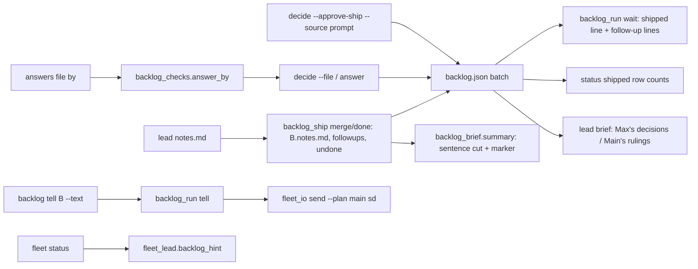
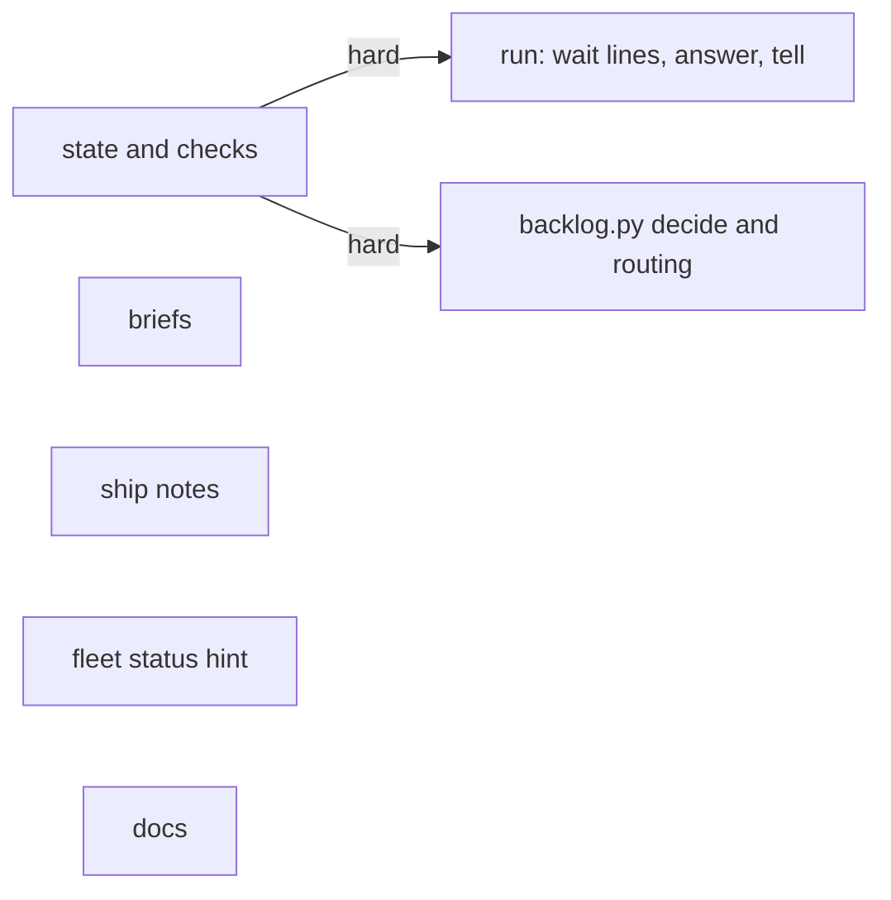

# Superlite: backlog main sees follow-ups, who answered, whole summary lines, and can tell a lead (B90)

**Goal:** fix #476, #477, #482, #487: main's wait lines and status carry each batch's follow-ups and steps left undone; answers files and the ship approval record who answered (user, main ruling, the user's prompt) and leads write it truthfully; batch summary lines are never cut mid-word; main messages a lead with `sl backlog tell B --text T` and a plain `sl fleet status` names the backlog's leads.
**Architecture:** backlog_checks.py parses the answers file's `by`; backlog_state.py records it, orders the ship question last and records a prompt approval; backlog_brief.py cuts summary lines at a sentence end and splits Max's decisions from main's rulings; backlog_ship.py keeps the full notes and parses follow-up and undone lines into the batch; backlog_run.py prints them on the shipped wait line, records `by` on `answer`, and adds `tell`; backlog.py routes `tell` and takes `decide --approve-ship --source prompt`; fleet.py status prints fleet_lead's `backlog:` hint.
**Tech stack:** Python 3.10+ stdlib, pytest (through `sl run_tests`).
**Spec:** this file, section Design; issues #476, #477, #482, #487 Expected lines; Max's decision in the lead brief (`backlog tell B --text`).
**Detail:** contracts
**Target-min:** 11
**Wave0:** none

Global constraints:
- Every code line in `skills/subagent-driven-development/scripts/*.py` carries the repo's trailing `# O(...)` complexity comment where the surrounding function's lines do; tests do not. Stdlib only.
- Existing tests stay green. An existing test file changes only when the task Owns it. If another existing test turns red, report it in DONE_WITH_CONCERNS with the test id and the reason instead of editing it.
- Run `sl` as an executable (`<abs>/sl ...`). Verify with `<abs>/sl run_tests --fast <own test files> --task Tn --background`, then run the printed `wait:` line in the foreground and end the turn only after it reports.
- Tests clear SUPERLITE_FLEET_ROLE, SUPERLITE_FLEET_PARENT_DIR, SUPERLITE_FLEET_WORKER and SUPERLITE_STATE_DIR with `monkeypatch.delenv(..., raising=False)` unless a case sets one.
- Never type a backlog subcommand after the word `backlog` in a Bash command (a hook blocks it, heredocs too); write files with the Write tool.
- No version edits. Never run `scripts/evals.sh`, `claude plugin eval` or `scripts/test_layers.py run`. Never edit files other open batches own: fleet_io.py, fleet_report.py, testcmd.py, plan_tools.py, pt_review.py, commit_task.py, findings.py, skills/subagent-driven-development/SKILL.md, skills/subagent-driven-development/fleet.md, agents/**, docs/**.

Ruling: #487 `sl backlog tell B --text T` is main only and needs a running batch with a lead; a needs_decision batch is refused with a pointer to `answer`, since a told lead that stops again would not be read as an answer - cost if wrong: main answers instead of telling.
Ruling: #487 a plain `sl fleet status` in main appends `backlog: N leads run in <root>/.superlite (B7 W3, ...); sl backlog status lists them, sl backlog tell B --text T messages one` when backlog.json holds running or needs_decision batches with leads and the resolved run folder is not that one; never inside a fleet worker; `fleet send` without `--plan` stays as it is (fleet_io.py is B91's) - cost if wrong: one more hint in fleet_io later.
Ruling: #477 an answers file takes an optional `by`: "user" (the default), "main", or a {question: "user"|"main"} map; `decide --file` and `answer` record it (batch `answered_by`, answer-n.json `by`); the ship approval refuses "main"; lead briefs list main's answers under "Main's rulings", never as Max's - cost if wrong: one more key.
Ruling: #477 `decide --approve-ship --source prompt` records `approved_ship = {"by": "prompt", "time": now}`; only `prompt` is a source (a dialog answer goes through `decide --file`); the ship question is printed last with `Approve shipping (Recommended)` first, both labels accepted; the status head stays `ship approved (<by> <time>)` - cost if wrong: one more source value.
Ruling: #476 a notes.md line holding `follow-up...:` (anywhere, up to 30 characters before the colon) is a follow-up, a line starting `Left undone:` a decided step the lead could not run; ship stores both lists in the batch; the shipped wait line gains ` followups=N` and ` undone=M` and one `B follow-up: <text>` / `B left undone: <text>` line per item; status shows the counts in the shipped row; the lead files nothing itself (it cannot create issues), main files them after the user's yes; the triage brief offers no option a lead cannot run - cost if wrong: main files by hand.
Ruling: #482 the summary keeps note lines up to 400 characters; a longer one is cut at its last sentence end when that lies past character 200, else at its last whole word (backlog_checks._word), and ends ` [cut: full text in B.notes.md]`; more than 7 note lines keep 6 plus `+N more note lines: full text in B.notes.md`; ship writes the full notes to `.superlite/backlog/B.notes.md` - cost if wrong: one more file per batch.
Ruling: files outside the brief's list that no open batch owns, edited: backlog_brief.py, backlog_state.py, backlog.py, fleet.py, skills/subagent-driven-development/backlog.md, commands/backlog.md (named in notes.md); docs/tools.md and docs/fleet.md (B95's) become a follow-up note.
Ruling: detail contracts; no probe adapter (CLI over JSON state; Review Focus cases are named pytest cases); layers: unit, headless (backlog.md, commands/backlog.md), evals stamped by ruling for a body-only edit of commands/backlog.md as B14 and B89 did.
LAYERS: unit, headless, evals

## Design

### 1. State (T1: backlog_checks.py, backlog_state.py)
- `answer_by` as in T1's Produces. `answer(data, answers, by, now)`: a str `by` (legacy "AskUserQuestion") means every answer is the user's and the approval's `by` is that str; a dict maps question -> "user"|"main" (missing: "user"), the approval's `by` "AskUserQuestion". Ship answer: label with or without ` (Recommended)`; by main -> error SHIP_MAIN. Batch answers set `answers[text]` and `answered_by[text]`.
- `open_questions`: the ship question moves after the batch questions; options labels `Approve shipping (Recommended)`, `Not yet`.
- `approve_ship` as in T1's Produces. `status_lines` shipped row: `<version or ->[ followups=N][ undone=M][ OPEN ...]`.

### 2. Briefs (T2: backlog_brief.py)
- `approval_text`, `cut_note`, `summary` as in T2. Lead brief: user answers under `Max's decisions:` (none: `Max's decisions: none`), main's under MAIN_HEAD; ship line `Ship: allowed (approved by <approval_text>)`; notes instruction NOTES_RULE. Triage Rules line: ROOT_DOC_TRIAGE + TRIAGE_RUN.

### 3. Ship (T3: backlog_ship.py)
- `note_items` as in T3. `_merge` success and `_done`: write the notes (control characters but `\n`, `\t` dropped, `\r\n` -> `\n`) to `<main sd>/backlog/<bid>.notes.md` when non-blank; `_set(..., followups=..., undone=...)`; the dict passed to `backlog_run._shipped` carries both.

### 4. Run (T4: backlog_run.py)
- `_shipped`: first line gains ` followups=N` / ` undone=M` (only when N, M > 0), then `B follow-up: <t>` per follow-up, `B left undone: <t>` per undone, then the OPEN line and the cleanup line as today.
- `answer`: `by` via answer_by; answer-n.json `{"answers": ..., "by": ...}`; batch `answered_by` updated; message ANSWER_MAIN when any answer is main's, else unchanged.
- `tell B --text T` as in T4. Resume answers line ANSWERS_LINE.

### 5. CLI (T5: backlog.py)
- `decide --file` passes answer_by's map to `bs.answer`; `decide --approve-ship --source prompt`; `tell` routed; the start note hint names `sl backlog tell`.

### 6. Fleet status (T6: fleet_lead.py, fleet.py)
- `backlog_hint` as in T6; `fleet status` prints it last, after `fleet: off` or the worker lines.

### 7. Docs (T7)
Exact text in T7.

## Coverage

| Category | State | Basis |
|---|---|---|
| Scope and success criteria | settled | four Expected lines; Max: `backlog tell B --text` |
| Domain and data model | ruled | batch keys `answered_by`, `followups`, `undone`; answers file `by` |
| Persistence and migration | ruled | old files lack the keys: user, none |
| Interfaces and contracts | ruled | `tell`, `--approve-ship --source prompt`; `summary` signature unchanged |
| UI states | n/a | CLI text only |
| Concurrency and state ownership | settled | every write through `bs.update` |
| Error handling and recovery | settled | BLOCKED/refused lines, exit 2, send failure exit 3 |
| Security and privacy | ruled | main cannot rule the ship approval; tell text capped, control characters refused |
| Performance and limits | n/a | small files |
| Observability | settled | wait lines, status counts, `backlog:` hint |
| Testing strategy | settled | existing fixtures (bk, sh, dn, cli) |
| Compatibility | settled | without the new keys output is unchanged but the briefs and the ship question order |
| Rollout | ruled | one PR; version bump at ship |
| Research unknowns | n/a | none |

## File structure
- `skills/subagent-driven-development/scripts/backlog_checks.py`: answer_by (T1).
- `skills/subagent-driven-development/scripts/backlog_state.py`: answer, open_questions, approve_ship, status (T1).
- `skills/subagent-driven-development/scripts/backlog_brief.py`: summary cut, decisions split, approval text, rules (T2).
- `skills/subagent-driven-development/scripts/backlog_ship.py`: notes file, note_items (T3).
- `skills/subagent-driven-development/scripts/backlog_run.py`: shipped lines, answer by, tell (T4).
- `skills/subagent-driven-development/scripts/backlog.py`: decide, routing (T5).
- `skills/subagent-driven-development/scripts/fleet_lead.py`, `fleet.py`: backlog hint (T6).
- `skills/subagent-driven-development/backlog.md`, `commands/backlog.md`: docs (T7).

## Task graph

```mermaid
%% schedule
gantt
  title Predicted schedule (mm:ss)
  dateFormat X
  axisFormat %M:%S
  section lane 1
  T1 state answer by ship question last pr :t1, 0, 106s
  T4 run shipped follow-up lines answer by :t4, 106, 124s
  section lane 2
  T2 briefs summary cut decisions split ap :t2, 0, 105s
  T5 backlog.py decide by and --approve-sh :t5, 106, 102s
  section lane 3
  T3 ship full notes file follow-ups and u :t3, 0, 85s
  section lane 4
  T6 fleet status names the backlog leads :t6, 0, 83s
  section lane 5
  T7 docs backlog.md and commands/backlog. :t7, 0, 80s
```

critical path: T1 → T4 (3.8 min) · peak width 5 · predicted build 3.8 min · predicted total ≈ 7.3 min (target ✓)

## Package: backlog CLI
App type: CLI. Categories: protocol (argv, flags, output lines), state (backlog.json, answers, approval), file (notes file, answer files), encoding (control characters in notes and tell text).
**Probe entry:** none (Ruling: no probe adapter).

### T1 state: answer by, ship question last, prompt approval, shipped counts · Complexity 4 · Est. context 36k
**Owns:** skills/subagent-driven-development/scripts/backlog_checks.py, skills/subagent-driven-development/scripts/backlog_state.py, tests/scripts/test_backlog_state_b90.py, tests/scripts/test_backlog_state.py, tests/scripts/test_backlog_plan_round.py, tests/scripts/test_backlog_cli.py
**Components:** 2
**LOC owned:** 170
**Tests:** fast
**Model:** sonnet
**Covers:** 1
**Consumes:** none
**Produces:** backlog_checks.answer_by(obj: dict, answers: dict) -> tuple[dict, str]
e.g. answer_by({"answers": {"A?": "x"}}, {"A?": "x"}) -> ({"A?": "user"}, "")
e.g. answer_by({"by": "main"}, {"A?": "x", "B?": "y"}) -> ({"A?": "main", "B?": "main"}, "")
e.g. answer_by({"by": {"B?": "main"}}, {"A?": "x", "B?": "y"}) -> ({"A?": "user", "B?": "main"}, "")
e.g. answer_by({"by": "bot"}, {"A?": "x"}) -> ({}, 'by: "user", "main" or a {question: "user"|"main"} map')
e.g. answer_by({"by": {"C?": "main"}}, {"A?": "x"}) -> ({}, "by: no answer for C?")
**Produces:** backlog_state.answer(data: dict, answers: dict, by: str | dict, now: str) -> list
e.g. answer(d, {SHIP_Q: "Approve shipping (Recommended)"}, {SHIP_Q: "user"}, "T") -> [] and d["approved_ship"] == {"by": "AskUserQuestion", "time": "T"}
e.g. answer(d, {SHIP_Q: "Approve shipping"}, {SHIP_Q: "main"}, "T") -> [SHIP_MAIN] and d["approved_ship"] is None
e.g. answer(d, {"B2: Keep the v1 API?": "Drop"}, {"B2: Keep the v1 API?": "main"}, "T") -> [] and B2 answers == {"Keep the v1 API?": "Drop"}, answered_by == {"Keep the v1 API?": "main"}
**Produces:** backlog_state.approve_ship(data: dict, source: str, now: str) -> str
e.g. approve_ship(d, "prompt", "T") -> "ship approved (prompt T): every batch of this plan round may ship" and d["approved_ship"] == {"by": "prompt", "time": "T"}
e.g. approve_ship(d, "prompt", "T") with approved_ship {"by": "AskUserQuestion", "time": "T0"} -> "ship already approved (AskUserQuestion T0)" (unchanged)
**Produces:** backlog_state.open_questions(data: dict) -> list
**Produces:** backlog_state.status_lines(data: dict, all_: bool = False) -> list
**Notes:** SHIP_MAIN = "ship: main cannot rule the ship approval; ask the user, or record an approval the user's prompt gave with sl backlog decide --approve-ship --source prompt". approve_ship errors: source other than "prompt" -> ValueError("--source: only prompt (an AskUserQuestion answer goes through decide --file)"); no batch -> ValueError("no batch planned: run sl backlog plan first"). Ship option descriptions: "one yes for every batch of this plan round; a new plan asks again", "leads stop before ship". SHIP_OK stays "Approve shipping"; the printed label is SHIP_OK + backlog_checks.REC. An answer other than both labels and SHIP_NO keeps "ship: answer must be Approve shipping or Not yet".
**Review Focus:**
state: `test_answer_by_examples` (the five e.g. lines; `by` a list -> the 'by: "user", ...' error; a dict value "admin" -> same error).
state: `test_ship_question_last_and_recommended` (d with B2 planned decision "Keep the v1 API?" and an Admit entry: questions order [admit, "B2: Keep the v1 API?", SHIP_Q]; ship labels ["Approve shipping (Recommended)", "Not yet"]; description "one yes for every batch of this plan round; a new plan asks again").
state: `test_answer_records_who_answered` (the three answer e.g. lines; legacy str "AskUserQuestion" -> answered_by {"Keep the v1 API?": "user"}, approval by "AskUserQuestion").
state: `test_approve_ship_prompt` (the two approve_ship e.g. lines; source "user" -> ValueError text above; no batches -> ValueError "no batch planned: run sl backlog plan first").
state: `test_status_shipped_counts` (shipped B3 version "1.5.9" followups ["a", "b"] undone ["c"] open_issues [6] -> row ends "| 1.5.9 followups=2 undone=1 OPEN #6"; no keys -> "| 1.5.9").
Existing: tests/scripts/test_backlog_state.py:37-43 (order, labels), tests/scripts/test_backlog_plan_round.py:26 (`questions(capsys)[-1]`), tests/scripts/test_backlog_cli.py:105 (ship question last, admit first) change to the new order.
**Steps:** 1 failing tests, 2 run: FAIL, 3 implement Design 1, 4 run: PASS (own files plus tests/scripts/test_backlog_state_left_out.py tests/scripts/test_backlog_status_b86.py tests/scripts/test_backlog_status_rounds_406.py tests/regression/test_leads_review_cli.py).

### T2 briefs: summary cut, decisions split, approval text, triage rule · Complexity 4 · Est. context 36k
**Owns:** skills/subagent-driven-development/scripts/backlog_brief.py, tests/scripts/test_backlog_brief_b90.py, tests/scripts/test_backlog_brief.py, tests/scripts/test_backlog_brief_jira_208.py, tests/scripts/test_backlog_brief_b89.py
**Components:** 2
**LOC owned:** 150
**Tests:** fast
**Model:** sonnet
**Covers:** 2
**Consumes:** none
**Produces:** backlog_brief.cut_note(text: str, full: str) -> str
e.g. cut_note("a" * 50, "B1.notes.md") -> "a" * 50
e.g. cut_note("x" * 250 + ". " + "y" * 200, "B1.notes.md") -> "x" * 250 + ". [cut: full text in B1.notes.md]"
e.g. cut_note("word " * 99 + "word", "B1.notes.md") -> ("word " * 80).rstrip() + " [cut: full text in B1.notes.md]"
e.g. cut_note("y" * 500, "B1.notes.md") -> "y" * 400 + " [cut: full text in B1.notes.md]"
**Produces:** backlog_brief.approval_text(ap: dict) -> str
e.g. approval_text({"by": "AskUserQuestion", "time": "T"}) -> "Max in AskUserQuestion at T"
e.g. approval_text({"by": "prompt", "time": "T"}) -> "Max's prompt, recorded by main, at T"
e.g. approval_text({"by": "x", "time": "T"}) -> "x at T"
**Produces:** backlog_brief.summary(batch: dict, notes: str) -> str
**Produces:** backlog_brief.lead_brief(batch: dict, ctx: dict) -> str
**Produces:** backlog_brief.triage_brief(issues: list, ctx: dict) -> str
**Notes:** cut_note: text up to NOTE_LIMIT (400) stays; else the last `[.;!?]` followed by whitespace whose end is at most 400 and over 200 ends the cut, else `backlog_checks._word(text, 400)` (exists at base); then ` [cut: full text in <full>]`. summary: note lines cleaned with `clean(x, None)` (no length cut), full = f"{bid}.notes.md"; up to 7 note lines kept; more -> the first 6 plus f"+{n - 6} more note lines: full text in {full}"; each kept line through cut_note. Exact constants:
MAIN_HEAD = "Main's rulings (main decided these as AI orchestrator, not Max; record each as main's ruling, never as Max's decision):"
NOTES_RULE = "First write .superlite/notes.md (at most 6 lines, each one self-contained line of at most 400 characters: `Ruling: ...` lines that change later batches, one `Follow-up: ...` line per follow-up issue (main files it) and one `Left undone: ...` line per decided step you could not run, such as a denied remote or production command) and .superlite/pr-body.md with "
TRIAGE_RUN = "offer no decision option a batch lead cannot carry out: a lead has no deploy, production, migration-run or other remote-host access (the auto-mode classifier denies those commands), so such a step is main's after the batch ships; "
(TRIAGE_RUN directly after ROOT_DOC_TRIAGE in the Rules line). The ship line reads `Ship: allowed (approved by {approval_text(ap)}). Ship only with ...` and NOTES_RULE replaces the old "First write .superlite/notes.md (at most 4 lines, ... follow-up issues) and .superlite/pr-body.md with " text. Lead brief decisions: `answered_by = batch.get("answered_by") or {}`; an answer whose answered_by is "main" goes under MAIN_HEAD (after the Max's decisions lines), every other under "Max's decisions:".
**Review Focus:**
protocol: `test_cut_note_examples` (the four cut_note e.g. lines; a sentence end at character 150 only -> word cut, not the sentence).
file: `test_summary_marks_cuts_and_overflow` (B1; notes "Ruling: ok\n" + "y" * 500 + "\n" + 8 more lines -> lines[3] == "Ruling: ok", lines[4] == "y" * 400 + " [cut: full text in B1.notes.md]", 10 lines in all, lines[9] == "+4 more note lines: full text in B1.notes.md"; exactly 7 note lines -> no "+" line).
encoding: `test_summary_drops_control_characters` ("Ctrl \x1b[2Jgone" -> "Ctrl [2Jgone").
protocol: `test_approval_text_examples` (the three e.g. lines; brief has "Ship: allowed (approved by Max in AskUserQuestion at T0)").
state: `test_main_rulings_split` (answers {"A?": "x", "B?": "y"}, answered_by {"B?": "main"} -> "Max's decisions:\n- A?: x\n" + MAIN_HEAD + "\n- B?: y" in brief; all main -> "Max's decisions: none" then MAIN_HEAD; no answered_by -> no MAIN_HEAD).
protocol: `test_notes_rule_and_triage_run` (NOTES_RULE in the lead brief; "Rules: " + ROOT_DOC_TRIAGE + TRIAGE_RUN + "no two batches share a file" in the triage brief).
Existing: test_backlog_brief.py:16, 42-56, 62 and test_backlog_brief_jira_208.py GH_LEAD, test_backlog_brief_b89.py `test_triage_root_doc_rule` change to the new text.
**Steps:** 1 failing tests, 2 run: FAIL, 3 implement Design 2, 4 run: PASS (own files plus tests/scripts/test_backlog_brief_limits.py tests/regression/test_leads_review_backlog.py tests/scripts/test_backlog_ship.py).

### T3 ship: full notes file, follow-ups and undone steps · Complexity 3 · Est. context 32k
**Owns:** skills/subagent-driven-development/scripts/backlog_ship.py, tests/scripts/test_backlog_ship_notes_476.py
**Components:** 1
**LOC owned:** 110
**Tests:** fast
**Model:** sonnet
**Covers:** 3
**Consumes:** none
**Produces:** backlog_ship.note_items(notes: str) -> dict
e.g. note_items("Ruling: x\nFollow-up: docs/tools.md lacks tell\n- Left undone: run the migration on prod\n") -> {"followups": ["docs/tools.md lacks tell"], "undone": ["run the migration on prod"]}
e.g. note_items("Ruling: a; follow-up (outside B27's files): fix SKILL.md") -> {"followups": ["fix SKILL.md"], "undone": []}
e.g. note_items("Follow-up issue: x\x1b[2J\ty") -> {"followups": ["x[2J y"], "undone": []}
e.g. note_items("") -> {"followups": [], "undone": []}
**Notes:** FOLLOW = `(?i)\bfollow[- ]?ups?\b[^:\n]{0,30}:\s*(\S.*)` searched in each line; UNDONE = `(?i)^\s*(?:[-*]\s*)?left undone\s*:\s*(\S.*)` matched first (an undone line is never also a follow-up); item text: whitespace runs -> one space, other control characters dropped, stripped. Notes file `<root>/.superlite/backlog/<bid>.notes.md`: written before the summary in `_merge`'s success branch (lead and main) and in `_done`, only for non-blank notes. `followups`, `undone` go into the `_set` call and into the dict `_merge` (main) and `_done` pass to `backlog_run._shipped`.
**Review Focus:**
protocol: `test_note_items_examples` (the four e.g. lines; "Left undone: a" -> undone ["a"], followups []).
file: `test_merge_keeps_notes_and_items` (sh fixture from test_backlog_ship, locked; notes.md "Ruling: x\nFollow-up: y\nLeft undone: z\x07\n"; merge -> 0; `<sd>/backlog/B1.notes.md` == "Ruling: x\nFollow-up: y\nLeft undone: z\n"; b1 followups ["y"], undone ["z"]).
file: `test_merge_without_notes_writes_no_file` (no notes.md -> no B1.notes.md; followups [], undone []).
state: `test_done_records_items` (dn fixture from test_backlog_ship_done; notes "Follow-up: q" -> batch followups ["q"]; the dict passed to a fake backlog_run._shipped holds followups ["q"], undone []).
**Steps:** 1 failing tests, 2 run: FAIL, 3 implement Design 3, 4 run: PASS (own file plus tests/scripts/test_backlog_ship.py tests/scripts/test_backlog_ship_done.py tests/scripts/test_backlog_ship_from_main.py).

### T6 fleet status names the backlog leads · Complexity 2 · Est. context 28k
**Owns:** skills/subagent-driven-development/scripts/fleet_lead.py, skills/subagent-driven-development/scripts/fleet.py, tests/scripts/test_fleet_status_backlog_487.py
**Components:** 1
**LOC owned:** 70
**Tests:** fast
**Model:** sonnet
**Covers:** 6
**Consumes:** none
**Produces:** fleet_lead.backlog_hint(sd: Path, cwd: Path) -> str | None
e.g. backlog_hint(Path("/s/run"), Path("/m")) -> "backlog: 2 leads run in /m/.superlite (B7 W3, B9 W4); sl backlog status lists them, sl backlog tell B --text T messages one" (/m/.superlite/backlog.json: B7 running lead W3, B8 shipped lead W2, B9 needs_decision lead W4)
e.g. one lead -> "backlog: 1 lead runs in /m/.superlite (B7 W3); sl backlog status lists it, sl backlog tell B --text T messages it"
**Notes:** None when SUPERLITE_FLEET_WORKER is set, `backlog_state.main_root(cwd)` raises RuntimeError, backlog.json is missing or unreadable (bs.load's errors), `Path(sd).resolve() == (root / ".superlite").resolve()`, or no running/needs_decision batch has a lead. Imports backlog_state inside the function. fleet.py `status`: `import fleet_lead` lazily, compute the hint once, print it after `fleet: off` (before that branch's return) and after the worker lines.
**Review Focus:**
state: `test_backlog_hint_examples` (tmp main root with backlog.json written through bs.update, `backlog_state.main_root` monkeypatched to return it: the two e.g. lines; sd == root/.superlite -> None; no active lead -> None; SUPERLITE_FLEET_WORKER=W1 -> None; main_root raising RuntimeError -> None; no backlog.json -> None).
protocol: `test_status_prints_the_hint` (fleet.main(["status"]) with fleet._sd -> tmp sd, fleet.fs.is_on -> False, fleet_lead.backlog_hint -> "backlog: x" -> stdout "fleet: off\nbacklog: x\n"; hint None -> "fleet: off\n").
**Steps:** 1 failing tests, 2 run: FAIL, 3 implement Design 6, 4 run: PASS (own file plus tests/scripts/test_fleet_lead.py tests/scripts/test_fleet_lead_b87.py).

### T4 run: shipped follow-up lines, answer by, tell · Complexity 5 · Est. context 42k
**Owns:** skills/subagent-driven-development/scripts/backlog_run.py, tests/scripts/test_backlog_run_b90.py, tests/scripts/test_backlog_run.py
**Components:** 3
**LOC owned:** 190
**Tests:** fast
**Model:** sonnet
**Covers:** 4
**Consumes:** backlog_checks.answer_by(obj: dict, answers: dict) -> tuple[dict, str] (T1)
**Produces:** backlog_run.main(argv: list | None = None) -> int
**Notes:** `tell B --text T` (argparse, --text required): in a fleet worker -> `BLOCKED: sl backlog tell runs only in the main session` (2); unknown batch -> `BLOCKED: unknown batch B9` (2); needs_decision -> `BLOCKED: B1 waits for an answer: sl backlog answer B1 --file F` (2); other state or no lead -> `BLOCKED: B1 is planned; only a running batch has a lead to tell` (2); text blank, over 2000 characters or with a control character other than `\n`/`\t` -> `BLOCKED: --text: 1 to 2000 characters, no control characters` (2); then `fleet_io.main(["send", lead, "--text", TELL.format(text=T), "--plan", str(sd)])`, nonzero -> `BLOCKED: B1 lead W1 not told (fleet send failed)` (3); else `B1 told lead W1` (0). TELL = "superlite: main says (sl backlog tell): {text}". answer: `_answers` also returns answer_by's map (its error -> BLOCKED, 2); answer-n.json `{"answers": ans, "by": by}`; batch `answered_by` updated with `by`; any "main" -> ANSWER_MAIN = "Main answered your question as AI orchestrator, not Max: read {af}; its by map names who answered each question (user: Max's decision, main: main's ruling); record each that way, then go on with the batch." ANSWERS_LINE = "- Answers given mid-run: {names} in .superlite/ (also under Max's decisions or main's rulings above; each file's by names who answered; never ask them again)". Module docstring names tell.
**Review Focus:**
protocol: `test_shipped_line_carries_followups` (bk fixture; running merged pr 201 version "1.5.8" followups ["file docs", "fix x"] undone ["run migration"] -> wait output "B1 shipped PR #201 1.5.8 summary=<sd>/backlog/B1.md followups=2 undone=1\nB1 follow-up: file docs\nB1 follow-up: fix x\nB1 left undone: run migration\n"; none -> line unchanged).
protocol: `test_tell_sends_to_the_lead` (running B1 lead W1 -> (0, "B1 told lead W1\n"); the text call == ["send", "W1", "--text", "superlite: main says (sl backlog tell): rebase first", "--plan", str(bk.sd)]; batch state and since unchanged).
state: `test_tell_refusals` (each BLOCKED line above with its exit; no text call; a failing fleet_io.main -> exit 3 line).
encoding: `test_tell_text_limits` ("a" * 2000 sent; "a" * 2001, "  ", "x\x1b[2J" refused; "a\nb" sent).
state: `test_answer_records_by` (answers {"Keep the v1 API?": "Drop"}, by "main" -> answer-1.json {"answers": {...}, "by": {"Keep the v1 API?": "main"}}, batch answered_by {"Keep the v1 API?": "main"}, sent text starts "Main answered your question as AI orchestrator, not Max: read "; no by -> "Max answered your question: read "; by "bot" -> exit 2).
Existing: test_backlog_run.py:117 (answer-1.json now has "by": {"Keep the v1 API?": "user"}) and :188 (ANSWERS_LINE text) change.
**Steps:** 1 failing tests, 2 run: FAIL, 3 implement Design 4, 4 run: PASS (own files plus tests/scripts/test_backlog_run_lifecycle.py tests/scripts/test_backlog_wait_question.py tests/scripts/test_backlog_wait_lag.py).

### T5 backlog.py: decide by and --approve-ship, tell route · Complexity 3 · Est. context 34k
**Owns:** skills/subagent-driven-development/scripts/backlog.py, tests/scripts/test_backlog_decide_by_477.py, tests/scripts/test_backlog_start_note_504.py
**Components:** 2
**LOC owned:** 110
**Tests:** fast
**Model:** sonnet
**Covers:** 5
**Consumes:** backlog_checks.answer_by(obj: dict, answers: dict) -> tuple[dict, str] (T1) · backlog_state.answer(data: dict, answers: dict, by: str | dict, now: str) -> list (T1) · backlog_state.approve_ship(data: dict, source: str, now: str) -> str (T1)
**Produces:** backlog.main(argv: list | None = None) -> int
**Notes:** decide parser gains `--approve-ship` (store_true) and `--source`. Order in cmd_decide after the worker check: `--approve-ship` without `--source` -> `BLOCKED: --approve-ship needs --source prompt` (2); with it -> `bs.update` calling approve_ship (ValueError -> `refused: <msg>`, 2), print its message, 0. `--file`: read obj; `answers` as today; `by, err = bc.answer_by(obj, answers)`, err -> `BLOCKED: <err>` (2); `bs.answer(c, answers, by, _now())`; output `recorded N answers, M open` or, when K answers are main's, `recorded N answers (K ruled by main), M open`. ROUTED gains "tell". The start note hint: `note: B2 lead W5 started before this note; sl backlog tell B2 --text "$(cat <F quoted>)" tells it`. Module docstring names tell, by and --approve-ship.
**Review Focus:**
protocol: `test_decide_approve_ship_prompt` (test_backlog_cli bk/cli; after `plan`: `decide --approve-ship --source prompt` -> (0, "ship approved (prompt <time>): every batch of this plan round may ship\n") with _now patched to "T"; `decide --approve-ship` -> (2, "BLOCKED: --approve-ship needs --source prompt\n"); `--source user` -> (2, "refused: --source: only prompt (an AskUserQuestion answer goes through decide --file)\n"); before any plan -> rc 2).
state: `test_decide_file_by_main` (answers {SHIP_Q: "Approve shipping"}, by "main" -> rc 2 and the SHIP_MAIN line; the admit #3 answer "Skip" with by {q: "main"} -> (0, "recorded 1 answers (1 ruled by main), 1 open\n") (the ship question stays open); by "bot" -> (2, 'BLOCKED: by: "user", "main" or a {question: "user"|"main"} map\n')).
protocol: `test_tell_is_routed` (sys.modules["backlog_run"] swapped for a namespace recording argv -> main(["tell", "B1", "--text", "x"]) routes ["tell", "B1", "--text", "x"]).
Existing: test_backlog_start_note_504.py:75 now asserts `sl backlog tell B2 --text "$(cat ...)" tells it`.
**Steps:** 1 failing tests, 2 run: FAIL, 3 implement Design 5, 4 run: PASS (own files plus tests/scripts/test_backlog_cli.py tests/scripts/test_backlog_plan_round.py tests/scripts/test_backlog_decide_fit.py).

### T7 docs: backlog.md and commands/backlog.md · Complexity 1 · Est. context 24k
**Owns:** skills/subagent-driven-development/backlog.md, commands/backlog.md, tests/scripts/test_backlog_docs_b90.py
**Components:** 1
**LOC owned:** 60
**Tests:** fast
**Kind:** mechanical
**Model:** haiku
**Covers:** 7
**Consumes:** none
**Produces:** none
**Notes:** exact edits; change nothing else. "Append" = one space, then the sentence, at the end of that line.
- backlog.md `## Main` step 3: replace `One ship approval covers all batches.` with: `One ship approval covers every batch of one plan round: each \`plan\` (also \`--reset\`) asks it again and \`plan --add\` keeps it; \`decide --print\` lists it last, \`Approve shipping (Recommended)\` first. An approval the user's own prompt gave is recorded with \`"$SL" backlog decide --approve-ship --source prompt\`. An answers file may carry \`"by": "main"\` or a \`{question: "user"|"main"}\` map (default \`user\`) for answers main ruled as AI orchestrator; \`decide\` and \`answer\` record it, lead briefs list those under main's rulings, never as Max's, and the ship approval refuses \`main\`.`
- backlog.md step 5: append `A shipped line ends with \` followups=N\` and \` undone=M\` when the lead's notes hold \`Follow-up:\` or \`Left undone:\` lines; one \`B follow-up: <text>\` or \`B left undone: <text>\` line per item follows it, and \`status\` keeps both counts in the shipped row. \`"$SL" backlog tell B --text T\` (main only) messages a running batch's lead; a needs_decision batch takes \`answer\`. A plain \`sl fleet status\` in main lists main's own fleet and names the running leads in one \`backlog:\` line.`
- backlog.md `## Lead`, the bullet starting `- Keep your notes in`: append `Note lines are \`Ruling: ...\`, \`Follow-up: ...\` (a follow-up issue; main files it) and \`Left undone: ...\` (a decided step you could not run, such as a denied remote or production command); main's wait line carries the last two. The summary \`.superlite/backlog/B.md\` keeps each note line up to 400 characters, cuts a longer one at its last sentence end or whole word with a \`[cut: full text in B.notes.md]\` marker, and \`B.notes.md\` beside it holds the full notes.`
- commands/backlog.md step 3: replace `The last question is the one ship approval.` with: `The last question is the ship approval, \`Approve shipping (Recommended)\` first; it covers every batch of this plan round (each new \`plan\` asks again, \`plan --add\` keeps it). When the user's prompt already approved shipping, record that with \`"$SL" backlog decide --approve-ship --source prompt\` instead of asking. An answer you ruled yourself as AI orchestrator goes into the answers file with \`"by": {"<question>": "main"}\` (the default is \`user\`), so leads record it as your ruling, not the user's; the ship approval is never yours to rule.`
- commands/backlog.md step 5: append `A \`shipped\` line may end with \` followups=N undone=M\`: the \`B follow-up:\` and \`B left undone:\` lines after it go into your closing report; file a follow-up issue or run an undone step only after the user approves it. To message a running lead, run \`"$SL" backlog tell B --text "..."\`; \`sl fleet status\` in main lists only main's own workers and names the leads in a \`backlog:\` line.`
**Review Focus:**
`test_main_doc_b90`: backlog.md step 3 line, `NEW3 in line` -> True and `"One ship approval covers all batches." in line` -> False; step 5 line, `line.endswith(" " + S5)` -> True; the `- Keep your notes in` bullet, `line.endswith(" " + LEAD)` -> True (NEW3, S5, LEAD = the exact texts above).
`test_command_doc_b90`: commands/backlog.md step 3 line, `C3 in line` -> True and `"The last question is the one ship approval." in line` -> False; step 5 line, `line.endswith(" " + C5)` -> True.
**Steps:** 1 failing tests, 2 run: FAIL, 3 edit, 4 run: PASS (own file plus tests/scripts/test_docs_b72_backlog.py tests/scripts/test_backlog_docs.py tests/scripts/test_backlog_main_docs.py tests/scripts/test_backlog_docs_b86.py tests/scripts/test_backlog_docs_b89.py tests/scripts/test_backlog_docs_369_370.py).

## Review Focus
- backlog CLI: protocol, state, file, encoding; cases in T1-T7.

## Self-review
Coverage: #476 T1 T3 T4 T2 T7; #477 T1 T2 T4 T5 T7; #482 T2 T3 T7; #487 T4 T5 T6 T7. Placeholders: none. Graph: T4 and T5 run answer_by; no two parallel tasks share a file (T1 owns test_backlog_cli.py, T5 only reads it).
