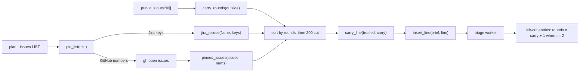

# Superlite: `backlog plan --issues` takes GitHub numbers; issues an earlier cap left out are ranked first (B68)

**Goal:** fix #433: `sl backlog plan --issues` accepts Jira keys only (`BLOCKED: --issues: not a Jira key: 362`), so a GitHub backlog cannot pin issues into the next plan, and the triage worker left the same old issues out as `not planned (cap)` round after round. Max's decision: both, `--issues` takes GitHub numbers and the plan ranks issues an earlier cap left out first.
**Architecture:** all in `backlog.py`. `pin_list` parses `--issues` (the first item picks GitHub numbers or Jira keys); a GitHub pin filters the usual open-issue fetch through `pinned_issues`. `carry_rounds` reads the previous round's cap entries from `outside[]`; `cmd_plan` sorts the fetched issues by those rounds before the fetch-limit cut, `carry_line` names them in one brief line that `insert_line` puts before the brief's `Rules:` line, and a cap entry left out again stores `rounds`. A pinned plan keeps the previous `outside[]` entries of the issues it did not read.
**Tech stack:** Python 3.10+ stdlib, pytest (through `sl run_tests`).
**Spec:** this file, section Design; issue #433's Expected line and Max's decision.
**Detail:** tests
**Target-min:** 11
**Wave0:** none
**Max chars:** 22000

Global constraints:
- Every new code line in `skills/subagent-driven-development/scripts/backlog.py` carries the repo's trailing `# O(...)` complexity comment; tests do not. Stdlib only.
- Existing tests stay green and no existing test file changes (another lead may own them). If an existing test turns red, report it in DONE_WITH_CONCERNS with the test id and the reason instead of editing it.
- Run `sl` as an executable (`<abs>/sl ...`). Verify with `<abs>/sl run_tests --fast tests/scripts/test_backlog_plan_pin_433.py tests/scripts/test_backlog_jira_208.py tests/scripts/test_backlog_plan_round.py tests/scripts/test_backlog_cli.py tests/scripts/test_backlog_plan_reset_369.py tests/scripts/test_backlog_plan_proposal_297.py tests/scripts/test_backlog_status_rounds_406.py tests/regression/test_backlog_gh_intake.py tests/regression/test_leads_review_cli.py --task T1 --background`, then run the printed `wait:` line in the foreground and end the turn only after it reports. Never raw `pytest`, never the e2e or eval layers (coordinator's step).
- No version edits (the ship step bumps the version). Touch only the files in Owns; `backlog_brief.py` and `backlog_state.py` stay unchanged (another lead may own them).

Ruling: Max's decision "Both": `--issues` takes GitHub numbers and plan ranks cap-left-out issues first - cost if wrong: none, both were asked for.
Ruling: a GitHub `--issues` plan reads exactly the pinned issues, as a Jira `--issues` plan does; the other open issues are not triaged this round - cost if wrong: Max wanting "pinned plus the rest" runs a plain plan instead.
Ruling: the first `--issues` item picks the kind; `12,PIX-1` is refused with `not a GitHub issue number: PIX-1`, `PIX-1,12` keeps `not a Jira key: 12`; `#362` is accepted - cost if wrong: a mixed list needs two rounds.
Ruling: a pinned issue in `skipped` is refused before any call (`BLOCKED: --issues: #2 is skipped`, exit 2), for Jira keys too - cost if wrong: Max un-skips by editing backlog.json.
Ruling: a pinned issue by an outside author in a public repo still goes through the trust gate (an Admit entry, not planned) - cost if wrong: one Admit answer first.
Ruling: carry-over counts both cap reasons (`not planned (cap)` and `not triaged (N cap)`); ranking happens before the fetch-limit cut, so an issue past 200 last round is triaged this round - cost if wrong: none.
Ruling: the rank lives in `backlog.py` (issue order plus one `Carry-over:` brief line inserted before `Rules:`, else appended) because `backlog_brief.py` is outside B68's files; moving the line into `triage_brief` is a follow-up - cost if wrong: a later brief rewrite without a `Rules:` line gets the line at the end.
Ruling: `rounds` is stored only from 2 up (first-time cap entries keep their `{number, title, reason}` shape, which existing tests pin); a missing or bad `rounds` counts 1; a triage reason drops the count - cost if wrong: none.
Ruling: a pinned plan keeps the previous `outside[]` entries of every issue it did not read whose kind (GitHub int, Jira str) matches; an unpinned plan replaces `outside[]` as before - cost if wrong: a closed issue's entry lingers until the next unpinned plan.
Ruling: detail tests; no probe adapter (CLI module tested in-process through the `bk` fixture) - cost if wrong: no generated probes.
Ruling: already in the lead worktree on branch superlite/b68-backlog-plan-github-pin - cost if wrong: none.
LAYERS: unit



## Design

1. `pin_list(text) -> tuple[bool, list]`: items = `re.split(r"[,\s]+", text or "")` without empties; none: `(False, [])`. First item matches `GH_RE = ^#?[1-9][0-9]*$`: every item must match (else `ValueError("not a GitHub issue number: X")`), ints without `#`, duplicates dropped, order kept, `(False, nums)`. First item a Jira key (`KEY_RE` on its upper case): `(True, jira_keys(text))`. Else `ValueError("not a GitHub issue number or Jira key: X")` naming the first item.
2. `cmd_plan`: `--issues` goes through `pin_list` (errors print `BLOCKED: --issues: <msg>`, exit 2; empty keeps `BLOCKED: --issues is empty`). Then, before any gh call, the first pinned item in `d["skipped"]` prints `BLOCKED: --issues: #N is skipped` (`KEY is skipped` for a key), exit 2. Jira keys go to `jira_issues` as before; GitHub numbers fetch the open-issue list as today, then `pinned_issues`.
3. `pinned_issues(issues, nums) -> list`: the fetched issues of `nums`, in `nums` order; the first missing number raises `RuntimeError(f"GitHub issue #{n} not found among the open issues")` (main prints `BLOCKED: ...`, exit 3).
4. `carry_rounds(outside) -> dict`: `{number: rounds}` for each dict entry whose `reason` is a str matching `CAP_RE = ^not (?:planned \(cap\)|triaged \(\d+ cap\))$` and whose `number` is an int (not bool) or str; `rounds` an int (not bool) >= 1, else 1. A non-list gives `{}`.
5. `cmd_plan` computes `carry = carry_rounds(d["outside"])` and sorts the fetched issues with the stable key `-carry.get(number, 0)` before `rest`/`ISSUE_LIMIT` are cut.
6. `carry_line(trusted, carry) -> str | None`: the trusted issues in `carry`, in trusted order: `Carry-over: the batch cap left these issues out of earlier plan rounds: #2 (3 rounds), #3 (1 round). Plan them before the other issues, unless one is an umbrella or tracking issue.` (a Jira key without `#`); None when no trusted issue is carried.
7. `insert_line(text, line) -> str`: None or empty line: `text` unchanged. Else the line goes before the first line starting `Rules:`, else after the last line; result joined with `\n` plus a final `\n`. `_triage` gains a `carry=None` parameter and writes `insert_line(triage_brief(...), carry)`.
8. Left-out entries: a reason matching `CAP_RE` gets `"rounds": carry.get(n, 0) + 1` when that is 2 or more (both the `not planned (cap)` and the `not triaged (N cap)` entries).
9. `apply` with a pin: `data["outside"] = outside + [o for o in old outside if isinstance(o, dict) and isinstance(o.get("number"), (int, str)) and o["number"] not in pin and isinstance(o["number"], str) == jira]`; without a pin it replaces `outside[]` as today.
10. Help: `--issues` metavar `LIST`, help `pin the plan to these issues: GitHub numbers (362,#433) or Jira keys (PIX-1,PIX-2); the first item picks the source`. The module docstring names both.

## Coverage

| Category | State | Basis |
|---|---|---|
| Scope and success criteria | settled | #433 Expected line; Max's decision "Both" |
| Domain and data model | ruled | `rounds` on left-out cap entries from 2 up |
| Persistence and migration | ruled | old entries without `rounds` count 1 |
| Interfaces and contracts | ruled | `--issues` LIST; existing Jira messages kept |
| UI states | n/a | CLI text only |
| Concurrency and state ownership | settled | `apply` runs under the existing state lock |
| Error handling and recovery | ruled | bad, skipped, missing pins are `BLOCKED:` lines |
| Security and privacy | ruled | trust gate unchanged; carry line holds numbers only |
| Performance and limits | settled | one sort over the fetched issues |
| Observability | settled | carry-over line in the triage brief; `rounds` in backlog.json |
| Testing strategy | settled | one new test file on the `bk`/`jk` fixtures |
| Compatibility | ruled | first-time entries and Jira paths unchanged |
| Rollout | ruled | one PR; version bump at ship |
| Research unknowns | n/a | read from the code |

## File structure
- `skills/subagent-driven-development/scripts/backlog.py`: `pin_list`, `pinned_issues`, `carry_rounds`, `carry_line`, `insert_line`, `cmd_plan` and `_triage` changes, help, docstring (T1).
- `tests/scripts/test_backlog_plan_pin_433.py`: the cases below (T1).

## Task graph


critical path: T1 (1.7 min) · peak width 1 · predicted build 1.7 min · predicted total ≈ 5.2 min (target ✓)

## Package: backlog plan pin and carry-over (CLI)
App type: CLI. Categories: protocol (`--issues` parsing, refusals), state (outside[] across rounds), encoding (key vs number), file (backlog.json shape).
**Probe entry:** none (Ruling: no probe adapter).

### T1 GitHub pin and cap carry-over · Complexity 4 · Est. context 40k
**Owns:** skills/subagent-driven-development/scripts/backlog.py, tests/scripts/test_backlog_plan_pin_433.py
**Components:** 2
**LOC owned:** 210
**Tests:** fast
**Model:** sonnet
**Est. time:** 3.0 min (2 components, about 210 LOC, fast tests)
**Covers:** 1, 2, 3, 4, 5, 6, 7, 8, 9, 10
**Consumes:** existing `backlog.jira_keys(text: str) -> list` · existing `backlog.jira_issues(jql, keys) -> list` · existing `backlog_state.update(p, fn)`
**Produces:** backlog.pin_list(text: str) -> tuple[bool, list] · backlog.pinned_issues(issues: list, nums: list) -> list · backlog.carry_rounds(outside) -> dict · backlog.carry_line(trusted: list, carry: dict) -> str | None · backlog.insert_line(text: str, line: str | None) -> str
e.g. pin_list("1,1 #1, 433") -> (False, [1, 433])
e.g. carry_rounds([{"number": 2, "reason": "not planned (cap)", "rounds": 4}]) -> {2: 4}
e.g. insert_line("a\nRules: x\n", "C") -> "a\nC\nRules: x\n"
**Review Focus:** protocol: `test_bad_pin_lists_refused_before_any_call`, `test_pinned_skipped_issue_refused`, `test_issues_number_not_open_is_blocked`; state: `test_cap_carry_over_ranked_first_and_counted`, `test_pinned_plan_keeps_left_out_entries_of_other_issues`, `test_most_rounds_first_and_triage_resets_the_count`; encoding: `test_jira_key_carried_first`; file: `test_bad_rounds_count_as_one_and_bad_entries_are_ignored`.
**Test code (verbatim):**
```python
"""sl backlog plan --issues takes GitHub numbers, and issues an earlier cap left out are ranked first (#433)."""
import pytest

from test_backlog_cli import bk, cli, load, BATCH, bl, bs  # noqa: F401  bk is the CLI fixture
from test_backlog_jira_208 import jk  # noqa: F401  jk is the acli fixture

CAP = "not planned (cap)"
HEAD = "Carry-over: the batch cap left these issues out of earlier plan rounds: "
TAIL = ". Plan them before the other issues, unless one is an umbrella or tracking issue."


def brief(ns):
    return (ns.sd / "briefs" / "triage.md").read_text()


def nums(ns):
    return [i["number"] for i in ns.issues]


def seed(ns, **kw):
    bs.update(bs.path(ns.root), lambda d: d.update(kw))


@pytest.fixture
def no_acli(monkeypatch):
    monkeypatch.setattr(bl, "_acli", lambda a: pytest.fail("acli called"))


def test_pin_list_kinds_and_duplicates():
    assert bl.pin_list("1,1 #1, 433") == (False, [1, 433])
    assert bl.pin_list("pix-1, PIX-1 pix-2") == (True, ["PIX-1", "PIX-2"])
    assert bl.pin_list(" , ") == (False, [])


def test_issues_takes_github_numbers(bk, capsys, no_acli):
    rc, out = cli(capsys, "plan", "--issues", "2,#1")
    d = load(bk)
    assert rc == 0 and "B1 | #1 #2 | planned" in out
    assert nums(bk) == [2, 1] and "#3" not in brief(bk)
    assert d["outside"] == [] and d["titles"] == {"1": "One", "2": "Two"}


def test_issues_number_not_open_is_blocked(bk, capsys, no_acli):
    assert cli(capsys, "plan", "--issues", "9") == (3, "BLOCKED: GitHub issue #9 not found among the open issues\n")
    assert load(bk)["batches"] == []


def test_bad_pin_lists_refused_before_any_call(bk, capsys, no_acli):
    assert cli(capsys, "plan", "--issues", "12,PIX-1") == (2, "BLOCKED: --issues: not a GitHub issue number: PIX-1\n")
    assert cli(capsys, "plan", "--issues", "foo") == (2, "BLOCKED: --issues: not a GitHub issue number or Jira key: foo\n")
    assert cli(capsys, "plan", "--issues", "#0,1") == (2, "BLOCKED: --issues: not a GitHub issue number or Jira key: #0\n")
    assert cli(capsys, "plan", "--issues", "PIX-1,12") == (2, "BLOCKED: --issues: not a Jira key: 12\n")
    assert cli(capsys, "plan", "--issues", " ") == (2, "BLOCKED: --issues is empty\n")
    assert bk.gh == []


def test_pinned_skipped_issue_refused(bk, capsys, no_acli):
    seed(bk, skipped=[2, "PIX-1"])
    assert cli(capsys, "plan", "--issues", "1,2") == (2, "BLOCKED: --issues: #2 is skipped\n")
    assert cli(capsys, "plan", "--issues", "pix-1") == (2, "BLOCKED: --issues: PIX-1 is skipped\n")
    assert bk.gh == []


def test_untrusted_pinned_issue_stays_an_admit_entry(bk, capsys, no_acli):
    bk.batches = [{**BATCH, "issues": [1]}]
    assert cli(capsys, "plan", "--issues", "3,1")[0] == 0
    assert nums(bk) == [1] and load(bk)["outside"] == [{"number": 3, "title": "Three", "author": "eve"}]


def test_pinned_plan_keeps_left_out_entries_of_other_issues(bk, capsys, no_acli):
    eve = {"number": 3, "title": "Three", "author": "eve"}
    two = {"number": 2, "title": "Two", "reason": CAP}
    seed(bk, outside=[eve, two, {"number": "PIX-9", "title": "J", "reason": CAP}])
    bk.batches = [{**BATCH, "issues": [1]}]
    assert cli(capsys, "plan", "--issues", "1")[0] == 0
    assert load(bk)["outside"] == [eve, two]
    assert "Carry-over" not in brief(bk)


def test_cap_carry_over_ranked_first_and_counted(bk, capsys, monkeypatch):
    monkeypatch.setattr(bl, "MAX_BATCHES", 1)
    bk.vis = "PRIVATE"
    bk.batches = [{**BATCH, "issues": [1]}]
    assert cli(capsys, "plan")[0] == 0
    assert nums(bk) == [1, 2, 3] and "Carry-over" not in brief(bk)
    assert load(bk)["outside"] == [{"number": 2, "title": "Two", "reason": CAP}, {"number": 3, "title": "Three", "reason": CAP}]
    bk.issues.clear()
    assert cli(capsys, "plan", "--reset")[0] == 0
    assert nums(bk) == [2, 3, 1] and HEAD + "#2 (1 round), #3 (1 round)" + TAIL in brief(bk)
    assert load(bk)["outside"] == [{"number": 2, "title": "Two", "reason": CAP, "rounds": 2},
                                   {"number": 3, "title": "Three", "reason": CAP, "rounds": 2}]
    bk.issues.clear()
    bk.batches = [{**BATCH, "issues": [2]}]
    assert cli(capsys, "plan", "--reset")[0] == 0
    assert nums(bk) == [2, 3, 1] and HEAD + "#2 (2 rounds), #3 (2 rounds)" + TAIL in brief(bk)
    assert load(bk)["outside"] == [{"number": 3, "title": "Three", "reason": CAP, "rounds": 3},
                                   {"number": 1, "title": "One", "reason": CAP}]


def test_most_rounds_first_and_triage_resets_the_count(bk, capsys):
    bk.vis = "PRIVATE"
    seed(bk, outside=[{"number": 3, "title": "Three", "reason": CAP}, {"number": 2, "title": "Two", "reason": CAP, "rounds": 3}])
    assert cli(capsys, "plan")[0] == 0
    assert nums(bk) == [2, 3, 1] and HEAD + "#2 (3 rounds), #3 (1 round)" + TAIL in brief(bk)
    assert load(bk)["outside"] == [{"number": 3, "title": "Three", "reason": "not planned (triage)"}]


def test_issue_past_the_fetch_limit_carried_into_the_brief(bk, capsys, monkeypatch):
    monkeypatch.setattr(bl, "ISSUE_LIMIT", 2)
    bk.vis = "PRIVATE"
    seed(bk, outside=[{"number": 3, "title": "Three", "reason": "not triaged (2 cap)"}])
    bk.batches = [{**BATCH, "issues": [3, 1]}]
    assert cli(capsys, "plan")[0] == 0
    assert nums(bk) == [3, 1] and HEAD + "#3 (1 round)" + TAIL in brief(bk) and "#2" not in brief(bk)
    assert load(bk)["outside"] == [{"number": 2, "title": "Two", "reason": "not triaged (2 cap)"}]


def test_bad_rounds_count_as_one_and_bad_entries_are_ignored(bk, capsys, monkeypatch):
    monkeypatch.setattr(bl, "MAX_BATCHES", 1)
    bk.vis = "PRIVATE"
    seed(bk, outside=[{"number": 2, "title": "Two", "reason": CAP, "rounds": True},
                      {"number": 3, "title": "Three", "reason": CAP, "rounds": "x"}, {"number": [1], "reason": CAP}, "junk"])
    bk.batches = [{**BATCH, "issues": [1]}]
    assert cli(capsys, "plan")[0] == 0
    assert load(bk)["outside"] == [{"number": 2, "title": "Two", "reason": CAP, "rounds": 2},
                                   {"number": 3, "title": "Three", "reason": CAP, "rounds": 2}]


def test_jira_key_carried_first(jk, capsys):
    seed(jk, outside=[{"number": "PIX-2", "title": "Two", "reason": CAP}])
    assert cli(capsys, "plan", "--jql", "x")[0] == 0
    assert nums(jk) == ["PIX-2", "PIX-1"] and HEAD + "PIX-2 (1 round)" + TAIL in brief(jk)
    d = load(jk)
    assert sorted(d["batches"][0]["issues"]) == ["PIX-1", "PIX-2"] and d["outside"] == []


def test_no_carry_no_line(bk, capsys):
    assert cli(capsys, "plan")[0] == 0
    assert "Carry-over" not in brief(bk)


def test_carry_helpers():
    out = [{"number": 2, "reason": CAP, "rounds": 4}, {"number": 5, "reason": "not triaged (200 cap)"},
           {"number": 6, "reason": "not planned (triage)"}, {"number": 7, "author": "eve"}, {"number": True, "reason": CAP}]
    assert bl.carry_rounds(out) == {2: 4, 5: 1}
    assert bl.carry_rounds(None) == {}
    trusted = [{"number": 5}, {"number": 2}, {"number": 9}]
    assert bl.carry_line(trusted, {2: 4, 5: 1}) == HEAD + "#5 (1 round), #2 (4 rounds)" + TAIL
    assert bl.carry_line(trusted, {}) is None
    assert bl.insert_line("# T\nA\nRules: x\nEnd\n", "C") == "# T\nA\nC\nRules: x\nEnd\n"
    assert bl.insert_line("a\nb", "C") == "a\nb\nC\n"
    assert bl.insert_line("a\n", None) == "a\n"


def test_help_names_github_numbers(capsys):
    with pytest.raises(SystemExit):
        bl.main(["plan", "--help"])
    assert "GitHub numbers (362,#433) or Jira keys" in " ".join(capsys.readouterr().out.split())
```
**Steps:** 1 failing tests, 2 run: FAIL, 3 implement Design 1 to 10 (read the Design section), 4 run: PASS (own file plus the verify files of Global constraints).
**Notes:** keep `jira_keys` and its messages unchanged (tests pin them). The `outside` order is: this round's outside-author entries, then this round's left-out entries in trusted order, then (pinned only) the kept old entries in their old order. `skipped` check uses `n in set(d["skipped"])` only for hashable items.

## Review Focus
Package backlog plan pin and carry-over: protocol (pin parsing and refusal lines before any gh or acli call), state (rounds across three rounds, triage resets, pinned plans keep other entries), encoding (Jira keys carried without `#`), file (bad `rounds` values and malformed outside entries). All cases sit in T1.

## Self-review
- #433 `--issues` GitHub numbers: Design 1 to 3; `test_issues_takes_github_numbers`, `test_bad_pin_lists_refused_before_any_call`.
- #433 cap skips the same old issues: Design 4 to 8; `test_cap_carry_over_ranked_first_and_counted`, `test_issue_past_the_fetch_limit_carried_into_the_brief`.
- Max's decision "Both": both halves in T1. One task, one file plus its new test file; no edge, no stub.
