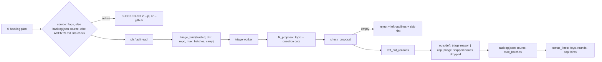
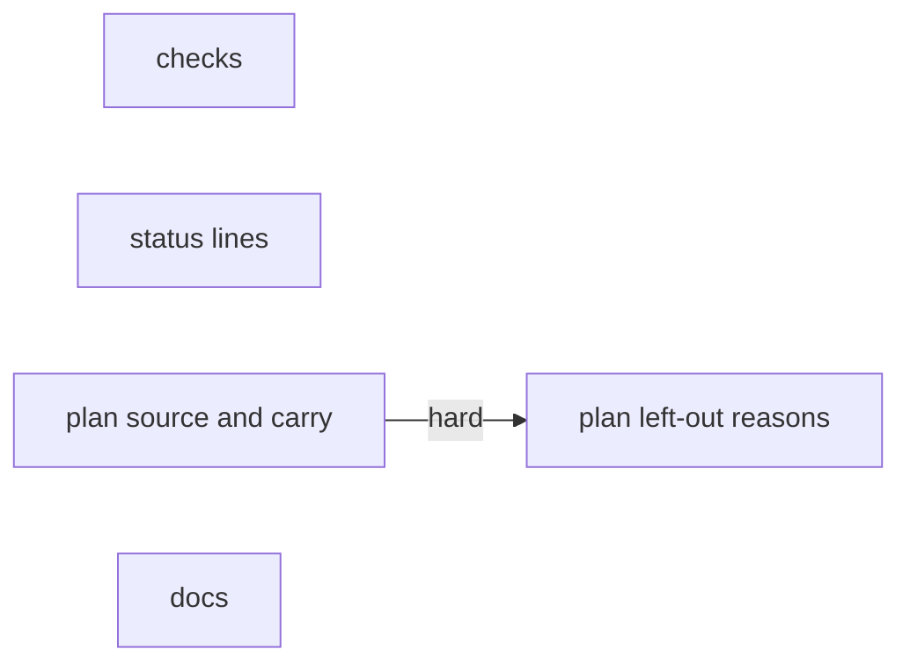

# Superlite: backlog plan intake and status output (B86)

**Goal:** fix #452, #472, #473, #483, #509: `sl backlog plan` remembers its source, gives a reason per left-out issue group and names its caps, cuts an over-long topic, and `status` prints Jira keys plainly, cap rounds, and never lists a shipped issue as not planned.
**Architecture:** `backlog_checks` gains the topic cut and a tolerant `left_out` reader; `backlog_state` formats left-out groups (rounds, cap hints, keys); `backlog.cmd_plan` resolves and stores the source, passes the carry dict and the batch cap to `backlog_brief.triage_brief`, and writes the triage reasons; the docs name it.
**Tech stack:** Python 3.10+ stdlib, pytest (through `sl run_tests`).
**Spec:** this file, section Design; issue bodies #452 #472 #473 #483 #509.
**Detail:** contracts
**Target-min:** 11
**Wave0:** none

Global constraints:
- Every code line in `skills/subagent-driven-development/scripts/*.py` carries the trailing `# O(...)` complexity comment where the surrounding function's lines do; tests do not. Stdlib only.
- Existing tests stay green. An existing test file changes only when the task Owns it. If another existing test turns red, report it in DONE_WITH_CONCERNS with the test id and the reason instead of editing it.
- Run `sl` as an executable (`<abs>/sl ...`). Verify with `<abs>/sl run_tests --fast <own test files> --task Tn --background`, then run the printed `wait:` line in the foreground and end the turn only after it reports.
- Tests clear SUPERLITE_FLEET_ROLE, SUPERLITE_FLEET_PARENT_DIR, SUPERLITE_FLEET_WORKER and SUPERLITE_STATE_DIR with `monkeypatch.delenv(..., raising=False)`.
- A hook blocks Bash text naming a main-only backlog subcommand (decide, start, ...): write test files with the Write tool, never a heredoc.
- No version edits (the ship step bumps it). Never run `scripts/evals.sh`, `claude plugin eval` or `scripts/test_layers.py run`.

Ruling: B86 also edits backlog.py, backlog_state.py, the two backlog docs and their tests (outside its brief's list): cmd_plan and status live there and no open batch (B85, B87, B88) owns them - cost if wrong: a rebase conflict at ship.
Ruling: the triage proposal gets an optional `left_out: [{"issues": [...], "reason": "<at most 60 chars>"}]`; a named issue is stored `not planned (triage: <reason>)`; an unnamed one keeps `not planned (cap)` / `not planned (triage)`; malformed entries are ignored, never a reject - cost if wrong: one stricter check later.
Ruling: `plan --max-batches N` (1 to 20, default 7) names the cap #472 asks for; backlog.json stores `max_batches`, status prints a `cap:` line naming the flag - cost if wrong: one unused flag.
Ruling: backlog.json `source` = `{"tracker": "github"}` or `{"tracker": "jira", "jql": Q}`; a plain plan reuses it; nothing remembered plus the word Jira (any case) in the main root's AGENTS.md or CLAUDE.md refuses (exit 2) naming `--jql` and the new `--github` - cost if wrong: one extra `--github` in a GitHub project that mentions Jira.
Ruling: a topic over 40 characters is cut at its last `-` boundary (Max: cut at a word boundary) with a `shortened:` note; the error names the 40-character limit - cost if wrong: none.
Ruling: detail contracts; no probe adapter (CLI over a JSON file; Review Focus cases are named pytest cases); LAYERS unit and headless (backlog.md is skills/**); evals stamped by ruling (body-only edit of commands/backlog.md, no eval case covers /superlite:backlog, as B55) - cost if wrong: one NEEDS_CONTEXT.
LAYERS: unit, headless



## Design

### 1. Checks (T1, #509, #472)
- `TOPIC_MAX = 40`. `fit_proposal` cuts, per batch dict, a str topic over 40: `head = v[:40]`; when `v[40] != "-"` and `head` holds a `-`, `head = head[:head.rindex("-")]`; strip trailing `-`; empty falls back to `v[:40]`. Note `"<id>" topic: N -> M characters` (`<id>` the batch's str id, else `batch <k>`), before that batch's question notes.
- `check_proposal` topic error: `<bid>: topic must be lowercase words joined by -, at most 40 characters`.
- `left_out_reasons(obj, known)`: reads `obj["left_out"]`; per dict entry with a str `reason` and a list `issues`: reason control characters to blanks, whitespace collapsed, over 60 cut by the existing `_word(r, 60)`; empty skipped; each item mapped to a known issue (an int not bool in known; a str whose stripped upper form is in known; a str `#N` or `N` whose int is in known); first reason per issue wins.

### 2. Status (T2, #452, #472, #483)
- `backlog_state.ref(n)`: a str is a Jira key as is, else `#n`. Used by the status rows (issues, OPEN list), `skip_issue` messages, `left_out_lines`; `backlog_run._shipped`'s `B OPEN` line uses `bs.ref`.
- `left_out_lines(data)`: skip an entry whose number is in any batch's `issues`; show `ref(n)`, plus ` (N rounds)` when `rounds` is an int (not bool) of 2 or more; after the group lines one hint per cap kind present, in this order: `not planned (cap)` -> `cap: a plan round holds at most M batches (sl backlog plan --max-batches N raises it, up to 20); capped issues rank first in the next round` (M = `data["max_batches"]` when an int, else `DEFAULT_CAP = 7`); `not triaged (K cap)` -> `cap: a plan round triages only the first K open issues; the rest rank first in the next round` (once per K).

### 3. Plan source, carry, cap (T3, #473, #452)
- Flags: `--github` (store_true, in the `--jql`/`--issues` group), `--max-batches N` (type int; outside 1..20: `BLOCKED: --max-batches: 1 to 20`, exit 2, before any call; `None` means `MAX_BATCHES`).
- `remembered_source(source, root) -> tuple`: `(jql, line, err)`. Jira source with a non-empty str jql: `(jql, 'source: Jira --jql "<jql>" (remembered from the last plan; --github, --jql or --issues picks another)', None)`. Jira without jql: `(None, None, 'BLOCKED: the last plan read Jira issues by key and remembers no JQL; run sl backlog plan --jql "<query>", --issues KEYS or --github')`. GitHub: `(None, None, None)`. No valid source: `jira_named(root)` gives `(None, None, 'BLOCKED: no backlog source remembered and AGENTS.md or CLAUDE.md names Jira; run sl backlog plan --jql "<query>" for Jira issues or --github for GitHub issues (--issues pins single issues); a plain plan then reuses the choice')`, else `(None, None, None)`.
- `jira_named(root) -> bool`: `root/AGENTS.md` or `root/CLAUDE.md` matches `(?i)\bjira\b` (unreadable file: no match).
- cmd_plan: a plain plan (no `--jql`, `--issues`, `--github`) calls it after the pin checks, before any gh or acli call; an err prints and exits 2; a line prints first on stdout. On success `apply` stores `data["source"]`: jql given or reused -> jira with jql; Jira keys pin -> jira keeping the previous jira source's jql when it has one, else `{"tracker": "jira"}`; otherwise github. And `data["max_batches"] = cap`. A rejected plan stores nothing.
- `why_out` compares the proposal's batch count with `cap`.
- Carry (#452): `backlog_brief.carry_line(issues, carry)` moves from backlog.py unchanged in text; `triage_brief` inserts it right before its `Rules:` line when `ctx.get("carry")` gives one; `insert_line` and `backlog.carry_line` go. `_triage(sd, root, trusted, repo, tier, timeout_min, carry=None, cap=None)` passes `{"repo", "max_batches": cap or MAX_BATCHES, "carry": carry or {}}`; cmd_plan always passes both; the regression fake takes `carry=None, cap=None`.

### 4. Left-out reasons, empty proposal, counts (T4, #472, #483, #509)
- After the checks pass: `reasons = bc.left_out_reasons(prop, {t["number"] for t in trusted})`; an unplanned trusted issue named there gets `not planned (triage: <reason>)`, else `why_out`.
- `apply` drops every outside entry (new or kept by a pin) whose number a shipped batch in `data` holds.
- The rejected-proposal `triage worker S: <summary>` line gains ` (the proposal holds N batches)` (`1 batch`) when `batches` is a list.
- An empty `batches` list: after the reject block, one `<reason>: <refs>` line per group of trusted issues (reason as stored above, refs `KEY` or `#n`), then `nothing to plan: sl backlog skip <issue> keeps an issue out of every later plan`.
- Brief Rules gain: `topic: lowercase words joined by -, at most 40 characters (a longer topic is cut at its last whole word)` and `list each issue you leave out of every batch under left_out with one short reason per group (at most 60 characters: needs a human, needs design, blocked by #N, outside work, umbrella or tracking, already done); leave out of left_out the issues only the batch cap of <max_batches> left out: plan names those`; the json template gains `"left_out": [{"issues": [<n>], "reason": "<why>"}]` (`["<KEY>"]` for Jira).

### 5. Docs (T5)
SDD backlog.md `## Main` step 2 and commands/backlog.md step 2 get the sentences in T5.

## Coverage

| Category | State | Basis |
|---|---|---|
| Scope and success criteria | settled | five issue Expected lines; Max: topic cut at a word boundary |
| Domain and data model | ruled | backlog.json `source`, `max_batches`; outside reason `not planned (triage: R)` |
| Persistence and migration | ruled | old files lack both keys: plain plan detects, status uses 7 |
| Interfaces and contracts | ruled | proposal `left_out`; `--github`, `--max-batches`; `_triage` keywords |
| UI states | n/a | CLI text only |
| Concurrency and state ownership | settled | writes stay inside `bs.update` |
| Error handling and recovery | ruled | refusals exit 2 before any call; malformed left_out ignored |
| Security and privacy | settled | reasons and keys cleaned of control characters; AGENTS.md only read |
| Performance and limits | n/a | linear passes |
| Observability | settled | `source:`, `cap:`, `shortened:` lines |
| Testing strategy | settled | unit cases per helper plus CLI cases on the bk/jk fixtures |
| Compatibility | settled | existing outputs keep their text; Jira refs drop the `#` |
| Rollout | ruled | one PR; version bump at ship |
| Research unknowns | n/a | none |

## File structure
- `skills/subagent-driven-development/scripts/backlog_checks.py`: topic cut, left_out reader (T1).
- `skills/subagent-driven-development/scripts/backlog_state.py`, `backlog_run.py`: ref, left-out lines (T2).
- `skills/subagent-driven-development/scripts/backlog.py`, `backlog_brief.py`: source, cap, carry (T3); reasons, empty proposal, brief rules (T4).
- `skills/subagent-driven-development/backlog.md`, `commands/backlog.md`: step 2 (T5).

## Task graph

```mermaid
%% schedule
gantt
  title Predicted schedule (mm:ss)
  dateFormat X
  axisFormat %M:%S
  section lane 1
  T3 plan source memory carry and cap :t3, 0, 108s
  T4 plan left-out reasons and empty propo :t4, 108, 103s
  section lane 2
  T1 topic cut and left-out reason reader :t1, 0, 83s
  section lane 3
  T2 status lines keys rounds cap hints :t2, 0, 82s
  section lane 4
  T5 backlog docs name source and reasons :t5, 0, 74s
```




critical path: T3 → T4 (3.5 min) · peak width 4 · predicted build 3.5 min · predicted total ≈ 7.0 min (target ✓)

## Package: backlog CLI
App type: CLI. Categories: protocol (flags, proposal shape), encoding (keys, reasons, control characters), state (backlog.json source, outside), file (AGENTS.md read).
Specific risks: a remembered Jira source silently reused after the user switched trackers; a reason injecting newlines into status; a shipped issue listed as left out; a Jira key printed with `#`.
**Probe entry:** none (Ruling: no probe adapter).

### T1 topic cut and left-out reason reader · Complexity 3 · Est. context 30k
**Owns:** skills/subagent-driven-development/scripts/backlog_checks.py, tests/scripts/test_backlog_checks.py, tests/scripts/test_backlog_checks_b86.py
**Components:** 1
**LOC owned:** 110
**Tests:** fast
**Model:** sonnet
**Est. time:** 2.2 min (1 component, about 110 LOC, fast tests)
**Covers:** 1
**Consumes:** none
**Produces:** backlog_checks.left_out_reasons(obj: object, known: set) -> dict
e.g. left_out_reasons({"batches": [], "left_out": [{"issues": [2, "#3", 9], "reason": "needs design"}, {"issues": [2], "reason": "dup"}]}, {1, 2, 3}) -> {2: "needs design", 3: "needs design"}
e.g. left_out_reasons({"left_out": [{"issues": ["pix-2"], "reason": " blocked\nby PIX-1 "}]}, {"PIX-1", "PIX-2"}) -> {"PIX-2": "blocked by PIX-1"}
e.g. left_out_reasons({"left_out": "x"}, {1}) -> {}
**Review Focus:**
Unit tests on `bc` directly (no CLI). `tests/scripts/test_backlog_checks.py` line 46: the expected topic error becomes `B1: topic must be lowercase words joined by -, at most 40 characters`.
protocol: `test_topic_cut_at_last_dash` (proposal `{"batches": [{"id": "B3", "topic": "backlog-plan-intake-and-status-output-fixes", ...}]}`; `fit_proposal` returns `['"B3" topic: 44 -> 37 characters']`, topic now `backlog-plan-intake-and-status-output`, then `check_proposal` passes).
protocol: `test_topic_without_dash_plain_cut` (`"a" * 45` -> `"a" * 40`, note `"B1" topic: 45 -> 40 characters`); `test_topic_40_untouched` (40 chars: no note); `test_topic_note_names_batch_k` (no str id -> note starts `"batch 1" topic:`); `test_topic_note_before_question_notes` (a batch with an over-long header: topic note first).
encoding: `test_reason_cut_and_cleaned` (reason `"x\x00y " + "word " * 14` -> no control char, at most 60 chars, ends at a whole word, no trailing blank); `test_bad_entries_ignored` (entries `"s"`, `{"issues": 2, "reason": "r"}`, `{"issues": [1], "reason": 5}`, `{"issues": [True], "reason": "r"}`, `{"issues": [1], "reason": "   "}` -> `{}`).
plus the three `e.g.` lines above as `test_left_out_reasons_examples`.

### T2 status lines: keys, rounds, cap hints · Complexity 3 · Est. context 32k
**Owns:** skills/subagent-driven-development/scripts/backlog_state.py, skills/subagent-driven-development/scripts/backlog_run.py, tests/scripts/test_backlog_jira_208.py, tests/scripts/test_backlog_run.py, tests/scripts/test_backlog_status_b86.py
**Components:** 1
**LOC owned:** 100
**Tests:** fast
**Model:** sonnet
**Est. time:** 2.1 min (1 component, about 100 LOC, fast tests)
**Covers:** 2
**Consumes:** none
**Produces:** backlog_state.ref(n: int | str) -> str
e.g. ref(12) -> "#12"
e.g. ref("PIX-4") -> "PIX-4"
**Review Focus:**
Update `test_backlog_jira_208.py` line 41 to `"B1 | PIX-1 PIX-2 | planned"` and line 99 to `"skipped PIX-2 (B1 keeps PIX-1)\n"`. New tests call `bs.status_lines` / `bs.left_out_lines` on dicts built with `backlog_fixtures.batch`.
state: `test_left_out_skips_issues_in_batches` (outside `[{"number": 5, "title": "t", "reason": "not planned (cap)"}]`, batches `[batch("B5", ["a.py"], state="shipped")]` -> `left_out_lines` is `[]`).
encoding: `test_rounds_and_keys_and_cap_hint` (outside `[{"number": 2, "reason": "not planned (cap)", "rounds": 3}, {"number": 3, "reason": "not planned (cap)"}, {"number": "PIX-4", "reason": "not planned (triage: needs design)"}]`, `max_batches` 4 -> exactly `["not planned (cap): #2 (3 rounds) #3", "not planned (triage: needs design): PIX-4", "cap: a plan round holds at most 4 batches (sl backlog plan --max-batches N raises it, up to 20); capped issues rank first in the next round"]`).
state: `test_cap_hint_defaults_to_7` (no `max_batches` key, or `True` -> `at most 7 batches`); `test_rounds_bool_or_one_not_shown` (`rounds` True or 1 -> plain `#2`); `test_triage_cap_hint` (reason `not triaged (200 cap)` -> the line `cap: a plan round triages only the first 200 open issues; the rest rank first in the next round`, once for two entries).
protocol: `test_status_row_jira_keys` (batch issues `["PIX-1"]`, state shipped, `open_issues` `["PIX-1"]`, version `1.0` -> row contains `| PIX-1 |` and `1.0 OPEN PIX-1`); `test_wait_open_line_jira_key` in test_backlog_run.py (as the test at line 163, `open_issues` `["PIX-9"]` -> `B1 OPEN PIX-9`).

### T3 plan source memory, carry and cap · Complexity 5 · Est. context 45k
**Owns:** skills/subagent-driven-development/scripts/backlog.py, skills/subagent-driven-development/scripts/backlog_brief.py, tests/scripts/test_backlog_cli.py, tests/scripts/test_backlog_plan_pin_433.py, tests/regression/test_backlog_gh_intake.py, tests/scripts/test_backlog_plan_source_473.py
**Components:** 2
**LOC owned:** 190
**Tests:** fast
**Model:** sonnet
**Est. time:** 3.6 min (2 components, about 190 LOC, fast tests)
**Covers:** 3
**Consumes:** none
**Produces:** backlog_brief.carry_line(issues: list, carry: dict) -> str | None
e.g. carry_line([{"number": 5}, {"number": 2}], {2: 4, 5: 1}) -> "Carry-over: the batch cap left these issues out of earlier plan rounds: #5 (1 round), #2 (4 rounds). Plan them before the other issues, unless one is an umbrella or tracking issue."
e.g. carry_line([{"number": 9}], {}) -> None
**Produces:** backlog.remembered_source(source: object, root: Path) -> tuple
e.g. remembered_source({"tracker": "jira", "jql": "project = PIX"}, root) -> ("project = PIX", 'source: Jira --jql "project = PIX" (remembered from the last plan; --github, --jql or --issues picks another)', None)
e.g. remembered_source({"tracker": "github"}, root) -> (None, None, None)
**Review Focus:**
Fixture: the `bk` fake `triage_brief` in test_backlog_cli.py keeps its lines and appends the real `backlog_brief.carry_line(issues, ctx.get("carry") or {})` when not None, and records `ns.ctx = ctx`. `test_carry_helpers` calls `bb.carry_line`; the `insert_line` asserts go. The regression fake becomes `def triage(sd, root, trusted, repo, tier, tmo, carry=None, cap=None)`.
state: `test_jql_remembered_and_reused` (jk: `plan --jql "project = PIX"` -> 0, `source == {"tracker": "jira", "jql": "project = PIX"}`; then `plan --reset` -> 0, first stdout line the `source:` line above, acli `--jql` arg `project = PIX`, no `api` gh call).
state: `test_github_remembered_no_line` (bk: `plan` -> `source == {"tracker": "github"}`, no `source:` in out).
file: `test_agents_md_jira_refuses_before_any_call` (`root/AGENTS.md` = `Tracker: JIRA project PIX` -> `plan` gives `(2, <no-source BLOCKED line> + "\n")`, `bk.gh == []`; `plan --github` -> 0, source github; `plan --reset` -> 0); `test_claude_md_checked` (`CLAUDE.md` with `jira` -> refused); `test_word_inside_name_not_jira` (`AGENTS.md` = `see jirafy.py` -> plan 0).
state: `test_key_pin_keeps_jql` (`plan --jql Q`, then `plan --reset --issues PIX-1` -> source `{"tracker": "jira", "jql": "Q"}`); `test_key_pin_without_jql_then_plain_refused` (fresh: `plan --issues PIX-1` -> `{"tracker": "jira"}`; `plan --reset` -> `(2, <no-JQL BLOCKED line> + "\n")`).
protocol: `test_github_excludes_jql` (`plan --github --jql x` -> SystemExit 2); `test_max_batches_bounds` (`--max-batches 0` and `21` -> `(2, "BLOCKED: --max-batches: 1 to 20\n")`, `bk.gh == []`); `test_max_batches_sets_cap` (PRIVATE, batches `[{**BATCH, "issues": [1]}]`, `plan --max-batches 1` -> `#2` reason `not planned (cap)`, `max_batches == 1`, `bk.ctx["max_batches"] == 1`); `test_rejected_plan_keeps_source` (jql plan, then `plan --reset --github` with `bk.batches = []` -> 3, source still jira).
state: `test_carry_always_passed` (default plan -> `bk.ctx["carry"] == {}`).

### T4 plan left-out reasons and empty proposal · Complexity 4 · Est. context 40k
**Owns:** skills/subagent-driven-development/scripts/backlog.py, skills/subagent-driven-development/scripts/backlog_brief.py, tests/scripts/test_backlog_plan_reasons_472.py
**Components:** 2
**LOC owned:** 140
**Tests:** fast
**Model:** sonnet
**Est. time:** 3.0 min (2 components, about 140 LOC, fast tests)
**Covers:** 4
**Consumes:** backlog_checks.left_out_reasons(obj: object, known: set) -> dict (T1)
**Produces:** none
**Review Focus:**
CLI cases on the `bk`/`jk` fixtures (test_backlog_cli.py, test_backlog_jira_208.py); the proposal's `left_out` goes in by setting the triage report: add a `bk.left_out` hook only inside this task's own test file (monkeypatch the fixture's `wait` there), never in the fixture file.
state: `test_triage_reason_stored_and_shown` (batches `[{**BATCH, "issues": [1]}]`, left_out `[{"issues": [2], "reason": "needs design"}]` -> outside entry `{"number": 2, "title": "Two", "reason": "not planned (triage: needs design)"}`, out line `not planned (triage: needs design): #2`).
state: `test_cap_without_reason_keeps_cap` (`MAX_BATCHES` 1, PRIVATE, left_out names `3` only -> `#2` reason `not planned (cap)`, `#3` triage reason).
state: `test_shipped_issue_never_left_out` (seed a shipped `B1` holding `[2]` and outside `[{"number": 2, "title": "Two", "reason": "not planned (cap)"}]`; `plan --issues 1` with batches `[{**BATCH, "issues": [1]}]` -> no outside entry for 2).
protocol: `test_empty_proposal_names_reasons_and_skip` (`bk.batches = []`, left_out `[{"issues": [1], "reason": "needs a human"}]` -> rc 3; lines `not planned (triage: needs a human): #1`, `not planned (triage): #2`, `nothing to plan: sl backlog skip <issue> keeps an issue out of every later plan`; `(the proposal holds 0 batches)` in the triage worker line).
protocol: `test_reject_line_counts_batches` (two batches sharing an unknown issue `#9` -> `(the proposal holds 2 batches)`; one -> `1 batch)`).
encoding: `test_jira_left_out_reason` (jk, left_out `[{"issues": ["pix-2"], "reason": "outside work"}]`, batches holding `PIX-1` -> `PIX-2` reason `not planned (triage: outside work)`).
protocol: `test_brief_names_topic_limit_and_left_out` (`bb.triage_brief([{"number": 1, "title": "t"}], {"repo": "r", "max_batches": 3})` contains `at most 40 characters`, `left_out`, `batch cap of 3`; Jira issues -> `["<KEY>"]` in the left_out template).

### T5 backlog docs name source and reasons · Complexity 1 · Est. context 22k
**Owns:** skills/subagent-driven-development/backlog.md, commands/backlog.md, tests/scripts/test_backlog_docs_b86.py
**Components:** 1
**LOC owned:** 30
**Tests:** fast
**Model:** sonnet
**Est. time:** 1.2 min (1 component, about 30 LOC, fast tests)
**Covers:** 5
**Consumes:** none
**Produces:** none
**Review Focus:**
Append to the end of `## Main` step 2 in skills/subagent-driven-development/backlog.md (same paragraph, one space after its last sentence) exactly this text:
```text
Source: `--jql Q` reads Jira through acli, `--issues` pins GitHub numbers or Jira keys, `--github` reads the open GitHub issues; backlog.json remembers the last plan's source and JQL and a plain `plan` reuses them (a `source:` line names a reused JQL); with nothing remembered and Jira named in the project's AGENTS.md or CLAUDE.md, a plain `plan` refuses and names `--jql` and `--github`. Left-out issues show in `status` as `<reason>: #a #b` lines: the triage worker's reason (`not planned (triage: <why>)`), `not planned (cap)` for the batch cap (`--max-batches N`, default 7, up to 20, named in a `cap:` line) or `not triaged (200 cap)`, with the rounds a cap entry waited (`#12 (2 rounds)`); an empty proposal names `sl backlog skip <issue>`; a topic over 40 characters is cut at its last whole word.
```
Append to the end of step 2 in commands/backlog.md (same paragraph, one space after its last sentence) exactly this text:
```text
The source is remembered: a plain `plan` reuses the last round's `--jql`; when it refuses because AGENTS.md names Jira and no source is remembered, run `"$SL" backlog plan --jql "<query>"` for Jira or `"$SL" backlog plan --github`. `status` gives each left-out group its reason; a `not planned (cap)` group comes with a `cap:` line naming `--max-batches N`.
```
protocol: `test_sdd_backlog_names_source_and_reasons` (the SDD file's step 2 paragraph contains `--github`, `a plain \`plan\` reuses them`, `not planned (triage: <why>)`, `--max-batches N`, `sl backlog skip <issue>`, `over 40 characters`); `test_command_names_source` (commands/backlog.md step 2 contains `backlog plan --github` and `--max-batches N`). Run the existing `tests/scripts/test_backlog_main_docs.py`, `test_docs_b26.py`, `test_docs_b72_backlog.py`, `test_backlog_docs.py` too.

## Self-review
Coverage: #452 items 1 and 3 in T3, item 2 in T2; #472 in T1, T2, T3 (cap flag), T4, T5; #473 in T3, T5; #483 shipped filter T2 + T4, count T4, keys T2; #509 in T1, T4 (brief). T3 and T4 share files, ordered by the hard edge. No placeholders.
