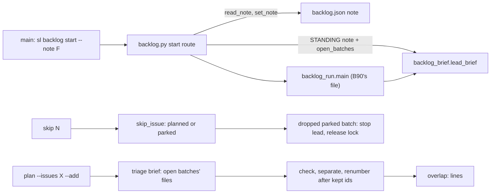
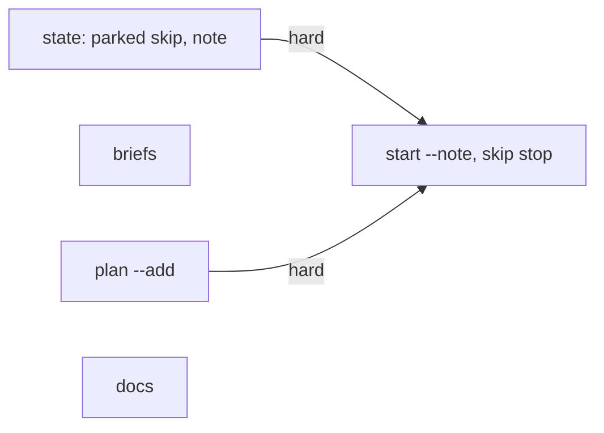

# Superlite: backlog skip on parked batches, plan --add, start --note, root-doc ownership (B89)

**Goal:** fix #503, #504, #505, #506: `sl backlog skip` takes an issue out of a parked batch; `sl backlog plan --issues X --add` plans an urgent issue next to open batches; `sl backlog start --note FILE` gives every lead brief a standing note; lead and triage briefs say who edits a file no batch owns (shared root docs).
**Architecture:** backlog_state.py gets the parked skip and the note state (read, store, status line); backlog_brief.py gets the note, owned-files and root-doc lines (lead) and the open-batches and root-doc lines (triage); backlog.py gets `plan --add` and, in its `start` route, strips `--note FILE`, stores it and hands the note plus the open batches' files to backlog_brief through a module dict `STANDING`, because `start` itself lives in backlog_run.py, which planned batch B90 owns.
**Tech stack:** Python 3.10+ stdlib, pytest (through `sl run_tests`).
**Spec:** this file, section Design; issues #503-#506 Expected lines; Max's decisions in the lead brief.
**Detail:** contracts
**Target-min:** 11
**Wave0:** none

Global constraints:
- Every code line in `skills/subagent-driven-development/scripts/*.py` carries the repo's trailing `# O(...)` complexity comment where the surrounding function's lines do; tests do not. Stdlib only.
- Existing tests stay green. An existing test file changes only when the task Owns it. If another existing test turns red, report it in DONE_WITH_CONCERNS with the test id and the reason instead of editing it.
- Run `sl` as an executable (`<abs>/sl ...`). Verify with `<abs>/sl run_tests --fast <own test files> --task Tn --background`, then run the printed `wait:` line in the foreground and end the turn only after it reports.
- Tests clear SUPERLITE_FLEET_ROLE, SUPERLITE_FLEET_PARENT_DIR, SUPERLITE_FLEET_WORKER and SUPERLITE_STATE_DIR with `monkeypatch.delenv(..., raising=False)`.
- Never type a backlog subcommand after the word `backlog` in a Bash command (a hook blocks it, heredocs too); write files with the Write tool.
- No version edits. Never run `scripts/evals.sh`, `claude plugin eval` or `scripts/test_layers.py run`. Never edit backlog_run.py, backlog_checks.py or backlog_ship.py (B90 owns them).

Ruling: `start --note` is parsed in backlog.py's `start` route and reaches the brief through `backlog_brief.STANDING` (lead_brief merges `{**STANDING, **ctx}`), since cmd_start and its argparse live in backlog_run.py (B90's file) - cost if wrong: B90 or later passes `ctx["note"]`/`ctx["owned"]` itself; the merge keeps ctx first.
Ruling: the note is stored in backlog.json `note` {text, file, time}, at most 2000 characters after cleaning; an empty file clears it; running leads are not sent it, start names each one with a `fleet send` hint (a send could hit a working lead) - cost if wrong: main sends by hand once per running lead.
Ruling: `--add` needs `--issues`, excludes `--reset`, keeps every batch, the ship approval (backlog_ship checks it for running leads), the source and max_batches, and appends the new ids to `round`; with no open batch it plans like `--issues` alone - cost if wrong: one more decide round.
Ruling: overlap with an open batch never rejects an `--add` proposal: plan prints `overlap:` lines and `start` already holds a batch that shares a file with a running one (`_pick`, status `clash`) - cost if wrong: a later issue makes overlap add a `depends`.
Ruling: skip takes planned and parked batches; a parked batch left empty is dropped, its worktree stays (named in the message), its lead is stopped and its ship lock released best effort, since no later `backlog wait` sees it - cost if wrong: an idle pane or a stale lock main frees by hand.
Ruling: #503 is fixed in the briefs: the triage rule lists root docs as files, and the lead brief lists the files other open batches own and says a needed file no open batch lists is the lead's to edit (named in notes.md), one another batch lists becomes a follow-up note - cost if wrong: a docs batch per round later.
Ruling: docs task T4 runs in parallel with the code: its exact text is in this plan; detail contracts; no probe adapter (CLI over JSON state; Review Focus cases are named pytest cases); layers: unit, headless (skills/**/backlog.md, commands/backlog.md), evals (commands/backlog.md, stamped by ruling for a body-only edit as B86 did).
LAYERS: unit, headless, evals

## Design

### 1. State (T1, backlog_state.py)
- `skip_issue`: refuse only `running` and `needs_decision` (message unchanged). A parked batch with a worktree left empty is dropped with `skipped #N (Bk dropped; its worktree <wt> stays)`.
- `read_note(path)`: read `utf-8-sig`; OSError or UnicodeDecodeError -> `ValueError(f"--note {path} unreadable: {e}")`; `\r\n` and `\r` -> `\n`; drop `[\x00-\x08\x0b-\x1f\x7f]`; rstrip each line; strip the whole; over NOTE_MAX = 2000 -> `ValueError(f"--note {path}: {n} characters, at most 2000")`.
- `set_note`, `note_line` as in T1's Produces; `status_lines` appends `note_line` after the left-out lines in both branches, before the questions line.

### 2. Briefs (T2, backlog_brief.py)
- `STANDING: dict = {}`; `lead_brief` starts with `ctx = {**STANDING, **ctx}`.
- Lead, after the `Files this batch may touch` line: with `owned` in ctx, `Files other open batches own: B2 (planned) b.py, c.py; B3 (running) d.py.` (the batch itself left out; `none.` when empty); then always ROOT_DOC_RULE (T2).
- Lead, after the Max's decisions lines, with a non-empty `note`: NOTE_HEAD, then each note line as `    <line>` with CTRL removed.
- Triage, after the carry line, with a non-empty `open`: OPEN_HEAD + `B89 running: a.py, b.py; B90 planned: c.py. ` + OPEN_TAIL; the Rules line gains ROOT_DOC_TRIAGE after its first sentence.

### 3. plan --add (T3, backlog.py)
- `--add` (store_true, help names `--issues` and the kept approval). Order in cmd_plan: `--add` without `--issues` -> `BLOCKED: --add needs --issues` (2); with `--reset` -> `BLOCKED: --add and --reset exclude each other` (2); no open batch -> plain pinned plan; else open batches do not refuse; a pinned issue in an open batch -> `BLOCKED: --issues: #2 is in B1 (running)` (2, before gh).
- A pinned plan without `--add` refused by open batches appends ADD_HINT `; --add plans the --issues next to them` to the BLOCKED line.
- `_triage(..., open_=None)` puts `"open": open_ or []` into the triage ctx (plain plan: `[]`).
- apply with add: raise `RuntimeError("backlog changed while triage ran (#2 is in B7 planned)")` (proposal: `while the proposal was checked`) when a pinned issue is now in an open batch; titles merged; outside = new entries + old ones not pinned; shipped issues filtered as today; approved_ship, source, max_batches untouched; new ids after every kept id; `round` = old round (else the open ids) + new ids; then `overlap_lines(new, open_batches(data))` printed after the status lines.

### 4. start --note and skip (T5, backlog.py)
- `start` route, before `backlog_run.main`: strip `--note F` / `--note=F` (no value: `BLOCKED: --note needs a FILE`, 2). Outside a fleet worker: read_note (ValueError -> `BLOCKED: <msg>`, 2, nothing routed), `bs.update(path, set_note(..., str(Path(F).resolve()), _now()))`, print its message; for a non-empty note, per running or needs_decision batch with a lead: `note: B2 lead W5 started before this note; sl fleet send W5 --text "$(cat /abs/F)" tells it`. Every start (worker env too, then without storing): `backlog_brief.STANDING = {"note": <stored text or "">, "owned": open_batches(data)}`, then `return backlog_run.main(rest)`. `-h`/`--help`: on SystemExit from backlog_run print NOTE_HELP, re-raise.
- `cmd_skip`: when the hit batch was parked, is gone after the skip and had a `lead`: `fleet.stop(root/.superlite, [lead])` (Exception and SystemExit swallowed) then print `B2 lead W4 stopped`; `ship_lock.release(ship_lock.lock_path(repo), bid)` (OSError, ValueError swallowed).

### 5. Docs (T4)
Exact sentences in T4.

## Coverage

| Category | State | Basis |
|---|---|---|
| Scope and success criteria | settled | four Expected lines; Max: `--add`, `--note FILE` |
| Domain and data model | ruled | backlog.json `note` key; `round` appended |
| Persistence and migration | ruled | old files have no `note`: nothing shown |
| Interfaces and contracts | ruled | `STANDING` merge; new flags only |
| UI states | n/a | CLI text only |
| Concurrency and state ownership | ruled | add re-checks pinned issues inside the locked update |
| Error handling and recovery | settled | BLOCKED lines, exit 2, nothing routed or written |
| Security and privacy | ruled | note text is main's, control characters dropped, capped |
| Performance and limits | n/a | one file read |
| Observability | settled | `note:`, `overlap:`, `stopped` lines |
| Testing strategy | settled | bk fixture CLI cases, pure-function cases |
| Compatibility | settled | without the new flags nothing changes but the brief rule lines |
| Rollout | ruled | one PR; version bump at ship |
| Research unknowns | n/a | none |

## File structure
- `skills/subagent-driven-development/scripts/backlog_state.py`: parked skip, note state (T1).
- `skills/subagent-driven-development/scripts/backlog_brief.py`: note, owned, root-doc and open lines (T2).
- `skills/subagent-driven-development/scripts/backlog.py`: plan --add (T3), start --note route, skip lead stop (T5).
- `skills/subagent-driven-development/backlog.md`, `commands/backlog.md`: docs (T4).

## Task graph

```mermaid
%% schedule
gantt
  title Predicted schedule (mm:ss)
  dateFormat X
  axisFormat %M:%S
  section lane 1
  T3 plan --issues X --add :t3, 0, 109s
  T5 start --note route and parked skip st :t5, 109, 107s
  section lane 2
  T1 state parked skip and note :t1, 0, 106s
  section lane 3
  T2 briefs note owned files root docs ope :t2, 0, 85s
  section lane 4
  T4 docs backlog.md and commands/backlog. :t4, 0, 76s
```

critical path: T3 → T5 (3.6 min) · peak width 4 · predicted build 3.6 min · predicted total ≈ 7.1 min (target ✓)

## Package: backlog CLI
App type: CLI. Categories: protocol (argv, flags), state (backlog.json, round, approval), file (note file), encoding (control characters in the note).
**Probe entry:** none (Ruling: no probe adapter).

### T1 state: parked skip and note · Complexity 3 · Est. context 32k
**Owns:** skills/subagent-driven-development/scripts/backlog_state.py, tests/scripts/test_backlog_state_b89.py, tests/scripts/test_backlog_state.py
**Components:** 2
**LOC owned:** 170
**Tests:** fast
**Model:** sonnet
**Covers:** 1
**Consumes:** none
**Produces:** backlog_state.skip_issue(data: dict, n: int | str) -> str
e.g. skip_issue(d, 2) -> "skipped #2 (B2 keeps #5)" (B2 parked, worktree "/w/b2", issues [2, 5])
e.g. skip_issue(d, 5) -> "skipped #5 (B2 dropped; its worktree /w/b2 stays)" (B2 parked, worktree "/w/b2", issues [5])
**Produces:** backlog_state.read_note(path: str) -> str
e.g. read_note("/m/rules.md") -> "Use uv.\nNo emojis." (file bytes b"Use uv.\r\nNo emojis.\x07  \n\n")
**Produces:** backlog_state.set_note(data: dict, text: str, src: str, now: str) -> str
e.g. set_note(d, "Use uv.\nNo emojis.", "/m/rules.md", "2026-11-10T22:00:00Z") -> "note: stored from /m/rules.md (2 lines); every lead brief from now on carries it"
e.g. set_note(d, "", "/m/empty.md", "T") -> "note: cleared; lead briefs carry no note"
**Produces:** backlog_state.note_line(data: dict) -> str | None
e.g. note_line({"note": {"text": "a\nb", "file": "/m/rules.md", "time": "T"}}) -> "note: 2 lines from /m/rules.md (T) go into every lead brief (sl backlog start --note FILE replaces it, an empty file clears it)"
**Review Focus:**
Fixture: `data`/`b` from tests/scripts/backlog_fixtures.py.
state: `test_skip_parked_keeps_the_rest` (B2 parked worktree "/w/b2" issues [2, 5] -> "skipped #2 (B2 keeps #5)", B2 stays parked, 2 in skipped).
state: `test_skip_parked_last_issue_drops_it` (issues [5] -> "skipped #5 (B2 dropped; its worktree /w/b2 stays)"; B3 depends ["B2"] becomes []).
state: `test_skip_parked_without_worktree_unchanged` (-> "skipped #5 (B2 dropped)").
state: `test_skip_running_and_needs_decision_refused` (ValueError "#1 is in B1, which is running" / "..., which is needs_decision"). In tests/scripts/test_backlog_state.py:66-69 the parked case now asserts the skip succeeds.
encoding: `test_read_note_cleans` (bytes above, also with a UTF-8 BOM -> "Use uv.\nNo emojis."; "\tx" keeps the tab).
file: `test_read_note_errors` (missing -> ValueError starting "--note 
 unreadable: "; bytes b"\xff\xfe\xfa" not UTF-8 -> same prefix; "x" * 2001 -> "--note 
: 2001 characters, at most 2000"; "x" * 2000 ok).
state: `test_set_note_stores_and_clears` (examples above; d["note"] == {"text": ..., "file": "/m/rules.md", "time": "2026-11-10T22:00:00Z"}; one line -> "(1 line)"; clear removes the key, also when absent).
state: `test_status_shows_note` (status_lines with a note and no batches: last line is the note_line; with batches and an open question: note line just before the "questions:" line; note_line({}) is None; text not a str -> None).
**Steps:** 1 failing tests, 2 run: FAIL, 3 implement Design 1, 4 run: PASS (own files plus tests/scripts/test_backlog_state_left_out.py tests/scripts/test_backlog_status_b86.py).

### T2 briefs: note, owned files, root docs, open batches · Complexity 3 · Est. context 30k
**Owns:** skills/subagent-driven-development/scripts/backlog_brief.py, tests/scripts/test_backlog_brief_b89.py, tests/scripts/test_backlog_brief_jira_208.py
**Components:** 1
**LOC owned:** 140
**Tests:** fast
**Model:** sonnet
**Covers:** 2
**Consumes:** none
**Produces:** backlog_brief.STANDING: dict
**Produces:** backlog_brief.lead_brief(batch: dict, ctx: dict) -> str
**Produces:** backlog_brief.triage_brief(issues: list, ctx: dict) -> str
**Notes:** constants, exact text:
ROOT_DOC_RULE = "A file your issues need outside this list is never dropped: if no open batch lists it (a shared root doc such as CLAUDE.md, AGENTS.md or README.md too), edit it and name it in .superlite/notes.md; if another open batch lists it, write the needed change into .superlite/notes.md as a follow-up."
NOTE_HEAD = "Standing note from main (sl backlog start --note): follow it, and copy it into every brief and task message you give a worker:"
OPEN_HEAD = "Open batches (planned, parked or running; their issues are not yours): "
OPEN_TAIL = "Keep your batches off these files where the issues allow; plan names each file a new batch shares with one, and start holds a batch that shares a file with a running one until that one ships."
ROOT_DOC_TRIAGE = "List a shared root doc (CLAUDE.md, AGENTS.md, README.md) in the files of every batch whose fix makes it wrong; the rule that no two batches share a file holds for it too; "
(inserted right after "Rules: " in the Rules line). File paths in the owned and open lines go through `clean()`.
**Review Focus:**
protocol: `test_note_lines` (ctx note "Use uv.\nNo emojis." -> NOTE_HEAD line, then "    Use uv.", "    No emojis.", right before the "Rulings from shipped batches" line; note "" -> no NOTE_HEAD).
state: `test_standing_is_the_default` (monkeypatch bb.STANDING = {"note": "x"}; ctx without note -> "    x" in brief; ctx note "" -> no NOTE_HEAD).
protocol: `test_owned_line` (batch B1; owned [B1 running a.py, B2 planned b.py c.py, B3 running d.py] -> "Files other open batches own: B2 (planned) b.py, c.py; B3 (running) d.py." right after the "Files this batch may touch" line; owned only B1 -> "Files other open batches own: none."; no owned key -> no such line).
protocol: `test_root_doc_rule_always` (ROOT_DOC_RULE line follows the Files line, or the owned line when present).
encoding: `test_note_control_characters` (note "a\x07b" -> "    ab").
protocol: `test_triage_open_line` (ctx open [{"id": "B89", "state": "running", "files": ["a.py", "b.py"]}, {"id": "B90", "state": "planned", "files": ["c.py"]}] -> OPEN_HEAD + "B89 running: a.py, b.py; B90 planned: c.py. " + OPEN_TAIL; open [] or missing -> no OPEN_HEAD).
protocol: `test_triage_root_doc_rule` ("Rules: " + ROOT_DOC_TRIAGE + "no two batches share a file" in the triage brief).
GH_LEAD in tests/scripts/test_backlog_brief_jira_208.py gains ROOT_DOC_RULE + "\n" after the Files line.
**Steps:** 1 failing tests, 2 run: FAIL, 3 implement Design 2, 4 run: PASS (own files plus tests/scripts/test_backlog_brief.py tests/scripts/test_backlog_brief_limits.py tests/regression/test_leads_review_backlog.py).

### T3 plan --issues X --add · Complexity 5 · Est. context 40k
**Owns:** skills/subagent-driven-development/scripts/backlog.py, tests/scripts/test_backlog_plan_add_505.py
**Components:** 2
**LOC owned:** 210
**Tests:** fast
**Model:** sonnet
**Covers:** 3
**Consumes:** none
**Produces:** backlog.open_batches(data: dict) -> list
e.g. open_batches({"batches": [{"id": "B1", "state": "shipped", "files": ["x.py"]}, {"id": "B10", "state": "running", "files": ["b.py"]}, {"id": "B2", "state": "planned", "files": ["a.py"]}]}) -> [{"id": "B2", "state": "planned", "files": ["a.py"]}, {"id": "B10", "state": "running", "files": ["b.py"]}]
**Produces:** backlog.overlap_lines(new: list, open_: list) -> list
e.g. overlap_lines([{"id": "B96", "files": ["a.py", "b.py"]}], [{"id": "B89", "state": "running", "files": ["a.py"]}]) -> ["overlap: B96 shares a.py with B89 (running): start holds B96 until B89 ships"]
e.g. overlap_lines([{"id": "B96", "files": ["b.py"]}], [{"id": "B90", "state": "planned", "files": ["b.py"]}]) -> ["overlap: B96 shares b.py with B90 (planned): whichever starts first holds the files"]
**Review Focus:**
Fixture: `bk`, `cli`, `load`, `BATCH` from test_backlog_cli (ISSUES #1, #2 trusted). `setup`: `bk.batches = [{**BATCH, "issues": [1]}]`, `cli(capsys, "plan")`, then B1 state running and approved_ship = APPROVED via bs.update; `NEW = {"id": "B1", "topic": "urgent", "issues": [2], "files": ["b.py"], "depends": [], "decisions": []}`.
state: `test_add_plans_next_to_running` (setup; bk.batches = [NEW]; `plan --issues 2 --add` -> 0; [(id, state)] == [("B1", "running"), ("B2", "planned")]; approved_ship kept; round == ["B1", "B2"]; titles keys {"1", "2"}; out has "B2 | #2 | planned"; bk.ctx["open"] == [{"id": "B1", "state": "running", "files": ["a.py"]}]).
state: `test_add_overlap_line` (NEW files ["a.py"] -> out has "overlap: B2 shares a.py with B1 (running): start holds B2 until B1 ships" and "clash B1").
protocol: `test_add_flag_errors` (`plan --add` -> (2, "BLOCKED: --add needs --issues\n"); `plan --issues 2 --add --reset` -> (2, "BLOCKED: --add and --reset exclude each other\n")).
state: `test_add_refuses_an_open_issue` (setup; `plan --issues 1 --add` -> (2, "BLOCKED: --issues: #1 is in B1 (running)\n"); no gh call).
protocol: `test_pinned_refusal_names_add` (setup; `plan --issues 2` -> (2, "BLOCKED: backlog has open batches (B1 running); --reset is refused too while a batch is running or needs_decision; --add plans the --issues next to them\n"); plain `plan` line unchanged).
state: `test_add_without_open_batch` (no setup; `plan --issues 1 --add` -> 0; approved_ship None; round ["B1"]; bk.ctx["open"] == []).
state: `test_add_keeps_source_cap_outside` (setup, then source {"tracker": "jira", "jql": "project = X"}, max_batches 9, outside [{"number": 7, "title": "s", "reason": "not planned (cap)"}, {"number": 2, "title": "t", "reason": "not planned (cap)"}]; add #2 -> source and max_batches unchanged; outside numbers [7]).
state: `test_add_race_refused` (setup; wrap sys.modules["fleet_io"].wait to put a planned B7 holding [2] into backlog.json first -> rc 3, out "BLOCKED: backlog changed while triage ran (#2 is in B7 planned)\n"; batches unchanged).
protocol: `test_plan_help_names_add` (`plan --help` SystemExit 0, stdout has "--add").
protocol: `test_open_batches_and_overlap_examples` (the e.g. lines above; 5 shared files -> "a.py, b.py, c.py (+2 more)").
**Steps:** 1 failing tests, 2 run: FAIL, 3 implement Design 3, 4 run: PASS (own file plus tests/scripts/test_backlog_cli.py tests/scripts/test_backlog_plan_pin_433.py tests/scripts/test_backlog_plan_reset_369.py tests/scripts/test_backlog_plan_round.py).

### T5 start --note route and parked skip stop · Complexity 4 · Est. context 38k
**Owns:** skills/subagent-driven-development/scripts/backlog.py, tests/scripts/test_backlog_start_note_504.py, tests/scripts/test_backlog_skip_parked_506.py
**Components:** 2
**LOC owned:** 190
**Tests:** fast
**Model:** sonnet
**Covers:** 4
**Consumes:** backlog_state.read_note(path: str) -> str (T1) · backlog_state.set_note(data: dict, text: str, src: str, now: str) -> str (T1) · backlog_state.skip_issue(data: dict, n: int | str) -> str (T1) · backlog.open_batches(data: dict) -> list (T3) · backlog_brief.STANDING: dict (T2)
**Produces:** backlog.main(argv: list | None = None) -> int
**Notes:** NOTE_HELP = "  --note FILE  standing note: FILE's text (at most 2000 characters) goes into every lead brief from now on; an empty file clears it (backlog.py)". `start` tests swap `sys.modules["backlog_run"]` for a namespace whose `main(argv)` records argv and `sys.modules["backlog_brief"].STANDING` and returns 0; `monkeypatch.setattr(real backlog_brief, "STANDING", {}, raising=False)`.
**Review Focus:**
protocol: `test_note_stored_and_stripped` (B1 planned files ["a.py"]; `start B1 --note F --cap 1` -> routed ["start", "B1", "--cap", "1"]; first stdout line "note: stored from <F resolved> (2 lines); every lead brief from now on carries it"; STANDING == {"note": "Use uv.\nNo emojis.", "owned": [{"id": "B1", "state": "planned", "files": ["a.py"]}]}; `--note=F` the same).
state: `test_stored_note_reused_and_cleared` (a later `start` without --note -> STANDING note unchanged; empty file -> "note: cleared; lead briefs carry no note", STANDING note "").
file: `test_bad_note_refused` (missing -> rc 2, stdout starts "BLOCKED: --note 
 unreadable: "; 2001 chars -> "BLOCKED: --note 
: 2001 characters, at most 2000"; `start --note` -> (2, "BLOCKED: --note needs a FILE\n"); routed never called; no note stored).
state: `test_running_leads_named` (B2 running lead "W5" -> line `note: B2 lead W5 started before this note; sl fleet send W5 --text "$(cat <F resolved>)" tells it`; none after a clear).
state: `test_worker_env_strips_without_storing` (SUPERLITE_FLEET_WORKER=W3 -> routed ["start"], backlog.json has no note).
protocol: `test_start_help_names_note` (routed main raises SystemExit(0) for --help -> SystemExit 0 propagates, stdout ends with NOTE_HELP + "\n").
state: `test_skip_parked_cli` (B2 parked worktree "/w/b2" lead "W4" issues [2, 5]; `skip 2` -> (0, "skipped #2 (B2 keeps #5)\n"), no stop).
state: `test_skip_parked_last_stops_lead` (issues [5], repo "o/r" -> (0, "skipped #5 (B2 dropped; its worktree /w/b2 stays)\nB2 lead W4 stopped\n"); fake fleet.stop got (root/".superlite", ["W4"]); fake ship_lock.release got (ship_lock.lock_path("o/r"), "B2"); a stop raising SystemExit -> no stopped line, rc 0).
state: `test_skip_running_refused_cli` (-> (2, "refused: #1 is in B1, which is running\n")).
**Steps:** 1 failing tests, 2 run: FAIL, 3 implement Design 4 and the module docstring (name --add, --note, parked skip), 4 run: PASS (own files plus tests/scripts/test_backlog_cli.py tests/scripts/test_backlog_plan_add_505.py tests/scripts/test_backlog_run.py).

### T4 docs: backlog.md and commands/backlog.md · Complexity 1 · Est. context 22k
**Owns:** skills/subagent-driven-development/backlog.md, commands/backlog.md, tests/scripts/test_backlog_docs_b89.py
**Components:** 1
**LOC owned:** 60
**Tests:** fast
**Kind:** mechanical
**Model:** haiku
**Covers:** 5
**Consumes:** none
**Produces:** none
**Notes:** append each sentence to the end of the named line, one space before it; change nothing else.
- backlog.md `## Main` step 2 (line starting `2. `): `An urgent issue while batches are open: \`plan --issues N --add\` plans it as more batches next to them (running ones too), keeping every batch, the round's ship approval, the source and the cap; the triage brief lists the open batches' files, plan prints one \`overlap: <new> shares <files> with <B> (<state>)\` line per shared batch, and \`start\` holds a batch that shares a file with a running one until that one ships; with no batch open \`--add\` plans like \`--issues\` alone, and a pinned plan refused by open batches names \`--add\`.`
- backlog.md step 4: `\`start --note FILE\` stores FILE's text (at most 2000 characters; an empty file clears it) as a standing note: every lead brief written from then on carries it and its lead copies it into its workers' briefs; \`status\` shows it in a \`note:\` line, and start names each running lead that started before it.`
- backlog.md step 7: `Skip takes an issue out of a planned or parked batch (a running or needs_decision one refuses); a parked batch left empty is dropped, its lead stopped and its worktree kept on disk.`
- backlog.md `## Lead`: new bullet after the `- Write a plan with` bullet: `- Your brief lists the files your batch may touch and the files other open batches own. A file your issues need that no open batch lists (a shared root doc such as CLAUDE.md, AGENTS.md or README.md too) is yours: edit it and name it in notes.md; one another open batch lists goes into notes.md as a follow-up, never dropped. A standing note from main in your brief binds you and goes into every brief and task message you give a worker.`
- commands/backlog.md step 2: `An urgent issue while batches run: \`"$SL" backlog plan --issues N --add\` plans it next to them and keeps every batch and the ship approval; an \`overlap:\` line names a file it shares with an open batch (a batch sharing one with a running batch starts after that one ships).`
- commands/backlog.md step 4: `A rule for every lead: \`"$SL" backlog start --note FILE\` puts FILE's text into every lead brief from then on (an empty file clears it); start names the leads already running, which you tell yourself.`
- commands/backlog.md step 7: `Skip also takes an issue out of a parked batch (an emptied one is dropped, its lead stopped, its worktree kept).`
**Review Focus:**
`test_main_steps_name_add_note_skip`: for steps 2, 4 and 7 of backlog.md `## Main`, `line.endswith(" " + sentence)` -> True; `section(BACKLOG, "## Lead", "## Permissions")` contains the new bullet -> True.
`test_command_steps_name_add_note_skip`: for steps 2, 4 and 7 of commands/backlog.md, `line.endswith(" " + sentence)` -> True.
`test_pinned_step_one_lines_unchanged`: tests/scripts/test_docs_b72_backlog.py run -> all pass.
**Steps:** 1 failing tests, 2 run: FAIL, 3 append, 4 run: PASS (own file plus tests/scripts/test_docs_b72_backlog.py tests/scripts/test_backlog_docs.py tests/scripts/test_backlog_main_docs.py tests/scripts/test_backlog_docs_b86.py tests/scripts/test_backlog_docs_369_370.py).

## Review Focus
- backlog CLI: protocol, state, file, encoding; cases in T1-T5.

## Self-review
- Coverage: #506 -> Design 1 (T1) and 4 (T5); #505 -> Design 3 (T3) and the triage open line (T2); #504 -> Design 1, 2, 4 (T1, T2, T5); #503 -> Design 2 (T2) and the Lead bullet (T4). No placeholders. T3 and T5 share backlog.py and run in order (edge); T1 -> T5 because T5's tests run read_note, set_note and skip_issue; T2 has no edge (T5 only sets the STANDING attribute).
