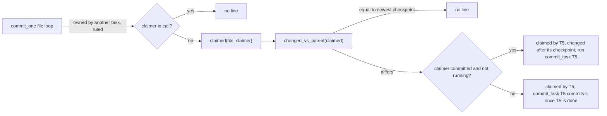
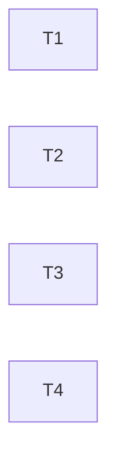

# Superlite: commit_task's claim note only when something is left to do (B73)

**Goal:** fix #419: `commit_task` prints `left uncommitted (claimed by T5): F` for a claimed file (a `--also` or `--claim` ruling) whenever another task commits, even when T5 is in the same call or F is already in T5's checkpoint. Expected: no line in those two cases; otherwise a line that says what to do.
**Architecture:** inside `commit_task.commit_one`, the claimed branch stops printing at once. It collects `{file: claimer}` for claimers outside the call (a claimer in the call commits the file itself, before or after); after the loop, `changed_vs_parent` keeps only files that differ from the newest checkpoint (the checkpoint chain is cumulative), and each prints one of two notes, chosen by whether the claimer is committed and not running.
**Tech stack:** Python 3.10+ stdlib, pytest (through `sl run_tests`).
**Spec:** this file, section Design; issue #419's Expected line.
**Detail:** tests
**Target-min:** 11
**Wave0:** none

Global constraints:
- Every new or changed code line in `skills/subagent-driven-development/scripts/` carries the repo's trailing `# O(...)` complexity comment (short notes after `|`); tests do not. Stdlib only.
- Existing tests stay green. The only existing test files that change are the three named in T1's Notes, each only as stated there. If any other existing test turns red, report it in DONE_WITH_CONCERNS with the test id and the reason instead of editing it.
- Run `sl` as an executable (`<abs>/sl ...`). Verify with the task's own `--fast` command, `--task T1 --background`, then run the printed `wait:` line in the foreground and end the turn only after it reports.
- No version edits (the ship step bumps the version). Touch only the files in Owns; `docs/tools.md` stays unchanged (outside B73's files).

Ruling: a claimed file whose claimer is in this call prints nothing, whatever the order (`T5 T8` or `T8 T5`): the claimer commits it in this call - cost if wrong: a claimer that then fails leaves the file without a claim line (its `Tn FAILED` line still shows).
Ruling: a claimed file equal to the newest checkpoint (`changed_vs_parent` leaves it out) prints nothing: the chain is cumulative, so it is in a checkpoint already - cost if wrong: none.
Ruling: a claimed file that differs prints `left uncommitted (claimed by T5, changed after its checkpoint; run commit_task T5): F` when T5 has a ledger commit line and is not running (busy in pool.json), the #397 owned-note shape; else (T5 not committed yet, or running) `left uncommitted (claimed by T5; commit_task T5 commits it once T5 is done): F` - cost if wrong: one wording change.
Ruling: the three existing tests that pin the old `left uncommitted (claimed by Tn): F` text get the new wording, though they are outside B73's file list: the only other running batch (B74) owns fleet.py - cost if wrong: a one-line rebase conflict.
Ruling: docs/tools.md keeps its `claimed by Tn` text (outside B73's files; test_docs_b72_tools pins it); a follow-up line in notes.md names it - cost if wrong: one stale doc phrase until the follow-up.
Ruling: one task (one source file); no probe adapter (the CLI is tested through subprocess runs in the task's tests) - cost if wrong: no generated probes.
Ruling: already in the lead worktree on branch superlite/b73-commit-task-claim-note - cost if wrong: none.
LAYERS: unit



## Design

1. In `commit_task.commit_one`, `call = getattr(a, "task", [tid])` moves above the file loop (it is read there now).
2. The `elif nt.owns_match(f, other)` branch takes `t2`, the task of the first `ruled` entry with `t2 != tid` and `hit(f, e)` (dict order, as today). No such entry: `theirs.append(f)` as today. `t2 in call`: nothing (no line, not in `theirs`). Else `claimed[f] = t2` (a new dict, empty at the start of `commit_one`). The branch still ends with `continue`.
3. `running = others_running(pool_path, call)` is computed when `theirs or mine or claimed` (today: `theirs or mine`).
4. After the #397 `owned` note block: for each `f` in `changed_vs_parent(list(claimed))` (skipped when `claimed` is empty), `t2 = claimed[f]`; `t2 in done and t2 not in running` prints, through `note_once`, `left uncommitted (claimed by {t2}, changed after its checkpoint; run commit_task {t2}): {f}`; else `left uncommitted (claimed by {t2}; commit_task {t2} commits it once {t2} is done): {f}`. Files equal to the newest checkpoint print nothing. A claimed file never joins `mine`, `theirs`, `out_of_scope` or an incident.
5. The module docstring's scope-check paragraph gains one sentence after the `owned by T2` note: a file another task claims (`--also` or `--claim` ruling) prints nothing when its claimer is in this call or the file equals the newest checkpoint, else one of the two notes in 4.

## Coverage

| Category | State | Basis |
|---|---|---|
| Scope and success criteria | settled | #419 Expected line |
| Domain and data model | n/a | one in-memory dict |
| Persistence and migration | n/a | nothing stored |
| Interfaces and contracts | ruled | two stderr note texts |
| UI states | n/a | CLI text only |
| Concurrency and state ownership | ruled | running claimer from pool.json |
| Error handling and recovery | n/a | no new failure path |
| Security and privacy | n/a | local files |
| Performance and limits | settled | one batched `changed_vs_parent` per task |
| Observability | ruled | note texts |
| Testing strategy | settled | one new test file; three pinned asserts updated |
| Compatibility | ruled | docs row unchanged, follow-up |
| Rollout | ruled | one PR; version bump at ship |
| Research unknowns | n/a | none |

## File structure
- `skills/subagent-driven-development/scripts/commit_task.py`: `commit_one` claimed branch and notes; docstring (T1).
- `tests/scripts/test_commit_claim_note_419.py`: T1's cases below (T1).
- `tests/scripts/test_commit_shared_test.py`, `tests/scripts/test_commit_scope_batch.py`, `tests/scripts/test_commit_notes_397_400.py`: the pinned note text only (T1 Notes).

## Task graph

```mermaid
%% schedule
gantt
  title Predicted schedule (mm:ss)
  dateFormat X
  axisFormat %M:%S
  section lane 1
  T1 commit_task claim note :t1, 0, 82s
```




critical path: T1 (1.4 min) · peak width 1 · predicted build 1.4 min · predicted total ≈ 4.9 min (target ✓)

## Package: commit_task claim note (CLI)
App type: CLI. Categories: protocol (note texts, call membership), state (committed, running, checkpoint content), file (directory claims).
**Probe entry:** none (Ruling: no probe adapter).

### T1 commit_task claim note · Complexity 3 · Est. context 45k
**Owns:** skills/subagent-driven-development/scripts/commit_task.py, tests/scripts/test_commit_claim_note_419.py, tests/scripts/test_commit_shared_test.py, tests/scripts/test_commit_scope_batch.py, tests/scripts/test_commit_notes_397_400.py
**Components:** 1
**LOC owned:** 150
**Tests:** fast
**Model:** sonnet
**Est. time:** 2.5 min (1 component, about 150 LOC, fast tests)
**Covers:** 1, 2, 3, 4, 5
**Consumes:** existing `commit_task.changed_vs_parent(files: list[str]) -> list[str]` · existing `commit_task.others_running(pool_path: str, tids: list[str]) -> list[str]` · existing `commit_task.note_once(a, line: str) -> bool`
**Produces:** commit_task.commit_one(a, tid: str, info: dict, own_files: set) -> tuple
**Review Focus:** protocol: `test_claimer_earlier_in_call_prints_nothing`, `test_claimer_later_in_call_prints_nothing`; state: `test_file_in_claimers_checkpoint_prints_nothing`, `test_claimer_recheckpoint_in_call_prints_nothing`, `test_changed_after_claimers_checkpoint_says_run`, `test_running_claimer_says_once_done`; file: `test_directory_claim_names_the_file`.
**Test code (verbatim):**
````python
"""#419 a claimed file prints no line when its claimer is in the call or the file is in a checkpoint; else the line says what to do."""
import json
import sys
from pathlib import Path

HERE = Path(__file__).resolve().parent
sys.path.insert(0, str(HERE))
from test_autocommit import ENV, git, make_repo, run, write  # noqa: E402

PLAN = """# Plan
**Goal:** x.



### T1 a · Complexity 2 · Est. context 20k
**Owns:** src/a.py

### T2 b · Complexity 2 · Est. context 20k
**Owns:** src/b.py

### T3 c · Complexity 2 · Est. context 20k
**Owns:** src/c.py

### T4 d · Complexity 2 · Est. context 20k
**Owns:** src/d.py
"""
X = "notes/x.md"


def setup(tmp_path):
    repo = make_repo(tmp_path)
    write(repo, "plan.md", PLAN)
    git(repo, "add", "-A")
    git(repo, "commit", "-q", "-m", "plan")
    return repo


def ck(repo, *args):
    return run("commit_task", *args, "--plan", "plan.md", cwd=repo, env=ENV)


def shas(r):
    return dict(ln.split()[:2] for ln in r.stdout.strip().splitlines())


def last_files(repo):
    return json.loads((repo / ".superlite" / "checkpoints.json").read_text(encoding="utf-8"))["entries"][-1]["files"]


def test_claimer_earlier_in_call_prints_nothing(tmp_path):
    repo = setup(tmp_path)
    write(repo, X, "x\n")
    write(repo, "src/a.py", "A = 1\n")
    write(repo, "src/b.py", "B = 1\n")
    r = ck(repo, "T1", "T2", "--also", X, "--ruling", "needed")
    assert r.returncode == 0, r.stdout + r.stderr
    assert "claimed by" not in r.stderr
    assert git(repo, "show", f"{shas(r)['T1']}:{X}") == "x"


def test_claimer_later_in_call_prints_nothing(tmp_path):
    repo = setup(tmp_path)
    assert ck(repo, "T4", "--claim", X, "--ruling", "needed").returncode == 0
    write(repo, X, "x\n")
    write(repo, "src/a.py", "A = 1\n")
    write(repo, "src/d.py", "D = 1\n")
    r = ck(repo, "T1", "T4")
    assert r.returncode == 0, r.stdout + r.stderr
    assert "claimed by" not in r.stderr
    assert git(repo, "show", f"{shas(r)['T4']}:{X}") == "x"


def test_file_in_claimers_checkpoint_prints_nothing(tmp_path):
    repo = setup(tmp_path)
    write(repo, X, "x\n")
    write(repo, "src/a.py", "A = 1\n")
    assert ck(repo, "T1", "--also", X, "--ruling", "needed").returncode == 0
    write(repo, "src/b.py", "B = 1\n")
    r = ck(repo, "T2")
    assert r.returncode == 0, r.stdout + r.stderr
    assert "claimed by" not in r.stderr
    assert last_files(repo) == ["src/b.py"]


def test_claimer_recheckpoint_in_call_prints_nothing(tmp_path):
    repo = setup(tmp_path)
    write(repo, X, "x\n")
    write(repo, "src/a.py", "A = 1\n")
    assert ck(repo, "T1", "--also", X, "--ruling", "needed").returncode == 0
    write(repo, X, "x2\n")
    write(repo, "src/a.py", "A = 2\n")
    write(repo, "src/b.py", "B = 1\n")
    r = ck(repo, "T1", "T2")
    assert r.returncode == 0, r.stdout + r.stderr
    assert "claimed by" not in r.stderr
    assert git(repo, "show", f"{shas(r)['T1']}:{X}") == "x2"


def test_changed_after_claimers_checkpoint_says_run(tmp_path):
    repo = setup(tmp_path)
    write(repo, X, "x\n")
    write(repo, "src/a.py", "A = 1\n")
    assert ck(repo, "T1", "--also", X, "--ruling", "needed").returncode == 0
    write(repo, X, "x2\n")
    write(repo, "src/b.py", "B = 1\n")
    r = ck(repo, "T2")
    assert r.returncode == 0, r.stdout + r.stderr
    assert f"left uncommitted (claimed by T1, changed after its checkpoint; run commit_task T1): {X}" in r.stderr
    assert r.stderr.count("claimed by") == 1
    assert last_files(repo) == ["src/b.py"]


def test_uncommitted_claimer_says_once_done(tmp_path):
    repo = setup(tmp_path)
    assert ck(repo, "T4", "--claim", X, "--ruling", "needed").returncode == 0
    write(repo, X, "x\n")
    write(repo, "src/a.py", "A = 1\n")
    r = ck(repo, "T1")
    assert r.returncode == 0, r.stdout + r.stderr
    assert f"left uncommitted (claimed by T4; commit_task T4 commits it once T4 is done): {X}" in r.stderr
    assert last_files(repo) == ["src/a.py"]


def test_running_claimer_says_once_done(tmp_path):
    repo = setup(tmp_path)
    write(repo, X, "x\n")
    write(repo, "src/a.py", "A = 1\n")
    assert ck(repo, "T1", "--also", X, "--ruling", "needed").returncode == 0
    (repo / ".superlite" / "pool.json").write_text(json.dumps({"agents": [{"busy": True, "current": "T1"}]}), encoding="utf-8")
    write(repo, X, "x2\n")
    write(repo, "src/b.py", "B = 1\n")
    r = ck(repo, "T2")
    assert r.returncode == 0, r.stdout + r.stderr
    assert f"left uncommitted (claimed by T1; commit_task T1 commits it once T1 is done): {X}" in r.stderr
    assert "changed after" not in r.stderr


def test_directory_claim_names_the_file(tmp_path):
    repo = setup(tmp_path)
    assert ck(repo, "T4", "--claim", "notes/", "--ruling", "needed").returncode == 0
    write(repo, "notes/y.md", "y\n")
    write(repo, "src/a.py", "A = 1\n")
    r = ck(repo, "T1")
    assert r.returncode == 0, r.stdout + r.stderr
    assert "left uncommitted (claimed by T4; commit_task T4 commits it once T4 is done): notes/y.md" in r.stderr
    assert last_files(repo) == ["src/a.py"]
````
**Steps:** 1 write the test file, 2 run: FAIL (keep the summary line for `Red run:`), 3 implement Design 1-5, 4 update the three pinned asserts, 5 run: PASS
**Notes:** the three pinned asserts, each changed only as stated: `tests/scripts/test_commit_shared_test.py` (`test_claimed_test_not_swept_as_shared`) `f"left uncommitted (claimed by T3): {SHARED}"` becomes `f"left uncommitted (claimed by T3; commit_task T3 commits it once T3 is done): {SHARED}"`; `tests/scripts/test_commit_scope_batch.py` (`test_claimed_file_left_uncommitted`) `"left uncommitted (claimed by T5): x.md"` becomes `"left uncommitted (claimed by T5; commit_task T5 commits it once T5 is done): x.md"`; `tests/scripts/test_commit_notes_397_400.py` (`test_claimed_line_once_per_call`) `"left uncommitted (claimed by T4): notes/x.md"` becomes `"left uncommitted (claimed by T4; commit_task T4 commits it once T4 is done): notes/x.md"`. Verify: `<abs sl> run_tests --fast tests/scripts/test_commit_claim_note_419.py tests/scripts/test_commit_shared_test.py tests/scripts/test_commit_scope_batch.py tests/scripts/test_commit_notes_397_400.py --task T1 --background`.

## Review Focus
CLI, protocol/state/file: the cases in T1. App-specific risk: a claimer that is both committed and running again (a fix round) gets the `once done` line, never `run commit_task`.

## Self-review
Coverage: Design 1-5 in T1. No placeholders. One task, no edges. Fields filled. Probe entry none with a ruling.
