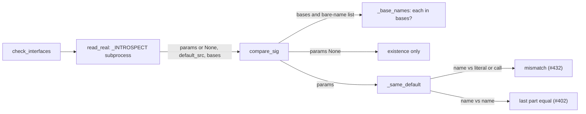

# Superlite: `pt_review contract` reports a name default against a literal or a call, and checks exception classes by base (B69)

**Goal:** fix #432 and #415 in `pt_review contract`. #432: a planned name default (`tid=TID`) whose code default is a literal (`tid=None`) or a call (`tid=re.compile("T")`) is skipped today; it must be a mismatch, while name against name keeps matching by name. #415: a Produces item `module.Name(Exception)` whose class has no `__init__` of its own logs `ValueError: no signature found for builtin type` as an open incident; such a class must be checked by existence and base class only.
**Architecture:** host side, `pt_review._same_default` gains the literal-or-call rule through a new helper `_literal_or_call`. Subprocess side, `pt_review._INTROSPECT` reports `bases` (the class's MRO names) for every class and `params: None` when the class has no readable signature; host side, `compare_sig` reads a bare-name argument list as a base list (`_base_names`) and checks it against `bases`.
**Tech stack:** Python 3.10+ stdlib, pytest (through `sl run_tests`).
**Spec:** this file, section Design; issues #432 and #415 (Expected lines).
**Detail:** tests
**Target-min:** 11
**Wave0:** none
**Max chars:** 26000

Global constraints:
- Every code line in `skills/subagent-driven-development/scripts/` outside string literals carries the repo's trailing `# O(...)` complexity comment (short notes after `|`); tests do not. Lines inside the `_INTROSPECT` string carry none. Stdlib only.
- Touch only the files in Owns. Existing tests stay green; the only existing test file that changes is `tests/scripts/test_pt_review_constant_default_402.py` (T1, exactly the edits in T1's Notes). Any other existing test turning red: report it in DONE_WITH_CONCERNS with the test id and the reason, never edit it.
- Run `sl` as an executable (`<abs>/sl ...`). Verify with `<abs>/sl run_tests --fast <own new test file> tests/scripts/test_pt_review_constant_default_402.py tests/scripts/test_pt_review.py tests/scripts/test_pt_review_owned_decl_383.py tests/scripts/test_pt_review_declarations.py tests/scripts/test_pt_review_noise.py tests/scripts/test_pt_review_noise_batch.py tests/scripts/test_pt_review_pix_v2.py tests/scripts/test_pt_review_ts_methods.py tests/scripts/test_0_3_1_scripts.py --task Tn --background`, then run the printed `wait:` line in the foreground and end the turn only after it reports. Never raw `pytest`, never the e2e or eval layers (coordinator's step).
- No version edits (the ship step bumps the version).

Ruling: #432: a non-literal planned default that is a plain or dotted name is a mismatch when the code's default source is a literal (`ast.literal_eval` succeeds: `None`, `-1`, `'x'`, `()`, `set()`) or a call; name against name keeps #402's last-component match; any other code expression (`LIMIT + 1`, `x[0]`, `lambda: 0`) and an unreadable source stay skipped - cost if wrong: a plan naming a constant whose code writes the same value literally (`port=PORT` vs `port=8080`, `PORT = 8080`) is reported; the fix is one spelling in plan or code.
Ruling: no value lookup of the planned name in the module (`repr(module.PORT) == real_repr`): #432 asks for the spelling rule, and a lookup needs the name's module - cost if wrong: the PORT case above stays a report.
Ruling: #432 reverses three #402 expectations (`("TID", "None", "None", True)`, `("TID", "re.compile('x')", "id_re()", True)`, `test_planned_name_for_literal_source_is_skipped`); T1 edits them in `tests/scripts/test_pt_review_constant_default_402.py`, outside the brief's file list, because no other batch owns pt_review's default rule - cost if wrong: a rebase conflict in that test file at ship.
Ruling: #415: a class whose `inspect.signature` raises `ValueError` reports `ok: True, params: None` plus its `bases`; a planned bare-name list (`(Exception)`, `(KeyError, Mixin)`) is a base list and each name must be in the class's MRO names (indirect bases count); a planned constructor signature against such a class is checked by existence only - cost if wrong: `Store(path: str)` against `class Store(dict): pass` reports nothing.
Ruling: a class that has its own `__init__` and a planned bare-name list whose names are all in its MRO matches as a base list too (no parameter compare), so `CodedError(ValueError)` with `__init__(self, msg)` logs nothing; a bare-name list with any name outside the MRO (`Plain(path)`) keeps the parameter compare - cost if wrong: a class planned by base list never has its constructor checked.
Ruling: a dotted base (`Name(errors.Base)`) stays unparsed by `parse_sig` and unchecked, as today - cost if wrong: no check for that spelling; follow-up if it shows up.
Ruling: two tasks chained `T1 --> T2` because both edit `pt_review.py`; detail tests; no probe adapter (library inside a CLI; Review Focus cases are named pytest cases) - cost if wrong: about 2 min of serial build time.
Ruling: already in the lead worktree on branch superlite/b69-contract-check-defaults-and-exceptio - cost if wrong: none.
LAYERS: unit



## Design

1. `_literal_or_call(src: str | None) -> bool`: `False` for `None`, an empty string or a `SyntaxError`; parses `src.strip()` with `mode="eval"`; `True` when the body is an `ast.Call`, or when `ast.literal_eval` of the stripped text succeeds; it catches `ValueError`, `SyntaxError`, `TypeError`, `MemoryError` and `RecursionError` from `literal_eval` and returns `False` then.
2. `_same_default(planned, real_repr, real_src=None)`: the literal planned branch is unchanged. Otherwise `pn = _dotted(planned)`; when `pn` is a list and `_dotted(real_src)` is a list, return `pn[-1] == rn[-1]` (unchanged); when `pn` is a list and `_literal_or_call(real_src)`, return `False`; else `True` (skipped). `compare_sig`'s mismatch line already shows the code's source for a name planned default (`parameter 'tid' default is None, planned TID`).
3. `_INTROSPECT`: `bases = [c.__name__ for c in inspect.getmro(obj)[1:]] if inspect.isclass(obj) else None`. `inspect.signature(obj)` raising `ValueError` on a class gives `r = {"ok": True, "params": None, "returns": None, "bases": bases, "file": None, "line": 0}` (no `default_srcs`, no self strip); a non-class still raises into the existing error path. The signature branch adds `"bases": bases` to its dict. The `getsourcefile`/`getsourcelines` block runs for both.
4. `_base_names(args_src: str) -> list[str] | None`: `_params_from_src(args_src)`; `None` when it is empty or any param is not `POSITIONAL_OR_KEYWORD`, has a default or has an annotation; else the names in order.
5. `compare_sig`, after the `declared` check: when `real.get("bases") is not None` and `p.args_src is not None` and `_base_names(p.args_src)` gives names, and either `real.get("params") is None` or every name is in `bases`: return one message per name not in `bases`, `{qual}: base class '{n}' not in its bases ({', '.join(bases)})` (empty list = match). Then, when `real.get("params") is None`, return `[]` (existence only). Everything after is unchanged.
6. The module docstring's Produces lines: T1 rewrites the default line to say a default naming a constant (`tid=TID`) must be a name in the code too (a literal or a call there is a mismatch) and any other non-literal default is not compared; T2 adds one line: a class item `pkg.errors.ParseError(Exception)` lists its bases, checked against the class's MRO; a class without a signature of its own is checked by existence and bases only.

## Coverage

| Category | State | Basis |
|---|---|---|
| Scope and success criteria | settled | #432 and #415 Expected lines |
| Domain and data model | ruled | real dicts gain `bases`; `params` may be `None` |
| Persistence and migration | n/a | no stored data |
| Interfaces and contracts | ruled | `_same_default` signature unchanged; new private helpers |
| UI states | n/a | CLI text only |
| Concurrency and state ownership | n/a | one subprocess, unchanged |
| Error handling and recovery | ruled | unreadable source and unknown expressions stay skipped |
| Security and privacy | n/a | reads the project's own source |
| Performance and limits | settled | one `getmro` per class item |
| Observability | settled | mismatch lines name the code's default and the real bases |
| Testing strategy | settled | two new test files, real introspection on a tmp project |
| Compatibility | ruled | three #402 expectations reversed by #432 |
| Rollout | ruled | one PR; version bump at ship |
| Research unknowns | n/a | both reproduced from the code |

## File structure
- `skills/subagent-driven-development/scripts/pt_review.py`: `_literal_or_call`, `_same_default`, docstring default line (T1); `_INTROSPECT` bases, `_base_names`, `compare_sig`, docstring class line (T2).
- `tests/scripts/test_pt_review_name_default_432.py`: #432 cases (T1).
- `tests/scripts/test_pt_review_constant_default_402.py`: three reversed expectations (T1).
- `tests/scripts/test_pt_review_exception_class_415.py`: #415 cases (T2).

## Task graph


critical path: T1 → T2 (2.8 min) · peak width 1 · predicted build 2.8 min · predicted total ≈ 6.3 min (target ✓)

## Package: pt_review contract (library inside a CLI)
App type: library. Categories: deep (MRO chains, keyword-only and method defaults), encoding (`ast.unparse` text of defaults), state (literal and name-vs-name paths unchanged).
**Probe entry:** none (Ruling: no probe adapter).

### T1 name defaults vs literal or call · Complexity 3 · Est. context 40k
**Owns:** skills/subagent-driven-development/scripts/pt_review.py, tests/scripts/test_pt_review_name_default_432.py, tests/scripts/test_pt_review_constant_default_402.py
**Components:** 1
**LOC owned:** 110
**Tests:** fast
**Model:** sonnet
**Est. time:** 2 min (1 component, about 110 LOC, fast tests)
**Covers:** 1, 2, 6
**Consumes:** existing `pt_review.check_interfaces(plan, root, task_ids)` · existing `pt_review.parse_plan(path)` · existing `pt_review._dotted(expr)`
**Produces:** pt_review._literal_or_call(src: str | None) -> bool · pt_review._same_default(planned: str, real_repr: str | None, real_src: str | None = None) -> bool
**Review Focus:** deep: `test_keyword_only_and_method_none_defaults_are_mismatches`; encoding: `test_call_default_is_a_mismatch`; state: `test_name_default_still_matches_by_name`, `test_other_expression_is_skipped`.
**Test code (verbatim):**
```python
"""#432: a planned name default is a mismatch when the code's default is a literal or a call."""
from __future__ import annotations

import importlib.util
import sys
from pathlib import Path

import pytest

HERE = Path(__file__).resolve().parent
SCRIPT = HERE.parent.parent / "skills" / "subagent-driven-development" / "scripts" / "pt_review.py"

_spec = importlib.util.spec_from_file_location("pt_review", SCRIPT)
pt_review = importlib.util.module_from_spec(_spec)
sys.modules["pt_review"] = pt_review
_spec.loader.exec_module(pt_review)

CORE = '''\
import re

TID = re.compile("T")
LIMIT = 10


def none_default(text: str, tid=None) -> list:
    return []


def call_default(text: str, tid=re.compile("T")) -> list:
    return []


def name_default(text: str, tid=TID) -> list:
    return []


def neg_default(n: int = -1) -> int:
    return n


def kw_none(text: str, *, tid=None) -> list:
    return []


def expr_default(n: int = LIMIT + 1) -> int:
    return n


class Box:
    def put(self, x: int, tid=None) -> None:
        return None
'''


def check(root: Path, produces: str) -> tuple[list[str], int]:
    (root / "src" / "pkg").mkdir(parents=True)
    (root / "src" / "pkg" / "__init__.py").write_text("", encoding="utf-8")
    (root / "src" / "pkg" / "core.py").write_text(CORE, encoding="utf-8")
    (root / "plan.md").write_text(
        "# p\n\n```mermaid\nflowchart LR\n%% taskgraph\nT1\n```\n\n"
        f"### T1 core · Complexity 3\n**Owns:** src/pkg/core.py\n**Produces:** {produces}\n\n"
        "## Review Focus\n- core: state\n", encoding="utf-8")
    out, n = pt_review.check_interfaces(pt_review.parse_plan(root / "plan.md"), root, None)
    return [m.msg for m in out], n


@pytest.mark.parametrize("src, hit", [
    ("None", True), ("-1", True), ("'x'", True), ("(1, 2)", True), ("[]", True), ("{}", True),
    ("set()", True), ("re.compile('T')", True), ("id_re()", True),
    ("TID", False), ("a.b", False), ("LIMIT + 1", False), ("x[0]", False), ("lambda: 0", False),
    ("{[]}", False), ("", False), (None, False), ("(", False),
])
def test_literal_or_call(src, hit):
    assert pt_review._literal_or_call(src) is hit


@pytest.mark.parametrize("planned, real_repr, real_src, same", [
    ("TID", "None", "None", False),
    ("TID", "re.compile('T')", "re.compile('T')", False),
    ("TID", "re.compile('x')", "id_re()", False),
    ("metrics.TID", "8080", "8080", False),
    ("TID", "-1", "-1", False),
    ("TID", "'x'", "'x'", False),
    ("TID", "()", "()", False),
    ("TID", "re.compile('x')", "TID", True),
    ("TID", "re.compile('x')", "metrics.TID", True),
    ("TID", "re.compile('x')", "OTHER", False),
    ("TID", "11", "LIMIT + 1", True),
    ("TID", "re.compile('x')", "x[0]", True),
    ("TID", "re.compile('x')", None, True),
    ("TID", "re.compile('x')", "", True),
    ("Path('.')", "PosixPath('.')", "None", True),
    ("0", "8080", "8080", False),
    ("0", "0", "ZERO", True),
])
def test_same_default(planned, real_repr, real_src, same):
    assert pt_review._same_default(planned, real_repr, real_src) is same


def test_none_default_is_a_mismatch(tmp_path):
    msgs, _n = check(tmp_path, "pkg.core.none_default(text: str, tid=TID) -> list")
    assert len(msgs) == 1
    assert msgs[0].endswith("pkg.core.none_default: parameter 'tid' default is None, planned TID")


def test_call_default_is_a_mismatch(tmp_path):
    msgs, _n = check(tmp_path, "pkg.core.call_default(text: str, tid=TID) -> list")
    assert len(msgs) == 1
    assert msgs[0].endswith("parameter 'tid' default is re.compile('T'), planned TID")


def test_keyword_only_and_method_none_defaults_are_mismatches(tmp_path):
    msgs, n = check(tmp_path, "pkg.core.kw_none(text: str, *, tid=TID) -> list · pkg.core.Box.put(x: int, tid=TID) -> None")
    assert n == 2
    assert len(msgs) == 2
    assert all(m.endswith("parameter 'tid' default is None, planned TID") for m in msgs)


def test_negative_literal_default_is_a_mismatch(tmp_path):
    msgs, _n = check(tmp_path, "pkg.core.neg_default(n: int = LIMIT) -> int")
    assert len(msgs) == 1
    assert msgs[0].endswith("parameter 'n' default is -1, planned LIMIT")


def test_dotted_planned_name_against_none_is_a_mismatch(tmp_path):
    msgs, _n = check(tmp_path, "pkg.core.none_default(text: str, tid=core.TID) -> list")
    assert len(msgs) == 1
    assert msgs[0].endswith("parameter 'tid' default is None, planned core.TID")


def test_name_default_still_matches_by_name(tmp_path):
    assert check(tmp_path, "pkg.core.name_default(text: str, tid=TID) -> list") == ([], 1)


def test_other_expression_is_skipped(tmp_path):
    assert check(tmp_path, "pkg.core.expr_default(n: int = LIMIT) -> int") == ([], 1)
```
**Steps:** 1 failing tests, 2 run: FAIL, 3 implement Design 1, 2 and the T1 half of 6, apply the #402 edits in Notes, 4 run: PASS (verify files of Global constraints).
**Notes:** edits to `tests/scripts/test_pt_review_constant_default_402.py`, nothing else in it: in `test_same_default`'s table `("TID", "re.compile('x')", "id_re()", True)` and `("TID", "None", "None", True)` end in `False`; `test_planned_name_for_literal_source_is_skipped` becomes `test_planned_name_for_literal_source_is_a_mismatch`: `msgs, _n = check(tmp_path, "pkg.core.serve(port: int = PORT) -> None")`, `assert len(msgs) == 1`, `assert msgs[0].endswith("parameter 'port' default is 8080, planned PORT")`; the module docstring reads `"""#402: a Produces default that names a module constant matches by name; #432: a literal or a call in the code is a mismatch."""`.

### T2 builtin-signature classes by bases · Complexity 4 · Est. context 45k
**Owns:** skills/subagent-driven-development/scripts/pt_review.py, tests/scripts/test_pt_review_exception_class_415.py
**Components:** 2
**LOC owned:** 140
**Tests:** fast
**Model:** sonnet
**Est. time:** 2.5 min (2 components, about 140 LOC, fast tests)
**Covers:** 3, 4, 5, 6
**Consumes:** existing `pt_review.check_interfaces(plan, root, task_ids)` · existing `pt_review.read_real(root, located)` · existing `pt_review.parse_plan(path)` · existing `pt_review._params_from_src(args_src)`
**Produces:** pt_review._base_names(args_src: str) -> list[str] | None · pt_review.compare_sig(p: Planned, real: dict) -> list[str]
**Review Focus:** deep: `test_indirect_base_matches`, `test_read_real_reports_bases`; state: `test_constructor_signature_still_compared`, `test_plain_class_constructor_unchanged`; protocol: `test_missing_class_still_reported`.
**Test code (verbatim):**
```python
"""#415: a class with no signature of its own (an exception subclass) is checked by existence and base class."""
from __future__ import annotations

import importlib.util
import sys
from pathlib import Path

import pytest

HERE = Path(__file__).resolve().parent
SCRIPT = HERE.parent.parent / "skills" / "subagent-driven-development" / "scripts" / "pt_review.py"

_spec = importlib.util.spec_from_file_location("pt_review", SCRIPT)
pt_review = importlib.util.module_from_spec(_spec)
sys.modules["pt_review"] = pt_review
_spec.loader.exec_module(pt_review)

ERRORS = '''\
class ParseError(Exception):
    pass


class LookupFailed(KeyError):
    """No __init__ of its own."""


class CodedError(ValueError):
    def __init__(self, msg: str, code: int = 1) -> None:
        super().__init__(msg)
        self.code = code


class Store(dict):
    pass


class Plain:
    def __init__(self, path: str) -> None:
        self.path = path


def boom(n: int) -> None:
    raise ParseError(n)
'''


def project(root: Path) -> Path:
    (root / "src" / "pkg").mkdir(parents=True)
    (root / "src" / "pkg" / "__init__.py").write_text("", encoding="utf-8")
    (root / "src" / "pkg" / "errors.py").write_text(ERRORS, encoding="utf-8")
    return root


def check(root: Path, produces: str) -> tuple[list[str], int]:
    project(root)
    (root / "plan.md").write_text(
        "# p\n\n```mermaid\nflowchart LR\n%% taskgraph\nT1\n```\n\n"
        f"### T1 errors · Complexity 3\n**Owns:** src/pkg/errors.py\n**Produces:** {produces}\n\n"
        "## Review Focus\n- errors: state\n", encoding="utf-8")
    out, n = pt_review.check_interfaces(pt_review.parse_plan(root / "plan.md"), root, None)
    return [m.msg for m in out], n


@pytest.mark.parametrize("args_src, names", [
    ("Exception", ["Exception"]),
    ("KeyError, Mixin", ["KeyError", "Mixin"]),
    ("path: str", None),
    ("x=1", None),
    ("*a", None),
    ("a, /", None),
    ("*, a", None),
    ("", None),
])
def test_base_names(args_src, names):
    assert pt_review._base_names(args_src) == names


def test_exception_class_without_init_matches_its_base(tmp_path):
    assert check(tmp_path, "pkg.errors.ParseError(Exception)") == ([], 1)


def test_indirect_base_matches(tmp_path):
    assert check(tmp_path, "pkg.errors.LookupFailed(LookupError)") == ([], 1)


def test_several_exception_classes_log_nothing(tmp_path):
    produces = "pkg.errors.ParseError(Exception) · pkg.errors.LookupFailed(KeyError) · pkg.errors.CodedError(ValueError)"
    assert check(tmp_path, produces) == ([], 3)


def test_wrong_base_is_a_mismatch(tmp_path):
    msgs, _n = check(tmp_path, "pkg.errors.ParseError(ValueError)")
    assert msgs == ["T1 Produces: pkg.errors.ParseError: base class 'ValueError' not in its bases "
                    "(Exception, BaseException, object)"]


def test_no_signature_error_is_gone(tmp_path):
    msgs, _n = check(tmp_path, "pkg.errors.ParseError(Exception) · pkg.errors.Store(path: str)")
    assert not any("no signature found" in m for m in msgs)
    assert msgs == []


def test_missing_class_still_reported(tmp_path):
    msgs, _n = check(tmp_path, "pkg.errors.Missing(Exception)")
    assert msgs == ["T1 Produces: pkg.errors.Missing: AttributeError: Missing not found in pkg.errors"]


def test_constructor_signature_still_compared(tmp_path):
    msgs, _n = check(tmp_path, "pkg.errors.CodedError(msg: str, code: int = 2)")
    assert len(msgs) == 1
    assert msgs[0].endswith("parameter 'code' default is 1, planned 2")


def test_plain_class_constructor_unchanged(tmp_path):
    assert check(tmp_path, "pkg.errors.Plain(path: str) · pkg.errors.Plain(path)") == ([], 2)


def test_read_real_reports_bases(tmp_path):
    project(tmp_path)
    got = pt_review.read_real(tmp_path, [("pkg.errors", ["ParseError"]), ("pkg.errors", ["Plain"]),
                                         ("pkg.errors", ["boom"])])
    assert got[0]["ok"] is True
    assert got[0]["params"] is None
    assert got[0]["bases"] == ["Exception", "BaseException", "object"]
    assert got[0]["file"].endswith("errors.py")
    assert got[1]["bases"] == ["object"]
    assert [p["name"] for p in got[1]["params"]] == ["path"]
    assert got[2]["bases"] is None
```
**Steps:** 1 failing tests, 2 run: FAIL, 3 implement Design 3, 4, 5 and the T2 half of 6, 4 run: PASS (verify files of Global constraints).
**Notes:** `_INTROSPECT` is a string run in the project's interpreter: no f-strings, no `# O(...)` comments in it, keep its `%` formatting style. `compare_sig` keeps its signature; only the two new early returns are added after the `declared` check.

## Review Focus
Package pt_review contract: deep (MRO chains, keyword-only and method defaults), encoding (`ast.unparse` text shown in mismatch lines), state (literal planned defaults, name against name and constructor compares unchanged), protocol (a missing class keeps its AttributeError line). T1 holds the default cases, T2 the class cases.

## Self-review
- #432 (`tid=TID` vs `tid=None` or a call skipped): Design 1, 2; `test_none_default_is_a_mismatch`, `test_call_default_is_a_mismatch`; #402 expectations reversed in T1 Notes.
- #415 (`no signature found for builtin type` per exception class): Design 3 to 5; `test_several_exception_classes_log_nothing`, `test_no_signature_error_is_gone`.
- Two tasks on one file, chained; no stub, no Consumes between them.
