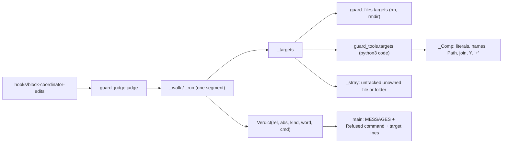
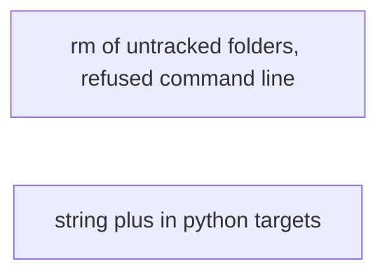

# Superlite: coordinator guard passes scratch concatenation and rm of untracked folders (B79)

**Goal:** fix #362 and #421 in the coordinator guard. #362: a Python write target built with a string `+` (`out+'prev-brief-'+d+'.md'`, `out` an absolute scratch folder) is an unknown target today, so a scratch write outside the project blocks. #421: `rm -r` / `rmdir` of an untracked folder that no task owns blocks, and the block does not say which of the chained commands it refused.
**Architecture:** `guard_tools._Comp` (the Python path-expression composer) learns string `+` concatenation, below `/` in precedence. `guard_judge._stray` also passes a folder that holds only untracked, unowned single-link files (for `rm`/`rmdir`), and every block names the innermost command it came from in a new `Refused command:` line.
**Tech stack:** Python 3.10+ stdlib, pytest (through `sl run_tests`).
**Spec:** this file, section Design; issues #362 and #421 (their Expected lines).
**Detail:** tests
**Target-min:** 11
**Wave0:** none
**Max chars:** 26000

Global constraints:
- Every new or changed code line in `skills/subagent-driven-development/scripts/guard_judge.py` and `guard_tools.py` carries the repo's trailing `# O(...)` complexity comment (`# O(1)`, `# O(len(s))`, ...); tests do not. Stdlib only. Keep the module docstrings' style.
- Existing tests stay green, except the one assertion each task's Notes name. If another existing test turns red, report it in DONE_WITH_CONCERNS with the test id and the reason instead of editing it.
- Run `sl` as an executable (`<abs>/sl ...`). Verify with the task's own `run_tests --fast ... --task Tn --background` line, then run the printed `wait:` line in the foreground and end the turn only after it reports.
- No version edits (the ship step bumps the version). Touch only the files in Owns. `hooks/block-coordinator-edits`, `guard_files.py`, `guard_lex.py` and every docs file stay unchanged. The block message wording in `MESSAGES` stays unchanged (two tests and the hook pin it).

Ruling: B79 also edits `skills/subagent-driven-development/scripts/guard_tools.py`, outside its brief's file list, because #362's sighting (`out+'prev-brief-'+...`) needs `+` in its composer and no planned or running batch lists that file (backlog.json checked) - cost if wrong: a merge conflict in `_Comp` only.
Ruling: #362's second sighting really ran its heredoc script (`python3 -I $S/pre.py`), whose targets come from `tempfile.mkdtemp()`; that run stays judged and blocked. The issue's expectation (a heredoc written outside the project and not run passes) already holds on 1.5.83 and gets a regression test; tempfile support is a follow-up - cost if wrong: such test scripts keep needing the Write tool first.
Ruling: a folder passes `rm`/`rmdir` only when it is a real folder whose entries are all folders or single-link regular files (no symlink, no `.git`, `.superlite` or run-file name, at most 2000 entries), git tracks nothing in it, and no task Owns it, a folder above it, or anything below it (any glob whose literal prefix overlaps) - cost if wrong: a rare false block on a big or linked scratch folder.
Ruling: every block prints `Refused command: <the innermost segment> (none of this Bash call ran; run its other commands again without it)` right after the policy lines, so the last lines (`Absolute target`/`Blocked target`, `Unresolved word`/`Blocked command`) stay as they are - cost if wrong: one more stderr line.
Ruling: `test_judge_housekeeping.py::test_rm_blocks_on_any_doubt` asserted `rm -r src/tmpdir` (a folder of one untracked, unowned file) blocks; #421 asks for the opposite, so T1 moves that one case to a pass assertion. `test_guard_scratch_script.py::test_composed_path_not_literal_blocked` case `'docs/plans/' + sys.argv[1]` with `src/a.py` now composes to `docs/plans/src/a.py` (allowed by policy), so T2 changes that one case to `'docs/plans/../../' + sys.argv[1]` (composes to `src/a.py`, still blocked) - cost if wrong: none, both files are only these tasks' tests.
Ruling: detail tests; two independent tasks (different modules, no edge); no probe adapter (the guard is tested in-process and through the hook) - cost if wrong: no generated probes.
Ruling: already in the lead worktree on branch superlite/b79-coordinator-guard-scratch-and-rm - cost if wrong: none.
LAYERS: unit



## Design

1. `guard_tools._Comp.expr()` returns the values of a sum: one or more `_Comp.prod()` results joined by a string `+` (a `+` not followed by `=`); each `x + y` is plain concatenation (no separator), capped at 64 values like `/`. `_Comp.prod()` is today's `expr()` body (terms joined by `/`, `//` excluded), so `/` binds tighter than `+` as in Python. An unknown piece (`_UNK`) stays where it is, so `_final` turns `'/tmp/s/b-' + <unknown> + '.md'` into `/tmp/s/?` and a relative or unknown prefix into `?`, as today for f-strings.
2. `guard_judge.Verdict` gains `cmd: str = field(default="", compare=False)`: the command (segment text) the verdict came from.
3. `guard_judge._seg_text(seg) -> str`: the segment's words joined by spaces, then each redirect whose op is in `WRITE_REDIRECTS` as `op target`.
4. Today's `_run` body becomes `_run_seg(c, st, ctx, depth)`; the new `_run` calls it and, for a verdict without `cmd`, returns `replace(v, cmd=_seg_text(c.seg))`, so the innermost segment wins (`bash -c 'rm -r src'` names `rm -r src`).
5. `guard_judge.REFUSED = "Refused command: {} (none of this Bash call ran; run its other commands again without it)"`. `main` prints `REFUSED.format(_flat(v.cmd, 300))` right after the `MESSAGES[v.kind]` lines when `v.cmd` is not empty, for every kind.
6. `guard_judge.MAX_TREE = 2000`. `_tree_ok(top) -> bool`: walks folder `top` with `os.scandir` (no symlink followed), counting entries; False when the count passes `MAX_TREE` or an entry is a symlink, is named `.git` or `.superlite`, has a name in `NAMES` (case-insensitive), or is neither a folder nor a regular file with `st_nlink == 1`; any OSError is False.
7. `guard_judge._owns_within(rel, owns) -> bool`: True when `next_tasks.owns_match(rel, owns)` (the folder or a folder above it), or an entry without `*` lies below (`o.rstrip("/")` starts with `rel + "/"`), or an entry with `*` has a literal prefix `lit = o.split("*", 1)[0]` with `(rel + "/").startswith(lit)` or `lit.startswith(rel + "/")`.
8. `guard_judge._stray(v, ctx, folders=False) -> bool`: as today for a regular file. With `folders`, a target whose `lstat` is a folder passes the type check when `_tree_ok(v.abs)`; git must track nothing in it (`git ls-files --error-unmatch -- <name>` exits 1, the same call as for a file), and no task of the stable plan has `_owns_within(rel, t.owns)`. Any exception or doubt is False.
9. `_targets`: the housekeeping skip applies to `base in ("rm", "rmdir", "unlink")` with `_stray(v, ctx, folders=base != "unlink")`; the other conditions (`one`, `v.kind == "code"`, `not flag`) stay.

## Coverage

| Category | State | Basis |
|---|---|---|
| Scope and success criteria | settled | #362 and #421 Expected lines; two sightings each |
| Domain and data model | ruled | `Verdict.cmd`; folder rule (Design 6-8) |
| Persistence and migration | n/a | no stored state changes |
| Interfaces and contracts | ruled | `judge()` signature unchanged; one new stderr line |
| UI states | n/a | stderr text only |
| Concurrency and state ownership | n/a | one judge call per hook run |
| Error handling and recovery | settled | any doubt blocks, as `_stray` today |
| Security and privacy | ruled | folder rule refuses links, nested repos, run files, owned paths |
| Performance and limits | ruled | `MAX_TREE` 2000 entries; judge budget unchanged |
| Observability | ruled | `Refused command:` line; incident row unchanged |
| Testing strategy | settled | two new test files; one case each in two existing files |
| Compatibility | ruled | last stderr lines unchanged; MESSAGES wording unchanged |
| Rollout | ruled | one PR; version bump at ship |
| Research unknowns | n/a | reproduced on 1.5.83 |

## File structure
- `skills/subagent-driven-development/scripts/guard_judge.py`: `Verdict.cmd`, `_seg_text`, `_run`/`_run_seg`, `REFUSED`, `MAX_TREE`, `_tree_ok`, `_owns_within`, `_stray`, `_targets`, `main` (T1).
- `tests/scripts/test_guard_rm_dir_421.py`: T1's cases. `tests/scripts/test_judge_housekeeping.py`: one case (T1).
- `skills/subagent-driven-development/scripts/guard_tools.py`: `_Comp.expr`, `_Comp.prod` (T2).
- `tests/scripts/test_guard_concat_362.py`: T2's cases. `tests/scripts/test_guard_scratch_script.py`: one case (T2).

## Task graph



critical path: T1 (1.7 min) · peak width 2 · predicted build 1.7 min · predicted total ≈ 5.2 min (target ✓)

## Package: coordinator guard (library + hook)
App type: library (a policy judge over shell and Python text). Categories: file (folders, links, nested repos, owned paths), state (the shell's directory, ownership from the stable plan), deep (nested `bash -c`, heredoc programs), encoding (stderr lines).
**Probe entry:** none (Ruling: no probe adapter).

### T1 rm of untracked folders, refused command line · Complexity 5 · Est. context 46k
**Owns:** skills/subagent-driven-development/scripts/guard_judge.py, tests/scripts/test_guard_rm_dir_421.py, tests/scripts/test_judge_housekeeping.py
**Components:** 2
**LOC owned:** 210
**Tests:** fast
**Model:** sonnet
**Est. time:** 3.5 min (2 components, about 210 LOC, fast tests)
**Covers:** 2, 3, 4, 5, 6, 7, 8, 9
**Consumes:** existing `next_tasks.owns_match(path: str, owns: list[str]) -> bool` · existing `plan_tools.Plan.load(path: str) -> Plan` · existing `plan_tools.stable_root(plan_path: str) -> Path`
**Produces:** guard_judge.REFUSED: str · guard_judge._tree_ok(top: str) -> bool · guard_judge._owns_within(rel: str, owns: list[str]) -> bool
e.g. _owns_within("gen", ["gen/sub/keep.py"]) -> True
e.g. _owns_within("tests/regression", ["src/a.py", "tests/owned/"]) -> False
e.g. _owns_within("tests", ["tests/**/test_*.py"]) -> True
**Review Focus:** file: `test_rm_r_folder_blocks_on_any_doubt` (symlink, hard link, nested `.git`, `.superlite`, run-file name, 2001 entries), `test_rm_r_owned_folder_blocks`; state: `test_rm_r_folder_other_doubts_block` (human mode, glob, unknown `$X`, unknown cd, no stable.json); deep: `test_refused_command_is_the_innermost`; encoding: `test_refused_line_keeps_the_last_lines`.
**Test code (verbatim):** `tests/scripts/test_guard_rm_dir_421.py`
```python
"""rm -r / rmdir of a folder that holds only untracked, unowned files passes; every block names the one command it refused (#421)."""
import io
import json
import os
import subprocess
import sys

import pytest

from test_plan_tools import SCRIPTS

sys.path.insert(0, str(SCRIPTS))
import guard_judge as gj  # noqa: E402

PLAN = "# Plan\n\n### T1 a\n**Owns:** src/a.py, tests/owned/\n\n### T2 b\n**Owns:** gen/sub/keep.py\n"


def git(P, *a):
    subprocess.run(["git", "-C", str(P), "-c", "user.email=t@t", "-c", "user.name=t", *a], check=True,
                   capture_output=True)


@pytest.fixture
def P(tmp_path):
    p = tmp_path / "proj"
    (p / "src").mkdir(parents=True)
    (p / ".superlite").mkdir()
    (p / ".superlite" / "pool.json").write_text("{}")
    (p / "docs" / "plans").mkdir(parents=True)
    plan = p / "docs" / "plans" / "plan.md"
    plan.write_text(PLAN)
    (p / "src" / "a.py").write_text("x = 1\n")
    (p / "lib" / "x").mkdir(parents=True)
    (p / "lib" / "x" / "t.py").write_text("t = 1\n")
    (p / ".gitignore").write_text("__pycache__/\n")
    subprocess.run(["git", "init", "-q", str(p)], check=True)
    git(p, "add", "-A")
    git(p, "commit", "-q", "-m", "init")
    (p / ".superlite" / "stable.json").write_text(json.dumps({"plan": str(plan), "stable": []}))
    return p


def j(P, cmd, mode="active"):
    return gj.judge(cmd, cwd=str(P), project=str(P), mode=mode, sds=(str(P / ".superlite"),))


def tree(P, rel, files=("f.txt",)):
    d = P / rel
    d.mkdir(parents=True, exist_ok=True)
    for f in files:
        (d / f).parent.mkdir(parents=True, exist_ok=True)
        (d / f).write_text("x")
    return d


def test_rm_r_untracked_unowned_folder_passes(P):
    tree(P, "tests/regression", ("test_x.py", "__pycache__/test_x.cpython-312.pyc"))
    for cmd in ("rm -r tests/regression", "rm -rf tests/regression", "rm -R tests/regression",
                "rm -r tests/regression/", "cd tests && rm -r regression"):
        assert j(P, cmd) is None, cmd


def test_rmdir_empty_untracked_folder_passes(P):
    (P / "tests" / "regression" / "__pycache__").mkdir(parents=True)
    assert j(P, "rmdir tests/regression/__pycache__") is None
    assert j(P, "rm -d tests/regression/__pycache__") is None


def test_rm_r_folder_with_a_tracked_file_blocks(P):
    (P / "src" / "new_untracked.py").write_text("x")
    for cmd, rel in (("rm -r src", "src"), ("rm -r lib", "lib"), ("rmdir lib/x", "lib/x")):
        v = j(P, cmd)
        assert v is not None and v.kind == "code" and v.rel == rel, cmd


def test_rm_r_owned_folder_blocks(P):
    tree(P, "tests/owned")
    tree(P, "gen/sub", ("other.txt",))
    for cmd in ("rm -r tests/owned", "rm -r tests", "rm -r gen", "rm -r gen/sub"):
        v = j(P, cmd)
        assert v is not None and v.kind == "code", cmd


def test_rm_r_folder_blocks_on_any_doubt(P):
    os.symlink(P / "src" / "a.py", tree(P, "tmp/links") / "l")
    os.link(P / "src" / "a.py", tree(P, "tmp/hard") / "h")
    tree(P, "tmp/repo/.git", ("HEAD",))
    tree(P, "tmp/run/.superlite", ("pool.json",))
    tree(P, "tmp/named", ("orchestrator.json",))
    tree(P, "tmp/big", [f"f{i}" for i in range(2001)])
    for rel in ("tmp/links", "tmp/hard", "tmp/repo", "tmp/run", "tmp/named", "tmp/big"):
        v = j(P, f"rm -r {rel}")
        assert v is not None and v.kind == "code", rel


def test_rm_r_folder_other_doubts_block(P):
    tree(P, "tmp/a")
    assert j(P, "rm -r tmp/a", mode="human").kind == "human"
    for cmd in ("rm -r tmp/*", "rm -r $X", "cd $X && rm -r tmp/a", "unlink tmp/a"):
        v = j(P, cmd)
        assert v is not None and v.kind == "code", cmd
    (P / ".superlite" / "stable.json").unlink()
    assert j(P, "rm -r tmp/a").kind == "code"


def test_file_rule_unchanged(P):
    (P / "stray.txt").write_text("x")
    assert j(P, "rm stray.txt") is None
    assert j(P, "rm src/a.py").kind == "code"


def test_owns_within_examples():
    assert gj._owns_within("gen", ["gen/sub/keep.py"]) is True
    assert gj._owns_within("tests/regression", ["src/a.py", "tests/owned/"]) is False
    assert gj._owns_within("tests", ["tests/**/test_*.py"]) is True
    assert gj._owns_within("tests/owned/x", ["tests/owned/"]) is True
    assert gj._owns_within("src/sub", ["src/*.py"]) is True


def test_tree_ok(tmp_path):
    assert gj._tree_ok(str(tmp_path)) is True
    (tmp_path / "a").mkdir()
    (tmp_path / "a" / "f").write_text("x")
    assert gj._tree_ok(str(tmp_path)) is True
    (tmp_path / "a" / "Backlog.JSON").write_text("x")
    assert gj._tree_ok(str(tmp_path)) is False
    assert gj._tree_ok(str(tmp_path / "missing")) is False


def run_main(P, monkeypatch, capsys, command):
    monkeypatch.setattr(sys, "stdin", io.StringIO(json.dumps(
        {"tool_name": "Bash", "tool_input": {"command": command}, "cwd": str(P)})))
    rc = gj.main(["--mode", "active", "--project", str(P), "--sd", str(P / ".superlite")])
    return rc, capsys.readouterr().err.splitlines()


def refused(lines):
    return [ln for ln in lines if ln.startswith("Refused command: ")]


def test_block_names_the_one_refused_command(P, monkeypatch, capsys):
    rc, lines = run_main(P, monkeypatch, capsys, "echo a && rm -r src && echo b")
    assert rc == 2
    assert refused(lines) == [gj.REFUSED.format("rm -r src")]
    assert lines[-2:] == [f"Absolute target: {P}/src", "Blocked target: src"]
    assert lines.index(refused(lines)[0]) == len(gj.MESSAGES["code"])


def test_refused_command_names_a_redirect(P, monkeypatch, capsys):
    rc, lines = run_main(P, monkeypatch, capsys, "echo ok; echo hi > src/a.py; echo done")
    assert rc == 2 and refused(lines) == [gj.REFUSED.format("echo hi > src/a.py")]
    assert lines[-1] == "Blocked target: src/a.py"


def test_refused_command_is_the_innermost(P, monkeypatch, capsys):
    rc, lines = run_main(P, monkeypatch, capsys, "echo a && bash -c 'rm -r src'")
    assert rc == 2 and refused(lines) == [gj.REFUSED.format("rm -r src")]
    assert j(P, "echo a && rm -r src && echo b").cmd == "rm -r src"


def test_refused_line_keeps_the_last_lines(P, monkeypatch, capsys):
    rc, lines = run_main(P, monkeypatch, capsys, "echo a && rm $(cat list)")
    assert rc == 2 and len(refused(lines)) == 1 and refused(lines)[0].startswith("Refused command: rm ")
    assert lines[-3] == gj.UNRESOLVED_HINT and lines[-2].startswith("Unresolved word: ")
    assert lines[-1].startswith("Blocked command: ")
    assert lines.index(refused(lines)[0]) < len(lines) - 3


def test_protected_block_names_the_command(P, monkeypatch, capsys):
    rc, lines = run_main(P, monkeypatch, capsys, "echo a; echo x > .superlite/orchestrator.json")
    assert rc == 2 and refused(lines) == [gj.REFUSED.format("echo x > .superlite/orchestrator.json")]
    assert not any(ln.startswith("Blocked target") for ln in lines)
```
**Steps:** 1 write the test file, 2 run: FAIL, 3 implement Design 2-9, 4 apply the Notes edit, 5 run: PASS.
**Verify:** `<abs sl> run_tests --fast tests/scripts/test_guard_rm_dir_421.py tests/scripts/test_judge_housekeeping.py tests/scripts/test_guard_judge.py tests/scripts/test_guard_for_loop_289.py tests/scripts/test_coordinator_doc_images.py tests/scripts/test_guard_parity.py tests/scripts/test_guard_false_blocks.py --task T1 --background`
**Notes:** In `tests/scripts/test_judge_housekeeping.py::test_rm_blocks_on_any_doubt`, drop `"rm -r src/tmpdir"` from the blocked tuple and add `assert j(P, "rm -r src/tmpdir") is None  # #421: a folder of untracked, unowned files` after the loop; change nothing else in that file. `_stray` keeps its lazy imports and the `timeout=1` git call. Extend the module docstring by one line for the folder rule and the `Refused command:` line.

### T2 string plus in python targets · Complexity 3 · Est. context 38k
**Owns:** skills/subagent-driven-development/scripts/guard_tools.py, tests/scripts/test_guard_concat_362.py, tests/scripts/test_guard_scratch_script.py
**Components:** 1
**LOC owned:** 130
**Tests:** fast
**Model:** sonnet
**Est. time:** 2.5 min (1 component, about 130 LOC, fast tests)
**Covers:** 1
**Consumes:** existing `guard_tools.targets(words: list[str], cwd: str | None = None, env=None, top: str | None = None, text: str | None = None) -> list[str]`
**Produces:** guard_tools._Comp.prod(self) -> list[str] | None
e.g. targets(["python3", "-c", "out='/tmp/s/'\nopen(out+'a.md','w')"]) -> ["/tmp/s/a.md"]
e.g. targets(["python3", "-c", "open(name + '.md', 'w')"]) -> ["?"]
**Review Focus:** deep: `test_plus_binds_looser_than_slash`; file: `test_concat_into_project_code_blocks`, `test_relative_concat_into_plans_passes_and_into_src_blocks`; state: `test_heredoc_script_that_runs_is_still_judged`; encoding: `test_unknown_piece_stays_unknown`.
**Test code (verbatim):** `tests/scripts/test_guard_concat_362.py`
```python
"""A Python string `+` composes a write target, so a scratch write outside the project passes (#362)."""
import json
import os
import shutil
import subprocess
import sys
from pathlib import Path

import pytest

from test_plan_tools import SCRIPTS

sys.path.insert(0, str(SCRIPTS))
from guard_tools import targets  # noqa: E402

ROOT = Path(__file__).resolve().parents[2]
HOOK = ROOT / "hooks" / "block-coordinator-edits"
_GIT_BASH = r"C:\Program Files\Git\bin\bash.exe"
BASH = _GIT_BASH if os.name == "nt" and os.path.exists(_GIT_BASH) else shutil.which("bash")

SIGHTING = (
    "mkdir -p {S} && cd {T} && python3 - <<'EOF'\n"
    "import json\n"
    "out='{S}/'\n"
    "for l in open('t.jsonl'):\n"
    "    r=json.loads(l); m=r.get('message',{{}}); c=m.get('content') if isinstance(m,dict) else None\n"
    "    if r.get('type')=='assistant' and isinstance(c,list):\n"
    "        for b in c:\n"
    "            if b.get('type')=='tool_use' and b['name']=='Agent':\n"
    "                d=b['input'].get('description','')\n"
    "                if 'Review' in d:\n"
    "                    open(out+'prev-brief-'+d.replace(' ','_')+'.md','w').write(b['input']['prompt'])\n"
    "            if b.get('type')=='tool_use' and b['name']=='SendMessage':\n"
    "                open(out+'prev-task-msg-P4B1.md','w').write(b['input']['message']); print('P4 msg')\n"
    "EOF\n"
    "cat \"{S}/prev-task-msg-P4B1.md\""
)


def py(code):
    return targets(["python3", "-c", code])


@pytest.fixture
def proj(tmp_path):
    p = tmp_path / "P"
    (p / ".superlite").mkdir(parents=True)
    (p / ".superlite" / "pool.json").write_text("{}")
    (p / "src").mkdir()
    return p


def hook(proj, cmd):
    raw = json.dumps({"tool_name": "Bash", "tool_input": {"command": cmd}})
    env = {**os.environ, "CLAUDE_PROJECT_DIR": str(proj)}
    return subprocess.run([BASH, str(HOOK)], input=raw, capture_output=True, text=True, env=env, cwd=proj)


@pytest.mark.parametrize("code,expected", [
    ("out='/tmp/s/'\nopen(out+'a.md','w')", ["/tmp/s/a.md"]),
    ("out = '/tmp/s'\nopen(out + '/a.md', 'w')", ["/tmp/s/a.md"]),
    ("open('/tmp/s/' + 'x' + '.md', 'w')", ["/tmp/s/x.md"]),
    ("out='/tmp/s/'\nopen(out+'b-'+d.replace(' ','_')+'.md','w')", ["/tmp/s/?"]),
    ("out='docs/plans/'\nopen(out + 'a.md', 'w')", ["docs/plans/a.md"]),
    ("p = 'src/' + 'a.py'\nopen(p, 'w')", ["src/a.py"]),
    ("import os\nopen(os.path.join('/tmp/s', 'a' + '.md'), 'w')", ["/tmp/s/a.md"]),
])
def test_string_plus_composes(code, expected):
    assert py(code) == expected


def test_plus_binds_looser_than_slash():
    assert py("from pathlib import Path\nopen(str(Path('/tmp/s') / 'a') + '.md', 'w')") == ["/tmp/s/a.md"]
    assert py("from pathlib import Path\nopen('/tmp/x' + str(Path('a') / 'b'), 'w')") == ["/tmp/xa/b"]


@pytest.mark.parametrize("code", [
    "open(name + '.md', 'w')",
    "open('src/' + name, 'w')",
    "p='a'+x\nopen(p,'w')",
    "p='a'\np+='x'\nopen(p,'w')",
    "p = 'docs/plans/' + sys.argv[1]\nopen(p, 'w')",
])
def test_unknown_piece_stays_unknown(code):
    assert py(code) == ["?"]


def test_sighting_scratch_concat_passes(proj, tmp_path):
    s, t = tmp_path / "scratch", tmp_path / "transcripts"
    t.mkdir()
    r = hook(proj, SIGHTING.format(S=s, T=t))
    assert r.returncode == 0, r.stderr


def test_concat_into_project_code_blocks(proj):
    r = hook(proj, f"python3 - <<'EOF'\nout='{proj}/src/'\nopen(out+'a.py','w').write('x')\nEOF")
    assert r.returncode == 2 and r.stderr.strip().splitlines()[-1] == "Blocked target: src/a.py"


def test_relative_concat_into_plans_passes_and_into_src_blocks(proj):
    ok = "python3 - <<'EOF'\nout='docs/plans/'\nopen(out+'a.md','w').write('x')\nEOF"
    bad = "python3 - <<'EOF'\nout='src/'\nopen(out+'a.py','w').write('x')\nEOF"
    assert hook(proj, ok).returncode == 0
    r = hook(proj, bad)
    assert r.returncode == 2 and r.stderr.strip().splitlines()[-1] == "Blocked target: src/a.py"


def test_unknown_concat_still_blocks(proj):
    r = hook(proj, "python3 - <<'EOF'\nimport sys\nopen(sys.stdin.readline() + '.md','w')\nEOF")
    assert r.returncode == 2 and "Unresolved word: ? (from python3)" in r.stderr


def test_heredoc_written_outside_not_run_passes(proj, tmp_path):
    s = tmp_path / "scratch"
    s.mkdir()
    body = "import os\nopen(P + '/src/x.py', 'w').write('x')\nprint(open('.superlite/orchestrator.json').read())\n"
    r = hook(proj, f"cd {proj}; S={s}; cat > $S/pre.py <<'PYEOF'\n{body}PYEOF")
    assert r.returncode == 0, r.stderr


def test_heredoc_script_that_runs_is_still_judged(proj, tmp_path):
    s = tmp_path / "scratch"
    s.mkdir()
    r = hook(proj, f"S={s}; cat > $S/pre.py <<'PYEOF'\nopen('src/x.py', 'w').write('x')\nPYEOF\npython3 $S/pre.py")
    assert r.returncode == 2 and r.stderr.strip().splitlines()[-1] == "Blocked target: src/x.py"
```
**Steps:** 1 write the test file, 2 run: FAIL, 3 implement Design 1, 4 apply the Notes edit, 5 run: PASS.
**Verify:** `<abs sl> run_tests --fast tests/scripts/test_guard_concat_362.py tests/scripts/test_guard_scratch_script.py tests/scripts/test_guard_tools.py tests/scripts/test_guard_false_blocks.py tests/scripts/test_guard_judge.py tests/scripts/test_guard_vars_329.py tests/scripts/test_guard_outside.py --task T2 --background`
**Notes:** In `tests/scripts/test_guard_scratch_script.py::test_composed_path_not_literal_blocked`, change only the parametrize case `"p = 'docs/plans/' + sys.argv[1]\np.write_text('x')"` to `"p = 'docs/plans/../../' + sys.argv[1]\np.write_text('x')"`. Replace the `expr` comment "a string `+` is not followed: the old guard did not" with one that names the new rule. Do not touch `_assigned`, `_final`, `_receiver` or `_str_name`.

## Review Focus
- file: a folder rm never passes with a link, a hard link, a nested repo, a run folder or file, more than 2000 entries, a tracked file or an owned path inside or above it (T1).
- state: human mode, unknown shell directory and a missing stable plan keep blocking (T1); a heredoc script that runs is still judged (T2).
- deep: the refused command is the innermost segment (T1); `/` binds tighter than `+` (T2).
- encoding: the last stderr lines stay as today (T1); an unknown piece keeps the whole relative target unknown (T2).

## Self-review
Coverage: Design 1 -> T2, 2-9 -> T1. No placeholders. Consumes are existing functions. No edge: T1 and T2 own different modules and test files. Measurable fields set. Limits: lint and schedule run next.
