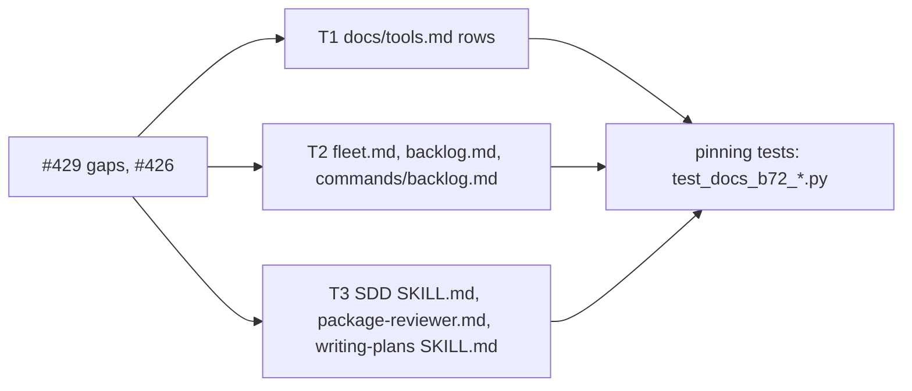
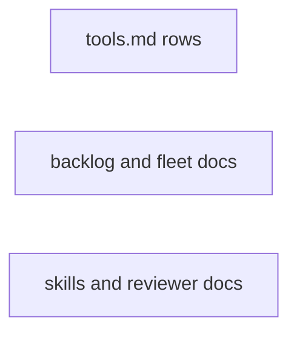

# Superlite: docs catch up with 1.5.70 to 1.5.76, Probe one-text-argument rule (B72)

**Goal:** fix #429 (the docs name what shipped in 1.5.70 to 1.5.76: run_tests `next:` cue and Swift `--fast` Target/Suite mapping; commit_task owned-by, hold and once-per-call notes; autocommit `apply: skipped`; backlog `earlier rounds` and `status --all`; the contract default rule; the report JSON's `red` field; a lead's question.json cut; `orchestrator takeover` in SDD SKILL.md; the package reviewer's `next:` cue) and #426 (writing-plans states that `call=` names a Produces with exactly one required text parameter, and what to write without one).
**Architecture:** text edits in eight owned files, each pinned by a new test file whose constants hold the exact text: T1 docs/tools.md; T2 docs/fleet.md, skills/subagent-driven-development/backlog.md, commands/backlog.md and tests/scripts/test_docs_b26.py; T3 skills/subagent-driven-development/SKILL.md, agents/package-reviewer.md and skills/writing-plans/SKILL.md.
**Tech stack:** Markdown docs; Python 3.10+ stdlib, pytest (through `sl run_tests`).
**Spec:** this file, section Design; issues #426 and #429.
**Detail:** tests
**Target-min:** 11
**Wave0:** none
**Coverage:** off
**Max chars:** 26000

Global constraints:
- Touch only the files in Owns. Existing tests stay green; no existing test file changes except tests/scripts/test_docs_b26.py (T2). If an existing test turns red, report it in DONE_WITH_CONCERNS with the test id and the reason instead of editing it.
- Each inserted text is the matching constant of the task's test file, byte for byte (copy it from the test file, never retype). Text outside the named spots stays byte-identical: older tests pin whole rows, lines and paragraphs (tests/scripts/test_docs_b67_tools.py pins the ends of the run_tests, commit_task, fleet and pt_review rows; tests/scripts/test_fixer_foreground_b26.py pins the package reviewer's `- Focused tests` line).
- skills/subagent-driven-development/SKILL.md stays at most 11700 characters (`len(text)`).
- Run `sl` as an executable (`<abs>/sl ...`). Verify with the task's `run_tests --fast ... --task Tn --background` line, then run the printed `wait:` line in the foreground and end the turn only after it reports. Never raw `pytest`, never the e2e or eval layers (coordinator's step).
- No version edits (the ship step bumps the version).

Ruling: scope is #429's list inside B72's files; agents/fixer-*.md, the fix brief (findings.py) and the commit_task.py docstring's stray `)` are outside the batch's files and go to notes as a follow-up - cost if wrong: one more small docs batch.
Ruling: the contract row states the default rule as the code has it now (#402 tightened by #432 in 1.5.78), since a 1.5.74-only text would already be wrong; #415's class bases and the B68-B70 doc gaps (`plan --issues` GitHub numbers, carry-over ranking, docs/testing.md store line) stay follow-ups - cost if wrong: none.
Ruling: the writing-plans example `call=minisheet.Workbook.set` names a two-parameter method that PROBE rejects, so it becomes `call=minisheet.Workbook.get` (the template's one-text-parameter Consumes) - cost if wrong: none.
Ruling: a package without a one-text-parameter function leaves `call=` out (`run=`/`serve=`, else `**Probe entry:** none (<why>)` with its Review Focus cases as named tests), never a probe-only wrapper - cost if wrong: such a package gets no library probe.
Ruling: SDD SKILL.md (11693 of 11700 characters) makes room for the takeover sentence by trimming three unpinned spots: the FROZEN parenthesis, the stop-conditions wording and the `LATE:` sentence (dispatch's `LATE:` line names its task itself) - cost if wrong: a coordinator misreads LATE once.
Ruling: the package reviewer's `next:` cue is a new bullet after its pinned `- Focused tests` line - cost if wrong: none.
Ruling: new test files tests/scripts/test_docs_b72_{tools,backlog,skills}.py (new paths no other lead owns) - cost if wrong: none.
Ruling: all three tasks are `Kind: mechanical` (docs from existing code, exact text in the test constants) - cost if wrong: a haiku miss goes to a sonnet fixer.
Ruling: coverage off: bounded docs change, no decision categories open - cost if wrong: none.
LAYERS: unit, headless, evals



## Design

Each gap becomes one inserted or replaced text; a new test file per task holds each text as a constant, asserts it at its place, and checks that the strings it quotes still exist in the code (run_tests.py, commit_task.py, autocommit.py, backlog.py, backlog_state.py, backlog_run.py, backlog_checks.py, pt_review.py, fleet_report.py, fleet_io.py, plan_tools.py, orchestrator.py). docs/tools.md rows stay one table row each (one ` | ` separator, ending ` |`). No code changes.

## File structure

- docs/tools.md: rows `run_tests`, `commit_task`, `autocommit`, `backlog`, `pt_review`, `fleet_io` (T1); tests/scripts/test_docs_b72_tools.py (T1).
- docs/fleet.md (escalation sentence, report `red` bullet), skills/subagent-driven-development/backlog.md (Main step 1, Lead question check), commands/backlog.md (step 1), tests/scripts/test_docs_b26.py (B_LEAD, F_ESC) (T2); tests/scripts/test_docs_b72_backlog.py (T2).
- skills/subagent-driven-development/SKILL.md (takeover, three trims), agents/package-reviewer.md (`next:` bullet), skills/writing-plans/SKILL.md (Probe bullet) (T3); tests/scripts/test_docs_b72_skills.py (T3).

## Task graph

```mermaid
%% schedule
gantt
  title Predicted schedule (mm:ss)
  dateFormat X
  axisFormat %M:%S
  section lane 1
  T1 tools.md rows for 1.5.70 to 1.5.76 :t1, 0, 80s
  section lane 2
  T2 backlog and fleet docs question cut r :t2, 0, 78s
  section lane 3
  T3 skills and reviewer docs Probe rule t :t3, 0, 78s
```





critical path: T1 (1.3 min) · peak width 3 · predicted build 1.3 min · predicted total ≈ 4.8 min (target ✓)

## Predicted schedule

## Docs

### T1 tools.md rows for 1.5.70 to 1.5.76 · Complexity 2 (O-1) · Est. context 36k
**Owns:** docs/tools.md, tests/scripts/test_docs_b72_tools.py
**Components:** 2
**LOC owned:** 80
**Tests:** fast
**Kind:** mechanical
**Model:** haiku
**Est. time:** 2 min (2 components, about 80 LOC, fast tests)
**Consumes:** none
**Produces:** none
**Review Focus:** `test_rows_keep_table_shape`: each edited row still has exactly one ` | ` and ends ` |`.
**Test code (verbatim):** tests/scripts/test_docs_b72_tools.py
```python
"""B72 (#429): docs/tools.md names what shipped in 1.5.70 to 1.5.76 and the contract default rule."""
from pathlib import Path

ROOT = Path(__file__).resolve().parents[2]
TOOLS = (ROOT / "docs" / "tools.md").read_text(encoding="utf-8")
SCRIPTS = ROOT / "skills" / "subagent-driven-development" / "scripts"

RT_OLD = "with `--background` (prints `summary: <path>` and a `wait:` line)"
RT_NEXT = "with `--background` (prints `summary: <path>`, then the cue `next: tests still running; run the wait line below now, in the foreground (never as a background command), and do not end your turn until it reports.` and, last, the `wait:` line)"
RT_SWIFT = "a Swift `--fast` run whose test-cmd.json template holds `{only_testing}` maps each test file to one shell-quoted `-only-testing:<Target>/<Suite>` id per suite it declares (`-only-testing:<Target>` when it declares none), the target taken from the unit and UI test targets of `*.xcodeproj/project.pbxproj` and the `.testTarget` names of `Package.swift` (at the root and one folder down; when neither lists one, from the folder: `Tests/<Target>/`, else the nearest folder ending `Tests`), and a path outside every test target runs the unfiltered `test` command with the stderr note `run_tests: <path> is not in a test target; running the unfiltered test command`; "
CT_NOTES = "a file another task owns prints `left uncommitted (owned by T2, changed after its checkpoint; run commit_task T2): F` when its owners are outside the call and not running, at least one of them is committed and the file differs from the newest checkpoint; a file this task owns that a running sibling (busy in pool.json, outside this call) also owns and that differs from the newest checkpoint is held out with one `left uncommitted (shared with running T2; commit_task T1 again once it is done): F` note per task, a task left with nothing fails `Tn FAILED: nothing to commit; held for running T2: F`, and `--also` files and the Wave 0 task are never held; every stderr note prints once per call, not once per task; "
AC_SKIP = "; `apply` writes no commit whose tree equals the commit it sits on (squash and `--no-squash`): each such entry prints `apply: skipped <title> (no change left)`, `applied N commit(s)` counts only the real commits, and with N = 0 HEAD and the index stay untouched while the checkpoints are still removed"
BL_HEAD = "| `backlog` | Backlog mode CLI: `status [--all]`, `plan [--tier sonnet]"
BL_STATUS = "; each successful `plan` (`--reset` too) records the batch ids it added as backlog.json `round`, and `status` lists the batches not shipped plus that round's, folding the other shipped batches into one `earlier rounds: N shipped (sl backlog status --all lists them)` line right after the head line; `status --all` lists every batch"
PT_DEFAULT = "a Python producer is compared by signature, defaults included: a planned literal default must equal the code's value; a planned name default (`tid=TID`) must be a name in the code too, matched by its last dotted part, so a literal (`None`, `-1`, `'x'`, `set()`) or a call there is a mismatch (`parameter 'tid' default is None, planned TID`); any other expression (`LIMIT + 1`, `x[0]`) is not compared; "
IO_RED = " (a saved report JSON `fleet/reports/<id>.json` carries a `red` string: the json block's non-empty `red`, else the reply's last `Red run:` line, else empty; a non-string `red` makes the block unparsable; the report contract `fleet send` appends asks for `red` between `tests` and `findings`, except the final reviewer's)"


def row(name):
    rows = [ln for ln in TOOLS.splitlines() if ln.startswith(f"| `{name}` |")]
    assert len(rows) == 1, name
    return rows[0]


def test_rows_keep_table_shape():
    for name in ("run_tests", "commit_task", "autocommit", "backlog", "pt_review", "fleet_io"):
        r = row(name)
        assert r.count(" | ") == 1 and r.endswith(" |"), name


def test_run_tests_row_names_the_cue_and_the_swift_mapping():
    r = row("run_tests")
    assert RT_NEXT in r and RT_OLD not in r
    assert "(the summary stays in the main `.superlite`); " + RT_SWIFT in r


def test_commit_task_row_names_the_notes():
    assert "(`left uncommitted (claimed by Tn): F`); " + CT_NOTES + "`--also` counts" in row("commit_task")


def test_autocommit_row_names_the_skip_line():
    assert row("autocommit").endswith("is a usage error (exit 2)" + AC_SKIP + " |")


def test_backlog_row_names_status_all():
    r = row("backlog")
    assert r.startswith(BL_HEAD)
    assert "and `next: sl backlog plan` when no batch is open" + BL_STATUS + "; `start`, `wait`" in r


def test_pt_review_row_names_the_default_rule():
    assert "and `contract` (seam checks; " + PT_DEFAULT + "a producer without Python sources" in row("pt_review")


def test_fleet_io_row_names_the_red_field():
    assert row("fleet_io").endswith("and report extraction" + IO_RED + " |")


def test_quoted_strings_exist_in_code():
    rt = (SCRIPTS / "run_tests.py").read_text(encoding="utf-8")
    assert 'WAIT_CUE = "next: tests still running; run the wait line below now, in the foreground (never as a background command), and do not end your turn until it reports."' in rt
    assert "is not in a test target; running the unfiltered test command" in rt and "-only-testing:{want}" in rt
    ct = (SCRIPTS / "commit_task.py").read_text(encoding="utf-8")
    for s in ("changed after its checkpoint; run commit_task ", " again once it is done): ", "nothing to commit; held for running "):
        assert s in ct, s
    ac = (SCRIPTS / "autocommit.py").read_text(encoding="utf-8")
    assert "(no change left)" in ac and "apply: skipped " in ac and "applied {len(done)} commit(s)" in ac
    assert "shipped (sl backlog status --all lists them)" in (SCRIPTS / "backlog_state.py").read_text(encoding="utf-8")
    assert 'add_argument("--all"' in (SCRIPTS / "backlog.py").read_text(encoding="utf-8")
    pt = (SCRIPTS / "pt_review.py").read_text(encoding="utf-8")
    assert "default is {shown}, planned {w['default']}" in pt and "def _literal_or_call(" in pt
    assert "Red run" in (SCRIPTS / "fleet_report.py").read_text(encoding="utf-8")
    assert 'fleet_report.REVIEW if role == "final-reviewer" else fleet_report.WORK' in (SCRIPTS / "fleet_io.py").read_text(encoding="utf-8")
```
**Steps:** 1 write the test file, 2 run: FAIL, 3 edit docs/tools.md: in the `run_tests` row replace RT_OLD with RT_NEXT, and insert RT_SWIFT right after "(the summary stays in the main `.superlite`); "; in the `commit_task` row insert CT_NOTES right after "(`left uncommitted (claimed by Tn): F`); "; in the `autocommit` row insert AC_SKIP right before the closing ` |`; in the `backlog` row replace "Backlog mode CLI: `status`, `plan" with "Backlog mode CLI: `status [--all]`, `plan" and insert BL_STATUS right after "and `next: sl backlog plan` when no batch is open"; in the `pt_review` row insert PT_DEFAULT right after "and `contract` (seam checks; "; in the `fleet_io` row insert IO_RED right before the closing ` |`, 4 run: PASS. Verify: `<abs sl> run_tests --fast tests/scripts/test_docs_b72_tools.py tests/scripts/test_docs_b67_tools.py tests/scripts/test_docs_b32_tools.py tests/scripts/test_docs_b16.py tests/scripts/test_docs_b10.py tests/scripts/test_backlog_docs_369_370.py tests/scripts/test_backlog_main_docs.py tests/scripts/test_backlog_user_docs.py tests/scripts/test_docs_contract.py tests/scripts/test_tool_notes.py --task T1 --background`.
**Probe entry:** none (text only)

### T2 backlog and fleet docs: question cut, red field, status --all · Complexity 2 (O-1) · Est. context 34k
**Owns:** docs/fleet.md, skills/subagent-driven-development/backlog.md, commands/backlog.md, tests/scripts/test_docs_b26.py, tests/scripts/test_docs_b72_backlog.py
**Components:** 2
**LOC owned:** 60
**Tests:** fast
**Kind:** mechanical
**Model:** haiku
**Est. time:** 2 min (2 components, about 60 LOC, fast tests)
**Consumes:** none
**Produces:** none
**Review Focus:** `test_quoted_strings_exist_in_code`: the cut, the send-back and the `red` rule the docs state exist in backlog_run.py, backlog_checks.py and fleet_report.py.
**Test code (verbatim):** tests/scripts/test_docs_b72_backlog.py
```python
"""B72 (#429): docs/fleet.md, backlog.md and commands/backlog.md name the question.json cut, the report's red field and status --all."""
from pathlib import Path

ROOT = Path(__file__).resolve().parents[2]
FLEET = (ROOT / "docs" / "fleet.md").read_text(encoding="utf-8")
BACKLOG = (ROOT / "skills" / "subagent-driven-development" / "backlog.md").read_text(encoding="utf-8")
CMD = (ROOT / "commands" / "backlog.md").read_text(encoding="utf-8")
SCRIPTS = ROOT / "skills" / "subagent-driven-development" / "scripts"

ESC = "A lead's `question.json` is cut like `plan`'s (header 12, option label 60 at its last whole word, option description 200; each cut named in a `B shortened:` line after the `needs_decision` line), never its question text; a file still invalid after the cut is sent back to the lead once, and the next invalid one parks the batch with `invalid question.json: <errors>`."
RED = "- A saved report JSON (`<sd>/fleet/reports/<id>.json`) carries a `red` string, the red-run evidence: the json block's non-empty `red`, else the reply's last `Red run:` line (a bullet, a bold or backticked label and CRLF line ends work), else `\"\"`; a non-string `red` makes the block unparsable. The report contract `fleet send` appends asks for it between `tests` and `findings`, except in the final reviewer's."
LEAD = "`backlog wait` cuts an over-long header (12), option label (60, at its last whole word, its full text moved to the front of its description) and option description (200) as `plan` does, names each cut in a `B shortened:` line and never cuts the question text; then it checks the file: 1 to 4 distinct questions, each question 1 to 300 characters, a header, and 2 to 4 options with distinct labels. A file still invalid after the cut is sent back to you once to rewrite; the next invalid one parks the batch with `invalid question.json: <errors>`."
MAIN1 = " Shipped batches of earlier plan rounds fold into one `earlier rounds: N shipped (sl backlog status --all lists them)` line after the head line; `\"$SL\" backlog status --all` lists every batch."
CMD1 = " Shipped batches of earlier plan rounds show as one `earlier rounds: N shipped` line; `\"$SL\" backlog status --all` lists them."


def section(text, start, end):
    i = text.index(start)
    return text[i:text.index(end, i + len(start))]


def test_fleet_escalation_names_the_cut():
    assert ESC in section(FLEET, "## Batch leads", "## Troubleshooting")
    assert "checked strictly, never cut" not in FLEET


def test_fleet_red_bullet_follows_fleet_wait():
    lines = FLEET.splitlines()
    i = next(k for k, ln in enumerate(lines) if ln.startswith("- `fleet wait [--timeout 540000]"))
    assert lines[i + 1] == RED


def test_backlog_lead_names_the_cut():
    assert LEAD in section(BACKLOG, "## Lead", "## Permissions")
    assert "checks that file strictly and never cuts it" not in BACKLOG


def test_backlog_main_step_one_names_status_all():
    line = next(ln for ln in BACKLOG.splitlines() if ln.startswith('1. `"$SL" backlog status`'))
    assert line.endswith("its last line is `next: sl backlog plan`." + MAIN1)


def test_command_step_one_names_status_all():
    line = next(ln for ln in CMD.splitlines() if ln.startswith('1. Run `"$SL" backlog status`'))
    assert line.endswith("its last line is `next: sl backlog plan`." + CMD1)


def test_quoted_strings_exist_in_code():
    run = (SCRIPTS / "backlog_run.py").read_text(encoding="utf-8")
    assert "cuts = bc.fit_question(obj)" in run and "question_reprompted" in run and "(an over-long header, label or description is cut for you)" in run
    assert "a lead's question keeps its text" in (SCRIPTS / "backlog_checks.py").read_text(encoding="utf-8")
    assert "shipped (sl backlog status --all lists them)" in (SCRIPTS / "backlog_state.py").read_text(encoding="utf-8")
    rep = (SCRIPTS / "fleet_report.py").read_text(encoding="utf-8")
    assert "Red run" in rep and '"red": red or _red_line(text)' in rep
    assert 'fleet_report.REVIEW if role == "final-reviewer" else fleet_report.WORK' in (SCRIPTS / "fleet_io.py").read_text(encoding="utf-8")
```
In tests/scripts/test_docs_b26.py set `B_LEAD` to the LEAD text above, and set `F_ESC` to the ESC text above + " A lead that stops without a Status line gets one re-prompt; its next such stop parks the batch with `no status in stop text: <text>` (`start` and `answer` reset it). A stop record whose transcript lags is re-read for 10 s from the stop; then a cut `last` line holding a status parks the batch with `<cut line> (transcript unread)`." (the old F_ESC tail, unchanged); nothing else in that file changes.
**Steps:** 1 write the new test file and the two test_docs_b26.py constants, 2 run: FAIL, 3 in docs/fleet.md replace "A lead's `question.json` is checked strictly, never cut; an invalid one parks the batch with `invalid question.json: <errors>`." with ESC, and insert RED as a new line right after the line starting "- `fleet wait [--timeout 540000]"; in skills/subagent-driven-development/backlog.md replace the sentence starting "`backlog wait` checks that file strictly" (through "`invalid question.json: <errors>`.") with LEAD, and append MAIN1 to the end of the line starting "1. `\"$SL\" backlog status`"; in commands/backlog.md append CMD1 to the end of the line starting "1. Run `\"$SL\" backlog status`", 4 run: PASS. Verify: `<abs sl> run_tests --fast tests/scripts/test_docs_b72_backlog.py tests/scripts/test_docs_b26.py tests/scripts/test_docs_b67_fleet.py tests/scripts/test_backlog_docs.py tests/scripts/test_backlog_docs_369_370.py tests/scripts/test_backlog_main_docs.py tests/scripts/test_backlog_user_docs.py tests/scripts/test_fleet_docs_b54.py tests/scripts/test_fleet_b1_docs.py tests/scripts/test_fleet_roles_docs.py tests/scripts/test_fleet_research_docs_b43.py tests/scripts/test_run_state_docs_b19.py tests/scripts/test_lead_guard_heredoc_276.py tests/scripts/test_docs_contract.py tests/scripts/test_backlog_brief.py --task T2 --background`.
**Probe entry:** none (text only)

### T3 skills and reviewer docs: Probe rule, takeover, next cue · Complexity 2 (O-1) · Est. context 36k
**Owns:** skills/subagent-driven-development/SKILL.md, agents/package-reviewer.md, skills/writing-plans/SKILL.md, tests/scripts/test_docs_b72_skills.py
**Components:** 2
**LOC owned:** 60
**Tests:** fast
**Kind:** mechanical
**Model:** haiku
**Est. time:** 2 min (2 components, about 60 LOC, fast tests)
**Consumes:** none
**Produces:** none
**Review Focus:** `test_sdd_names_takeover_and_keeps_its_cap`: SDD SKILL.md stays at most 11700 characters after the insert and the three trims.
**Test code (verbatim):** tests/scripts/test_docs_b72_skills.py
```python
"""B72 (#426, #429): writing-plans states the Probe one-text-argument rule; SDD SKILL.md names orchestrator takeover; the package reviewer names the run_tests next: cue."""
from pathlib import Path

ROOT = Path(__file__).resolve().parents[2]
WP = (ROOT / "skills" / "writing-plans" / "SKILL.md").read_text(encoding="utf-8")
SDD = (ROOT / "skills" / "subagent-driven-development" / "SKILL.md").read_text(encoding="utf-8")
PR = (ROOT / "agents" / "package-reviewer.md").read_text(encoding="utf-8")
SCRIPTS = ROOT / "skills" / "subagent-driven-development" / "scripts"

PROBE = "for example `call=minisheet.Workbook.get · run=python -m minisheet · serve=minisheet.server.create_server`. Use `call=` for libraries, `run=` for CLIs, `serve=` for servers. `call=` must name a Produces of this plan with exactly one required parameter, because each probe passes one text argument (a `str`): a method's `self` does not count, every other parameter needs a default, and a method's class must build with no arguments. Anything else fails lint with `PROBE: call=<target> takes N required parameters; probes pass one text argument` (`Workbook.set(ref, raw)` takes two) or `PROBE: call=<target> is not a Produces of this plan`. A package without such a function leaves `call=` out: `run=` or `serve=` when it has a CLI or server, else `**Probe entry:** none (<why>)`, and its Review Focus cases become named tests in the owning task. No agent writes adapters."
TAKEOVER = " Resuming another session's run: `\"$SL\" orchestrator takeover --plan $PLAN` first."
FROZEN = "Dispatched tasks are frozen: keep blocks byte-identical, else lint says `FROZEN:` (restore them). `MISSED TARGET:` warns"
STOP = "Ask only for an irreversible, destructive, security-sensitive or outward step (merge, push, publish), or a plan so broken all paths are guesses."
NEXT = "- The run prints a `next:` cue and, as its last line, that `wait:` line; a turn ended before the wait reports reaches the coordinator with no test result."


def test_writing_plans_states_the_probe_rule():
    assert PROBE in WP
    assert "call=minisheet.Workbook.set" not in WP
    assert "Workbook.get(ref: str) -> Value" in WP


def test_probe_messages_match_the_code():
    lint = (SCRIPTS / "plan_tools.py").read_text(encoding="utf-8")
    assert 'f"PROBE: call={target} takes {counts[0]} required parameters; probes pass one text argument"' in lint
    assert 'f"PROBE: call={target} is not a Produces of this plan"' in lint
    pt = (SCRIPTS / "pt_review.py").read_text(encoding="utf-8")
    assert "obj = getattr(parent(), obj.__name__)" in pt and "return obj(text)" in pt


def test_sdd_names_takeover_and_keeps_its_cap():
    line = next(ln for ln in SDD.splitlines() if ln.startswith("- Run root:"))
    assert line.endswith("in `.git/info/exclude` itself." + TAKEOVER)
    assert FROZEN in SDD and STOP in SDD.splitlines()
    assert "a real change is a follow-up" not in SDD and "names the task to unblock first" not in SDD
    budget = next(ln for ln in SDD.splitlines() if ln.startswith("`lint` and `dispatch` print `budget:` lines"))
    assert budget.endswith("then `commit_task` and finish.")
    assert len(SDD) <= 11700
    assert '"takeover"' in (SCRIPTS / "orchestrator.py").read_text(encoding="utf-8")


def test_package_reviewer_names_the_next_cue():
    lines = PR.splitlines()
    i = next(k for k, ln in enumerate(lines) if ln.startswith("- Focused tests, in the background:"))
    assert lines[i + 1] == NEXT
    assert 'WAIT_CUE = "next: ' in (SCRIPTS / "run_tests.py").read_text(encoding="utf-8")
```
**Steps:** 1 write the test file, 2 run: FAIL, 3 in skills/writing-plans/SKILL.md replace "for example `call=minisheet.Workbook.set · run=python -m minisheet · serve=minisheet.server.create_server`. Use `call=` for libraries, `run=` for CLIs, `serve=` for servers. No agent writes adapters." with PROBE; in skills/subagent-driven-development/SKILL.md append TAKEOVER to the end of the line starting "- Run root:", replace "(restore; a real change is a follow-up)" with "(restore them)", replace the line "Ask only for: an irreversible or destructive operation; a security-sensitive action; an outward side effect (merge, push, publish); a plan so broken all paths are guesses." with STOP, and delete " `LATE:` names the task to unblock first." (with its leading space) from the budget line; in agents/package-reviewer.md insert NEXT as a new line right after the line starting "- Focused tests, in the background:", 4 run: PASS. Verify: `<abs sl> run_tests --fast tests/scripts/test_docs_b72_skills.py tests/scripts/test_orchestrator.py tests/scripts/test_docs_b10.py tests/scripts/test_docs_b32_sdd.py tests/scripts/test_fleet_roles_skill.py tests/scripts/test_fleet_hard_stop.py tests/scripts/test_implementer_red_prime_b65.py tests/scripts/test_agent_mcp_tools.py tests/scripts/test_fixer_foreground_b26.py tests/scripts/test_reviewer_scope_b59.py tests/scripts/test_incident_resolve.py tests/scripts/test_coverage_docs.py tests/scripts/test_isolation_wording.py tests/scripts/test_docs_contract.py tests/scripts/test_mvp_plan_docs_b19.py tests/scripts/test_task_constraints_285.py --task T3 --background`.
**Probe entry:** none (text only)

## Review Focus

Package docs (app type: generator of text; categories: encoding). Risks: a table row split by a stray ` | ` (T1 `test_rows_keep_table_shape`); a quoted message that no longer matches the code (each test's code-string check); a pinned row end, line or paragraph changed (existing tests in each verify line); SDD SKILL.md over its 11700-character cap (T3).

## Self-review

1. Coverage: #429 tools.md bullets: run_tests (RT_NEXT, RT_SWIFT), commit_task (CT_NOTES), autocommit (AC_SKIP), backlog (BL_HEAD, BL_STATUS), contract (PT_DEFAULT), report `red` (IO_RED); fleet.md (ESC, RED); SDD SKILL.md (TAKEOVER); backlog.md and commands/backlog.md (MAIN1, CMD1, LEAD); package-reviewer.md (NEXT); #426 (PROBE). Fixer agents, the fix brief and the commit_task.py docstring are outside the batch (Ruling).
2. Placeholders: none. 3. Types: no Produces. 4. Graph: no edges, disjoint Owns. 5. Fields filled. 6. Review Focus per task. 7. Schedule and lint below.
