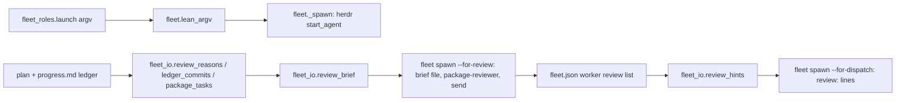
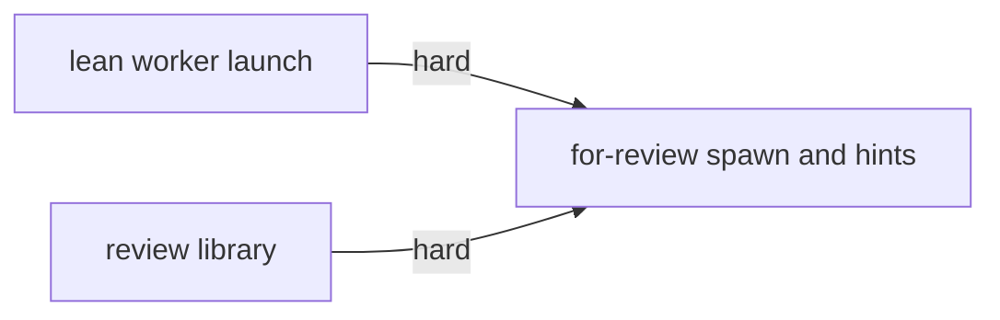

# Superlite: fleet workers start lean, `fleet spawn --for-review` builds the package-review brief, `--for-dispatch` prints `review:` hints (B77)

**Goal:** fix #377 (a fleet worker holds about 48-58k context at READY, so dispatch evicts it after one task) and #422 (the coordinator hand-writes every package-review brief and nothing says which committed task needs a review). Max's decision for #377: lower the baseline every worker starts with.
**Architecture:** `fleet.py` launches every `fleet.spawn` worker (implementer, fixer, package-reviewer, final-reviewer, research) with lean flags: no MCP servers, no Chrome, no skills or slash commands, and the Artifact, ListAgents, ReadNotifications and ReportFindings tools denied; leads (`fleet_lead.py`) keep their launch. `fleet_io.py` gains the review library: ledger commit lines, the selective-review reasons of a task, the plan's package sections, the review brief text and the hint list. `fleet.py` gains `spawn --for-review Tn [Tm ...] | --package X`, which writes the brief, starts a package-reviewer worker, sends it and records the reviewed tasks on the worker; `spawn --for-dispatch` ends with one `review: Tn (<why>); run ...` line per committed task that matches and has no review yet.
**Tech stack:** Python 3.10+ stdlib, pytest (through `sl run_tests`).
**Spec:** this file, section Design; issues #377 and #422 (Expected lines).
**Detail:** contracts
**Target-min:** 11
**Wave0:** none
**Max chars:** 32000

Global constraints:
- Every new or changed code line in `fleet.py` and `fleet_io.py` carries the repo's trailing `# O(...)` complexity comment; tests do not. Stdlib only.
- Existing tests stay green. If an existing test turns red, report it in DONE_WITH_CONCERNS with the test id and the reason instead of editing it.
- Run `sl` as an executable (`<abs>/sl ...`). Verify with `<abs>/sl run_tests --fast <your test file> <the existing tests named in your Notes> --task Tn --background`, then run the printed `wait:` line in the foreground and end the turn only after it reports. Never raw `pytest`, never the e2e or eval layers (coordinator's step).
- No version edits (the ship step bumps the version). Touch only the files in Owns; docs (`docs/fleet.md`, `docs/tools.md`, SKILL.md and fleet.md) stay unchanged (outside B77's files).

Ruling: the lean launch lives in `fleet.py` (`lean_argv` on the argv `fleet_roles.launch` returns), since `fleet_roles.py` and `build_prime.py` are outside B77's files; the prime file itself is about 1.3k tokens, the rest of the READY context is Claude Code's own start-up (MCP instructions, skill listing, the Artifact tool) - cost if wrong: a later batch moves the flags into fleet_roles.
Ruling: lean flags are `--strict-mcp-config --no-chrome --disable-slash-commands` plus denying Artifact, ArtifactComments, ArtifactData, ListAgents, ReadNotifications, ReportFindings; no superlite agent file, prime or brief uses a skill, MCP tool or those tools; W67's spike measured 27.8k -> 10.0k for one `claude -p` READY turn - cost if wrong: a worker that needs an MCP server runs as the coordinator's step.
Ruling: eviction keeps counting raw context when pool.json has no baseline yet (Max declined "count context above baseline"); the lower start is what lets a worker take a second task - cost if wrong: workers with big tasks are still evicted after one.
Ruling: the `review:` hint is printed by `fleet spawn --for-dispatch`, not `commit_task` (commit_task.py is outside B77's files); the coordinator runs `--for-dispatch` after every `commit_task`, so the hint shows up in the next dispatch round as SKILL.md's D16 says - cost if wrong: a coordinator that commits without a dispatch round misses the hint.
Ruling: the selective triggers are Complexity >= 5, a taskgraph edge (seam) and a hard Review Focus category (deep, numeric, state, protocol) of the plan's Review Focus section for the task's Owns parts, as `plan_tools.not_mechanical_reasons` reads it; the per-task `**Review Focus:**` field (every task has one) and open incidents (incidents.jsonl also holds fleet's own workaround lines) do not count - cost if wrong: a risky task without those signals waits for its package review.
Ruling: a package is a plan `## ` section; its name is the heading without a leading `Package:` and a trailing `(...)`, matched case-insensitively - cost if wrong: a plan without package sections can only review by task ids.
Ruling: a task counts as reviewed once a `--for-review` send to a worker succeeded (the worker's `review` list in fleet.json); a fix round after the review does not trigger a new hint - cost if wrong: a re-review is started by hand.
Ruling: detail contracts; three tasks, T1 and T2 in parallel, T3 after both (it shares fleet.py with T1 and calls T2's functions); no probe adapter (fleet code is tested in process with a fake Herdr) - cost if wrong: no generated probes.
Ruling: already in the lead worktree on branch superlite/b77-fleet-review-spawn-and-reuse - cost if wrong: none.
LAYERS: unit

## Design

1. `fleet.lean_argv(argv)` returns a new list: `--strict-mcp-config`, `--no-chrome` and `--disable-slash-commands` (each only when missing) placed right before the first `--disallowedTools`, and the names Artifact, ArtifactComments, ArtifactData, ListAgents, ReadNotifications, ReportFindings that are not yet denied appended to that option's values (right after its last value, before the next `--` argument); an argv without `--disallowedTools` gets the flags and then `--disallowedTools` with the names at its end. The input list is not changed; applying it twice gives the same list.
2. `fleet._spawn` starts every worker with `lean_argv(launch["argv"])`, before the `--add-dir` pair; the module docstring says workers start lean (#377).
3. `fleet_io.ledger_commits(ledger)`: {task id: its `commit Tn <sha> ...` ledger lines, bullet stripped, file order}; a missing file is {}.
4. `fleet_io.review_reasons(plan, tid)`: in this order `Complexity N` (heading Complexity >= 5), `seam A↔B` for each taskgraph seam naming tid, `Review Focus c1, c2` (sorted hard categories of the plan's Review Focus section packages found among the task's Owns path parts); [] when none; KeyError for an unknown task.
5. `fleet_io.package_tasks(plan, name)` and `fleet_io.package_names(plan)`: the task ids of the `## ` section a name matches (Ruling above), in plan order; [] for an unknown name; the names of the sections holding tasks, in plan order.
6. `fleet_io.review_brief(sd, plan, tasks, sl_path, superlite_root, package=None)`: the brief text (Notes of T2): heading, SUPERLITE, PLAN, Root, sl path, why, ledger commit lines, diff and spec-slice commands, files in scope, `incident hotspots` output for those files, probe adapter path or none.
7. `fleet_io.review_hints(sd, plan)`: [(tid, reasons)] in plan order for each task with a commit line, a non-empty `review_reasons` and no fleet.json worker whose `review` list holds it.
8. `fleet spawn --for-review T3 [T4 ...] --plan P` and `fleet spawn --package X --plan P` (also `--for-review --package X`): refuse unknown ids or packages (exit 2), uncommitted tasks (exit 3, BLOCKED); write `<sd>/briefs/<label>.md`, spawn a package-reviewer, send the brief with the label, record the tasks on the worker; exit 0.
9. `fleet spawn --for-dispatch` prints, after its worker lines, `review: Tn (<reasons joined by "; ">); run <abs sl> fleet spawn --for-review Tn --plan <plan>` per hint; a hint failure is one stderr warning and never changes the exit code.

## Coverage

| Category | State | Basis |
|---|---|---|
| Scope and success criteria | settled | #377 and #422 Expected lines |
| Domain and data model | ruled | package = plan section; reviewed = worker review list |
| Persistence and migration | ruled | one new `review` key on fleet.json workers; older files read as unreviewed |
| Interfaces and contracts | ruled | `--for-review Tn` / `--package X` as #422 names them |
| UI states | n/a | CLI text only |
| Concurrency and state ownership | settled | fleet.json writes under `fs.locked` |
| Error handling and recovery | ruled | exit 2 usage, exit 3 BLOCKED, hint failure is a warning |
| Security and privacy | settled | no new input from outside the run |
| Performance and limits | settled | one plan parse per call |
| Observability | ruled | `review:` lines name the command to run |
| Testing strategy | settled | one new test file per task, fake Herdr |
| Compatibility | ruled | leads keep their argv; spawn prefixes unchanged |
| Rollout | ruled | one PR; version bump at ship |
| Research unknowns | settled | W67 spike measured the lean flags |

## File structure
- `skills/subagent-driven-development/scripts/fleet.py`: lean_argv and its use in _spawn (T1); for_review, the `--for-review`/`--package` options and the hint lines in for_dispatch (T3).
- `skills/subagent-driven-development/scripts/fleet_io.py`: ledger_commits, review_reasons, package_tasks, package_names, review_brief, review_hints (T2).
- `tests/scripts/test_fleet_lean_377.py` (T1), `tests/scripts/test_fleet_io_review_422.py` (T2), `tests/scripts/test_fleet_for_review_422.py` (T3).

## Task graph

```mermaid
%% schedule
gantt
  title Predicted schedule (mm:ss)
  dateFormat X
  axisFormat %M:%S
  section lane 1
  T2 review library :t2, 0, 103s
  T3 for-review spawn and hints :t3, 103, 85s
  section lane 2
  T1 lean worker launch :t1, 0, 73s
```

critical path: T2 → T3 (3.1 min) · peak width 2 · predicted build 3.1 min · predicted total ≈ 6.6 min (target ✓)

## Package: fleet launch (CLI)
App type: CLI. Categories: protocol (the claude argv), state (spawn order).
**Probe entry:** none (Ruling: no probe adapter; argv checked through the fake Herdr).

### T1 lean worker launch · Complexity 3 · Est. context 36k
**Owns:** skills/subagent-driven-development/scripts/fleet.py, tests/scripts/test_fleet_lean_377.py
**Components:** 1
**LOC owned:** 80
**Tests:** fast
**Model:** sonnet
**Est. time:** 2.0 min (1 component, about 80 LOC, fast tests)
**Covers:** 1, 2
**Produces:** fleet.lean_argv(argv: list[str]) -> list[str]
e.g. fleet.lean_argv(["--agent", "superlite:implementer", "--model", "sonnet", "--disallowedTools", "AskUserQuestion"]) -> ["--agent", "superlite:implementer", "--model", "sonnet", "--strict-mcp-config", "--no-chrome", "--disable-slash-commands", "--disallowedTools", "AskUserQuestion", "Artifact", "ArtifactComments", "ArtifactData", "ListAgents", "ReadNotifications", "ReportFindings"]
e.g. fleet.lean_argv(["--agent", "x"]) -> ["--agent", "x", "--strict-mcp-config", "--no-chrome", "--disable-slash-commands", "--disallowedTools", "Artifact", "ArtifactComments", "ArtifactData", "ListAgents", "ReadNotifications", "ReportFindings"]
**Review Focus:** protocol: `test_lean_argv_keeps_research_writers_and_repeats_nothing`, `test_spawn_starts_every_role_lean`.
**Test code (contracts):**
- `test_lean_argv_inserts_flags_before_the_deny_list`: the first e.g. above, exactly; the input list is unchanged afterwards.
- `test_lean_argv_adds_a_deny_list_when_none`: the second e.g. above, exactly.
- `test_lean_argv_keeps_research_writers_and_repeats_nothing`: `lean_argv(["--agent", "superlite:researcher", "--model", "sonnet", "--disallowedTools", "AskUserQuestion", "Edit", "Write", "NotebookEdit", "Bash", "Artifact"])` == `["--agent", "superlite:researcher", "--model", "sonnet", "--strict-mcp-config", "--no-chrome", "--disable-slash-commands", "--disallowedTools", "AskUserQuestion", "Edit", "Write", "NotebookEdit", "Bash", "Artifact", "ArtifactComments", "ArtifactData", "ListAgents", "ReadNotifications", "ReportFindings"]`; `lean_argv(lean_argv(a)) == lean_argv(a)` for all three inputs above; a deny list followed by another option (`["--disallowedTools", "AskUserQuestion", "--effort", "high"]`) gets the names before `--effort`.
- `test_spawn_starts_every_role_lean`: with the fake Herdr world of `tests/scripts/test_fleet_roles_spawn.py`, `fleet.spawn` for role implementer, package-reviewer and research: the `start_agent` argv holds `--strict-mcp-config`, `--no-chrome`, `--disable-slash-commands` once each and `Artifact` after `--disallowedTools`; the implementer argv still starts `["--agent", "superlite:implementer", "--model", "sonnet", "--effort", "medium"]`; with the state dir outside the project the last two items are `--add-dir` and the state dir.
**Steps:** 1 failing test, 2 run: FAIL, 3 implement, 4 run: PASS
**Notes:** constants `LEAN_FLAGS` (the three flags) and `LEAN_DENY` (the six names) at module level. In `_spawn`, `argv = lean_argv(launch["argv"])` replaces `argv = list(launch["argv"])`. Add one docstring line: `Every worker starts lean (#377): no MCP servers, Chrome, skills or slash commands; Artifact, ListAgents, ReadNotifications and ReportFindings denied (LEAN_FLAGS, LEAN_DENY).` Also run `tests/scripts/test_fleet_roles_spawn.py tests/scripts/test_fleet.py tests/scripts/test_fleet_spawn_account_retry_428.py tests/scripts/test_fleet_spawn_shell_retry.py tests/regression/test_fleet_roles_final_b.py`.

## Package: review brief (library)
App type: library. Categories: state (ledger and fleet.json reads), protocol (brief text), file (missing ledger, adapter or incident log).
**Probe entry:** none (Ruling: no probe adapter; functions tested in process).

### T2 review library · Complexity 5 · Est. context 46k
**Owns:** skills/subagent-driven-development/scripts/fleet_io.py, tests/scripts/test_fleet_io_review_422.py
**Components:** 2
**LOC owned:** 210
**Tests:** fast
**Model:** sonnet
**Est. time:** 3.6 min (2 components, about 210 LOC, fast tests)
**Covers:** 3, 4, 5, 6, 7
**Consumes:** existing `plan_tools.Plan.load(path: str) -> Plan` · existing `plan_tools.review_focus_cases(plan: Plan) -> dict[str, set[str]]` · existing `next_tasks.taskgraph_full(plan: str) -> dict` · existing `incident.main(argv: list[str]) -> int` · existing `fleet_state.load(sd: Path) -> dict`
**Produces:** fleet_io.ledger_commits(ledger: Path) -> dict[str, list[str]] · fleet_io.review_reasons(plan: str, tid: str) -> list[str] · fleet_io.package_tasks(plan: str, name: str) -> list[str] · fleet_io.package_names(plan: str) -> list[str] · fleet_io.review_brief(sd: Path, plan: str, tasks: list[str], sl_path: str, superlite_root: str, package: str | None = None) -> str · fleet_io.review_hints(sd: Path, plan: str) -> list[tuple[str, list[str]]]
e.g. fleet_io.ledger_commits(Path("progress.md")) with lines `- start abc1234`, `- commit T1 abc1234 lean launch`, `- Ruling: x`, `- commit T1 def5678 fix`, `- commit T2 0123abc brief` -> {"T1": ["commit T1 abc1234 lean launch", "commit T1 def5678 fix"], "T2": ["commit T2 0123abc brief"]}
e.g. fleet_io.review_reasons(PLAN, "T3") -> ["Complexity 6", "seam T1↔T3", "Review Focus state"]
e.g. fleet_io.review_hints(sd, PLAN) with T1 and T3 committed and a worker `"review": ["T1"]` -> [("T3", ["Complexity 6", "seam T1↔T3", "Review Focus state"])]
e.g. fleet_io.package_tasks(PLAN, "core lib") -> ["T3", "T4"]; fleet_io.package_names(PLAN) -> ["cli", "Core lib"] (heading case kept)
**Review Focus:** state: `test_review_hints_skip_uncommitted_and_reviewed_tasks`; protocol: `test_review_brief_lines`; file: `test_review_brief_without_ledger_adapter_or_incidents`.
**Test code (contracts):** PLAN is a plan written by the test: `## Package: cli (CLI)` with `### T1 entry · Complexity 3 · Est. context 30k` (Owns `src/app/cli.py`); `## Package: Core lib (library)` with `### T3 engine · Complexity 6 · Est. context 30k` (Owns `src/core/engine.py, tests/test_engine.py`) and `### T4 docs · Complexity 4 · Est. context 30k` (Owns `docs/notes.md`); a `%% taskgraph` block with `T1 --> T3`; `## Review Focus` with `- core: state, encoding`.
- `test_ledger_commits_keeps_each_commit_line_in_order`: the first e.g. exactly; a missing file gives {}.
- `test_review_reasons_names_complexity_seam_and_focus`: T3 as the e.g.; T1 -> ["seam T1↔T3"]; T4 -> []; an unknown id raises KeyError.
- `test_package_tasks_by_section`: the e.g. line; `package_tasks(PLAN, "Core Lib (library)")` -> ["T3", "T4"]; `package_tasks(PLAN, "nope")` -> [].
- `test_review_hints_skip_uncommitted_and_reviewed_tasks`: the e.g. exactly (fleet.json worker W5 `"role": "package-reviewer", "review": ["T1"]`, ledger commits T1 and T3); with no fleet.json review list, T1 and T3 both show; a commit line for `T0` (not in the plan) is skipped.
- `test_review_brief_lines`: `review_brief(sd, PLAN, ["T3"], "/sl/sl", "/sl")` holds, each as a whole line: `# Review: T3`, `SUPERLITE=/sl`, `PLAN=<plan resolved>`, `Root: <project root>`, `sl (type it literally in every command): /sl/sl`, `Why: T3: Complexity 6; seam T1↔T3; Review Focus state`, `- commit T3 abc1234 engine`, `Diffs: \`git show <sha>\` for each commit above, in Root.`, `Spec slice: \`/sl/sl task T3 --plan <plan resolved>\``, `Files in scope: src/core/engine.py, tests/test_engine.py`; with `<sd>/incidents.jsonl` holding one open entry for `src/core/engine.py` line 4 the hotspot JSON line follows `Incident hotspots (\`/sl/sl incident hotspots --files src/core/engine.py,tests/test_engine.py\`):`; with `<sd>/probes/adapter.py` present: `Probe adapter: <sd>/probes/adapter.py`. With `package="Core lib"` and tasks ["T3", "T4"]: heading `# Review: T3, T4 (package Core lib)` and `Why: every committed task of package Core lib`.
- `test_review_brief_without_ledger_adapter_or_incidents`: no progress.md, no adapter, no incident log: `- (no commit line in progress.md)`, `(none)` under the hotspots line, `Probe adapter: none`.
**Steps:** 1 failing test, 2 run: FAIL, 3 implement, 4 run: PASS
**Notes:** `RISK = ("deep", "numeric", "state", "protocol")`. Ledger regex as `commit_task.COMMIT_LINE` (`^\s*[-*+]?\s*commit\s+(<task id>)\s+[0-9a-f]{7,40}`), value = the line with its bullet and outer spaces stripped. Seams: `nt.taskgraph_full(plan)["seams"]` entries `"A↔B"` split on `↔`. Focus parts: `{seg.lower() for o in task.owns for seg in re.split(r"[/.]", o)}` against `pt.review_focus_cases(pl)` keys. Sections: unfenced lines (`pl.fenced`) matching `^## (?!#)`; a task belongs to the nearest one above its heading line (`task.line`); name = heading text minus `Package:` (any case) and a trailing `(...)`, stripped; compare lowercased. Root = `state.git_root(sd) or sd.parent`. Hotspots: `incident.main(["hotspots", "--files", csv, "--log", str(sd / "incidents.jsonl")])` with stdout captured (`contextlib.redirect_stdout`); empty output `(none)`; an exception or SystemExit `(hotspots failed: <error>)`. Commit lines listed per task in `tasks` order, oldest first. `review_hints`: covered = union of every fleet.json worker's `review` list (`fs.load(sd)["workers"]`, any state); a task not in the plan is skipped. Also run `tests/scripts/test_fleet_io.py tests/scripts/test_fleet_io_roles.py`.

### T3 for-review spawn and hints · Complexity 4 · Est. context 50k
**Owns:** skills/subagent-driven-development/scripts/fleet.py, tests/scripts/test_fleet_for_review_422.py
**Components:** 1
**LOC owned:** 170
**Tests:** fast
**Model:** sonnet
**Est. time:** 3.0 min (1 component, about 170 LOC, fast tests)
**Covers:** 8, 9
**Consumes:** fleet_io.ledger_commits(ledger: Path) -> dict[str, list[str]] (T2) · fleet_io.package_tasks(plan: str, name: str) -> list[str] (T2) · fleet_io.package_names(plan: str) -> list[str] (T2) · fleet_io.review_brief(sd: Path, plan: str, tasks: list[str], sl_path: str, superlite_root: str, package: str | None = None) -> str (T2) · fleet_io.review_hints(sd: Path, plan: str) -> list[tuple[str, list[str]]] (T2) · existing `fleet_io.send_brief(sd, wid, brief, label="") -> str`
**Produces:** fleet.for_review(sd: Path, plan: str, project: Path, tasks: list[str], package: str | None = None) -> int
**Review Focus:** protocol: `test_for_review_takes_ids_or_package_not_both`, `test_for_review_refuses_unknown_and_uncommitted`; state: `test_for_review_records_the_reviewed_tasks_after_the_send`.
**Test code (contracts):** fleet.spawn and fio.send_brief are faked (monkeypatch); `fleet spawn` runs through `fleet.main([...])` with fleet on, as `tests/scripts/test_fleet_for_dispatch.py` does; the fake spawn adds worker W4 (`role` package-reviewer) to fleet.json and returns `{"id": "W4", ...}`.
- `test_for_review_spawns_a_package_reviewer_and_sends_the_brief`: T3 committed in progress.md; `main(["spawn", "--for-review", "T3", "--plan", P])` returns 0; spawn got `role="package-reviewer"`; `<sd>/briefs/review-T3.md` holds `fio.review_brief(sd, P, ["T3"], <abs sl>, <superlite root>)`; send_brief got (sd, "W4", that file, "review-T3"); `--for-review T3,T4` and `--for-review T3 T4` both review ["T3", "T4"] with label `review-T3,T4` and file `review-T3-T4.md`.
- `test_for_review_package_reviews_its_committed_tasks`: package `Core lib` holds T3 (committed) and T4 (not): `main(["spawn", "--package", "Core lib", "--plan", P])` returns 0, reviews ["T3"], label `review-core-lib`, file `review-core-lib.md`, review_brief got `package="Core lib"`; `--for-review --package "Core lib"` does the same.
- `test_for_review_refuses_unknown_and_uncommitted`: `--for-review T9` -> exit 2, stderr `error: unknown task T9`; `--package nope` -> exit 2, stderr `error: unknown package nope (packages: cli, Core lib)`; T4 uncommitted -> exit 3, stdout `BLOCKED: T4 has no commit line in progress.md; run commit_task T4 first`; a package with no committed task -> exit 3, `BLOCKED: no committed task in package cli`; none of these spawns.
- `test_for_review_takes_ids_or_package_not_both`: `--for-review T3 --package cli` -> exit 2, `error: --for-review takes task ids or --package, not both`; `--for-review` alone -> exit 2, `error: --for-review needs task ids or --package`.
- `test_for_review_records_the_reviewed_tasks_after_the_send`: after a good send fleet.json W4 has `"review": ["T3"]`; a send that raises `HerdrError` -> exit 3, stdout `BLOCKED: review-T3 not sent (<message>)`, no `review` key on W4.
- `test_for_dispatch_prints_review_hints`: scripted dispatch with no lines and `fio.review_hints` faked to `[("T3", ["Complexity 6", "seam T1↔T3"])]`: stdout holds `review: T3 (Complexity 6; seam T1↔T3); run <abs sl> fleet spawn --for-review T3 --plan <plan>`, exit 0; a fake that raises ValueError("bad") -> stderr `warning: no review hints (bad)`, exit 0.
**Steps:** 1 failing test, 2 run: FAIL, 3 implement, 4 run: PASS
**Notes:** argparse on the `spawn` parser: `--for-review` with `nargs="*"`, `default=None` (ids split on commas and spaces, repeats dropped), `--package`. `--package` alone means review. `for_review` resolves the plan like `for_dispatch` (`plan or pool.json plan or nt.DEFAULT_PLAN`), and needs no orchestrator gate. Order: validate ids (plan `by_id`) or package, then commits (`fio.ledger_commits(sd / "progress.md")`), then brief file, then `spawn(sd, plan, None, project, role="package-reviewer")` (its own `Wn ...` or BLOCKED line and exit 3 stay as they are), then `fio.send_brief`, then the `review` list under `fs.locked`. Label: `review-` + ",".join(ids), or `review-` + slug (lowercase, runs of non-alphanumerics to `-`, stripped) of the package name; file name: the label with commas as `-`. Unknown package message lists `fio.package_names(plan)`. Hints in `for_dispatch` after the line loop, exit code untouched; `sl` path as in for_dispatch (`fio.HERE / "sl"`). Docstring: the usage line `fleet.py spawn --for-review Tn [Tm ...] | --package X --plan P` and one sentence on the `review:` lines. Also run `tests/scripts/test_fleet_for_dispatch.py tests/scripts/test_fleet_dispatch_round.py tests/scripts/test_fleet_cli_b54.py tests/scripts/test_fleet_evict_dropped_424.py`.

## Review Focus
- fleet launch (CLI): protocol, state; specific risk: the deny names landing after a later option's value, or a second `--disallowedTools` that the CLI reads differently.
- review brief (library): state, protocol, file; specific risk: a hint that never goes away after its review, or a brief naming the wrong commit.

## Self-review
Coverage: Design 1-2 T1, 3-7 T2, 8-9 T3. No placeholders. T1 and T2 share no file; T3 shares fleet.py with T1 and calls T2's code, so both edges are hard. Each task has Components, LOC owned, Tests and Model; each package has a Probe entry line and named Review Focus tests.
