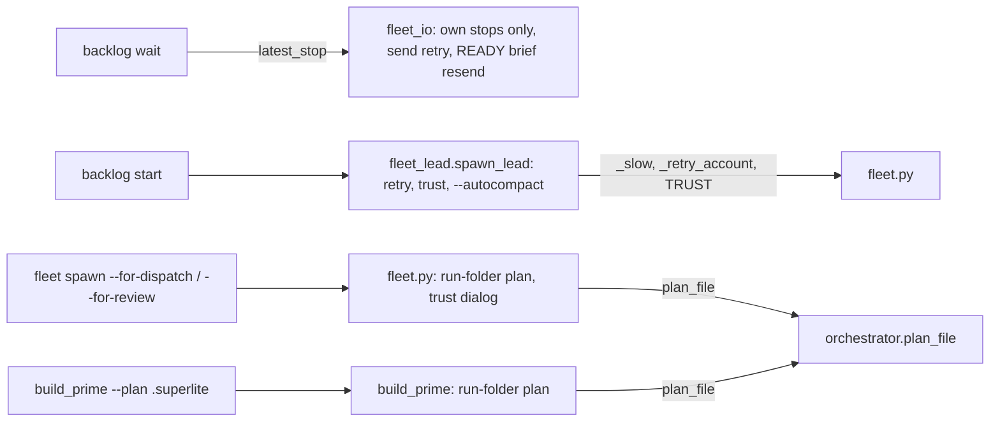
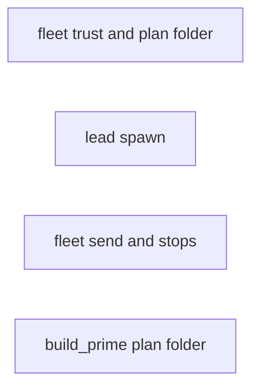

# Superlite: fleet spawn and lead start (B87)

**Goal:** fix #454, #464, #508, #514, #515: `fleet send` retries a slow Herdr reply, a lead spawn gets the account retry, the trust dialog and main's auto-compact window, `fleet spawn --for-dispatch|--for-review` and `build_prime` accept the run folder as `--plan`, and `backlog wait` no longer parks a working lead because of stop records its own child sessions wrote.
**Architecture:** four independent tasks, one module each: fleet.py (T1), fleet_lead.py (T2), fleet_io.py (T3), build_prime.py (T4). No edges: each uses only code that exists today.
**Tech stack:** Python 3.10+ stdlib, pytest (through `sl run_tests`).
**Spec:** this file, section Design; the five issue bodies.
**Detail:** tests
**Target-min:** 11
**Wave0:** none

Global constraints:
- Every code line in `skills/subagent-driven-development/scripts/*.py` carries the repo's trailing `# O(...)` complexity comment where the surrounding function's lines do; tests do not. Stdlib only.
- Existing tests stay green. An existing test file changes only when the task Owns it. If another existing test turns red, report it in DONE_WITH_CONCERNS with the test id and the reason instead of editing it.
- Run `sl` as an executable (`<abs>/sl ...`). Verify with `<abs>/sl run_tests --fast <own test files> --task Tn --background`, then run the printed `wait:` line in the foreground and end the turn only after it reports.
- Tests clear SUPERLITE_FLEET_ROLE, SUPERLITE_FLEET_PARENT_DIR and SUPERLITE_STATE_DIR with `monkeypatch.delenv(..., raising=False)`. Tests that script herdr replies skip under `SUPERLITE_REAL=1` like their neighbours.
- No version edits (the ship step bumps the version). Never run `scripts/evals.sh`, `claude plugin eval` or `scripts/test_layers.py run`. Each module's docstring gets one sentence per new behaviour.

Ruling: B87 also edits fleet_io.py and build_prime.py, outside its brief's list (#454 names fleet_io.send; #508 names build_prime); no open batch owns them (B86: backlog_*.py, B88: run_tests.py, test_layers.py, hooks/record-human-reply) - cost if wrong: one rebase conflict.
Ruling: #515's root cause is not a lead that answered a prime: B77's lead W67 ran spike `claude` sessions in its scratchpad; they inherited SUPERLITE_FLEET_WORKER=W67 and SUPERLITE_FLEET_PARENT_DIR, so their Stop hook wrote `last: READY` records as W67 into main's metrics.jsonl (transcripts under `-private-tmp-...-scratchpad-spike/`). Fix: `fleet_io.latest_stop` skips a lead's stop record whose transcript folder is not the lead worktree's Claude project folder; backlog_run.py (B86's) is not touched - cost if wrong: a lead stop in an unexpected folder is not seen and its batch waits.
Ruling: Max's decision for #515 (re-send the brief once) lives in `fleet_io.send_text`: backlog wait's one re-prompt (`fleet send Wn --text REPROMPT`) to a lead whose newest own stop says only READY sends the lead's brief message instead - cost if wrong: one extra brief message to a lead.
Ruling: #454's send retry: Herdr `timed out waiting for app response` on a send first asks `agent_state`; `working` means the message landed (no resend), anything else resends once with the same message; a stall (`agent_prompt_stalled`) resends at once. One helper for `send`, `send_brief` and `send_text` (task sends get the stall resend too) - cost if wrong: a duplicate message to a worker that went working late.
Ruling: #464 uses `claude --autocompact <n>` (docs/config.md names it) in `lead_argv`; the window is main's (`CLAUDE_CODE_AUTO_COMPACT_WINDOW` in main's env, else `autoCompactWindow`, else `modelSettings.<key holding the lead model>.autoCompactWindow` in main's user settings), else 400000, the window `/superlite:setup` offers; written `400k` when divisible by 1000 - cost if wrong: one argv change.
Ruling: #514: the trust dialog counts as open when `Yes, I trust this folder` is on screen and no READY line is (`_is_ready`), so the fake binary's screen (trust text plus READY) changes nothing. A primed worker with no READY and an open dialog gets Down, Enter and the prime once more; still open: `BLOCKED: Wn no READY: the folder trust dialog is still open in <cwd>; accept it once per account (start claude there on account <A>), then rerun`. Roles without a prime and leads check the screen once after a successful start - cost if wrong: one more screen read per one-turn spawn.
Ruling: #508: a `--plan` that is a folder resolves with `orchestrator.plan_file(state.plan_dir(P))` (stable.json, pool.json, plan.md); none found is `error: --plan P is a run folder with no plan file (stable.json, pool.json or plan.md name none); pass the plan file`, exit 2. Plain `fleet spawn` keeps taking the folder as today - cost if wrong: one message.
Ruling: detail tests; no probe adapter (CLI over herdr and files; Review Focus cases are named pytest cases); already in the lead worktree; layers: unit only (scripts/** and tests/scripts/**) - cost if wrong: one NEEDS_CONTEXT round.
LAYERS: unit

## Design

### 1. fleet.py (T1)
- `_trust_open(screen) -> bool`: `TRUST in screen and not _is_ready(screen)`. `_accept_trust(name)`: `hc.send_keys(name, ["Down", "Enter"])`, `hc.wait_state(name, ["idle"], 60000)`; the `agent_not_ready` path uses it (behaviour unchanged).
- `_spawn`, role without a prime: after a successful start read the screen once (`SCREEN_ROWS`); `_trust_open` -> `_accept_trust`.
- `_spawn`, primed role, before the `no READY` fail: when `_trust_open(screen)`: `_accept_trust`, resend the same prime ask once (`hc.prompt(name, ask, ["idle", "done", "blocked"], 180000)`), read the screen again; a HerdrError there fails as `startup: <code>: <message>`. Still not READY with TRUST on screen: the BLOCKED line of the Ruling (`named=False`); otherwise the existing `no READY` text.
- `main`, spawn with `--for-dispatch` or `--for-review`/`--package`: a `--plan` that is a folder is replaced by `orchestrator.plan_file(state.plan_dir(a.plan))` before the call; None prints the #508 error and returns 2 before dispatch, pane or worker id.

### 2. fleet_lead.py (T2)
- `main_window(env, model) -> int` per the #464 Ruling; settings file `$CLAUDE_CONFIG_DIR/settings.json` of `env`, else `<env HOME or Path.home()>/.claude/settings.json`; only positive ints count (no bools); unreadable or non-object JSON is the default. `modelSettings` keys are tried in sorted order.
- `lead_argv(sl_path, model, window=None)`: unchanged without a window; else `+ ["--autocompact", "400k"]` style (`f"{n // 1000}k"` when `n % 1000 == 0`, else `str(n)`). `spawn_lead` passes `main_window(base, model)`.
- `spawn_lead` keeps its signature and return dict; it runs `_spawn_lead(..., after=None)` and on `fleet._Slow` once more with `after`. The retry picks `fleet._retry_account(main_sd, model, base, after.account)`, prints `<after.wid> account <after.account> <after.why>; retrying on account <new>` on stderr, and a second failure's BLOCKED reason ends `; retried after <after.wid> on <after.account>`. A first start error with `fleet._slow(e)`: state blocked, pane closed, `fleet._keep(main_sd, wid, why, screen, "fleet spawn retry")`, raise `fleet._Slow(wid, account, why)` with `why = "startup: <first screen line or message or code>"`. Other errors stay as today.
- After a successful start: read the screen (a HerdrError is ignored); `fleet.TRUST in screen and not fleet._is_ready(screen)` -> Down, Enter, wait idle 60000.

### 3. fleet_io.py (T3)
- `SLOW_MSG = "timed out waiting for app response"`. `_prompt(name, msg)`: `hc.prompt(name, msg, ["working"], 15000)`; on HerdrError: code `STALLED` -> resend once; `SLOW_MSG` in the message -> `hc.agent_state(name)` (HerdrError -> None); `working` -> return; else resend once. Other errors and a second failure propagate. `send`, `send_brief` and `send_text` call it.
- `project_dir(path) -> str`: `re.sub(r"[^A-Za-z0-9]", "-", str(path))`. `own_stop(rec, worker) -> bool`: True when `worker` is None or has no `worktree`, or `rec` has no transcript; else the transcript's parent folder name equals `project_dir` of the worktree or of its resolved path (a name over 200 characters: the folder name starts with its first 200).
- `latest_stop(sd, wid, after_ms, stops=None)`: same signature; reads the worker record once and skips records where `own_stop` is False.
- `send_text`: role `lead`, the newest own stop since `sent` has `" ".join(last.split()) == "READY"` and `<lead_sd>/briefs/lead.md` is a file -> the message is `fleet_report.brief_message("lead", <abs brief>)` (no contract appended) and stdout gets `Wn brief resent (its last stop said only READY)`; otherwise unchanged.

### 4. build_prime.py (T4)
- `main`: right after parsing, a `--plan` that is a folder becomes `orchestrator.plan_file(state.plan_dir(a.plan))`; None -> `die("--plan P is a run folder with no plan file (stable.json, pool.json or plan.md name none); pass the plan file")` (exit 2). Then `orchestrator.require` and the rest use the file.

## Coverage

| Category | State | Basis |
|---|---|---|
| Scope and success criteria | settled | five issue bodies; Max: re-send the brief once |
| Domain and data model | n/a | no data change |
| Persistence and migration | n/a | nothing new stored |
| Interfaces and contracts | ruled | `lead_argv` and `latest_stop` keep their calls; new helpers only |
| UI states | n/a | CLI text only |
| Concurrency and state ownership | ruled | stop records filtered per lead worktree |
| Error handling and recovery | ruled | one resend per send, one account retry per lead, trust accept once |
| Security and privacy | ruled | trust is accepted only where fleet already accepts it (its own worktree or project) |
| Performance and limits | ruled | one fleet.json read per latest_stop, one screen read per one-turn spawn |
| Observability | settled | stderr retry line, BLOCKED lines, `brief resent` line |
| Testing strategy | settled | in-process FakeHerdr cases per task |
| Compatibility | settled | defaults keep today's behaviour |
| Rollout | ruled | one PR; version bump at ship |
| Research unknowns | n/a | root cause of #515 read from main's metrics.jsonl |

## File structure
- `skills/subagent-driven-development/scripts/fleet.py`, `tests/scripts/test_fleet_trust_plan_b87.py` (T1)
- `skills/subagent-driven-development/scripts/fleet_lead.py`, `tests/scripts/test_fleet_lead.py`, `tests/scripts/test_fleet_lead_b87.py` (T2)
- `skills/subagent-driven-development/scripts/fleet_io.py`, `tests/scripts/test_fleet_io_b87.py` (T3)
- `skills/subagent-driven-development/scripts/build_prime.py`, `tests/scripts/test_build_prime_run_folder_508.py` (T4)

## Task graph

```mermaid
%% schedule
gantt
  title Predicted schedule (mm:ss)
  dateFormat X
  axisFormat %M:%S
  section lane 1
  T2 lead spawn retry trust and auto-compa :t2, 0, 88s
  section lane 2
  T3 fleet send retry and lead stop record :t3, 0, 88s
  section lane 3
  T1 fleet trust dialog and run-folder pla :t1, 0, 87s
  section lane 4
  T4 build_prime accepts the run folder :t4, 0, 75s
```

critical path: T2 (1.5 min) · peak width 4 · predicted build 1.5 min · predicted total ≈ 5.0 min (target ✓)

## Package: fleet
App type: CLI over herdr. Categories: protocol (herdr errors, argv), state (worker records, stop records), file (settings.json, run folder). Specific risks: a resend that duplicates a landed message; a lead's own stop filtered out; a trust accept on a ready pane.
**Probe entry:** none (Ruling: no probe adapter).

### T1 fleet trust dialog and run-folder plan · Complexity 4 · Est. context 45k
**Owns:** skills/subagent-driven-development/scripts/fleet.py, tests/scripts/test_fleet_trust_plan_b87.py
**Components:** 1
**LOC owned:** 140
**Tests:** fast
**Model:** sonnet
**Est. time:** 2.6 min (1 component, about 140 LOC, fast tests)
**Covers:** 1
**Consumes:** none
**Produces:** fleet._trust_open(screen: str) -> bool
**Review Focus:**
Fixture: `world` from test_fleet (FakeHerdr: `screen`, `screen_after` once `send_keys` ran, `prompt_state`). `D = "Quick safety check\n > No, exit\n   Yes, I trust this folder\n"`.
protocol: `test_trust_open` (`_trust_open(D)` True; `_trust_open("Yes, I trust this folder\nREADY\n")` False; `_trust_open("READY\n")` False).
state: `test_trust_after_prime_accepted_and_prime_resent` (`fleet.main(["on"])`, `screen = D`, `screen_after = "⏺ READY\n"`, `prompt_state = "idle"` -> `spawn(...)["id"] == "W1"`; `("send_keys", name, ["Down", "Enter"])` in calls; two `prompt` calls with the same prime text; worker state `ready`).
state: `test_trust_dialog_stays_open_names_it` (`screen = screen_after = D` -> SystemExit 3; stdout holds `BLOCKED: W1 no READY: the folder trust dialog is still open in <world.proj>` and `accept it once per account`; worker state `blocked`).
state: `test_no_dialog_keeps_no_ready` (`screen = "nothing\n"` -> SystemExit 3, stdout `BLOCKED: W1 no READY (pane 64 rows, 73 cols)`; no `send_keys`).
protocol: `test_ready_with_trust_text_sends_no_keys` (`screen = "Yes, I trust this folder\nREADY\n"` -> W1 ready, no `send_keys`, one `prompt`).
state: `test_one_turn_role_accepts_trust_after_start` (`spawn(..., role="fixer", tier="1")` with `screen = D` -> `send_keys` Down, Enter after `start_agent`, no `prompt`).
protocol: `test_for_dispatch_resolves_run_folder` (stable.json `{"plan": str(world.plan)}` in `world.sd`; `fleet.for_dispatch` monkeypatched to record its plan -> `fleet.main(["spawn", "--for-dispatch", "--plan", str(world.sd)])` passes `str(world.plan)`; the same for `--for-review T1` and `fleet.for_review`).
protocol: `test_run_folder_without_plan_is_exit_2` (empty run folder -> returns 2; stderr `error: --plan <sd> is a run folder with no plan file (stable.json, pool.json or plan.md name none); pass the plan file`; no `start_agent`, fleet.json has no worker).
**Steps:** 1 failing tests, 2 run: FAIL, 3 implement Design 1, 4 run: PASS (own file plus `tests/scripts/test_fleet.py tests/scripts/test_fleet_for_dispatch.py tests/scripts/test_fleet_spawn_account_retry_428.py`).

### T2 lead spawn retry, trust and auto-compact · Complexity 4 · Est. context 45k
**Owns:** skills/subagent-driven-development/scripts/fleet_lead.py, tests/scripts/test_fleet_lead.py, tests/scripts/test_fleet_lead_b87.py
**Components:** 1
**LOC owned:** 150
**Tests:** fast
**Model:** sonnet
**Est. time:** 2.8 min (1 component, about 150 LOC, fast tests)
**Covers:** 2
**Consumes:** none
**Produces:** fleet_lead.main_window(env: dict, model: str) -> int · fleet_lead.lead_argv(sl_path: str, model: str, window: int | None = None) -> list[str]
**Review Focus:**
Fixture: `world` from test_fleet, `SUPERLITE_HOME` set to tmp as in test_fleet_lead. In test_fleet_lead.py only `test_spawn_lead_starts_in_the_worktree_without_prime` changes: its argv is `fl.lead_argv(sl, "opus", 400000)`.
file: `test_main_window` (`{"CLAUDE_CODE_AUTO_COMPACT_WINDOW": "300000"}` -> 300000; `CLAUDE_CONFIG_DIR=d` with `{"autoCompactWindow": 250000}` -> 250000; `{"modelSettings": {"claude-opus-5-5": {"autoCompactWindow": 350000}}}` and model `opus` -> 350000; `{"autoCompactWindow": true}` -> 400000; invalid JSON -> 400000; `{"HOME": str(tmp)}` with `tmp/.claude/settings.json` `{"autoCompactWindow": 200000}` -> 200000; nothing -> 400000).
protocol: `test_lead_argv_window` (window 400000 -> tail `["--autocompact", "400k"]`; 123456 -> `["--autocompact", "123456"]`; None -> the old list).
state: `test_slow_start_retried_on_another_account` (accounts `claude1,claude3`, first `start_agent` raises code `timeout` -> result `id == "W2"`, account `claude1`; stderr `W1 account claude3 startup: ...; retrying on account claude1`; W1 `blocked`).
state: `test_second_slow_start_blocks` (both starts raise `timeout` -> SystemExit 3; stdout BLOCKED line ends `; retried after W1 on claude3`).
protocol: `test_other_start_error_not_retried` (`agent_not_ready`, screen without the dialog -> SystemExit 3 after one `start_agent`).
state: `test_trust_dialog_after_start_accepted` (no start error, `screen = "Quick safety check\n > No, exit\n   Yes, I trust this folder\n"` -> `send_keys` Down, Enter; record `ready`); `test_ready_screen_sends_no_keys` (`screen = "Yes, I trust this folder\nREADY\n"` -> no `send_keys`).
**Steps:** 1 failing tests, 2 run: FAIL, 3 implement Design 2, 4 run: PASS (own files plus `tests/scripts/test_backlog_run.py tests/scripts/test_backlog_run_lifecycle.py`).

### T3 fleet send retry and lead stop records · Complexity 5 · Est. context 50k
**Owns:** skills/subagent-driven-development/scripts/fleet_io.py, tests/scripts/test_fleet_io_b87.py
**Components:** 1
**LOC owned:** 150
**Tests:** fast
**Model:** sonnet
**Est. time:** 2.8 min (1 component, about 150 LOC, fast tests)
**Covers:** 3
**Consumes:** none
**Produces:** fleet_io.own_stop(rec: dict, worker: dict | None) -> bool · fleet_io.project_dir(path: str) -> str
**Review Focus:**
Fixture: `io, world` from test_fleet_io; scripted `world.fh.prompt` raising HerdrError(code, message) like test_fleet_io_brief_stall; `world.fh.agent_state` set per test.
protocol: `test_send_slow_reply_resent_once` (first prompt raises `("timeout", "timed out waiting for app response after 5000 ms")`, `agent_state` -> `idle` -> `io.send` prints `W1 T1 sent`, two prompts with the same text, worker busy on T1).
protocol: `test_send_slow_reply_that_landed_not_resent` (same error, `agent_state` -> `working` -> one prompt, busy).
protocol: `test_send_brief_slow_twice_propagates` (both prompts raise the slow error, `agent_state` raises -> HerdrError raised, worker stays `ready`).
protocol: `test_send_text_stall_resent` (`agent_prompt_stalled` once -> two prompts).
state: `test_own_stop` (`{"transcript": "/u/p/-wt-b1/s.jsonl"}` with `{"worktree": "/wt/b1"}` True; `/u/p/-tmp-x-scratchpad/s.jsonl` False; no transcript True; worker without worktree True; `None` True; `project_dir("/Users/a/.claude/w-1") == "-Users-a--claude-w-1"`).
state: `test_latest_stop_skips_child_session_of_lead` (fleet.json W1 role lead, worktree `wt`; metrics: own stop t=100 last `Status: DONE`, then a scratchpad stop t=200 last `READY` -> `latest_stop(sd, "W1", 0)["t"] == 100`; a non-lead worker gets t=200).
state: `test_send_text_resends_brief_after_ready_stop` (lead W1 with `lead_sd` holding `briefs/lead.md`, `sent` 50, own stop t=100 last `READY` -> prompt text is `fleet_report.brief_message("lead", <abs brief>)`, stdout has `W1 brief resent (its last stop said only READY)`; last `Status: DONE` -> the free text plus contract as before).
**Steps:** 1 failing tests, 2 run: FAIL, 3 implement Design 3, 4 run: PASS (own file plus `tests/scripts/test_fleet_io.py tests/scripts/test_fleet_io_brief_stall.py tests/scripts/test_fleet_send_kinds.py tests/scripts/test_fleet_io_notify.py`).

### T4 build_prime accepts the run folder · Complexity 2 · Est. context 26k
**Owns:** skills/subagent-driven-development/scripts/build_prime.py, tests/scripts/test_build_prime_run_folder_508.py
**Components:** 1
**LOC owned:** 60
**Tests:** fast
**Kind:** mechanical
**Model:** haiku
**Est. time:** 1.6 min (1 component, about 60 LOC, fast tests)
**Covers:** 4
**Consumes:** none
**Produces:** none
**Review Focus:**
Fixture: `tmp_path / "proj"` with `.superlite/`, a plan from `test_plan_tools.make_plan(proj, [{"id": "T1", "owns": "src/a.py"}])`, `monkeypatch.chdir(proj)`, SUPERLITE_STATE_DIR cleared.
file: `test_run_folder_uses_stable_plan` (stable.json `{"plan": str(plan.resolve())}` -> `build_prime.main(["--plan", str(sd), "--out", str(o1)])` returns 0; `o1` bytes equal those of `main(["--plan", str(plan), "--out", str(o2)])`).
file: `test_run_folder_uses_plan_md` (no stable.json or pool.json, the plan copied to `sd / "plan.md"` -> returns 0, `o1` written).
file: `test_run_folder_without_plan_exits_2` (empty run folder -> SystemExit code 2; stderr `error: --plan <sd> is a run folder with no plan file (stable.json, pool.json or plan.md name none); pass the plan file`; no out file).
**Steps:** 1 failing tests, 2 run: FAIL, 3 implement Design 4, 4 run: PASS (own file plus `tests/scripts/test_build_prime_mini.py tests/scripts/test_build_prime_stub_root.py`).

## Review Focus
- fleet: protocol, state, file; cases in T1-T4.

## Self-review
- Coverage: #454 -> Design 2 (lead retry) and 3 (send retry); #464 -> 2; #508 -> 1 and 4; #514 -> 1 and 2; #515 -> 3 (root cause and Max's resend). No placeholders. No edges; no two tasks share a file.
