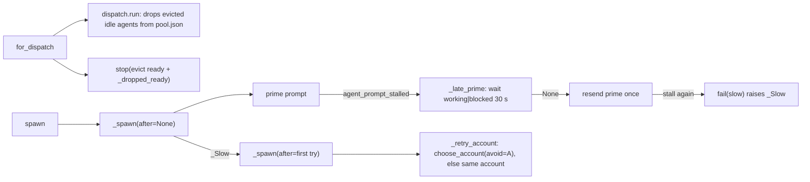
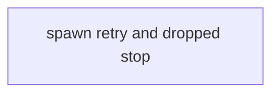

# Superlite: fleet spawn retries a slow start on another account and stops dropped workers (B74)

**Goal:** fix #424 and #428 in `fleet.py`. #424: a ready implementer that an earlier `dispatch` or `commit_task --dispatch` evicted (dropped from pool.json) keeps its pane, because only `spawn --for-dispatch`'s own round stops evicted workers and the next round no longer names them. #428: a prime that herdr reports `agent_prompt_stalled` (herdr's fixed 5 s window) is resent at once and a second stall exits 3; Max's decision: a longer wait, plus one retry on another account.
**Architecture:** `for_dispatch` stops this round's evicted ready workers plus every ready implementer pool.json no longer lists (`_dropped_ready`); `spawn` writes the pool entry before it marks a worker ready, so no concurrent round sees a fresh worker outside the pool. A stalled prime first waits up to `STALL_WAIT_MS` for a late start (`_late_prime`), then is resent once; a start that stays slow (`_slow`: stall, timeout, app response timeout) raises `_Slow` inside `_spawn`, and `spawn` runs `_spawn` once more on another account (`choose_account(..., avoid=)`), or on the same one when no other has headroom.
**Tech stack:** Python 3.10+ stdlib, pytest (through `sl run_tests`).
**Spec:** this file, section Design; issues #424 and #428 (Expected lines).
**Detail:** tests
**Target-min:** 11
**Wave0:** none
**Max chars:** 26000

Global constraints:
- Every new or changed code line in `skills/subagent-driven-development/scripts/fleet.py` carries the repo's trailing `# O(...)` complexity comment (as the file does today); tests do not. Stdlib only.
- Existing tests stay green, except the two assertion edits named in T1 Notes. If another existing test turns red, report it in DONE_WITH_CONCERNS with the test id and the reason instead of editing it.
- Run `sl` as an executable (`<abs>/sl ...`). Verify with `<abs>/sl run_tests --fast tests/scripts/test_fleet_evict_dropped_424.py tests/scripts/test_fleet_spawn_account_retry_428.py tests/scripts/test_fleet.py tests/scripts/test_fleet_capacity.py tests/scripts/test_fleet_for_dispatch.py tests/scripts/test_fleet_dispatch_round.py tests/scripts/test_fleet_spawn_shell_retry.py tests/scripts/test_fleet_roles_spawn.py --task T1 --background`, then run the printed `wait:` line in the foreground and end the turn only after it reports.
- No version edits (the ship step bumps the version). Touch only the files in Owns; `fleet_io.py`, `dispatch.py`, `commit_task.py` and all docs stay unchanged (outside B74's files).

Ruling: #424 is fixed where the brief allows (fleet.py): `spawn --for-dispatch` stops every `ready` worker whose role is implementer (a record without `role` counts as one) and whose id pool.json no longer lists, after this round's `dispatch.run`, together with this round's evicted ready workers, each once, in that order; `commit_task --dispatch` itself still only prints `evict=` (it never touches panes) - cost if wrong: a worker evicted by `commit_task --dispatch` keeps its pane until the next `spawn --for-dispatch`.
Ruling: no pool.json means nothing is stopped as dropped; a busy, starting, blocked or stopped worker is never stopped as dropped; research, reviewer, fixer and lead workers never enter the pool and are skipped - cost if wrong: none, the pool only ever holds implementers.
Ruling: `spawn` calls `_register_pool` before `fs.set_state(sd, wid, "ready")`, so a parallel `spawn --for-dispatch` never reads a fresh ready implementer outside the pool - cost if wrong: a dispatch in that window may offer a worker whose state still reads `starting`; it has already answered READY.
Ruling: the longer wait is `STALL_WAIT_MS = 30000`: after the first stall `_late_prime` waits for `working` or `blocked`; `working` then waits up to 180000 ms for idle, done or blocked; herdr's `timeout` reads the screen and takes READY as done; anything else resends the prime once, as today - cost if wrong: a lost prime costs 30 s more before its resend.
Ruling: the account retry covers a startup HerdrError whose code is `agent_prompt_stalled` or `timeout`, or whose message holds `timed out waiting for app response`, raised after the pane opened (start, trust keys, prime, resend); open_pane errors, `no READY`, a late `blocked`, a missing prime and every other code keep today's exit 3 - cost if wrong: another slow-start code still exits 3.
Ruling: one retry with a new worker id; the first try keeps state `blocked`, its pane closed, its screen file and an incident `fleet spawn retry: <why>`, and stderr gets `Wn account A <why>; retrying on account B`; with no other account with headroom the retry runs on the same account (feedback 505aac4de35e: the next spawn on the same account came up ready); a failed retry prints its own BLOCKED line ending `; retried after Wn on A` - cost if wrong: one extra worker id per retried spawn.
Ruling: detail tests; one task (one file, one chain, about 260 LOC); no probe adapter (CLI tested in-process against the fake herdr) - cost if wrong: no generated probes.
Ruling: already in the lead worktree on branch superlite/b74-fleet-spawn-retry-and-evict-stop - cost if wrong: none.
LAYERS: unit



## Design

1. `fleet._dropped_ready(sd) -> list[str]`: `[]` when `<sd>/pool.json` does not exist; else the ids of `fs.workers(sd)` (fleet.json order) whose `state` is `ready`, whose `role` (missing: `implementer`) is `implementer`, and whose id is not an `id` in `pool.load(<sd>/pool.json)["agents"]`.
2. `for_dispatch`: after `dp.run` and `dp.render`, `ids = [k for k in evict if state_of.get(k) == "ready"]`, then append each `_dropped_ready(sd)` id not already in `ids`; `for wid in stop(sd, ids): print(f"stopped {wid}")`.
3. `spawn` body becomes `_spawn(sd, plan, tier, project, cfg, env, role, after)`; `spawn(...)` (same signature as today) returns `_spawn(..., None)` and on `_Slow as first` returns `_spawn(..., first)`. In `_spawn`, `_register_pool` (when `launch["pool"]`) moves before `fs.set_state(sd, wid, "ready")`.
4. `class _Slow(Exception)` with `wid`, `account`, `why`. `fleet._slow(e: HerdrError) -> bool`: `e.code in ("agent_prompt_stalled", "timeout") or SLOW_MSG in (e.message or "")`, `SLOW_MSG = "timed out waiting for app response"`.
5. `fleet._late_prime(name: str) -> str | None`: `hc.wait_state(name, ["working", "blocked"], STALL_WAIT_MS)`; a HerdrError with code `timeout` returns `"idle"` when `_is_ready(hc.read_screen(name, SCREEN_ROWS))`, else None; any other HerdrError propagates; `working` returns `hc.wait_state(name, ["idle", "done", "blocked"], 180000)`; `blocked` returns `"blocked"`; any other reply returns None.
6. The prime: on `agent_prompt_stalled`, `st = _late_prime(name) or hc.prompt(name, ask, ["idle", "done", "blocked"], 180000)`.
7. `fail(why, screen=None, named=True, slow=False)`: sets `blocked` and closes the pane as today; then, when `slow and after is None`, writes the screen file and the incident (`fleet spawn retry: <why>`, cut to 150 chars, kind `workaround`) and raises `_Slow(wid, account, why)`; else `_blocked(sd, wid, account, why + tail, screen, named)` with `tail = "" if after is None else f"; retried after {after.wid} on {after.account}"`. The start-error call passes `slow=_slow(e)`; the outer HerdrError handler calls `fail(f"startup: {e.code}: {e.message}", slow=_slow(e))` (the real HerdrError's `str` is the same text). The open_pane BLOCKED line also gets `tail`.
8. `_blocked` keeps its output; its screen-file and incident part becomes `_keep(sd, wid, why, screen, label)` (label `fleet spawn blocked` or `fleet spawn retry`), shared by both paths.
9. `choose_account(sd, model, env, avoid=None)`: entries whose `ac.entry_name` equals `avoid` are dropped right after `entries` is built; output and exits otherwise unchanged (`fleet_lead.py` and `fleet_layer.py` keep calling it without `avoid`).
10. `fleet._retry_account(sd, model, env, avoid) -> (account, cdir, shared)`: `choose_account(..., avoid=avoid)` with stdout sent to a buffer; on `SystemExit` code 3 it returns `choose_account(sd, model, env)` (that call prints and exits as today when it fails too). `_spawn` with `after` uses it, then prints `f"{after.wid} account {after.account} {after.why}; retrying on account {account}"` to stderr.
11. The module docstring gains two lines: the dropped-worker stop and the stall wait plus account retry.

## Coverage

| Category | State | Basis |
|---|---|---|
| Scope and success criteria | settled | #424 and #428 Expected lines; Max's decision on #428 |
| Domain and data model | ruled | pool.json membership marks a live implementer as dispatchable |
| Persistence and migration | n/a | fleet.json and pool.json shapes unchanged |
| Interfaces and contracts | ruled | `spawn` signature and stdout lines unchanged; `choose_account` gains `avoid=None` |
| UI states | n/a | CLI text only |
| Concurrency and state ownership | ruled | pool entry before `ready` |
| Error handling and recovery | ruled | slow codes retried once on another account; others exit 3 |
| Security and privacy | n/a | local panes only |
| Performance and limits | ruled | at most 30 s wait plus one resend plus one retry per spawn |
| Observability | ruled | stderr retry line, incident, screen file, `; retried after` tail |
| Testing strategy | settled | two new test files, two assertion edits |
| Compatibility | ruled | callers of `choose_account` and `spawn` unchanged |
| Rollout | ruled | one PR; version bump at ship |
| Research unknowns | settled | `herdr agent prompt --help`: the 5000 ms stall window is fixed |

## File structure
- `skills/subagent-driven-development/scripts/fleet.py`: Design 1-11 (T1).
- `tests/scripts/test_fleet_evict_dropped_424.py`: #424 cases (T1).
- `tests/scripts/test_fleet_spawn_account_retry_428.py`: #428 cases (T1).
- `tests/scripts/test_fleet.py`, `tests/scripts/test_fleet_capacity.py`: one assertion each (T1 Notes).

## Task graph

```mermaid
%% schedule
gantt
  title Predicted schedule (mm:ss)
  dateFormat X
  axisFormat %M:%S
  section lane 1
  T1 spawn retry and dropped stop :t1, 0, 109s
```




critical path: T1 (1.8 min) · peak width 1 · predicted build 1.8 min · predicted total ≈ 5.3 min (target ✓)

## Package: fleet spawn (CLI)
App type: CLI over herdr. Categories: state (fleet.json vs pool.json, worker states), protocol (stdout and stderr lines, exit 3), concurrency (pool entry before ready).
**Probe entry:** none (Ruling: no probe adapter).

### T1 spawn retry and dropped stop · Complexity 5 · Est. context 44k
**Owns:** skills/subagent-driven-development/scripts/fleet.py, tests/scripts/test_fleet_evict_dropped_424.py, tests/scripts/test_fleet_spawn_account_retry_428.py, tests/scripts/test_fleet.py, tests/scripts/test_fleet_capacity.py
**Components:** 2
**LOC owned:** 260
**Tests:** fast
**Model:** sonnet
**Est. time:** 3.5 min (2 components, about 260 LOC, fast tests)
**Covers:** 1, 2, 3, 4, 5, 6, 7, 8, 9, 10, 11
**Consumes:** existing `pool.load(path) -> dict` · existing `fs.workers(sd) -> dict` · existing `stop(sd, ids) -> list[str]` · existing `hc.wait_state(name, until, timeout_ms) -> str`
**Produces:** fleet._dropped_ready(sd: Path) -> list[str] · fleet._late_prime(name: str) -> str | None · fleet._slow(e: HerdrError) -> bool · fleet.choose_account(sd, model, env, avoid: str | None = None) -> tuple · fleet.STALL_WAIT_MS: int = 30000
**Review Focus:** state: `test_ready_workers_an_earlier_dispatch_dropped_are_stopped`, `test_busy_and_starting_workers_outside_the_pool_are_kept`, `test_ready_worker_of_another_role_is_kept`; concurrency: `test_spawn_writes_the_pool_entry_before_the_worker_reads_ready`; protocol: `test_a_second_stall_retries_once_on_another_account`, `test_a_retry_that_fails_again_blocks_naming_the_first_try`, `test_other_startup_errors_get_no_account_retry`.
**Notes:** two existing assertions change with the retry (Max's decision): `tests/scripts/test_fleet.py::test_prime_error_is_blocked_not_traceback` asserts `"BLOCKED: W2" in ...out` instead of `"BLOCKED: W1"` (every prime stalls, so W2 on claude1 is the retry); `tests/scripts/test_fleet_capacity.py::test_second_stall_blocks_and_other_errors_are_not_resent` asserts `len(seen) == 4` instead of `2` in its first block. Nothing else in those files changes. The FakeHerdr `wait_state` returns `idle` for any `until`, which `_late_prime` reads as no late start (resend), so `test_stalled_prime_is_resent_once` stays as it is.
**Test code (verbatim):**
```python
# tests/scripts/test_fleet_evict_dropped_424.py
"""#424: `fleet spawn --for-dispatch` also stops the ready implementers an earlier dispatch dropped from pool.json."""
import json, os
import pytest
from test_fleet import world  # noqa: F401
from test_fleet_for_dispatch import dwld, _go, FRESH  # noqa: F401
import fleet
import pool
REAL = os.environ.get("SUPERLITE_REAL") == "1"
pytestmark = pytest.mark.skipif(REAL, reason="scripted dispatch lines need the in-process fake")


def drop(sd, *ids):
    """What dispatch.drop_evicted does in an earlier `commit_task --dispatch`: the ids leave pool.json, their panes stay."""
    p = sd / "pool.json"
    data = pool.load(p)
    for i in ids:
        pool.remove(data, i)
    pool.save(p, data)


def workers(sd):
    return json.loads((sd / "fleet.json").read_text())["workers"]


def spawn(w, n):
    for _ in range(n):
        fleet.spawn(w.sd, w.plan, "sonnet", w.proj)


def exits(w):
    return [c[1] for c in w.fh.calls if c[0] == "exit_agent"]


def test_ready_workers_an_earlier_dispatch_dropped_are_stopped(dwld, capsys):
    fleet.main(["on"]); spawn(dwld, 3); capsys.readouterr()
    drop(dwld.sd, "W1", "W2")
    dwld.lines = [("T3", "agent=W3 tier=sonnet")]; dwld.fh.calls.clear()
    assert _go(dwld) == 0
    assert capsys.readouterr().out.splitlines() == ["stopped W1", "stopped W2", "W3 T3 sent"]
    ws = workers(dwld.sd)
    assert ws["W1"]["state"] == "stopped" and ws["W2"]["state"] == "stopped" and ws["W3"]["state"] != "stopped"
    assert exits(dwld) == [fleet.fs.agent_name(dwld.sd, "W1"), fleet.fs.agent_name(dwld.sd, "W2")]


def test_busy_and_starting_workers_outside_the_pool_are_kept(dwld, capsys):
    fleet.main(["on"]); spawn(dwld, 2); capsys.readouterr()
    fleet.fs.set_state(dwld.sd, "W1", "busy"); fleet.fs.set_state(dwld.sd, "W2", "starting")
    drop(dwld.sd, "W1", "W2"); dwld.lines = []; dwld.fh.calls.clear()
    assert _go(dwld) == 0
    assert capsys.readouterr().out == "" and exits(dwld) == []
    ws = workers(dwld.sd)
    assert ws["W1"]["state"] == "busy" and ws["W2"]["state"] == "starting"


def test_ready_worker_of_another_role_is_kept(dwld, capsys):
    fleet.main(["on"]); fleet.spawn(dwld.sd, dwld.plan, None, dwld.proj, role="research"); spawn(dwld, 1); capsys.readouterr()
    dwld.lines = []; dwld.fh.calls.clear()
    assert _go(dwld) == 0
    assert capsys.readouterr().out == "" and exits(dwld) == []
    assert workers(dwld.sd)["W1"]["state"] == "ready"


def test_this_rounds_evict_and_an_earlier_drop_stop_each_worker_once(dwld, capsys):
    fleet.main(["on"]); spawn(dwld, 2); capsys.readouterr()
    drop(dwld.sd, "W1"); dwld.evict = {"W1": "context over 80k", "W2": "context over 80k"}; dwld.lines = []
    dwld.fh.calls.clear()
    assert _go(dwld) == 0
    assert capsys.readouterr().out.splitlines() == ["stopped W1", "stopped W2"]
    assert len(exits(dwld)) == 2


def test_no_pool_file_stops_nothing(dwld, capsys):
    fleet.main(["on"]); spawn(dwld, 1); (dwld.sd / "pool.json").unlink(); capsys.readouterr()
    dwld.lines = []; dwld.fh.calls.clear()
    assert _go(dwld) == 0
    assert capsys.readouterr().out == "" and workers(dwld.sd)["W1"]["state"] == "ready"


def test_spawn_writes_the_pool_entry_before_the_worker_reads_ready(world, monkeypatch):
    fleet.main(["on"]); seen = []
    orig = fleet.fs.set_state
    def spy(sd, wid, state, task=None):
        if state == "ready":
            p = fleet.Path(sd) / "pool.json"
            seen.append([a["id"] for a in pool.load(p).get("agents") or []] if p.exists() else [])
        return orig(sd, wid, state, task)
    monkeypatch.setattr(fleet.fs, "set_state", spy)
    fleet.spawn(world.sd, world.plan, "sonnet", world.proj)
    assert seen == [["W1"]]
```
```python
# tests/scripts/test_fleet_spawn_account_retry_428.py
"""#428: a stalled prime is waited for longer and resent once; a start that stays slow is retried once on another account."""
import json, os
import pytest
from test_fleet import world  # noqa: F401
from test_fleet_for_dispatch import dwld, _go, FRESH  # noqa: F401
import fleet
REAL = os.environ.get("SUPERLITE_REAL") == "1"
pytestmark = pytest.mark.skipif(REAL, reason="scripted herdr replies need the in-process fake")
STALL = ("agent_prompt_stalled", "agent prompt produced no observed working or blocked state within 5000 ms; current status is idle")
APP = "timed out waiting for app response after 5000 ms"


def nm(w, wid):
    return fleet.fs.agent_name(w.sd, wid)


def workers(w):
    return json.loads((w.sd / "fleet.json").read_text())["workers"]


def stall(w, times):
    """prompt raises the stall for the first times[wid] prompts to that worker, then answers as the fake; returns the prompted names."""
    orig, seen, limit = w.fh.prompt, [], {nm(w, k): n for k, n in times.items()}
    def prompt(name, text, until, ms):
        seen.append(name)
        if seen.count(name) <= limit.get(name, 0):
            raise w.fh.HerdrError(*STALL)
        return orig(name, text, until, ms)
    w.fh.prompt = prompt
    return seen


def late(w, reply):
    """The wait for a late start (until working or blocked): `reply` is the state herdr reports, or "timeout" to raise herdr's timeout."""
    orig = w.fh.wait_state
    def wait(name, until, ms):
        if list(until) == ["working", "blocked"]:
            w.fh.calls.append(("late_wait", name, ms))
            if reply == "timeout":
                raise w.fh.HerdrError("timeout", "agent wait timed out")
            return reply
        return orig(name, until, ms)
    w.fh.wait_state = wait


def blank(w, *wids):
    """These workers' screens never show READY."""
    orig, names = w.fh.read_screen, {nm(w, k) for k in wids}
    w.fh.read_screen = lambda name, lines=40, source="visible": "\n" if name in names else orig(name, lines, source)


def first_try(err):
    return [l for l in err.splitlines() if l.startswith("W1 ")]


def test_a_prime_that_starts_late_is_not_resent(world):
    fleet.main(["on"]); seen = stall(world, {"W1": 9}); late(world, "working")
    assert fleet.spawn(world.sd, world.plan, "sonnet", world.proj)["id"] == "W1"
    assert seen == [nm(world, "W1")] and fleet.STALL_WAIT_MS == 30000
    assert ("late_wait", nm(world, "W1"), fleet.STALL_WAIT_MS) in world.fh.calls
    assert ("wait_state", nm(world, "W1"), ["idle", "done", "blocked"]) in world.fh.calls


def test_ready_on_screen_after_the_late_wait_is_not_resent(world):
    fleet.main(["on"]); seen = stall(world, {"W1": 9}); late(world, "timeout")
    assert fleet.spawn(world.sd, world.plan, "sonnet", world.proj)["id"] == "W1" and seen == [nm(world, "W1")]


def test_no_late_start_resends_the_prime_once(world):
    fleet.main(["on"]); seen = stall(world, {"W1": 1}); late(world, "timeout")
    orig = world.fh.read_screen
    world.fh.read_screen = lambda name, lines=40, source="visible": orig(name, lines, source) if len(seen) >= 2 else "\n"
    assert fleet.spawn(world.sd, world.plan, "sonnet", world.proj)["id"] == "W1"
    assert seen == [nm(world, "W1")] * 2 and "W2" not in workers(world)


def test_a_late_blocked_state_is_no_ready_and_not_retried(world, capsys):
    fleet.main(["on"]); capsys.readouterr(); stall(world, {"W1": 9}); late(world, "blocked")
    with pytest.raises(SystemExit) as e:
        fleet.spawn(world.sd, world.plan, "sonnet", world.proj)
    assert e.value.code == 3 and capsys.readouterr().out.startswith("BLOCKED: W1 no READY")
    assert list(workers(world)) == ["W1"]


def test_a_second_stall_retries_once_on_another_account(world, capsys):
    fleet.main(["on"]); capsys.readouterr()
    seen = stall(world, {"W1": 2}); late(world, "timeout"); blank(world, "W1")
    w = fleet.spawn(world.sd, world.plan, "sonnet", world.proj)
    assert (w["id"], w["account"]) == ("W2", "claude1")
    ws = workers(world)
    assert (ws["W1"]["state"], ws["W1"]["account"], ws["W2"]["state"]) == ("blocked", "claude3", "ready")
    cap = capsys.readouterr()
    assert cap.out.splitlines() == [f"W2 account=claude1 pane={w['pane_id']} agent={w['agent']}"]
    assert first_try(cap.err) == [f"W1 account claude3 startup: {STALL[0]}: {STALL[1]}; retrying on account claude1"]
    assert seen == [nm(world, "W1")] * 2 + [nm(world, "W2")]
    assert ("close_pane", ws["W1"]["pane_id"]) in world.fh.calls
    assert "fleet spawn retry: startup: agent_prompt_stalled" in (world.sd / "incidents.jsonl").read_text()


def test_with_no_other_account_the_retry_uses_the_same_one(world, capsys):
    fleet.main(["on", "--accounts", "claude3"]); capsys.readouterr()
    stall(world, {"W1": 2}); late(world, "timeout"); blank(world, "W1")
    w = fleet.spawn(world.sd, world.plan, "sonnet", world.proj)
    assert (w["id"], w["account"]) == ("W2", "claude3")
    cap = capsys.readouterr()
    assert first_try(cap.err)[0].endswith("; retrying on account claude3") and "BLOCKED" not in cap.out


def test_a_retry_that_fails_again_blocks_naming_the_first_try(world, capsys):
    fleet.main(["on"]); capsys.readouterr()
    seen = stall(world, {"W1": 2, "W2": 2}); late(world, "timeout"); blank(world, "W1", "W2")
    with pytest.raises(SystemExit) as e:
        fleet.spawn(world.sd, world.plan, "sonnet", world.proj)
    assert e.value.code == 3
    assert capsys.readouterr().out.splitlines() == [f"BLOCKED: W2 account claude1 startup: {STALL[0]}: {STALL[1]}; retried after W1 on claude3"]
    assert len(seen) == 4 and sorted(workers(world)) == ["W1", "W2"]
    assert {v["state"] for v in workers(world).values()} == {"blocked"}


@pytest.mark.parametrize("code,message", [("timeout", "herdr agent start timed out"), ("exit", APP)])
def test_a_slow_start_retries_on_another_account(world, capsys, code, message):
    fleet.main(["on"]); capsys.readouterr()
    orig, n = world.fh.start_agent, [0]
    def start(*a, **k):
        n[0] += 1
        if n[0] == 1:
            raise world.fh.HerdrError(code, message)
        return orig(*a, **k)
    world.fh.start_agent = start
    w = fleet.spawn(world.sd, world.plan, "sonnet", world.proj)
    assert (w["id"], w["account"], n[0]) == ("W2", "claude1", 2)
    assert first_try(capsys.readouterr().err)[0].endswith("; retrying on account claude1")


def test_other_startup_errors_get_no_account_retry(world, capsys):
    fleet.main(["on"]); capsys.readouterr()
    world.fh.start_error = "agent_not_ready"; world.fh.screen = "Select login method\n"
    with pytest.raises(SystemExit) as e:
        fleet.spawn(world.sd, world.plan, "sonnet", world.proj)
    cap = capsys.readouterr()
    assert e.value.code == 3 and cap.out.startswith("BLOCKED: W1 account claude3 startup: Select login method")
    assert "retrying" not in cap.err and list(workers(world)) == ["W1"]


def test_for_dispatch_sends_to_the_retried_worker(dwld, capsys):
    fleet.main(["on"]); capsys.readouterr()
    stall(dwld, {"W1": 2}); late(dwld, "timeout"); blank(dwld, "W1")
    dwld.lines = [("T2", FRESH)]
    assert _go(dwld) == 0
    assert capsys.readouterr().out.splitlines() == ["W2 T2 sent"]
```
**Steps:** 1 write both test files and the two assertion edits, 2 run: FAIL, 3 implement Design 1-11 in fleet.py, 4 run: PASS

## Review Focus
- state: a ready implementer outside the pool is stopped once; busy, starting, blocked and non-implementer workers are kept; no pool.json stops nothing.
- concurrency: the pool entry exists before `ready` is written.
- protocol: stdout keeps one worker line or one BLOCKED line per spawn; the retry note goes to stderr; exit 3 only after the retry failed; `_spawn_quiet` and `for_dispatch` report the retried worker.

## Self-review
Coverage: Design 1-11 map to T1. No placeholders. Consumes are existing functions. One task, no edges. Fields filled. Review Focus cases are named tests in T1.
