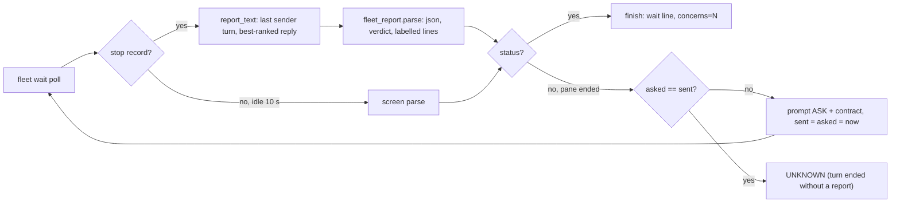
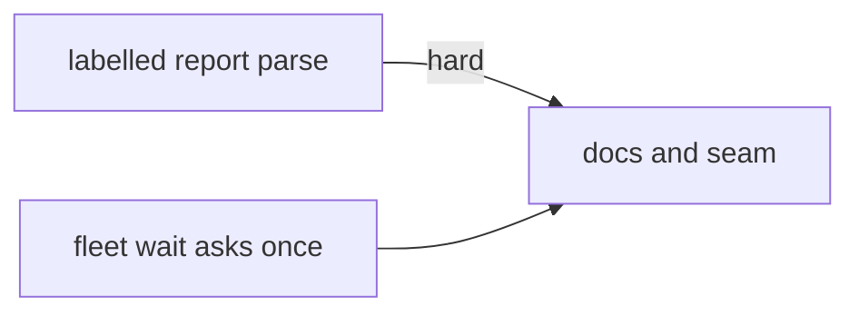

# Superlite: fleet wait reads labelled reports, asks once for a missing one, fast-path review lists what it checked (B91)

**Goal:** fix #500 (a labelled-line report parses in full), #470 (`fleet wait` finds the report past a later turn and asks the worker once when a turn ends without one) and #474 (a fast-path final review still lists what it checked; a full review can be forced).
**Architecture:** `fleet_report.parse` gains a labelled-line reader and a `concerns` list; `fleet_report.brief_message` gains `full`. `fleet_io.report_text` starts a turn only at a sender message and prefers the fullest report in it; `fleet_io.wait` asks a worker once per send (`asked`) before it reports UNKNOWN; `fleet send --brief --full` forces a full final review. `agents/final-reviewer.md` and the SDD `SKILL.md` name the `Checked:` lines on the fast path and the full-review override.
**Tech stack:** Python 3.10+ stdlib, pytest (through `sl run_tests`).
**Spec:** this file, section Design; issues #470, #474, #500 Expected lines; Max's decision: parse labelled lines, ask the worker once.
**Detail:** contracts
**Target-min:** 11
**Wave0:** none

Global constraints:
- Every code line in `skills/subagent-driven-development/scripts/*.py` carries the repo's trailing `# O(...)` complexity comment where the surrounding function's lines do; tests do not. Stdlib only.
- Existing tests stay green. An existing test file changes only when the task Owns it, and only the expectations this task's behaviour change touches. If another existing test turns red, report it in DONE_WITH_CONCERNS with the test id and the reason instead of editing it.
- Run `sl` as an executable (`<abs>/sl ...`). Verify with `<abs>/sl run_tests --fast <own test files> --task Tn --background`, then run the printed `wait:` line in the foreground and end the turn only after it reports.
- Tests clear SUPERLITE_FLEET_ROLE, SUPERLITE_FLEET_PARENT_DIR, SUPERLITE_FLEET_WORKER and SUPERLITE_STATE_DIR with `monkeypatch.delenv(..., raising=False)`.
- No version edits (the ship step bumps the version). Never run `scripts/evals.sh`, `claude plugin eval` or `scripts/test_layers.py run`.

Ruling: every report dict from `fleet_report.parse` carries `concerns` (list of str), filled from labelled `Concerns:` / `Open questions:` / `Questions:` lines; `valid` stays True only for a json block - cost if wrong: one more key for json readers; T1 adds `"concerns": []` to the exact-dict expectations of tests/scripts/test_fleet_report.py and test_fleet_report_red_b65.py.
Ruling: a turn starts only at a sender message: a user message, not isMeta, not `Stop hook feedback`, not a tool result, whose `origin.kind` is absent or `human` and whose text does not start with `<task-notification>`; within it `report_text` takes the newest text of the best rank (json-valid 3, status plus a parsed field 2, status 1), else the last text - cost if wrong: an older reply of the same turn wins over a newer one.
Ruling: ask once per send: a turn that ended without a status (stop record, or screen with no stop record) on a pane that reads done or idle, or any state but working or blocked for SETTLE_MS after the stop, gets one prompt `ASK + contract`; the worker's `asked` equals its new `sent`; the next miss is UNKNOWN as today; leads (backlog wait re-prompts them) and layers are never asked; a Herdr error on the ask finishes UNKNOWN - cost if wrong: one extra prompt per missed report.
Ruling: #474 keeps the cheap fast path but it lists `Checked:` lines; `fleet send Wn --brief <packet> --full` (final-reviewer workers only) and `Full review` in an Agent brief override the `FAST PATH` line; the packet builder (pt_review.py) is outside this batch's files, so no packet flag - cost if wrong: a follow-up `packet --full`.
Ruling: T2 owns tests/scripts/test_fleet_io.py, test_fleet_io_roles.py and test_fleet_io_transcript_lag.py for the expectations the ask changes (an unreported idle stop is now asked first); T2 fakes T1's `parse` concerns and `brief_message(full=)` with monkeypatch; T3 tests the real seam.
Ruling: detail contracts; no probe adapter (Review Focus cases are named pytest cases); already in the lead worktree; layers: unit (scripts, tests), headless and evals (agents/final-reviewer.md, skills/*/SKILL.md).
LAYERS: unit, headless, evals



## Design

### 1. Labelled-line reports (T1, fleet_report.py)
- `_labelled(text)`: reads lines outside fenced blocks (a line whose stripped text starts with three backticks toggles). A label line is `^[ \t]*(?:[-*+][ \t]+)?[*_`]*(<label>)[*_`]*[ \t]*:[*_`]*[ \t]*(<value>.*?)[ \t]*\r?$`, label case-insensitive: files = `files changed`, `changed files`, `files`, `files touched`; tests = `test`, `tests`, `test command`, `test result`, `test results`; summary = `summary`; concerns = `concerns`, `open questions`, `questions`. The list items after a label line are the consecutive lines `^[ \t]*(?:[-*+]|\d+[.)])[ \t]+(.*?)[ \t]*\r?$`; a blank or other line ends them.
- files: the inline value split on commas plus the items; each entry is its first backticked span, else its first whitespace token with trailing `:,;` cut; none-words dropped (`none`, `(none)`, `-`, `n/a`, case-insensitive); duplicates dropped, order kept.
- tests: every tests label's inline value (or, when empty, its first item), joined with `; `. summary: the first summary label's value (or first item). concerns: each concerns label's inline value and items, every `**` removed, stripped, none-words dropped.
- findings outside the Verdict path: `FINDING_LINE` matches on lines outside fences.
- `parse`: a valid json block returns its fields plus `concerns` = the block's `concerns` when a list of strings, else `_labelled(text)["concerns"]`. Otherwise every fallback starts from `_labelled(text)` (files, tests, summary, concerns), `red` and `valid` False; the Verdict path keeps its findings; the status path takes the outside-fence finding lines.
- `brief_message(role, path, full=False)`: a final-reviewer with `full` gets `FULL` between the first sentence and `REVIEW`; `full` changes nothing for other roles. `FULL = "Full review: the packet's FAST PATH line does not apply; review every section and the diff."`
- Module docstring: the labelled form and `concerns`.

### 2. fleet wait (T2, fleet_io.py)
- `_starts_turn` as in the Ruling. `report_text` ranks texts of the last sender turn (Ruling).
- `ASK = "Your last turn ended without your report. If your work is not done, finish it first: run any wait in the foreground and do not end your turn to wait. Then end your reply with your report."` The prompt is `ASK + " " + (fleet_report.REVIEW if role == "final-reviewer" else fleet_report.WORK)`, sent with `_prompt`; then, under `fs.locked`, the worker gets `state busy`, `sent = asked = now`; stdout `Wn <label> ASKED (turn ended without a report; asked once)`; `seen` and `changed` drop the worker; it stays pending. `--any` does not end on an ask.
- `wait`: a stop record without a status ends the turn when the pane reads done or idle, or any state but working or blocked once SETTLE_MS passed since the record was first seen (today such a pane waits to TIMEOUT); then ask once, else finish UNKNOWN with the pane tail. The screen path asks once when its text has no status. The lag (`cut`) path is unchanged.
- `_finish`: when the report has concerns, ` concerns=N` follows `findings=N` in the wait line; the returned dict is unchanged.
- `send --brief FILE --full`: `send_brief(sd, wid, brief, label="", full=False)` passes `full` to `fleet_report.brief_message`. `--full` without `--brief` exits 2 `error: --full needs --brief`; to a worker whose role is not final-reviewer exits 2 `error: --full is for a final-reviewer worker (Wn is <role>)` before any prompt.
- Module docstring: ASKED, concerns, `--full`.

### 3. Docs and seam (T3)
- agents/final-reviewer.md, the fast-path rule: `- Fast path: only when the packet's first line says `FAST PATH` and your brief does not say `Full review`, reply `Verdict: APPROVED` and the `Checked:` lines for the head, test summary and diff stat you read; a bare verdict counts as no review. An inline packet never takes it: review its diff and new files against the spec, even when every other section is empty.` The `Checked:` paragraph's last sentence becomes `On the fast path too: a reply without `Checked:` lines is no review.`
- SKILL.md, Final review step 3: `No `Checked:` block (fast path too) is no review: start a fresh one. Full review asked: `fleet send Wn --brief <packet> --full` (Agent: `Full review` in the brief).` SKILL.md stays at most 11700 characters (tests/scripts/test_orchestrator.py): shorten other wording without dropping a rule or a string a test pins (`grep -rn "SKILL.md" tests`).

## Coverage

| Category | State | Basis |
|---|---|---|
| Scope and success criteria | settled | three Expected lines; Max: parse labelled lines, ask once |
| Domain and data model | ruled | `concerns` key; `asked` worker key |
| Persistence and migration | n/a | fleet.json gains one optional key |
| Interfaces and contracts | ruled | `--full`; ASKED and `concerns=` wait-line parts |
| UI states | n/a | CLI text only |
| Concurrency and state ownership | ruled | `asked` written under fs.locked with `sent` |
| Error handling and recovery | ruled | Herdr error on ask finishes UNKNOWN |
| Security and privacy | n/a | no new input surface |
| Performance and limits | ruled | linear line scan; 20000-line case |
| Observability | settled | ASKED line, concerns count |
| Testing strategy | settled | named cases per task, real seam in T3 |
| Compatibility | ruled | json reports unchanged plus `concerns` |
| Rollout | ruled | one PR; version bump at ship |
| Research unknowns | n/a | transcript shapes read from real sessions |

## File structure
- `skills/subagent-driven-development/scripts/fleet_report.py`: labelled lines, concerns, `full` (T1).
- `tests/scripts/test_fleet_report_labelled_500.py` (new), `test_fleet_report.py`, `test_fleet_report_red_b65.py` (T1).
- `skills/subagent-driven-development/scripts/fleet_io.py`: turns, ranking, ask once, concerns, `--full` (T2).
- `tests/scripts/test_fleet_io_ask_470.py` (new), `test_fleet_io.py`, `test_fleet_io_roles.py`, `test_fleet_io_transcript_lag.py` (T2).
- `agents/final-reviewer.md`, `skills/subagent-driven-development/SKILL.md`, `tests/scripts/test_fleet_wait_report_b91.py` (new) (T3).

## Task graph

```mermaid
%% schedule
gantt
  title Predicted schedule (mm:ss)
  dateFormat X
  axisFormat %M:%S
  section lane 1
  T2 fleet wait finds the report asks once :t2, 0, 110s
  T3 fast-path review docs and seam test :t3, 110, 81s
  section lane 2
  T1 labelled report parse :t1, 0, 85s
```




critical path: T2 → T3 (3.2 min) · peak width 2 · predicted build 3.2 min · predicted total ≈ 6.7 min (target ✓)

## Package: fleet reports
App type: library / parser. Categories: encoding (bold, backticks, CRLF), deep (long replies), state (none). Specific risks: a json field read from inside a fence as a label; a none-word kept as a path.
**Probe entry:** none (Ruling: no probe adapter).

### T1 labelled report parse · Complexity 4 · Est. context 32k
**Owns:** skills/subagent-driven-development/scripts/fleet_report.py, tests/scripts/test_fleet_report_labelled_500.py, tests/scripts/test_fleet_report.py, tests/scripts/test_fleet_report_red_b65.py
**Components:** 1
**LOC owned:** 140
**Tests:** fast
**Model:** sonnet
**Est. time:** 2.6 min (1 component, about 140 LOC, fast tests)
**Covers:** 1
**Consumes:** none
**Produces:** fleet_report.parse(text: str, label: str = "", allow_json: bool = True) -> dict
e.g. parse("Status: DONE_WITH_CONCERNS\nFiles changed:\n- `a.py`\nTest: 3 passed\nConcerns:\n- slow path untested") -> {"status": "DONE_WITH_CONCERNS", "files": ["a.py"], "tests": "3 passed", "red": "", "findings": [], "summary": "", "concerns": ["slow path untested"], "valid": False}
e.g. parse("no status here") -> {"status": "UNKNOWN", "files": [], "tests": "", "red": "", "findings": [], "summary": "", "concerns": [], "valid": False}
**Produces:** fleet_report.brief_message(role: str, path: str, full: bool = False) -> str
e.g. brief_message("final-reviewer", "/r/p.md", full=True) -> "Review the packet /r/p.md as your instructions say. Full review: the packet's FAST PATH line does not apply; review every section and the diff. " + REVIEW
e.g. brief_message("fixer", "/r/b.md", full=True) -> "Read /r/b.md and do what it says. " + WORK
**Review Focus:**
Helpers: `block(obj)` and `GOOD` as in test_fleet_report.py; `LAB = "Status: DONE_WITH_CONCERNS\n\nFiles changed:\n- `skills/a.py`\n- tests/test_a.py: new cases\n* docs/a.md\n\nTest: tests (fast): 37 passed, 0 failed\nRed run: tests (fast): 2 failed\nConcerns:\n- slow path untested\n- **name clash** with b.py\n"`.
encoding: `test_labelled_task_report_parses_in_full` (`parse(LAB) == {"status": "DONE_WITH_CONCERNS", "files": ["skills/a.py", "tests/test_a.py", "docs/a.md"], "tests": "tests (fast): 37 passed, 0 failed", "red": "tests (fast): 2 failed", "findings": [], "summary": "", "concerns": ["slow path untested", "name clash with b.py"], "valid": False}`).
encoding: `test_bold_and_inline_labels` (`"**Status:** DONE\n**Files changed:** `a.py`, b.py\n**Tests:** `sl run_tests --fast t.py` -> 3 passed\n**Summary:** added x\n**Open questions:** none\n"` -> status DONE, files `["a.py", "b.py"]`, tests "`sl run_tests --fast t.py` -> 3 passed", summary `"added x"`, concerns `[]`).
encoding: `test_empty_label_takes_next_items` (`"Status: DONE\nTest:\n- tests (fast): 5 passed, 0 failed\nFiles:\n1. a.py\n2. b.py\n"` -> tests `"tests (fast): 5 passed, 0 failed"`, files `["a.py", "b.py"]`).
encoding: `test_two_test_lines_join` (`"Status: DONE\nTest command: sl run_tests --fast t.py\nTest result: 4 passed, 0 failed\n"` -> tests `"sl run_tests --fast t.py; 4 passed, 0 failed"`).
encoding: `test_crlf_labels` (`"Status: DONE\r\nFiles changed:\r\n- a.py\r\nTest: 1 passed\r\n"` -> files `["a.py"]`, tests `"1 passed"`).
encoding: `test_labels_inside_fences_ignored` (`"Status: BLOCKED\n```\nFiles changed: x.py\nConcerns: y\n```\n"` -> files `[]`, concerns `[]`, status BLOCKED).
encoding: `test_none_words_dropped` (`"Status: DONE\nFiles changed: none\nConcerns: n/a\n"` -> files `[]`, concerns `[]`).
encoding: `test_finding_lines_in_a_status_report` (`"Status: DONE_WITH_CONCERNS\n- src/a.py:12 - off by one - use <= - tier 1\n"` -> findings `[{"file": "src/a.py", "line": 12, "problem": "off by one", "fix": "use <=", "tier": 1}]`).
encoding: `test_json_block_wins_and_carries_concerns` (`parse("Status: DONE\nConcerns:\n- flaky timer\n" + block(GOOD)) == {**GOOD, "concerns": ["flaky timer"], "valid": True}`; a block with `"concerns": ["c1"]` -> `["c1"]`; a block with `"concerns": "c1"` stays valid, concerns `[]`).
deep: `test_long_reply_is_linear` (`"Status: DONE\nFiles changed:\n" + "- a.py\n" * 20000` -> files `["a.py"]` in under 2 s).
protocol: `test_brief_message_full` (the two e.g. lines; no `"\n"`; `brief_message("final-reviewer", p) == brief_message("final-reviewer", p, full=False)`).
Existing files: add `"concerns": []` to `GOOD`, `EMPTY` and each explicit expected dict in test_fleet_report.py and test_fleet_report_red_b65.py; nothing else there changes.
**Steps:** 1 failing tests, 2 run: FAIL, 3 implement Design 1, 4 run: PASS (own files).

## Package: fleet wait
App type: concurrency / CLI. Categories: state (one ask per send, `sent` and `asked` under the lock), protocol (Herdr states, transcript record shapes, argv). Specific risks: an endless ask loop; an old task's report read for a new send; a lead asked by fleet wait and backlog wait both.
**Probe entry:** none (Ruling: no probe adapter).

### T2 fleet wait finds the report, asks once · Complexity 6 · Est. context 52k
**Owns:** skills/subagent-driven-development/scripts/fleet_io.py, tests/scripts/test_fleet_io_ask_470.py, tests/scripts/test_fleet_io.py, tests/scripts/test_fleet_io_roles.py, tests/scripts/test_fleet_io_transcript_lag.py
**Components:** 2
**LOC owned:** 220
**Tests:** fast
**Model:** sonnet
**Est. time:** 4.6 min (2 components, about 220 LOC, fast tests)
**Covers:** 2
**Consumes:** fleet_report.parse(text: str, label: str = "", allow_json: bool = True) -> dict (T1) · fleet_report.brief_message(role: str, path: str, full: bool = False) -> str (T1)
**Produces:** fleet_io.report_text(transcript: str) -> str
e.g. report_text(<user "task", assistant "Status: DONE" + json block R, user origin task-notification, assistant "Background run done.">) -> the text holding R
**Produces:** fleet_io.send_brief(sd: str, wid: str, brief: str, label: str = "", full: bool = False) -> str
**Review Focus:**
Use test_fleet_io.py's `world`, `FakeHerdr`, `rec`, `user`, `assistant`, `HOOK`, `stop_at` (import them). `NOTE = {"type": "user", "origin": {"kind": "task-notification"}, "message": {"content": "<task-notification>\n<task-id>a1</task-id>\n</task-notification>"}}`; `REPORT = "Status: DONE\n" + a json block of a valid WORK report`.
protocol: `test_task_notification_does_not_start_a_turn` (user("task"), assistant(REPORT), NOTE, assistant("Background run done.") -> `report_text == REPORT`; the same with NOTE's `origin` removed).
protocol: `test_json_report_beats_a_later_bare_status` (user("task"), assistant(REPORT), HOOK, assistant("Uncommitted work warning\nStatus: DONE") -> REPORT).
state: `test_new_sender_turn_bounds_the_report` (user("task 1"), assistant(REPORT), user("task 2"), assistant("working on it") -> `"working on it"`).
state: `test_unreported_idle_stop_is_asked_once` (send T3; transcript without a status; stop record after sent; state idle -> `wait(sd, ["W1"], 5000) == []`; stdout holds `W1 T3 ASKED (turn ended without a report; asked once)`; one prompt whose text starts with `io.ASK` and holds `Status: <DONE|DONE_WITH_CONCERNS|NEEDS_CONTEXT|BLOCKED>`; fleet.json W1 `asked == sent`, state busy; no reports/T3.md).
state: `test_answer_after_ask_is_collected` (then a new turn user(ASK text), assistant(REPORT) and a stop record after the new sent -> DONE, source transcript, no second ask).
state: `test_second_miss_is_unknown` (then a stop without a status, idle -> UNKNOWN, stdout `(turn ended without a report)`, exactly one ASK prompt in all).
protocol: `test_other_state_asks_after_settle` (state `"unknown"`, unreported stop: no ask before SETTLE_MS, ASKED after; state `"working"`: TIMEOUT, no ask).
protocol: `test_screen_without_status_is_asked_once` (no stop record, idle, screen `"⏺ Waiting"` -> ASKED after SETTLE_MS; screen `"Status: DONE"` -> DONE `(screen)` as today).
state: `test_lead_is_never_asked` (role lead, unreported idle stop -> UNKNOWN, no prompt).
protocol: `test_ask_herdr_error_finishes_unknown` (prompt raises `io.hc.HerdrError` -> UNKNOWN `(turn ended without a report)`).
protocol: `test_concerns_in_wait_line` (monkeypatch `io.fleet_report.parse` to return a DONE_WITH_CONCERNS dict with `"concerns": ["a", "b"]` -> stdout holds `findings=0 concerns=2 `; with `[]` no `concerns=`).
protocol: `test_send_brief_full` (final-reviewer worker; monkeypatch `io.fleet_report.brief_message` to `lambda role, path, full=False: f"{role}|{path}|{full}"`; `main(["send", "W2", "--brief", p, "--full", "--plan", P]) == 0`, prompt text `"final-reviewer|<abs p>|True"`; without `--full` ends `|False`; `--full` with task ids, `--text` or alone -> 2 `error: --full needs --brief`; to an implementer -> 2 `error: --full is for a final-reviewer worker (W1 is implementer)`, no prompt).
Existing files: tests whose unreported idle stop now gets the ask set the worker's `asked` to its `sent` first (or assert the ASK), keeping what they test.
**Steps:** 1 failing tests, 2 run: FAIL, 3 implement Design 2, 4 run: PASS (own files plus `tests/scripts/test_fleet_io_b87.py tests/scripts/test_fleet_io_brief_stall.py tests/scripts/test_fleet_io_notify.py tests/scripts/test_fleet_io_review_422.py tests/scripts/test_backlog_wait_lag.py tests/scripts/test_backlog_run.py`).

## Package: docs and seam
App type: docs plus integration. Categories: protocol (doc rules the tests pin).
**Probe entry:** none (Ruling: no probe adapter).

### T3 fast-path review docs and seam test · Complexity 3 · Est. context 34k
**Owns:** agents/final-reviewer.md, skills/subagent-driven-development/SKILL.md, tests/scripts/test_fleet_wait_report_b91.py
**Components:** 1
**LOC owned:** 90
**Tests:** fast
**Model:** sonnet
**Est. time:** 2.0 min (1 component, about 90 LOC, fast tests)
**Covers:** 3
**Consumes:** fleet_report.parse(text: str, label: str = "", allow_json: bool = True) -> dict (T1) · fleet_io.report_text(transcript: str) -> str (T2) · fleet_io.send_brief(sd: str, wid: str, brief: str, label: str = "", full: bool = False) -> str (T2)
**Review Focus:**
Real code, no fakes for fleet_report; test_fleet_io.py's `world` helpers; `LAB` as in T1.
protocol: `test_wait_collects_a_labelled_report_in_full` (send T3, transcript user("task"), assistant(LAB), stop, done -> DONE_WITH_CONCERNS; reports/T3.json `files == ["skills/a.py", "tests/test_a.py", "docs/a.md"]`, `concerns == ["slow path untested", "name clash with b.py"]`; stdout holds `findings=0 concerns=2`).
protocol: `test_labelled_report_beats_a_later_hook_status` (user("task"), assistant(LAB), HOOK, assistant("Uncommitted work warning\nStatus: DONE") -> `report_text == LAB`).
protocol: `test_full_brief_reaches_the_final_reviewer` (`main(["send", "W2", "--brief", p, "--full", ...])` to a final-reviewer -> prompt text holds `Full review: the packet's FAST PATH line does not apply`).
protocol: `test_final_reviewer_fast_path_lists_checked` (the `- Fast path` line holds `` `FAST PATH` ``, `inline`, `` `Full review` ``, `` `Checked:` ``; the file no longer holds `On the fast path reply with the bare verdict line`; SKILL.md holds `fast path too` and `--full`; `len(SKILL.md) <= 11700`).
**Steps:** 1 failing tests, 2 run: FAIL, 3 edit Design 3, 4 run: PASS (own file plus `tests/scripts/test_packet_inline.py tests/scripts/test_docs_contract.py tests/scripts/test_orchestrator.py tests/scripts/test_docs_b67_review_finish.py`).

## Review Focus
- fleet reports: encoding, deep; cases in T1.
- fleet wait: state, protocol; cases in T2.
- docs and seam: protocol; cases in T3.

## Self-review
- Coverage: #500 -> Design 1; #470 -> Design 2 (Max: parse labelled lines, ask once); #474 -> Design 1 (`full`), 2 (`--full`), 3. No placeholders. T1 and T2 run in parallel (T2 fakes T1); T3 runs the real seam after both.
