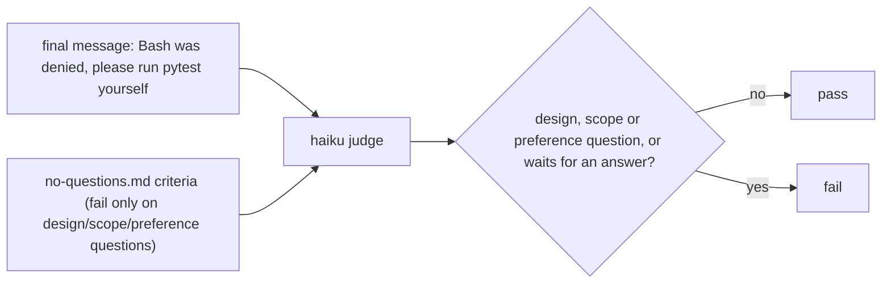
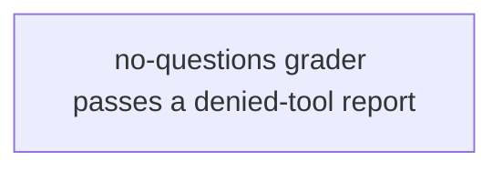

# Superlite: the no-questions judge passes a denied-tool report (B83)

**Goal:** fix #414: the `ai-bounded-quiet` no-questions LLM judge (haiku) failed 2 of 4 runs whose final message asks nothing, because it read "Bash was denied, please run pytest yourself" as a question. Expected: the grader passes a report of an unrun test command.
**Architecture:** one grader file. Its `criteria` turns from "asks no question ... is not a question" into the fail-only framing that hardened `evals/ai-asks-once/graders/one-batch.md`: fail only on a design, scope or preference question or an explicit wait for an answer; a fixed list of things that never count, the issue's message quoted. The body repeats the exemption in one sentence. A new test file pins the text.
**Tech stack:** YAML frontmatter read by `claude plugin eval`; pytest (through `sl run_tests`).
**Spec:** this file, section Design; issue #414's Expected line.
**Detail:** tests
**Target-min:** 11
**Wave0:** none

Global constraints:
- The `criteria` value stays one line and a YAML plain scalar: no `: ` and no ` #` inside, no leading quote or indicator character.
- Touch only the files in Owns. `tests/scripts/test_evals_suite.py`, `evals/ai-bounded-quiet/case.yaml` and every other eval file stay unchanged (outside B83's files).
- No version edits (the ship step bumps the version).
- Run `sl` as an executable (`<abs>/sl ...`). Verify with `<abs>/sl run_tests --fast tests/scripts/test_evals_no_questions_414.py tests/scripts/test_evals_suite.py --task T1 --background`, then its `wait:` line in the foreground.

Ruling: fix the grader, not the case (because the brief allows only `evals/ai-bounded-quiet/graders/no-questions.md`; the issue accepts either) - cost if wrong: a later batch states the denied path in the case too.
Ruling: the guard test is a new file `tests/scripts/test_evals_no_questions_414.py` (because `tests/scripts/test_evals_suite.py` may belong to another lead; a file that did not exist cannot collide) - cost if wrong: one more test file next to the suite test.
Ruling: one mechanical task (one grader edit plus a verbatim test file), detail tests, no probe adapter (grader text, no runnable entry) - cost if wrong: none.
LAYERS: unit, evals



## Design

1. `evals/ai-bounded-quiet/graders/no-questions.md` frontmatter becomes exactly two lines, `type: llm` and this `criteria` line:
   `criteria: Fail only when the final message asks the user to decide a design, scope or preference item, or says it waits for the user's answer before making the change; pass otherwise, zero questions included. Never count as a question Ruling lines, stated assumptions, a report that a tool, command or permission was denied, a request that the user run a command or test by hand (Bash was denied, please run pytest yourself), a request to enable or allow a denied tool, a list of checks not run, or an offer of an optional follow-up.`
2. Its body (after the closing `---` and one blank line) becomes this one paragraph:
   `A bounded, fully specified request in AI mode gets rulings, not questions. A report that Bash or a test command was denied, with a request to run it by hand, is a status report, not a question.`

## Coverage

| Category | State | Basis |
|---|---|---|
| Scope and success criteria | settled | #414 Expected line |
| Domain and data model | n/a | grader text only |
| Persistence and migration | n/a | no stored data |
| Interfaces and contracts | settled | grader frontmatter keys `type`, `criteria` unchanged |
| UI states | n/a | no UI |
| Concurrency and state ownership | n/a | no state |
| Error handling and recovery | n/a | no code path |
| Security and privacy | n/a | eval text |
| Performance and limits | n/a | one judge call per run, as before |
| Observability | settled | eval result JSON names the failing grader |
| Testing strategy | ruled | new test file pins the text; evals layer runs the case |
| Compatibility | ruled | YAML plain scalar rules (Global constraints) |
| Rollout | ruled | one PR; version bump at ship |
| Research unknowns | n/a | judge behaviour checked by the coordinator after the build |

## File structure
- `evals/ai-bounded-quiet/graders/no-questions.md`: the judge criteria and body (T1).
- `tests/scripts/test_evals_no_questions_414.py`: pins the criteria and body text (T1).

## Task graph

```mermaid
%% schedule
gantt
  title Predicted schedule (mm:ss)
  dateFormat X
  axisFormat %M:%S
  section lane 1
  T1 no-questions grader passes a denied-t :t1, 0, 66s
```




critical path: T1 (1.1 min) · peak width 1 · predicted build 1.1 min · predicted total ≈ 4.6 min (target ✓)

## Package: eval graders (grader text)
App type: file I/O / generator (a grader file read by `claude plugin eval`). Categories: encoding (YAML plain scalar), file (frontmatter shape).
**Probe entry:** none (grader text, no runnable entry; its cases are named tests in T1).

### T1 no-questions grader passes a denied-tool report · Complexity 1 · Est. context 24k
**Owns:** evals/ai-bounded-quiet/graders/no-questions.md, tests/scripts/test_evals_no_questions_414.py
**Components:** 1
**LOC owned:** 50
**Tests:** fast
**Kind:** mechanical
**Model:** haiku
**Est. time:** 1.5 min (1 component, about 50 LOC, fast tests)
**Covers:** 1, 2
**Consumes:** none
**Produces:** evals/ai-bounded-quiet/graders/no-questions.md (frontmatter `type: llm` and the criteria line of Design 1; body of Design 2)
**Review Focus:** encoding: `test_criteria_is_a_safe_yaml_plain_scalar`; file: `test_type_and_one_line_criteria`
**Test code (verbatim):**
```python
"""#414: the ai-bounded-quiet no-questions judge passes a final message that reports a denied test command."""
from __future__ import annotations

from pathlib import Path

GRADER = Path(__file__).resolve().parents[2] / "evals" / "ai-bounded-quiet" / "graders" / "no-questions.md"


def split():
    text = GRADER.read_text()
    assert text.startswith("---\n")
    _, head, body = text.split("---\n", 2)
    fm = {}
    for line in head.splitlines():
        key, _, value = line.partition(":")
        fm[key.strip()] = value.strip()
    return head, fm, body


def test_type_and_one_line_criteria():
    head, fm, _ = split()
    assert fm["type"] == "llm"
    assert set(fm) == {"type", "criteria"}
    assert len(head.splitlines()) == 2


def test_criteria_fail_only_on_design_scope_or_preference_questions():
    criteria = split()[1]["criteria"]
    for need in ("Fail only when", "design, scope or preference", "waits for the user's answer",
                 "zero questions included"):
        assert need in criteria, need


def test_criteria_never_counts_a_denied_test_command_report():
    criteria = split()[1]["criteria"]
    for need in ("Ruling lines", "a tool, command or permission was denied", "run a command or test by hand",
                 "Bash was denied, please run pytest yourself", "enable or allow a denied tool",
                 "checks not run", "optional follow-up"):
        assert need in criteria, need


def test_criteria_is_a_safe_yaml_plain_scalar():
    criteria = split()[1]["criteria"]
    assert ": " not in criteria and " #" not in criteria
    assert criteria[0] not in "\"'&*!|>%@`{[#-?:,"
    assert not criteria.endswith(":")


def test_body_names_the_denied_command_report():
    body = split()[2]
    assert "rulings, not questions" in body
    assert "run it by hand" in body and "not a question" in body
```
**Steps:** 1 write the test file, 2 run: FAIL (`Red run:` line), 3 write the grader exactly as Design 1 and 2, 4 run: PASS (the new file and `tests/scripts/test_evals_suite.py`)
**Notes:** copy the criteria and body text from Design 1 and 2 character for character; the frontmatter keeps the order `type`, then `criteria`.

## Review Focus
Package eval graders: encoding (the criteria must stay a YAML plain scalar that `claude plugin eval` parses), file (frontmatter has exactly `type` and `criteria`). Cases are in T1.

## Self-review
Coverage: Design 1 and 2 map to T1. No placeholders. No Consumes. One task, no edges. Fields filled. Probe entry none with reason. Plan under the char cap.
